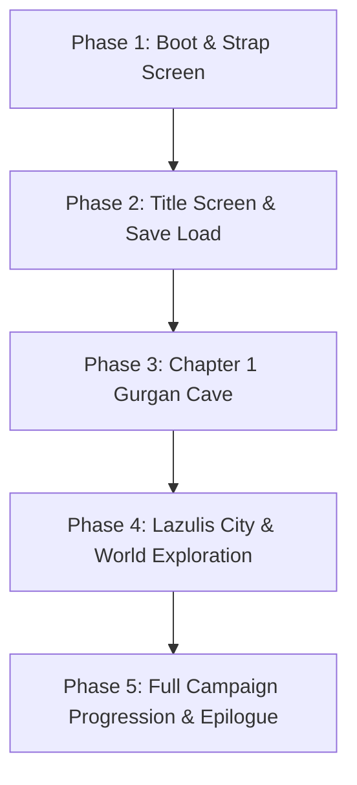

# Master Game Lifecycle Execution Plan

## Purpose
Guide the progressive verification and implementation of the recompiled Wii game engine across all operational phases:
1. Boot & Strap Screen
2. Title Screen & Menus (New Game / Save Management / Options)
3. Chapter 1: Gurgan Cave (Combat mechanics, particle effects, 3D meshes, enemy AI)
4. Chapter 2–44: Full Campaign (Lazulis City, Arena, Dungeons, Bosses, Cutscenes, Epilogue)

---

## Core Planning Directives

### 1. Unified Engine Observability First
Before attempting to fix a symptom in any chapter or scene:
* Check the **Sequence Manager** (`0x8087EE90`) and **Task Manager** (`0x8087EE94`).
* Check the **Resource Loader Queue** (`lbl_8087F510`).
* Check the **Input State** (`PadManager` / `WPAD`).
* Check the **Graphics Backend** (batches, textures, blend modes).
* NEVER use synthetic state overrides to jump ahead. If a task isn't advancing, determine what resource or event it is waiting for and provide it cleanly.

### 2. Systematic Phase Roadmap

#### Phase 1: Boot & Strap Screen
- **Milestones**:
  - RVL-SDK OS boot, memory arenas (MEM1 24MB, MEM2 64MB), threading, and interrupt controllers initialized.
  - Strap screen asset (`strapA_en.texture`) loaded and presented cleanly.
  - Clean dismissal via either timeout or user confirmation ('A' button).
  - Transition to Title Sequence without lingering XFB cache artifacts.

#### Phase 2: Title Screen & Save Management
- **Milestones**:
  - Title assets (`title00.pk` - `title08.pk`, `titlle_white.map`, `radial.texture`) loaded.
  - 3D cave background model and camera animations rendered at 60 FPS.
  - 2D Title Logo, "Press Any Button" prompt, and Menu items (New Game, Load Game, Options) rendered with pixel-perfect alpha testing (no black/white boxes).
  - User input smoothly navigates menus.
  - Save file creation and loading (`savedata/savedata.dat`, 1.35MB) validated.

#### Phase 3: Chapter 1 Gurgan Cave & Combat System
- **Milestones**:
  - Map loading (`game_start_dg.pk`, `change_dg.pk`).
  - Player character model (Zael), companions, and enemy beasts loaded with skeletal animations and skinning matrices.
  - Real-time combat system: sword slashes, cover system, crossbow aiming, command mode, magic circles.
  - Shader pipeline: normal mapping, specular highlights, point lights, radial blur, depth of field.
  - Audio: dynamic battle music switching, sound effects, voice lines.

#### Phase 4: Lazulis City & World Exploration
- **Milestones**:
  - Large-scale city rendering (`na000_00_town.pk`, `na000_00.pk`).
  - Dynamic crowd AI, NPC interactions, dialogue textboxes, mini-map, compass HUD.
  - Shop system, weapon upgrade, tavern events, stealth mechanics.

#### Phase 5: Full Campaign Progression & Epilogue
- **Milestones**:
  - Event script VM (`LastWorld.sel`, script coroutines, event triggers).
  - Movie streaming (`orig/DATA/files/movie/*.thp`).
  - All 44 chapters playable end-to-end with persistent saves.

---

## Completion Criteria Checklist
- [ ] Zero unhandled CPU exceptions or guest aborts.
- [ ] Zero thread queue corruption warnings (`Resetting invalid queue head`).
- [ ] Zero linear console spam in loops.
- [ ] 60.0 FPS locked presentation in Direct3D 11 / Direct3D 12.
- [ ] 100% natural progression with standard controller / keyboard input.
