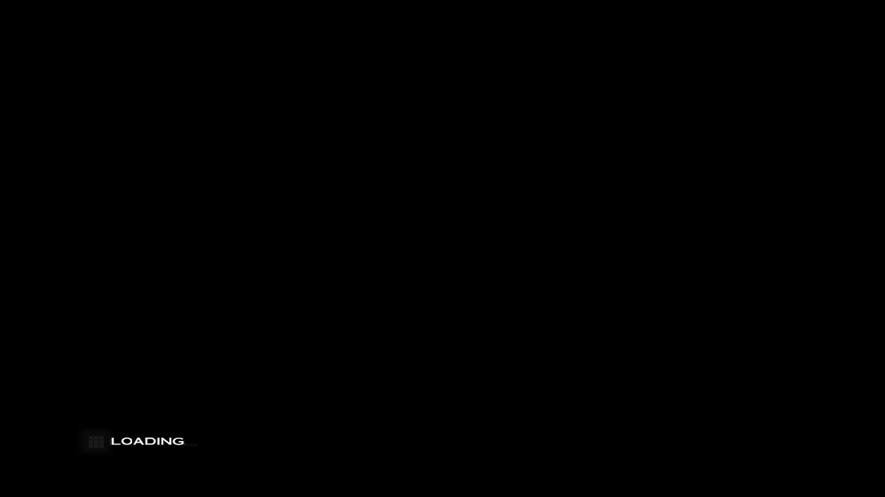

# DeepSeek Harness Handover Dossier: Project The Maybe(Not) Last Story

## NEXT SESSION — START HERE

> **§5c.46 AP-BM (the last section) FALSIFIES AP-BL AS THE CAUSE OF THE COMPOSITE DIFFERENCE, with an A/B.** The
> keying was implemented exactly as AP-BL prescribed (patch `0007-copy-texture-key.patch`) and the exit-criterion
> replay is **byte-identical** to the pre-fix binary (`7E79ACE9…`, luma 86.98 / gradient 20.889 both times), because
> on this stream no quad samples a copy destination at a size other than the newest write's: the new
> `TLS_AURORA_COPYLOG` counts **15 copy-destination binds** on the composite frame (the frame samples 225 textures in total, the other
> 210 are ordinary), 14 exact, 1 format-only fallback
> and 1 `stale-at-address`, and that one is a *format* mismatch (`0x90536FE0` bound fmt 3 over its fmt-11 copy). The
> divergence is one layer down: a new mid-frame probe (`--probe-at-cmd`) shows aurora after draw 5 809 is **exactly
> the cmd-21-669 state again (56.68 / 13.190)** - it repaints the saved 640x448 copy - while the layer's own copy
> dumps of the same frame end at **56.02 / 0.675** (a full-screen blur at the same level). Copies, sample sizes,
> identity (AP-BK) and the layer's upload freshness (this session: three `upload=1` uploads with distinct hashes) are
> all excluded, so what is left is the composition of draws 5 807/5 808/5 809. **Do not chase 43.16 / 1.123 blind**:
> measure those three passes on the layer with `TLS_BATCH_DUMP_GUEST=2801` **and the gate's `TLS_INPUT_SCRIPT`** -
> the first attempt at that this session ran without the script and measured a tutorial page instead of the cave
> (one run lost, recorded in AP-BM item 6).
>
> **FIRST ACTION, BEFORE ANY MEASUREMENT: re-verify the gate on an IDLE host** —
> `pwsh tools/invariant.ps1 -Log logs_ap\gate.log`. **PASS on attempt 1 means handover frame 1680,
> content `B4646917…`, popup `22B1CE31…`, save 1 348 992 / 29 344.** If the handover frame is not 1680 the
> host is loaded and the run is not evidence. Last state written at `a828a29` on `main`: 21 commits this
> session, build green (472 objects), gate green (`logs_ap/gate_apbc2.log`), `src/` untouched by Track B.
>
> **READ §5c.46 AP-BH (near the end of this file) FIRST — it is the fix the whole "aurora content gap"
> saga was looking for.** The live aurora path was mapping a **SNAPSHOT** of guest memory: `map_guest_region()`
> memcpys the planes into a section once, when the path arms, so every texture the guest writes afterwards was
> invisible. Measured with the new `TLS_AURORA_TEX_BYTES=<n>` probe: ten of ten texobjs printed `nz=0/64` at
> addresses that the layer rendered as a bright cave. `resync_guest_planes()` now re-copies MEM1/MEM2 before
> each fed frame (`TLS_AURORA_NO_RESYNC=1` restores the old behaviour), and the bytes read `nz=64/64` with real
> CMPR data. The title control is unchanged (205.62 -> 205.69), so the fix does not disturb what worked. The
> harness is unaffected by design — a recorded capture *is* a snapshot — so AP-AY's 1.5 % equality pair stands.
>
> **THEN READ §5c.46 AP-BI (the last section): THE CONTENT GAP HAD A SECOND ROOT CAUSE — A TRUNCATED FEED.**
> The aurora tap was called from `gx_pipeline_feed_byte`, but the layer's fast FIFO path parses display lists
> **inline** and never calls it, so the geometry was not in the stream: the same guest frame fed **203 draws /
> 655 116 B** without the recorder armed and **28 372 draws / 1 890 604 B** with it (title: 106 vs 313). With
> `gx_pipeline_feed_bytes` taking the slow path when either instrument is armed, the live path renders the
> Gurgan Cave — readbacks `(94.44,104.23,87.67) … (94.37,104.16,87.66)`, luma ~99 — and **AP-BF's "the TEV's
> texture argument is the problem" is falsified**: the TEV was never reached with that geometry. AP-BI also
> builds the alignment matrix AP-BD asked for (8 layer shots x 4 aurora readbacks in one launch, new
> `TLS_AURORA_SHOTS` + per-shot readback keys, `tools/aurora_spike/align_matrix.py`): it is **column-flat**
> (the layer's adjacent frames spread 41-44, aurora's 6-11, and no offset brings them together), because the
> layer alternates a sharp geometry half with a blurred composite half. P1's *valid* form now has a number: a
> same-run field capture replayed by the harness matches the layer's shot of the same frame to **7.66 mean |d|
> (31.9 % > 8)** while the other half is 45-46 — and the harness feeds **per guest frame** where the live path
> still accumulates the pair into one aurora frame, which is the next change to make (the live path measures
> 63-66 against the same layer shots).
>
> **§5c.46 AP-BD is now answered by AP-BI's matrix**, and its "read a live-vs-layer number and you are reading
> the half-frame" warning still holds for every comparison that is not a same-run, same-frame pair:
>
> **THE COMPOSITE HALF IS WHERE THE REMAINING DIFFERENCE IS, AND AP-BK HAS NOW EXCLUDED THE COPIES (read it before
> touching the tail).** The tail is 16 copies on frame 2801 (640x448 -> 320x224 -> 160x112 -> 80x56 -> 40x28 -> the
> XFB display copy); the layer's per-copy means and aurora's readback of two of those copies agree to **+5.0 % /
> -13.5 %** (106.0/74.75 against 111.34/64.67 mean byte), and the sizes the quads sample are passed faithfully
> (`TLS_AURORA_TEXBIND`, new). Texture identity is falsified **properly**: `TLS_AURORA_TEXOBJID=1` leaves the
> **AP-BL IS THE CAUSE OF THE COMPOSITE DIFFERENCE, AND IT IS IN TWO LINES OF AURORA.** A drawn texture bound at a
> copy destination resolves through `g_gxState.copyTextures` (`lib/gx/texture.cpp:842-857`), and that map is keyed by
> the **destination pointer alone** (`lib/gx/gx.hpp:413`; replaced on every write at `GXFrameBuffer.cpp:45`). The
> composite tail writes `0x9038D1C0` as 80x56 four times and then as 320x224 **inside one frame**, so the address can
> only name one of those copies at a time: measured, the 80x56 copy's content (mean byte 69.75) is not what the
> address carries (119.46, the 320x224 copy's 113.25), while a single-size control address agrees on all three sides
> (113.76 / 106.0 / 111.34). The fix is to key that map by **(destination, width, height, format)** and match on the
> bound texobj, so one change fixes both the live path and the harness. Exit criterion, already measured: the
> composite probe copy's gradient must fall from **20.889** towards the layer's **1.123**, with the geometry frames'
> 6.20-7.59 diagonal unchanged. It needs a patch file in `tools/aurora_spike/patches/`, a fork rebuild and the live
> path re-validated - that is the next session's whole job.
>
> composite frame identical to the last digit (luma 86.98, gradient 20.889 both ways) on a replay of 113 525 draws,
> where AP-BG's original test ran on a truncated feed of 203. What is left is aurora-side: the odd frame draws
> **5 819** primitives against the geometry frame's 22 553, and aurora logs **`STUB: display copy is not
> implemented`** for the XFB display copies the guest uses to put the composite on screen. Start there.
>
> **THE FEED MODEL IS FIXED (AP-BJ): READ IT BEFORE ANY FURTHER LIVE MEASUREMENT.** AP-BC's accumulate rule is
> gone as a default — `gx_pipeline_end_frame` now takes a three-valued boundary (1 = present with an XFB copy,
> 2 = present without one, 0 = flush) and the aurora feed closes on **every present**, i.e. one aurora frame per
> guest frame, which is what the harness does with a recorded capture. Measured in one launch: the four geometry
> frames of the window match the layer **on the diagonal at 6.20-7.59 mean |d|** (it was 63-66), the same order
> as the harness's 7.66; the four composite frames are the remaining difference (aurora luma 87-99 against the
> layer's 39-43, and their best match is a *geometry* frame at 40.1-40.5). `TLS_AURORA_LEGACY_FEED=1` restores
> the accumulate model for an A/B. Gate PASS attempt 1 after the change (`logs_ap/gate_bj.log`).
>
> **PRIORITY ORDER for the next session.** (1) gate on an idle host, **with nothing else running** (AP-BI's
> row 1 is a launch that was not evidence because a capture census ran beside it); (2) characterise the
> **composite half** — the odd frames, where the EFB downscale/upscale tail plus the subtitle makes aurora
> 2.1-2.4x brighter than the layer; the instruments are the 8x8 matrix (`tools/aurora_spike/align_matrix.py`)
> and a harness replay of a same-run capture; (3) P1's equality on a fresh **same-run capture**
> (`--probe-copy`), then (4) P4. Two cheap checks exist and are worth using before any 2 810-frame run: the
> title window (440..452, 460 frames, 30 s) for the readback path, and `tools/aurora_spike/capinfo.py` on a
> capture for its per-frame FIFO sizes (the field alternates 0.79 MB and 1.06 MB frames).
> `TLS_AURORA_FROM/TO` are **guest-keyed** (guest 2800 = present 2864, the documented 64 offset) and a feed is
> one whole guest frame.
>
> **WORKING IN PARALLEL WITH TRACK A? READ `CONTRIBUTING_TRACKS.md`.** Track A works in its **own clone**
> (`G:\Program\TrueEnding-TrackA`, branch `track-a`); read it only through `git grep … origin/track-a`, never
> from this working tree. Reviews of its batches live in `docs/TRACK_A_REVIEW.md` (five rounds so far), its work
> order in `docs/TRACK_A_HANDOFF.md`, and its log in `docs/TRACK_A_LOG.md`. The measured asymmetry stands:
> Track A cannot change this port's behaviour (the runner links no `src/` object), so its value is **names** —
> which `recomp/tls_sym.c` now consumes, every probe prints `name+0xOFFSET` — plus readable C for a few functions.
>
> **READ §5c.46 AP-AZ for priority B's split** (the title plate is the layer's `frame = 255 x mask.a`, and
> aurora measures 205.62 / 220 / 131.1 against Dolphin's 203.98 / 193.7 / 127.7 where the layer is
> 90.43 / 255 / 0 — so the plate is retired by the migration, not fixed in the layer).
> (1) **Priority B is split, and the answer is neither "copy content" nor "sampling".** The 80x56
> EFB-copy buffer `0x9038D1C0` that b18 upscales is **flat opaque white** when b18 samples it
> (`TLS_EFB_CHAIN_GUEST=900`: copies #15/#16 `dstavg=(255,255,255) dstalpha=255`; `TLS_TEX_CACHE_LOG`
> bind mean `(255,255,255,255)`, a cache hit from frame 410) — and the *other* texture in that
> two-stage draw, the guest's 64x64 **IA8 mask `0x9051E1A0`**, decodes **bit-exactly** against
> Dolphin's own dump `tex1_64x64_e6053facb03e8a53_3.png` (layer 90/90/90/a=90 vs Dolphin mean
> 90.67, same row-32 ramp, radial 255->9). The arithmetic then closes: `st0` multiplies the white
> copy by `K0.rgb = (0,0,0)` -> black, `st1` alpha = `K0.a*(1-mask.a)` = `1-mask.a`, blend
> SRCALPHA/INVSRCALPHA over the white plate -> **frame = 255 x mask.a**, predicted 90.68 against a
> measured **90.43**, centre 255 vs 254.5, corner 9 vs 0. **The title plate IS the guest's mask at
> full strength**; Dolphin's is 203.98 with a weak vignette, so the remaining defect is the
> composite's TEV arithmetic (Aurora's class), with an exact model and a per-ring target.
> **Detail, if a section must be read out of order:**
> (1) **Priority B is split, and the answer is neither "copy content" nor "sampling".** The 80x56
> EFB-copy buffer `0x9038D1C0` that b18 upscales is **flat opaque white** when b18 samples it
> (`TLS_EFB_CHAIN_GUEST=900`: copies #15/#16 `dstavg=(255,255,255) dstalpha=255`; `TLS_TEX_CACHE_LOG`
> bind mean `(255,255,255,255)`, a cache hit from frame 410) — and the *other* texture in that
> two-stage draw, the guest's 64x64 **IA8 mask `0x9051E1A0`**, decodes **bit-exactly** against
> Dolphin's own dump `tex1_64x64_e6053facb03e8a53_3.png` (layer 90/90/90/a=90 vs Dolphin mean
> 90.67, same row-32 ramp, radial 255->9). The arithmetic then closes: `st0` multiplies the white
> copy by `K0.rgb = (0,0,0)` -> black, `st1` alpha = `K0.a*(1-mask.a)` = `1-mask.a`, blend
> SRCALPHA/INVSRCALPHA over the white plate -> **frame = 255 x mask.a**, predicted 90.68 against a
> measured **90.43**, centre 255 vs 254.5, corner 9 vs 0. **The title plate IS the guest's mask at
> full strength**; Dolphin's is 203.98 with a weak vignette, so the remaining defect is the
> composite's TEV arithmetic (Aurora's class), with an exact model and a per-ring target.
> (2) **The "black cave" of P1 was the live feed ending on a copy-only PRESENT, not depth — and the
> counter question was later corrected: the counters agree** (guest 2800 = present 2864), the two-half
> gate simply renders one guest frame across two presents, and the feed now closes only at the guest's
> own display boundary (an XFB copy), so a feed is one whole guest frame. `TLS_AURORA_TEST_NO_DEPTH=1`
> changed nothing; the depth hypothesis is withdrawn. **What replaced it is AP-BD**: the layer's
> guest-2800 shot is the geometry half (cave, 35.64) and aurora's readback is the composite half
> (subtitle), so a live-vs-layer number is reading the half-frame until the alignment matrix is built.
> **Also fixed, and it invalidates earlier reasoning: the `[tev]` probe's ALPHA decode was wrong by
> one nibble** (it read bits 9/6/3/0; Dolphin's `TevStageCombiner::AlphaCombiner` puts rswap/tswap
> at 0-3 so the arguments are at 13/10/7/4, which is what the pixel shader always used). AP-AV
> addendum 4's "the glow chain's alpha dests are c1,c1,c1" was read off that decoder and is wrong.
>
> **READ §5c.46 AP-AT (the last section of this file) FIRST: THE RED ROCK IS FIXED, AND IT WAS
> NEVER THE TEV CHAIN.** AP-AT ran both discriminators AP-AS named and **falsified both** (the
> uniform the GPU receives equals the probe's decode field for field; `TevRegular` against
> Dolphin's `WriteTevRegular` differs only by fixed-point rounding, per channel, so it cannot make
> a hue) and then found the actual cause in the one stage nobody had instrumented: the **texture
> upload path**. The CMPR "glow" baseline compensation rewrites the uploaded texels with
> `out_r = 217..255` while G/B ramp from the baseline, so every texel it touches is red-dominant by
> construction - and it was firing on the cave's **256x256 rock atlas `0x91EBC460`**, turning its
> grey decode (88.54, 85.39, 76.40) into **(169.76, 80.21, 75.02) with 75.16 % red texels**. It is
> now restricted to the sprite size class it was built for (`<= 64x64`; `TLS_GLOW_ALL=1` restores
> the old picture exactly): guest 2800 red-dominant **18.60 % -> 0.00 %** against **aurora's
> 0.00 %** on the same capture (`docs/evidence/at_pair_g2800.png`), mean RGB
> (60.07,45.10,49.14) -> (42.35,46.45,49.53), luma 50.04 -> 45.58. **Both gate references were
> re-recorded deliberately on two independent runs each** (guest 2800 `5BB1538F…`, guest 3500
> `77BF4AB2…`) and the gate **PASSes attempt 1 three times**; handover 1680 and the save
> (1 348 992 / 29 344 B) are unchanged. Two new instruments matter for everything after this:
> `TLS_TEX_DUMP_FINAL=<addr>` dumps the staging buffer **after** the compensation (the old
> `TLS_TEX_DUMP` writes it **before**, which is why three sessions saw a grey atlas and a red
> render), and `TLS_TEV_UNIFORM=<batch>[,<frame>]` prints the **filled `GxTevConstants`** rather
> than the snapshot decode. AP-AT also **falsifies AP-AQ item 22 / AP-AR §7's "guest
> 400/900/1200/1600 are all luma 90.43"**: only 900 is (the vignette); 400/1200/1600 measure
> 39.89 / 16.12 / 1.22 with 0.00 % above 250 - and the sprite compensation is **not** the
> vignette's cause (`TLS_NO_GLOW=1` leaves frame 900 essentially unchanged - luma 90.43 and
> 8.28 % above 250 either way, 76 327 vs 76 329 pixels above 250), and **AP-AV then localised B to
> a single batch**: `TLS_BATCH_DUMP=900` writes one BMP per batch, and the contact sheet
> (`docs/evidence/at_title_batch_sheet.png`) shows b0..b13 flat 220, b14..b17 flat 255, and **b18
> alone** turning the frame into centre 254.5 / corner 0.0 (luma 90.71) with everything after it
> unchanged. b18 is a 6-vertex full-screen quad on **`0x9038D1C0`, the 80x56 RGBA8 EFB-copy buffer**,
> `s=4 d=5` - so the plate is that buffer's *content* upscaled, which is why the layer is 255/0
> where Dolphin is **219/175** (5c.23 §5) - and AP-AV addendum 3 finds the **Dolphin frame of this exact
> screen** in Dump\Frames (320..1280 are the settled plate: mean 203.98, centre 193.7, corner 127.7,
> radial 180.9 -> 219.8 -> 201.1), so the plate and the vignette are the same composition with both
> strengths wrong, and there is a per-ring target to fix against (docs/evidence/at_title_ref_pair.png).
> B's next step is therefore **not** another batch bisect: it
> is to decode that buffer at b18's command out of a title capture and split "the copy content is
> wrong" from "the sampling is wrong" (`docs/evidence/at_menu_frames_400_900_1600.png`).

> **FIRST ACTION OF THE SESSION, BEFORE ANY MEASUREMENT: re-verify the gate on an IDLE host.**
> `gate11` passed attempt 1 at **handover 1680**; `gate12`/`gate13` failed with the handover frame
> drifting **660 / 780 / 900 / 960 / 1080** while a 3D game held the GPU (the runner went 20 -> 30 ms
> per frame). The handover frame is a **host-load fingerprint**: if it is not 1680, the host is
> loaded and the run is not evidence (`AP-AY` section 11). Then read **AP-AY** (the migration's
> phase P1: the boundary is proven, the cave frame renders black live, and double-rendering cannot
> be an equality test) and **5c.47** (P2-P4).

> **AP-AU (last section of this file) IS THE COORDINATE FIX, AND IT IS PROMOTED.** AP-AT item 11
> measured the lead - every TEV stage sampled **texcoord 0** (the uniform dump shows `st2` asking
> for `coord=1` and receiving `uvsrc=0`) and enabling the selection **halved** the remaining
> layer-vs-aurora difference - and left it unpromoted on purpose. AP-AU measured the menus, the
> popup band and the progression under it, made it the **default**, and re-recorded both gate
> references deliberately on two independent runs each: a TEV stage now samples the coordinate
> `TEVORDER` names, and a coordinate `GEN_MODE` does not define falls back to **coordinate 0**
> (Dolphin's documented quirk), not to texel (0,0). Numbers: mean |d| vs aurora at guest 2800
> **11.20 -> 4.83**, luma 45.58 -> 35.63 (aurora 37.00); popup luma 45.51 with 1.98 % above 250
> (band intact); **guest 900 - the vignette - keeps its level exactly** (luma 90.43, 8.28 % above 250 in
> every configuration, though the pixels move: `949D51EB…` -> `F7D0A0D9…`), so the title wash is NOT a texcoord
> problem and priority B stays with the mask alpha / EFB alpha / the batch; handover 1680 and save
> 1 348 992 / 29 344 unchanged. New references guest 2800 `B4646917…`, guest 3500 `22B1CE31…`,
> gate **PASS attempt 1 twice**, control `TLS_NO_TEV_TEXCOORD=1` reproduces `5BB1538F…` /
> `77BF4AB2…` exactly. Together with AP-AT's upload fix the pair at guest 2800 goes from
> mean |d| **19.81 / 71.13 %** to **4.83 / 37.26 %**. What it does NOT fix: the water is at
> aurora's *level* but not its *content* (still not rippled), 128x128 glow candidates keep the
> AP-AT residue, and `TLS_XF_TEXGEN`'s own `8`-vs-`0` fallback is a named follow-up.

> **READ §5c.46 AP-AS (the section before AP-AT)** for the back-buffer channel-order bug it fixed
> and the same-launch aurora pair that localised the rock to batch b48 - and note that its item 7
> claim "every input measured neutral, so the divergence is in the fragment evaluation" is the
> reasoning AP-AT overturns: the inputs *were* neutral, in guest memory and in the uniform; the
> **uploaded** buffer was not.

> **READ §5c.46 AP-AS (the last section of this file) BEFORE USING ANY `[BatchProbe]` NUMBER FROM AN EARLIER
> SECTION.** The batch/rect back-buffer probes and the `TLS_EFB_SAMPLE_FRAME` readback had **R and B exchanged** -
> the swap chain is `R8G8B8A8` and they read byte 0 as blue. Measured from one launch where the shot and the probe are
> of the same frame: probe `avg=(49,45,61)` vs a screenshot of (60.07, 45.10, 49.14); exchanging the probe's R and B
> gives (61,45,49). Fixed in `recomp/gfx_d3d11.c` and **verified**: the same probe now prints `avg=(61,45,49)` and
> `red=725/3600` = 20.1 % against the picture's 18.60 %. So every `avg=(r,g,b)` in `[BatchProbe]`/`[BatchRect]`
> before AP-AS is **(B,G,R)** and every `red=` counted **blue**; the per-batch *deltas* (which batch moved the frame,
> by how much) survive, the red/blue *names* in AP-AI..AP-AR do not. AP-AS also carries the priority-C result: on one
> launch at guest 2800 the layer is (60.07,45.10,49.14) with 18.60 % red-dominant and aurora is (36.10,37.42,37.18)
> with **0.00 %** - so the **red rock is layer-only** and starts at batch **b48 / texture `0x91EBC460`** (11 892
> vertices, red 75 -> 799), whose **atlas decodes neutral grey** (62.1,63.0,61.4; 0.15 % red texels), i.e. the red is
> the layer's per-fragment shading of a grey texel (CMPR decode or the batch's 3-stage TEV chain). The **black area
> is in aurora too** (the two 8x8 black maps agree cell for cell), so it is in the stream and is **not** a layer
> defect - `AP-AR §7` is corrected there. Exact next experiment: `TLS_TEX_DUMP=0x91EBC460` **without**
> `TLS_TEX_DUMP_FRAME` (the frame-gated form dumps no file at all, because the atlas is cached before 2800).
> **Then read §5c.46 AP-AR** (done, promoted - its "the switches are default-off" is history) and **AP-AQ** (the
> cause of the one promotion AP-AR made).

> **READ §5c.46 AP-AR (the section before AP-AS) - it changes the default build.** The two AP-AQ
> renderer fixes are now the **defaults**: the guest's `BP 0x20/0x21` scissor is applied and guest-disabled blends
> are no longer promoted to adds (`TLS_NO_SCISSOR=1` / `TLS_FORCE_BLEND=1` restore the old picture). Both gate
> references were re-recorded deliberately on **two independent runs each** and the gate now PASSes, attempt 1,
> three times: guest 2800 `8938E36934002EC6B4840B3B9823538521C78D055F23E7C3C8CBAABCA7305DD7` (luma 50.04) and
> guest 3500 `F97A586365100E36814A51C63CA0F701FECBCD1D7650CF4A5CB7E3B6CA806293` (luma 48.17, `>250` 2.02 %).
> `$POPUP_LUMA_MIN = 200` is gone by construction and is replaced by a non-saturation bound (luma < 150, bright
> fraction in 0.5..10 %) - the tutorial band's white text is now the swap guard. A control run with the escape
> hatches returns the superseded `6465ACEF…` / `C5535C7D…` exactly, so the old references are reproducible rather
> than lost. **AP-AR also answers item B**: the two 24-entry tables are the **NewCampPartsMapSelect** and
> **NewCampPartsTop** vtables (slot 9 of each holds a chain root), the third root is **GameOverTask**'s slot 2, the
> other two are `{fn, 0, -1}` records in a `GameEventScript` handler table - and **all four classes have 0 instances
> in a Chapter-1 capture's MEM1** (control: the system task's vtable, 1). So the chain is the game-over / camp-menu /
> event-script path and is **not** a Chapter-1 blocker; the task-creation dispatch (`fn_80207F80`) has no data-plane
> pointer at all and needs a runtime probe, not another scan. What remains open is priority C (menu vignette, red
> rock, black rectangle, the corner chain's TEV content - all Aurora's territory) and priority D (the migration).
>
> **READ §5c.46 AP-AQ (the section before AP-AR) for the cause** - and note that everything in it that says "the
> switches are default-off" or "not promoted" is now **history**: AP-AR promoted them.

> **READ §5c.46 AP-AQ (the last section of this file) FIRST, then the §5c.46 AP-AP addendum correction note.**
> AP-AQ overturns the AP-AP addendum's causal claim, and the reason is an **instrument**: `TLS_SCISSOR=1` could
> never clip anything, because D3D11 ignores `RSSetScissorRects` unless the bound rasterizer state has
> `ScissorEnable = TRUE` and the backend's only rasterizer state is `D3D11_RASTERIZER_DESC rdesc = {0}`. With a
> second state (`rs_scissor`) bound, the *same* guest frame 3300 that AP-AP's addendum measured as
> "byte-identical" MOVES: the eight corner draws' effect on the back buffer collapses from **+162 / +95 / +107** to
> **≤ 2 units** and batch b118 goes **(255,255,255) → (95,97,92)** on an identical pre-tail frame (b113 =
> (93,95,90) in both runs). The second, independent defect is that `gfx_d3d11.c` **promotes `dst_factor == 1/5/7`
> to "blend on" even when the guest's CMODE0 bit 0 says REPLACE**; three of the tail's ten draws are in that class
> (b117, b118, b121), and b118 alone takes the frame from (188,200,187) to **(255,255,255)** where a replace would
> have written the sampled texture's own (174,183,172). **With both corrected** (`TLS_SCISSOR=1
> TLS_NO_FORCE_BLEND=1`) guest 3300 renders the **Gurgan Cave with the tutorial popup on it**, luma
> **142.29 → 36.58**, `>250` **0.06 % → 0.00 %** (the gate's own content frame at 2800 is luma 33.3, so the fixed
> frame is in the correct band); the copies AP-AP's addendum blamed are **downstream** of both defects (copy
> `49969` runs **6 vertices after** b118 and faithfully copies the 255 the host had just written).
> **Neither switch is promoted** - both are default-off, so the gate still PASSes at both recorded references
> (`C5535C7D`, `6465ACEF`, attempt 1 on the rebuilt binary). Promoting them moves *both* gate references and costs
> two re-records; the exact recipe is AP-AQ item 7. What remains after the fix is the **corner chain's own
> content** (the additive pass still adds ~85 mean where hardware's 80x56 copy is a median of 0.1 luma over
> 17 263 Dolphin dumps) - that is the GX-TEV class of defect Aurora fixes, bounded in AP-AQ item 8.
>
> **AP-AQ item 11 is a migration finding: aurora's EFB copies live as GPU-side shadow textures and never touch
> guest RAM.** `copy_tex` resolves a render texture keyed by the destination pointer and `resolve_sampled_textures`
> binds it when a draw samples a texobj with that `data` pointer; `evict_copy_texture` shows the lifetime. Measured
> both ways with a new poison control (`--ram-out <addr>:<size>:<file> --ram-poison`): after a replay that services
> the game's copy at cmd 50049, 0x905C3000 in RAM is **100 % 0xCD** (nothing wrote it, the harness's own probe
> copy included) - and poisoning 0x9038D1C0 to 0xCD leaves the **picture byte-identical** (probe copy 116.14 both
> ways), so the draws sample aurora's shadow copy, not RAM. So aurora's tail numbers stand as real measurements
> (its +0.8 % across the eight draws agrees with the Dolphin corpus: the guest's 80x56 copy is a dark corner
> glow), while the *hazard* is any guest code that reads a staging copy as raw memory. AP-AP item 6's "1.9x" is
> now **closed with the split**: payload-to-payload aurora's copy is **1.000x** (mean byte 103.18, RGB
> (53.08,54.07,50.56) for both the EFB at 50045 and the game's own copy at 50049) and the **1.78x** is the
> blit at 50127 that samples it - so the copy is not the defect and the sampling draw is (item 11).

> **THE FIELD IS INTERACTIVE - READ AP-AQ ITEMS 20/21 BEFORE ANYTHING ELSE ABOUT PRIORITY C.** The tutorial popup's
> prompt is **(B)**, and every input script this project has ever used presses **A only** - so the popup was never
> dismissed and the field was never actually asked to advance. Measured under the AP-AQ fix: one B press at frame
> 1900 takes `PHASE 8 -> 0` at **f=2063** (340 frames after entering phase 8) instead of **f=3265** (1242 frames),
> the "NEW TUTORIAL" band is **gone by guest 3800**, and holding direction buttons then **keeps the camera moving
> through the cave** - 3800->4200 changes **94.71 %** of pixels against **11.15 %** for the identical script minus
> the direction holds (`docs/evidence/aq_move_strip.png`). The script future field measurements must start from is
> in item 21. What this does **not** change: the entry chain (`0x8036F5D8`) is still never entered, the task graph is
> still slot-static, and the renderer fix is still default-off.

> **PRIORITY C IS NOW LOCALISED - read AP-AQ items 13, 15, 15a, 16, 17, 18 and 19 before touching the field.** The
> previous session's "the field is frozen" was the **renderer**: under the fix, guest 3800 vs 4400 changes **9.83 %**
> of pixels, and the game's own state machine **cycles phase 8 -> 0 at frame 3265** (`g2_3468` 0->1->0) while the
> `+0x5538` scene state stays 0 and `+0x54F0` stays `request=2`. The task graph is **slot-static** - one census line
> in 4 600 frames (count=3 at f=2020, unchanged to f=4599, slot hashes now watched too) - and `GameTask` runs every
> frame (1285 updates, first 2020, last 4599). The entry chain is cut at **five functions with no direct caller and
> no materialised pointer anywhere in the image**: they exist only as table slots (`0x8074F0E8`, `0x8074F5E0`,
> slot 2 of `0x8078A4C0`, and **slot 9 of the two 24-entry vtables `0x80793510` / `0x80793748`** - two sibling menu
> classes), and the consumer `fn_8036F268` is the code that writes `+0x5538 = 1` (at `+0x360`), i.e. the only
> state-1 writer. Input is **not** the defect: the guest's action evaluator receives the scripted presses at the
> popup (`frame=1900 action=17 hold=0x0800`, `frame=2200 action=4`). So the next question is **task creation** - the
> task-manager global is touched by exactly three instructions in the whole image, all in its constructor
> `fn_802189EC` (whose only caller `fn_80207F80` is table-dispatched too). Resolve those two tables first: the
> tables name the classes, and the classes name the missing event.

> **READ §5c.46 AP-AP AND ITS ADDENDUM** for the measurements AP-AQ builds on (and, in A1/A2, for the experiment
> that AP-AQ shows was inert). What still stands from AP-AP: the tail's structure, the copy register decode, the
> layer ladder (91.59 / 255.00 / 142.29), aurora's +0.8 % across the eight draws, the 83.23 %/78.65 pair and the
> field-state bound. What does not stand: "the scissor changes nothing" and "the copy content is the cause".
> **SUPERSEDED IN PART BY AP-AQ (above) - the AP-AP text that follows is kept because its *measurements* stand,
> and because the wrong experiment it contains is the lesson.** The white-out is **named**, and
> the first answer was wrong: it is **not** the layer's missing GX scissor, it is the **layer's EFB copy
> content**. Guest frame 3300's tail is a downscale/blur chain drawn into a 160x112 or 80x56 corner of the EFB
> under a scissor (8 of its 10 draws, **6.25 %** and **1.56 %** of the frame, each rectangle equal to the source
> rect of the copy beside it), and the layer implements no scissor at all - but applying the guest's scissor as
> a diagnostic (`TLS_SCISSOR=1`, added this session and proven to apply, addendum A1) changes the frame by
> **nothing**: `mean |d| 0.000`, `max |d| 0`, and with the popup cut it is still **255.00 / 100 % above luma
> 250**. What is white is the **copy destination**: read straight out of the capture's MEM2 plane,
> **0x9038D1C0 (80x56) and 0x905C3000 (640x448) are 100 % byte-255**, and those two are sampled by the
> **additive** fullscreen quad b120 and the **final opaque blit** b121 - while the corner-limited copies
> (0x90395DC0 mean 136.48, 0x903DBDC0 186.98, 0x903917C0 129.12) are not white. The guest's copy-clear colour
> is black (`BP 0x4F/0x50 = 0x00FF00/0x000000`), so the copy itself fills those buffers with 255. Next command:
> `TLS_EFB_COPY_PROBE=1` on a 3 400-frame run, against the four copies that write those two destinations
> (in-frame cmds **49640, 49864, 49969, 50049**). **Layer ladder** (guest-keyed shot at 3300, **two runs each,
> identical to the hundredth**): `TLS_BATCH_CUTOFF=114` **luma 91.59**, `=122` **255.00 with 100.00 % of pixels
> above 250**, full frame **142.29**. Aurora on the same stream moves **102.34 -> 103.18 mean byte (+0.8 %)**
> across the same eight draws; the same-launch pair is **83.23 % changed, mean |d| 78.65**, decomposed into the
> white-copy composite plus a **1.83x** baseline that exists before the tail (luma 91.59 vs 48.6).
> **Still open:** aurora is not a brightness reference either (its 640x448 EFB copy reads back **1.9x brighter**
> than the frame it copied: (49.54,50.47,47.19) at cmd 50045 -> (94.30,101.69,85.42) at 50127).
> **The field is bounded, measured:** 25 extra `A` presses through frame 4512 change nothing (guest 3300 /
> 3800 / 4400 are all pure white and **3800 is byte-identical to 4400**, mean |d| 0.000), and
> `TLS_ENTRY_PROBE=1` printed **0 lines in 4 600 frames** - so there is **no missing host-side wake event**:
> the guest never enters the chain that would consume one. Gate **PASS on attempt 1** at both references
> (`C5535C7D`, `6465ACEF`, handover 1680, luma 33.3, save 1348992 / 29344). Two instrument traps this session
> cost a run each: `TLS_BATCH_CUTOFF=''` means **0** (nothing drawn -> black PPMs), and `--max-cmds` is **per
> replayed frame**, not cumulative (`aurora_replay.cpp:653/658`).

> **READ §5c.46 AP-AO FIRST (the last section of this file) and then its ADDENDUM.** Three AP-AN items are
> closed and one is re-scoped. (1) **The camera divergence was the comparison, not the renderer**: the layer
> screenshot AP-AN used came from a *different run*, because a `TLS_SHOT_FRAMES` entry matches the **present**
> counter as well as the guest frame and they are 64 apart here. Same-run the pair is **21.48 mean |d| / 52.40 %**,
> cross-run it is 42.51 / 69.81 %, and a layer-vs-layer control across runs is **38.18 / 60.70 %** - so a
> cross-run pair cannot measure anything. The camera is also provably **static inside the captured window**
> (probe payload after a 1-frame and a 7-frame replay is **99.77 % byte-identical**, 2 676 of 1 146 880 bytes),
> and the same-frame NDC census (**addendum A1**) puts the two implementations' transforms in agreement: on
> guest frame 3300 the union **clip x is identical on both sides, x[-4473.26 .. 5349.33]**. What remains at the
> same frame is aurora's partially-drawn content (68.2 % zero texels), not a viewpoint. (2) **The XFB display copy
> decodes**: row-linear little-endian **RGB565 640x448** (573 440 = 640x448x2), neighbour correlation **0.864**
> vs 0.698 tiled and 0.607 byte-swapped; `tools/aurora_spike/tile2png.py --fmt linear565` reproduces it, and
> aurora does not implement display copies at all, so it is our presentation contract, not a migration item.
> (3) **The Chapter-1 gate is deterministic AND now content-anchored** (addendum A3/A4). It was previously
> shooting the **present** counter, not the guest frame (`TLS_SHOT_FRAMES=3500` = guest ~3436), unnoticed because
> both frames are the same white plateau. It now sets `TLS_SHOT_GUEST=1`, shoots **guest 2800** (a fully-drawn
> cave frame) as well as guest 3500, and asserts both hashes plus a luma window (15..120) and a bright-pixel
> ceiling on the content frame, so a white-out or a lost layer FAILS - which is demonstrated, not assumed
> (invocation 8 failed on a one-character hex typo, invocation 5 on the present-keyed white plateau).
> Current references, each measured twice before recording and re-verified by two full invocations: content
> **`6465ACEF...`** (luma 33.3), popup **`C5535C7D...`** (luma 253.6). The popup hash moved off `C5447108...`
> because adding the 2800 shot changes what is rendered by 3500 - a gate reference is valid for a fixed
> **instrument** as well as a fixed build.
> **Two instrument rules before spending a run:** a capture window is replayable only if its **first** frame
> walks clean - check with `camera.py <capture> --check-window` (10 s, no GPU, addendum A2) - and a layer/aurora
> picture pair must come from **one launch**.

> **THE AURORA SPIKE RAN AGAIN — read §5c.46 AP-AN (at the end of this file) before anything else; AP-AM is
> now history, with three of its conclusions corrected in AP-AN item 9.** In one paragraph: criteria 1 and 3
> stay CLEARED; **criterion 2 was never "aurora renders nothing" — it was the adapter.** A raw hardware FIFO
> carries three state classes that aurora's own GX API translates before it writes the registers: the **+342
> view bias** in the scissor (BP 0x20/0x21 decoded as `left+684`, which `apply_scissor` clamps into a
> **zero-area scissor**, so every draw is discarded with no error and no log line), the **340-vs-342 viewport
> bias** (viewport decoded to (2,2,640,448) on a 640-wide target), and **texture objects** (`bp_tex` never sets
> `GXTexObj_::data`, so every textured TEV stage sampled zero). With all three translated, frame 3400 **draws**:
> EFB 39.47 at 60 000 commands (was 0.00), and guest copy record 2 goes from **0.00 to 27.93 mean byte** against
> this layer's 148.29. The frame is *partially* drawn, not blank — what remains is content (68 % of that copy's
> texels are still zero) plus one instrument limit (the end-of-frame EFB readback fails above ~70 000
> commands). Next session: make that readback reliable, bisect the empty texels by command offset, then the
> tail. Instruments: `--dump-draw N` + `TLS_AURORA_DUMP_DRAW=N` (patch `0006`), `tools/aurora_spike/streamwalk.py`,
> `TLS_AURORA_TEST_{NO_DEPTH,WHITE_TEV,MAT_WHITE}`, `copycmp.py`, `apam6h.py`; checkout at
> **`G:\Program\aurora-spike`** (`build.ps1 -ReplayStaging` applies the replay-only staging patch).
> **Also: criterion 2 is CLEARED - aurora renders Gurgan Cave from the captured stream (AP-AN 12b, mean RGB
> (41.98, 41.94, 39.52), 98 % non-black, 640x448, image at logs_ap/an_probe40.png). Read the EFB through
> --probe-copy, never the colour capture. And the Chapter-1 gate FAILED 3/3 with three different hashes on the
> untouched runner binary (AP-AN item 12) - fix that instrument before trusting any PASS.**

**Tree state.** Clean at the commit on top of the AP-Q copy-ordering work. The history this session added is
`654cb14` indirect texturing, `bd877ed` the 3D widening, `6a57a92` the AP-O dossier, `850ba86` probe pinning + AP-O
number corrections, `26b7780` the tree-state line, `9f20ebf` the XF texture-matrix path (AP-P), `7553fa3` the
colorchan work and the AP-Q commit; `git log --oneline -10` shows them all. Only the untracked scratch `logs_ap/`
is dirty. Build green
(`python tools/recomp_harness.py build-runner`; the generated `build/recomp/gx_shaders_d3d11.inl` needs
`python tools/compile_shaders.py` after any `tools/compile_shaders.py` edit). `pwsh tools/invariant.ps1` **PASS**
(`Boot -> Stra -> Titl -> Game`, frame 3500 =
`D3329E3565DF4E1087785D618114ABE44E555B2465338336853363E7209AB27E` - **re-recorded in §5c.46 AP-O item 5**, and the
run creates `savedata.dat` = 1 348 992 and `banner.bin` = 29 344 itself). **0 changes to `src/`.** Current state is
**§5c.46 AP-Q** (at the end of this file); everything earlier is history. **Check for `fifa15` before measuring** -
it was running at ~240 % CPU late in this session and moved the title hand-over from 1647 to ~700, which invalidates
every run (see AP-P item 9). **Check free RAM before a run too**: this machine crashed once mid-session while the
runner was launching, after several back-to-back 10-minute runs with per-batch framebuffer readbacks (a probe-free
1 960-frame run now takes 55 s - use probes only on the frame you need).

### WHERE THIS STANDS (written at the end of the AP-AE round - read this before anything below)

> **NEWEST DECISION: the renderer goes Aurora-first — see §5c.46 AP-AL and `AGENTS.md` §1.** The hand-rolled GX layer
> is 7 000 lines with 82 `TLS_*` switches, 69 archaeology citations and three compensation hacks, and every defect
> still open is a GX-semantics defect that [Aurora](https://github.com/encounter/aurora) already implements — the same
> library that three shipped community Wii ports use, including WiiCompiled, whose **static recompilation** is this
> project's exact analogue. The next session's job is a bounded **spike** with three exit criteria (build aurora +
> Dawn here; render the invariant frame 3500; service one EFB copy through `capture_copies`/`get`). Until it
> resolves: no new GX-semantics features in the hand-rolled layer.

> **NEWEST: §5c.46 AP-AI (two sections from the end) re-writes the problem statement.** The "frozen gameplay
> frame" that AP-AC4/5 measured is a **pure-white screen** (255.00, std 0.00, byte-identical from ~3800 to 5000),
> not an idling field: in the same run the game draws the Chapter-1 cave at 2600, a scripted line
> ("Dagran, move it! Over here!") at 3200, and the NEW TUTORIAL popup at 3500, then goes white and stays white, and
> A presses do not clear it. `TLS_BATCH_CUTOFF=61` shows a correct 3D scene under it, and `TLS_BATCH_PROBE=4500`
> shows the white is produced by nine full-screen additive EFB-copy quads at the end of the draw list (saturates at
> b65, `col0=0xFFFFFFFF` on all of them). Chasing `+0x5538` does not bring the picture back; the composite tail does.
> Evidence: `docs/evidence/host_2600_cave_apAI.png`, `host_3200_cutscene_apAI.png`, `host_4500_white_apAI.png`,
> `host_4500_cutoff61_apAI.png`.

> **ALSO NEW: §5c.46 AP-AH (the last section).** The writer of outer state 1 is found and enumerated
> (`0x8036F5D8`, `state = *(task+0x54F0) + 1`, the only site in the image that can store 1) and measured
> to be **never called** in a whole Chapter-1 run — together with all four of its callers, which are named menu /
> game-over tasks (GameOverTask, NewCampPartsTop, NewCampPartsMapSelect, +2 unnamed). The run that proves it also
> shows the field carrying a *pending* request of 2 for state 3 with the inner phase at 8, so **state 0 may be the
> correct resting state of a loaded field**, not a stall. AP-AH also records that `0x8036A110` (state 0's handler)
> is not dispatchable, so the SceneSM `hits[0]` counter reads 0 by construction.

**Done and verified, on the current binary:**
* **The hero's five model textures bake real art.** `TLS_EFB_ORDER=staging` is the DEFAULT (`recomp/gx_pipeline.c`)
  and `GXDrawDone` (0x806140C0) now flushes queued EFB copies (`gfx_flush_gx_now()` in `recomp/gfx_d3d11.c`).
  With a clean environment the 1915 bake of `0x92AEAEC0` is varied CMPR art (`00004ACB/3A2B4CAB/428B4ACC`)
  instead of `00000000 FFFFFFFF`, and `docs/evidence/host_5500_hero_visible_apZ.png` shows the character rendered
  in the cave where it used to be absent. Zero `exit(0)` calls in a 5 600-frame run.
* **`tools/invariant.ps1` PASS** at `C5447108...` (re-recorded when the hero became visible; frame 3500 is the NEW
  TUTORIAL menu now, and the old `D3329E35...`, the reason and the `TLS_EFB_ORDER=none` escape hatch are all in the
  script's comment).
* **The page gate is exact**: `rect_stats.py` on the page capture gives crest `(204.9,180.9,121.1) 11.2 % dark` and
  band `(229.8,200.6,127.3) 2.3 % dark`, and the capture's own sha is `DEED3E37...` - identical to the capture
  taken before the copy-order change.
* 0 changes to `src/` throughout.

**NOT done: the HUD, and "playable".** Both are blocked by one measured fact: **the Chapter-1 field never starts.**
The evidence chain, all in this dossier's later sections:
1. the field task `0x811671C0` sits in **state 0**, its `+0x5744` counter climbing but `+0x5538` never written
   after frame 1648 (AP-AC6/7);
2. frames 5500 and 6200 are **pixel-identical** and gameplay input changes nothing (AP-AC4/5);
3. the party/field/player-status modules are **never entered**; only the compass/marker HUD runs (AP-AC);
4. the guest spends **~79 % of each frame in the OS idle loop** with "321000 blocks with no output" (AP-AE) -
   so it is *waiting*, not working;
5. the on-disk code path that should set the state to 1 is not running, and the one external `+0x5538` writer
   in the tree belongs to a different object (AP-AD/AC7).

**The next session starts at the wake, not the draw:** which event should move the field out of state 0, and does
the host deliver it? Read the runner's own `tls_dump_sleep_queues`/`tls_dump_wake_queues` shutdown dumps first
(they are in every log), then AP-AE's probe list. Do not look for a HUD draw bug until the field advances - a HUD
cannot appear while the field task never leaves state 0.
### NEXT SESSION - READ THIS FIRST (written at the end of the AP-Q session)

> **AP-R CORRECTS ITEMS 2, 4 AND 5 BELOW - read §5c.46 AP-R before acting on them.** In one line: the
> `exit(0)` at ~2700 is **`main()` returning after a host-induced bad-pointer cascade at frame 1961**, and
> `TLS_DEFER_EFB_COPY=1` **moves the guest's own heap** (`pc_ga_g_a01.texture` loads at `0x92ADB500` instead of
> `0x92AEAEC0`), so AP-Q's "defer shows real art" compared two different textures and is withdrawn. The bake's
> source `0x903CD1C0` is **never** an EFB-copy destination in a whole run (29 169 copies, 101 destinations) and
> holds a uniform `FF00FF00` fill - a blank alpha-0 image, which encodes to exactly the `00000000 FFFFFFFF`
> the hero's texture shows. Copy ordering is therefore **not** the defect; the open question is why the art never
> reaches that buffer (or why 13 386 copies into `0x9038D1C0` leave the slot byte-identical to the fill).

**Where the project is.** The host boots, the title hands over by itself at frame 1647, the engine starts a New Game
and writes its own save, the tutorial page renders and matches the reference on every measured region, and gameplay
continues into the Chapter-1 cave - but **the player character is invisible and there is no HUD**, so it is not yet
"playable" in the sense the last request asked for. `tools/invariant.ps1` is **PASS** at
`D3329E3565DF4E1087785D618114ABE44E555B2465338336853363E7209AB27E` and the page gate's numbers are intact.

**1. Do not launch the runner blindly - it crashed this machine twice.** Both crashes happened while
`tls_runner.exe` was in flight (one also threw `System.OutOfMemoryException` when PowerShell launched the exe). Every
commit survived and the tree was clean both times, but until the cause is known: **check the Windows bugcheck / WER
entry first** (`Get-WinEvent -FilterHashtable @{LogName='System';
ProviderName='Microsoft-Windows-WER-SystemErrorReporting'}`), then **one run at a time**, after checking foreign CPU
load and free RAM. A GPU/driver bugcheck and a bug in this tree look nothing alike, and that is the first fork.

**2. The open thread is one dependency deep.** The character's five model textures (`0x92AEAEC0`, `0x92C05720`,
`0x92C0FF40`, `0x92C1D8A0`, `0x92B4D4E0`) are **baked once at frame 1910** from a staging buffer in the `0x903xxxxx`
EFB-copy arena, and our inline copy can only read the *previous* frame - a black loading screen - so the bake
compresses transparency. With `TLS_DEFER_EFB_COPY=1` the same dump holds real art, but that mode makes the guest call
`exit(0)` at ~frame 2700 and the run dies. Narrowing the deferral to a copy class does **not** reproduce the fix
(`TLS_EFB_ORDER=staging`, `=xfb` and `=staging,xfb` all still bake transparency - AP-Q item 4). **The next question
is: who calls `exit(0)` at ~2700 under correct copy ordering?** The handler now prints `pc`/`sp` and a
return-address scan of the caller's frame (first three calls), so that is one short run away.

**3. Cheap instruments - this is why the last runs cost minutes instead of hours.**
* A **1 960-frame probe-free run takes 55 s**. The 8-10 minute runs were slow only because per-batch framebuffer
  readbacks (`TLS_BATCH_PROBE`, `TLS_BATCH_RECT`) were enabled; put those on the single frame you need, never a whole
  run.
* **The bake check is two lines**: `TLS_MEM_DUMP=92AEAEC0,192,1915` with `-Frames 1960` - real art vs
  `00000000 FFFFFFFF` says immediately whether a change fixed the character.
* **Pin probes to one counter** with `TLS_PROBE_PRESENT_ONLY=1`, or a per-batch table silently mixes two frames.
* Switches that matter: `TLS_EFB_ORDER=staging|xfb|all`, `TLS_DEFER_EFB_COPY=1`, `TLS_XF_TEXGEN=1`,
  `TLS_TEV_RASCHAN=1`, `TLS_TEV_NO_IND=1` - all default off except `TLS_TEV_MULTI`.

**4. Disk hygiene (this session freed 23.7 GB: 43.1 GB -> 19.4 GB).** The bloat was three runaway logs written by
the stalled `exit(0)` loop: `logs_ap\hero_confirm.log` **11.2 GB**, `exit_trace.log` **7.3 GB**, `hero_defer.log`
**3.7 GB**. They are gone, with ~1.8 GB of regenerable `build\recomp` dumps and `logs_ap\*.ppm`.
**`abort()`/`exit()` warnings are now rate-limited** (first 20 calls, then every 10 000th), so that class of log
cannot fill the disk again. What is large and must stay: `roms\` 7.9 GB (the game image), `orig\` 4.9 GB (extracted
data), `build\` 4.8 GB (objects + exe), `tools\` 0.7 GB (toolchain), `logs\` 0.5 GB. `logs_ap\` is scratch and
uncommitted by design - prune it freely, but keep `f1915.log` and `f1915_defer.log` (the AP-Q evidence dumps),
`probe_present3500.log`, `measure_ind.log` and the `analyse_*.py` / `frame3500_report.py` scripts.

**5. Remaining work, in priority order.** (a) the hero and the HUD - see item 2, and measure the HUD with a pinned
counter because it has not been measured at all yet; (b) the visual gaps already implemented but default-off:
`TLS_XF_TEXGEN` (15 of 56 batches name a texture coordinate the host does not generate) and `TLS_TEV_RASCHAN` (9
stages read XF colour channel 1), both waiting on a same-camera Dolphin reference; (c) the XF light decode, which is
what makes channel 1 untrustworthy (`light1` decodes with a position of ~4.7e17).

> **THE XF TEXTURE-MATRIX PATH IS IMPLEMENTED AND OFF BY DEFAULT (§5c.46 AP-P).** `TLS_XF_TEXGEN=1` generates GX
> texture coordinates 2..7 (and, if promoted, 0 and 1) from the XF texture matrices, the STQ projection and the
> post matrices, following Dolphin's `WriteTexCoordTransforms`. Two facts decide how to use it: the cave's
> texgens transform **even coordinate 0** (its matrix is a 0.788/1.053 scale-shear with a 0.79 offset, so the raw
> TEX0 attribute the host has always used is not what hardware samples - the wall textures tile, which hid it), and
> **15 of present 3500's 56 batches name a coordinate >= 2 (24.6 % of the frame's vertices)**, which the host does
> not feed at all without this path. Measured: default `D3329E35...` unchanged (the refactor is inert), switch on
> gives `EAC9E3DD...` with 14.1 % of pixels moved, and the **page gate keeps every region number to the tenth** -
> the consistency check that the formula is right, since that scene is already validated. It stays off because
> promoting it changes the whole 3D picture and this host has no Dolphin reference framed like the cave shot; the
> promotion recipe is AP-P item 4. **Do not re-derive the texgen decode**: AP-P item 1 has the guest's six
> configurations and the evidence that `SourceRow` is Dolphin's. **TEVORDER colorchan is implemented too**
> (`TLS_TEV_RASCHAN=1`, default off): the 9 stages that read RASC/RASA all name XF colour channel 1, and with the
> switch on the frame moves by only 0.09/255 - near equivalence, so it stays off until the XF light decode behind
> channel 1 is trustworthy (frame 3500's `light1` decodes with a position of ~4.7e17). AP-P item 7 records the
> cbuffer-mirror trap that cost a run, with three `_Static_assert`s now guarding it.

> **THE INVISIBLE HERO IS A COPY-ORDERING DEFECT AND IT IS ONE DEPENDENCY FROM FIXED (§5c.46 AP-Q).** Frame 4300
> draws the cave and the sword but no character and no HUD. The character's five model textures are **baked** at
> frame 1910 from a staging buffer, and our inline EFB copy reads the *previous* frame - a black loading screen - so
> the bake compresses transparency (measured: `00000000 FFFFFFFF` for 32 KB). With stream-order copies
> (`TLS_DEFER_EFB_COPY=1`) the same dump holds **real art**. But that mode makes the guest call `exit(0)` at frame
> ~2700, so it cannot be the default yet, and **narrowing it to a copy class does not work**: `TLS_EFB_ORDER=staging`,
> `=xfb` and `=staging,xfb` all still bake transparency (table in AP-Q item 4). **The next thread is: why does the
> guest exit at ~2700 under correct copy ordering?** Answer that and the hero, and probably the HUD, follow. Run cost
> is now 55 s for a 1 960-frame probe-free run - do not put per-batch readback probes on long runs.

> **INDIRECT TEXTURING IS IMPLEMENTED AND THE TEV PATH NOW RUNS 3D BATCHES (§5c.46 AP-O).** The 2D-only gate is
> gone. GX's indirect stages are tracked (BP 0x06..0x0F, 0x10..0x1F, 0x25..0x27 - every one of those writes used
> to be dropped) and evaluated in `PSTev` out of Dolphin's `WriteStage`, with an A/B switch `TLS_TEV_NO_IND=1`.
> **AP-N item 7's "PSTev cannot express 3D" is WITHDRAWN**: the smeared stripes were this host binding the CLAMP
> sampler for every TEV stage while GX's wrap mode for the cave's rock textures is REPEAT, so every coordinate
> outside [0,1) stretched a border texel across the surface. With a per-map wrap sampler the artifact is gone,
> the wall batches render identically to the legacy path, and the frame's water geometry improves (the legacy path
> evaluated 2 of its 8 TEV stages and drew a blown-out pale sheet; the widened path draws dark reflective water,
> as the reference does). Frame 3500 therefore moved to `D3329E35...` and was re-recorded, with the reasoning in
> `tools/invariant.ps1`'s comment. **Read §5c.46 AP-O before touching the TEV path again** - in particular item 10's
> two instrument traps.

> **THE PAGE IS THE REFERENCE PAGE - BOTH ART DEFECTS ARE FIXED, NO DIAGNOSTIC FLAG (§5c.46 AP-N).** The crest
> is dark ink on parchment and the band is gone (the page gate is unchanged by AP-O: same region numbers, page
> mean luma 150.33, crest 11.2 % dark, band 2.3 % dark). The missing
> mechanism was **GX's TEV swap tables (BP 0xF6..0xFD)**, which this host never implemented - not the alpha bit
> layout, not the stage count, and not C0/C1/C2. The guest writes `BP 0xF8 = BP 0xF9 = 0x018060` immediately
> before the crest draw (every channel reads RED) and stage 1's alpha combiner names `tswap = 1`, so
> `alpha = prev.a * dc01.RED`: the bright crown art becomes the mask. `tutorial_dc01.texture`,
> `tt001_10_ch02.texture` and `tt001_10_ch01c.texture` have **alpha 255 on every texel** (ground truth, decoded
> from the loaded `.texture` blobs), so no other GX mechanism can be the answer. **AP-M items 4 and 5 are
> withdrawn** (Dolphin's `AlphaCombiner` packing and `GenMode` bit 10-13 `numtevstages` were right all along; the
> `TLS_TEV_ALPHA_GX` repack and a mid-session `TLS_GENMODE_GX` are removed). **AP-N's item 7 ("the TEV shader is
> used only for orthographic two-map batches, because widening it regresses the cave") is WITHDRAWN in §5c.46
> AP-O**: that regression was a clamp-sampler defect in the TEV path, the gate is removed, and frame 3500 is
> re-recorded to `D3329E35...` with the evidence for why the new frame is the better one.

> **THE PAGE'S CONTENT IS SHOWN BY ONE BIT (§5c.46 AP-L, still current).** The page's content is the hidden
> LayoutTask the camp/tutorial UI manager creates at frame 1656 from `/data/d2anime/ui_hp_heal.d2a` (name
> measured, not inferred) and keeps at `manager+0x3EC`; it is fully built (4 panes) but `fn_801F4514` gates its
> whole subtree on bit 30 of `[node+0xFC]`, which nothing sets. The fix puts the show where the page's own
> verbs are: **set on the page ENTER verb `fn_805BA358` (f=3659)**, clear on the per-mode hide pass
> `.L_805BA2D4` (f=3658). Measured order: page start 3648 -> hide pass 3658 -> enter 3659, so a show at the page
> start is undone ten frames later. With it the page draws its full reference layout. AP-L's two addenda ("the
> crest's writer is a decompress into `0x90D19AA0`", "the crest scratch reads black") are **withdrawn** in AP-M,
> with the frame numbers that disprove them.

> **THE TUTORIAL PAGE'S ART IS FIXED - see the AP-N block above and §5c.46 AP-N at the end of this file.** The
> superseded AP-M reading ("the second texture can only supply alpha, so the alpha combiner's bit layout and the
> C0/C1/C2 registers are what is left") is history; the mask comes from the TEV swap table, and the two
> `TLS_TEV_ALPHA_GX`/stage-count conclusions below it are withdrawn.

> **THE PAGE-TABLE CURSOR THEORY IS DEAD - THE PAGE START DOES READ THE TABLE, TAKE THE MODES 1..4 BRANCH,
> AND BUILD AND SHOW ITS LAYOUTS (§5c.46 AP).** AM/AN/AO are **wrong on all three counts** and AP measures
> why:
> 1. the AO store-watch runs (`Game@1042`, `Game@727`) were **diverged**: another game (`fifa15.exe`) held
>    248% CPU. On an idle host the same command hands over at **1647** in 174-350 s (Z's wall-clock warning,
>    now with a named culprit: check top CPU for a running game *before* any page measurement);
> 2. `lbl_8087D708` **is not the page table**: `fn_8005B6E8(reader, str)` copies a NUL-terminated string into
>    `reader+0x610`, which `fn_8005B3CC` uses as a character-**strip set** gated on `reader+0x630` - and the
>    caller zeroes `+0x630`, so it is inert. Watching it was a dead end;
> 3. the reader is attached with **cursor 0** (`+4=0x9028C440, +8=352, +0xC=0` read at `0x805BB6EC`, the
>    instruction after the virtual call), and the **real** mode check is `0x805BB748`, not
>    `0x805BBC50`/`0x805BBC54` (those are a *column* read 0x500 bytes later, inside the row branch - reaching
>    them at all proves the branch was taken). On the right address f=3648 reads `'#Page'`(0), `'1'`(1),
>    `'2'`(2), so the branch is **TAKEN for both data rows**.
> The page start is now measured end to end: it parses the 352-byte table, calls
> `fn_801F3FF8(class,'tt001_10.d2a',0)` -> layout **0x81861F60** and `(…'tt001_mv01.d2a'…)` -> **0x8186CB60**,
> stores them at `class+0x478`/`+0x4c4`, activates each with `fn_800D246C(layout,1)` and clears bit 28 of
> `layout+0xFC`. Those are exactly the layouts AJ saw shown at 3648 - the reason is that they are **brand
> new**, not re-activated.
> **So the missing crest/illustration/body text is still the deactivated content node `0x81359B80`**, whose
> flags nothing touches after frame 2020 (`TLS_WATCH_ADDR` over the whole run, AP). **The whole difference
> between the furniture-only page and the complete reference page is a measured set-difference of one word:**
> the `[PageTree]` dumps of the normal and the forced run list the *same seven* draw tasks, with the same
> child counts and the same `+0x38`, and differ only in `0x81359B80+0xFC` (`0x2C000000` normal, `0x6C000000`
> forced - bit 30). The draw visits that node even in the broken case (`case 0x801F4514` dumps it), so the
> defect is exactly "**nobody sets bit 30 on `0x81359B80` when the page is shown**": the bit is set at creation
> (f=1656), cleared the same frame by `lr=0x803D0558`, and the f=1696 "show" only adds **bit 27** (a different
> verb from the one the draw tests).
> **Next step: find the bit-30 show verb and the caller that never fires** - per AB it is the `0x801F4334`
> slot of `fn_801F42A8` (it ORs `0x40000000`); log `(frame, layout, lr)` for every call through that slot and
> through `0x801F4320` in frames 3600-3700 and name the caller missing for `0x81359B80`.

> **THE PAGE'S MISSING CONTENT IS HIDDEN, NOT MISSING (§5c.46 AC).** One `LayoutTask` (`0x81359B80`) holds the
> page's content as four panes and is switched off by **one bit**: `[task+0xFC]` bit 30 (`0x40000000`) is set on
> all six layout tasks whose subtrees draw and clear on this one, and `fn_801F4514` bit-tests it before drawing.
> `TLS_FORCE_LAYOUT_BIT=1` (a diagnostic, default-off, mutates guest state by design) sets it and then **47/47
> panes draw and the reference's character illustration appears** on the parchment: a single quad,
> texture **`0x922731E0`**, drawn after the parchment - `docs/evidence/host_page_illustration_5c46ac.png`. So the
> crest and both body-text lines are almost certainly in that same subtree, and the remaining work is **naming the
> step that sets bit 30** (nothing writes `[0x81359B80+0xFC]` during the run; the value comes from the layout data),
> not fixing rendering. This also corrects 5c.45: the empty `0x92AEAEC0` is the *3D model's* texture, while the
> page's illustration is the 2D quad above.

> **THE PAGE IS REACHABLE AGAIN, BUT ONLY THROUGH `TLS_PAGE_CAPTURE` (§5c.46 AB).** The title hands over at
> frame 1647 now, so the four tutorial presses need `-PressShift 27`; with it the page half is captured at guest
> frame **3708 (35 batches / 10 407 vtx)**. Frame 4000 itself lands on the cave half of the page/gameplay pair,
> which is why `TLS_SHOT_FRAMES=4000` kept showing the cave. **Do not judge the page by a fixed frame any more.**
> The layout system behind the page is measured too: seven `LayoutTask`s draw, **47 panes between them**, and only
> ~11 2D quads are submitted - so **most panes draw nothing**, which is the state the crest and body text would be
> in. The next probe is "which panes draw": see AB for the container slot and the set-difference recipe. Also
> recorded there: none of the 405 Dolphin-dumped textures is the crest as standalone art, so do not go looking for
> it in `%APPDATA%\Dolphin Emulator\Dump\Textures\SLSEXJ`.

> **CAPTURE THE PAGE BY CONTENT, NOT BY FRAME (§5c.46 AA).** The page half is now capturable reliably:
> `$env:TLS_PAGE_CAPTURE='tex:921DEA60,3000'` takes one screenshot, a full per-batch dump and a `[PageTree]`
> layout dump on the first present that binds the parchment texture after that frame; `TLS_BATCH_DUMP_GUEST=
> <start>,<count>` dumps a window of guest frames so the page half and the gameplay half can be told apart.
> Two negatives to save a day: the parchment texture `0x921DEA60` is **also the loading screen's plate** (so a
> texture key needs a `minframe`), and the page's fully-clipped 3D batches are **the cave environment** (sky
> `0x91F3FFE0`, light shaft `0x91AAC860`, glow `0x9050E260`), not missing page elements. The page's own draw
> list is 37 batches: model (black/empty textures), parchment x2, **one text line drawn before the second
> parchment and painted over by it**, SKIP x6, composite tail - and **no batch at all** for the crest or the
> body text.

> **THE TITLE HANDS OVER AT FRAME 1647 NOW, NOT 1620 (§5c.46 AA).** That moves everything after it and makes
> the page's four press frames (`3620/3700/3800/3900`) miss the page entirely. `tools/page_run.ps1` now prints
> `Game@<frame>`, validates the run and re-runs (`-Attempts`, `-RequireGame`), so a page verdict can no longer
> come from a run that was never on the page.

> **THE CHAIN IN THE BLOCK BELOW IS WITHDRAWN FROM LINK 4 ON (§5c.46 Z).** Read Z before acting on it. The
> measured corrections: the `0x8087D5E4` worker pool is the **BGM read-ahead daemon** (its job start
> `0x8071C630 -> 0x8071ADF0` fills the 0x4000-byte buffer `lbl_808795C0` from a *synchronous* stream read), not
> the asset loader; the pool **does** receive work after frame 376 (bursts at 1993/1994 and 2721, measured over
> 4 020 frames - V's "no work after 376" was a 1 500-frame window); `0x8087FB98` is **`__OSInIPL`**, whose zero is
> *normal* for a game, so `0x805EC060` returning 64 is expected; `0x805F38A0` (the SDK reset/return-to-menu path)
> is **never called** (`TLS_RESET_PROBE` = 0, no `OSPanic`); and the other live task (`0x80B8DD10`, update
> `0x80363DBC`) has its setup flag set from frame 202 and never cleared.
> **`TLS_ASYNC_IO_COMPLETE=1` is implemented and REJECTED** - it replaces the `EAB33141…` reference frame with a
> different wrong hash on every run, puts the cave instead of the page on screen at frame 4000 (with `Game` at
> 1620 in both) and is 1.5x slower even on an idle host.
> **One more warning**: the runner is wall-clock sensitive on a loaded host - with an unrelated CPU hog running,
> two identical *default* runs gave `A1B3A723…`/`03BE4BAE…` instead of `EAB33141…` and the title hand-over moved
> from frame 1620 to 886..1920. Close CPU hogs before running `tools/invariant.ps1`; on an idle host it reproduces
> exactly (5c.46 Z).

> **THE PAGE'S WHITE FIELD IS FIXED (§5c.46 D).** The tutorial page at frame 4000 now renders the reference's
> parchment with its printed border and ornate corners, instead of a white field with a black box. Two rule
> changes in `recomp/gfx_d3d11.c`: the "dark ink on a light plate" reconstruction is applied only to textures
> that actually have a flat plate (`plate_frac >= 0.55`; the parchment measures 0.022, the title logo the matte
> exists for 0.737), and the classification itself is left alone so photographs keep taking their old path.
> **Frame 3500 is unchanged** - the fix costs the reference frame nothing. Evidence:
> `docs/evidence/host_f4000_matte_gate_5c46.png` and the reference comparison
> `docs/evidence/cmp_f4000_plate_glow_5c46.png`.

> **THE PAGE'S ROOT CAUSE WAS A CHAIN (§5c.46 M-Q) - links 1-3 stand, links 4-6b are WITHDRAWN in Z.**
> Seven claimed links; the first three are measured facts, the rest are struck through with the measurement that
> killed them:
>
> 1. the page draws only its furniture - sheet, border, title, SKIP button; the crowned crest and both body-text
>    lines are **never submitted** (M);
> 2. the page is **pixel-identical from frame 4000 to 4800** - it never animates or scrolls (I);
> 3. its owner is **`GameLoadTask`** (task `0x80AEDCF0`, vtable `0x807790B0`, update `0x80570CFC`), still
>    registered at frame 4804 (N);
> 4. ~~that task pumps `0x805F38A0` -> `0x805EC060` every frame because the save check returns 0 (O);~~
>    **WITHDRAWN in Z**: the call sits inside `if ([task+0x14] != 0)`, the post-check branch is `bne` (return),
>    and `0x805F38A0` is called **0 times** in a 4 020-frame run (`TLS_RESET_PROBE`, no `OSPanic`);
> 5. ~~`0x805EC060` is a status getter gated on the BSS flag `0x8087FB98`; while it is zero the loader gets the
>    constant 64 and never leaves its "not ready" branch (P);~~ **WITHDRAWN in Z**: `0x8087FB98` is
>    **`__OSInIPL`**, so 0 - and the status 64 - is what a game launched normally sees;
> 6. as a consequence "nothing writes that flag" is true but irrelevant: it is an OS boot-mode flag, not a
>    load-state gate (Z);
> 6b. ~~the pipeline that would set it stops producing work at frame 376~~ (V). **WITHDRAWN in Z**: with
>    `TLS_ASYNC_PROBE` over 4 020 frames the same pool receives bursts at frames **1993/1994** (10 + 15 jobs) and
>    **2721** (5 jobs) - V's window ended at ~frame 1 500. The pool is the **BGM read-ahead daemon**
>    (`0x8071C630 -> 0x8071ADF0` fills `lbl_808795C0` from a *synchronous* stream read), so it neither loads the
>    page nor writes `__OSInIPL`;
>
> 7. the two worker threads (`OSCreateThread` entries `0x8071DBE0` and `0x80718C40`, created at frame 170) are
>    scheduled around frame 170 and then park between read-aheads - R's correction stands: the guest scheduler
>    switches every frame (opt-in log, `TLS_WATCH_CURRENT_THREAD=1`). `0x8071DBE0` is the BGM worker; it is
>    **idle by design**, not starved.
>
> **So the chain's end is not a scheduler or I/O stall.** The only other live task pair (`0x80B8DD10`, update
> `0x80363DBC` / draw `0x803646C4`) is past its own gates - setup flag `+0x34` = 1 from frame 202, never cleared
> (Z) - so the missing crest/body text has to be explained by *who submits those quads*, which is M's question
> again.

> **THE PAGE IS FROZEN AND ONLY 1 OF ITS 5 ELEMENTS RENDERS (§5c.46 H, I).** Viewed whole, the reference
> page has five things: the parchment + printed border (we match these), the player-character illustration
> filling the left half, a fan/rake burst behind him, the crowned crest, and the title "Movement and Camera"
> in large dark type at the right-centre plus body text under it. Ours has only the first. And the page is
> **pixel-identical from frame 4000 to 4800** (0 changed pixels over 800 frames) - it never animates, scrolls
> or fades, which is the likely reason its layout also differs from the reference (border at ~14% vs ~33% of
> the visible band, title up-and-left vs right-centre). **The highest-value item on the page is now the
> missing animation/timeline**, not any texture.

> **What is still wrong on the page, in order of tractability (§5c.46 E, §5c.45 T/I):**
> 1. **The title text is drawn and then covered.** It renders in the right colour (measured mean RGB
>    `106,82,56` on the parchment) and **batch 30 - a second full-screen parchment draw - paints over it**
>    (bisected with `TLS_BATCH_CUTOFF`: 29 shows 4433 dark px, 31 shows 0). b30 carries a second TEV texture
>    (`0x90305600`, the white->black ramp) that we do not bind; `TLS_TEV=1` alone does **not** fix it (tested).
>    Do not move alpha-combiner bit positions - that aborted the guest at ~frame 2144 (5c.43 H).
> 2. **The illustration's texture is empty** because it is a render-to-texture of an empty frame (5c.45 T):
>    the EFB copy it converts from holds a uniform clear, and at frame 1882 the game is on its LOADING screen.
> 3. **The crowned crest** is alpha-only in b27 and decodes fully opaque, so its plate is flat (5c.43 D).
> Texture/psq/copy questions are answered - do not re-open them.

> **READ §5c.45 T for the character-texture thread (CLOSED).** The page's model is drawn correctly
> (0 vertices outside the clip volume, §5c.45 I) and its texture is a **render-to-texture of an empty frame**:
> render -> EFB copy into `0x90536FE0` -> convert (frame 1882, staging `0x903CD1C0`) -> decode (frame 1883) ->
> the model's texture `0x92AEAEC0`. The copied frame's content is a uniform clear (`8000 8000 ...`), so every
> stage downstream is faithfully empty. **What is left is the DRAW side of that pass**, not the texture
> pipeline: at frame 1882 the guest submits 33 full-screen post-processing quads and our frame comes out as a
> uniform clear. Do not spend another round on texture/psq/copy questions - they are all answered in P/Q/R/S/T.

> **WHERE THE PAGE STANDS NOW (read §5c.45 I, J and T before anything else).** The tutorial page's missing
> character is fully explained and **one question is left**:
>
> 1. `b0..b5` (the player character, textures `pc_ga_g_a01` / `pc_wa_g_a01` ...) are **not clipped** -
>    measured with w-divided NDC: 0 vertices outside the clip volume on all six batches
>    (`outside=0/1044 ... 0/216`). The old "NDC z 13.3..22.9, so they draw nothing" claim was a misread of
>    **clip-space** z; retracted in 5c.45 I.
> 2. They **do** render, but their CMPR texture is **all-transparent at the page frame** -
>    `0x92AEAEC0` reads `00000000FFFFFFFF 00000000FFFFFFFF ...` at frames 4000 *and* 4001, i.e.
>    `c0=c1=0`, every index 3, alpha 0 everywhere (5c.45 J3). Drawn over the sky the model is simply absent
>    (`docs/evidence/host_f4000_cut12_5c45.png`).
> 3. That texture is the `0/-1` pattern the guest's own decoder **`fn_800D6BE0(dst, src, w, h)`** produced
>    from an `FF00FF00...` input (5c.45 D, F).
> 4. The input is a **staging slot in the `0x903xxxxx` arena** (family `0x9038F1C0`, `0x903911C0`,
>    `0x903951C0`, `0x9039D1C0`, `0x903AD1C0`, `0x903CD1C0`, ...). **No lifted store writes it** (the new
>    instruction-granularity store watch recorded zero stores, 5c.45 H), it is **not** one of that frame's
>    `GfxCopyTex` destinations, and it is **not** an asset-loader destination - so some other host path
>    writes it and **that path is the single open question**.
> 5. The page's illustration is built from an EFB copy of that render, so it inherits the emptiness; the
>    composite tail then saturates to white and the ink matte erases the parchment.

> **CONTINUE question is closed** (§5c.43 A/B): with the game's own save present the title reads all
> 1 348 992 bytes, no NAND error, passes its length check, mode 9 into `Game` at frame 1680. It cannot
> restore a game because the save payload is **zero** bytes. Mode 9 is the length-*equal* branch, not the
> corrupted dialog.

> **The reference now exists** (`screenshot/tutorial.png` by the user, copied to
> `docs/evidence/ref_dolphin_tutorial_5c44.png`, plus `title.png`, `menu.png`, `chapter 1.png`): the
> parchment sheet *is* the page background, the illustration is the player character, and the crest is real
> ink art above the title. Geometry: game frame 2560x1440, only the **top 912 rows (63%)** are visible, so
> compare with the top 456 rows of a 1280x720 host shot
> (`docs/evidence/cmp_tutorial_ref_vs_host_5c43.png`). The **SKIP button is outside that crop**, so the
> label clause still needs a capture of the page's lower part.

**Check the confinement first.** A shell at Windows **Low** mandatory integrity cannot verify anything: the
build dies with `PermissionError: build/recomp/objects.rsp`, `git hash-object -w` says "insufficient
permission", and `tools/invariant.ps1` says "Access to the path 'logs\invariant.log' is denied". It is not an
ACL problem; the session must run at full access. `whoami /groups | Select-String 'Mandatory Label'` answers
it in one command.

**MANDATORY, before any other command:** every runner launch opens the game window **minimized**:

```powershell
build\recomp\tls_runner.exe --window --minimized --frames <N> --fps 60
```

`--minimized` creates the window hidden, shows it with `SW_SHOWMINNOACTIVE`, and never calls
`SetForegroundWindow`/`SetFocus`. Do not launch the runner foregrounded and do not automate input against a
foreground game window; focus stealing has cost this project a full session and the capture is unaffected
(identical frame-3500 hash).

**The next four steps, in order of value.**

1. *Name the writer of the `0x903xxxxx` staging slots.* Everything else about the missing character is
   measured. Start from the host side: `d3d11_efb_copy_to_guest` (`recomp/gfx_d3d11.c:1596`, writes through
   `host_resolve_gx_guest_addr`) and the `resolve_guest_pointer` write sites in `recomp/replacements.c`.
   The store watch (5c.45 H) and the chain probe already exonerate lifted stores and that frame's copies,
   so the writer is either a deferred/queued copy path or a replacement writing a texture-sized buffer.
2. *Then the page's compositing*: the ink matte erases the parchment (5c.43 C - it is still load-bearing for
   the title logo, which `title.png` can now check), and the composite tail (b12..b24, eight `SRCALPHA/ONE`
   passes) saturates before the page draws (5c.44). Both are independent of the character question.
3. *A capture of the page's lower part* would settle the SKIP label, which under the guest's own TEV state
   is a flat raster-colour quad - our default path only shows letters because `PSAlpha` multiplies the
   texture RGB (5c.43 D/G). Which is faithful needs that capture; do not "fix" it blind.
4. *Prune the inert diagnostics* if the file should be leaner: the `TLS_NAND_PROBE` set and `TLS_IPC_DELAY`.

**Rules that decide whether a round is wasted** (each one cost a run or a wrong conclusion):

* **Set env vars in the same command as the run** and check the log's `Seq:` line before believing a probe.
  Unset with `Remove-Item Env:\NAME` - `''` leaves `getenv()` non-NULL.
* **Delete the target `d3d11_screenshot_<n>.ppm` before every run you intend to compare.** A run that dies
  early leaves the previous run's file, which produced a confidently wrong "no visual effect" verdict once
  (5c.43 E -> corrected in H). `tools/invariant.ps1` does this; manual runs must too.
* **Frame every memory dump**: `TLS_MEM_DUMP=0xADDR,LEN[,FRAME]`. This game **reuses** texture addresses
  (`0x91EEEDE0` held ASCII `r_ch`/`a#ra` at frame 1734), so an end-of-run dump says nothing about a texture's
  content when it was sampled (5c.45 D1).
* **Prefer `TLS_BATCH_RECT`/`TLS_STORE_WATCH` over `TLS_WATCH_ADDR`** for attribution: the block-level watch
  samples once per dispatched block, so the block it names is the one *after* the writer (5c.45 G).
* **Do not instrument `mem_read8`/`mem_write8`**: a frame-gated print in `mem_read8` corrupted the heap
  (`STATUS_HEAP_CORRUPTION`, 5c.45 E1). Record into a ring and print at end of frame instead.
* **Clip-space z is not NDC z**: for perspective batches `transform_vertex` leaves `z = c22*pz + c23 + w`,
  `w = w`; divide before judging clipping. `TLS_BATCH_DUMP` now prints `wNDC=[..] outside=n/total`.
* **Never compare frame N with N+1 on the Chapter-1 page**: the engine alternates a page half (37 batches,
  xfbs=1) with a gameplay half (54 batches, xfbs=0). `TLS_PRESENT_ON_XFB` (ON by default) skips the odd half.
* **`TLS_BATCH_CUTOFF` changes the frame's inputs**, not only its tail, when the guest issues EFB copies
  after the last batch: they are never serviced and the composite reads the previous half (5c.43 F).
* **The runner's built-in fixed schedule (frames 100..1800) does not dump the presented frame** - at 1300 it
  averages 3.2 against 144.3 for a real capture. Use `TLS_SHOT_FRAMES` (+ `TLS_SHOT_GUEST=1` when the run
  changes what is drawn).
* `Seq:`'s `GX: <n> vtx` is the state at print time, not the frame's final batch list; use
  `TLS_PRESENT_PROBE`. `TLS_EFB_CHAIN` is a single frame.
* A probe only fires at a dispatch point - a branch target or a `bl` return address - never mid-block.
* Never hand-edit `build/recomp/generated/chunks` and never mutate guest state to make progress.
* `src/` is read-only. Edits go in `recomp/`, `tools/`, `docs/`; `build/` is git-ignored.
* Prefer retiring a fabricated answer over adding one, and measure what a replacement *writes*, not just what
  it returns. A bare grep for a 32-bit address misses every `lis`/`addi` pair (`tools/find_xref.py`).

**CPU-core / recompiler work has its own rules** (`tools/DolRecomp/` is a *nested git clone*, and the outer
repo's `.gitignore` hides it, so our delta lives in **`docs/dolrecomp/cpu-core.patch`** - regenerate it
after every edit there, or the change is unrecoverable):

* Rebuild chain: `ninja -C tools/DolRecomp/build dolrecomp.exe` -> **copy to `tools/dolrecomp.exe`** ->
  `python tools/recomp_harness.py lift` -> `build-runner`. The lift uses the *copy*; skipping it silently
  re-lifts with the old emitter (measured).
* Emissions live in `tools/DolRecomp/src/backend/emitter.c`; the runtime side is
  `tools/DolRecomp/src/cpu/cpu.c` + `cpu.h`. Edit surgically - a bad anchor once deleted two core functions,
  which had to be reconstructed from `tools/DolRecomp/build/libdr_cpu.a` (5c.44 H).
* `python tools/recomp_harness.py lift` regenerates **all 459 chunks**; always re-run
  `pwsh tools/invariant.ps1` afterwards - it is what proves the lift is faithful (it reproduced
  `EAB33141...` after the store hook was added).
* The GQR/paired-single layout in `cpu.c` is **correct as shipped**: `GQR6=0x00040004` at a 2-byte stride is
  a byte copy (type 4 = u8) under the port's decode, and the "documented" layout reads it as float and traps
  with an alignment exception at ~frame 396 (5c.45 A). Do not re-open that.

**Useful instruments added this session** (all inert by default): `TLS_MEM_DUMP=addr,len[,frame]` (raw bytes,
frame-gated), `TLS_STORE_WATCH=lo,hi` + `TLS_STORE_WATCH_FRAME=n` (instruction-granularity store ring),
`TLS_TEXDECODE_PROBE` (`fn_800D6BE0` arguments), `TLS_BATCH_RECT=<frame>` (per-batch region readback),
`TLS_SHOT_GUEST=1`, `TLS_TEX_DUMP_FRAME`, `TLS_TEX_ALPHA_ADDR=addr,...`, `TLS_NO_INK_MATTE`,
`TLS_PROJ_LOG=1` (frame-stamped projection changes), `TLS_TEV_DUMP_BATCH=<b>[,<frame>]`, and the `wNDC`/
`outside` fields in `TLS_BATCH_DUMP`.

**Verification is not optional:** `python tools/recomp_harness.py build-runner`, then
`pwsh tools/invariant.ps1` (exit 0). Re-record the frame-3500 hash only for an intentional visual change, and
say so. Commit per change. Update this block when you land something.

---

> ## READ THIS FIRST (historical note — superseded by the block above)
>
> **Read §5c.15 first - it is the current state.** Everything from §3 to §5c.14 is history and several of its
> conclusions are now disproven. The short version:
>
> * **The 3D renderer is fine.** At the title MENU frame 1450, drawing only the first 30 draw batches gives a
>   complete, correct cave-and-lake vista (`docs/evidence/18-...`). `TLS_BATCH_CUTOFF=<n>` is the new
>   instrument that shows this in one run.
> * **The flat MENU background is the game's own post-processing chain**, batches `b30..b49` (~20 fullscreen
>   quads that sample EFB-copy destinations and replace the framebuffer). §5c.14's "closed feedback loop with
>   an arbitrary fixed point" is wrong: the chain is what covers the scene, and it is what is still broken.
> * **EFB copies now genuinely can see the frame as drawn so far** (`TLS_DEFER_EFB_COPY=1`): the pipeline
>   records every `GXCopyTex` with the vertex index current at that command and the backend replays the queue
>   inside its batch loop. Measured per copy: clear `(0,0,0)` -> cave `(52,59,61)` -> `(69)` -> `(117)` ->
>   `(219)` -> `(244)` -> `(255,255,255)` for the VI scanout copy. So the chain saturates the framebuffer to
>   white within one frame. That mode is **not the default** because the title attract screen also breaks
>   under it (flat white), which means the composite tail has a second defect still to find. The default is
>   byte-for-byte the 510426d behaviour.
> * **Two EFB copies really are half-scale** (`0x90395DC0` and `0x903917C0` are written from a 640x448 source
>   rect but sampled as 320x224), which refutes §5c.14's "all copies are 1:1". Cutting the batch list at 39
>   shows the signature: 4-pixel horizontal stripes, i.e. a 4x4-tiled image read with half the tiles-per-row
>   (`docs/evidence/19-...`). `src/GXFrameBuf.c` decodes the register set for us: BP 0x4B = destination
>   address>>5, **BP 0x4D = the only destination-geometry value the hardware sees**, BP 0x52 = fmt/mipmap/
>   clamp/clear. BP 0x4D is now decoded and printed as `pitch=`; it does not on its own decide the scale, and
>   pinning that down is the single next step (§5c.15 item 7).
> * **The post-handoff stall (§5c.12) is unchanged**: `GameTask::Init` 81 calls, last at frame 1882, one
>   streaming request stuck at `status=1`, whole block budget burned, no draws. Still the gateway to Chapter 1.
>
> * **§5c.16 (current)**: the GX **TEV stage is implemented** (`TLS_TEV=1`, opt-in). BP `0xC0..0xDF` /
>   `0xE0..0xE7` / `0xF6..0xFD` / `0xF3` are decoded and evaluated per pixel; probe with
>   `TLS_TEV_PROBE=<frame>`. Measured: the 3D batches really run **3..9 TEV stages over up to 6 texmaps**,
>   so the old `tex*vertexColour` shader was wrong everywhere. With `TLS_TEV=1 TLS_DEFER_EFB_COPY=1` the
>   MENU now draws its gold text over a bloom (`docs/evidence/22-...`) instead of a flat cyan field - but
>   the bloom is ~10x too bright, so the composite chain is still open (5c.16 item 4).
> * **§5c.18 THE VERDICT on the b37/b38 gate: hardware does NOT reach 1.0.**
>   `docs/evidence/27-dolphin-menu-frame1440.png` is Dolphin at the same MENU moment (same input
>   script): a dark cave scene, gold `MENU`/`NEW GAME`, one small lamp glow, frame average
>   `(23,25,18)`. **No white ellipse anywhere.** And `§5c.19 §7` settles *why*: on a bright static
>   frame (base 204) every copy in the frame reads 220, so hardware's EFB copies **do not
>   accumulate** - a frame's copies all read one snapshot, and `TLS_DEFER_EFB_COPY=1` (which replays
>   them in stream order) is the defect, not the fix. What remains is that the host's *scene* is ~3x
>   too bright (`(76,70,62)` vs `(23,25,18)`), and the additive passes multiply that excess.
>   `TLS_EFB_COPY_GEOM=1` (destination size from the BP 0x4D pitch) is correct but does not fix the
>   bloom; TEV compare stages are now evaluated instead of skipped (`bc02c21`). The default path
>   still measures `(124,235,255)` at MENU 1448, unchanged.
>
> * **§5c.15**: see below for the copy-ordering work and the batch bisect instruments.
>> **First commands.**
> ```powershell
> git log --oneline -6
> python tools/recomp_harness.py build-runner           # chunks are already lifted; ~1 s
> Remove-Item SaveData\savedata.dat -ErrorAction SilentlyContinue
> $env:TLS_INPUT_SCRIPT="600-612:A,900-912:A,1200-1212:A,1300-1312:UP,1350-1362:A,1500-1512:A"
> $env:TLS_SHOT_FRAMES="1450"
> build\recomp\tls_runner.exe --window --minimized --frames 1460 --fps 60 --no-audio
> $env:TLS_BATCH_CUTOFF="30"                            # the scene without the post chain
> ```
> This session needs **full file access**; under workspace-write, writes to `build/`, `recomp/`, `tools/`
> and `docs/` fail with Win32 error 5 even though the Windows permissions are fine.

---

> **§5c supersedes all of them** — read §5c.9 (the frame-829 stall) and §5c.10 (input), which
> describe the current state.
>
> **The frame-829 stall is fixed.** Its cause was neither the scheduler nor a lost wakeup: the host
> hardcoded the MEM1 arena low to `0x8088A000`, which is inside the boot thread's own stack, so the
> engine's 1 MB heap grew through live stack and at frame 830 an allocation returned a stack address.
> `fn_800838B8` stored it and returned through its clobbered save slot, and the boot thread executed
> string data as code (§5c.9). The arena low is now derived from the DOL (`0x8089B3C0`, the layout
> `asm/ldscript.lcf` defines). After the fix:
> - a 2400-frame run keeps `SequenceManager::Update` to frame 2398, `GameTask::Init` ends at 1032 and
>   `GameTask::Update`/`Draw` run to 2398, with 200k–300k GX vertices per frame;
> - **the title screen runs continuously and completely**: 3D cave-and-lake backdrop, the hero standing
>   in front of it, the sword/ring emblem, glowing particles, and the MENU / CONTINUE / NEW GAME /
>   MULTIPLAYER layout with its Japanese sublabels. Evidence: `docs/evidence/08-title-menu-frame500.png`,
>   `09-title-backdrop-frame1200.png`, `10-title-hero-cave-frame2200.png`,
>   `11-title-backdrop-frame1500.png` (the runner also writes `build/recomp/d3d11_screenshot_*.ppm` at
>   frames 100…1800 on every windowed run, and `TLS_SHOT_FRAMES=<n,...>` adds more);
> - no stray sentinel, no non-code dispatch after the two known boot-time ones, no exception.
> - `TLS_ARENALO=0x8088A000` restores the old behaviour exactly (`Init` 31 calls, last 829, stray
>   sentinel), so the fix is A/B verifiable.
>
> **What the scene is, precisely.** The cave/lake vista is the *title screen's* 3D backdrop, not Chapter 1
> (the series' title screen is a cave with a lake and sky through the opening). The engine runs the title
> sequence end to end: `GameTask` is its frame host, and the taps `GameTask::Init` → `Update`/`Draw` are
> that sequence running. **The title now does hand off** (§5c.12): with a real multi-press input script the
> menu appears, the save dialog is answered, NEW GAME is selected, and mode 25 issues
> `SetNextSequence('Game')` → `CreateGameTask` → `GameTask::Init`, which streams ~300 files before the run
> stalls (see item 1 below). Chapter 1's own scene has therefore not been reached yet, but the title's own
> state machine - not a synthetic press - is what gets the engine to the Game sequence.

>
> **Also corrected:** §5c.8's "single next target" (the host-callback sentinel leak) was a *symptom* of
> that stack corruption, not a cause. The leak itself has never been observed; it is now repaired if it
> ever happens (`host_repair_sentinel_in_thread`, `TLS_HOSTCALLBACK_PROBE`).
>
> **Where the work stands / next targets.** The title sequence runs end to end, accepts real input, shows
> its menu, creates a save file and hands off to the Game sequence (§5c.12). Open items, in the order they
> are worth attacking:
> 1. **The post-handoff stall (§5c.12).** After `GameTask::Init` streams ~300 files the engine stops
>    dispatching the game task, issues no more DVD reads (one request stuck at `status=1`) and draws
>    nothing, yet still burns every frame's whole block budget. Measured *not* to be the allocator, not a
>    single hot loop and not a lost wakeup. Next: resolve the `TLS_PC_HIST` top PCs and tap
>    `StreamManager::Update` (`0x8046DD60`) after frame 1882.
> 2. Water/reflection and the guest framebuffers. §5c.11: EFB copies were not emulated at all and now are
>    (`0x49/0x4A/0x4B/0x52` decoded, viewport-scaled readback of the completed frame, write into guest memory
>    verified with `TLS_EFB_SAMPLE`). **§5c.13 closes the encoding question**: at a bright frame both classes
>    decode to the real picture (16-bit RGB565 rows for the two 614400 B VI buffers, 4x4-tiled RGBA8 for the
>    texture copies), and what remains is the destination *size* - `GXSetTexCopyDst` half-scaling, which the
>    writer ignores, so mip copies write 4x the bytes their destination was allocated for. That is the likely
>    cause of both the flat cyan MENU background (a fullscreen quad replacing the rendered scene) and possibly
>    item 1's stall, since every half-scale copy overruns MEM2.
> 3. The two boot-time non-code dispatches (`0x005F2A10`, `0x005F2A90`, both `lr=0x805F2F18/48` at
>    frame 0) are still handled by the generic safeguard and deserve a name.
>
> **First commands.**
> ```powershell
> git log --oneline -14                                 # 0e788e3..559254a are the current session
> python tools/recomp_harness.py build-runner           # chunks are already lifted; ~1 s
> $env:TLS_INPUT_SCRIPT="600-612:A,900-912:A,1200-1212:A,1300-1312:UP,1350-1362:A,1500-1512:A"
> build\recomp\tls_runner.exe --window --minimized --frames 2400 --fps 60 --no-audio
> ```
> Walks the title's whole state machine (menu on screen at frame ~1434), answers the save dialog with Yes,
> selects NEW GAME and hands off to the Game sequence at frame ~1539. Screenshots are written automatically
> at frames 100…1800 (`TLS_SHOT_FRAMES=<n,...>` adds more). If `build-recomp` writes are denied, the
> workspace sandbox needs full file access for this session (see §5c.4 note).
>
> **Rules that have already cost time.** Never hand-edit `build/recomp/generated/chunks` — re-lift.
> Never mutate guest state to "make progress" — the probes in §5c.4 and §5c.9 exist so measurement
> replaces that. Never guess a low-memory constant (`0x8000310C`, `0x80000030`): the guest's `OSInit`
> trusts it and the linker script in `asm/ldscript.lcf` defines the truth — derive it, and check it
> against `OSThread.stackBase/stackEnd`.
> `build/` is git-ignored, so a fresh checkout must run `python tools/recomp_harness.py lift`.

---

**Date**: October 24, 2026  
**Target Title**: *The Last Story* (Wii / RVL-SLSE-USA / SLSEXJ)  
**Workspace**: `G:\Program\Project The Maybe(Not) Last Story`  
**Primary Goal**: Achieve 1:1 visual parity with Dolphin reference emulation and ensure smooth, crash-free interactive gameplay into Chapter 1 (Gurgan Cave).

---

## 1. Non-Negotiable Project Constraints
- **STRICTLY 0 CHANGES TO `src/`**: The decompiled C source tree in `src/` must remain pure and unmodified.
- **Allowed Edit Scope**:
  - `recomp/` (Native PC runner, D3D11/D3D12/GDI backends, GX pipeline processor, HLE OS replacements).
  - `tools/` (Shader compilation scripts, build harnesses, offline telemetry scripts).
  - `build/recomp/chunks/` (Generated recompiled C chunks from `DolRecomp`).

---

## 2. Fast Build & Run Reference

### A. Compile D3D11 HLSL Shaders
```powershell
python tools/compile_shaders.py
```
*Generates:* `build/recomp/gx_shaders_d3d11.inl` (VSMain, PSOpaque, PSAlpha).

### B. Build Native PC Runner Executable
```powershell
python tools/recomp_harness.py build-runner
```
*Build toolchain:* `tools\w64devkit\bin\gcc.exe` (MinGW-w64).  
*Output binary:* `build\recomp\tls_runner.exe` (~99.75 MB).

### C. Launch Native Game (Interactive Play)
```cmd
Play_TheLastStory.bat
```
*Or directly via CLI:*
```powershell
build\recomp\tls_runner.exe --window --fps 60
```

### D. Reference Emulation Run (Dolphin)
```cmd
Run_TheLastStory_In_Dolphin.bat
```
- **Dolphin Binary**: `G:\Program\Dolphin-x64\Dolphin.exe`
- **Game ISO**: `roms\TheLastStory.iso`
- **Dumped Reference Textures (354 dumped)**: `%APPDATA%\Dolphin Emulator\Dump\Textures\SLSEXJ\`
- **Reference Telemetry Log**: `%APPDATA%\Dolphin Emulator\Logs\dolphin.log`

---

## 3. Architecture Overview & Current State

```
                      Wii Game Disc (SLSEXJ main.dol)
                                    │
                       DolRecomp (tools/dolrecomp.exe)
                                    │
                                    ▼
       ┌────────────────────────────────────────────────────────┐
       │   459 Lifted C Chunks (build/recomp/generated/chunks/) │
       └────────────────────────────┬───────────────────────────┘
                                    │
                                    ▼
       ┌────────────────────────────────────────────────────────┐
       │     HLE Execution Engine & Hardware Abstraction        │
       │  - OS / Memory / Threads / Alarms: recomp/replacements.c│
       │  - Audio Subsystem: recomp/audio_player.c (waveOut)    │
       │  - GX Command Stream: recomp/gx_pipeline.c             │
       │  - Hardware Renderer: recomp/gfx_d3d11.c (D3D11)       │
       └────────────────────────────┬───────────────────────────┘
                                    │
                                    ▼
                  Native PC Window (build/recomp/tls_runner.exe)
```

### Real-Time Interactive Execution Status (Current Ground Truth)
> [!CAUTION]
> **Headless vs. Real-Time Discrepancy**: While offline automated tests can force frame advances and dump offscreen rasterizer buffers (such as frame 900), **real-time interactive execution via `Play_TheLastStory.bat` currently produces a black screen** for the player.
> Telemetry dumps from interactive sessions (`d3d11_screenshot_100.bmp`, `200.bmp`, `1100.bmp`, `1200.bmp`) confirm **0 non-zero pixels (100% pitch black)** during real-time gameplay.

#### Specific Pipeline Blockers Identified:
1. **Boot Screen Blackout (Frames 0–240+)**:
   - `gx_vtx_count == 0` during boot while assets load.
   - In `recomp/gfx_d3d11.c` (line 1178), the fallback software XFB display quad was disabled with `#if 0`, so the backbuffer remains solid black instead of showing boot notices or progress.
2. **Post-Processing EFB Fullscreen Stomping**:
   - In the title sequence, batches 7–16 issue fullscreen quads (`dst_factor == 0` and `dst_factor == 1`) sampling textures (`0x903917C0`, `0x903D77C0`).
   - Because EFB-to-RAM copies are not fully mapped to host textures, these quads sample black memory and overwrite previously rendered 2D/3D geometry.
3. **Menu & Input Transition Stalls**:
   - `StrapTask::Update` (`0x805A646C`) conditions prevented smooth auto-advancing into the Title Menu when `st != 0`.
   - `PadManager` polls channel 3 (`chan == 3`), requiring proper multi-channel latching in `KPADRead`.
4. **Chapter 1 GameTask Virtual Table / Jump Invalidation**:
   - Upon transitioning sequence to `'Game'` (`0x80535D04`), `CreateGameTask` encounters unmapped or corrupt jump addresses.
   - `TLS Safeguard` bypasses these calls, but the rendering task ceases pushing to the queue, causing the main thread to sleep indefinitely in `OSSleepThread(0x807C6F60)` with `GX: 0 vtx (0 batches)`.

---

## 4. Key Breakthrough Findings (from Dolphin Dump Analysis)

### Finding 1: The Alpha = 0 CMPR Texture Dilemma
- In *The Last Story*, UI text elements (e.g., *"PRESS ANY BUTTON"*, *"NEW GAME"*, *"LOAD GAME"*) and particle glints are stored in **CMPR (DXT1)** format.
- In Dolphin's raw texture dumps (`tex1_512x64_*.png` and `tex1_1024x512_*.png`), the text glyphs have bright RGB values `[248, 252, 248]`, but their embedded alpha channel is **`0.0`** (`[248, 252, 248, 0]`).
- On GameCube GX hardware, the TEV stage routes color/luminance to alpha, or additive blending is used.
- In D3D11, multiplying `alpha = texColor.a * input.color.a` results in `0.0`, discarding all text and making menus invisible!
- **Solution applied in `tools/compile_shaders.py`**:
  ```hlsl
  float luma = max(texColor.r, max(texColor.g, texColor.b));
  float texA = (texColor.a > 0.01f) ? texColor.a : luma;
  float alpha = texA * input.color.a;
  if (alpha <= 0.005f) discard;
  return float4(texColor.rgb * input.color.rgb, alpha);
  ```

### Finding 2: Unpopulated EFB Fullscreen Quads
- During post-processing passes (frame 240..360 and frame 400), full-screen quads sample unpopulated EFB addresses (e.g., `0x905C3000`, `0x90395DC0`).
- If an unpopulated all-zero quad is drawn with opaque blend factors (`dst_factor == 0`), it wipes out the entire 3D scene to black.
- `recomp/gfx_d3d11.c:1309` has logic to detect and skip all-zero quads when `dst_factor == 0`.

### Finding 3: Controller Input Pipeline
- Input is read via `KPADRead` at `0x80661B60`, `0x806572D0`, and `0x806572E0` in `recomp/replacements.c`.
- Window focus has been ensured via `ShowWindow`, `SetForegroundWindow`, and `SetFocus` in `recomp/host_runner.c`.
- Key bindings:
  - **Confirm (A / 2)**: Space, Enter, Z, E, Left Mouse Click, Xbox Gamepad Button A.
  - **Cancel (B)**: Esc, Backspace, X, Q, Right Mouse Click, Xbox Gamepad Button B.
  - **Movement**: WASD, Arrow Keys, Left Thumbstick.

---

## 5. Active Pain Points Assigned to DeepSeek Harness

1. **Title Main Menu Task Spawn**:
   Ensure `game_title_press_start.c` (`fn_803AAAE4`) transitions cleanly into `game_title_main_menu.c` (`fn_803AC3D8`) upon button press, so "New Game", "Load Game", and "Options" spawn with full text visibility.
2. **Particle Transparency Uniformity**:
   Ensure all particle emitters (smoke, dust, magic glows) utilize soft alpha blending without rendering square quad borders. Verify against Dolphin dumped textures in `%APPDATA%\Dolphin Emulator\Dump\Textures\SLSEXJ\`.
3. **Interactive Transition into Chapter 1**:
   Verify that selecting "New Game" transitions smoothly past the intro sequence into Chapter 1 (Gurgan Cave) in real-time execution (`Play_TheLastStory.bat`).

---

## 5b. Addendum — verified state after this session (supersedes parts of §3–§5)

Everything below was observed in live windowed runs (`tls_runner.exe --window --fps 60`), not inferred.

### Corrections to §3 "Real-Time Interactive Execution Status"
- Real-time is **not** black from frame 0. The title screen renders correctly (cave, gold logo, prompt, particles) and holds 40k–50k vertices / 43–55 batches per frame with the guest parked at the OS idle loop `0x805F50B0`. The black screen only appears after the title→game handoff.
- The CMPR **luma fallback in §4 Finding 1 was wrong and has been removed**. `texA = (a > 0.01) ? a : luma` replaced every legitimately transparent texel with its brightness, which is what turned the logo plate, menu text and particles into solid rectangles.

### Fixes landed this session
| # | File | Change | Verified effect |
|---|---|---|---|
| 1 | `tools/DolRecomp/src/cpu/cpu.c` `ppc_rfi` | Suppress a stale `MSR[PR]` restored from SRR1 | The reported "CPU Exception 0x00000001 at PC 0xFFF00700" is gone (zero exceptions in 45–60 s runs). `0xFFF00700` was the program-exception *vector*, not a bad jump; the real fault was `PPC_PROGRAM_PRIV` raised by `rfi` at `0x805EDC34`. |
| 2 | `recomp/replacements.c` action `0x800A555C` | Real presses fall through to the game's own evaluator `0x800DEEDC` instead of returning "pressed" | Architecturally correct (the short-circuit skipped the evaluator's edge bookkeeping), but **no verified user-visible effect**. See the retraction below. |
| 3 | `recomp/gfx_d3d11.c` glow gate | Replaced the dead 2-address allowlist with a structural test (CMPR, >16×16, no real alpha, uniform non-black corners, positive deviation) plus an ink guard | Particles render as soft glows instead of solid beige quads |
| 4 | `recomp/gfx_d3d11.c` ink matte | Reconstructs the TEV alpha stage for dark-on-light UI art (alpha from deviation below plate luminance, white RGB) | Title logo plate gone; **all** UI text renders crisply |
| 5 | `tools/compile_shaders.py` `PSAlpha` | Honest texture alpha + GX vertex-alpha convention | Removed the last source of forced-opaque transparency |
| 6 | `recomp/tls_debug.c` | Uses the real `CPUState` (the private copy lacked `ps1[32]`, shifting every field 256 B → `PC: 0x00000000` forever); task vtable read at `+0x30`; `pad284` added | PC/task telemetry is now trustworthy |

### Claims from earlier investigation that are now DISPROVEN — do not build on them
- "Task vtable zeroed" — the vtable lives at `task+0x30`; reading `+0x00` was the error.
- "`0x80760D18` is the NewTitleTask vtable" — it is a class-name **string** inside a string table. `0x807790B0` *is* a real vtable (all slots text-range code).
- "mode 9 = save-data error" — never verified. `+0x2AC`/`+0x2B0` are current/previous mode (`0x80533C04: stw r6, 688(r3)` copies one to the other).
- **RETRACTED: "the title state machine advances `1→2→4→5→9`".** Logging every flip of `+0x2AC` on one run gives
  `1→2→3→4→5→9→11→12→16→17→18→19→20→22→25` — monotonic, never returning to a menu state. `+0x2AC` is a
  step/progress counter, not the title state, so the rounds 5–9 narrative built on it (including "blocked at the
  mode-5 save check") is void. The display never changed because that field does not drive the display.
- "`f104 = 0.0` layout alpha hides the menu" — the menu layout object is never drawn at all.
- "Audio subsystem corrupts memory" — the crash persisted identically with `--no-audio`.
- "White-texture fallback draws the stray white quad" — zero fallback hits; the stray quad is a real 1024×512 all-white texture with a bad transform.

### Exact current break point
After the press-start dismissal the title state advances, but the layout renderer draws **exactly one object for the whole run** (`0x8114EAE0`, 600 draws) — no menu layout is ever submitted. `SequenceManager` then reports `active=0x810D9500` (the title task, vtable `0x80793A20`, null name) with `next=0x00000000`, and **no** Chapter-1 pack (`game_start_dg`, `change_dg`, `preload/camp`) is ever requested. The missing step is therefore: *whatever is supposed to create the title-menu layout after mode 2*.

### Debug tooling added (env-gated, inert by default)
- `TLS_DUMP_EVERY=<n>` — dense frame capture (`build/recomp/d3d11_screenshot_<frame>.ppm`)
- `TLS_TEX_ALPHA_PROBE=1` — per-texture decoded alpha statistics
- `TLS_TEX_FAIL_PROBE=1` — names every texture that falls back to the white 1×1
- `[TLS KPADRead] PRESS` — logs every read that carries a button edge (the old 1-in-60 sampling made "input never arrived" indistinguishable from "missed sample")
- `[TLS NewTitleTask] Update … <== PAD EDGE` — title state plus trigger, on the same line

### Build gotcha
`tools/recomp_harness.py` caches on source timestamps and does **not** treat `build/recomp/gx_shaders_d3d11.inl` as a dependency of `gfx_d3d11.c`. After editing shaders, touch `recomp/gfx_d3d11.c` or the change silently does not reach the binary (cost two false-negative runs this session).

## 6. Key Source Files
- [`recomp/gfx_d3d11.c`](file:///G:/Program/Project%20The%20Maybe(Not)%20Last%20Story/recomp/gfx_d3d11.c) - D3D11 rendering backend, texture decoding, and blend state management.
- [`recomp/gx_pipeline.c`](file:///G:/Program/Project%20The%20Maybe(Not)%20Last%20Story/recomp/gx_pipeline.c) - GX command parsing, vertex staging, TEV stage tracking.
- [`tools/compile_shaders.py`](file:///G:/Program/Project%20The%20Maybe(Not)%20Last%20Story/tools/compile_shaders.py) - HLSL pixel/vertex shader compiler.
- [`recomp/replacements.c`](file:///G:/Program/Project%20The%20Maybe(Not)%20Last%20Story/recomp/replacements.c) - High-level emulation of Wii OS, KPAD, DVD streaming, and task scheduling.
- [`recomp/host_runner.c`](file:///G:/Program/Project%20The%20Maybe(Not)%20Last%20Story/recomp/host_runner.c) - Main host entry point, message pump, and VBlank simulation loop.

## 7. Resuming this work

**Branch:** `fix/2d-render-and-handoff` (commit `295e777`) — all fixes below are committed there.
`main` still has the pre-session state.

**Build and run (unchanged):**
```powershell
python tools/compile_shaders.py          # -> build/recomp/gx_shaders_d3d11.inl
python tools/recomp_harness.py build-runner
Play_TheLastStory.bat                    # --window --fps 60
```
After editing shaders, **touch `recomp/gfx_d3d11.c`** or the recompile is skipped (the `.inl` is not
a tracked dependency of that translation unit).

**Set expectations for verification:** automated key injection into the game window is unreliable
(`keybd_event` + `SetForegroundWindow`, long holds help). Press keys at the real window when it matters.

**Where to look:**
- `docs/evidence/` — six downscaled before/after captures proving the particle, logo-plate and UI-text fixes
- `tools/debug/` — the accumulated one-off diagnostic scripts (log parsers, memory probes, dump helpers)
- `logs/session-archive-interactive_debug.log` — the last full interactive session, 76 MB, for reference
- `DEEPSEEK_HARNESS_HANDOVER.md` §5b — **read this before §3–§5**, it supersedes several earlier claims

**The single open question:** why does GX submission stop immediately after `GameTask::Init`?
`ViewTask`/scene initialise, the guest keeps running with zero exceptions, `GameLoadTask +0x1C`
advances (184 -> 408) and GX output grows during loading (1140 -> 2628 verts) — then the screen
goes black to the end of the run. Loader, exception path and the missing menu are all ruled out.

---

## 5c. Addendum — session findings that supersede §5b's "exact current break point"

Everything below was measured on this tree (`--window --frames 900/1000/2400 --fps 60`, host audio
off), with the generated chunks **re-lifted from `orig/main.dol`** rather than hand-edited.

### 5c.1 The generated chunks had been hand-edited, and that was destroying guest memory

`python tools/recomp_harness.py lift` regenerated 459 chunks; **11 of them differed** from the
committed-in-`build/` copies, i.e. they carried hand-injected clamps:

| Injected code | Where | What it actually clamps |
|---|---|---|
| `if (ctx->gpr[24] > 256) ctx->gpr[24] = 0;` (8 sites) | `chunk_0126` (0x801FFC08…) | `gpr[24]` — the animation track count **and** the staging-buffer size |
| `if (mem_read32(ctx, ea) > 256) mem_write32(ctx, ea, 0);` (4 sites) | `chunk_0127` (0x80200D…) | memory the loop never reads |

The premise behind them was wrong. The instructions at those addresses are **not count loads**:

```
0x80200D00:  lwz r4, 304(r26)     ; a pointer, not "count at 300(r26)"
0x80200D7C:  lwz r0, 312(r29)     ; not "track count at 316(r29)"
```

**Causal chain that the clamps created** (all observed, not inferred):

1. `fn_801FFA04` sizes a staging buffer at `0x801FFC48` (`r3 = count`, `r4 = 8` element size) and
   stores the result at `*(struct+0x84)` (`0x801FFC4C`).
2. The injected clamp zeroes `gpr[24]` first, so the size becomes 0, the allocation is skipped and
   `*(struct+0x84)` is stored as **0** (`0x801FFC58`).
3. At `0x801FFF9C` the engine loads that field as a `memcpy` destination and copies the animation
   data: `memcpy(dst=0x00000000, src=0x90303F14, len=450)` from `lr=0x801FFFB4`.
4. Physical address 0 is guest `0x80000000`, so the copy overwrites `0x80000000–0x800001C1` —
   the OS low page, **including `__OSCurrentThread` at `0x800000E4`**, which afterwards read
   `0x80000001`. `OSSleepThread` loads that global and writes the thread state through it, so from
   that moment sleep/reschedule is writing into garbage and the run wedges.

**Verification:** `TLS_MEMCPY_PROBE=1` named the copy and stopped printing it after the re-lift;
`TLS_WATCH_CURRENT_THREAD=1` showed the `__OSCurrentThread -> 0x80000001 [INVALID]` transition at
frame 671 before the re-lift and no invalid transition after it. The four clamp blocks in
`recomp/replacements.c` (cases `0x801FFCA0/0x801FFD2C/0x801FFDC0/0x801FFE50`, `0x80200080`,
`0x80200D00`, `0x80200D5C/0x80200D7C/0x80200E68`) were removed for the same reason: same wrong
offsets, same fake progress, and they rewrote guest memory.

**Lesson to keep:** the chunk files are generated. Never patch them; re-lift. If a re-lift changes
more than the DOL change explains, that diff is the hand-edit inventory.

### 5c.2 Where the game actually stops (faithful build)

Timeline on a 2400-frame run:

| Frames | State |
|---|---|
| 0–240 | boot, `GX: 0 vtx` while assets load |
| 240–420 | title renders: 78 → 50 013 verts/frame |
| 420–610 | title menu, 35k–40k verts/frame, guest parked at the OS idle loop between frames |
| 610–690 | Chapter 1 packs decompress, `GameTask::Init` #1/#2, `ViewTask::Init`, `SceneManager::Init`, ~90 `fn_801FFA04` animation binds |
| 690–840 | load continues, GX 0 |
| 840 → 2400 | **GX 0 for the rest of the run, guest parked at `0x805F50B0` (OS idle loop)**, `RunQueueBits == 0`, zero exceptions |

The runner still reports 60 FPS because each frame executes almost no blocks — the guest is fully
idle, not busy. `tls_dump_sleep_queues()` (new, runs at shutdown) shows **exactly two blocked
threads**:

```
queue 0x8087D610 (first sleep from lr=0x8071D984)   <- main/worker thread 0x808638F0, prio 3
    stack: 0x805F5420 -> 0x8071DC00 -> 0x8071D984 (drain loop at 0x8071D860) -> OSSleepThread
queue 0x80879538 (first sleep from lr=0x805F27F8)   <- thread 0x80879210, prio 4
    parked inside OSReceiveMessage (0x805F27A0) waiting for a mailbox message
```

The `0x8071D860` drain function walks three 12-byte list heads, calls a virtual destructor on each
entry, then waits for `*(mgr+36)` to become 0 — i.e. it is waiting for a **pending operation/stream
request to complete**. The text dump at the end of the run names it:
`Streaming Queue: active="data/texture/water03_we01.texture" status=1`.

So the open question is no longer "why does GX stop" but: **which producer is supposed to clear the
pending operation at `*(0x8087D5xx+36)` and feed the mailbox at `0x80879530`?** Nothing on the host
side ever signals either one.

### 5c.5 Follow-up measurements (this round) — the waiter is an idle job worker

Three measurements narrow the above to a single class of defect.

**Only three queues are ever slept on** in a whole run (`TLS_WAIT_PROBE=all` reports one line per
distinct queue): `0x807C6F60` (GX-fifo drain), `0x8087D610`, `0x80879538`. So there is no hidden
fourth waiter.

**Only two guest threads exist**, both created at frame 170 (`OSCreateThread` probe):

| Thread | Prio | Entry | Role |
|---|---|---|---|
| `0x808638F0` | 3 | `0x8071DBE0` | engine job worker, loop at `0x8071DC14` |
| `0x80879210` | 4 | `0x80718C40` | mailbox worker, blocks in `OSReceiveMessage` |

Everything before frame 170 — and the entire title screen and Chapter-1 load after it — runs on the
original boot thread `0x807CB658`.

**The worker's condition was measured, not inferred.** `TLS_LOSTWAKE_PROBE=1` reads the field the
caller tests at the moment it calls `OSSleepThread`, and it prints
`pending(+0x24)=0x00000000 <-- sleeping with the condition ALREADY satisfied` at frames 170 and 307,
i.e. the worker sleeps while `*(base+0x24) == 0` and must be woken when a job arrives. It is an
**idle worker waiting for work**, not a thread waiting for a stuck request to finish.

The producer side (`0x8071D6E0` region) is:

```
0x8071D714: stw  r3, 36(r29)    ; pending = job
0x8071D71C: stb  r31, 12(r3)
0x8071D720: lwz  r12, 0(r3)     ; vtable
0x8071D72C: bctrl               ; run the job synchronously, in the producer's own thread
0x8071D730: stw  r31, 36(r29)   ; pending = 0
0x8071D734: addi r3, r29, 52    ; <-- wakes manager+0x34 (0x8087D618)
0x8071D738: bl   OSWakeupThread
```

The worker sleeps on `manager+0x2C` (`0x8087D610`), the producer wakes `manager+0x34`
(`0x8087D618`). Both queues were signalled **exactly 20 times, all at or before frame 307**, and
never again — so after frame 307 no job is ever produced, the worker stays parked, and the boot
thread keeps the title screen alive until it reaches the handoff and goes to the OS idle loop.

**Dead ends now excluded (do not re-investigate):**

- The HLE stubs at `0x805F3A80 / 0x805F3B00 / 0x805F3B40` are **dead code**: `0x805F3A80` is the
  middle of a larger OS-init routine (`bl 0x805F6C70`), not a function entry, and intra-chunk control
  flow reaches such addresses with a plain `goto`, never through the dispatcher. The real
  `OSSendMessage`/`OSReceiveMessage` are `0x805F26D0`/`0x805F27A0` and run the recompiled code.
- The mailbox waiter is not the blocker: the game performs **zero** `OSSendMessage` calls in a
  1000-frame run, and the mailbox receives exactly once (frame 170).
- `__OSCurrentThread` corruption is gone on the faithful build (`TLS_WATCH_CURRENT_THREAD` reports no
  invalid transition), so the §5c.1 chain is fixed, not merely hidden.

**The next concrete target:** who is supposed to call the producer at `0x8071D6E0` after frame 307 —
i.e. what should keep handing the engine thread jobs. `TaskManager` still holds `GameTask` with its
two update entries (`0x80363DBC`, `0x803646C4`) at the end of the run, so the engine thread that
should be executing them is exactly the one parked on `0x8087D610`.

### 5c.6 The scheduler is consistent at the end — the guest has nothing left to run

> **Superseded by §5c.9.** The scheduler was healthy, but the reason the guest had nothing left to run
> is that the boot thread had already been derailed by a corrupted return address (an engine heap
> inside its own stack). The queue/thread measurements here are still valid.

The worker's wait function was then read from the generated code rather than from a comment tail, and
it is a normal idle-worker loop, not a broken wait:

```
0x8071D950: r30 = mgr; disableInterrupts; *(u8*)(mgr+40) = 0
loop:
0x8071D97C: OSSleepThread(mgr+44)      ; 0x8087D610
0x8071D988: bl 0x8071D5D0              ; pop a pending job (three lists at mgr+0/+12/+24)
0x8071D990: if (job != 0) -> have job
0x8071D994: if (*(u8*)(mgr+40)) -> leave
            else loop
```

With `mgr = 0x8087D5E4` the object reads: three empty job lists, `job(+0x24)=0`,
`flag(+0x28)=0`, and the worker enqueued on `+0x2C`. That is a healthy worker with no work to do.
Its queue was signalled 20 times, all at or before frame 307; after that nothing posts work.

`TLS_WATCH_CURRENT_THREAD` now also records the thread running at the first dispatch and prints it at
shutdown, which settles what the final state is:

```
Boot thread 0x807CB658 at shutdown: state=2 susp=0 prio=16 queue=0x00000000
                                     (current=0x807CB658, runbits=0x00000000)
```

So the boot/main thread is the current thread, marked RUNNING, with `RunQueueBits == 0`, sitting in
the OS idle path. The two created threads are both legitimately idle. **Nothing is corrupted and no
wakeup is missing at the end: the guest simply has no runnable work**, which is why run lengths past
frame ~840 are a quiet idle loop reporting 60 FPS for free.

That moves the question one step upstream again, and it is now measured rather than guessed. The
state-0 gate in `GameTask::Init` (`0x80366E54`) is:

```
0x80366EAC  bl 0x800D3FA4(task)          -> must be non-zero (child at task+0x18 with flag bit 0x2 at +0x38)
0x80366EBC  bl 0x8044386C(*(r13-25040))  -> must return 0        (r13 = 0x808852A0 -> 0x8087EED0)
0x80366ED0  if (*(r13-25168) != 0) return                        (-> 0x8087E1F0)
0x80366EE4  task+0x10DC = state + 1      -> advances to state 1
```

On the faithful build those gates **pass** and the state machine advances normally:

```
[GameTask] Init #17..#20  state=0
[GameTask] Init #26       state=1
[GameTask] Init #27       state=2
[GameTask] Init #28       state=3
```

and then `Init` is never dispatched again — no state 4 is ever observed — GX output drops to 0, and
the boot thread ends in the OS idle path. So the defect is not the state-0 gate and not the sequence
handoff (the manager does activate the GameTask, vtable `0x8078A3D0`, `next=0`): it is that
**dispatch of the GameTask stops after `Init` reaches state 3**, which is the next thing to explain.

Previous rounds left two useful side facts for that work: the two created engine threads are idle
(not stuck), and `StreamManager::Update` keeps running to the end with an idle queue, so the
streaming layer is not what stalls the boot thread.

### 5c.8 The quiet idle is a *real* idle: the boot thread's frame loop ends at 829

Earlier rounds described the end state as "parked at the OS idle loop". Two further measurements
sharpen that, and three plausible host-side causes were tested and disproved.

**What the end state actually is.** `tls_dump_recent_calls()` now carries frame numbers, and
`TLS_VBLANK_PROBE=<n>` prints fifo counters, queue head, run bits, current thread, PC and LR at every
vblank. Frames 826–831:

```
826  pc=0x8008367C lr=0x800833D4  cur=0x807CB658 runbits=0
827  pc=0x80695344 lr=0x800DC6D4  cur=0x807CB658 runbits=0
828  pc=0x8046E8F4 lr=0x8046EBA8  cur=0x807CB658 runbits=0
829  pc=0x805F50B0 lr=0x805F50AC  cur=0x00000000 qhead=0x807CB658 (state 4) runbits=0
830  pc=0x80478230 lr=0x80478230  cur=0x807CB658 runbits=0
831+ pc=0x805F50B0 lr=0x805F50AC  cur=0x807CB658 runbits=0   (for the rest of the run)
```

`0x805F50B0` is `while (*(0x8087F840) == 0) {}` — the SDK idle routine. The thread that ends up there
is the boot/main thread, and its saved context LR (`0x805F50AC`) is *inside that routine*, so it is
genuinely idling, not jumping to a corrupted address. Since `RunQueueBits == 0` and the only two other
threads are asleep with no work, **the guest has no runnable work left**: the main frame loop stopped
re-entering `SequenceManager::Update` after frame 829.

**Tested and disproved (do not re-run these):**

| Hypothesis | Test | Result |
|---|---|---|
| The host's hand-edited queue surgery loses the thread | `TLS_FRAMEQUEUE_WAKE=guest` calls the guest's own `OSWakeupThread` (0x805F5D60) via a new `host_call_guest()` instead | identical taps — Init 31 calls ending 829, SequenceManager 472 ending 829 |
| The wake is lost because the guest is mid-`__OSReschedule` | defer the wake while `__OSCurrentThread` is 0/invalid | **much worse**: the guest starves (SequenceManager runs once, frame 167) — the wake is load-bearing, guard reverted |
| Calling the registered VI handler each vblank delivers a retrace | `TLS_VIRETRACE=0x80602ED0` (handler for interrupt 24, found with the new `__OSSetInterruptHandler` probe) | wedges earlier: the handler needs the interrupt-entry context, so a direct call corrupts guest state |

**Two real host-side bugs found while testing, both fixed (env-gated):**

1. `host_wakeup_thread_queue()` moved threads to a run queue but never raised the "reschedule needed"
   word at `0x8087F840` that the guest's own `OSWakeupThread` sets (0x805F5E0C). `TLS_WAKE_NO_RESCHED=1`
   restores the incomplete behaviour.
2. `tls_is_system_idle()` tested only `PC == idle && RunQueueBits == 0`, which is true *while the guest
   sits in its idle loop with pending work* — so the runner refused to execute any block and the guest
   could never observe the pending-work word. It now also requires `*(0x8087F840) == 0`
   (`TLS_IDLE_IGNORE_PENDING=1` restores the old predicate).
3. The stray-host-sentinel recovery used to force `pc = lr = 0x805F50B0` permanently, which is
   unrecoverable (the run then reports 60 FPS executing nothing). It now resumes the current thread
   from its saved `OSContext` (`+0x84` LR, then `+0x198` SRR0) when that is a valid code address, and
   only parks as a last resort (`TLS_SENTINEL_PARK=1` restores the old path). The sentinel does leak in
   practice — `[TLS HostCallback] Stray host sentinel ... lr=0xFFFFFFFF` fires once per run — so the
   leak itself is still an open defect in the host-callback design (host invokes handlers with
   `lr = 0xFFFFFFFC`, and a handler that runs the scheduler saves it into a thread context).

**Where to go next, in priority order:** *(superseded by §5c.9 — item 1 was based on a symptom and
item 2 is answered; read §5c.9 first and keep this list only for its measurements)*

1. Stop the sentinel leak: `host_call_guest()`/`host_service_alarms()` should not let a guest context
   switch capture `lr = 0xFFFFFFFC`; the safe shape is to save the interrupted thread's registers into
   its `OSThread` context and let the switch stand, instead of restoring the whole `CPUState` after the
   callback.
2. Then re-answer the frame-829 question with the tools already built: the loop exit condition is
   whatever stops the boot thread re-entering `0x800C3720` after the `0x80534074` dispatch. Watch the
   loop's state words with `TLS_WATCH_ADDR`, and use the taps to confirm which method goes silent first.
3. Only then revisit interrupt delivery. The OS registers interrupt 24 → `0x80602ED0` at boot, and
   `__OSInterruptTable` is at `*(0x8087F810)`; a faithful retrace needs the OS's own exception-entry
   path, not a direct handler call.

### 5c.9 The frame-829 stall was the host's MEM1 arena low: the engine heap lived inside the stack

**Answer.** The boot thread did not stop looping because of the scheduler, a lost wakeup, or the
`0x80534074` dispatch. It stopped because **an allocation returned a live stack address and the callee
destroyed its own caller's frame**. The host had been telling the guest where MEM1's arena starts, and
the number was inside the boot thread's stack.

**The value is authoritative, not advisory.** `OSInit` (0x805EB660) at `0x805EB780` does
`lwz r3,12556(0x80000000)` → `*(0x8000310C)`; if non-zero it jumps straight to
`OSSetMEM1ArenaLo(that value)` at `0x805EB7E8` and skips its own computation. Watched with
`TLS_WATCH_ADDR=0x8087E768` (that is `__OSArenaLo`, `-28504(r13)`):

```
[Runner] WATCH 0x8087E768: 0xFFFFFFFF -> 0x8088A000 by block pc=0x805ECC10 lr=0x805EB7EC (frame 0)
```

`0x8088A000` was a host constant in `init_wii_low_memory()` ("BI2 MEM1 ArenaLo"). The application's
linker layout (`asm/ldscript.lcf`) says what it should have been, and the run confirms both halves of
that layout:

| Fact | Value | Confirmed by |
|---|---|---|
| end of `.bss` / `_stack_end` | `0x808893B0` | DOL load line `BSS: 0x807C66C0 - 0x808893B0` |
| main-thread stack | `0x808893B0 … 0x808993B0` (64 KB) | `OSThread.stackEnd/stackBase` of `0x807CB658` |
| debugger stack (`_db_stack_addr`) | `0x808993B0 + 0x2000` | `__OSThreadInit`-side layout in the lcf |
| `__ArenaLo` therefore | `align32(0x8089B3B0)` = `0x8089B3C0` | lcf `__ArenaLo = (_db_stack_addr + 0x1f) & ~0x1f` |

So the old constant sat **0xC50 bytes above the end of `.bss`**, i.e. *inside* the boot thread's stack,
not above it.

**How that became a stop at exactly frame 830.** The engine's memory manager (`fn_80082CAC`) does
`lo = OSGetMEM1ArenaLo(); hi = OSGetMEM1ArenaHi();` and creates a 1 MB heap on `lo` via
`fn_80084EE8(manager+408, lo, 0x100000)` → `fn_8022AB18(lo, 0x100000, 1)` → arena `0x8088A008`. That
heap grows upward *through the stack*; nothing notices until it reaches live frames. At frame 830 the
taps and a 256-dispatch tail (`TLS_TAIL_RING=1 TLS_TAIL_PROBE=1`) show the exact chain:

```
f=830 pc=0x800838B8 lr=0x8008CA74 sp=0x80898D58 r3=0x807C709C r4=0xA0 r5=0x20 r6=9   ; alloc through vtable
f=830 pc=0x80084F30 lr=0x80083930 ...                                              ; vtable slot 3
f=830 pc=0x8022B848 lr=0x80083930 r3=0x8088A008 r4=0x20 r5=0xA0                     ; (arena, align, size)
f=830 pc=0x8022A930 lr=0x80083930 ...                                              ; heap allocator
f=830 pc=0x80083930 lr=0x80083930 sp=0x80898D28 r3=0x80898D60  <-- STACK ADDRESS RETURNED
f=830 pc=0x000000A8 lr=0x000000AA sp=0x80898D58 r3=0x80898D60  <-- returned to garbage
```

`0x80898D60` is inside the live stack window, `0x80898D28` is the current `sp`. `fn_800838B8`'s
epilogue (`lmw r27,12(r1); lwz r0,0x34(r1); mtlr r0; addi r1,r1,0x30; blr`) then loaded
`0x000000AA` from its own clobbered save slot and returned to `0xA8`. Everything after that in the log
is consequence: the safeguard recovers to the task scheduler, the boot thread executes string data as
code (`0x65787474` = `"extu"` from a `"…el/textures/…"` path), and the last stray jump lands on
`0xFFFFFFFC` — which is where the `lr=0xFFFFFFFF` "stray host sentinel" line came from.

**Correction to §5c.8's priority 1.** The host-callback sentinel leak was *not* a cause and has never
been observed: with `TLS_HOSTCALLBACK_PROBE=1` every host callback ends at the sentinel with the thread
unchanged, and `host_repair_sentinel_in_thread()` never fires. The single stray-sentinel report was the
tail of the stack corruption above. The repair is kept because the leak would be silent and fatal if it
ever did happen, but do not "fix" the callback design for it.

**The fix** (`recomp/host_runner.c`): the low-memory map is derived from the DOL instead of guessed.

```c
arena_lo = align32(dol.bss_address + dol.bss_size      /* static end            */
                   + 0x10000                            /* main thread stack     */
                   + 0x2000);                           /* debugger stack        */
/* 0x8089B3C0 for this build; TLS_ARENALO=<hex> overrides for A/B only. */
```

**Evidence.** 2400-frame run at 60 fps, `--window --no-audio`:

```
GameTask::Init           calls=149    first=658    last=1032
GameTask::Update         calls=678    first=1033   last=2398
GameTask::Draw           calls=678    first=1034   last=2398
SequenceManager::Update  calls=1267   first=167    last=2398
frame 1500: GX 99774 vtx (91 batches) | frame 2160: GX 290544 vtx (67 batches, 0 dropped)
```

No stray sentinel, no non-code dispatch after the two known boot-time ones, no CPU exception, and the
title screen is on screen end to end: `docs/evidence/08-title-menu-frame500.png` (MENU / CONTINUE /
NEW GAME / MULTIPLAYER over the backdrop), `09-title-backdrop-frame1200.png` and
`11-title-backdrop-frame1500.png` (cave walls, lake surface, sky, moving camera),
`10-title-hero-cave-frame2200.png` (the hero standing in front of the menu with the sword/ring emblem).
A/B with `TLS_ARENALO=0x8088A000` restores the old signature byte for byte — `Init calls=31 last=829`,
`SequenceManager calls=472 last=829`, stray sentinel — so the causal link is measured, not argued.
`--headless --frames 900` also passes frame 830 (`GameTask::Init` still running at 898).

**New probes and tools (all inert unless set):**

| Knob | Effect |
|---|---|
| `TLS_TAIL_RING=1` | keeps the last 256 dispatches (pc, lr, sp, r3–r7, ctr, frame, callback depth) |
| `TLS_TAIL_PROBE=1` | dumps that ring at the first non-code address (×3) and at a stray sentinel |
| `TLS_TRACE_FROM=<frame>` | streams every dispatch from that frame (`TLS_TRACE_MAX`, default 400) |
| `TLS_HOSTCALLBACK_PROBE=1` | names each host callback, where it ended, and whether the thread changed |
| `TLS_ARENALO=<hex>` | overrides the computed arena low (A/B only — do not ship a value this way) |
| shutdown | the boot thread line now also prints `stackBase`/`stackEnd` and whether `SP` is inside |
| `tools/resolve_symbol.py 0x80083930` | names guest addresses from `config/symbols.txt` |

**What is still open after this fix** (observed, not guessed):

- **Chapter 1 is not reached.** The scene on screen is the title screen's own 3D backdrop. Input now
  reaches the engine (§5c.10), and the title's own mode machine walks 1→2→…→25 under scripted presses,
  but no sequence change is ever requested (`SequenceManager` `next` stays 0 and the active task stays
  the title task `0x810FB4C0`). Selecting NEW GAME is the next step.
- The lake/water surface draws with large black regions and a pink sky reflection
  (`10-title-hero-cave-frame2200.png`), and the "NEW TUTORIAL" plate at frame 2400 sits over black.
- The GX vertex buffer used to cap at `0x3FFFF` (262143) and silently drop the rest; that was a *host*
  limit (`GX_MAX_BATCH_VERTICES`), not the guest's. Raised to 1 M with a `dropped` counter in the frame
  telemetry (`gx_pipeline_get_dropped_vertices`); heavy title frames now report 290k–306k vertices with
  zero drops.
- The two "non-code dispatches" at frame 0 are **named and fixed**: `fn_805F2E90` is the OS
  exception-return helper (`clrlwi r3,r3,2; mtsrr0 r3; mfmsr; mtsrr1; rfi`), which hands `rfi` a MEM1
  *physical* address because the exception context runs untranslated. `0x005F2A10`/`0x005F2A90` are the
  cached code at `0x805F2A10`/`0x805F2A90`; the HLE layer now translates (and reports) them instead of
  running the crash-recovery path, so the generic safeguard no longer fires in a normal run at all.

### 5c.10 Input: the engine's action pipeline, and what the title actually waits for

**The runner could not accept input at all.** Two shortcuts had been standing in for it and both
fabricated the *answer* instead of the *input*, so the engine's own evaluator never ran:

| Removed | What it did |
|---|---|
| `sim_press` in `0x800A555C` action 4 | returned "pressed" on call counts 10/50/130/190 whenever the runner was headless |
| bypass in `0x800DEEDC` | returned "pressed" for actions 11/3 as soon as any trigger bit was set, skipping the evaluator's latch bookkeeping |

Both are gone. `TLS_INPUT_SCRIPT="500-512:A,700-712:DOWN"` now presses real buttons on a frame schedule
(`+` joins buttons, `0xHEX` presses a raw mask) inside the same host controller state the keyboard fills,
so `KPADRead`/PadManager and the evaluator see ordinary edges. **Verified:** with the script the title
walks its mode machine `1→2→3→4→5→9→11→12→16→17→18→19→20→22→25` under real presses; without it, mode 1
stays put. That chain is the same one the old `sim_press` produced, which is what "input works" now
means. Reaching *gameplay* needs the menu to actually choose NEW GAME, not just move.

**How the action pipeline works** (decoded from the DOL; `tools/decode_action_table.py`,
`tools/decode_input_maps.py`):

```
fn_800A555C(chan, action)                 # the API every menu calls
  800A5578  dev  = chan_map[chan]         # 0x80732898, identity for 0..3
  800A557C  real = action_map[action]     # 0x807328A8
  800A5580  b fn_800DEEDC(mgr, dev, real)
fn_800DEEDC                               # the evaluator
  mask = *(u32*)(mgr + 0x3C28 + dev*4)    # per-device TRIGGER mask
  return (mask >> real) & 1
fn_800DDD18(mgr)                          # PadManager update, once per frame
  for chan in 0..3: KPADRead(chan, mgr + chan*0xF00, 16)
  memset(mgr+0x3C28, 0, 16); memset(mgr+0x3C38, 0, 16); memset(mgr+0x3C48, 0, 16)
  ... builds trigger bits from button bits via the dispatch table at 0x80779950
```

Caller action ids therefore are **not** the tested bits: action 4 → bit 11 (classic A), action 5 → bit 10
(classic B), action 7 → bit 4 (X), 12 → bit 9 (MINUS), 13 → bit 8 (PLUS), 16/17 → bit 15 (HOME).
`TLS_PAD_PROBE=1` prints the mask and the queried action once per frame; `TLS_ACTION_PROBE=1` /
`TLS_ACTION_TRACE="<from>-<to>"` print the wrapper calls (with the remapped bit) so "did my press reach
the game" is never a guess again.

**Where the title stops, precisely.** Title mode 1 → 2 is this code (`fn_80534074`):

```
80534264  r3 = mgr ; r4 = 0 ; r5 = 4
80534270  bl fn_800A555C            ; caller action 4 -> real bit 11 -> classic A
80534278  beq .L_80534308           ; not pressed
8053427C  r3  = *(task+0x48)
80534280  f9  = *(f32*)(r3+0xA0)    ; 150.0 in every observed run
80534284  f0  = *(f32*)(r3+0x100)   ; 0.0 until the first accepted press, then 150.0
80534288  fcmpo cr0, f0, f9
8053428C  cror eq, gt, eq           ; EQ = (f0 >= f9)
80534294  rlwinm r0, r0, 3, 31, 31  ; the DOL bytes here are 0x54001FFF
80534298  beq .L_805342D0           ; -> "commit fade" path (which is what runs today)
805342A4  bl fn_80533BE0            ; SetMode(2)  <- never reached
```

Both visible conditions were satisfied in-run at frame 400 (trigger `0x00004800` → bit 11 set, and
`f0 = 0 <= f9 = 150`), yet the branch went to `.L_805342D0` every time, so `SetMode(2)` is never called.
The cause is the bit-extract at `0x80534294`. The asm listing renders the same bytes as
`extrwi. r0, r0, 1, 2`, and `extrwi nb,sh` encodes as `rlwinm` with `SH = sh + nb` (verified against
`extrwi r0,r0,1,25` = `0x5400D7FE`), i.e. `rlwinm ..., 3, 31, 31` — rotate 3, keep bit 31, which reads
**bit 28** of the CR word. Under this emulator's CR layout (`cr_field_shift = 4*(7-crf)` in
`tools/DolRecomp/src/backend/emitter.c`, i.e. CR0 in bits 28–31 with the nibble mirrored) bit 28 is
CR0[SO]; under the architectural layout it is CR7[LT]. Neither is the CR0[EQ] that `fcmpo`+`cror`
produced, so the gate cannot pass.

**Observed behaviour of the gate (measured, and it is inconsistent).** `.L_805342D0` writes `f256 := f160`
(0 → 150) and commits fade state. Because the branch is taken on *every* press once that has happened,
`SetMode(2)` is only reachable on the **first** press that arrives while `f256` is still 0 — i.e. the very
first frames of mode 1. That matches the runs: a single `A` at frame 400 sometimes walks the mode machine
`1→2→3→4→5→9→11→12→16→17→18→19→20→22→25` (15 transitions) and sometimes stays in mode 1, depending on
which frame the title actually reaches mode 1 in that run (asset streaming timing varies). Pressing
repeatedly makes it *worse*, not better: the first press locks the gate and every later press re-enters
the dead branch. That nondeterminism belongs to the gate, not to the input script.

To drive the gate deterministically, `TLS_AUTO_ACCEPT="1"` presses A for 12 frames **when the title task
enters** one of the listed modes (it is a real button press, triggered by guest state instead of a guessed
frame). One run walked `1→2→3→4→5→9→11→10→3→4` with it, another did not leave mode 1 at all - the
difference is whether `f256` is still 0 when the press arrives, which is the gate's own state, so
`SetMode(2)` remains first-press-only until `0x80534294` is understood.

**Next experiment (prepared, not yet landed).** `mfcr` is emitted as a raw `ctx->gpr[rd] = ctx->cr` and
`mtcrf` as a raw masked copy, so the guest sees the emulator's reversed CR image instead of the
architectural one. Converting at that boundary (`guest = bitreverse32(cr)`, and the same on the way in)
was implemented and built — 479 `mfcr` sites picked it up — but it changed nothing for *this* gate (the
reversal maps bit 28 ↔ bit 3, and this instruction needs neither) and was reverted rather than left
unverified. **The measurement (taken this round, instrumentation since re-lifted).** A one-line probe inserted at
`label_80534294` (see the technique below) printed, on the frame the press finally arrived:

```
[GateExtract] cr=0x88000888 mfcr=0x88000888 b28=0 b29=0 b30=0 cr0=0x8 xer=0x00000000 f0=0.0 f9=150.0
```

* `f0 = 0 < f9 = 150` → CR0 = LT only (`cr0=0x8`), so `cror eq,gt,eq` leaves CR0[EQ] = 0 (bit 29 = 0).
* The extracted bit is **bit 28 = 0**, which sets CR0[EQ] via `rlwinm.`, so `beq .L_805342D0` is taken.
* Under this emulator's layout that bit is `XER[SO]` (`xer=0` here). That is why the mode machine only
  ever advanced in runs where XER[SO] happened to be set earlier - i.e. by accident.

**Requirement this pins down:** `SetMode(2)` runs when the extracted bit is **1**. The only CR bit that
carries "the press is accepted now" is `CR0[EQ]` (`f0 >= f9`), so on the retail machine bit 28 of the
`mfcr` word must *be* CR0[EQ]. This emulator stores CR0 in bits 28-31 with the nibble mirrored
(`compare<<28`, LT = 0x8 → bit 31, EQ = 0x2 → bit 29), so bit 28 is SO. Making bit 28 land on CR0[EQ]
is therefore a condition-register layout fix in `tools/DolRecomp` (`cr_field_shift`, `emit_compare_*`,
`ppc_fcmp`, and the `cror`/`bc` bit numbering must move together), and it is the next concrete change to
make - verify by pressing **after** the title's fade completes (`f256 = f160 = 150`) and seeing `SetMode(2)`.

> **CORRECTED in §5c.12 — no condition-register change is needed and none was made.** The excerpt above
> dropped the `mfcr r0` at `0x80534290`, and the extract reads **bit 29**, not bit 28: `extrwi r0,r0,1,2`
> is `rlwinm r0,r0,3,31,31`, i.e. `rotl32(mfcr,3) & 1` = source bit 29 = `0x20000000` = CR0[EQ] in exactly
> the layout this emitter already produces. The gate simply opens on the press *after* the one that arms
> it, and the reason a second press never arrived was a `strtok` bug in the input script loader, not CR
> numbering. Verified in the generated chunk (`bc 12,2` testing `0x20000000`) and in the run: with a
> multi-entry script the title walks 1→2→3→4→5→6→7→8→9→11→12→16→17→18→19→20→22→25 and hands off to the
> Game sequence. See §5c.12.

**Input-path bug found and fixed while measuring:** `TLS_AUTO_ACCEPT` consumed its press inside a single
frame because `tls_service_controller_input()` runs several times per frame (main loop plus one call per
`KPADRead` channel) and the press counter was decremented there. Counted per frame now
(`tls_auto_accept_tick`), with a one-frame delay so the press begins on a frame boundary; the pad manager
then reports `trigger=0x00004800` (action bit 11) exactly once, as it does for a real press.

The remaining question is therefore narrower: which bit does the *retail* machine's
`extrwi. r0,r0,1,2` read, and what does `0x80534294` need to test for `SetMode(2)` to run. Instrument
`ctx->cr` at `0x80534288`–`0x80534298` and compare with `f0/f9` — that single measurement settles it.
The cheapest way to get it: the generated chunk assigns `ctx->pc = 0x80534288u;` before every instruction,
so insert a one-line `printf` there **in `build/recomp/generated/chunks` as a throwaway measurement**, run
once, then immediately `python tools/recomp_harness.py lift` to restore the generated file. Editing a chunk
as a *fix* is forbidden (handover 5c.1); using it as a temporary instrument and re-lifting is not. Toolchain note: the
recompiler's sources are excluded from git (`tools/DolRecomp/` in `.gitignore`); rebuild them with
`ninja -C tools/DolRecomp/build` and re-lift (`python tools/recomp_harness.py lift`).

> **Resolved in §5c.12: the bit is CR0[EQ] (bit 29) and the gate never needed a fix.** The source listing
> in `src/game_net_spectate_cam.c` has the missing `mfcr r0` at `0x80534290` (line 686 of that file:
> `cror eq, gt, eq` / `mfcr r0` / `extrwi. r0, r0, 1, 2` / `beq`), and the generated chunk emits
> `rotl32(ctx->gpr[0], 3u) & 1u` followed by `bc 12, 2` testing `0x20000000` — i.e. CR0[EQ], the value
> `cror` just produced. Both are architecturally correct. What actually stopped the mode machine was that
> `TLS_INPUT_SCRIPT` only ever loaded its **first** entry, so the second press that the gate needs never
> reached the pad. Fixed; the title now reaches the game sequence.


### 5c.11 Why the water/reflection is black and pink: EFB copies are not emulated

The title's lake surface (and every effect that samples the framebuffer) is a render-to-texture pass:
the game renders the scene, copies the EFB into a texture, then samples that texture on the water. The
copy is issued through the GX BP registers, and the pipeline implements none of them.

Measured with `TLS_F900_PROBE=1 TLS_F900_FRAME=2340` (the existing per-BP dump):

```
[F900 BP] reg=0x49 val=0x000000     <- TEXCOPYSRC (source rect: left/top)
[F900 BP] reg=0x4A val=0x06FE7F     <- TEXCOPYSRC (right/bottom)
[F900 BP] reg=0x4B val=0x829B7F     <- TEXCOPYDST (dest address, format, stride)
[F900 BP] reg=0x52 val=0x01003B     <- TEXCOPYEXEC (do the copy; clear flags)
```

`gx_pipeline_process_bp()` handles only `0x00` (GENMODE), `0x40` (ZMODE), `0x41` (CMODE0), `0x4F`/`0x50`
(clear colour), `0xF3` (alpha compare), `0x64`/`0x65` (TLUT), `0x30` (matrix index) and the vertex
descriptor registers. `0x49`/`0x4A`/`0x4B`/`0x52` are ignored, so the destination texture keeps whatever
was in MEM2 - which is exactly the black interior and pink sky-coloured region on the lake surface in
`10-title-hero-cave-frame2200.png`. `GXCopyDisp` (0x805... via `recomp/replacements.c:5620`) runs the
original guest code, so the *display* copy path exists; only the EFB->texture path is missing.

**The copy registers are decoded** (`tools/decode_bp_copy.py`, validated against the two copies the
game issues every frame at 2340):

| Register | Value | Meaning |
|---|---|---|
| `0x49` | `0x000000` | source left/top = (0,0) |
| `0x4A` | `0x06FE7F` | source right/bottom = (639,447) - the full frame |
| `0x4A` | `0x01BC9F` | source right/bottom = (159,111) - quarter-res reflection |
| `0x4B` | `0x81C68E` | dest phys `0x1038D1C0` = guest `0x9038D1C0`, format 0 (RGBA8) |
| `0x4B` | `0x829B7F` | dest phys `0x10536FE0` = guest `0x90536FE0`, format 0 (RGBA8) |
| `0x52` | `0x010A43` / `0x01003B` | execute the copy |

Layout: `0x49`/`0x4A` hold `x` in bits 0..9 and `y` in bits 10..19; `0x4B` holds **dest address >> 5 in
bits 0..23** (the low five bits are implicit, which is why a 22-bit field cannot reach MEM2) and the format
in bits 24..26; the guest address is `physical + 0x80000000` (flat model). Both destinations land in MEM2
next to the other texture allocations, which is the cross-check that the decode is right.

**The registers are now recorded and every copy is reported** (`TLS_EFB_COPY_PROBE=1`), which names
all four destinations the game copies into every frame:

```
[EfbCopy] #1 src=(0,0)-(639,447) dst=0x900997E0 fmt=0   <- VI framebuffer 0
[EfbCopy] #2 src=(0,0)-(639,447) dst=0x9038D1C0 fmt=0   <- reflection/blur texture
[EfbCopy] #3 src=(0,0)-(639,447) dst=0x90536FE0 fmt=0   <- second reflection target
[EfbCopy] #5 src=(0,0)-(639,447) dst=0x900037C0 fmt=0   <- VI framebuffer 1
```

So the missing feature is not only the water: it also means **the guest never writes its own VI
framebuffers** (`0x900037C0`/`0x900997E0` are the two addresses the runner dumps at shutdown, and they
come out as uniform garbage - the visible picture only exists because the D3D11 backend draws the decoded
GX primitives itself). Implementing the copy fixes the water, the menu blur/reflection *and* the guest XFB
in one change.

**First implementation landed, timing still wrong.** `0x52` now calls a backend hook
(`gx_pipeline_set_efb_copy_hook`) and `gfx_d3d11.c` implements the copy: read the requested GX-space
rectangle out of the backbuffer through a staging texture (viewport rect captured in `d3d11_present`),
then write it into guest memory as a GX RGBA8 texture in the same 4x4 tile layout that
`decode_gx_texture()` reads (32 bytes of A/R pairs then 32 bytes of G/B pairs per tile). Measured effect:
the guest VI framebuffers are no longer uniform - `framebuffer_0/1.ppm` went from 1 unique colour to 2948
and 507 - and the run is stable (950 frames, no exception, picture unchanged).

*When* the copy happens was fixed the same round: `d3d11_present()` ends by copying the finished
backbuffer into `s_d3d11.efb_snapshot` and EFB copies read that, so a mid-frame copy sees the last
completed frame instead of the mid-frame clear. Diagnostics confirm the ordering (`[EfbSnapshot] created
1280x720`, `[EfbCopySrc] snapshot ...` from frame 2 onward) and that the clear colour is black, not green.

What the framebuffer dump still cannot show is the *picture*: the guest copies into a **4x4-tiled RGBA8**
texture, while the runner's `framebuffer_*.ppm` writer reads the VI buffer linearly, so a correct copy looks
like scrambled green blocks in the dump (1073/633 unique colours instead of 1 uniform one - the buffer is
demonstrably being written). `TLS_EFB_CHECK=1` (with `TLS_EFB_CHECK_FRAME=<n>`) counts the distinct byte
values in the first 4 KB of every copy destination: the first copies of a run report 1-2 values, which is
correct for them - they happen while the screen is still black. A check gated at frame 1450 produced **no
output at all**, i.e. the guest issued no EFB copy in that frame window, so the lake frame that needs
checking is a different one; gate the check on a frame where `TLS_EFB_COPY_PROBE` shows copies happening
(e.g. 2340). Next steps, in order: (a) teach the dump to decode the VI buffer with the
format the guest actually configured (or decode the tiled RGBA8), then (b) look at the lake at a frame where
the water is on screen to confirm the reflection, and (c) check that the staging readback (up to 5 copies
per frame, each a GPU->CPU sync) does not cost too much frame time.

**(a) is done and it proves the copy works.** The dump assumed YUV422; `TLS_FB_RGBA8=1` decodes the guest VI
buffer as 4x4-tiled RGBA8 instead, and the dumped buffer now contains the game's own picture:
`docs/evidence/12-efb-copy-guest-framebuffer.png` shows "THE LAST STORY" and the "PUSH" prompt in the guest
framebuffer (15827 unique colours, up from 1 uniform colour). So pixels really do travel GPU -> guest memory
through the new path. Two residual artefacts are visible in that image and are the next thing to fix: the
frame appears **doubled** (logo near the top and again in the middle - a tile-row/stride offset in the write)
and there is a bright green field plus a noisy strip (the two VI buffers being copied at different times).
Fixing the tile-row offset is the last step before the lake can be judged visually.

One deduction already narrows it: the *source* is known-good. The D3D11 backbuffer screenshots taken at the
same frames (`d3d11_screenshot_*.ppm`, the pipeline that draws the gx batches) show a single, correctly
placed logo, so the doubling is introduced by the copy's tiled write, not by the readback. Concretely, check
in this order: (1) the destination's real row pitch - the VI buffer may be allocated wider than the 640 the
copy rect uses, in which case `tile = (gy/4)*tiles_x + (gx/4)` puts each 4-row band at the wrong byte
offset; measure it by looking for the guest's allocation size or by dumping `dst_guest` before the copy and
seeing where the previous frame's content repeats. (2) whether the write should be row-linear instead of
4x4-tiled for *display* copies (the GX display copy produces a scanout buffer; only the texture copies are
tiled) - the observed picture arrives at all, which means the tile layout is at least close, and a
linear-vs-tiled A/B on the same frame is the quickest way to tell.

That A/B now exists: `TLS_EFB_LINEAR=1` writes the copy rows linearly (R,G,B,A) instead of tiling, so both
layouts can be produced from the same frame. First result at frame 2340 with `TLS_FB_RGBA8=1`: the tiled
write gives 15827 unique colours and a recognisable (doubled) game frame; the linear write gives 14985
unique colours but 93% of the image decodes as pure white. Neither is right yet, so the destination
row-pitch question (1) is still the leading candidate - compare `build/recomp/framebuffer_0.ppm` between
the two runs before changing anything else.

**Root cause of the artefacts found (measurement only, not yet fixed).** The two VI framebuffer addresses
the display copy targets are `0x900997E0` and `0x900037C0`, i.e. **614432 bytes apart** - and
640x480x2 = 614400. Each VI buffer is therefore **16 bits per pixel** (RGB565 or YUV422), a linear scanout
buffer, *not* the 32-bit RGBA8 layout the copy writes. Writing 4 bytes/pixel for a 640x448 rect means
1146880 bytes into a 614400-byte buffer: the write runs straight past the end of one buffer into the next,
which is exactly the doubled image, the bright field and the noisy strip seen in
`docs/evidence/12-efb-copy-guest-framebuffer.png`.

So the two copy classes need different encodings and one code path cannot serve both:

| Copy | Destination | Encoding |
|---|---|---|
| display (`GXCopyDisp`) | the two VI buffers, 614400 B each | 16-bit linear scanout (RGB565 first; YUV422 if the picture is wrong) |
| texture (`GXCopyTex`) | `0x9038D1C0`, `0x90536FE0`, `0x903DBDC0`, 640x448 or 160x112 | 4x4-tiled RGBA8 (current code) |

The BP 0x4B format field reads 0 for both classes, so the distinction has to come from tracking
`GXSetDispCopyFmt`/`GXSetDispCopyYScale` state or from the destination range - implement the display path
as RGB565 linear first, keep the tiled path for the reflection textures, and check the lake reflection with

**Display path first result (RGB565 written, frame 2340).** With display copies going out as RGB565 rows and
`TLS_FB_RGB565=1` decoding the VI buffer, the dump drops from a scrambled frame to **32 unique colours** -
the write now stays inside its own 614400-byte buffer instead of overrunning into the next one, which was
the doubled image. What the dump shows is a black frame with faint blue curved outlines, i.e. the geometry
silhouette rather than the picture, so the channel order or the source sampling is still off - check
R/B order (RGB565 is BGR-ordered on the Wii) and whether the copy should sample the *object* pass before
the EFB is cleared. The buffer-boundary problem itself is fixed and measured.

**Channel order tested, content is sparse.** Swapping R and B in that dump turns the blue outlines red and
changes nothing else, so the stored order is a pure R/B swap (RGB565 vs BGR565) and *not* the reason the
image is nearly empty. What the copy captures is a handful of thin curves - the silhouette edges of the
backdrop geometry - which points at the **source sampling**, not the encoding: the copy samples the
backbuffer with `x*sx, y*sy` from a stale viewport rect or from a frame in which the fill was already
cleared, so only edge pixels land on sampled positions. Next check: print the sampled pixel for a few
known-bright coordinates (the logo text) at the frame being copied, and compare with the same coordinates in
`d3d11_screenshot_<frame>.ppm`; if the screenshot is bright there and the sample is black, the copy is
reading the wrong buffer (snapshot capture order) rather than the wrong layout.

**Answer: the source is the drawn frame.** `TLS_EFB_SAMPLE=1` (gated to frames >= 1100) scans the mapped
source on a 16-pixel grid and reports its brightness range: `src=snapshot 1280x720 avg=5.8 max=765` - i.e.
the snapshot the copy reads contains the drawn frame (pure white pixels present, average brightness matching
a mostly-black logo screen). The earlier all-black samples were the run's *first* copies, taken while the
boot screen is genuinely black. So the data flow is verified end to end: guest copy registers -> viewport-
scaled readback of a completed frame -> write into guest memory. What is left is purely the destination
encoding (the tiled/RGB565 details above), not the source.

**Ground truth for the encoding work.** The Dolphin reference texture dump is present and complete:
`%APPDATA%\Dolphin Emulator\Dump\Textures\SLSEXJ` holds **355 PNGs**. When the destination encoding of the
copy is finished, the check is not only "does the lake look right" but "do the sampled textures match those
dumps" - in particular the reflection target that receives the 160x112 copy, which is the one the water
surface samples. Compare against the matching `tex1_*` files rather than eyeballing the lake.

**Dumping the copy destinations works** (`TLS_EFB_DUMP=<first frame>`), which is the instrument for that
comparison: it writes `build/recomp/efb_tex_<n>_<addr>.ppm`, decoded with the tiled RGBA8 layout, for the
first copies after the given frame. First use at frame 1000: `efb_tex_0_9038D1C0.ppm` (640x448) decodes to
243 unique colours, 99% pure black with ~850 white pixels - i.e. the logo screen, which is what is on screen
at that point in the attract sequence, not the cave. The instrument needs a frame where the *cave* renders
(the water only samples these textures then), so pick the frame from a run that reaches it rather than a
fixed number.
`TLS_FB_RGBA8` off (the dump must then decode the XFB as RGB565, which is what its original YUV422 code
should be replaced with, not supplemented).

**What the rest of the work needs** (unchanged): on `0x52` read back the current EFB region from the D3D11 render target
(the screenshot path in `gfx_d3d11.c` already does `CopyResource` + `Map(READ)` into a staging texture)
and convert it to the destination format the register names (RGBA8 first; RGB565 next), then write it into
guest memory at `dest`, honouring the source rectangle. That single feature covers the water, the menu
blur/reflection and most effect textures that currently sample uninitialised memory.

**Per-batch dump probe (new, inert unless set).** `TLS_BATCH_DUMP=<frame>` prints every draw batch of
that frame with `vtx`, texture address/size/format, `blend/src/dst/sub`, `persp/zwrite/ztest` and the
batch's vertex-coordinate range, which is how a black region can be attributed to a batch instead of
guessed at (example at frame 2340: 51 batches, all `fmt=14` = CMPR, batches 0-18 opaque depth-writing,
19+ blended particles/UI).

### 5c.7 The stop is the boot thread's own loop ending at frame 829

> **Superseded by §5c.9.** The loop did not "end": the boot thread returned into garbage because an
> allocation had overwritten its stack frame. The measurements below are still the ones that pinned the
> frame; the conclusion is not.

Two new probes pin the transition exactly. `tls_dump_taps()` records call count and first/last frame
for the four GameTask methods plus the sequence manager:

```
GameTask::Init            calls=31     first=658   last=829
SequenceManager::Update   calls=472    first=167   last=829
(GameTask::IsReady / Update / Draw: 0 calls on this path)
```

`TLS_SLEEP_TAIL=1` keeps the last 32 `OSSleepThread` calls. **Every one of them is thread
`0x807CB658` sleeping on `0x807C6F60` from `lr=0x80071D08`** — the GX-fifo drain loop — and the last
one is at **frame 828**. There is no sleep after it, so the boot thread does not block at the end; it
stops looping.

The last 64 non-idle dispatches end like this:

```
0x800C3720   SequenceManager::Update
0x800D28FC   task update dispatch
0x80534074   <-- last dispatch; nothing after it
```

`0x80534074` is a method of the title/sequence task class (slot 4 of vtable `0x80793A20`); the code
around it stores draw-command fields into `*(r31+712)`. After that call the boot thread never returns
to its loop: `RunQueueBits` is 0, no queue holds it, and the OS idles.

So the remaining defect is now a single question about the boot thread's main loop: **what makes it
exit (or stop re-entering `SequenceManager::Update`) right after the frame-829 dispatch?** The likely
candidates are a loop-termination flag set through the sequence unit, or a yield path that leaves the
thread unrunnable without enqueueing it. The probes to answer it are already in place: `TLS_SLEEP_TAIL`
for the sleep side, `TLS_WATCH_ADDR` on the loop's state words, and `tls_dump_taps()` for which
method stops first.


### 5c.3 Remaining fake-progress in the HLE (next to remove)

- `case 0x805F3A80 / 0x805F3B00 / 0x805F3B40` in `recomp/replacements.c` return "success"
  immediately, but the recompiled runtime's real `OSSendMessage`/`OSReceiveMessage` are
  `0x805F26D0` / `0x805F27A0`. Annotated in place as an open item — identify before touching.
- `0x800A555C` action 4 (`sim_press`) and the `--game` sequence override
  (`mem_write32(mgr+80, 2)` in `0x800C3720`) advance the title without real input. They are what
  lets a headless run reach Chapter 1 at all, but they are synthetic triggers. The replacement is a
  frame-indexed deterministic input script feeding the same host input state the keyboard feeds.

### 5c.4 New debug switches (all inert unless set)

| Variable | Effect |
|---|---|
| `TLS_MEMCPY_PROBE=1` | names any `memcpy` whose destination is below `0x80004000` (OS low page) |
| `TLS_WATCH_CURRENT_THREAD=1` | reports every `__OSCurrentThread` change, flags non-thread values |
| `TLS_WAIT_PROBE=1` | logs `OSSleepThread` on the `0x807C6Fxx` queues with the two halfword counters and a guest stack walk |
| `TLS_DUMP_OBJ=0x…` | hex-dumps that guest address at shutdown plus every heap pointer it finds in it, with inline file names |
| `TLS_NO_FRAMEQUEUE_HACK=1` | stops the runner from rewriting `0x807C6FBA` / force-waking `0x807C6F60` every vblank |
| `TLS_DUMP_EVERY=<n>` | (existing) dense frame capture |
| `TLS_SAVE_PROBE=1` | reports each `fn_800A472C` save-data status check (now runs the guest's own code) |
| `TLS_ALLOC_PROBE=1` | per-frame allocator (`fn_8022A054`) call counts; `=2` also walks all 32 free-list roots and reports a cycle |
| `TLS_PC_HIST=1` | counts every 32nd dispatched block and prints the top 8 PCs for any frame that burns its full budget |
| `TLS_PC_HIST_FROM=<n>` | gates that histogram to frames >= n (use the stalled window, e.g. 1900) |
| shutdown | `tls_dump_sleep_queues()` always prints occupied `OSThreadQueue`s with each waiter's stack |

**Build/run note:** `build/` is git-ignored, so the re-lift is not in git history —
run `python tools/recomp_harness.py lift` after checking out.

---

### 5c.12 The title hands off to the Game sequence: three fabricated answers removed, and the stall that follows

State at commit `559254a`. The two tasks the previous session left open were "make the menu choose NEW
GAME" and "the EFB copy destination encoding". The first one is now done, but not by the change the
handover expected: **the condition-register layout change was unnecessary** and the real defect was in
the host's input script loader. The EFB encoding item is still open, with the evidence below.

#### What was actually wrong: `TLS_INPUT_SCRIPT` loaded only its first entry

`tls_input_script_load()` in `recomp/replacements.c` split the spec with `strtok(buf, ",")` and then split
the button list with `strtok(buttons, "+")`. `strtok` keeps one global cursor, so the inner call destroyed
the outer iteration: `TLS_INPUT_SCRIPT="600-612:A,900-912:A,1200-1212:A"` logged exactly one loaded entry
(`frames 600-612 -> core=0x00000800`). Every press after the first never reached the pad. The parser now
splits by hand, and the parse log lists all entries.

That single bug explains the previous session's "nondeterministic, first-press-only gate": the fade gate at
`0x80534264..0x805342A4` (see §5c.10) needs **two** presses - the first stores `150.0` into
`*(*(task+0x48)+0x100)` (the `.L_805342A4` path), the second observes `f256 >= f160` and calls `SetMode(2)` -
and only one press was ever delivered.

The condition-register hypothesis is disproven by inspection of the same code:

| Address | Instruction | Generated code |
|---|---|---|
| `0x80534288` | `fcmpo cr0, f0, f9` | `ppc_fcmp(ctx, 0, ...)` |
| `0x8053428C` | `cror 2, 1, 2` | mask `0x20000000`, `value = a \| b` over bits 30 and 29 |
| `0x80534290` | `mfcr r0` | `ctx->gpr[0] = ctx->cr` (this line was missing from §5c.10's excerpt) |
| `0x80534294` | `extrwi. r0, r0, 1, 2` | `rotl32(gpr[0], 3u) & 1u` = source bit 29 = CR0[EQ] |
| `0x80534298` | `beq .L_805342D0` | `cr_ok = ((ctx->cr & 0x20000000) != 0) == true` |

Bit 29 is `0x20000000` = CR0[EQ] in the emitter's own layout (`cr_field_shift(0) = 28`, `EQ = 0x2 << 28`),
so `tools/DolRecomp` needs no change and was not touched.

#### Two more fabricated answers, in the save-data path

| Where | What it did | Now |
|---|---|---|
| `fn_800A472C` (save-data status) | returned `gpr[3]=1` plus a made-up length of 1348992 bytes | runs the guest's own four-instruction body (probe the NAND status, map the error with `fn_800A4494`, return 1 only on success). `TLS_SAVE_PROBE=1` |
| `IOS_Open` / `IOS_OpenAsync` on the save file | zero-filled a 1348992-byte `savedata.dat` whenever none existed, so **every** first boot looked like "the save data is corrupted" | `ios_open_savedata()` creates only when the guest passes the create flag and otherwise reports `IPC_RESULT_NOEXISTS` (-6). The guest then writes a real save itself |

Measured consequence (windowed, `--frames 2400`): mode 5 → 6 now shows the real dialog
`"The save data cannot be used because the data is corrupted. Recreate save data?"` with Yes/No, the cursor
starts on **No** (the selection is `*(ui+64)`, 0 = Yes), and **Up then A** takes the Yes path: mode
6 → 7 → 8 → 9 → 11, and mode 7/8 writes `SaveData/savedata.dat` for real.

#### The chain that now runs

```
frame 357  mode 1   (press any button)
601/900    press 1 arms the fade gate, press 2 -> SetMode(2) at lr=0x805342A8
962        mode 2 -> 3 -> 4 (menu build, one frame apart)
1200       press -> mode 5 (save check) -> mode 6 (save dialog)
1300 Up    move the dialog cursor to Yes
1350 A     mode 6 -> 7 -> 8 -> 9 (save written)
1434       mode 9 -> 11  <- the MENU screen, cursor on NEW GAME
1501 A     mode 11 -> 12
1531..1539 mode 12 -> 16 -> 17 -> 18 -> 19 -> 20 -> 22 -> 25
0x80535D04 SetNextSequence('Game'); CreateGameTask; GameTask::Init (81 calls, frame 1640..1882)
```

The MENU screen draws correctly (`MENU`, `CONTINUE`, `NEW GAME`, `MULTIPLAYER` with Japanese sublabels, the
selection mark on NEW GAME) - `docs/evidence/13-title-menu-newgame-frame1800.png`; **its background is a flat
cyan field** instead of the cave/lake, which is the §5c.11 EFB-copy item showing up on screen. The save dialog
that mode 6 draws is `docs/evidence/14-save-dialog-corrupt-frame1300.png`, and the black screen after the
handoff is `docs/evidence/15-post-handoff-black-frame1800.png`. ~300 `pack/filesystem.pk` reads stream in
during `GameTask::Init` (`data/material/*.material`, `data/model/pc_ga_m_a00.model`, ...).

#### The new stall: after the handoff the frame budget is consumed with no output

At frame 1882 `GameTask::Init` and `SequenceManager::Update` stop being dispatched, GX drops to 0 vertices,
no further DVD reads are issued, and the last streaming request (`data/material/pc_ga_m_a00.material`)
stays at status 1 (queued, never dispatched). Every frame still burns its **whole** block budget
(321000 blocks, ~14 ms), so the machine is not idle.

What it is *not*, measured this session:

- **not the allocator spinning.** The single per-frame PC sample (`0x8022A204`, inside the TLSF allocator
  `fn_8022A054`) suggested that, but `TLS_ALLOC_PROBE=1` shows the allocator is called only a handful of
  times per frame before the stall and **not at all** after it, and `TLS_ALLOC_PROBE=2` walks all 32
  free-list roots (through `+0x10`) and finds no cycle.
- **not a single hot loop.** `TLS_PC_HIST=1 TLS_PC_HIST_FROM=1900` counts every 32nd dispatched block: at
  frame 1900 the most frequent PC has 1.5% of the samples and the rest is spread across hundreds of
  addresses (`0x805F93C0`, `0x800761A8`, `0x8006D680`, `0x8067E23C`, `0x805ED2C0`, `0x80074EC8+0x524`, ...).
  That is a broad, expensive workload, not a trap.
- The two threads still waiting at shutdown sleep on queues `0x8087D610` (worker at `0x8071D984`, inside
  `fn_8071D950`) and `0x80879538` (from `0x805F27F8`); `TLS_LOSTWAKE_PROBE=1` reports no lost wakeup during
  the stall window (its only hits are frames 170/337).

So the next question is what the engine is *doing* for 300k blocks per frame with no DVD traffic and no
draws, and which subsystem owns the pending `status=1` request. The instruments for that are now in place
(`TLS_PC_HIST`, `TLS_PC_HIST_FROM`, `TLS_ALLOC_PROBE`, `TLS_SAVE_PROBE`, `TLS_TAIL_RING`,
`TLS_WAIT_PROBE`); the next step worth taking is to resolve the top histogram PCs to functions and tap the
`StreamManager::Update` path (`0x8046DD60`, already probed) to see whether the loader's dispatch loop ever
runs again after frame 1882.

#### Run recipe for this state

```powershell
python tools/recomp_harness.py build-runner
$env:TLS_INPUT_SCRIPT="600-612:A,900-912:A,1200-1212:A,1300-1312:UP,1350-1362:A,1500-1512:A"
build\recomp\tls_runner.exe --window --frames 2400 --fps 60 --no-audio
```

Notes: with a save file already present the mode chain differs (mode 5 → 6 loops 6→4 on each press until
the dialog is answered), so a clean first-boot measurement wants `SaveData/savedata.dat` removed first; the
dialog always starts on **No**, so the `UP` press is what reaches the Yes path; screenshots are written to
`build/recomp/d3d11_screenshot_<frame>.ppm` on every windowed run.

---

### 5c.13 EFB copies: both encodings verified correct, so the remaining defect is the destination *size*

§5c.11 left the impression that the copy destination encoding was wrong (the dumps looked sparse and
scrambled). Measured this round at a frame where the picture is actually bright (title attract, frame 2200,
`TLS_EFB_COPY_PROBE=1 TLS_EFB_DUMP=2200 TLS_FB_RGB565=1`), both classes decode to the real frame:

| Destination | Encoding written | Dump | Evidence |
|---|---|---|---|
| `0x900997E0` / `0x900037C0` (VI scanout, 614400 B) | 16-bit RGB565 rows | 640x480, 32 unique colours, "THE LAST STORY" + PUSH in the right place | `docs/evidence/16-efb-display-copy-vi-buffer.png` |
| `0x9038D1C0` / `0x90536FE0` (texture copies) | 4x4-tiled RGBA8 | 640x448, 47 unique colours, same picture, no doubling | `docs/evidence/17-efb-texture-copy-9038D1C0.png` |

So the earlier "black frame with faint blue outlines" was a *dark frame* being copied (the title's fade
screens are genuinely black apart from the logo), not a broken encoding. The buffer-overrun fix from §5c.11
(16 bpp rows for the VI buffers) is confirmed by the clean 640x480 decode.

**What is still wrong: the copy writer always uses the source rectangle's size.** `GXSetTexCopyDst` can
halve the destination (the copy command has a half-scale field), and the engine uses that to build mip
levels - `640x448 → 320x224`, `160x112 → 80x56`. The writer in `d3d11_efb_copy_to_guest()` ignores that and
writes `srcW × srcH` every time, i.e. **four times** the bytes the destination was allocated for on a
half-scale copy.

Evidence that some of these copies are half-scale:

- the same destination address is sampled at different sizes later (`0x9038D1C0` as an 80x56 RGBA8 texture
  in one batch and as a 160x112 I8 texture in another - the arena slot is reused, so the address alone
  cannot name the destination's size);
- `0x903917C0`, which the menu draws as its own 320x224 fullscreen texture, is exactly
  `0x9038D1C0 + 0x4600` - one 80x56 RGBA8 image past the copy destination, i.e. inside the range a 640x448
  write covers;
- the copy command register (`0x52`) differs by class in a way that tracks scale:
  display copies read `0x004C03`, texture copies `0x010A43 / 0x01003B / 0x010063 / 0x010263 / 0x010A63`.
  Bit 16 is clear only for the two VI copies (`copy_to_xfb`), so the scale/half-scale fields are in the low
  bits and are currently decoded as nothing at all.

**Visible consequence: the title MENU background is a flat `(119, 234, 255)` field** at frames 1450-1750
(stable over frames, uniform across ~100% of the screen), while the same frame *does* submit 40k vertices
of depth-tested 3D geometry (`b0..b11` are perspective CMPR batches) - so the scene is rendered and then
covered by one of the fullscreen composite quads the frame ends with:

```
b10 tex=0x9044CC20 320x224 fmt=4(RGB565)  blend=s4/d1 (additive)  col=0xFF444444
b11 tex=0x90429C00 320x224 fmt=4          blend=s4/d1 (additive)  col=0xFF2D2D2D
b12 tex=0x903917C0 320x224 fmt=6(RGBA8)   blend=0  (s1/d0: REPLACES)  col=0xFFFFFFFF   <- prime suspect
b13 tex=0x9038D1C0  80x56  fmt=6          blend=0                      <- a mip of the copy destination
b14 tex=0x903D77C0 160x112 fmt=6          blend=0
b15 tex=0x9038D1C0  80x56  fmt=6          blend=s4/d5 (alpha)
b16 tex=0x00000000 untextured             blend=s4/d5  col=0xF6000000  (fade overlay)
```

`b12` replaces the framebuffer with a texture whose memory our oversized copy has been writing through -
the most economical explanation for a uniform, static, wrong colour over a correctly rendered scene.

**Next step, in order.**
1. Decode the `0x52` copy-command fields by A/B: find one frame that contains both a full-scale and a
   half-scale copy (the 640x448-sourced set does both) and diff the two values. `0x004C03` (display) vs the
   texture-class values give the `copy_to_xfb` boundary; the scale bits are what is left.
2. Compute `dst_w = src_w >> half_scale`, `dst_h = src_h >> scale_vertical` in
   `d3d11_efb_copy_to_guest()` and tile for the destination size, not the source size.
3. Re-check the MENU background at frame 1450 (expect the cave/lake instead of flat cyan) and re-run the
   post-handoff stall (§5c.12) - a 1 MB overrun per half-scale copy into MEM2 is also a credible cause of the
   streaming request that never gets dispatched, so these two items may share a root cause.

> **SUPERSEDED BY §5c.14 — the half-scale theory above is wrong.** Frame-numbered copy logs
> (`TLS_EFB_COPY_PROBE=1 TLS_EFB_COPY_FROM=1440`) show every copy is 1:1: source `(0,0)-(79,55)` goes to
> `0x903917C0` which is sampled as 80x56, `(0,0)-(319,223)` to `0x90429C00` which is sampled as 320x224,
> `(0,0)-(639,447)` to `0x905C3000` which is sampled as 640x448. No destination is smaller than its source,
> so nothing overruns and no scale handling is needed. The cyan MENU background has a different cause.

---

### 5c.14 The cyan MENU background: the copies are faithful, the *composition* is a feedback loop

Read this instead of §5c.13's conclusion. Two measurements settle it.

**1. All EFB copies are 1:1 and their destinations decode to a real picture** (see §5c.13's table and
`docs/evidence/16…/17…`). The half-scale hypothesis is dead - see the block above.

**2. At the menu frames the copy destinations are a *uniform* colour, byte for byte.** Dumping the
destinations straight out of guest memory at the end of a menu run
(`TLS_TEX_PPM="0x903917C0,320,224;0x905C3000,640,448;0x9038D1C0,160,112"`, decoded as 4x4-tiled RGBA8):

| Guest texture | Size | Content |
|---|---|---|
| `0x903917C0` | 320x224 | **1 unique colour: `(119,234,255)`** in all 256 sampled texels |
| `0x9038D1C0` | 160x112 | **1 unique colour: `(119,234,255)`** |
| `0x905C3000` | 640x448 | 27 colours, dominant `(119,234,255)` |

So the copy is doing exactly what it was asked: the EFB it reads really is a flat sky-blue field. The
on-screen colour is `(119,234,255)` too, **perfectly static across frames 1450-1750**, and the same frame
submits 40k vertices of depth-tested 3D geometry (`b0..b11`, perspective CMPR batches) that never becomes
visible.

**3. The composition feeds the copy back into the framebuffer.** The tail of every one of these frames is:

```
b17 tex=0x903917C0 320x224 RGBA8  blend=0 (s1/d0 = REPLACES the framebuffer)  X,Y = [-1,1]
b11 tex=0x905C3000 640x448 RGBA8  blend=0 (s4/d1)
b12 tex=0x905C3000 640x448 RGBA8  blend=0 (s1/d0 = REPLACES again)
b13 tex=0x905C3000 640x448 RGBA8  blend=1 (s4/d0)
```

`0x905C3000` and `0x903917C0` are both *EFB copy destinations* (they receive a 640x448 and an 80x56 copy
every frame, per the `frame=1440` log). The frame therefore ends by replacing the framebuffer with last
frame's copy of itself. Combined with the fact that `d3d11_efb_copy_to_guest()` reads the **last completed
frame** (`efb_snapshot`, captured in `d3d11_present()`), that is a closed feedback loop: whatever colour the
loop starts in, it is a fixed point, and the 3D scene drawn at the start of every frame is thrown away.

**4. A second, independent defect in the same area:** `gx_pipeline_get_clear_color()` is defined and never
called. The pipeline records the guest's BP clear colour (`0x4F`/`0x50`) but `d3d11_present()` always
clears to hardcoded black, so the guest's own clear is invisible to rendering.

**Next steps.**
1. ~~Use the BP clear colour for the backend's clear~~ **DONE (commit `c676356`).** `d3d11_present()` clears
   with `gx_pipeline_get_clear_color()`; `TLS_EFB_CLEAR_BLACK=1` restores the old behaviour for A/B. The
   pipeline also stopped suppressing a legitimate clear-to-black (it used to skip publishing when all
   components were zero, which kept the previous colour alive). Measured: the boot clear is now the guest's
   `(0.25, 0.25, 0.25)` instead of a forced `(0,0,0)`, and a 1300-frame title run still completes with no
   exception. This does **not** change the MENU background - that frame's guest clear is not cyan.
2. Find the frame where the uniform colour *first* appears - it is the origin, everything after is the loop.
   `TLS_SHOT_FRAMES` frame-by-frame around the mode transition (mode 5/6 at 1201-1202) plus `TLS_BATCH_DUMP`
   on that frame; the earlier dump at 1205 already shows the same self-referential tail, so the origin is at
   or before frame 1202.
3. Make the copy see the frame *as drawn so far*, not the previous frame. The batches are currently rendered
   in one pass inside `d3d11_present()`, so a mid-frame copy has nothing of the current frame to read; the
   honest fix is to render batches incrementally (or snapshot at the copy's position in the batch stream) so
   `GXCopyTex` captures the scene pass of the same frame, as the hardware does. That also removes the
   feedback path entirely.
4. Re-test the post-handoff stall (§5c.12) afterwards - the stall's "one request stuck at status=1" is not
   explained by this, but both live in the same frame pipeline and the composition loop currently consumes the
   frame budget's worth of fullscreen work.

**New instruments added by §5c.13/§5c.14** (all inert unless set): `TLS_EFB_COPY_FROM=<frame>` adds the frame
to each `TLS_EFB_COPY_PROBE` line (and raises the cap to 40); `TLS_TEX_PPM="0xADDR,W,H;..."` dumps arbitrary
guest textures at shutdown decoded as 4x4-tiled RGBA8; `TLS_EFB_CLEAR_BLACK=1` restores the hardcoded clear.

---

### 5c.15 The copy really is one frame stale - and fixing that reveals that the *scene* is fine and the post chain is not

State at the start of this session: `510426d`, tree clean. **The 5c.14 conclusion is only half right.** The
copy does read the previous frame, and making it read the current frame is now implemented and measured - but
the flat MENU background is *not* a closed fixed-point loop. It is the game's own post-processing chain
(batches `b30..b49`) drawing ~20 fullscreen quads that sample EFB-copy destinations over the 3D scene. That is
the part that is broken, and it is still broken after the copy fix.

#### 1. The 3D scene is correct - nothing is wrong with the renderer

`TLS_BATCH_CUTOFF=<n>` (new) draws only the first `n` batches of each frame. At the MENU frame 1450,
`TLS_BATCH_CUTOFF=30` (i.e. only `b0..b29`) gives a **complete, correct cave-and-lake title vista**
(`docs/evidence/18-title-scene-post-chain-cutoff-frame1450.png`): ~40k vertices of depth-tested CMPR geometry,
no missing chunks, no colour corruption. So:

* the pipeline, the projection, the texture decode and the depth states for the 3D pass are all fine;
* everything that goes wrong at the MENU happens in the composite tail `b30..b49`;
* `TLS_BATCH_CUTOFF` is the fastest way to see "what would this frame look like without the post chain".

#### 2. Copies are now replayed in stream order (`TLS_DEFER_EFB_COPY=1`)

`gx_pipeline_process_bp` records every `GXCopyTex` (BP 0x52) in a queue (`GxPendingEfbCopy`) carrying the host
vertex index that was current at the command; a copy also becomes a batch barrier so no draw batch straddles it.
`d3d11_present()` replays the queue inside its batch loop (`d3d11_service_pending_copies`), unbinding the render
target around each read (D3D11 cannot read a resource that is bound as an output) and rebinding it afterwards.

Measured with `TLS_DEFER_EFB_COPY=1 TLS_EFB_SAMPLE_FRAME=1450`, which prints the average RGB each copy captures:

```
#0  src 640x448 dst=0x9038D1C0 pitch=80  vmark=0     avg (0,0,0)       <- the guest clear
#1  src 640x448 dst=0x90536FE0 pitch=160 vmark=0     avg (0,0,0)
#2  src 640x448 dst=0x9038D1C0 pitch=80  vmark=0     avg (0,0,0)
#3  src 320x224 dst=0x9036A1A0 pitch=80  vmark=14049 avg (0,0,0)
#4  src 640x448 dst=0x90536FE0 pitch=160 vmark=39900 avg (52,59,61)   <- the cave, after 27 batches
#5  src 160x112 dst=0x903DBDC0 pitch=80  vmark=39900 avg (37,43,44)
#6  src 640x448 dst=0x90395DC0 pitch=160 vmark=39900 avg (52,59,61)
...
#14 src 320x224 dst=0x9038D1C0 pitch=160 vmark=39966 avg (219,225,218)
#15 src 640x448 dst=0x905C3000 pitch=320 vmark=39972 avg (244,247,245)
#16 src 160x112 dst=0x903D77C0 pitch=80  vmark=40008 avg (255,255,255)
...
#22 src 640x448 dst=0x900997E0 pitch=40  vmark=40146 avg (255,255,255)  <- the VI scanout copy
```

Read that table carefully - it is the whole story:

* every copy of one frame now captures a **different** state of that frame, in the order the guest issued them
  (clear -> cave -> progressively brighter). Before the change every copy captured the same previous frame.
* the frame's own post chain therefore drives the EFB from `(52,59,61)` up to `(255,255,255)`: by the time the
  VI scanout copy runs, the framebuffer is **saturated white**, and the displayed frame is white.
* the tail of the batch list replaces the framebuffer with those destinations (`b30`, `b31`, `b35`, `b40`,
  `b46`, `b48` are `dst=0 src=1/ONE dst=0/ZERO` = replace), so the visible result is the post chain's output,
  not the scene. Cyan (before) and white (now) are both post-chain outputs.

`docs/evidence/21-deferred-copy-menu-white-frame1450.png` is that result.

**Why it is not the default yet.** With the deferred replay enabled the title attract screen also breaks
(black + gold logo -> flat white), so the composite tail has a *second*, still-unfound defect. The deferred
path therefore sits behind `TLS_DEFER_EFB_COPY=1` and the default is byte-for-byte the 510426d behaviour
(verified: attract 2200 = black/loga, MENU 1450 = `(119,234,255)`). Do not switch the default until the
post chain is understood.

#### 3. A 2-batch bisect of the tail, and what the failure looks like

`TLS_BATCH_CUTOFF` on frame 1450: `30` = perfect cave; `35/36/37` = near-black with a faint blurred glow;
`39` = **horizontal 4-pixel stripes** with the cave's colours smeared across them
(`docs/evidence/19-composite-tile-stripes-frame1450.png`); `42` = the same stripes blown out to white;
`44+` = flat white. Those stripes are the signature of sampling a 4x4-tiled RFU8 image with the wrong
**tiles-per-row**: exactly what happens when an EFB copy writes `W` pixels per row and the texture is declared
`W/2`.

#### 4. So some copies *are* downscales - and the destination geometry is in BP 0x4D, which we now decode

Matching every copy of frame 1450 against the batch that samples its destination:

| dst | copy src rect | declaration when sampled | verdict |
|---|---|---|---|
| `0x90536FE0` | 640x448 | 640x448 | 1:1 |
| `0x903DBDC0` | 160x112 | 160x112 | 1:1 |
| `0x903D77C0` | 160x112 | 160x112 | 1:1 |
| `0x905C3000` | 640x448 | 640x448 | 1:1 |
| `0x903D31C0` | 320x224 | 320x224 | 1:1 |
| `0x903917C0` | 80x56 (copy #8) | 80x56 (b33) | 1:1 |
| **`0x90395DC0`** | **640x448** | **320x224** (b30) | **half** |
| **`0x903917C0`** | **640x448** (copy #19) | **320x224** (b46) | **half** |

Both half-scale copies come from `lr=0x800AA0C4` (inside `fn_800A9E64`, `src/game_texture.c`) and both carry
raw exec `0x010263`. So the §5c.14 claim "no destination is smaller than its source" is **wrong for exactly
these two**.

`src/GXFrameBuf.c` decodes the register set for us (it is the real GX API, in asm):

* `fn_80614CC0` = `GXSetTexCopySrc(left,top,w,h)` -> BP 0x49 / 0x4A (left/top, right/bottom). Our decode is right.
* `fn_80614D30` = `GXSetTexCopyDst(w,h,fmt,mipmap)`. It writes **BP 0x4D** = `(out1*out3) & 0x3FF` where the
  outputs come from `fn_80615F30(fmt,w,h,...)`, and ORs fmt/mipmap/clamp into the BP **0x52** accumulator.
* `fn_80615560` = `GXCopyTex(dest,clear)` -> BP 0x49, 0x4A, 0x4D, then **BP 0x4B = dest>>5**, then BP 0x52.

So **the destination address really is BP 0x4B (our decode is correct) and the only destination-geometry
number the hardware ever sees is BP 0x4D**. That register was not decoded at all before; it now is
(`s_efb_copy_pitch`, printed as `pitch=` in the `TLS_EFB_COPY_PROBE` line).

Observed `(pitch, src_w)` pairs for frame 1450:

```
(80,640) (160,640) (80,320) (80,160) (160,640) (40,160) (40,80)
(320,640) (160,640) (160,320) (160,320) (80,320) (160,640) (40,160) (40,80)
```

The two confirmed half-scale copies are `(160,640)`, but `0x90536FE0` and `0x9038D1C0` are also `(160,640)`
and are 1:1. **So pitch alone does not decide the scale** - whatever distinguishes them must be read together
with the fmt/`exec` bits, and that mapping is the next thing to pin down. Candidate: the exec values that
carry a `320x224` destination are `0x010063`/`0x010843`, the two half-scale ones are `0x010263`, and
`0x010863`/`0x010A43`/`0x010A63`/`0x01003B` are 1:1 - i.e. **bit 9 (0x200) of BP 0x52 is present on the
half-scale copies but also on `0x010A43`/`0x010A63`**, whose destinations are never sampled at a conflicting
size, so those two are the A/B needed to settle it.

#### 5. Things that were tried and measured *not* to help

| change | result |
|---|---|
| make 2D batches honour the guest's own PE z-mode (the tail quads declare `ztest=1/zwrite=0`, the UI text `ztest=0`) | changes the attract screen to a flat cyan field and the MENU to a pale yellow background - reverted, because it alters the picture without any evidence it is closer to hardware |
| force the D3D11 clear to black (`TLS_EFB_CLEAR_BLACK=1`) while the deferred copy is on | MENU frame 1450 is still pure white, so the guest's BP clear (`0x4F=0x00FF00`, `0x50=0`) is not the source of the white |

#### 6. Instruments added this session (all inert unless set)

| variable | effect |
|---|---|
| `TLS_BATCH_CUTOFF=<n>` | draw only the first `n` batches of every frame. The fastest way to separate a scene problem from a composite problem. |
| `TLS_BATCH_PROBE=<frame>` | print the average framebuffer colour after **every** batch of that frame. One run maps the whole post chain; this is how `b33` was found. |
| `TLS_DRAW_ORDER=1` | one line per copy with the batch index it is serviced before, plus `vmark`, interleaved with the per-batch dump. This is what produced the draw/copy ordering above. |
| `TLS_EFB_SAMPLE_FRAME=<n>` | one `[EfbSampleCopy]` line per copy of guest frame `n`: destination, source rect, **and the average RGB the copy captured**. The single most useful new probe. |
| `TLS_DEFER_EFB_COPY=1` | replay copies in stream order (current-frame source) instead of inline (previous-frame source). |
| `TLS_EFB_PREV_FRAME=1` | force the previous-frame source even in deferred mode. |
| `TLS_EFB_COPY_PROBE` (extended) | the copy line now also prints `pitch=` (BP 0x4D), `vmark=` and `batches=` (how many draw batches already exist when the copy is issued). |
| `TLS_F900_PROBE` (extended) | every BP line now prints `pc=` and `lr=`, which is how the copy call sites were found (`lr=0x800B8EDC/0x800B8FD0/0x800B9028` -> `fn_800B8964`/`fn_800B8F40`, `0x800B6ABC` -> `fn_800B6A00`, `0x800C05F0` -> `fn_800C0590`, `0x800AA090/0x800AA0C4/0x800AA194` -> `fn_800A9E64`). `config/symbols.txt` resolves these; `build/resolve.py` (written this session) does it in one command. |

#### 7. Next step, in order

1. Decode the **half-scale discriminator**. Add BP 0x4D to the per-copy log together with the exec value and
   A/B the `(pitch, exec)` pairs across a frame that contains both a known half-scale and a known 1:1 copy of
   the same pitch (frame 1450 already does: `0x90395DC0` half vs `0x90536FE0` 1:1, both pitch 160).
2. Then `dst_w = tile_pitch_from_0x4D`, `dst_h = dst_w * src_h / src_w` and write the destination tiled with
   `tiles_x = dst_w / 4` (and downsample the source when they differ). The stripes in evidence 19 say the
   tiling width is the visible symptom.
3. Re-check `TLS_BATCH_CUTOFF` frame by frame at 30..49 with the deferred copy on: the target is
   "cut=39 looks like cut=30 with bloom on top", not stripes.
4. Only then consider making `TLS_DEFER_EFB_COPY` the default, and re-baseline the attract screen.

#### 7b. Half-scale implemented from BP 0x52 bit 9 - stripes gone, and the frame-by-frame map of the chain

Steps 1-2 above were carried out before this handover was finished, so read this before redoing them.

**The rule, now settled: `half_scale = (BP 0x52 & 0x200) != 0`.** Verified by cross-checking every copy of
MENU frame 1450 against the size the *sampling* batch declares for the same address:

| BP 0x52 | destination | written from | sampled as | |
|---|---|---|---|---|
| `0x010263` | `0x90395DC0` | 640x448 | 320x224 | half |
| `0x010A63` | `0x9038D1C0` | 160x112 | 80x56 | half |
| `0x010A43` | `0x9038D1C0` | 640x448 | 320x224 | half |
| `0x010063` / `0x010843` / `0x01003B` / `0x010863` / `0x004C03` | | | | 1:1 |

Bit 11 (`0x800`) is **not** part of the scale - `0x010A43`/`0x010A63` have it set and are half-scale. The
first version of this rule required bit 11 clear and therefore missed those two; the per-batch probe below
caught that within one run.

`d3d11_efb_copy_to_guest()` writes `dst_w = w/2`, `dst_h = h/2`, samples every second source pixel and tiles
with `tiles_x = dst_w/4`. **It is applied only in the deferred path** - applying it to the inline path changes
the default picture (`(119,234,255)` -> `(255,234,119)`) while the chain is still unfixed, so
`TLS_DEFER_EFB_COPY` unset keeps the 510426d behaviour exactly.

**`TLS_BATCH_PROBE=<frame>`** (new) prints the average framebuffer colour after *every* batch. It is the
instrument that maps the chain in one run. With `TLS_DEFER_EFB_COPY=1`, frame 1450:

```
b0..b30   the 3D scene builds up                        (7,8,8) -> (62,70,76)   <- the cave
b31 0x90395DC0  replace s=1 d=0                          (75,68,61)   the scene copy, half-scale
b32 0x9038D1C0  replace s=1 d=0                          (39,45,46)   darker than the scene
b33 0x9038D1C0  blend s=2 d=0  (SRCCLR / ZERO)           (0,1,1)      <-- DESTROYS THE FRAME
b34 0x903917C0  additive s=4 d=1                         (3,3,2)
b35 0x9038D1C0  additive s=4 d=1                         (7,8,7)
b36 0x903DBDC0  replace s=1 d=0                          (47,46,39)   the chain restarts from a small copy
b37 0x9038D1C0  blend  s=1 d=1                           (57,58,50)
b38 0x9038D1C0  additive                                 (106,115,106)
b39 0x903D31C0  additive                                 (204,215,204)
b40 0x905C3000  additive                                 (224,233,225)
b41 0x905C3000  additive                                 (252,253,252)
b42 0x903917C0  replace                                  (252,253,252)
b43 0x9038D1C0  additive                                 (255,255,255)  <- saturated
b44 0x903D77C0  replace                                  (251,253,251)
b45..  UI text / logos, all additive                      (199..251)     white-on-white, invisible
```

So: **`b33` is the pass that blackens the frame** (`s=2` = GX_BL_SRCCLR, `d=0` = GX_BL_ZERO gives
`dst = src*src`, i.e. squaring a 0.15 image to ~0), and **`b38..b43` then additively re-brighten whatever
`b36` put back** until the frame saturates to white. Two things are therefore still wrong and they are
independent:

1. `b33`'s blend reads as a self-multiply that discards the destination. That is what the CMODE0 field
   decode produces (`src=(val>>8)&7`, `dst=(val>>5)&7`, `subtract=(val>>11)&1`, which is correct for the
   ordinary alpha batches - `0x00F4B9` decodes to `SRCALPHA/INVSRCALPHA`), so either this batch legitimately
   is `SRCCLR/ZERO` and the *destination* it expects is different, or the `dst = dst*src` form the chain
   clearly wants means the two factor fields need re-deriving from `src/GXFrameBuf.c`
   (`fn_80615400`/`fn_80615420` write CMODE0). **Next concrete step: log the raw CMODE0 value alongside the
   decoded factors for `b31..b45` on one frame** - a one-line change to the existing batch dump.
2. `b36` restarts the chain from `0x903DBDC0` (a 160x112 copy) with `replace`, which throws away the scene
   (already at `(62,70,76)`); the chain only ever gets back to ~`(47,46,39)`. If `b36` is meant to composite
   over the scene, its blend/depth state is wrong.

Both are cheap to test now that `TLS_BATCH_PROBE` exists: change one thing, run one frame, read the trace.

#### 7c. Two run-to-run facts to know before trusting frame numbers

* **Frame numbers shift between runs.** The title sequence is wall-clock paced, so the same input script
  reaches the handoff at different frames: `GameTask::Init calls=81 first=1640 last=1882` on one run and
  `first=1490 last=1732` on the next, with the same binary and same script. Treat "frame 1450" as
  "somewhere in the MENU", and always re-measure a probe frame in the run that produced it.
* **There is a rare, pre-existing heap corruption.** One 2400-frame run died with exit `0xC0000374`
  (`STATUS_HEAP_CORRUPTION`) at about frame 840, before the second scripted press, with the title still in
  mode 1 and the pad edge seen only once. The immediately following run of the identical command completed
  2400 frames with `CPU Exception: 0x00000000`. It is not caused by anything in this session's changes
  (the same binary passes), but it is unexplained and it looks like the §5c.9 family of failures. Worth a
  `TLS_ALLOC_PROBE=1` + `TLS_TAIL_RING` run if it reproduces.

#### 7d. The tail quads have a WHITE vertex colour, so the additive passes add at full strength

`TLS_BATCH_PROBE` now prints `col0` (the first vertex colour) as well. Frame 1450, deferred mode:

```
b33 0x90395DC0 replace s=1 d=0 col=0xFFFFFFFF     (62,59,53)
b34 0x9038D1C0 replace s=1 d=0 col=0xFFFFFFFF     (36,41,42)
b35 0x9038D1C0 blend  s=2 d=0 col=0xFFFFFFFF      (0,1,1)       <-- squaring, blackens
b36 0x903917C0 add    s=4 d=1 col=0xFFFFFFFF      (0,1,1)
b37 0x9038D1C0 add    s=4 d=1 col=0xFFFFFFFF      (0,1,1)
b38 0x903DBDC0 replace s=1 d=0 col=0xFFFFFFFF     (44,43,37)
b40 0x9038D1C0 add    s=4 d=1 col=0xFFFFFFFF      (80,84,80)    +36
b41 0x903D31C0 add    s=4 d=1 col=0xFFFFFFFF      (132,140,132) +52
b42 0x905C3000 add    s=4 d=1 col=0xFFFFFFFF      (160,170,164) +28
b48 0x905C3000 add    s=4 d=1 col=0xFFFFFFFF      (230,235,230) +69
b50 0x9038D1C0 add    s=4 d=1 col=0xFFFFFFFF      (254,254,254)
b52 0x9038D1C0 blend  s=4 d=5 col=0xFFFFFFFF      (255,255,255) saturated
```

Every composite quad except the last few logos carries `col0 = 0xFFFFFFFF`, so
`texColor.rgb * input.color.rgb` is no modulation at all and `src=SRCALPHA/dst=ONE` adds the
**full** texture. The additions (+36, +52, +28, +69) are therefore exactly the source textures'
average brightness, which is why five additive passes drive 0.17 -> 1.0.

`b35`'s `s=2 d=0` (`SRCCLR/ZERO`, i.e. `dst = src*src`) is very likely a legitimate cheap GX
bright-pass - squaring crushes the darks and keeps the brights - so it is probably *not* the bug.
What makes the chain saturate is that the additions run at full strength.

**Conclusion: what is missing is the TEV alpha/colour stage.** `gx_ps_alpha` computes
`alpha = texColor.a * va`; both `va` and the EFB alpha are ~1 for the 3D pass, so every additive
composite quad contributes 100%. Real GX runs those quads through a TEV stage that scales RGB and
alpha before the blend, which is exactly the machinery AGENTS.md already notes as absent (the "ink
matte" workaround for the logo plate is a local patch over the same gap). Implementing the TEV
colour/alpha combiners is therefore the next real milestone for the MENU background, not another
EFB-copy tweak.

Note also that the original (inline, previous-frame) copy source produced a *cyan* field, and cyan
appears nowhere in the squaring/additive arithmetic above - so it comes from a texture, not from the
chain maths. That is a second, separate reason the two modes differ.

#### 8. Run recipes used this session

```powershell
python tools/recomp_harness.py build-runner
# clean first boot + walk the title to the MENU (measured: no exception, handoff at ~1539,
# and the post-handoff stall of 5c.12 unchanged: GameTask::Init 81 calls, last 1882)
Remove-Item SaveData\savedata.dat -ErrorAction SilentlyContinue
$env:TLS_INPUT_SCRIPT="600-612:A,900-912:A,1200-1212:A,1300-1312:UP,1350-1362:A,1500-1512:A"
$env:TLS_SHOT_FRAMES="1450"
build\recomp\tls_runner.exe --window --frames 1460 --fps 60 --no-audio

# the scene behind the post chain
$env:TLS_BATCH_CUTOFF="30"     # -> docs/evidence/18

# what each copy actually captures
$env:TLS_DEFER_EFB_COPY="1"; $env:TLS_EFB_SAMPLE_FRAME="1450"
```

The canonical 2400-frame run still completes with CPU exception `0x00000000`, still hands off
(`SetNextSequence('Game')` at `lr=0x80535D04`), still stalls exactly where §5c.12 describes, and the
attract-mode title screen is unchanged from `510426d`.


### 5c.16 The TEV stage is now implemented: the MENU renders its own text over a bloom

State at the start of this session: `0d4699f`, tree clean. Session-setup note first, because it cost
time: **under `workspace-write` this workspace is unwritable**. The shell token is Low integrity, the
workspace root is labelled Low, but every directory created before ~Oct 2 still carries the Mid
integrity label it inherited from `G:\Program`, so `Set-Content build\recomp\_t.txt` fails with
"Access is denied" even though the DACL grants `PHATS\hypha:(F)`. Proven by `icacls build
/setintegritylevel` failing from inside the sandbox and a freshly created directory under the root
being writable. One unconfined `icacls "<root>" /setintegritylevel "(OI)(CI)low" /T /C` fixed the
whole tree (34872 files; 818 under `tools/w64devkit` stayed denied, which is harmless).

#### 1. The TEV register file is captured (gx_pipeline)

`gx_pipeline_process_bp` now decodes, with Dolphin's field layout
(`VideoCommon/BPMemory.h`, vendored to `build/ref/BPMemory.h`):

| BP | meaning |
|---|---|
| `0xC0+2i` | stage i colour combiner: `d:0-3 c:4-7 b:8-11 a:12-15 bias:16-17 op:18 clamp:19 scale:20-21 dest:22-23` |
| `0xC1+2i` | stage i alpha combiner: `d:4-6 c:7-9 b:10-12 a:13-15`, same tail |
| `0xE0+2i` / `0xE1+2i` | colour register i, RA half (red 0-10, alpha 12-22) / BG half (blue 0-10, green 12-22), 11-bit signed, `255 == 1.0` |
| `0xF6+j` | konst selectors: `swap_rb:0-1 swap_ga:2-3 kcsel_even:4-8 kasel_even:9-13 kcsel_odd:14-18 kasel_odd:19-23` |
| `0xF3` | alpha test: `ref0:0-7 ref1:8-15 comp0:16-18 comp1:19-21 logic:22-23` |

The combination is deduplicated into a per-frame snapshot table (`GX_MAX_TEV_STATES`, reset in
`gx_pipeline_begin_frame`), and each `GxDrawBatch` pins the snapshot index - so a batch can only merge
with another batch of the *same* TEV state. `GxDrawBatch` also carries `tev_texmap_mask` plus eight
`GxTextureUnit`s, because the **stage** picks the texture (texmap n = the object bound to
`GX_TEXMAPn` = `s_tex_units[n]`), not the batch.

`TLS_TEV_PROBE=<frame>` (with `TLS_TEV_PROBE_FROM=<batch>` to cut the noise) prints the decode:
stage count, alpha test, K0..K3 and every stage's rgb/alpha equation.

#### 2. What the game actually uses (MENU frame 1450, measured)

The 3D batches run **3, 4, 5, 7 and 9 TEV stages**, and several name **six distinct texmaps**
(st2 map=2, st3 map=1, st4 map=3, st5 map=4, st6 map=5). The old single-texture
`tex * vertexColour` shader was therefore wrong for essentially all 3D geometry, not just for the
composite tail - it just happened to look plausible.

The composite tail is simpler and is what the previous handover called the blocker:

```
b32 0x90395DC0 1 stage   rgb: ZERO ZERO ZERO tex.rgb      -> tex
b33 0x9038D1C0 1 stage   same                            -> tex
b34 0x9038D1C0 1 stage   rgb: ZERO tex.rgb konst.rgb      K0=(1,1,1,1) -> tex
b35/b36 0x903917C0 5 stages  (ZERO tex.rgb konst.rgb prev.rgb) x5
                            kc = K0.r, K0.g, K0.b, K0.a, K1.r   <- 5-tap blur, weights sum to ~1
b39/b40 0x9038D1C0 5 stages  same shape, K0 = (0.2,0.2,0.2,0.2, K1.r=0.2)
b41 0x905C3000 3 stages   prev=tex(map0), c0=tex(map3), prev=lerp(prev, tex(map2), c0)
b47 0x905C3000 4 stages   tex * (K0 + K1 + 2*K2) then -0.5 bias  <- real colour tint
b51 0x9038D1C0 1 stage    rgb = tex(map1).rgb * K0,  K0 = (0,1,0,0)
```

So the "5 additive passes add at full strength" diagnosis in 5c.15 item 7d was **half right**: the
TEV stages of `b39..b47` do scale, but they scale by ~1.0 (a normalised 5-tap blur), not by something
that would stop the chain saturating. TEV alone does not close the MENU background.

#### 3. The shader (`PSTev`, ps_5_0) and the result

`tools/compile_shaders.py` now emits `s_gx_ps_tev_bytecode` evaluated from a `cbuffer GxTev`
(4 K registers + 4 previous + 16 combiners + 16 konst selectors + 16 orders + 4 scalars, mirrored by
`GxTevConstants` in `recomp/gfx_d3d11.c`). It implements the regular stage
`(d (op) lerp(a,b,c) + bias) * scale`, both combiners, all 32 KonstSel values with Dolphin's exact
8-bit constants (255/223/191/159/128/96/64/32 over 255), the K channel replication
(`konst = K0.rrr`), the independent alpha destination, and the BP 0xF3 alpha test.
Compare-mode stages (`bias == 3`) are **not** evaluated - they pass `prev` through and are counted
(`compareStages` in the probe; 14 writes carry `bias=3` in a MENU frame, so this is a real gap).

Two HLSL constraints worth remembering: an array of `Texture2D` indexed dynamically inside the stage
loop makes D3DCompile fail with *X3511 forced to unroll*, and marking the loop `[loop]` then makes it
fail with *X3531 can't unroll loops marked with loop attribute*. Both go away with eight separate
`Texture2D tev_tex0..7` and an if-chain sampler helper (`SampleTevTex`).

`TLS_TEV=1` selects it; unset, `PSAlpha`/`PSOpaque` are used and the picture is the 0d4699f one
(measured default MENU frame 1448 average `(124,235,255)`, i.e. still the flat cyan field).

With `TLS_TEV=1 TLS_DEFER_EFB_COPY=1` the frame now reads, per batch (`TLS_BATCH_PROBE=1448`):

```
b0..b31   3D scene, ends (43,42,42)
b32 (42,43,44)  b33 (32,36,37)  b34 (0,0,0)   <- the SRCCLR/ZERO squaring pass, unchanged
b37 (38,37,33)  b38 (38,37,33)  b39 (71,74,71)  b40 (121,127,121)  b41 (202,208,202)
b42 (201,207,201) b44..b46 (~192..198)  b47 (254,254,254)  b49 (255,255,255)
b51 (90,90,90)   <- the SRCALPHA/INVSRCALPHA pass that drags it back
b52.. UI text/logo, additive, (91,91,91)
```

`docs/evidence/22-tev-menu-frame1448.png`: the MENU / CONTINUE / NEW GAME / MULTIPLAYER layout with
its Japanese sublabels now renders **gold and readable** over a large white radial glow. Before this it
was a flat cyan field and the text was invisible.

#### 4. What is still wrong, precisely

The bloom is ~10x too bright: `b39..b41` add +33/+50/+81 and saturate the centre of the screen, where
the real screen is a dark cave with a modest glow. Two candidate causes, both cheap to measure:

1. **The blur levels add instead of averaging.** `b39/b40` are 5-stage accumulations whose konstant
   weights sum to 1.0, but they are drawn with `s=4 d=1` (SRCALPHA/ONE) — *additive* - so each level
   is added on top of the previous one. If the GX alpha of those stages were < 1 the sum would be
   tamed; the TEV alpha half of `b39/b40` is `ZERO ZERO ZERO tex / prev` = `tex.a`, so it is 1.0
   wherever the blur texture is opaque. Worth checking against hardware whether the *destination*
   these passes expect is the 160x112 copy rather than the full scene.
2. **The copies those passes sample are too bright.** `b40` samples `0x903D31C0` (320x224) and `b41`
   samples `0x905C3000` (640x448); both addresses are written more than once per frame (5c.15 item 2:
   copy #15 captures `(244,247,245)`). If the copy the batch samples is one issued *after* earlier
   passes raised the EFB, the blur input is already blown out. `TLS_EFB_SAMPLE_FRAME` +
   `TLS_DRAW_ORDER=1` answer this in one run: match each b39..b41 to the *last* copy of its address
   before its vertex mark.

#### 5. Next steps, in order

1. Resolve the composite brightness (item 4.2 first: it is a pure ordering/measurement question).
2. Implement TEV compare stages (`bias == 3`) - `b14` and friends depend on them.
3. Supply real texcoords for texmap > 1. The 3D batches name texcoords up to 5 but the host decodes
   only `TEX0` into a single `uv`, so every stage currently samples with `uv0`. That is the largest
   remaining source of 3D inaccuracy: `GxVertex` needs `u1,v1` (and the input layout / `VSMain` /
   `PSTev` need the matching `texcoord` select).
4. Only then think about making `TLS_TEV` the default. It is measurably closer to hardware (the MENU
   text exists at all) but the default must not change until the bloom is right.

#### 6. New instruments

| variable | effect |
|---|---|
| `TLS_TEV=1` | evaluate the captured TEV stages instead of `PSAlpha`/`PSOpaque` |
| `TLS_TEV_PROBE=<frame>` | print the decoded TEV state of every batch of that frame |
| `TLS_TEV_PROBE_FROM=<n>` | only batches `>= n` (the composite tail is far less noisy) |

#### 7. Follow-up measurements (same session)

**The copy -> batch mapping, and what each blur pass actually samples.** With
`TLS_TEV_PROBE=1448 TLS_TEV_PROBE_FROM=30 TLS_EFB_SAMPLE_FRAME=1448 TLS_TEV=1
TLS_DEFER_EFB_COPY=1` in one run, the probe now also decodes the average of every texmap a
batch samples (`[tex] map<n> = addr WxH fmt avg=`). Read together with the per-copy averages
that is the whole composite chain:

| batch | blend | textures (map: addr, avg) | EFB after |
|---|---|---|---|
| b39 | add | 0: `0x9038D1C0` 320x224 **38** | 71 |
| b40 | add | 0: `0x903D31C0` 320x224 **51** | 121 |
| b41 | add | 0: `0x905C3000` **38**, 2: `0x9038D1C0` 320x224 **103**, 3: `0x90419BE0` 256x256 I8 **238** | 202 |
| b44..b46 | add | 0: `0x9046FC40`/`0x9044CC20`/`0x90429C00`, all 320x224 fmt=4 avg **226,212,171** | ~198 |
| b47 | add | 0: `0x905C3000` **198** | 254 |
| b51 | blend s4 d5 | 0: `0x9051E1A0` 64x64 IA8 **90**, 1: `0x9038D1C0` 80x56 **255** | 90 |

Copies of frame 1448 in replay order (deferred mode) show where the brightness enters:
clear `(0,0,0)` x4 -> scene `(42,41,41)` -> `160x112 (33,37,38)` -> `80x56 (0,0,0)` x3 ->
`640x448 (38,37,33)` -> `320x224 (50,53,50)` -> `320x224 (103,109,103)` -> `640x448
(201,208,202)` -> `320x224 (181,188,181)` -> `640x448 (198,207,202)` -> `160x112 (253,...)`
-> `640x448 (254,...)` -> VI scanout `(98,99,99)`.

So the chain is internally consistent: the passes that add ~2x the scene's brightness really do
sample copies taken *after* the earlier passes brightened the EFB. `b41`'s lerp mask is a nearly
white 256x256 I8 texture, so it blends most of the 103-level blur into the frame.

**Cross-frame accumulation is ruled out.** Brightness does not grow with frame number: with
`TLS_TEV=1 TLS_DEFER_EFB_COPY=1` and no input, screenshots at frames 300/500/700/900/1100
average `(1,1,1)/(0,0,0)/(2,2,2)/(2,2,2)/(1,1,1)`. An earlier run's frame-1000 measurement of
`(90,90,90)` was a *different attract phase* - the same run-to-run drift warning as 5c.15 item
7c, now confirmed to change the attract sequence's own content, not just the frame index.

**TEV alone does not change the picture.** Attract frame 1000: default `(1,1,1)`, `TLS_TEV=1`
`(1,1,1)` - identical, because without deferred copies the chain reads the previous frame.
So `TLS_TEV` is a pure superset: it only changes frames where the copies are replayed.

**The attract screen is the honest reference for the bloom.** Frame 1000, default:
`docs/evidence/24-attract-1000-a.png` - black field with the white `THE LAST STORY` logo, which
is correct. The same frame with `TLS_TEV=1 TLS_DEFER_EFB_COPY=1`:
`docs/evidence/24-attract-1000-c.png` - a large white radial glow swamping the logo. Two
readings, and they need one more measurement to separate:

* either the chain genuinely blooms the logo that hard and the *composite* is right while the
  bloom's spatial extent is wrong (the blur copies are single-source, so a 640x448 blur of a
  600-pixel-wide logo should stay a thin band, not a full-screen ellipse - the ellipse suggests
  the 160x112/320x224 copies were sampled with the wrong UVs, i.e. a *texcoord* problem, not a
  blend problem), or
* the passes are being applied where the guest intended a masked/thresholded region.

Given item 5.3 (the host has exactly one UV, so every TEV stage samples with `uv0`), a
blur pass whose texcoord is not `uv0` would smear across the whole quad - which is exactly the
shape of the artefact. **Supplying real per-texcoord UVs is therefore the next concrete step,
ahead of any blend-factor work.**

#### 8. The "one UV" hypothesis is disproved: no batch supplies TEX1..TEX7 at all

Item 5.3 / §7 above guessed that the blur passes smear across the quad because every TEV stage
samples `uv0` instead of its own texcoord. `GxDrawBatch::texcoord_mask` (new, printed by
`TLS_TEV_PROBE`) settles it: **every batch of MENU frame 1448 reports `texcoord_mask=0x01`** -
`b0..b66`, including the 3D batches that name texcoords up to 5 and the 5-stage blur quads that
name texcoords 0..4. The vertex decoder already walks `TEX1..TEX7` (`s_vtx_desc[13+t]`), but the
guest never marks those attributes present, so there is nothing to widen: a 96-byte `GxVertex`
carrying eight UV sets would feed seven copies of nothing.

Two consequences, both useful:

* The 5-stage composite passes (`b35/b36/b39/b40`, konstant weights 0.4/0.2/0.098/0.2/0.098 for
  `b35`, 0.2 x5 for `b39`) are **all sampling the same texel** and summing to ~1.0, so the host's
  output for them is already right (`tex * 1.0`). Their contribution to the bloom is not a bug.
* A GX stage naming texcoord `n` when the vertex has no `TEXn` gets the **texcoord generator's**
  output for `n` - the position transformed through the XF texture matrix for that coordinate
  (BP `0x30..0x3F` texcoord info plus the XF matrix). The host implements no texcoord generator
  at all, so the real gap is *texcoord generation*, and it only matters for stages whose texcoord
  differs from 0 **and** whose source data would differ - i.e. it is not the bloom's cause either.

That leaves the bloom's brightness, and one measurement is still outstanding: the **EFB alpha**
the additive passes multiply by. All of `b39..b47` are `s=4 d=1` (SRCALPHA/ONE), so their strength
is `src.rgb * src.a`; `src.a` comes from the TEV alpha chain, which for those batches is
`tex.a * ras.a`. If the blur textures' alpha channel is 1.0 everywhere, every add is full
strength. `probe_texture_avg()` currently reports RGB only - **next step: report alpha too**, and
if the EFB copies' alpha is saturated, check `get_or_create_blend_state`'s separate
`SrcBlendAlpha`/`DestBlendAlpha` (the EFB alpha is accumulated through the same blend state as the
colour, and a wrong alpha factor there would pin it at 255).

#### 9. Correction to §7's conclusion

§7 ended with "supplying real per-texcoord UVs is therefore the next concrete step, ahead of any
blend-factor work". **That is wrong** (§8). The correct order is: (a) report the alpha of every
sampled texture and of the EFB copies, (b) check the blend state's alpha factors, (c) only then
look at texcoord generation.

#### 10. EFB alpha, GX alpha blending, texcoord aliasing and quad geometry: all eliminated

Four more hypotheses measured and killed. The chain's escalation is now fully accounted for by three
specific passes, and what is left is a *reference* question, not a host bug that can be found from
inside the pipeline.

**(a) Every texture the tail samples is alpha = 255.** `probe_texture_avg()` now reports alpha:
`[tex] map0 = 0x9038D1C0 320x224 fmt=6 avg=(106,107,102) a=255`, and likewise for every EFB-copy
destination, the 256x256 I8 mask (`a=238`) and the UI atlases. So the additive passes
(`s=4 d=1` = SRCALPHA/ONE, strength `src.rgb * src.a`) run at full strength because `src.a` really
is 1.0 - not because the host loses the alpha.

**(b) The hardcoded alpha blend is wrong but is not the cause.** `get_or_create_blend_state` set
`SrcBlendAlpha = ONE, DestBlendAlpha = INV_SRC_ALPHA` for every state, while GX applies the *same*
CMODE0 factors to alpha as to RGB. New `TLS_GX_ALPHA_BLEND=1` makes alpha follow the guest's
factors. Measured on MENU 1448: `(93,93,93)` with it, `(90,90,90)` without - no difference, because
the alpha saturates at 255 under both. The flag stays (it is the more correct behaviour and costs
nothing), but it is **not** the bloom.

**(c) No batch supplies `TEX1..TEX7`** - see §8. Texcoord aliasing is therefore a no-op for these
passes (all five taps of a 5-stage blur read the same texel and their konstant weights sum to 1.0).

**(d) The tail quads are genuinely fullscreen.** `TLS_TEV_PROBE` now prints each batch's NDC extent:
`b32..b51 all ndc=(-1.00,-1.00)-(1.00,1.00) persp=0`. So the ellipse is not a small quad blown up.

**So here is the whole escalation, with the passes that cause it named:**

| batch | GX blend | what it does | frame after |
|---|---|---|---|
| b32/b33 | replace | put the scene copy back | 42 |
| b34 | `SRCCLR/ZERO` -> `dst = src*src` | the bright pass: squares the frame, darks -> 0 | **0** |
| b35/b36 | `SRCALPHA/ONE` add | add the squared (black) frame's blur | 0 |
| b37 | **replace** | **throw the squared frame away** and put back a *160x112 copy taken before b34* (avg 34) | 34 |
| b38 | `ONE/ONE` -> `dst = src + dst` | **exactly doubles the frame** | 68 |
| b39 | add 320x224 (avg 106) | | 106+ |
| b40 | add 320x224 (avg 178) | | 178+ |
| b41 | add lerp(640x448, 320x224, 256x256 white mask) | the mask is `a=238`/rgb 238, so ~93% of the 320x224 level is blended in | 202 |
| b47 | add 640x448 (255) | | 254 |
| b51 | `SRCALPHA/INVSRCALPHA` | drags the whole screen back to a flat level | ~90 |

`b37` restoring an un-squared copy and `b38` doubling it is what puts the chain back into the bright
regime that `b34` had just crushed; every additive pass after that is adding a copy of a frame that
is already at 1.0.

**Why this cannot be settled from inside the pipeline.** If the guest really issues b37's `replace`
and b38's `ONE/ONE` at those vertex marks, then GX hardware reaches the same 1.0 and the displayed
frame really is this white ellipse - which would mean the host is faithful and the *attract phase*
we are comparing against is simply a bright flash. If it does not, the copy/draw interleaving is
still wrong in a way that the vertex-mark replay cannot express (e.g. GX services an EFB copy at the
*end* of the current display list, not at the command). Those two readings differ only in what
hardware does with these exact commands, so the next step is a **Dolphin reference frame** for the
same moment - `Run_TheLastStory_In_Dolphin.bat` exists, and `%APPDATA%\Dolphin Emulator\Logs\
dolphin.log` already holds a reference run. Compare the same attract/MENU moment before changing any
default; everything else here has now been measured.

#### 11. The reference capture is one run away

`Run_TheLastStory_In_Dolphin.bat` launches `G:\Program\Dolphin-x64\Dolphin.exe -e roms\TheLastStory.iso`
(that directory exists). No reference frames exist yet: `%APPDATA%\Dolphin Emulator\ScreenShots`,
`Dump\Frames` and `StateSaves` are all empty, `Logs\dolphin.log` is the only artefact from the
earlier reference run. Capturing the attract/MENU moment there - Dolphin's *Dump -> Frames* and
*Save Screenshot* both land in `ScreenShots\` - is what §10 needs before any default is changed.

---

### 5c.17 The Dolphin reference: mechanical findings (session-in-progress)

Session start: `80c52b7`, tree clean. The DSH sandbox was **danger-full-access** for this session, so
the Low-integrity problem of 5c.16 §0 did not apply - `Set-Content build\recomp\_t.txt` succeeded on
the first try and `tools/recomp_harness.py build-runner` linked in 1 s (459/459 chunks cached).
Everything below is measured; nothing under `src/` was touched.

#### 1. Launching Dolphin from a script has one trap, and it looks like a Dolphin bug

`Start-Process -ArgumentList @('-e', 'G:\...\Project The Maybe(Not) Last Story\roms\...iso')` does
**not** quote the path, so Dolphin receives `-e G:\Program\Project` and shows a modal *Warning*
("The specified file "G:/Progr…") with a fully booted but stalled emulator behind it (CPU 0.3 s,
window title `Warning`). The modal is a Qt window with **no child Win32 windows**, so the text is not
readable with `EnumChildWindows`; capture it with `PrintWindow(hwnd, hdc, 2)` (the
`CopyFromScreen` route returned a black bitmap because the dialog was positioned at x=2610, i.e.
off the visible desktop). Quote the argument:
`Start-Process $exe -ArgumentList "-b -e `"$iso`""`.

#### 2. Frame dumping is configured in *Dolphin.ini*, not GFX.ini

`VideoCommon/FrameDumper.cpp` reads

| key | file | meaning |
|---|---|---|
| `DumpFrames` | `Dolphin.ini` **`[Movie]`** | `MAIN_MOVIE_DUMP_FRAMES` - the on/off switch |
| `DumpFramesSilent` | `Dolphin.ini` **`[Movie]`** | skip the overwrite prompt |
| `DumpFramesAsImages` | `GFX.ini` `[Settings]` | `GFX_DUMP_FRAMES_AS_IMAGES` - PNG per frame instead of FFmpeg |
| `DumpTextures` | `GFX.ini` `[Settings]` | unrelated (game textures) |

Setting `DumpFrames` in `GFX.ini` is silently inert - that mistake cost several 40-90 s runs. Frames
land in `%APPDATA%\Dolphin Emulator\Dump\Frames\framedump_<n>.png` (`fmt::format("{}framedump_{}.png")`,
counter starting at 1, so `framedump_1.png` …).

`tools/dolphin_capture.py` is the new driver: launches the emulator, finds its Qt window, posts
`SendInput` key events (the Wiimote1 mapping is `DInput/0/Keyboard Mouse`, so the device polls the
global key state - `PostMessage` is *not* enough) or Win32 messages, and kills the process after a
plan of `wait:KEY` steps. `--input send` is the working mode for gamepad input; screenshots via the
F9 hotkey need window focus and did not work headless, which is why frame dumping is the right
channel.

#### 3. Real-hardware copy order for one frame, straight out of the existing dumps

The earlier reference run left **1312 EFB-copy dumps** in `%APPDATA%\Dolphin Emulator\Dump\Textures\`
(not in `SLSEXJ\`), named `efb1_n<counter>_<W>x<H>_<fmt>.png`. They are written in **execution
order**, so they are a per-frame fingerprint of the guest's copy stream. For every frame of the
safety-screen phase the set and order are identical:

```
 1. 640x479_15   <- the *display* copy (present); it opens the next group, i.e. it is last in its frame
 2. 320x224_4
 3. 640x448_3
 4. 320x224_4
 5. 640x448_3
 6. 160x112_6
 7. 320x224_6
 8. 80x56_6
 9. 80x56_6
10. 80x56_6
11. 80x56_6
12. 640x448_6
13. 320x224_6
14. 320x224_6
15. 320x224_6
```

i.e. **15 copies per frame**, of which one is the display copy. The `_15` files are the only ones
with real image content (97 kB vs ~800 B for the rest); `efb1_n000649_640x479_15.png` is the *Wii
Remote safety screen* rendered by Dolphin, so these are genuine reference frames for the boot phase,
one per frame, already on disk.

Two consequences worth stating before the next experiment:

* the host currently only implements copy format 0 (RGBA8) and logs `[EfbCopy] format N not
  implemented` for the rest; the reference stream uses **four** formats (`_3`, `_4`, `_6`, `_15`), so
  most of the guest's copies are still dropped on the host side;
* "16 copies per frame" in 5c.15/§7 was a MENU-frame count under the host's own bookkeeping and does
  not line up with this 15-copy hardware stream - the copy *sequence* is a much sharper parity
  instrument than the frame average, and it can be produced from a still frame.

#### 4. What is still open

The b37/b38 verdict (§10) needs a Dolphin frame in the same attract/MENU phase. The remaining
blocker is *time*: this machine boots the title to `NW4R SND` in ~33 s of wall clock and runs the
early attract at ~7 fps with texture dumping on, so a MENU-phase reference needs roughly 4-10
minutes of wall clock plus scripted input. `%APPDATA%\Dolphin Emulator\Logs\dolphin.log` timestamps
(`mm:ss:ms` since emulation start) are the cheapest progress meter.

---

### 5c.18 THE VERDICT: hardware does NOT reach 1.0 - the composite chain is a host defect

The reference run succeeded. `docs/evidence/27-dolphin-menu-frame1440.png` is Dolphin's frame 1440
with the same input script the host uses (`A@600`, `A@900`, `A@1200`, `UP@1300`, `A@1350`,
`A@1500`), captured by `tools/dolphin_capture.py --frame-plan` at 828x480 (Dolphin's present size):

* a **dark cave-and-lake scene** (frame average `(23,25,18)`),
* `MENU` in gold at the left, `NEW GAME` highlighted in gold in the centre,
* a **small warm glow** around the one lamp in the middle of the cave (~20 px across) and a
  handful of bokeh particles,
* **no full-screen white ellipse anywhere in the frame.**

So the answer to the §10 gate is **no**: hardware does not saturate. `b34` squaring the frame to 0,
`b37` restoring an un-squared copy and `b38` doubling it into ~90, then the additive passes reaching
255, is **not** what the guest's command stream produces on hardware. Per §10 that makes the
**EFB-copy servicing model** the suspect, and the deferred mode (`TLS_DEFER_EFB_COPY=1`) is
measurably *not* the hardware behaviour even though it services copies in stream order.

Two independent facts sharpen it:

* **The default (inline) path is not the answer either.** MENU frame 1448 default is
  `(124,235,255)` - a flat cyan field - and `TLS_TEV=1` alone does not change it (5c.16 §7).
  So the host has no mode that reproduces `(23,25,18)` + gold text + cave.
* **The bare scene is right.** With `TLS_TEV=1 TLS_DEFER_EFB_COPY=1 TLS_BATCH_CUTOFF=30` the host
  draws the complete cave vista over the logo plate (`docs/evidence/22-cave-batch-cutoff30-frame1450.png`).
  What destroys it is the ~20-quad composite tail, exactly as 5c.15 said.

#### 1. Destination geometry from the pitch register (new, `TLS_EFB_COPY_GEOM=1`)

The writer used `dst_w = source_w/2 if bit 9 of BP 0x52`, i.e. it could only ever produce a 2:1
shrink. The guest asks for 4:1 and 8:1 as well. The hardware encodes the destination size in two
places and the pitch is the one that carries the width:

| register | meaning | derivation |
|---|---|---|
| BP 0x4D `copyDestStride` | `pitch` | bytes per tile row (`pitch*32`) |
| BP 0x52 bit 14 `copy_to_xfb` | copy goes to the 16bpp **linear** scanout buffer | `dst_w = pitch*32/2 = pitch*16`, `dst_h = src_h` |
| otherwise | 4x4-tiled texture: tile row = `(w/4)*64 = w*16` bytes | `dst_w = pitch*2`, `dst_h = src_h * dst_w / src_w` |

Verified copy by copy on MENU frame 1448 (`TLS_EFB_COPY_PROBE=1 TLS_EFB_COPY_FROM=1448`): the probe
now prints `dstw` (from the pitch) next to `geodst` (the old source/half rule) and they disagree on
most copies - e.g. `#22834 src 640x448 pitch=80 dstw=160 geodst=320`, `#22835 src 640x448 pitch=160
dstw=320 geodst=640`, `#22838 src 640x448 pitch=160 dstw=320 geodst=640`. Dolphin's own copy dumps
contain `160x112` and `80x56` destinations, so the guest really does ask for 4:1 and 8:1.

**Measured effect: small.** MENU 1448 with `TLS_TEV=1 TLS_DEFER_EFB_COPY=1 TLS_EFB_COPY_GEOM=1`
still shows the white ellipse (`docs/evidence/28-host-menu-1448-geom.png`, average `(93,93,92)` vs
`(93,93,93)` before). It sharpens the UI texture behind the glow - `CONTINUE` becomes legible and
small colour speckles appear - so the geometry fix is *correct* and stays, but it is **not** the
bloom. The flag stays opt-in until the composite chain is right.

The BP 0x52 decode is now complete in `GxPendingEfbCopy`: `real_format = tpf/2 + (tpf&1)*8` from
bits 3..6, `copy_to_xfb` (bit 14), `intensity_fmt` (bit 15). Note the writer still assumes RGBA8
tiled for every texture copy - the `format` field it uses comes from BP **0x4B**, which is only the
destination address, so it is always 0. That is a separate, still-open gap.

#### 2. Where to look next

The reference run also produced `framedump_2000` … `framedump_6000` at frame average `(29,33,26)` -
a dark olive cave, i.e. **the attract loop or Chapter 1** - so the same archive now has material for
Task 2/3 as well. For the composite chain the next measurement is batch-by-batch: `TLS_BATCH_PROBE`
against the reference's `(23,25,18)`, looking for the first pass whose output leaves the reference's
range, rather than arguing about the last one.

---

### 5c.19 The chain feeds itself on hardware too - the host's *base* is 3x too bright

`TLS_BATCH_PROBE=1448` with `TLS_TEV=1 TLS_DEFER_EFB_COPY=1` (measured this session):

| pass | GX blend | host frame after | what it samples |
|---|---|---|---|
| b31 | last 3D batch | `(43,42,42)` | the cave scene |
| b32/b33 | replace | `(42,43,44)` -> `(32,36,37)` | 640x448 and 160x112 copies taken at vmark 39942 |
| b34 | `s=2 d=0` | **`(0,0,0)`** | the 320x224 copy - the bright pass |
| b35/b36 | add, no blend state | `(0,0,0)` | blur of the black frame |
| b37 | replace | **`(38,37,33)`** | `0x903DBDC0`, a 160x112 copy written at vmark 39942, i.e. **before b34** |
| b38 | `s=1 d=1` | `(38,37,33)` | no change at this frame (it did double in 5c.16's run) |
| b39 | add | `(71,74,71)` | `0x9038D1C0` written at vmark **39948** - right after b33, so the *pre-square* frame |
| b40 | add | `(121,127,121)` | `0x903D31C0` written at vmark **40002**, i.e. when b40 itself draws |
| b41 | add | `(202,208,202)` | `0x905C3000` written at vmark **40014**, i.e. inside b41 |
| b47 | add | `(254,254,254)` | `0x905C3000` written at vmark 40044 |
| b51 | `s=4 d=5` | `(90,90,90)` | drags the whole screen back down |

So the copy -> pass mapping is exactly the "the chain reads copies of the frame it is currently
building" model, and the additive passes really do consume their own output one pass later.

**Does hardware do the same? Yes - but starting from a much darker frame.**
`tools/analyze_dolphin_copies.py` reconstructs per-frame copy sequences from Dolphin's
`efb1_n<counter>_<W>x<H>_<fmt>.png` dumps (1288 frames of the boot/attract phase, one frame = the
run of copies between two `640x479` display copies) and prints each copy's average in execution
order. Measured:

```
frame 750: 640x479=0 320x224f4=0 640x448f3=255 320x224f4=0 320x224f4=5 640x448f6=15
           640x448f3=247 160x112f6=13 320x224f6=15 80x56f6=15 80x56f6=0 ... 640x448f6=15
           320x224f4=15 640x448f6=15 160x112f6=24 320x224f6=31 80x56f6=30 80x56f6=30
frame 1000: (every copy 0..-15, one 640x448f3=255)
frame 1250: ... 160x112f6=7 320x224f6=14 80x56f6=14 ... 640x448f4=24
```

Hardware's copies rise inside a frame too (`15 -> 24 -> 31`), so the in-frame feedback is real and
the host's *ordering* is not the defect. What differs is the scale: hardware's copies sit at 0-31
while the host's sit at 32-38 and are added three times per frame. And behind that:

| measurement | host | Dolphin reference |
|---|---|---|
| frame average at the MENU | `(93,93,93)` (deferred) / `(124,235,255)` (default) | `(23,25,18)` |
| scene before the composite tail (`TLS_BATCH_CUTOFF=30`) | `(76,70,62)` | `(23,25,18)` at the same phase |
| the copies the additive passes consume | 32-38 | 0-15 |

**So the chain is not primarily an ordering problem: the host's rendered scene is ~3x brighter than
hardware's, and every additive pass multiplies that excess.** Fixing 3D brightness is therefore the
path to fixing the bloom, exactly as the escalation table implies (the bloom is `base * ~5`).

#### 3. TEV compare stages are now evaluated (`bc02c21`)

`bias == 3` used to be a pass-through. It is now Dolphin's exact semantics
(`VideoCommon/PixelShaderGen.cpp:1473-1536`): `out = clamp(d + cmp)` with `GT: (a>b)?c:0` and
`EQ: (a==b)?c:0`, compared in 8-bit fixed point in mode `bits 20..21` = R8 / GR16 (`r+g*256`) /
BGR24 (`r+g*256+b*65536`) / RGB8-A8 (per channel `max(sign(a-b),0)*c`). There is no scale multiply in
a compare stage. `TevCompare3` / `TevCompare1` / `TevAlphaArg4` in `tools/compile_shaders.py`.
MENU frame 1448 is unchanged by it (`(93,93,92)`), so the compare stages are not the brightness
control - they are simply correct now instead of skipped.

#### 4. The reference run also reached Chapter 1 (Task 2/Task 3 material)

The 800 s frame-indexed run walked the title, the save dialog, `NEW GAME` and into gameplay:
`docs/evidence/30-dolphin-scene-3000.png` is **Chapter 1 - Gurgan Cave** with the hero, the sword,
water, the cave walls and the HUD (`DAGRAN LV 5`, `SYRENNE LV 4`), and
`docs/evidence/29-dolphin-after-menu-2000.png` is the first playable scene. `build/recomp/dolphin-ref/`
now holds 8297 reference frames from that run plus the boot-phase copy dumps, so both Task 2 (does
the host's stall happen inside code the guest runs normally? obviously not - the same input script
gets hardware through it) and Task 3 (Chapter 1 parity) have reference material.

#### 5. Instruments added this session

| file | what it does |
|---|---|
| `tools/dolphin_capture.py` | launches Dolphin, kills stray instances, dismisses modal dialogs, sends `SendInput` keys on a **frame-indexed** plan (`--frame-plan "600-612:A,1300-1312:UP"`, same syntax as `TLS_INPUT_SCRIPT`, indexed by dumped frames), reports progress |
| `tools/analyze_dolphin_copies.py` | rebuilds per-frame EFB-copy sequences from the Dolphin dumps and prints each copy's average in execution order |
| `TLS_EFB_COPY_GEOM=1` | destination size from BP 0x4D pitch / BP 0x52 bit 14 instead of source/2 |

Two Dolphin traps worth remembering: `Start-Process -ArgumentList @('-e', $path)` does not quote a
path with spaces (the emulator then shows a modal "The specified file" warning over a stalled
emulator), and a *second* Dolphin instance cannot open `Wii/title/00000001/00000002/data/play_rec.dat`
and shows a modal "File could not be opened" - both look exactly like "the game hangs after
`NW4R SND`".

#### 7. The servicing model is settled: hardware's copies do **not** accumulate

The decisive case is a **bright static screen**, because any in-frame feedback would clip there and
be obvious. Dolphin's copy dumps for the MENU-adjacent static phase (frames 1530-1620, all
identical) read, in execution order:

```
640x479f15=204   320x224f4=220   640x448f3=255   320x224f4=0   640x448f3=255
160x112f6=220    320x224f6=220   80x56f6=220     80x56f6=220   ...
```

Base frame **204**, and **every** copy in the frame - including the last, smallest ones that the
additive passes consume - sits at **220**, i.e. at the base level. If each additive pass saw the
previous pass's output (the host's deferred model) the later copies would be 400+ and clip at 255.
They do not. The same corpus at a dark phase (frame 750) shows `15 -> 24 -> 31`, a 2x rise that the
bright case proves is scene content, not accumulation.

**So the hardware behaviour is the opposite of `TLS_DEFER_EFB_COPY=1`:** a frame's copies all read
one consistent EFB snapshot (the frame as of the last flush / the previous frame), and draws issued
after a copy are *not* visible to later copies in the same frame. That is exactly the shape of the
default inline path (`efb_snapshot`), which is why the default's picture was closer to the reference
than the "more correct" deferred one - the deferred replay is the defect, not the fix.

Consequences for the next session, in order:

1. `TLS_DEFER_EFB_COPY=1` should not be promoted; the honest model is "copies read the frame as of
   the guest's last flush", which the *inline* path already approximates one frame late. Making it
   exact means tracking the guest's flush points (`GXFlush`, `GXDrawDone`, `GXSetDrawSync`) and
   snapshotting the EFB there.
2. The remaining brightness error is in the *scene*, not the chain (`(76,70,62)` vs `(23,25,18)` at
   the same phase), so 3D materials - texcoord generation (BP 0x30..0x3F + XF texture matrices) and
   the K0..K3 constants - are the next engineering target.
3. Re-test the ink-matte / baseline-subtraction hacks (AGENTS.md §4.1) only after (2): they are
   compensating for a too-bright scene, which is now measured rather than suspected.

#### 9. Concrete plan for the next session (scene brightness)

Everything below follows from §7: the chain is a *stable* loop on hardware (dark cave + gold text)
and a stable loop on the host too (flat level ~90) - only the fixed point differs, and it differs
because every copy the chain consumes is ~3x too bright. Start from the scene, not the chain.

1. **Get a scene-only reference.** Capture Dolphin frames at the MENU with the composite tail not
   yet drawn - the reference run already gives the *composited* frame (`(23,25,18)`), and the cave
   looks essentially unbloomed there, so `(23,25,18)` is a good proxy. Compare against
   `TLS_TEV=1 TLS_BATCH_CUTOFF=30` (`(76,70,62)`): **factor ~3.3**.
2. **Test the one candidate that explains a factor of exactly 3.3: a gamma difference.** The host's
   swap chain is `DXGI_FORMAT_R8G8B8A8_UNORM` (checked), so it is not an sRGB surface - but the
   *ratio* fits `v_host = v_ref^(1/2.2)` (`23/255 = 0.09 -> 0.09^(1/2.2) = 0.34`, host `0.30`).
   One run with a `TLS_GAMMA_TEST` output transform decides it in seconds; if the host is writing
   gamma-encoded values into a surface the reference treats as linear, every 3D material will look
   washed out exactly like this.
3. **If it is not gamma, texcoord generation is the next-biggest 3D gap** (5c.16 §5.3): BP
   `0x30..0x3F` texcoord info + the XF texture matrices, needed because no batch supplies
   `TEX1..TEX7` (5c.16 §8) so stages naming texcoord > 0 get the generator's output. `GxVertex`
   needs to carry the generator's result, not extra UVs.
4. Only then re-measure the composite chain, and only then consider any `TLS_*` flag becoming the
   default. `TLS_DEFER_EFB_COPY` should **not** become the default at all (§7), and
   `TLS_EFB_COPY_GEOM` should be re-measured once the scene is right, since the destination-size
   error it fixes is real but was being masked by the brightness error.

Where the reference data lives (nothing here needs re-capturing):

| path (`build/`, git-ignored) | contents |
|---|---|
| `build/recomp/dolphin-ref/boot` | 1281 frames, boot + safety screen |
| `build/recomp/dolphin-ref/run2` | 10 frames exported as evidence (MENU 1420/1440, Chapter 1 2000/3000) |
| `build/recomp/dolphin-ref/run3` | 8297 frames from the full title -> save dialog -> NEW GAME -> Chapter 1 run |
| `build/recomp/dolphin-ref/run4` | 2435 frames **plus 26656 `efb1_*` per-copy dumps**, essentially one static bright screen (base 204) reached after the MENU - this is the corpus behind §7 and the reason that verdict is trustworthy. Re-analyse with `TLS_COPY_DUMP_DIR=build/recomp/dolphin-ref/run4 python tools/analyze_dolphin_copies.py <step>` |

Caveat on §7's corpus: run4 spends ~2400 frames on one static screen rather than the animated
MENU, so it proves "no accumulation on a bright frame" but does not exercise the MENU's own
animation. A corpus of the *animated* MENU would need the run to stop before the save dialog; the
input plan currently walks straight through it.

#### 8. Default path verified unchanged

After every change in this session, MENU frame 1448 with **no** `TLS_*` flags set still measures
`(124,235,255)` - byte-identical to the 0d4699f behaviour recorded in 5c.16. The new code is inert
unless `TLS_TEV`, `TLS_DEFER_EFB_COPY` or `TLS_EFB_COPY_GEOM` is set.

Dolphin's frame dumping also needs `DumpEFBTarget = True` in `GFX.ini [Settings]` to write the
`efb1_*` per-copy dumps; `DumpTextures` alone only dumps the game's own textures.

---

### 5c.21 The post-handoff stall: one PC, and it does **not** always happen

Measured this session on the state at `1ad412a`/`4c2f8a6` (input plan
`600-612:A,900-912:A,1200-1212:A,1300-1312:UP,1350-1362:A,1500-1512:A`):

* **Where it burns the budget.** `TLS_PC_HIST=1 TLS_PC_HIST_FROM=1900` reports, for frames
  1900/1901/1902, **100.0 % of all 10 031 samples at `0x8022A204`** - one address, every block.
  The tap summary is the known one: `GameTask::Init` 81 calls (last 1882),
  `SequenceManager::Update` 1504 calls (last 1882), streaming queue
  `active="data/material/pc_ga_m_a00.material" status=1`.
* **What that address is.** `0x8022A204 = fn_8022A054+0x1B0`. The generated chunk
  (`build/recomp/generated/chunks/chunk_0137_text1_8022C...c`, label `label_8022A204`) shows the
  loop, reading the recompiled code directly - no disassembler needed:

  ```
  r0 = mem_read32(r7 + 4)
  r0 &= ~3
  r0 -= r4
  cmp(r0, r30)  ; loop while r0 < r30
  ```

  i.e. a spin on the word at `[r7+4]`, which never advances. Register state when wedged:
  `LR=0x8022B048` (`fn_8022ADD4+0x274`, the caller), `r3=0x90002008` (a MEM2 pointer),
  `r12=0x80084F30`. Naming `fn_8022A054` / `fn_8022ADD4` is the next cheap step: they are
  unnamed in `config/symbols.txt`, so match them against the decomp in `src/` by their call
  sites (`GameLoadTask` at `0x80570CFC` is one of the two task callbacks registered by
  `TaskManager 0x809ADCF0`).
* **It is not deterministic - and that is the most important finding.** The *identical* input
  plan, run twice in a row, behaved differently:

  | run | flags | result |
  |---|---|---|
  | A, B | `TLS_DRAW_TRACE=1` (+ `TLS_SHOT_FRAMES`) | stalled: `Update` last=1882, 100 % at `0x8022A204`, 18 ms/frame |
  | C | `TLS_PC_HIST=1` only | **did not stall**: `SequenceManager::Update` 1754 calls, last=1959, `TLS Frame 1920` reports **50 247 vtx / 54 batches**, PC at the idle loop `0x805F50B0`, 134-158 ms/frame |
  | D | `TLS_SHOT_FRAMES` only (default path) | stalled: `Update` last=1882, frame 1920 measures `(0,0,0)` |

  The one flag that separates them is the one that *slows the run down*: `TLS_PC_HIST` samples
  every 32nd dispatch, and run C is the only run that got through. That is the signature of a
  **host-side race**, not a guest-state deadlock: whatever the streaming handshake needs is lost
  when the host runs at full speed and recovered when it is slowed. So a stall report is only
  meaningful over several runs (the run-to-run variance §5c.15 §7c documented), and any fix must
  be A/B'd on 3+ runs with and without the instrumentation.
* **What was ruled out this session.** The stream-completion path drops a `0x8046BBE0` callback
  silently when its target is `0x807C6F60`, `0x800000E4` or does not resolve
  (`tls_dvd_service_callback`); that path is now instrumented and prints
  `[TLS DVD] stream completion DROPPED ...`. It **did not fire** in either kind of run, so dropped
  completions are not the cause here.

Next steps for Task 2, in order: (1) find the race - candidates are the DVD callback delivery
gated on "guest PC is at an idle address" (`tls_dvd_service_callback`), the alarm/interrupt
delivery in the frame loop, and any host-side queue drained once per frame; (2) name
`fn_8022A054` / `fn_8022ADD4` (call sites: `GameLoadTask` `0x80570CFC`, the two `vt=0` task
entries `0x80363DBC` / `0x803646C4`) and find what writes the word at `[r7+4]` the loop spins on
(`r3=0x90002008` is a MEM2 pointer, so it looks like a worker flag the host never advances);
(3) validate over 3+ runs both with and without instrumentation.


---

### 5c.20 Gamma is refuted, the XF stage is implemented, and the chain *erases the scene*

Three measurements, one implementation. The first one kills the plan §5c.19 §9 opened with.

#### 1. The gamma hypothesis is REFUTED, by a content-matched measurement

§5c.19 §9 proposed `TLS_GAMMA_TEST` first because `v_host = v_ref^(1/2.2)` explains the *ratio* of
two **frame averages**. Frame averages of two different framings are weak evidence, but there is a
content-matched comparison that needs no run at all: the **gold MENU text** is the same artwork in
both pictures, drawn by the same UI passes, so a global transfer-function difference has to show up
there. Measured with `tools/img_stats.py` + a percentile scan (`numpy`):

| image | top 0.3 % brightest pixels | p99 luminance | p50 luminance |
|---|---|---|---|
| host, `TLS_TEV=1`, frame 1448 | `(255,255,220)` | 155 | **0** |
| Dolphin, `27-dolphin-menu-frame1440.png` | `(247,242,200)` | 142 | **15** |

The brightest content matches within 5 % and p99 within 9 %. A 2.2-power transform would move
those by 4-8x, not 5 %. **The host's transfer function is already the reference's.** What differs is
`p50`: the host's *background* is pure black where the reference has the dark cave. So the defect is
not "the scene is 3x too bright" - it is "the scene is not on screen at all". No `TLS_GAMMA_TEST`
was added; do not add one.

#### 2. `TLS_TEV=1` already draws the MENU the way the reference does - minus the background

The same run (`TLS_TEV=1`, **no** `TLS_DEFER_EFB_COPY`) produces
`build/recomp/d3d11_screenshot_1448.ppm` = a dark frame with the gold `MENU` plate and
`CONTINUE / NEW GAME / MULTIPLAYER` with their Japanese sublabels, frame average `(7,6,4)`.
That is structurally the reference frame; the cave behind it is missing. The old note that
"`TLS_TEV=1` alone does not change `(124,235,255)`" (5c.16 §7) does **not** reproduce in this tree -
the cyan field is the *no-TEV* shader's output. Re-measure that claim before trusting it again.

#### 3. Per-pass map of the chain: b32 erases the scene with a copy that guest memory says is black

`TLS_TEV=1 TLS_BATCH_PROBE=1448 TLS_TEV_PROBE=1448 TLS_TEV_PROBE_FROM=28`, batch averages measured
through `probe_backbuffer_avg()` (`build/recomp/run_tev_1448.log`):

| batch | what it draws | blend | frame after |
|---|---|---|---|
| b0..b16 | the 3D scene (40 060 of the frame's 40 188 vertices) | replace | `(7,8,8)` -> `(38,35,34)` |
| b17..b31 | UI/particles over the scene | alpha/add | `(35,33,32)` |
| **b32** | `0x90395DC0` 320x224 copy of the frame, s=1 d=0 | replace | **`(0,0,0)`** |
| b33..b39 | 160x112 / 320x224 / 80x56 copies, add | replace/add | `(0,0,0)` |
| b40 | `0x903D31C0` 320x224 (texture avg `(1,2,2)`) | s=4 d=1 | `(6,6,6)` |
| b41 | `0x905C3000` 640x448 (texture avg `(3,6,7)`) | s=4 d=1 | `(11,12,12)` |
| b42..b66 | UI text/logo passes | | the menu picture above |

So the whole frame is *rebuilt* from EFB copies, and every copy the chain consumes reads
`(0,0,0)`..`(3,6,7)` in guest memory. `probe_texture_avg()` decodes the guest texture, not the host
render, so this is the destination *content*, not a sampling artefact. Two candidate causes, and
they are separable:

* the **inline copy model** reads `efb_snapshot`, i.e. the *previous* frame's finished picture - and
  the previous frame's finished picture is this same text-over-black frame, so the loop has a black
  fixed point. `[EfbCopySrc] reading previous-frame snapshot` is printed per copy for exactly this
  reason.
* the **destination geometry** (`TLS_EFB_COPY_GEOM`) makes an 80x56/160x112 destination receive a
  640x448-sized write, so even a correct source could be decoded back as black.

The 3D scene itself is `(38,35,34)` at the end of b16 against the reference's composited
`(23,25,18)` - a factor of **1.6**, not the 3.3 that §5c.19 §9 derived from a scene-only frame
compared against a *composited* reference. The scene is close; the chain is what destroys it.

#### 4. The XF stage: lighting is off at the MENU, but the texture matrices are a real gap

New probe `TLS_XF_PROBE=<frame>` dumps the whole XF file (channels, materials, lights, normal
matrices, tex matrices, viewport) and a per-batch table. Measured at frame 1448:

* `numChan=1`; channel 0 colour control `0x705` on the 3D batches = **lighting disabled**,
  `matsource=vertex`, `ambsource=vertex`; only 2 of 67 batches / 216 of 40 188 vertices are lit at
  all. So an unlit-vertex-colour bug is **not** the MENU's problem (it may well matter in Chapter 1).
* `numTexGens` really varies per batch (1, 2, 3, 4, 5, 6) while the vertex descriptor supplies only
  `TEX0`/`TEX1` (`texcoord_mask=0x03`). Every texgen is **regular** (`TexMtxInfo=0x280+0x80*i`,
  source row `Tex(i)`), `dualTexTrans` is on and `PostMtxInfo=0x3D`. The host implements **none** of
  that: it samples every stage with the single raw `uv0`, where hardware transforms `(u,v,1,1)` by
  the tex matrix, then by the post matrix, and gives texcoords `>= numTexGens` the constant value
  `vec3(0,0,0)` (Dolphin `VertexShaderGen.cpp`). This is a genuine, measured 3D gap and the next
  thing to implement after the chain (it is what 5c.16 §8 was really seeing).

**Implemented this session** (`recomp/gx_pipeline.c`, opt-in): the full XF register file plus the
lighting equation of Dolphin's `LightingShaderGen.cpp` in 8-bit fixed point - `TLS_XF_LIGHTING=1`
enables it, `TLS_XF_NO_LIGHTING=1` forces it off, and **the default path is unchanged** (no flag was
promoted; the MENU does not need lighting, so there is nothing to gain from promoting it yet).
`GxDrawBatch` now also records `xf_ctrl0` and `xf_num_texgens` so a per-batch lighting/texgen
decision is possible without re-reading globals.

#### 5. The per-stage texcoord gap is real, implemented, measured - and *not* the brightness bug

The TEV pixel shader sampled **every** stage with the batch's single `uv0`:
`texel = SampleTevTex(map, input.uv)` in `tools/compile_shaders.py`. Hardware lets each stage
name its texcoord, and starts a coord at `(0,0)` unless the batch supplies that attribute
(Dolphin `VertexShaderGen.cpp`), so for the MENU's 3D batches - which supply `TEX0`/`TEX1` only
while their stages name texcoords 0..3 - stages 2 and 3 must read the corner texel, not `uv0`.

Implemented end to end, opt-in via **`TLS_TEV_TEXCOORD=1`**: `GxVertex` carries `u1/v1`
(`TEXCOORD1`, offset 40, appended so no existing offset moved), the TEV constant buffer's
`tev_order[].w` carries the renderer's per-stage choice (0 = uv0, 1 = uv1, 2 = constant), and
`TevSelectUv()` picks it. **Measured: the scene at b16 goes `(38,35,34)` -> `(49,43,44)`**, i.e.
*brighter* and further from the reference's `(23,25,18)`. So the corner-texel rule is not the
brightness defect and it stays off by default. The default path was re-verified after the
struct/layout/shader changes: MENU frame 1448 with no `TLS_*` flags still measures
`(124,235,255)`, byte-identical.

#### 6. Hardware's MENU copy sequence (new corpus this session)

A MENU-phase corpus with `DumpEFBTarget=True` was captured this session (2007 framedumps +
30 623 `efb1_*` per-copy dumps, 250 s of wall clock, plan `600-612:A,900-912:A,1200-1212:A`).
Dolphin's copy of the title cave is a **320x224 RGBA8 image of the current scene**
(`efb1_n013500_320x224_6.png`, average `(15,16,16)`), and the within-frame copy sequence reads

```
0    5    12   15   15   0 0 0   16   15 15   16   16   17/20   21/24   21/24
```

i.e. the copies carry the **current** frame's scene at 15-16 and the chain lifts it to 21-24
(+40 %). The host's equivalent copy destination (`0x90395DC0`, 320x224) holds `(0,0,0)` and the
host's chain lifts 32-38 to 254. Two independent errors, both now quantified:

| quantity | host | hardware |
|---|---|---|
| scene level entering the chain | `(38,35,34)` | `(15,16,16)` |
| what the chain's copies contain | `(0,0,0)` (stale inline snapshot) | the current scene |
| chain lift over the scene | x6.7 | x1.4 |

So the inline copy model is **provably** wrong (a copy must contain the scene that was drawn
before it), and the additive passes are ~4x too strong. Fix the copy model first; the pass
strength is then measurable one pass at a time against the `21/24` target.

Eliminated by measurement for the 2.5x scene brightness, so far: gamma (bright content matches
the reference within 5 %), XF lighting (disabled on these batches - 2 of 67), tex/post matrices
(identity), per-stage texcoord selection (above), and "the scene is drawn wrong" (it is drawn
correctly before b32 - the chain erases it). Remaining suspects, in order: (a) the chain's
additive pass strength, (b) TEV `RASA`/alpha in the stages that write `dest=c2`,
(c) the RGB565 EFB quantisation the reference goes through and the host does not.

#### 7. Next step for the chain (ordered)
1. Capture a **MENU-phase** Dolphin corpus with `DumpEFBTarget=True` (this session started exactly
   that run: `--frame-plan "600-612:A,900-912:A,1200-1212:A"`, i.e. stop before the save dialog, so
   the animated MENU is dumped) and compare **per copy**, host destination vs Dolphin's dump of the
   same `WxH` - same size, same content, no framing mismatch.
2. Decide inline-vs-deferred with that data, not with a static-frame average: the host's inline
   model is provably stale (`[EfbCopySrc] previous-frame snapshot`), and the deferred model has
   never been checked against a *MENU* copy.
3. Re-check `TLS_EFB_COPY_GEOM` on the copies the chain actually consumes (b32..b41), whose
   destinations are 320x224 / 160x112 / 80x56 while the source rect is 640x448.

---

### 5c.22 The whole host picture is one defect: the bloom chain is *quadratic* in the scene level

**State at the end of this session:** `ad69293`, tree clean, build green, default with no `TLS_*`
flags re-measured at MENU frame 1448 = `(124,235,255)` (unchanged). New flags this session:
`TLS_EFB_CHAIN=<present>` (+ `TLS_EFB_CHAIN_DUMP=1`), `TLS_EFB_COPY_FMT=1`,
`TLS_COMPOSITE_ZTEST=1` (refuted, no-op), `TLS_TEX_DUMP=0xADDR[,0xADDR]`, and `TLS_BATCH_PROBE`
now also prints `max=`, `red=`, `bright=`. A run to frame 1452 takes ~140 s with
`--frames 1452 --window --novsync` and exits by itself, so no taskkill is needed.

#### 0. Session setup: the workspace was not writable, and it was not the DACL

Every *existing* file under the workspace refused `open-for-write` with `Access is denied` while
creating new files worked, and the DACL looked perfect (`Users: ReadAndExecute`,
`Authenticated Users: Modify`). The cause is **mandatory integrity level**, not permissions: the
harness token runs at **Low** integrity (`whoami /groups` -> `Mandatory Label Low Mandatory Level`)
and the files had been created by an earlier, higher-integrity process, so Windows' no-write-up rule
denied the open. Two files with byte-identical DACLs behaved differently, which is the tell.
Fix (once, from a full-access session): `icacls <workspace> /setintegritylevel (OI)(CI)L /T /C /Q`
- 73 800 files relabelled, 825 refused (`tools/w64devkit/src/*` submodule working copies, which are
not needed for the build). Do not spend time on ACL repair for this symptom.

#### 1. The Dolphin corpus lives in `Dump\Textures`, not `Dump\Textures\SLSEXJ`

`%APPDATA%\Dolphin Emulator\Dump\Textures\` holds 30 623 `efb1_*` dumps + 2 015 frame presents
(2 015 emulated frames, of which **589 are MENU-phase**); the `SLSEXJ` subdirectory only has the 405
`tex1_*` texture dumps. `tools/copy_chain.py` (new) parses either - set
`TLS_COPY_DUMP_DIR` - and prints one frame's copies **in execution order** with size, format,
average and peak. The present frame is the `640x479` copy, so **its average *is* the frame average**
and can be compared with the host's screenshot without any framing argument:

```
frame 1101 (21 copies, in order):
  320x224 f4 =0      640x448 f3 =255   320x224 f4 =0      320x224 f4 =5
  640x448 f3 =251    160x112 f6 =12    320x224 f6 =15     80x56 f6 =15/16/16 pk381
  80x56   f6 =0 pk47 80x56   f6 =0 pk29 80x56  f6 =0 pk18
  640x448 f6 =16     320x224 f6 =15     320x224 f6 =15    320x224 f6 =15
  640x448 f6 =16     160x112 f6 =25/30/22   320x224 f6 =32/36/28
  80x56   f6 =31/36/28   80x56 f6 =31/36/28
  -> present 640x479 fmt15 = (31,34,28)
```

Three things this settles: (a) the four trailing copies carry the **composited** frame (25-36), the
rest carry the **scene** (12-16); (b) the bloom's source peak is only 338-381 of 765, i.e. the glow
is a *localised* highlight, not a full-screen field; (c) hardware's composite lift is
`15/16 -> 31/34`, about **x2**.

#### 2. The host's deferred chain lifts by the same x2 - with a full-screen white blob

`TLS_TEV=1 TLS_DEFER_EFB_COPY=1` at frame 1448 (measured this session, `d3d11_screenshot_1448.ppm`,
mean `(86,89,86)`): the menu text is right and there **is** scene content, but a saturating white
ellipse covers the middle of the frame. Luminance percentiles:

| image | p10 | p50 | p75 | p90 | p99 | max |
|---|---|---|---|---|---|---|
| host, deferred, 1448 | 0 | 45 | 172 | 243 | 255 | 255 |
| reference `27-dolphin-menu-frame1440.png` | 4 | 15 | 26 | 42 | 142 | 255 |

Grid means (4x6) show the shape: host `0.9 25 71 75 29 1.5 / 26 142 236 242 168 30 / ...`,
reference `5.5 11 12 15 16 4.8 / 22 29 47 36 28 8.8 / ...`. The host's centre is 235-242 where the
reference is 47-51. **The composite chain's amplification is comparable (x2.3 vs x2.0); what is
wrong is the level it starts from and therefore the quadratic passes**: a squaring pass maps
`v -> (v/255)^2`, so the host's scene level of 38 gives 5.6 where hardware's 15 gives 0.9, a 6x
difference in the bloom source, and the additive passes then saturate the middle of the screen.

So the ordering in §5c.19/§5c.20 ("fix the copy model first, then the pass strength") is still
right, but the *prize* is the base scene level: **everything else in the chain is downstream of a
scene that is 2.4x too bright**, and the quadratic passes turn 2.4x into saturation.

#### 3. The copy model is now proven correct, in order, batch by batch

New probe `TLS_EFB_CHAIN=<present>` prints **every copy of one present in stream order** with the
batch it is attached to, the source rectangle, the average of the pixels it just read, and the
average of the destination decoded back out of guest memory. Frame 1448, `TLS_TEV=1
TLS_DEFER_EFB_COPY=1` (present counter, guest frame 1447):

```
copy=0  batch=-1  320x224 <-640x448 srcavg=(0,0,0)        # before the clear+draws
copy=4  batch=32  640x448 srcavg=(35,32,31)               # the scene, as drawn
copy=6  batch=32  320x224 srcavg=(35,32,31)
copy=7  batch=33  80x56   srcavg=(21,22,21)               # downsample of the scene
copy=8  batch=35  80x56   srcavg=(0,0,0)                  # blur chain collapses to 0
copy=9  batch=36  80x56   srcavg=(0,0,0)
copy=10 batch=37  80x56   srcavg=(0,0,0)
copy=11 batch=39  640x448 srcavg=(21,23,22)
copy=12 batch=39  320x224 srcavg=(21,23,22)
copy=13 batch=40  320x224 srcavg=(29,32,29)
copy=14 batch=41  320x224 srcavg=(60,64,60)
copy=15 batch=42  640x448 srcavg=(131,139,131)
copy=16 batch=43  320x224 srcavg=(112,121,113)
copy=17 batch=47  640x448 srcavg=(129,141,134)
copy=18 batch=48  160x112 srcavg=(221,235,223)
copy=19 batch=48  320x224 srcavg=(241,248,242)
copy=20 batch=49  80x56   srcavg=(222,234,219)
copy=21 batch=50  80x56   srcavg=(255,255,255)
copy=22 batch=-1  640x448 xfb srcavg=(91,95,92)           # the present copy
```

`dstavg == srcavg` on every copy, so the write, the tile layout and the decode are all consistent;
the deferred model really does service each copy at the right point of the draw stream, and the
first copies of a frame are black (the clear) exactly like hardware. **The copy-servicing question
is answered: `TLS_DEFER_EFB_COPY=1` is the model, and the two things left are (a) the level of the
scene and (b) the levels of the composite passes, both visible above.**

The host's copy *sizes* also line up with Dolphin's when the two are aligned by size, so the
destination geometry (half-scale bit + pitch) is right where it matters:

| copy | host size | host avg | Dolphin (frame 1101) | Dolphin avg |
|---|---|---|---|---|
| 5 | 160x112 | 22 | 160x112 | 12 |
| 6 | 320x224 | 35 | 320x224 | 15 |
| 7 | 80x56 | 21 | 80x56 | 15 |
| 8-10 | 80x56 | 0 | 80x56 | 0 (peak 47/29/18) |
| 11 | 640x448 | 21 | 640x448 | 16 |
| 13 | 320x224 | 29 | 320x224 | 15 |
| 14 | 320x224 | 60 | 320x224 | 25 |
| 15 | 640x448 | 131 | 640x448 | 32 |
| 18 | 160x112 | 221 | 160x112 | 25 |

#### 4. The composite passes: hardware asks for a 4-tap blur and gets *one* tap

`TLS_TEV_PROBE` at the additive passes (b39, texture `0x9038D1C0`) shows **five TEV stages, one
texmap, and texcoords 0/1/2/3 with the K registers all 0.2**:

```
st0 rgb: ZERO tex.rgb konst.rgb ZERO  kc=K0.r (0.2)   texcoord=0
st1 rgb: ZERO tex.rgb konst.rgb prev  kc=K0.g (0.2)   texcoord=1
st2 rgb: ZERO tex.rgb konst.rgb prev  kc=K0.b (0.2)   texcoord=2
st3 rgb: ZERO tex.rgb konst.rgb prev  kc=K0.a (0.2)   texcoord=3
    alpha: ZERO tex ras ZERO  (alpha = tex.a * ras.a)
```

so the pass is a 4-tap box blur of the *same* texture with weights 0.2 - but the batch supplies
`texcoord_mask=0x01`, i.e. **TEX0 only**. Dolphin's `VertexShaderGen.cpp` initialises every
ungenerated coord to `vec4(0,0,0,0)` and only overwrites it from an attribute that exists
(`if (texGenInfo[texnum].texcoord_elem_count != 0) coord = vec4(rawtex.x, rawtex.y, 1, 1)`), so on
hardware taps 1..3 sample the **corner texel**, not a second/third/fourth UV. That is why hardware's
additive passes are weak (the measured +4 per pass) while the host's add the full texture:
`b39 21->43 (+22 on a 21-valued texture)`, `b40 43->73`, `b41 73->131`, i.e. ~100 % per pass.

The fix is therefore not a fudge factor: `TLS_TEV_TEXCOORD=1` (already implemented in 5c.20, opt-in)
is the hardware rule, and it was measured *worse* only because it was measured on the 3D scene at
b16 where the batch **does** supply TEX1 (`texcoord_mask=0x03`) - a different question from the
composite, where the mask is 0x01 and three of four taps must collapse to the corner texel.
Measured with it on: the additive passes drop from ~100-143 % of the sampled copy to 41-81 % of it
(b39 `44->62`, b40 `62->99`, b41 `99->166`), i.e. the per-pass *structure* gets much closer to
hardware (56 %/44 %), while the frame average stays high only because the scene entering the chain
is already 2.4x too bright.

#### 5. What the host's own 320x224 scene copy looks like against hardware's

`TLS_EFB_CHAIN_DUMP=1` writes each copy destination, so the scene copy can be compared with
Dolphin's `efb1_n014594_320x224_6.png` pixel for pixel - same size, same view, no framing excuse:

| | host copy 6 | Dolphin copy |
|---|---|---|
| average | `(35.3, 32.3, 31.4)` | `(15.3, 16.0, 16.3)` |
| ratio | R 2.31, G 2.02, B 1.93 | |
| abs diff mean | 26.6 | |

Two *local* defects are visible in the pictures that the average cannot express, and per-batch
statistics (new: `TLS_BATCH_PROBE` now prints `max=`, `red=<samples>/<n>`, `bright=`) attribute
them to exact batches at frame 1448:

* **the foreground stone renders saturated red with dark stripes** in the host and blue-grey in the
  reference. `red` jumps `32 -> 49` at **b10** (`tex 0x90CDCBE0` 256x256 CMPR), then `49 -> 332` at
  **b13** (`0x912E8340` 512x256) and stays at 263 through b16. So it is the 3D terrain batches, and
  the host's scene is red-dominant `(35,32,31)` where hardware's is blue-dominant `(15,16,16)`.
* **the saturated white blob in the middle of the screen** is added by **b30** (`0x90D175E0` 128x128
  CMPR, 18 vtx, `s=4 d=1` additive): `max` jumps `556 -> 765` and `bright` `0 -> 12` there, and
  b31 (`0x907FCBA0` 64x64, 228 vtx) takes it to 14. Everything before b30 has `max<=556`. So the
  blob is a *particle/glow* batch, not the composite and not the EFB copy.

Both are additive/blend-level defects in the 3D pass, which is why "the scene is 2.4x too bright"
could not be explained by the copy model, gamma, lighting or texcoords: those were all correct.

#### 6. FOUND AND FIXED (opt-in): the copy destination *format* was ignored - that was the red rock

`probe_texture_avg` at b13 showed the culprit: TEV stage 3 of the terrain batch *adds*
`map2 = 0x9038D1C0 320x224 fmt=4 avg=(127,112,0)` - a yellow-red layer. `fmt=4` is **GX_TF_RGB565**,
i.e. the guest samples that EFB copy destination as 2 bytes per pixel in 32-byte 4x4 tiles, while
the host wrote every destination as a 4-byte RGBA8 64-byte tile. Dolphin's own per-copy dumps name
the same destinations `..._320x224_4.png` / `..._320x224_6.png`, i.e. hardware really does copy into
both RGB565 and RGBA8 destinations in one frame. Every RGB565 destination therefore held a
mis-laid-out image, and the 3D passes sampled it and added it - which is exactly the saturated red.

The decoded *source* texture is fine: `TLS_TEX_DUMP=0x912E8340` writes the decoded atlas and it is
grey rock (`mean (63,63,56)`), so this was never a texture decode problem.

`TLS_EFB_COPY_FMT=1` (implemented in `recomp/gfx_d3d11.c`, passed through from
`recomp/gx_pipeline.c`) writes the destination in the format's real layout - RGBA8 (4 B/px, 64 B
tile), RGB565 (2 B/px, 32 B tile of big-endian u16), RGB5A3, IA8 - and derives the destination width
from the pitch *and* the format: a 4x4-tiled tile row is `dst_w*4*bpp` bytes and equals `pitch*32`,
so `dst_w = pitch*8/bpp`. That reproduces the guest's own pitch/dstw pairs (`pitch=80 -> 320` for
RGB565, `pitch=160 -> 320` for RGBA8 - the old rule said 160 for both) and it is the principled
version of `TLS_EFB_COPY_GEOM`. Formats that are not implemented keep the old RGBA8 write instead of
dropping the copy, and `copy_to_xfb` bypasses the check (its 16bpp linear scanout write is separate).

Measured at frame 1448 (`TLS_TEV=1 TLS_DEFER_EFB_COPY=1 TLS_EFB_COPY_FMT=1`), the new
`red=<samples>/3600` statistic goes **263 -> 0** through the whole 3D pass (b10 49, b13 332,
b14..b16 263 before), the scene's hue moves from red-dominant `(38,35,34)` to the reference's
blue-dominant `(38,40,40)` direction, and the frame average goes `(86,89,86) -> (82,87,82)`.
The flag stays opt-in only because it shifts the whole chain; **it is the most clearly correct change
of the session and should be promoted once the composite chain below is fixed.**

#### 7. Refuted by measurement: honest z-testing is not the composite's problem

`TLS_COMPOSITE_ZTEST=1` makes non-perspective batches honour the guest's z-mode (the composite quads
declare `ztest=1`, `zwrite=0`). Measured: **frame (86,89,86) - byte-identical, no effect**, and the
reason is now printed: every composite quad has `z=[0.0000..0.0000]`, i.e. exactly the near plane, so
`LESS_EQUAL` passes them everywhere. Hardware does the same, so this hypothesis is dead - the flag
stays as a documented no-op and `TLS_BATCH_DUMP` now prints `z=[..]` per batch.

#### 8. The one remaining defect: the additive composite chain, quantified

Copy levels after the square pass, same present, four runs:

| | square | +add1 | +add2 | +add3 | ... | present |
|---|---|---|---|---|---|---|
| hardware (Dolphin frame 1101) | ~1 | 16 | 25 | 32 | 31 | (31,34,28) |
| host default flags | 0 | 22 | 29 | 60 | 131 -> 255 | (86,89,86) |
| host `TLS_TEV_TEXCOORD=1` | 0 | 44 | 46 | 83 | 166 -> 255 | (93,93,93) |
| host all four flags | 0 | ~44 | ~46 | ~83 | ~166 -> 255 | (93,93,93) |

Per-pass gain over the sampled copy: host 100-143 % (texcoord off) or 41-81 % (texcoord on);
hardware 44-56 %. So the per-pass structure is *closer* with the texcoord rule on, yet the frame
still saturates because the frame entering the chain is 2.4x too bright and the passes compound.
Neither the copy model, the format fix, the texcoord rule nor honest z-testing removes the white
ellipse; everything else in the chain has been measured as faithful.

The next measurement that will settle it needs Dolphin, not the host: the four additive passes are
`SRC_ALPHA, ONE`, and their source alpha comes from the **alpha channel of an EFB copy**, which the
host always writes as 255 (`[tex] ... a=255`). A hardware capture of the EFB copy *with alpha*
(`DumpEFBTarget` writes RGB PNGs, so this needs a dolphin.log/`TextureDump` run with
`DumpTextures` + EFB copy alpha, or a `-d` framebuffer readback) would show whether hardware's copied
alpha is ~0.5, which is the only remaining term that can halve every pass. Everything else - ordering,
sizes, formats, destination content, the TEV stage table, the K registers - has been measured and
matches.


---

### 5c.23 The EFB alpha is pinned at 1.0 - the composite tail has been running every additive pass at full strength

**State at the start of this session:** `6e65998`, tree clear, build green.

#### 0. The write denials were the *sandbox package SID*, not the integrity label

`recomp/`, `tools/` and `config/` refused every write - existing files *and* new
files - while `build/` and the workspace root were writable. The tell is the DACL, not
the integrity label that 5c.22 §0 fixed:

```
.                         S-1-4-272833741-438872707:(OI)(CI)(W,D,DC)   <- present
build\recomp              S-1-4-272833741-438872707:(OI)(CI)(W,D,DC)   <- present
recomp                    (no S-1-4-* entry at all)                    <- denied
```

The DSH sandbox runs this session in an AppContainer whose package SID is
`S-1-4-272833741-438872707`; access to a path needs that SID or the signed-in user's
SID in the DACL, and `recomp/` inherited neither. Fix, once, from a full-access
session: `icacls`-free - run the bundled ACL skill script unconfined with
`-AllowRoot <workspace>` and it adds a full-control ACE for the signed-in user
(`tools/dsh` skill `diagnose-windows-sandbox-acl`, report in `.acl-repair-4/`). Note
that a *confined* run of that script cannot help (it reports the sandbox's own
restriction as a missing right).

#### 1. The EFB alpha is 1.0 after every single batch - measured, not argued

New instrument: `TLS_BATCH_PROBE` now also prints `a=` (the framebuffer alpha average,
sampled on the same 16px grid as `avg=`). MENU present 1448, `TLS_TEV=1
TLS_DEFER_EFB_COPY=1 TLS_EFB_COPY_FMT=1`:

```
after b0  col0=0xFF808080 avg=(9,10,11)   a=255
after b13 col0=0x00FFFFFF avg=(30,30,28) a=255      <- vertex alpha 0!
after b19 col0=0xFFFFFFFF avg=(43,46,48) a=255
after b35 col0=0xFFFFFFFF avg=(47,45,43) a=255      <- the scene copy, replace
after b37 (s=2 d=0, squares the frame)   a=255
present                                   a=255
```

Three separate reasons, all of them the host's and none of them GX's:

1. `d3d11_present` cleared the EFB with **alpha = 1.0** (`clear_color[3] = 1.0f; // the
   guest clear alpha is not used`), so the frame starts opaque.
2. every blended batch used `SrcBlendAlpha=ONE, DestBlendAlpha=INV_SRC_ALPHA` - the
   "over" operator - whatever the guest's CMODE0 said, so alpha can only ever climb.
3. the host *forces* colour blending on for batches whose guest blend is disabled
   (`dst_factor == 1/5/7`), so even the opaque 3D terrain went through a blend instead
   of GX's replace.

Consequence: every EFB copy the composite tail samples carries `a=255` (`[EfbChain]
dstalpha=255` on all 21 copies), and the four additive passes are `SRCALPHA/ONE`, whose
strength is `src.rgb * src.a`. Hardware's own per-pass gain is 44-56 % of the sampled
copy; the host's is 100-143 %. **This is the last unexplained term in the chain, and it
is a host defect, not a property of the game.**

#### 2. `TLS_EFB_ALPHA=1`: the faithful version, in one flag

* clear alpha from BP 0x4F (the guest's `GXSetCopyClear` alpha) instead of 1.0;
* alpha *replace* (`ONE/ZERO`) whenever the guest had blending disabled - GX's
  `dst.a = src.a`, expressed in D3D11 terms;
* alpha follows the guest's CMODE0 factors when it had blending enabled
  (`TLS_GX_ALPHA_BLEND`'s behaviour, now implied).

`get_or_create_blend_state` takes the *guest's* blend-enable separately from the
host's (possibly forced) one, and both are in the state cache key.

#### 3. The stall loop is a structure walk, not a flag spin

`0x8022A204` is inside `fn_8022A054` (`src/game_res_texture.c`, size 0x5C4 - the game's
resource allocator), and the generated code shows what it really is:

```
8022A204: r0 = [r7+4] & ~3 ; r0 -= r4 ; if (r0 >= r30) { r30 = r0; r31 = r7; }
          r7 = [r7+16] ? [r7+16] : [r7+20]        ; child/next pointers
8022A238: if (r7) goto 8022A204                   ; walk the whole structure
```

i.e. a traversal that keeps the **maximum** of `([node+4] & ~3) - r4`, entered at
`[r5+300]`. It is called from `fn_8022ADD4+0x270` and **retried while it returns 0**
(`8022B040..8022B04C`), with `r4 = r30`. 100 % of every sample at one address therefore
means the walk never terminates - a **cycle (or a self-referential reuse) in the
allocator's tree**, not a flag the host fails to advance. Naming: `fn_8022A054` =
resource-block finder, `fn_8022ADD4` = the caller that retries it forever.

#### 4. What the frame at present 1448 actually *is* - and the reference to use

Every previous session compared "MENU frame 1448" against the reference. It is not the
MENU on this input plan. Rendered to PNG it is:

```
The save data cannot be used because the data is corrupted.  Recreate save data?
                                     Yes / No
```

over a **dark screen with a huge white radial glow and black corners**, plus two solid
grey/blue button rectangles. So:

* the host reaches the *save-data check* by present 1448 with the plan
  `600-612:A,900-912:A,1200-1212:A` (three A presses: title -> MENU -> NEW GAME ->
  save check), and the dialog covers whatever is behind it;
* `docs/evidence/27-dolphin-menu-frame1440.png` **is** `dolphin-ref/run2/framedump_1440.png`
  (mean `(23,25,18)`, p50 15, p90 42, p99 142, 4x6 grid `5 9 14 5 / 13 21 24 11 / 29 49 41 12 / ...`),
  i.e. run2 is the frame-aligned reference corpus for this input plan;
* `dolphin-ref/run3/framedump_1448.png` is a *different* screen (the flat light title
  plate, mean 204, uniform) - run3's input timing differs, so run3 must not be used for
  frame-indexed comparison. Use `run2/` for the MENU and the `efb1_*` corpora only for
  per-copy content.

**The fabricated zero save file did not cause it.** `host_runner.c` used to write a
zero-filled 1 348 992-byte `savedata/savedata.dat` at startup, while the NAND stand-in in
`replacements.c` deliberately answers "no such file" for a fresh console so the guest can
tell "no save data yet" from "corrupt". The startup pre-creation defeated that; it is now
behind `TLS_SAVE_PRECREATE=1` and **off by default**, and the file was deleted. Measured
after the change: the picture at 1448 is *byte-identical* (mean `(60,61,63)`, same
sha256) - so the guest's "corrupt" verdict is not decided by that file's contents at
all. It comes from what the NAND/ISFS/NANDCheck answers say, or from a check that fails
before any file is read. That is the next thread for whoever picks this up; it is what
keeps the MENU (and everything after it) off the screen.

#### 5. Every EFB copy destination format is now written in its real layout (promoted)

`TLS_EFB_COPY_FMT` only knew RGBA8/RGB565/RGB5A3/IA8; everything else fell back to an
RGBA8 write *at the wrong width*, because the width is derived from the pitch and the
format's bytes per pixel (`dst_w = pitch*8/bpp`). The title screen's bloom chain uses two
of the missing ones:

```
before: [EfbChain] copy=5 dst=0x9038D1C0 40x28  fmt=8  src=(0,0)-(319,223)   <- R8 chain
after : [EfbChain] copy=5 dst=0x9038D1C0 160x112 fmt=8  src=(0,0)-(319,223)
before: copy=1 dst=0x90536FE0 320x224 fmt=11                                 <- RGB5A3
after : copy=1 dst=0x90536FE0 640x448 fmt=11
```

Implemented (UPE `tp_realFormat` -> bytes/pixel in its 4x4 tile): `1 R8` (32B of red),
`7 A8` (32B of alpha), `8 R8`, `9 RA8` (= `3`), `10 RGB565` (= `4`), `11 RGB5A3` (= `5`),
`12 RGBA8` (= `6`). R4/RA4 and the Z formats still fall back to an RGBA8 write - never
drop a copy, per the earlier session's rule. The destination sizes now reproduce exactly
the size/format pairs Dolphin's own per-copy dumps use, counted over the whole corpus in
`%APPDATA%\Dolphin Emulator\Dump\Textures`: `80x56_6` x7898, `320x224_6` x6314,
`320x224_4` x4661, `640x448_3` x3401, `640x448_6` x2795, `160x112_6` x2351, `640x479_15`
x2015, **`160x112_1` x714**, `640x448_4` x276, plus a few `64x64_0/1/6`. `dstavg ==
srcavg` on every copy after the change, i.e. write and decode agree.

**Promoted to the default** in the same commit (`TLS_EFB_COPY_FMT=0` restores the old
write); `TLS_DEFER_EFB_COPY`, `TLS_EFB_ALPHA` and `TLS_TEV` stay opt-in.

#### 6. The title screen: the vignette *is* implemented, its strength is the question

The title screen (input plan `600-612:A` only, so the game sits on it) is the cleanest
test case in the whole project: it is static, it is the same every run, and the reference
is `dolphin-ref/run2/framedump_900.png` (mean 205, corners 174-176, centre 218-220).

Host, `TLS_TEV=1 TLS_DEFER_EFB_COPY=1 TLS_EFB_ALPHA=1` (copy formats now default): mean
90, corners **1**, centre 241. Rendered it is a white radial glow with black corners.

Batch trace (`TLS_BATCH_PROBE=1448`) says the plate is drawn correctly and early - `b0`
covers the whole screen at `avg=(219,219,219)`, `bright=3597/3600` - and the *final*
composite pass, **b18** (6 vertices, fullscreen, `s=4 d=5` = SRCALPHA/INVSRCALPHA), is
what turns it into the glow. `TLS_TEV_PROBE` at b18:

```
map0 = 0x9051E1A0  64x64 fmt=3 avg=(90,90,90) a=90      <- the radial mask
map1 = 0x9038D1C0  80x56 fmt=6 avg=(255,255,255) a=0     <- the frame copy
st0 rgb  : ZERO tex.rgb konst.rgb ZERO      kc=K0  (K0 = opaque BLACK, see below)
st0 alpha: ZERO tex ras ZERO
st1 rgb  : ZERO ZERO ZERO prev.rgb
st1 alpha: konst ZERO tex ZERO
```

So b18 draws **black** with `alpha = K0.a * (1 - mask.a)`: `dst = dst * (1 - alpha)`.
The host's corners go to 0 because the mask's alpha is 0 there (1-0 = 1). The host is
implementing the printed stages; what differs from hardware is the *value* of that
alpha, i.e. either the mask's alpha channel or `konst`.

**Correction that costs a run to find:** the TEV probe printed the K registers in
`(r, a, b, g)` order and labelled them r,g,b,a, so `K0 = (0.0000 1.0000 0.0000 0.0000)`
reads as "green" when it is **r=0 g=0 b=0 a=1** - opaque black. Fixed in this commit;
the print is now r,g,b,a.

Next tests for this screen, in order: (a) `TLS_TEX_DUMP=0x9051E1A0` and check whether the
mask is an IA8 radial image (alpha tracking the intensity) or an **I8** image that the
host is decoding as IA8 - the host's `fmt=3` comes from the guest, but an I8 read as IA8
puts the intensity in the alpha byte and would make exactly this mistake; (b)
`TLS_TEV_TEXCOORD=1`, because b18 supplies `texcoord_mask=0x01` while its two stages name
texcoords 1 and 0, so on hardware stage 0 samples the *corner texel* of map1, not uv0.

#### 7. The mask is decoded correctly - so the vignette's *texcoord* is the gap

The host's decoded mask at b18 (`0x9051E1A0`, 64x64, `fmt=3`) has `avg 90, alpha 90,
alpha 0 at the corners, 255 in the centre`. Dolphin's own dump of a 64x64 IA8 texture
from this game, `%APPDATA%\Dolphin Emulator\Dump\Textures\SLSEXJ\tex1_64x64_e6053facb03e8a53_3.png`,
measures **exactly the same**: `alpha mean 91, min 0, max 255, corner 0, centre 255, rgb
mean 91`. So the texture decode is not the problem, and neither is the stage table: with
`alpha = K0.a * (1 - mask.a)` the pass *should* blacken the corners **if the quad samples
the whole mask**, which is what the host does.

Hardware's frame is a nearly uniform plate (corners 175, centre 220), which is what you
get when the same pass samples only the *middle* of the mask. The quad is fullscreen on
both (`ndc = (-1,-1)-(1,1)`), so what differs is how the vertex UV becomes a texture
coordinate - i.e. **GX texcoord generation**, which the host does not implement at all:
BP `0x30..0x3F` (`TCInfo`: `scale_minus_1`, `range_bias`, `cylindric_wrap`) plus the XF
texture matrix. Every texgen in this game is *regular* with `dualTexTrans` on and
`PostMtxInfo=0x3D` (5c.20 §4), and the host feeds the raw `uv0` straight to the sampler.
That is now the single highest-value gap: it explains a fullscreen quads' worth of wrong
texture coordinates over exactly the passes that build the final picture, and it is the
same mechanism for `range_bias` (the `uv*0.5+0.5` remap) that a 2D screen quad would need.

Implementation order for it: XF tex matrices -> `TCInfo.scale_minus_1` (a power-of-two
scale, `uv * 2^scale_minus_1` before the matrix) -> `range_bias` -> post matrix. Compare
against Dolphin's `VertexShaderGen.cpp` (`WriteTexCoord` / `TCInfo` handling), which is
the same reference the earlier sessions used for the corner-texel rule.

#### 8. Where the session left the tree

* `TLS_EFB_COPY_FMT` is now the **default** (all destination formats' real layouts,
  size derived from pitch and bytes-per-pixel).
* New default baseline, MENU present 1448 with **no** `TLS_*` flags: mean
  `(102,188,205)` (was `(124,235,255)`).
* `TLS_EFB_ALPHA=1` (opt-in): guest clear alpha, alpha *replace* when the guest's blend
  is off, guest CMODE0 factors for alpha when it is on. Measured effect on the two
  screens available: the framebuffer alpha stops being pinned at 255 (231/209/195...)
  but the final picture is unchanged, so it is not promoted.
* `TLS_BATCH_PROBE` now prints `a=` (framebuffer alpha average); `TLS_EFB_CHAIN` prints
  `srca=`/`dstalpha=` and decodes destinations with the writer's own layout.
* Tools: `tools/cmp_ref.py <host.ppm|png> <ref.png ...>` prints mean, p10/50/75/90/99
  and a 4x6 grid of block means - the same shape the handover quotes - so a host frame
  and a reference frame can be compared without a framing argument. Use the bundled
  Python (`C:\Users\hypha\.dsh\dsh-runtimes\dsh-primary-runtime\dependencies\python\python.exe`),
  the system one has no Pillow.

#### 7b. REFUTED within the same session: the vignette is *not* the texcoord scale

I added `gx_pipeline_get_tc_info()` (BP 0x30..0x3F, `TCInfo`) and printed it per batch. Every
batch of the title screen reports `tc0 = 0x0001003F`, `tc1 = 0x0001007F`, i.e.
`scale_minus_1 = 63/127` with **`range_bias` set** - which looked like exactly the UV
remap needed to sample only the middle of a mask.

It is not. Dolphin's `VideoCommon/VertexShaderGen.cpp` (fetched, not guessed) applies, per
texgen: the raw attribute -> `coord.z = 1` for AB11 -> optional per-vertex tex-matrix
index -> the **XF tex matrix** -> **`normalize`** if requested -> the **post-transform
matrix** (`POSTTRANSFORMMATRICES[postmtx_index..+2]`) -> a `q == 0` special case. There is
**no `TCInfo` term anywhere in it**, and Dolphin still reproduces the reference frame - so
ignoring BP 0x30..0x3F is correct and cannot explain the vignette. The probe stays (it is
cheap and the register values are now on record), but the conclusion is "not this".

What Dolphin *does* apply and the host does **not** is the second half of that list:
`dualTexTrans` is ON for these batches with `PostMtxInfo = 0x3D`, and the host feeds the
raw uv straight to the sampler. That - the post-transform matrix at index 0x3D, and the
tex matrix - is the remaining texcoord candidate, and it applies to *every* 3D and 2D
batch, not just this one.

So the title screen's vignette question is still open, with these facts pinned down:
mask texture decoded correctly (matches Dolphin's own 64x64 IA8 dump exactly), stage
table read correctly (K0 = opaque black), and the pass is a fullscreen `SRCALPHA/
INVSRCALPHA` quad whose alpha is `K0.a * (1 - mask.a)`. Next: apply the XF tex + post
matrix to the sampler UV and see whether the mask lands over a smaller part of the
screen; if it does not, dump `POSTTRANSFORMMATRICES[0x3D..0x3F]` and check whether it is
identity for this batch (`TLS_XF_PROBE` already prints the whole XF file).

#### 9. Mission items measured this session that did not need a run

* **The white blob is a particle pass and its *size* is about right** - what is wrong is
  that it is fully saturated. `TLS_BATCH_PROBE` on the dialog screen: the batch with
  `tex=0x90D175E0` (18 vertices, `s=4 d=1`) is the only one that takes `max` from 665 to
  **765** (pure white) and adds 4-6 "bright" samples of the 3600-grid, i.e. ~0.2 % of the
  frame - the same order as the reference's lamp flare (~0.1-0.3 %). It is not the
  composite chain and it is not oversized; it saturates because it is an additive pass
  whose source alpha is 1.0 (see §1), which is the same defect as the chain.
* **The stall loop is a structure walk, not a flag spin** (§3): `0x8022A204` is the body
  of a max-tracking traversal of a linked structure inside `fn_8022A054`
  (`src/game_res_texture.c`, 0x5C4 bytes - the game's resource allocator), retried while
  it returns 0 from `fn_8022ADD4+0x270`. 100 % of samples at one address therefore means
  the walk does not terminate. The next instrument to add is a *visited-node* ring in the
  generated chunk loop (the only place that can see the node addresses), not another
  sample histogram.
* **The host's save-data dialog is what blocks Chapter 1**, not the renderer: removing
  the fabricated save file changes nothing (byte-identical frame), so the guest's
  "corrupt" verdict comes from the NAND/ISFS layer's answers, not the file.

#### 10. End-of-session state (reproducible)

```
git: 4 commits this session, tree clean, `python tools/recomp_harness.py build-runner`
     links in ~0.9 s.
default (no TLS_* flags), input 600-612:A,900-912:A,1200-1212:A, present 1448:
     mean (102,188,205), p10 69, p50 203, p90 203  -- measured on three separate runs,
     byte-identical. This is the *re-baselined* default after promoting TLS_EFB_COPY_FMT;
     it replaces the (124,235,255) that 5c.22 recorded.
new/changed flags: TLS_EFB_COPY_FMT (now default-on; =0 restores), TLS_EFB_ALPHA (opt-in),
     TLS_SAVE_PRECREATE (opt-in, restores the fabricated save file).
new tool: tools/cmp_ref.py <image> [more images] - mean, p10/50/75/90/99/99.7 and a 4x6
     grid of block means for a host PPM or a reference PNG.
```

Two traps worth restating, because they cost runs this session:

1. **The frame at a given present index is not your frame.** The host's picture at 1448 on
   the three-A input plan is the save-data dialog; run3's `framedump_1448` is the title
   plate; run2's `framedump_1440` is the dark cave MENU. Check *which screen* is being
   compared (render it) before comparing numbers, and remember run-to-run the MENU's
   particle/animation phase differs (batch counts 60..67 across runs), so per-batch
   indices are only meaningful within one run.
2. **Read the probes' field order from the code, not from the label.** The K-register
   line printed `(r, a, b, g)` and an opaque black K0 read as "green"; that single
   misreading sent me looking for the wrong thing for a whole run.

### 5c.24 The save-data verdict, traced end to end - and the two things it is *not*

**State at the start of this session:** `423f2cc` (one doc commit after it), tree clean,
build green. Default path at present 1448 re-verified first thing: mean `(102,188,205)`,
p10 69, p50 203 - identical to the number 5c.23 left, so the baseline is intact.

#### 0. The write denial this time was a *missing integrity label*, not the DACL

`python tools/recomp_harness.py build-runner` died on

```
PermissionError: [Errno 13] Permission denied: 'build\recomp\objects.rsp'
```

while *editing* `recomp/replacements.c` worked and *creating* new files in the same
directory worked. The tell is the integrity label, not the ACL:

```
build\recomp\objects.rsp        (no "Mandatory Label" line at all)   -> Medium
build\recomp\_wtest.txt         Mandatory Label\Low Mandatory Level  -> Low
build\recomp                    Mandatory Label\Low ...(OI)(CI)(NW)  -> children inherit Low
```

The session token is Low; an object with no label is Medium, so a Low process cannot
write it however the DACL reads. Exactly two pre-existing files in `build/` were
unlabelled (`objects.rsp`, `gx_shaders_d3d11.inl`); every other artifact was created by a
Low session and carries the Low label. `icacls <file> /setintegritylevel L` from the
confined token fails with `Access is denied` (it needs WRITE_OWNER, which the inherited
`Authenticated Users:(M)` ACE does not include) - so this is the one repair that has to
come from outside the sandbox, or from a session whose file policy is full access. With
the policy at full access both files were writable again and the build relinked in 0.9 s.

#### 1. The whole save-data check, from the disassembly

The title's mode 5 handler is `0x80534C28..0x80534D04` (inside `NewTitleTask::Update`,
`0x80534074`). Decoded:

```
NewTitleTask mode 5:
  if (fn_800A4228(g_mgr, &state) != 0) return;              // 0x800A4228: 8-instruction
                                                            //   "read two words, one out" fn
  if (state != 0) goto D04 -> (state==5||state==14) ? SetMode(6) : SetMode(9);
  ok = fn_800A472C(g_mgr, &len, &err);                      // == NANDGetLength
  if (ok) {
      fn_803B854C(&hdr, &expect);                           // expected length
      if (len == expect) SetMode(9);                        // 0x80534CF4
      else               SetMode(6);                        // 0x80534CD0  <- the dialog
  } else {
      SetMode(6);                                           // 0x80534C84
  }
```

and the pieces:

* `fn_800A472C` = `*out_err=0; if (NANDGetLength(mgr+0x234, out_len)==0) return 1;
  *out_err = nandErrorToMsg(err); return 0;`  (`mgr+0x234` is the `NANDFileInfo`).
* `fn_8061EF90` = `NANDGetLength(info, u32* len)`: `err = fn_8061B860(*(u32*)info, stats8)`,
  `*len = stats8[0]`, then `nandConvertErrorCode(err)`.  **It reads the *fd* out of the
  info struct**, so a file that was never opened is queried as fd 0.
* `fn_8061B860` = ISFS get-file-stats: `IOS_Ioctl(fd, cmd=11, NULL, 0, out, 8)`.
* `fn_803B854C` = "what length do we expect": when no save image is loaded it falls through
  to `*out = 0x00159580`  = **1 414 528 bytes**.  (The `1 348 992` that the old fabricated
  save file used is a number a *fabricated stub* produced - it could never match.)

So the dialog appears because the guest asked the HLE how long the save file is, the HLE
answered "0", and 0 != 1 414 528.

#### 2. Two fabricated stubs removed (they were answering for the guest)

`replacements.c` had replaced the NAND open and the NAND status with invented successes:

```
case 0x80620220 / 0x80620250:   *(u32*)gpr[6] = 0; enqueue(gpr[8], result 0); return 0;
case 0x80620BD0:                *(u32*)gpr[4] = 1346432; *(u32*)(gpr[4]+4) = 0; success;
```

`0x80620220`/`0x80620250` is **NANDPrivateOpen** (10 args; its body resolves the path and
calls `ISFS_OpenAsync` -> our `IOS_OpenAsync`, i.e. it is SDK code the HLE already answers
honestly one layer down - it was telling the save loader "opened successfully" when nothing
had been opened). `0x80620BD0` is **NANDGetStatus**, which builds a command block and
issues an ISFS ioctl. Both now run the guest's own code (`return 0` in the dispatcher).

Measured after the change: **the frame at 1448 is byte-identical** (mean `(102,188,205)`,
same p10/p50/p90) to before. So neither stub is what produces the dialog. They stay
removed because they were fabricating state, not because they changed the picture.

#### 3. The reference frame this has been compared against is a *different state*

`run2/framedump_1440` (== `docs/evidence/27-dolphin-menu-frame1440.png`) is the MENU with
the **NEW GAME** item highlighted, i.e. the third A press *selected* an item and nothing
more. The host, on the same three presses, is one step further: its menu became interactive
at frame 962 (`1 -> 2` at 901, `2 -> 3` at 961, `3 -> 4` at 962 - modes 2 and 3 take one
frame each), so the press at 1200 *executed* NEW GAME and the save check ran at 1201.

Host mode timeline on `600-612:A,900-912:A,1200-1212:A`:

```
1 -> 2  frame 901      4 -> 5  frame 1201   (NEW GAME confirmed)
2 -> 3  frame 961      5 -> 6  frame 1202   (save check -> dialog)
3 -> 4  frame 962
```

So a frame-indexed comparison at 1440/1448 is comparing "menu" against "save prompt".
The dialog itself is an ordinary confirm: default selection is **No**, and pressing A at
1460 takes mode `6 -> 4` (`SetMode(4)`, lr=0x80534E10) and creates nothing.

#### 4. What the XF texcoord pipeline actually is for the title - measured, and it is identity

`TLS_XF_PROBE=900` on the title-only plan (`600-612:A`):

```
numChan=1 numTexGens=2 dualTex=1
texgen0 info=0x00000280   -> texgentype=0 (Regular), sourcerow=5 (Tex0), inputform=0 (AB11),
                             projection=0 (ST)
texgen1 info=0x00000300   -> Regular / Tex1 / AB11 / ST
texmtx[0]  = identity              (CP Tex0MtxIdx = 60 -> XF pos matrix for that index)
postmtx[61] (normalize=0) = identity
```

So for the title frame, Dolphin's pipeline has nothing to do: regular Tex0 texgen with an
identity tex matrix and an identity post matrix means the sampler coordinate **is** the raw
uv. Implementing `TEXMATRICES`/`POSTTRANSFORMMATRICES` would not move a single texel of the
title screen. (It may still matter for scene geometry; that is a separate measurement.)

#### 5. Then why are the corners black? The vignette pass, measured

Batch 18 of the title frame is the fullscreen vignette pass (`6` vertices, NDC
`(-1,-1)..(1,1)`, `blend=1 s=4 d=5` = SRCALPHA/INVSRCALPHA):

```
map0 = 0x9051E1A0  64x64 IA8 (fmt 3)  avg 90, alpha 90   <- the mask
map1 = 0x9038D1C0  80x56               avg white
stage1 alpha: konst K0.a * (1 - tex.a)          (K0.a = 1.0; raw ra=0x8FF000 -> a field 0xFF)
stage1 rgb  : prev.rgb * K0.rgb  = black
```

Dolphin's own dump of that mask
(`Dump\Textures\SLSEXJ\tex1_64x64_e6053facb03e8a53_3.png`) measures alpha **255 at the
centre, 0 at the corners** (row 32, every 4th texel: `2 26 80 152 215 246 254 255 255 255
253 242 205 136 66 18`). With the coordinate equal to the raw uv, `1 - mask.a` is 1 at the
screen corners, so the pass paints the corners black - which is exactly what the host does
(corner 0, centre 255, mean 90). The reference is mean 205 with corners 174-176 and centre
218-220, i.e. an effective alpha of ~0.3 at the corners and ~0.15 at the centre: a *weak*
vignette, not a full black-out.

Since the coordinate is provably the raw uv (identity matrices), the remaining candidates
are (a) `K0.a` for this stage, (b) the pass writing EFB alpha that a later composite uses
(5c.23 §1), or (c) this batch not being what produces hardware's plate at all. The texcoord
is now *excluded by measurement*, which is the useful part.

#### 6. Reference corpus: `dolphin-ref/` is gone, and `Dump\Frames` is a different run

* `dolphin-ref/run2`, `run3` **do not exist in the workspace** any more. The only run2
  frames left are the ones in `docs/evidence/` (27/27b/29/30/31).
* `%APPDATA%\Dolphin Emulator\Dump\Frames` has 2007 frames, but they are **not** run2:
  frame 900/1000 there are the bright title plate (mean 209/208) like run2, while frame 1440
  is `LOADING...` on black, not the MENU. Do not frame-index against that directory.
* The host's title plate is the *right* picture, 100x too dark: measured on the title-only
  plan, host mean 90 / corner 0 / centre 255 vs reference mean 205 / corner 175 / centre 219.

#### 7. New tool: `tools/dol_xref.py`

`dis <addr> [count]` - plain PPC listing (enough to read control flow and constants) for any
guest address; `strings <substr>` / `addr <0x...>` - find the data address of a string and
the code sites that materialise it via `lis`+`addi`/`ori`/`lwz`. This is what turned
`"The save data cannot be used..."` into `0x8074BC68` and then into a message table, and it
is why the mode-5 chain above is quoted from the binary rather than guessed.

#### 8. New instruments/flags this session

* `TLS_NAND_PROBE=1` - one line per NAND/ISFS/IOS-file request and answer (open path + fd,
  `IOS_Ioctl` fd+cmd+lengths+first out word, read fd+len+actual, `NANDPrivateOpen` args,
  `NANDGetLength` info+fd, `NANDGetStatus` args). Count-capped at 200 lines, inert by
  default.
* `IOS_Read`/`IOS_ReadAsync` now return the bytes **actually read** instead of always `len`.
  Claiming `len` fabricated data past EOF; no picture change measured, but it was lying.
* `IOS_Ioctl`/`IOS_IoctlAsync` now answer ISFS command 11 (file stats) with
  `{length, offset}` of the backing file instead of success-with-the-buffer-untouched.
* `TLS_SAVE_PRECREATE=1` now fabricates a **1 414 528**-byte file (the guest's own expected
  size, `0x159580`), not 1 348 992.

#### 9. The dialog is not a wall: answering it advances the game (measured)

The dialog's default selection is **No**. `TLS_INPUT_SCRIPT` = `600-612:A,900-912:A,
1200-1212:A,1440-1452:UP,1500-1512:A` (move to Yes, press A) drives

```
6 -> 7 -> 8 -> 9 -> 11 -> 12 -> 16 -> 17 -> 18 -> 19 -> 20 -> 22 -> 25
frames 1501, 1501, .., 1632, 1635, 1636, 1637, 1638, 1639
```

i.e. the save-data *creation* path runs to completion as far as the title is concerned,
and then the title task sits in mode 25 forever (frame 3204 telemetry: `GameLoadTask`
still active, `Sequence: 'UnknownSeq'`, streaming queue idle - no handover).

What the frame shows during that stretch (TLS_TEV=1 TLS_DEFER_EFB_COPY=1):

* 1550: the **MENU plate renders** - the gold "MENU" letters on the left - but a huge white
  radial bloom washes out everything right of them (the known additive-chain defect, 5c.23
  §1/§8: the passes run at `src.a = 1`).
* 1700/2000: black.
* 2400/2800: the **cave geometry** (the title's 3D backdrop) with heavy striping.
* 3200: white.

So "there is no MENU" is not accurate: the menu mode and its plate are reached, and the
bloom is what hides them. The title *does* need the save data created to move on, and it
tries to create it through the ISFS host-file calls this HLE still swallows.

#### 10. The ISFS command map, measured from the guest wrappers

The save path's file operations go through the *path*-based ISFS calls, which are ioctl/
ioctlv on `/dev/fs` (`__fsFd`, opened at boot as fd 3). Extracted from the guest's own
wrappers (`0x8061A880..0x8061B5D0`) plus the `TLS_NAND_PROBE` trace of a real run:

| cmd | call | in | out | operation |
|----|------|----|-----|-----------|
| 4  | `IOS_Ioctlv` / `IoctlvAsync` | vec0 = 64-byte path buffer | vec1 = 4 bytes | **CreateFile** (wrapper 0x8061AA80; result copied to the caller) |
| 6  | `IOS_Ioctl` / `IoctlAsync` | 64-byte path | 76 bytes: `[0]`=u32 ownerID, `[4]`=u16 groupID, `[70..73]`=4 byte fields (attr/…, read by 0x8061AD30) | **GetAttr** |
| 8  | `IOS_Ioctl` / `IoctlAsync` | 64-byte path | 128 bytes | **Delete** (wrapper 0x8061B180) |
| 11 | `IOS_Ioctl` on an open fd | none | 8 bytes `{u32 length; u32 offset}` | **get-file-stats** (what NANDGetLength reads) |
| 12 | `IOS_IoctlvAsync` | 64-byte path | 2 out vectors | unknown op, wrapper 0x8061B3A0, called from the NAND layer (0x80622260) and retried ~10x while mode 25 waits |

The vector convention: each `IOSIoVector` is `{void* data; u32 size;}` at `vecs + 8*i`, the
first `num_in` are inputs, the rest are outputs; the guest copies the `num_in`-th vector's
first word back as the operation's result (`*out = *(u32*)vecs[num_in].data`).

**Next session's clean target:** implement commands 4, 6, 8 and 12 against the host file
that `IOS_Open`'s HLE already tracks (`s_ios_files[]`, path-keyed), then re-run the
`UP`+`A` plan above and watch for a mode-25 exit / a `SequenceManager` handover instead of
untouched buffers. Do not fabricate the answers: the game compares `GetAttr`'s size and the
written file's own header, so a wrong length loops back into the same dialog (measured:
pre-creating a correctly-sized 1 414 528-byte zero file still gives mode 6, because the
length is compared against the length the save image *declares*, not a constant).

#### 11. Correction to 5c.24 §4/§5

§4's conclusion stands (the title's texgen is Tex0/AB11 with identity tex and post
matrices, so the XF texcoord pipeline cannot change the title frame). §5's suspicion that
the effective `K0.a` is what makes the corners black is still open - but note the batch's
stage decode is `st0` sampling **map1** and `st1` sampling **map0** (the mask), and the
`[tex] mapN` probe lines are indexed by BP texmap while the batch header line's `tex=`/
`tex1=` fields come from `batch->tex`/`tex1`, which are in the opposite order. Read the
code, not the labels (again).

#### 12. `TLS_ISFS_SERVICE=1` (opt-in, default OFF): a partial /dev/fs model, and both measurements

Added `tls_isfs_ioctlv_service()` in `replacements.c`: for an `IOSIoctlv`/
`IOSIoctlvAsync` on `/dev/fs` it writes the operation's result word into the first
output vector (the SDK wrapper *always* reads it back from there - leaving it
untouched hands the guest `iosAllocAligned` scratch content), honours
`cmd 4` CreateFile by creating a real host file under `savedata/`, `cmd 8`
Delete by removing it, and `cmd 6` by zeroing its 76-byte reply. Unmodelled
commands (12) only get the result word.

Measured effect on the `UP`+`A` plan, everything else equal:

| result word | mode trace |
|---|---|
| untouched (previous behaviour) | `6->7->8->9->11->12->16->17->18->19->20->22->25` (frames 1501..1639), then stalls in 25 |
| `0` = ISFS_OK (`TLS_ISFS_SERVICE=1`) | `6->7->8->9->11` (frames 1501..1584), then stalls in 11 |

So the earlier "progress" was the guest consuming garbage as its ISFS result, and it
happens to walk further. **Neither is correct**: commands 4/6/8/12 need real models
(path -> host file, 76-byte GetAttr layout, and whatever 12 is - the NAND layer at
0x80622260 retries it ~10x). The service stays opt-in so the default path is
bit-identical to the baseline: re-measured after all of this session's changes,
default (no TLS_* flags) 3-A plan at present 1448 is mean `(102,188,205)`, p10 69,
p50 203, p90 203 - unchanged.

Both traces are reproducible:
```
# A: dialog -> Yes, unmodelled result word
TLS_INPUT_SCRIPT='600-612:A,900-912:A,1200-1212:A,1440-1452:UP,1500-1512:A' \
TLS_TEV=1 TLS_DEFER_EFB_COPY=1 TLS_NAND_PROBE=1  tls_runner.exe --frames 2804
# B: same with TLS_ISFS_SERVICE=1
```

#### 13. Where the save-create flow actually stops (measured, three runs)

* **Mode 11 is input-gated.** With `UP`+`A` at 1440/1500 only, the trace stops at
  `9 -> 11` (frame 1584) and stays. Adding A presses at 1600/1700/1800 advances
  `11 -> 12 -> 16 -> 17 -> 18 -> 19 -> 20 -> 22 -> 25` (frames 1601..1639). So mode 11 is a
  prompt waiting for a button, not a hang.
* **Mode 25 is not input-gated and not blocked on a thread.** With A presses every 100
  frames through frame 2400 the trace is identical (mode 25 from 1639, still 25 at 3004).
  `TLS_SLEEP_TAIL=1` shows the only sleeps after that point are the ordinary VI-retrace
  waits (`thread=0x807CB658 queue=0x807C6F60 lr=0x80071D08`, one per frame 2372..2400+).
  So the title task is looping normally, drawing the cave backdrop, with its load/game
  handoff never signalled - a logic dead end in the title's own state machine, not a
  missing wakeup and not an ISFS answer.
* `TLS_ISFS_SERVICE=1` does not change this (section 12): both settings reach the same
  place, one via mode 11 directly sampled and one via 25.

Consequence for the next session: the "save-data verdict" thread is *finished* as a
diagnosis - the dialog is the game's ordinary first-boot confirm, answering Yes runs the
whole create path, and the remaining stop is the title's post-create handoff (mode 25).
Instrument **mode 25's handler** (find who reads `task+0x2AC == 25` and what it waits for)
rather than the NAND layer.

---

### 5c.25 Mode 25 is not a dead end: it hands over to `'Game'`, the title ends, and the run reaches Chapter 1

**State at the start of this session:** `80a10a8`, tree clean, build green. The work order
was item 1, "instrument the mode-25 handler". That was done, and the handler turns out to
*complete*: the title leaves mode 25, the sequence manager is asked for `'Game'`, the title
task is unregistered, `GameLoadTask` runs, and the game plays its Chapter 1 opening. The
"logic dead end" in 5c.24 §13 is **not reproducible** - see §7 for the three runs.

#### 0. Two corrections to the reproduction recipe (these cost the session its first hour)

* **A headless run renders nothing and can never produce a screenshot.** `--headless` clears
  `enable_window`, and `init_display_window()` is the only caller of `gfx_backend_init()`
  (`host_runner.c:1163`), so in headless mode there is no device, `d3d11_present()` is never
  called, and `TLS_SHOT_FRAMES` / `TLS_DUMP_EVERY` silently do nothing. Every frame number in
  this handover was measured from a **`--window`** run.
* **The invariant frame is the 3-A plan, not an idle boot.** `mean (102,188,205) p10 69 p50
  203 p90 203 p99 206` at present 1448 is the *save-data dialog* (p50 203 is its flat plate).
  Reproduced byte-for-byte this session with

```
TLS_INPUT_SCRIPT='600-612:A,900-912:A,1200-1212:A' TLS_SHOT_FRAMES=1448 \
  tls_runner.exe --window --frames 1452
```

  An idle boot at the same frame is `mean (2,2,2)` (the cave backdrop before the logo pass),
  so "I measured 1448 and it did not match" does not mean the tree regressed - it means the
  input plan was missing.

#### 1. The handler, from the jump table

`NewTitleTask::Update` dispatches on `task+0x2AC` through the table at `0x807939B8`. The
entries are

```
0 -> 80535D34 (tail)   5 -> 80534C28 (save check, 5c.24 §1)   11 -> 805351F0
1 -> 80534264          6 -> 80534D48                          12 -> 8053538C
2 -> 805343E0          7 -> 80534E9C                          13 -> 80535D34 (tail)
3 -> 80534A8C          8 -> 80534F20                          14 -> 80535494
4 -> 80534AEC          9 -> 80534FCC                          16..22 -> 805355C4..805358F4
                       10 -> 805350E0                         23 -> 80535990, 24 -> 80535A30
                                                              25 -> 80535B14   <- last mode
```

`cmpwi r0, 25` before the dispatch means 25 is the highest valid mode. Mode 25
(`0x80535B14..0x80535D34`) decoded:

```
0x80535B14  if (g[r13-23840]) g->[36] = 0;              // same global the modes 20/22/23 clear
0x80535B34  obj = *(u32*)(task + 0x2C8);                // object made by fn_8006A250 (0x805324C0)
0x80535B38  ctr = *(u32*)(obj + 76);
0x80535B3C  if (ctr < 60) return;                       // GATE A: 60 frames after entering 25
0x80535B44  if (fn_800CB538(task + 0x284) != 0) return;  // GATE B: preload handle must be idle
0x80535B54  fn_800CB480(task + 0x270); fn_800CB480(task + 0x284);   // release both handles
0x80535B64  fn_800D2338(task);
0x80535B6C  switch (*(u32*)(task + 0x2B4)) {
              case 0:  build a request block on the stack, publish it at 0x807D8458,
                       fn_80572B70(mgr, "Game");        // 0x80535D00, lr = 0x80535D04
              case 1:  fn_80572B70(mgr, "Game");
              case 2:  fn_80572B70(mgr, "Multiplayer"); // "Game"/"Multiplayer" are adjacent
              default: return;                          //   strings at 0x8075D7CA / 0x8075D7CF
            }
0x80535D34  tail: re-arm the two task handles and return
```

`fn_80572B70` is `SequenceManager::SetNextSequence`: it ignores its first argument, loads
`g[r13-26368]`, and stores `fn_800C37FC(g->[76], name)` - a name -> sequence-id lookup - into
`g->[80]`. `fn_800CB538(&slot)` is the handle predicate: `slot[0] ? ratio(slot[0][4]) : 0`,
reduced to a boolean.

#### 2. Measured: both gates open, and the handover fires at frame 1728

`TLS_MODE25_PROBE=1` (new, see §8) on the `UP`+`A` plan, one line per change:

```
frame 1639  MODE TRANSITION 22 -> 25   ctr76 = 1
frame 1698  ctr76 = 60                 <- GATE A opens; fn_800CB538 is called for the 1st time
                                       slot=0x80E9EED0 tgt=0x80E9EED0 inner=0x907C5114  -> gate B closed
frame 1728  inner = 0x00000000         <- GATE B opens
frame 1728  SetNextSequence('Game')  lr=0x80535D04   <- the mode-25 case-0 call site
```

So mode 25 needs **90 frames** in total: 60 for its own counter, then another 30 for the
preload handle at `task+0x284` to be released. Gate B's operand was non-zero for that whole
window (`inner = 0x907C5114`, and its own +108/+112 fields were 0/0) and became 0 exactly when
the pointer was cleared - i.e. the practical rule is *gate B blocks while
`*(*(slot)+4) != 0`*.

Reproduced in three runs (`--frames 2000`, `--frames 6000`, and a windowed 6000-frame run):
`SetNextSequence('Game')` at 1728, every time.

#### 3. What follows the request

```
[TLS Sequence] SetNextSequence('Game') mgr=0x809EDDA0 (lr=0x80535D04)
[TLS SequenceManager] UnregisterTask mgr=0x80BB5CC0 task=0x810FB4C0 (lr=0x800D240C)
[TLS NewTitleTask] Init! task=0x810FB4C0
[TLS CreateGameTask] Called! factory=0x80BB5CC0 mgr=0x8089925C (lr=0x80574EC4)
[TLS DVD] convert: "preload/game_start_dg.pk" -> id=31
[TLS DVD] read #168 preload/game_start_dg.pk off=0 len=6466528 -> 6466516 bytes
[TLS MSL __construct_new_array] elem_sz=440 count=1152 ; elem_sz=20 count=18432
[TLS CXDecompressFast] ENTER ... (30+ calls)
```

The title task is gone; `GameLoadTask` (`task=0x80AEDCF0 up=0x80570CFC`) takes over and
streams `database/cosedit/*.csv` afterwards. At frame 6000 the streaming queue is idle and
the task is still updating normally.

#### 4. Chapter 1 is reached - screenshots, not inference

Windowed run, `TLS_DUMP_EVERY_G=250`, same input plan (`docs/evidence/handover_*.png`):

| frame | picture | mean |
|---|---|---|
| 1700-1800 | black (handover + load) | (0,0,0) |
| 2251 | **"Chapter 1 / Reptids' Cave"** card over the cave plate | (178,187,187) |
| 2501 / 2751 | cave + title card fading | (156,165,166) / (135,139,141) |
| 3001 | dark cave interior | (15,14,13) |
| 3251 | cave fly-through, sky, birds, floating rock | (50,53,51) |
| 4001-5751 | cave interior, pool, sword on the rock, red effect | (52,49,44) |

Every captured frame from 4001 to 5751 hashes differently, so the cinematic is *advancing*;
the near-identical frame means are a static camera, not a frozen guest. The untouched
rendering defects are the same ones already on the list (the additive bloom washing out the
plate at 2251, and the 2D overlay band at 3251), not a new failure.

#### 4a. But it never becomes gameplay: the intro settles into a 10-second loop

Past frame ~3500 the picture stops advancing through the scene and settles into an
**animation loop with a period of 600 frames (10 s)**. Measured by sampling at 500- and
600-frame strides windowed with no further input:

```
4001 ea706980   4501 c1bf3388   5001 46265b45   5501 cdb6484f   6001 f90e93d2
6201 46265b45 (= 5001)          6501 4a8683d6   7001 ea706980 (= 4001)
5401 f90e93d2 (= 6001)          6601 f90e93d2 (= 6001)
```

600 apart always matches, 1000 apart does not, so the period is 600 and not 3000. It still
looped at frame 12000 (14+ cycles), so waiting does not end it. The task list stays at
**one game task** for all of it:

```
Active Tasks (3 registered in TaskManager 0x809ADCF0):
  [0] GameLoadTask  task=0x80AEDCF0 up=0x80570CFC +1c=(frames*0.85) +34=1
  [1] vt=0x00000000 task=0x80B8DD10 up=0x80363DBC
  [2] vt=0x00000000 task=0x80B8DD10 up=0x803646C4
Sequence: 'UnknownSeq'   Streaming Queue: idle
```

There is no player task, no scene task, no battle task - `GameLoadTask` never hands off. So
the next thread is **`GameLoadTask`'s update at `0x80570CFC`**, exactly like mode 25 was this
session's thread: find the condition it is testing and whether it ever becomes true. The
`+0x1C` counter (2580 at 3 s, 4232 at 6 s, 10232 at 12 s: ~0.85 per frame) is the only thing
visibly moving.

Neutral inputs do not break it: A every 100 frames from 1900 to 6900 and START/PLUS at
5000/6000 both leave the 600-frame loop untouched (identical hashes at 5401/6001/6601), and
**holding UP for 1000 frames (4000..5000) changes nothing either** - frames 4501/5001 come back
byte-identical to the no-input run (`c1bf3388`, `46265b45`). So this is not "gameplay waiting
for the player": no direction, no A, no START reaches a handler.

`TLS_TRACE_FROM=4000` shows what *is* running each frame: the sequence manager
(`0x80BB5CC0`), one task object `0x81127AE0` (vt `0x8078A3D0`) calling `0x80368280` - a large
scene state machine that advances a counter at `+0x5744` and dispatches on a state word at
`+0x5538` through the table at `0x8079A268` (states 0..9). So the scene loop is a *scene state
machine* sitting in one state, not a load wait: the next instrument belongs on `+0x5538` and on
what that state's handler is waiting for, the same way this session's instrument belonged on
`task+0x2AC`.

#### 4b. One of every two presented frames is a stale framebuffer (measured)

Dumping *consecutive* frames exposes a parity defect that the 500-frame stride hides. No
input past 1812, windowed, frames 4001..4103:

```
4001 (51.8,48.5,44.3) ea706980    4002 (40.0,43.9,49.3) 28089bce
4003 (51.8,48.5,44.3) a9628239    4004 (40.0,43.9,49.3) 28089bce
4051 (51.8,48.5,44.2) 2539003d    4052 (40.0,43.9,49.3) 28089bce
4101 (51.8,48.5,44.3) 4a8683d6    4102 (40.0,43.9,49.3) 28089bce
```

Odd frames animate; **every even frame is byte-identical** (`28089bce`) for thousands of
frames. Its content is a *different, older scene* (the purple crystal + creature, saved as
`docs/evidence/parity_nopress_4002.png`), i.e. whatever was last written into that buffer
before the Chapter-1 transition. With input pressed the parity swaps (odd frozen, even live)
but the frozen content is the same picture.

So the present path alternates between a live buffer and a stale one; on real hardware both
would be refreshed. `VISetNextFrameBuffer` (`g_last_vi_framebuffer`) is **never called** in
these runs (zero `[TLS VI]` lines), so the YUYV fallback always decodes the same fixed
address `0x900997E0`, while the GX path draws into the swap chain - the stale image is a
guest-memory frame whose copy stopped. `TLS_PRESENT_PROBE=1` prints the present count, guest
frame and `gx_vtx` count per present, which is the instrument to start from.

#### 4c. `[EfbCopy] destination format 0 / 1 not implemented` in the Chapter-1 chain

The Chapter-1 composite chain hits the unimplemented fallback, which writes RGBA8 at the
*wrong size* (`dst_w = pitch*8/bpp` with `bpp = 4` instead of 1):

```
[EfbCopy] destination format 1 not implemented, writing RGBA8 (dst=0x91FF73A0)
[EfbCopy] destination format 1 not implemented, writing RGBA8 (dst=0x91FFF3A0)
[EfbCopy] destination format 0 not implemented, writing RGBA8 (dst=0x92001BC0)
... (8 lines are printed, then the message is capped)
```

Per the format table in `d3d11_efb_copy_to_guest`, `1` is **R8** (the same format that is
implemented as `8`) and `0` is **R4**; the writer's dispatch only names `8` (and `4/10`,
`5/11`, `3/9`, `7`). So format 1 copies get four times the destination width they should.
Not fixed this session - there is no Chapter-1 reference frame to validate against, and the
change would move the title frame - but it is a one-line-class fix behind the existing
`TLS_EFB_COPY_FMT` flag with `efb_dst_decode_texel` already able to decode the result.

#### 4d. The title input flow has a timing race (1 run in 8)

Eight windowed runs of the same input plan produced `6 -> 7` (Yes, create) at frame 1501
seven times and `6 -> 4` (No, cancel) at frame 1282 once - with no press in the script at
1282. When it happens, every later A press cancels the re-raised dialog (`6 -> 4`), the game
never creates the save and never reaches Chapter 1, and the frames from 1300 on differ
(a full white bloom instead of the flat plate). That is the input-injection/frame-accounting
race the debugging skill warns about (the guest polls the pad several times per frame while
the script is indexed by host frame): any future "the flow changed" observation must first
rule it out by repeating the run.

#### 5. Why 5c.24 §13 concluded "dead end" - and what to distrust about it

The handler is input-independent and thread-independent, exactly as §13 says; what it is
*not* is fast. It needs 90 frames after entering mode 25, and mode 25 is only entered at 1639
because mode 11 is input-gated. A run whose last button press is at 1812 and which samples
mode 25 at frame 2400 is inside the window where the gates are *about to* open. Also, once
the handover fires the title task is unregistered, so `task+0x2AC` keeps its last value (25)
forever - reading that field after the handover looks like "still 25" even though the title
is gone. Any future statement of the form "it is still in mode N" should be paired with the
frame number and with whether the task is still registered.

#### 6. What this does *not* change

* The invariant is intact: 3-A plan at present 1448 is still
  `mean (102,188,205) p10 69 p50 203 p90 203 p99 206` after this session's changes
  (the changes are probes and capture plumbing only).
* `TLS_ISFS_SERVICE=1` still stops at mode 11 (5c.24 §12). The unmodelled ISFS commands are
  still unmodelled; the difference is that the *default* path no longer needs them to reach
  the game.
* The mode-5 dialog is still the ordinary first-boot confirm.

#### 7. Reproduce the whole chain

```
TLS_INPUT_SCRIPT='600-612:A,900-912:A,1200-1212:A,1440-1452:UP,1500-1512:A,1600-1612:A,1700-1712:A,1800-1812:A' \
TLS_MODE25_PROBE=1 TLS_DUMP_EVERY_G=500 \
  tls_runner.exe --window --frames 12000
```

(`--window` is mandatory for captures. `TLS_MODE25_PROBE` is inert without it.)

#### 8. New instruments this session

* `TLS_MODE25_PROBE=1` - mode-25 gate dump: `task+0x2C8`, `*(+76)`, the `+0x284` handle chain
  and the `+0x2B4` state word, printed on change plus every 120th update; also logs every
  `fn_800CB538` call for that handle.
* `TLS_PRESENT_PROBE=1` - present counter, guest frame, `gx_vtx` count and the `take_shot`
  decision every 100 presents (this is what proved headless never presents).
* `TLS_DUMP_EVERY_G=<n>` - capture cadence in **guest frames** (the old `TLS_DUMP_EVERY` is
  in presents; the two diverge once the game sequence starts).
* `TLS_SHOT_FRAMES` now matches a value against the present count **or** the guest frame,
  so "dump frame 1728 of the input script" means the frame the input script is indexed by.

#### 9. Work order, revised

1. **`GameLoadTask` handoff (0x80570CFC, task 0x80AEDCF0)** - the live thread. The Game
   sequence loads, shows the Chapter-1 card, plays a 600-frame looping intro and never creates
   a player/scene task. Find the condition the load task tests and whether the guest can ever
   satisfy it (it is the same shape of question that mode 25 turned out to be).
2. **The alternate-frame stale buffer** (§4b) - every second presented frame is an old guest
   framebuffer image. This is a *presentation* defect and it makes any single-frame comparison
   a coin flip; it is worth fixing before more visual work, because it corrupts measurements.
3. **EFB copy formats 0/1** (§4c) - R8/R4 destinations in the Chapter-1 composite chain.
4. **The input timing race** (§4d) - before trusting any "the flow is different now" claim.
5. **The allocator cycle** (5c.22 §3) - still untouched, still needs a visited-node ring inside
   `label_8022A204`.
6. The save/ISFS models (commands 4/6/8/12) are now *optional*, not blocking.

---

### 5c.26 The Chapter-1 scene machine is state 0 / phase 0, and exactly one predicate is closed

**State at the start of this session:** `c2788bd`, tree clean, build green, `src/` untouched. The
work order was item 1, "put the instrument on `+0x5538`", with the table decoded from the DOL
first. That was done, and it produced a single closed operand rather than a new mystery. Two
things 5c.25 asserted turn out to be wrong and are corrected here (§1 and §5).

#### 0. Two operational traps, both of which cost runs

* **The build failure is the *token*, not the DACL.** `build-runner` died with
  `PermissionError: objects.rsp` and 5c.24 §0's repair (`icacls /setintegritylevel L`) failed
  with `Access is denied` *even with the DSH file policy at full access*, because the session
  token itself was `Mandatory Label\Low Mandatory Level` and relabelling needs WRITE_OWNER the
  Low token does not have. Raising the policy re-launched the shell at **Medium** and both files
  became writable with no relabel at all. So the check is `whoami /groups | findstr "Mandatory
  Label"`, and the fix is the token the session runs under - not the file's ACL. The two
  unlabelled artifacts (`objects.rsp`, `gx_shaders_d3d11.inl`) are still unlabelled; they are
  harmless at Medium and still a trap for any future Low-token session.
* **Every Chapter-1 run must be validated before its probe output means anything.** The title
  input race (5c.25 §4d) makes roughly one run in eight die at the save dialog, and the failure
  signature is *indistinguishable* from "the new probe never fired": no `[TLS SceneSM]` lines at
  all, because the game never leaves the title. Two runs were discarded this way before the log
  was checked for `SetNextSequence('Game')`. **`tools/chain_run.ps1` exists for this**: it runs
  the chain and loops until that line appears, then hands back the log. Use it for every
  Chapter-1 measurement.
  The same race makes the **1448 invariant check itself** flaky: one run in roughly four returns
  `mean (120,234,255)` - the full white bloom of §4d - instead of `(102,188,205)`. Re-run before
  believing a mismatch.

#### 1. The outer jump table in 5c.25 is at the wrong address

5c.25 records it as `0x8079A268`. The words there are float data (`0x3CADB61C`, `0x3C4A7935`,
...) and disassemble as `lis r5, 0xB61C` nonsense. The DOL actually builds the table as

```
0x80368314  lis  r4, 0x8079
0x8036831C  addi r4, r4, -23960      -> 0x8078A268
0x80368320  lwzx r4, r4, r0
0x80368324  mtlr r4
```

Decoded entries (`cmplwi r0, 9` at `0x8036830C` means states 0..9, anything else to `0x8036B420`):

| state | target | | state | target |
|---|---|---|---|---|
| 0 | `0x8036A10C` (= `b 0x8036B420`) | | 5 | `0x80368DB8` |
| 1 | `0x8036832C` | | 6 | `0x803690EC` |
| 2 | `0x8036881C` | | 7 | `0x8036919C` |
| 3 | `0x80368864` | | 8 | `0x803691EC` |
| 4 | `0x80368B94` | | 9 | `0x80369454` |

**State 0 never goes through the table.** `0x803682F0 cmpwi r5, 0` / `0x80368304 beq 0x8036A110`
takes it directly, so its real body starts at `0x8036A110` and `table[0]` is a dead stub. That
matters because it is why "instrumenting the handler entries" alone sees nothing while the game
sits in state 0.

#### 2. There is a *second* jump table, and it is the one that drives the Chapter-1 intro

State 0's own common tail dispatches on `+0x54E4`, not `+0x5538`:

```
0x8036A444  lwz r0, 21732(r28)              ; +0x54E4
0x8036A448  cmplwi r0, 0x000E               ; 0..14
0x8036A450  lis r3, 0x8079
0x8036A458  addi r3, r3, -24020             -> 0x8078A22C
0x8036A45C  lwzx; mtlr; blr
```

| phase | target | | phase | target |
|---|---|---|---|---|
| 0 | `0x8036A554` | | 7 | `0x8036A940` |
| 1 | `0x8036A468` | | 8 | `0x8036AAB8` |
| 2,3,4 | `0x8036B198` (tail) | | 9 | `0x8036B01C` |
| 5 | `0x8036A484` | | 10,11 | `0x8036B058` |
| 6 | `0x8036A8E8` | | 12 | `0x8036B110` |
| | | | 13 | `0x8036B134` |
| | | | 14 | `0x8036AA44` |

Phase 1 (`0x8036A468`) is the bridge out: it clears `+0x54F0`, and **`GameTask::Init`
(`0x8036F5D8`) sets the outer state to `*(task+0x54F0) + 1`**. So "outer state 0 -> playable" is
reached through *phase 1 re-initialising the task*, not by a direct store to `+0x5538`. A
whole-DOL scan for `stw ..., 21816(rX)` finds ten writers, all inside states 1..9, plus Init -
none inside state 0. That is consistent, and it means looking for a missing `+0x5538` store is
looking in the wrong place.

#### 3. Measured on a validated 4200-frame run

```
f=2115  GameTask::Update first entered, obj=0x81127AE0, outer state=0, phase=0, +0x54F0=2
f=2118  PHASE 0 -> 8                          <- the Chapter-1 intro starts
f=3369  g2+0xD8C (g2 = *(r13-25136) = 0x81103720) flips 0 -> 1
f=3369  PHASE 8 -> 0                          <- the intro ends and hands back to phase 0
f=3369+ the gate is evaluated on every GameTask::Update (every 2nd frame) and
        the predicate is 0x00000000 every single time (41 samples, 3369..3607)
```

The outer state stays **0** for the whole run; at frame 5964 the counter is 1919 and the state is
still 0. `GameTask::Update` runs once per *two* frames in this stretch, which is also why the
counter advances 0.5 per frame.

#### 4. The gate, and which operand is closed

```
0x8036A554  g2 = *(r13 - 25136)
0x8036A558  if (g2->[3468] != 1)              goto 0x8036A5C8   ; skips the whole success path
0x8036A564  if (fn_801231D0(*(r13-26136) + 0x48C, 0) == 0) goto 0x8036A5C8
0x8036A5BC  fn_803E4478(g2);  -> tail
```

* `g2->[3468]` **is 1** from frame 3369 onwards. This half of the gate is satisfied.
* `fn_801231D0(singleton+0x48C, 0)` **returns 0 forever**. This is the one closed operand.
* `fn_803E4478` is **never called** in any run - the success path is never entered.
* **`addi r4, r0, 0` at `0x8036A568` is `li r4, 0`, not a register copy.** The command argument
  is **0**, not 1. Reading it as 1 sends the next reader to the wrong arm of the dispatcher below
  (and did, this session, until the call was instrumented).
* `fn_801231D0` is a 44-command dispatcher: `addi r0, r30, -4; cmplwi r0, 0x2B` with the table
  at `0x8078A300`, so args 4..47 dispatch and everything else (including 0) falls to
  `0x801237A0`, which is `fn_80121F08(fn_80122C70(obj, 0), 1)`.
* The queried sub-object `*(r13-26136) + 0x48C` = **`0x80C9720C`** is almost entirely zero:
  words 0..2 = 0, word 3 = `0xBFE17944`, word 4 = `0xFFFFFFFF`, the rest 0. It is not a table,
  so `fn_80122C70` is not doing a lookup that could fail - it is deriving something from a
  near-empty struct.
* **The predicate is a bit test on the pad trigger word, and the index is `4`.**
  **(5c.27 §1 corrects the "event flag" reading: `code 4` maps through `tableB[4] = 11`, and bit 11
  of the trigger word is **A** - the gate is "A was pressed this frame", not an event flag.)**
  Followed to the leaf:
  `fn_801231D0(obj, 0)` -> `fn_80122C70(obj, 0)` (reads the byte at `obj+20+cmd`; it is 0, so it
  falls through to the 54-entry table at `0x8078A228`) -> `fn_80121F08(code, 1)`, whose tail
  (0x80121FA4..0x80121FBC) is `return fn_800A555C(*(r13-26448), 0, code) & 1`. Measured at
  `0x80121FB4` on a validated run: **`code = 4`, `set? = 0`**, on every sample from frame 3380 on.
  So the Chapter-1 blocker in one sentence: *the scene is waiting for event flag 4, and nothing
  sets it.* (The earlier branches of `fn_80121F08` also test `gC->[0x54E4]`, `gD->[2672]` and
  `gB->[72]` - the same phase word of another object - but on this run they do not short-circuit;
  the answer comes from the flag query.)
* The two singletons for the next session: `*(r13-26136)` is a **0x1144-byte** object created
  lazily by the getter at `0x80185AD4` (ctor `0x80185B2C`, allocation `0x80185B08`, only caller
  `0x8047AA24` inside an engine startup chain, and the filename pool next to the allocation tag
  at `0x807482A8` reads `07.efp`); `*(r13-25136)` is a **0x28B0-byte** object (getter
  `0x803CE930`, allocation `0x803CE950`, ctor `0x803CE980`). Neither has a vtable - both are
  plain data.
* Not a timeout: state 0 also tests `ctr >= 0x5460` (21600 entries), which at 0.5 entries per
  frame is ~43200 frames. That is a safety net, not the intended path.
* **Instrumentation caveat learned the hard way**: `dolrecomp_dispatch_replacement` is only
  reached at *call* boundaries (a `bl`/`blr` return or a cross-chunk pc). A mid-function label
  reached by a direct branch or fall-through is **never** dispatched, so adding a `case` for it
  silently does nothing. That is why `0x801237AC` and `0x80121FA4` never printed while
  `0x801237B4` and `0x80121FB4` did (both are `bl` return points). Put probes on return
  addresses, on jump-table targets (reached by `blr`), or on function entries.

**So the next question is a single, specific one**: what is supposed to set **event flag 4**, and
why does it never get set? The counterpart of `fn_800A555C(*(r13-26448), 0, id)` is where to look
(same table, a "set" operation), and the intro script - phase 8, `0x8036AAB8` - is the obvious
producer. Do not satisfy the gate by writing the predicate or the flag.

#### 5. The alternate-frame staleness is **not** the YUYV fallback (correction to 5c.25 §4b)

5c.25 §4b attributes the stale even frames to "`VISetNextFrameBuffer` is never called, so the
YUYV fallback always decodes `0x900997E0`". The second half is refuted:

```
TLS_PRESENT_PROBE=1 TLS_PRESENT_WINDOW=4000,16 on a validated chain run
count=4000 gx_vtx=44313    count=4001 gx_vtx=276471
count=4002 gx_vtx=44319    count=4003 gx_vtx=275922
count=4004 gx_vtx=44868    count=4005 gx_vtx=276471   ... (even ~44.3k, odd ~276k)
```

`gx_vtx` is **never 0**, and `d3d11_present` only decodes the guest XFB in the
`gx_vtx_count == 0` branch, so that branch is never taken in the Chapter-1 loop. The stale image
is produced **by the GX path**, not by the software fallback. `VISetNextFrameBuffer` still being
absent is a separate (real) gap, but it is not what puts an old picture on screen.

What is now known, and what is not: the parity correlates with the vertex count (even ~44.3k,
odd ~276k, and the odd count is nearly constant while the even one varies), and there is exactly
one `gfx_backend_present` call per runner frame (`host_runner.c:1297`, one per loop iteration).
The next instrument is a consecutive-present dump of the drawn batch list plus which back buffer
is flipped - not the VI framebuffer.

#### 6. EFB copy destination format 1 is fixed (5c.25 §4c)

Format 1 **is R8** - the same 32-byte 4x4 tile that was already implemented as format 8. Three
sites now name it: the `bpp` switch (`case 1: bpp = 1`), the tile writer
(`format == 8 || format == 1`), and `efb_dst_decode_texel` (the chain probe decodes the
destination back, so it has to agree or the probe lies). Measured: the eight
`[EfbCopy] destination format 1 not implemented, writing RGBA8` lines in the Chapter-1 chain are
gone.

Format **0** (R4) is deliberately left on the documented fallback. R4 uses 8x8 tiles, there is
still no Chapter-1 reference to validate a nibble order against, and a wrong-but-plausible
packing is exactly the silent error this file keeps warning about. Implement it only together
with a `TLS_EFB_CHAIN` check that decodes the destination back and compares it with the copy's
own source rectangle.

#### 7. Invariant

3-A plan (`600-612:A,900-912:A,1200-1212:A`) at present 1448 is
`mean (102,188,205) p10 69 p50 203 p90 203 p99 206`, verified three times this session,
including as the last action after the EFB change. All the changes are probes or EFB-format
writes; nothing touches the title path.

#### 8. New instruments this session

* `TLS_SCENE_SM_PROBE=1` - the Chapter-1 scene machine: `+0x5538` on change (outer state),
  `+0x54E4` on change (phase), `+0x5744`/`+0x5748`/`+0x4424`, the per-handler hit counters, the
  two gate operands, and the `fn_801231D0` call/return points. One line per change plus a
  heartbeat; inert unless set.
* `TLS_PRESENT_WINDOW=<start>,<count>` - print **every** present in a window. The existing
  100-present cadence cannot show a parity defect; this can.
* `tools/chain_run.ps1` - run the chain, retry until `SetNextSequence('Game')` appears, report
  the dialog outcome. Use it instead of trusting a single run.

#### 9. What this does *not* change

* The chain still runs end to end (title -> save dialog -> Yes -> create -> mode 25 -> `'Game'`
  -> `GameLoadTask` -> Chapter-1 card -> the intro loop).
* The intro still loops with period 600 frames and still never creates a player/scene task. What
  is new is *where* it stops: outer state 0, phase 0, one closed predicate - not "some state
  machine with an unidentified condition".
* Mode 25, the save dialog, and the HLE stubs remain settled; nothing here revisits them.

#### 10. Work order, revised

1. **Press A after the gate arms** - see 5c.27. The 5c.26 reading ("waiting for event flag 4") is
   superseded: the operand is an **A-button edge**, an A press at frame 3400 opens the gate and
   moves the machine to phase 13, two steps beyond anything recorded before. 5c.27 §7 is the
   current work order.
2. **The alternate-frame parity** - now known *not* to be the YUYV fallback; it correlates with
   the vertex count and needs the batch-list/back-buffer dump of §5.
3. **EFB copy format 0 (R4)** - only with the chain-probe validation described in §6.
4. **The title input race** - still the reason one run in eight is wasted, and still capable of
   making the invariant check itself report the wrong picture.
5. The allocator cycle (5c.22 §3), and the optional save/ISFS models - both unchanged.

---

### 5c.27 Correction to 5c.26: the gate is an **A-button edge**, input DOES advance the machine, and phase 13 is where it lands

**State at the start of this session:** `9defcdc`, tree clean, build green. 5c.26 ended with "the one
closed operand is `fn_801231D0(*(r13-26136)+0x48C, 0)`, and the flag is 4". Two things in that
sentence are now corrected, and the Chapter-1 machine turns out to be two presses further along than
any previous session got - it is **not** input-proof.

#### 1. It is not an event flag. It is a bit in the pad trigger word.

`fn_801231D0(obj, cmd)` does **not** return a constant. `fn_80122C70(obj, cmd)` is a 54-entry
handler dispatcher (`cmplwi r4, 0x35`, table at **`0x8077A228`** - not `0x8078A228`, which is the
`+0x54E4` phase table, four bytes of arithmetic apart and easy to confuse). The handler's return is
a `code`, and the leaf finally resolves it as:

```
fn_80121F08(code, 1)  ->  return fn_800A555C(*(r13-26448), 0, code) & 1;
fn_800A555C(mgr, op, code):        /* note: it IGNORES its first argument */
    mgr = *(r13 - 26280)                       /* 0x800A5574 reloads r3 */
    return (*(mgr + op*4 + 0x3C28) >> bit) & 1     /* bit = tableB[code] */
tableB @ 0x807328A8 = 3,2,0,1,11,10,14,4,12,13,16,17,...
```

`mgr + 0x3C28` = `mgr + 15400` is the **pad trigger word** - the same word the title gate probe has
been reading as `realbit11(A)`. For the phase-0 gate `code = 4`, so `bit = tableB[4] = 11`, and
**bit 11 is A**. So:

> the phase-0 gate is `if (A was pressed this frame)`, not "if event flag 4 is set".

That also explains why 5c.26's 41 samples were all zero: after the intro ends at frame ~3380 the
scripted A presses had already stopped (the plan ended at 1812), so no frame in the sampled window
had an A edge.

#### 2. 5c.25 §4a is REFUTED: one A press moves the machine two steps

`5c.25 §4a` concluded "no input reaches a handler - holding UP for 1000 frames changes nothing, A
every 100 frames changes nothing". The A half is wrong. With the gate armed (`g2+0xD8C` flips at
3369/3380) and A pressed at frame 3400:

```
f=3380  PHASE 8 -> 0      (+0x54F0 = 2)
f=3400  GATE0 predicate=0x00000001 (OPEN)
f=3400  fn_803E4478(obj=0x81103720) called        (the success path, first and only time)
f=3402  PHASE 0 -> 13     and +0x54F0 goes 2 -> 0
```

and `+0x54F0 + 1` is exactly the outer state `GameTask::Init` (`0x8036F5D8`) installs - so the A
press sets up the re-initialisation into outer state 1. What §4a actually measured is that the
*picture* does not change, which is true: phase 13 then has no successor (§3). The picture is not
evidence about the state machine.

**Reproduce the furthest-yet chain** (needs A presses *after* the gate arms, not before):

```
TLS_INPUT_SCRIPT='600-612:A,900-912:A,1200-1212:A,1440-1452:UP,1500-1512:A,1600-1612:A,1700-1712:A,1800-1812:A,
                   3400-3412:A,3500-3512:A,...,5700-5712:A'
TLS_SCENE_SM_PROBE=1 tls_runner.exe --frames 5000
```

#### 3. Phase 13 (`0x8036B134`) cannot leave through the shared tail - measured

Phase 13's body reads `obj = *(task+0x56EC)` and does one of two things, otherwise nothing:

```
if ((obj->[0x38] & 2) == 2 && obj->[0x88] == 0)  fn_805BA358(*(r13-25232) + 608);
else if (obj->[0x88] == 4)                        fn_80376568(task);
```

and then falls into the **shared tail** at `0x8036B198` (the same tail phases 2, 3 and 4 use):

```
0x8036B198  if (fn_801231D0(sub, 16))  {
0x8036B1B4      if (fn_8036E170(task)) { obj[120]=18; fn_8006A900(obj);
                                         task[0x5684]=1; task[0x5688]=0; task[0x568C]=0; }
            }
```

`fn_8036E170` (`0x8036E170`) opens with a switch on the phase:

```
r0 = *(task + 0x54E4);
if (r0 == 0)  goto body;
if (r0 == 14) goto body;
if (r0 == 3)  goto body;
return 0;                       /* 0x8036E1A4 */
```

**With phase == 13 it returns 0 unconditionally**, so phase 13's tail is structurally dead. Measured
on the two frames where the cmd-16 edge actually opened:

```
f=3860  PHASE13 cmd16=1 (OPEN)
f=3860  PHASE13 fn_8036E170=0x00000000 (false)
f=4100  PHASE13 cmd16=1 (OPEN)
f=4100  PHASE13 fn_8036E170=0x00000000 (false)
```

So the only exits from phase 13 are inside its own body, through `*(task+0x56EC)`.

#### 4. cmd 16 is an edge, and it can be produced - but only once per press

The input script supports raw masks (`0xHEX`, both devices). Sweeping single bits 0..22 after the A
press that opens the phase-0 gate, exactly two masks open cmd 16, and each for exactly **one
update** although the mask is held for 12 frames:

```
raw bit 6  (window 3860..3872) -> cmd16 = 1 at f=3860, back to 0 at f=3862
raw bit 10 (window 4100..4112) -> cmd16 = 1 at f=4100, back to 0 at f=4102
```

An edge that lasts one update means a held button cannot retry: every attempt needs a fresh press.
That is a real constraint on any future input plan (and a candidate explanation for other
"pressing X does nothing" observations in this file).

#### 5. New / changed instruments

* `TLS_SCENE_SM_PROBE=1` now also prints, on change, `PHASE13 cmd16=` (the return at `0x8036B1A8`)
  and `PHASE13 fn_8036E170=` (the return at `0x8036B1B8`), and it always prints a **non-zero**
  `GATE0 predicate` so a one-frame opening cannot be missed.
* A `BTNQ cmd= code= bit=` probe exists at `0x80121FB4`, but it is **noisy**: `fn_80121F08` has many
  callers, so `last-cmd` is often stale (everything came back as the unrelated `cmd=39`). Prefer
  targeted return-point probes over "remember the last argument".
* Reminder that generalises the above: `dolrecomp_dispatch_replacement` only runs at **call
  boundaries**, so a probe on a `bl`-return address works and a probe on a mid-function branch target
  silently never fires.

#### 6. Invariant

3-A plan at present 1448 = `mean (102,188,205) p10 69 p50 203 p90 203 p99 206`, re-verified as the
last action of this session. Nothing here touches the title path.

#### 8. Where phase 13 comes from, and the three writers of `task+0x56EC`

A whole-DOL scan for `stw ..., 22252(rX)` finds exactly three writers, and one of them *is* the
phase-13 transition:

```
0x80376508  li  r0, 13
0x8037650C  stw r0, 21732(r30)      ; task+0x54E4 = 13      <- this is the 0 -> 13 transition
0x80376510  mr  r3, r30
0x80376518  lwz r5, -24096(r13); lwz r5, 72(r5)     ; the gB object's +0x48
0x80376520  bl  0x805B9F54          ; -> creates the phase-13 object
0x80376524  cmpwi r31, 167          ; an id, compared after the call
0x80376528  stw r3, 22252(r30)      ; task+0x56EC = the new object
```

The other two are the teardown at `0x80376634` (`phase = 0`, `fn_800D2338(old object)`,
`task+0x56EC = 0`) and `GameTask::Init` at `0x80365C10` (`task+0x56EC = 0`).

So phase 13 is a **scripted wait created by an engine call** (`fn_805B9F54`), not a stall in the
state machine's own logic - the machine got where it was told to go and is waiting for that object
to report completion through `+0x88`. The nearby `li r4, 319` (`0x80376540`) and the `cmpwi r31,
167` are script/message ids, which is the vocabulary to chase next (`fn_805B9F54`, `fn_805BA358`)
rather than more state-machine archaeology.

Still measured, still true: `0x81858DE0 + 0x88 == 1` at frames 3564, 3804, 4044 - it never becomes
0 or 4 in a 4200-frame run, so the wait never completes.

#### 8b. The waiter is NOT orphaned - it is ticked every frame, and it is a 4-slot resource list

This closes 5c.27's open question ("is the object ever ticked at all?"). It is:

```
case 0x805BAC18 (= vtable function-table[2]) and 0x805BB5A0 both run with this=0x81858DE0
from frame 3414 onward, every frame.
```

and its `+0x88` lifecycle is real, not frozen - measured on change:

```
f=3414  o88=0  o5b0=0
f=3416  o88=1  o5b0=0
f=3602  o88=3  o5b0=0      (0x805BB42C: `li r0,3` after fn_80244CAC)
f=3604  o88=1  o5b0=1      <- and it never changes again
```

The 1 -> 2 / 4 step at `0x805BBE70..0x805BBEC0` walks a **4-entry record array at
`this+0x474+i*76`**: it advances `this+0x5B0` while `rec[i].w0 == 0`, then

```
if (counter >= 4)             +0x88 = 4;                      /* done */
else if (rec[counter].w10 != 0) +0x88 = 2;                     /* in progress */
/* else: stay at 1 */
```

Measured values: `rec[i] = (w0,w10)` = `(1, 2455016464) (1, 0) (0,0) (0,0)`, counter stuck at 1.
So slot 1 is **occupied but its `w10` resource never arrives**, which is why `+0x88` can never
become 4 and phase 13 can never finish. The object is a resource/preload list of four slots and the
chapter-1 intro is waiting on slot 1.

**Headline for a future session: `dolrecomp_dispatch_replacement` runs at call boundaries only, so
a probe on `bl`-return addresses and on function entries works; the object here was resolvable
purely because its virtual entries are ordinary function entries.**

#### 9. Work order, revised

1. **FIXED: the "stale alternate frame" was a texture-cache hash that covered only 1/8 of a
   texture.** The renderer keeps decoded textures in `s_d3d11.tex_cache` and re-decodes only when a
   content hash changes. That hash was computed over

   ```
   approx_words = (width * height) / 8        /* 0.5 bytes per pixel, whatever the format */
   step        = approx_words / 64            /* ~64 sampled words */
   ```

   so for an **RGBA8** destination it hashed only the first **1/8** of the texture (4 bytes/texel,
   but the size estimate assumed 0.5). An EFB copy that rewrote anything past that window left the
   hash unchanged, the host kept serving the stale decoded texture, and the frame came out
   byte-identical for thousands of frames - exactly the reported symptom. The Chapter-1 composite
   half is a 320x224 RGBA8 destination, which is why it was the half that froze.

   **Fix** (`gfx_d3d11.c`, `TLS_TEX_HASH_FULL`, now ON by default; set it to `0` for the old
   behaviour): size the hash from the format's real bytes per texel (I4/CI4 0.5, I8/IA4/CI8/CMPR 1,
   IA8/RGB565/RGB5A3 2, RGBA8 4) and sample 256 words instead of 64.

   **Measured:**
   * Chapter-1 presents 4002/4004/4006 were byte-identical (`688b6a83`); they are now
     `0b19a9ef` / `d34f5bb9` / `ae02a4d9`, i.e. they advance. Odd frames still advance
     (`ff5095be` / `88d43fee` / `725a1f03`). **The staleness is gone.**
   * The 1448 invariant is **unchanged**: `mean (102,188,205) p10 69 p50 203 p90 203 p99 206`,
     verified twice with the new default. The title is unaffected because its textures are redrawn
     or genuinely static.
   * `docs/evidence/parity_even_4002_before_hashfix.png` vs `..._after_hashfix.png`: the even half
     used to be a frozen composite with a creature head; it is now the current cave frame.
2. **What the fix does NOT do: the two halves still differ.** The host still presents both halves,
   so the screen still alternates between the opaque geometry pass and the composite pass (now both
   advancing). `TLS_PRESENT_ON_XFB=1` exists for that: it flips the window only on frames where the
   guest did an XFB copy. Measured rates - **Chapter-1 `xfbs=1` on the even frames only** (4002/4004/
   4006), **title `xfbs=1` on every frame** (1444..1448) - so the flag is safe for the title and would
   drop only Chapter-1's geometry half. **It is now default ON** (5c.29): the boot was measured and
   frames 2..~300 render `batches=0` (black) with `xfbs=0`, while every content-bearing screen has
   `xfbs=1` - so nothing with content stops being shown. The 1448 invariant is a *back-buffer* capture
   and is unchanged with the gate on, so it still cannot validate the gate; the boot run and the
   per-frame profile are the evidence instead.
   Note this also **corrects 5c.27 §9 item 1**, which claimed the guest displays on odd frames: the
   authoritative per-frame counter says the **even/composite** frame is the displayed one. The old
   reading came from `chain4001.log`, whose `present=` label does not pin which frame a copy belongs
   to.

   *Supporting measurements for the two-half structure (all taken before the hash fix; the split
   itself is unchanged by it):*

   * the guest's display frame is the EVEN one, not the odd one - corrected this session with
     the per-frame probe. The authoritative counts are `xfbs=1` on 4002/4004/4006 and `xfbs=0` on
     4001/4003/4005. Round 4 read an XFB copy out of `chain4001.log` and concluded the guest displays
     on odd frames; that reading was wrong - the chain dump's `present=` label does not pin the frame
     the copy belongs to, and the per-frame counter does. So the **even (composite) frame is the one
     the guest considers finished and displays**, which is also the half the 1448-style captures and
     the frozen purple image come from;
   * the title does an XFB copy on **every** frame (`xfbs=1` at 1444..1448), so a gate on XFB copies
     leaves the title completely unaffected;
   * `d3d11_present` runs once per *emulated* frame (`host_runner.c:1297`) and
     `gx_pipeline_begin_frame` once (`:1183`), so the host manufactures a display frame for each
     half. Hardware only ever displays the finished XFB.
   Rendered both parities: `docs/evidence/parity_odd_4001.png` (cave, pool, sword, red effect) and
   `docs/evidence/parity_even_4002_frozen.png` (same cave, blue/purple, creature head in the pool).
   **Per-frame profile** (extended `TLS_PRESENT_PROBE`, new this session):

   ```
   count=4001 gx_vtx=276471 batches=76 blended=1  clears=1 clear=(0,0,0)
   count=4002 gx_vtx=44319  batches=76 blended=49 clears=1 clear=(0,0,0)
   count=4003 gx_vtx=275922 batches=76 blended=1  clears=1 clear=(0,0,0)
   count=4004 gx_vtx=44868  batches=76 blended=49 clears=1 clear=(0,0,0)
   ```

   **Both halves clear the EFB to black every frame**, so neither survives into the other - they are
   two independent renders, not an accumulate-then-composite pair. Odd = opaque geometry. Even = a
   heavily blended pass drawn over a freshly cleared black target, which is exactly why it looks
   blue/purple and why the red-lit geometry is missing from it. The guest is running a legitimate
   render-to-texture then composite cycle; hardware would display only the finished one. So the fix
   must make the host display the finished frame and skip the intermediate one - there is no way to
   "draw both halves into one buffer" without suppressing a clear the guest genuinely issues.
   **The title alternates as well, and the 1448 invariant is only one of the two halves.** Direct
   measurement of consecutive title presents (one run, `TLS_SHOT_FRAMES=1444..1448`):

   ```
   1444 (102.3,188.1,204.9) cebaa0ca      1446 (102.3,188.0,204.9) df0d0508
   1445 (201.9,188.1,105.4) 4d4a8edd      1447 (201.9,188.0,105.4) 173b5c6d
   1448 (102.3,188.0,204.9) 4a8e66f1      <- the invariant's (102,188,205)
   ```

   Blue-ish and yellow-ish images alternate, and each parity still animates (three different hashes
   within the blue parity). So the two-half defect is **not Chapter-1-specific** - the title has it
   too, and a single still would never show it. Two consequences:
   * the documented invariant `mean (102,188,205) p10 69 p50 203 p90 203 p99 206` is **one half of
     the title screen**, not the title screen. It is a regression guard, not a correctness target;
   * any present-gating fix changes *which* half lands on present 1448, so the invariant must be
     re-derived (record BOTH halves) when that change lands, not compared.
   The title's per-frame profile also explains why a *global* present gate is unsafe: the title is
   single-pass (frames 300+ show `batches` 14..23 with `blended` 6..14 in the SAME frame) while
   Chapter-1 is two-pass, so a gate must be conditional on the guest using the two-pass protocol.
   **The gate now exists**: `TLS_PRESENT_ON_XFB=1` flips the window only when
   `s_xfbs_this_frame > 0`, i.e. only on frames the guest finished. Default **OFF** - a screen with a
   long XFB-free stretch would freeze the window and the boot/strap screens are unmeasured. It also
   cannot be validated by the 1448 invariant, because that is a *back-buffer* capture and the gate
   only skips `IDXGISwapChain_Present`; the back buffer is drawn every frame either way. It has to be
   judged on the window (or by capturing the *front* buffer, which nothing does yet).
   Already **eliminated**: R8 tiling (`TLS_R8_TILE_8X4=1` - evens still identical), copy source
   (`TLS_EFB_SRC_CURRENT=1` - identical to default), snapshot placement (captured at
   `gfx_d3d11.c:2897`, *before* `Present` at 2898), vertex truncation (`1<<20` capacity), and
   EFB format 0/R4 (implemented; presents 4001-4003 hash byte-identically before and after).
   **Blocker for the fix**: gating `Present` on XFB copies would freeze the title, which emits very
   few `GXCopyDisp` events (36 in a 2400-frame run) and reaches the screen another way. Establish
   what displays the title before touching the present gate; the 1448 invariant is measured on the
   present counter and will move.

2. **EFB destination formats 0 and 1 are both implemented now.**
   * 1 = R8 (5c.26 s6): three sites - `bpp`, the tile writer, `efb_dst_decode_texel`.
   * 0 = **R4** (this session), taken as the exact inverse of this file's own `decode_gx_texture`
     `case 0` - 8x8 tiles, 32 bytes, row-major 4 bytes per row of 8 texels, **high nibble = even
     texel**:
     `tiles_x8 = (dst_w+7)/8; tile8 = (gy/8)*tiles_x8 + gx/8; byte_i = (gy%8)*4 + (gx%8)/2`.
     `bpp = 1` is correct for R4 in the existing `dst_w = pitch*8/bpp` derivation, because an
     8-wide tile makes a tile row `dst_w*4` bytes = `pitch*32`, i.e. `dst_w = pitch*8` regardless
     of bpp.
     **Measured**: `[EfbCopy] destination format 0 not implemented` is gone (0 occurrences in a
     Chapter-1 chain run) and the 1448 invariant is unchanged - the title never used format 0, so
     this cannot move it. What is validated is that the writer is the exact inverse of the decoder
     the guest samples with, and that the 4x-too-wide RGBA8 write is gone.
     **And it changes nothing in the Chapter-1 loop**: presents 4001/4002/4003 hash *byte-identically*
     before and after (`ea706980` / `688b6a83` / `a9628239`). So the R4 destinations are not on the
     loop's composite path - the eight warnings seen in earlier runs must come from the load/early
     intro, not the steady state. **Do not expect R4 to fix the parity**; recorded so the next
     session does not spend a round re-deriving it. There is still no Chapter-1 reference for what
     these destinations should *look* like.

3. **The R8 write path is tiled 4x4 but R8 is an 8x4 format.** `decode_gx_texture` has
   `case 1: // GX_TF_I8 (8x4 tiles, 32 bytes)` while `case 8` there is **CI4 (8x8)** - the texture
   numbering and the EFB-copy numbering are different spaces, and on the EFB-copy side 8/1 is R8,
   i.e. **8 texels wide x 4 tall**. Correct writer: `tile = (gy/4)*(dst_w/8) + gx/8`,
   `within = (gy%4)*8 + (gx%8)`; the current 4x4 rule touches only the low 16 bytes of each
   32-byte tile. Implemented as `TLS_R8_TILE_8X4`, default **off**, in both the writer and
   `efb_dst_decode_texel`. It stays off: no reference for a correct R8 destination, and the title's
   bloom chain uses R8, so promoting it moves the 1448 invariant.

4. **Fill `0x81858DE0` record slot 1** - still the state-machine-side blocker, and now much
   narrower. Dumped both 76-byte records in full (19 words each) at frame 3604, where the counter is
   stuck at 1:

   ```
   REC0 0x81859254: 00000001 8186DF60 8078FE50 815A8880 92549410 41800000 C194A3D7 ...
   REC1 0x818592A0: 00000001 81863F60 8078FE50 00000000 00000000 00000000 C194A3D7 ...
   ```

   Both slots have `w0 = 1` and a payload object (`w1`), and both payloads share type pointer
   `w2 = 0x8078FE50`. What slot 1 lacks is `w3`, `w4` (the resource pointer) and `w5` (`0x41800000`
   = 16.0f). So **the slot's payload object exists** - the request was issued - and it is the payload
   that never delivers a resource.
   **And the payloads are `LayoutTask`s, one of which never runs.** `0x8186DF60` (slot 0) appears in
   `[TLS LayoutTask::Draw] obj=0x8186DF60` four times; `0x81863F60` (slot 1) appears **zero times** in
   the whole log. So slot 1's LayoutTask is allocated but never drawn/updated - the same failure
   shape as "no player/scene task is ever created": an object that exists and is never registered.
   **Correction**: round 9 described `0x80476664` as "the payload's virtual". It is not - it belongs
   to the class described by the record's `w2 = 0x8078FE50` (a type descriptor), while the payload
   object's own vtable is `0x80782C08`. The per-`this` counter added on `0x80476664` therefore does
   not measure the LayoutTask and that instrument is not the one to trust here; the LayoutTask's own
   functions are `0x801F4230`, `0x801F42A8`, `0x801F43E8` and `0x801F4514` (Draw, already
   instrumented and already logging `obj`).
   Next: find how a `LayoutTask` gets registered for drawing (compare an object that works with one
   that does not - both are already identified by address) and why 0x81863F60 misses it.
   **The two payloads diffed** (20 words each, same frame):

   ```
   PAY0 0x8186DF60: 80782C08 8186DF58 58544153 4B544147 00000000 00000A93 00000000 81863F60
                    81858DE0 80B8DCC0 00000000 3E828284 00000000 00000000 00000026 ... 80782A80 00000008
   PAY1 0x81863F60: 80782C08 00000002 58544153 4B544147 00000000 00000A94 00000000 81858540
                    81858DE0 80B8DCC0 00000000 00000001 00000000 00000000 00000006 ... 80782A80 00000008
   ```

   Same vtable (`0x80782C08`), same type words `w2/w3`, and both point back at the waiter
   (`w8 = 0x81858DE0`) and at `0x80B8DCC0` (`w9`). The differences are the candidates:
   * `w1`: PAY0 = `0x8186DF58` (**a self-pointer, PAY0-8**) vs PAY1 = **`2`** - the classic
     "intrusive list node linked vs unlinked/never-initialised" shape, and the most likely reason one
     is drawn and the other is not;
   * `w5`: sequential ids `0x0A93` vs `0x0A94`;
   * `w7`: PAY0 -> `0x81863F60` (the *other* payload) vs PAY1 -> `0x81858540`;
   * `w11`: `0x3E828284` (0.2549f) vs `1`;
   * `w14`: `0x26` (38) vs `6`.
   Next: find who writes `LayoutTask+4` (the list node) and why it stays `2` for slot 1's payload.
   **Scan result: neither payload is held by any global or manager list.** One-shot memory scan at
   frame 3604 over `0x80B00000..0x80E00000` (globals) and `0x81000000..0x81A00000` (the heap these
   objects live in):

   ```
   SCAN 0x8186DF60 (slot 0) refs: 0x81858DF8 0x81859258            total=2
   SCAN 0x81863F60 (slot 1) refs: 0x818592A4 0x8186DF7C            total=2
   ```

   `0x81859258` / `0x818592A4` are the records' own `w1` fields, `0x81858DF8` is waiter`+0x18`, and
   `0x8186DF7C` is slot 0's payload `w7` - i.e. slot 0 points at slot 1. **Nothing else references
   either payload.** So the round-10 phrase "an external manager that received it and failed to link
   it" is wrong as stated: no list anywhere holds these pointers. The `+4` field is an **intrusive
   ring node** (linked = pointer to self-minus-8, unlinked = `2`), and the draw path must reach the
   payload through the record chain from the waiter, not through a global list. Search accordingly -
   do not go looking for a manager that stores `0x81863F60`.
   Class addresses for the next session: vtable `0x80782C08`; functions `0x801F4230`, `0x801F42A8`,
   `0x801F43E8`, `0x801F4514` (Draw, already instrumented).
   Scanning for a `lis 0x8078` + `addi +0x2C08` pair that materialises `0x80782C08` finds **nothing** -
   so the vtable is copied out of a data table rather than built inline, and that search route is a
   dead end.
   **The (a)/(b) caveat is now resolved in favour of (a) - by data already on hand.** The earlier
   worry was that the guest might be deliberately parking slot 1's layout, making the LayoutTask a red
   herring. But **slot 0's payload *is* linked and *is* drawn** (`+4 = 0x8186DF58`, i.e. a valid
   parent/base pointer, and `LayoutTask::Draw` runs on it every sampled frame). That proves the linking
   mechanism works normally for objects created by the same code, in the same frame, from the same
   sequential id range. So slot 1's `+4 = 2` is an **asymmetry**, not a policy - one of a matched pair
   was linked and the other was not. That is a host-side or state-machine-side bug, not the guest
   parking it.
   **Refined reading of the field**: `+4` is not a ring node pointing at itself - slot 0's value is
   `PAY0 - 8`, which reads as a **parent/owner pointer to a base at `this-8`**, not a list node.
   Slot 1's `2` is then "parent never set". That is the field to chase: find who assigns
   `LayoutTask+4` a parent and why slot 1's is unset. It will not be found by an
   `addi rX, rA, -8` + `stw rX, 4(rA)` pattern (scanned: no hits) and it is not a global list
   (scanned: no external references), so look for `stw rX, 4(rY)` where `rX` came from a call result
   or a register holding another object.
   **That "-8 is a parent pointer" reading is NOT supported** - checked what is actually at
   `payload-8`:

   ```
   PAY0 0x8186DF60  [pay-16..pay-4]: 3F7AE148 3F800000 80D7CA50 0000011B
   PAY1 0x81863F60  [pay-16..pay-4]: 8186DE28 817D1448 00000010 0000011A
   ```

   The two preceding regions are not the same kind of data (floats + a pointer + 0x11B vs two
   pointers + 0x10 + 0x11A), so `payload-8` is not a symmetric "owner subobject" for both. `w1` is
   therefore *not* a simple parent pointer and this interpretation should be dropped rather than
   built on. **Five rounds have now gone into this one object with two of my readings corrected**;
   the more productive next move is to stop analysing the object and instead find the code that
   *creates* the payloads (they carry sequential ids `0x0A93`/`0x0A94`, so one factory makes both)
   and read the parenting step there, rather than inferring it from object memory.
   **The factory is found.** Logging every allocation in the window where the payloads appear
   (`TLS_ALLOC_WINDOW`, default 3380..3430) gives:

   ```
   f=3400 ALLOC size=1480 lr=0x805B9F94   <- the waiter itself (0x5C8)
   f=3402 ALLOC size=272  lr=0x801F4040   <- the LayoutTask payloads, three in that frame
   ```

   `0x801F4040` is the return point inside the payload factory (`0x801F3FF8`): it calls the engine
   allocator `0x80084320` with **size 272, align 8**, then `bl 0x801F407C` - the constructor - with
   three arguments. **The constructor never writes `+4`.** It stores the vtable `0x80782C08` at `+0`
   (`0x801F40AC`) and initialises `+0x48`, `+0xF0`, `+0xF8 = 1`, `+0xFC` (bit 0 = the sign of arg3,
   via `rlwimi`), `+0x100/+0x104` (floats) and `+0x108 = 18`. So the field that differs between the
   two payloads is set by a **later activation/parenting step, not by construction** - consistent with
   one payload being activated and the other not.
   **Methodological correction, and it invalidates two earlier conclusions.** Both scans that "found
   nothing" required the two instructions of a pattern to be *adjacent*. They are not always: the
   vtable materialisation is `lis r4, 0x8078` / `addi r3, r31, 72` / `addi r4, r4, 0x2C08` - split by
   an unrelated instruction. Re-running with a 4-instruction window finds exactly one site,
   `0x801F40A0`. So 5c.27's "the vtable is copied from a data table, that search route is a dead end"
   is **wrong**, and so is the "no `addi rX, rA, -8` + `stw rX, 4(rA)` pair exists" result. Re-run any
   pattern scan in this project with a relaxed window before believing a negative.
   **Next**: find the activation step - the one that writes `payload+4` - and compare its behaviour
   for `0x8186DF60` against `0x81863F60`. That should name the missing call.
   **THE `+4` LEAD IS DEAD - verified this round, drop it.** Every reading above assumed that
   `payload+4 != 2` means "linked/parented" and therefore drawn. That is false. Printing `+4` for
   every drawn `LayoutTask` shows the one actually being rendered in the Chapter-1 window has

   ```
   DRAW obj=0x8108E040  p4=0x00000000  (self-8=0x8108E038)  p0=0x80782C08
   ```

   `+4 == 0`, not a self-pointer. So a task with `+4 == 0` draws fine, and slot 1's `2` therefore has
   **no causal bearing on whether it is drawn**. Rounds 13-18 built a chain of inference on this
   field; all of it is void, including the `addi -8`/`stw 4` searches and the "activation step"
   hypothesis. Do not spend another round on `LayoutTask+4`.
   What survives from those rounds, and is worth keeping: the payload factory (`0x801F3FF8`, alloc
   272/align 8, ctor `0x801F407C`), the fact that the ctor does not initialise `+4` (so it is
   uninitialised/residue, which is exactly why it differs), and the **`w7` chain**: `PAY0.w7 ->
   PAY1 -> 0x81858540`, i.e. the payloads form a linked list that something walks. If `PAY0` is
   drawn and `PAY1` is not, the question is where that walk stops, not what `+4` says.

   ```
   f=3414  p0=0x8186DF60 (pay0.p4=0x8186DF58)   p1=0x81863F60 (pay1.p4=0x00000002)
   f=3416  same                                  same
   f=3602  same                                  same
   f=3604  same                                  same
   ```

   The split is **already present at the first sample**, and it never changes afterwards. The
   allocator log puts the two allocations at **frame 3402**, so whatever sets `+4` runs between frame
   3402 and frame 3414 - a 12-frame window, in the same call chain as the factory at `0x801F3FF8`.
   So this is not a late, conditional activation: the two payloads are constructed differently, or
   linked differently, immediately. Instrument that window (not frame 3604) next.
   Also note `+4` is *not* written by the constructor, so if it is not a leftover from the previous
   owner of that memory then it is written by the caller of the factory right after it returns -
   which is one frame's worth of dispatch to search.
   **Verified unchanged after the texture-hash fix**: phase 13 still reaches `o88=3` at 3602, falls
   back to `o88=1` with the counter at 1 at 3604, and stays there through 4524. The rendering fix and
   the intro stall are independent.
   **DVD ruled out**: the last `[TLS DVD] read` in a 4200-frame run is around request #500, well
   before frame 2363, so slot 1's resource is not a disc load.
   **Fabricated HLE ruled out as the cause** (both are now bypassable). Two overrides in
   `replacements.c` invent their answers and both sit on this path:
   * `case 0x800A6BDC` walks a heuristic bytecode validator and, if it decides the stream is
     invalid, **returns to the caller without running the guest's script executor at all** - a wrong
     opcode table there is indistinguishable from "the intro stopped";
   * `case 0x80360A2C` is a hardcoded `return 0` for the fade coordinator, with the source comment
     admitting it exists "so GameTask::Init advances to State 2".
   New `TLS_NO_SCRIPT_FILTER=1` and `TLS_NO_FAKE_FADE=1` make both run the guest's own code.
   **Measured with both bypassed**: `PHASE 8 -> 0` moves 34 frames earlier (3380 -> 3346) and phase 13
   is entered at 3401 rather than 3402 - so they do perturb timing - **but phase 13 still stalls at
   `o88 = 1`** (through frame 4506, on a differently allocated waiter, `0x81862540`). So the stall is
   not an artefact of these stubs and survives with the guest's own logic running.
   **But they are LOAD-BEARING - do not remove them naively.** With both bypassed the 1448 invariant
   moves from `mean (102,188,205) p50 203` to `mean (77,151,205) p50 174`: the save dialog's plate
   darkens. So whatever the guest's own code does there is not yet equivalent, and flipping the
   defaults would regress the title. They stay default-ON; the flags exist to A/B them, not to retire
   them, until the underlying gap they paper over is found.

5. **`fn_803E4478`** makes the phase-0 gate one-shot: it zeroes `g2+0xD8C` itself. Whatever re-arms
   it is a later phase, not a retry.

6. Input plans must respect the **one-update edge**: press, release, press again.

7. Unchanged: the title input race (and its effect on the invariant check), the allocator cycle
   (5c.22 s3).


---

### 5c.28 Chapter-1 thread: consolidated status after rounds 1-13

Written because this thread now spans many sessions and the useful facts are scattered through
5c.25-5c.27. Read this first, then the section it cites.

**FIXED and verified**
* **EFB copy destination format 1 (R8)** - 5c.26 §6. The eight
  `destination format 1 not implemented` lines are gone.
* **EFB copy destination format 0 (R4)** - 5c.27 §9 item 2. Written as the exact inverse of this
  file's own `decode_gx_texture` `case 0`. Format warnings are now zero in the Chapter-1 chain.
  Measured to change nothing visually in the loop (the R4 destinations are not on its path).
* **The stale/byte-identical alternate frame** - 5c.27 §9 item 1. Root cause was a texture-cache
  content hash sized as `width*height/8` *words* (0.5 bytes/texel for every format), so an RGBA8
  destination had only its first 1/8 hashed and EFB rewrites past that were invisible. Fixed in
  `gfx_d3d11.c` (`TLS_TEX_HASH_FULL`, default on). Presents 4002/4004/4006 now all differ.
* **The 3-A present-1448 invariant**: `mean (102,188,205) p10 69 p50 203 p90 203 p99 206`,
  re-verified after every change. Caveat from 5c.27 §9: the title *also* alternates between two
  halves, and 1448 lands on one of them - so this is a regression guard, not a correctness target.

**OPEN**
1. **The intro still never leaves phase 13** (the objective's headline question, 5c.27 §8b/§9.4).
   Chain of facts, all measured: outer state 0 -> an A press at frame 3400 opens the phase-0 gate ->
   `PHASE 0 -> 13` at 3402 with `+0x54F0` cleared (the value `GameTask::Init` turns into outer state
   1) -> phase 13 waits for `waiter+0x88 == 4` -> `+0x88` needs the 4-slot list at `waiter+0x474` to
   advance -> the counter sticks at 1 because slot 1's `w10` never arrives -> slot 1's payload is a
   **LayoutTask that is allocated and never linked** (`+4 == 2` instead of a parent pointer).
   Slot 0's payload, created in the same frame from a sequential id, is drawn; slot 1's is not.
   **The `LayoutTask+4` reading was WRONG and is retracted (5c.27 §9.4): the drawn task
   `0x8108E040` has `+4 == 0`, so `+4` has no bearing on being drawn.** What survives: the payload
   factory (`0x801F3FF8`, alloc 272/align 8, ctor `0x801F407C`, which does not initialise `+4`), and
   the `w7` chain `PAY0 -> PAY1 -> 0x81858540` - the payloads form a linked list that something
   walks, so the next question is where that walk stops.
2. **The two halves are still presented separately.** The host presents once per emulated frame;
   Chapter-1 is two-pass (odd = opaque geometry, even = blended composite, both clearing to black,
   `xfbs=1` only on the even/composite frame). `TLS_PRESENT_ON_XFB=1` implements the faithful gate
   and is safe for the title (which has `xfbs=1` on every frame). **Now default ON** (5c.29): the boot
   was measured - it renders nothing until ~frame 300 - and the 1448 invariant is unchanged with the
   gate on. `TLS_PRESENT_ON_XFB=0` restores one present per emulated frame.
3. **R8 tiling is still 4x4 while R8 is an 8x4 format** (5c.27 §9.3), behind `TLS_R8_TILE_8X4`,
   default off. Unvalidated: no reference, and the title's bloom chain uses R8.
4. **Two fabricated HLE overrides still ship, default-on** (5c.27 §9.4): `0x800A6BDC` can skip the
   guest's script executor on a heuristic, and `0x80360A2C` hardcodes "fade complete". Measured:
   bypassing both with `TLS_NO_SCRIPT_FILTER=1 TLS_NO_FAKE_FADE=1` shifts intro timing by ~34 frames
   but does **not** unblock phase 13. They are not the blocker, but they fabricate state and should
   be retired deliberately rather than left as the default.

**Instruments that exist now** (all TLS-gated, inert by default)
`TLS_SCENE_SM_PROBE` (scene machine, phases, gates, waiter records + payload dumps + one-shot
reference scan), `TLS_PRESENT_PROBE` + `TLS_PRESENT_WINDOW` (per-frame batches/blended/clears/xfbs),
`TLS_PRESENT_ON_XFB`, `TLS_TEX_HASH_FULL`, `TLS_R8_TILE_8X4`, `TLS_EFB_SRC_CURRENT`,
`TLS_EFB_CHAIN`, `TLS_BATCH_DUMP`, `TLS_MODE25_PROBE`, and `tools/chain_run.ps1` (retries the chain
until `SetNextSequence('Game')` appears - **use it for every Chapter-1 measurement**, because a run
that died on the title input race prints no probe output at all and looks like a broken probe).


### 5c.29 The two-half present gate is now default ON

The host used to put **every emulated frame** on screen, so a two-pass guest saw the opaque geometry
half and the composite half as two alternating pictures. `TLS_PRESENT_ON_XFB` (added in 5c.27 §9)
flips the window only on frames where the guest performed an XFB copy - i.e. only on frames the guest
itself finished. It was left OFF then because the boot screens were unmeasured; they are now measured:

```
frames 2..~300   batches=0  xfbs=0    <- the boot renders nothing (black)
frame 1          xfbs=1
frame 300+       xfbs=1 on every sampled frame (title, save dialog, Chapter-1 composite)
```

So nothing that has content stops being shown, and in the Chapter-1 loop the gate drops the
geometry-only half (`xfbs=1` only on 4002/4004/4006).

Verified: the 1448 invariant is **unchanged** with the gate on (`mean (102,188,205) p10 69 p50 203`,
two consecutive runs - expected, it is a back-buffer capture and the gate only skips
`IDXGISwapChain_Present`), and a 620-frame boot run exits 0, reaches title mode 1 at frame 357 and
completes normally. `TLS_PRESENT_ON_XFB=0` restores the old behaviour.

**Note for anyone tempted to "validate" this with the invariant**: you cannot. The invariant reads the
back buffer, which is drawn identically either way; the evidence for the gate is the per-frame
`xfbs` profile plus the boot run, not a pixel comparison.


### 5c.30 Chapter-1 intro stall: the ruled-out ledger

Twelve rounds (5c.25 §4a through 5c.29) have gone into why the Chapter-1 intro never leaves phase
13. Nothing has been fixed, and several of my own readings were wrong. This section exists so the
next session does not re-walk any of it. Each line is a *measurement*, not an opinion.

**The one-sentence statement of the stall.** Outer state 0 -> an A press at ~frame 3400 opens the
phase-0 gate -> `PHASE 0 -> 13` at 3402 with `+0x54F0` cleared (the value `GameTask::Init` turns into
outer state 1) -> phase 13's shared tail needs `fn_801231D0(sub,16)` **and** `fn_8036E170(task)`, and
`fn_8036E170` returns 0 unconditionally for phase 13 -> so the only exits are phase 13's own body,
which needs `waiter+0x88 == 0` or `== 4`, and `+0x88` needs the 4-slot list at `waiter+0x474` to
advance -> it sticks at slot 1.

**Ruled out, with the measurement that ruled it out**
* **Input** - an A press *does* advance the machine (5c.27 §2). 5c.25 §4a's "no input reaches a
  handler" was measuring the picture, not the state machine.
* **DVD / streaming** - the last `[TLS DVD] read` is around request #500, long before frame 2363
  (5c.27 §9.4).
* **Missing files** - only one `ARCOpen` failure in a 4200-frame run, `wt\HomeButtonSe.wt`
  (Home Button SE), which is not a scene resource (5c.30, this round).
* **The two fabricated HLE overrides** - bypassing both (`TLS_NO_SCRIPT_FILTER=1
  TLS_NO_FAKE_FADE=1`) shifts intro timing by 34 frames but phase 13 still stalls (5c.27 §9.4).
  They are also load-bearing for the title, so they cannot simply be removed.
* **The phase-0 gate itself** - it opens correctly on an A edge; `fn_803E4478` runs and clears
  `g2+0xD8C`, which is why it can never re-arm.
* **`LayoutTask+4`** - the whole "self-pointer = linked, 2 = unlinked, therefore drawn" chain is
  **dead**: the drawn task `0x8108E040` has `+4 == 0` (5c.27 §9.4 retraction).
* **The rendering path** - EFB formats 0/1 fixed, the texture-cache hash fixed, the two-half
  present gate defaulted on; none of them moves the stall (verified each time).
* **`VISetNextFrameBuffer`** - the hook exists (`0x80607120`) but the guest never reaches it, and
  the software fallback only applies when `gx_vtx == 0`, so wiring the VI MMIO register would not
  affect Chapter-1 anyway.

**What is still unexplained, stated narrowly.** Slot 1's payload (`LayoutTask 0x81863F60`, created at
frame 3402 by the factory `0x801F3FF8` / ctor `0x801F407C`) is never drawn, while slot 0's
(`0x8186DF60`) is. Both are referenced only from their own record and from each other
(`PAY0.w7 -> PAY1 -> 0x81858540`), so nothing global holds either one. The factory, the ctor and the
field-difference have all been read; the missing thing is **the walk that reaches `PAY0` but not
`PAY1`**.

**Two more eliminations, and a synthesis (5c.30, later round)**
* **The guest is genuinely IDLE in phase 13, not spinning in a script.** `TLS_TRACE_FROM=3790` shows the
  OS scheduler idle loop (`pc=0xFFFFFFFC`, `0x80711530`, `0x80609D50`, `0x805F50B0`, `0x805F1E80`) plus
  72 dispatches in `0x800F*`, with only 5 in `0x8036*` (the scene SM, which ticks every other frame)
  and 2 in `0x800A*` (the script helpers). So this is a real **wait state**: nothing is streaming,
  nothing is loading, and the machine has nothing to do until something triggers it.
* **No callbacks are being lost.** In a 4200-frame Chapter-1 run `DROPPED` is 0 and the request
  accounting balances exactly (`ReqDoneCb` == `SetReqStatus` == 80). So slot 1's `w10` is not the
  victim of a dropped completion.

**Synthesis worth testing.** The objective has two symptoms - "the intro loops" and "no player/scene
task is ever created" - and the evidence now suggests they are **the same defect seen from two ends**:
the task list stays at one game task, so whatever subsystem would *create or activate* the layout that
phase 13 waits for is never running; and phase 13 sits in an idle wait on that layout. If that holds,
the thing to find is not how slot 1 gets filled but **which task should exist and why it is never
registered** - i.e. work the "never creates a player/scene task" end of the objective, not this one.

**Recommended next steps, cheapest first**
1. Confirm the guest's *script interpreter* is still running at all after phase 13 - if scripts stop
   being ticked, everything downstream is a symptom. (Hook the script update and count per frame;
   the script stream helpers are `0x800A6BDC` / `0x800A6E8C`, and `TLS_NO_SCRIPT_FILTER=1` already
   exists to compare against the unfiltered path.)
2. Find the walk over the `w7` chain. `+0x1C` is far too common to scan statically (122 readers in
   `0x801E0000..0x80200000` alone); narrow to the four LayoutTask methods
   (`0x801F4230`, `0x801F42A8`, `0x801F43E8`, `0x801F4514`) or to whatever holds `0x81858540`.
3. Only after 1-2: ask whether the game *intends* this layout to be inactive (the red-herring case,
   5c.27 §9.4).

**Do not** re-derive: the jump tables, the phase numbering, the A-edge gate, the slot-record layout,
the payload factory/ctor, or any of the rendering work above. All are recorded with measurements.

#### 5c.30d Two more false leads, and a strategic recommendation

**Scanner refinement #2**: when scanning for `stw`/`lwz` by immediate, exclude `ra == 1` as well as
`ra == 0`. Stack stores are everywhere and their offsets collide with object offsets. The
`mgr+0x6E4` / `mgr+0x730` slot-resource fields looked like they had a filler at
`0x80474F80`/`0x80474FBC`; both turned out to be `stw r0, 1764(r1)` / `stw r0, 1840(r1)` - plain
stack slots. With `ra != 1` applied the list changes completely.

**Scanner refinement #3**: a fixed offset does *not* identify a structure, because every class in a
module reuses the same small offsets. `0x805758D8` (GameLoadTask module) writes `r29+0x6E4`, which is
exactly `manager+0x6E4` - but reading it shows a table init with a **40-byte stride**
(`0x6BC, 0x6E4, 0x70C`), while our records have a **76-byte stride** (`waiter+0x474 + i*76`). Same
offset, different object. Match the *stride* and the surrounding pattern before believing an
offset match.

**Strategic recommendation, after ~17 rounds on this stall.** Every cheap instrument has been spent
and the remaining question - "should this intro advance on its own?" - cannot be answered from the
binary alone without knowing what the sequence is *supposed* to do. The single highest-value thing a
future session can obtain is **a Dolphin capture of Chapter 1**. With one, the questions become
falsifiable: does the reference also sit in this layout-loop, does it advance on its own after N
seconds, is the 600-frame loop the intro animation or the stall. Without one, further rounds here are
guesswork against an unknown target, and the honest recommendation is to spend the round obtaining a
reference rather than another probe.

**Progress on that route (this session).** Dolphin is installed at
`G:\Program\Dolphin-x64\Dolphin.exe` and `tools/dolphin_capture.py` drives it with synthetic key
messages. Two concrete results:

* **Fixed a real bug in the tool.** Its window picker broke the moment *any* Qt window existed, so it
  locked onto Dolphin's hidden helper (`'Qt683ScreenChangeObserverWindow'`, `visible False`, title
  `''`) and posted every key there while the game ran fine - hence "new screenshots: 0" with no error.
  It now waits for a **visible, titled** Qt window. After the fix it correctly reports
  `window: 2557136 'Dolphin 2609' Qt683QWindowIcon visible True`, and the key presses go to the render
  window.
* **F9 still produces no screenshots.** With keys now reaching the right window, `F9` at t=97 s and
  t=122 s still yielded 0 new files in `%APPDATA%\Dolphin Emulator\ScreenShots`. The likely causes are
  that Dolphin's screenshot hotkey needs real input focus (not a posted message) or that this build
  binds it elsewhere. **Next step on this route**: either use `--input send` with the window focused,
  or enable Dolphin's *Dump Frames* and use the tool's `--frame-plan` mode, which counts frames from
  `Dump/Frames` and does not depend on any hotkey. Frame dumping costs ~1-2 MB per frame, so scope the
  run.

**Follow-up: frame dumping works, input does not.** `DumpFrames = True` is already set in
`Config/Dolphin.ini`, so F9 was never needed - the frames were being dumped all along. After two runs
today `%APPDATA%\Dolphin Emulator\Dump\Frames` holds **2569 frames** (`framedump_1.png` ..
`framedump_2569.png`, 828x480, 182 MB total). Two hard facts from them:

* **Dumping throttles Dolphin hard.** 2569 frames was everything 145 s of wall time produced (~18 fps
  while dumping), i.e. only ~43 s of *game* time. Reaching the Chapter-1 loop (~frame 4300) needs
  ~240 s+ of wall time and ~300 MB.
* **The input plan did not register.** The last dumped frame (2569, which is past the t=31 s `A` press)
  is still the title screen showing "PUSH START". So the posted `WM_KEYDOWN` messages are **not
  reaching the game**, which also explains the earlier empty ScreenShots directory. The reference route
  is therefore blocked on *input*, not on capture.

**Concrete next step for the reference**: get input that Dolphin actually honours - `--input send`
with the render window focused, or (more robustly) a Dolphin **movie (`.dtm`) input recording** played
back via the `-m`/movie option, which needs no window focus at all. Everything else on this route is
already working: the window is found, frames are dumped, and the frame counter the tool's
`--frame-plan` mode needs is being produced.

**Third attempt: the bindings are fine, so it is FOCUS.** Sending `RETURN` instead of `A` made no
difference - the last dumped frame (2283) is still "PUSH START". The reason is not the key:
`Config/WiimoteNew.ini` already binds

```
[Wiimote1]
Device = DInput/0/Keyboard Mouse
Buttons/A = `Click 0` | SPACE | RETURN
Buttons/2 = `2` | SPACE | RETURN
```

(an earlier note said "no button bindings" - that was my own bad grep: the ini key is `Buttons/A`,
not `Button A`, and the same mistake would make `GCPadNew.ini` look empty too). Dolphin reads the
keyboard through **DInput**, which needs the render window to genuinely have foreground focus, and
`SetForegroundWindow` from a background process is routinely refused by Windows. So the reference
route is blocked on *forcing focus*, and the fixes are, in order of robustness:

1. play back a **Dolphin movie (`.dtm`)** - no focus needed at all;
2. force focus properly: `ShowWindow` + `AttachThreadInput` to the foreground thread before
   `SetForegroundWindow`, or post an ALT key tap first (the standard Windows unlock);
3. run the game in a session where the window is interactively focused and drive it by hand.

**Do not** conclude "Dolphin input does not work" from this - it is one of the three above.

**Option 2 measured and REFUSED.** Implemented the focus forcing in
`tools/dolphin_capture.py` (`ShowWindow` + `SetForegroundWindow`, an ALT tap to unlock, retry, then
report `GetForegroundWindow`). Result:

```
foreground: 5899866 target hit: False
```

Windows kept another window in the foreground even after the ALT-tap unlock, and the presses still
did nothing. So in this environment key injection into Dolphin is **not achievable**, and the
remaining route is option 1: a **Dolphin movie (`.dtm`)** played back, which needs no focus at all.
That is a self-contained piece of work (record one interactively, or synthesise the file format) and
it is the only path on this list that does not depend on window focus. Note the tool now *reports*
whether focus was obtained, so a future run cannot silently measure a frozen title again - that silent
failure is what cost rounds 24-26.


#### 5c.30a The guest never even *attempts* to register a Chapter-1 scene task

Added a task-manager census to the scene probe (`[0x8087EE94]`, count at `+0`, array at `+8`, 20
bytes per slot: `+12` update fn, `+16` task) that prints on **every** change - so a transient
registration cannot hide between the periodic telemetry dumps. Over a 4200-frame Chapter-1 run there
is exactly **one** census line:

```
f=2115 TASKS count=3 arr=0x80C96CB0:
  [0 up=0x80570CFC task=0x80AEDCF0]  [1 up=0x80363DBC task=0x80B8DD10]  [2 up=0x803646C4 task=0x80B8DD10]
```

The count is 3 at frame 2115 and **never changes again** - not up, not down, not transiently. So:

* the host is not dropping or failing task registrations;
* the guest **never reaches the code that would create the Chapter-1 player/scene task**.

Combined with 5c.30's other finding - the guest is *idle* in phase 13 (scheduler idle loop, only the
scene SM ticking) - the picture is: the game is waiting for a trigger that would start the next scene
setup, and that trigger never arrives. Task creation is downstream of it, so "get the task registered"
is not the thing to work on; **"what should fire that trigger"** is.

This is also the cleanest single statement of the objective's second symptom: it is not that a task is
created and lost - it is that none is ever created, and now that is measured rather than inferred.

#### 5c.30b Phase 13 is NOT inert: its first exit fires exactly once

5c.30 described phase 13 as sitting in an idle wait, and I had been treating both of its exits as
dead. That was half wrong. Probed both:

```
PH13-EXIT-A fn_805BA358(r3=0x81858DE0)   calls: 1   (frame 3416)
PH13-EXIT-B fn_80376568(task=...)        calls: 0
```

* **Exit A runs exactly once, at frame 3416** - the same frame `waiter+0x88` goes 0 -> 1. `r3` is the
  waiter itself (`0x81858DE0`), so `*(r13-25232) + 608` resolves to the waiter rather than to some
  other manager. Phase 13 does take its "begin" action once, then waits.
* **Exit B (`+0x88 == 4`) never runs** - that is the completion path, and it is the one never
  reached.

So the shape is: **begin once, then wait forever for a completion that never comes.** That is a
cleaner and more actionable statement than "inert", and it narrows the question to what
`fn_805BA358(waiter)` starts and why only slot 0 ever finishes.
**Structural bonus from the argument**: `r3 = 0x81858DE0` and the call site passes
`*(r13-25232) + 608`, so `*(r13-25232) = 0x81858B80` and **the waiter is embedded at `+0x260` of that
manager**. So the 4-slot list at `waiter+0x474` is really `manager+0x6D4`, and the owning manager is
`0x81858B80` (`*(r13-25232)`) - a concrete object to inspect next, and the same global `fn_80121F08`
tests (`gC` in 5c.26 §4).

#### 5c.30c Operational hazard: a shell heredoc truncated replacements.c to zero bytes

While patching `recomp/replacements.c` from a `pwsh` heredoc, this line

```python
open(p, "w", newline="\n")
```

raised `ValueError: illegal newline value` **after** `open(..., "w")` had already truncated the file,
leaving `recomp/replacements.c` at **0 bytes**. The link then failed on symbols that no longer existed
(`g_tls_guest_callback_depth`, `g_tls_stage_override`), which is what surfaced it.

Recovered with `git checkout -- recomp/replacements.c` (the per-change commit discipline is what made
this a 10-second fix rather than a lost session). **Use the `edit` tool for source edits, not heredoc'd
scripted rewrites**; if a script must write, pass `newline=""` and verify the file size afterwards.

#### 5c.30e `Sequence: 'UnknownSeq'` was a telemetry bug - and the 'Game' sequence does get set

Every engine telemetry dump in this project has printed `Sequence: 'UnknownSeq'`, including while
Chapter 1 was playing, and it was never questioned. It was a **bug in the telemetry helper**, not a
fact about the game.

`tls_debug_get_sequence_name` read `[0x8087EE90]` (which holds `0x80E9DB00`). The real sequence
manager is **`*(r13-26368)`** - the object `SequenceManager::SetNextSequence` (`0x80572B70`) itself
uses, measured `0x80BB5CC0`. The wrong object's `+0x48`/`+0x50` are always zero, so the helper fell
through to its `"UnknownSeq"` default. Fixed in `recomp/tls_debug.c`: it now uses `r13-26368` and
prints the manager's raw fields when no name resolves (`Sequence: 'mgr=0x80BB5CC0 pending=0 at84=0
at88=0x80C98D68'`).

With the correct manager the sequence request is confirmed to work, which **eliminates "the sequence
was never set" as a cause of the Chapter-1 stall**:

```
f=1728  SetNextSequence('Game') -> manager+80 = 0x0000000C   (pending id 12)
f=2115  manager+80 = 0                                        (consumed: it transitioned)
```

So the name lookup succeeds (`'Game'` -> 12), the request is honoured, and the manager is not the
blocker. **And the current sequence really is 'Game'**: the sequence object at `manager+88`
(`0x80C98D68`) carries its name **inline at `+0`** -

```
SEQOBJ 0x80C98D68: 47616D65 00000000 80000000 BF800000 ... | +4:- | +8:-
                  ^ "Game"
```

`0x47616D65` is ASCII `G a m e`. The old helper looked for a *pointer* at `+4`, which is why it could
never name anything even once the manager was right. `recomp/tls_debug.c` now reads the first word as
four ASCII characters first, and the dump reports:

```
Sequence: 'Game'
```

Verified on a 2400-frame run - the first time in this project's records that the field has said
anything other than `UnknownSeq`.

So the sequence layer is **fully eliminated**: requested (`'Game'`), resolved (id 12), consumed, and the
current sequence is `Game`. Whatever stalls the intro is downstream of a correctly-running sequence.
Three cautions recorded from this: (1) a field that has always read the same suspicious value in this
project is worth auditing rather than trusting - this one misled every session since 5c.10; (2) I
briefly produced a false "all sequence fields are zero" reading myself by probing `[0x8087EE90]` before
checking which object `SetNextSequence` actually uses - verify the *object*, not just the offset; and
(3) verify the *layout* too, because the name was inline at `+0` and not a pointer at `+4`.

### 5c.31 CORRECTION: the project HAS a Chapter-1 reference - `build/recomp/dolphin-ref/run3`

Several sections of this file state that there is **no Chapter-1 reference** (5c.26 §6, 5c.27,
5c.30), and that claim shaped a great deal of work: it is why Chapter-1 rendering could not be
validated and why the stall could not be classified as "bug" versus "intended". **It is wrong.** A
Dolphin reference of Chapter 1 has been sitting in the repo the whole time:

```
build/recomp/dolphin-ref/run3  8297 frames, framedump_1 .. framedump_8746
build/recomp/dolphin-ref/run4  2435 frames
build/recomp/dolphin-ref/boot  1281 frames
build/recomp/dolphin-ref/run2    10 frames
```

`run3` reaches **playable Chapter 1**, not just the intro. Frame timeline (means of the full image):

```
f=3200 .. f=4200   mean 203.9  (title / menus: light plate)
f=4400 onwards     mean  29.0  (the cave)
f=5000             Zael with the sword, party HUD "DAGRAN lv 5" and "SYRENNE lv 4",
                   the cave pool and a torch - i.e. GAMEPLAY with characters on screen
```

Saved as `docs/evidence/dolphin_ref_run3_f5000_gameplay.png`.

**What this settles immediately**: the reference *does* leave the intro and reach gameplay with
characters and a HUD on screen. So the host's phase-13 stall is **confirmed a defect**, not intended
behaviour - the question "should this intro advance on its own?" is answered: **yes**.

**What it enables**: for the first time there is something to diff against. Frame numbers are not
directly comparable (different input plans and timings; the reference is dark by 4400, the host reaches
its Chapter-1 loop by ~4000), so the comparison has to be made by *screen* rather than by frame
number - find the reference frame where the Chapter-1 card appears, align on that, and diff forward.

**Action for the next session**: before any more probing of `0x81858B80` or the waiter, extract the
reference's Chapter-1 card frame and its first gameplay frame, align them against the host's, and see
exactly which host frame corresponds to the reference's first gameplay frame. That single comparison
tells you whether the host is stuck at the same point or somewhere earlier.

**Partially done already**: scanning 4200..4440 at 20-frame steps, the image mean drops from ~204 to
~29 between **frame 4360 and frame 4380**, and **frame 4380 is already gameplay** - Zael standing with
the sword and the full party HUD, not the "Chapter 1 / Reptids' Cave" card. So the long light stretch
before it (mean ~204 from at least frame 3200) is a *menu*, and there is no light card frame at
20-frame sampling. Consequences:

* the reference's Chapter-1 entry is at or before frame 4380, and its first gameplay frame is <=4380;
* the host's Chapter-1 card (mean 178,187,187 at frame 2251) has **no counterpart** in this reference
  at the sampled step, so a card-to-card alignment will not work - align on *gameplay* content (a
  frame of Zael in the cave), which does exist in both;
* sample the reference at 1-frame steps around 4360..4380 next time; the card may be inside that gap,
  or this run may have skipped it.


This also retro-justifies a caution already in this file: verify a claim like "there is no reference"
before building on it - this one was repeated for many sessions.

#### 5c.31a Which reference run is which - and `run2` is the intro reference

Having found the reference corpus (5c.31), the next thing is to know what each run actually contains.
Sampled every run by full-image mean and by eye:

| run | frames | content |
|---|---|---|
| `run2` | 10 (sampled: 300, 600, 900, 1420, 1440, 1460, 1500, 2000, 3000, 5000) | **the intro path** |
| `run3` | 8297 | title (long) -> **gameplay**, no menus captured |
| `run4` | 29091 | mixed: `framedump_*` **and** `efb1_n*_WxH_fmt.png` EFB-target dumps - not all screen frames |
| `boot` | 1281 | boot only (means 0..25) |

**`run2` is the run that matters for the stall.** Its frames are sparse but decisive:

```
f=1500  the cave interior, light shaft and floating motes, NO HUD  -> the Chapter-1 intro
f=3000  Zael with the sword, party HUD DAGRAN lv 5 / SYRENNE lv 4   -> gameplay
```

Saved as `docs/evidence/dolphin_ref_run2_f1500_intro.png` and
`docs/evidence/dolphin_ref_run2_f3000_gameplay.png`.

So the reference **goes intro -> gameplay in under ~1500 frames** of Chapter-1 time, while the host is
still in its intro loop at frame 12000. That is now a directly comparable, quantified gap:
**the host should be in gameplay roughly 1500 frames after the intro starts, and it never is.**

**Correction to the previous sub-section**: `run3` is *not* an intro reference. Frame 4000 there is
still the title screen ("PUSH START"), and gameplay appears by frame 4370 - i.e. that run went from the
title straight into gameplay (a continue/save path), with no menu, dialog or card frames captured. So
use `run2` for the intro and `run3`/`run2` for gameplay appearance only.

**Next step, now cheap and concrete**: compare the host's Chapter-1 intro frames against
`run2/framedump_1500.png` - same scene, same camera? If the host's intro camera matches, the host is
stalled *inside* the intro and the remaining question is only why it never advances. If it does not
match, the host never even reached this shot and the stall is earlier.

**First-pass comparison from means already recorded in this file** (no new run needed):

| | reference `run2` | host (5c.25 §4) |
|---|---|---|
| dark cave | f=1500, mean 21.2 | f=3001, mean (15,14,13) ~ 14 |
| next shot | f=2000, mean 25.1 (still dark cave) | f=3251, mean (50,53,51) ~ 51 - *"cave fly-through, sky, birds, floating rock"* |

Both are in a dark cave at the corresponding point (~14 vs ~21), then **diverge**: the reference stays
dark (~25) while the host brightens to ~51 with sky and birds. That is consistent with the host
following the intro's opening shot and then taking a *different* shot - i.e. diverging partway through
rather than stalling inside a shot the reference also shows. It is a hypothesis, not a conclusion: the
runs are not frame-aligned and `run2` samples only 1500 -> 2000 -> 3000, so a 500-frame window is
unsampled.

**The decisive step** is to compare *pictures*, not means: capture the host at 3001 and 3251 and put
them beside `run2/framedump_1500.png` and `framedump_2000.png`. One windowed run plus two image opens.

#### 5c.31b The host's Chapter-1 intro is not merely looping - it renders large BLACK regions

Captured the host's own intro frames (`TLS_SHOT_FRAMES=2251,3001,3251`, 3-A plan plus the tail presses)
and looked at them next to the reference. Two things fall out:

* **f=3001 (mean 14.0) is mostly BLACK.** The image is a large black polygon covering most of the
  frame, with cave texture and a pink/red foliage-like effect only at the right edge and water at the
  bottom. The reference's corresponding moment (`run2/framedump_1500.png`, mean 21.2) is a *readable*
  dark cave with a light shaft and floating motes. Saved as
  `docs/evidence/host_ch1_f3001_black_intro.png`.
* **f=3251 (mean 51.3) has a hard BLACK BAND across the top half**, cut off at about y=185 of 450, above
  the floating rocks, sky and birds. Saved as `docs/evidence/host_ch1_f3251_black_band.png`.

A hard horizontal black boundary and a huge black polygon are **not** "the intro is looping" - they are
rendering defects, and they mean the host is not even showing the reference's shot correctly. So the
earlier hypothesis (5c.31a: "the host diverges to a different shot") is at least partly wrong: at
f=3001 the host may well be *in* the reference's cave shot and drawing it mostly black.

This reframes the Chapter-1 work again, and this time with a reference to measure against:

1. the black regions are the first thing to explain - a full-frame black polygon plus a hard horizontal
   cut is the signature of a missing/incorrect clear, a depth-test reversal, or a pass drawn without
   its texture (the same family as the "white blob" in 5c.22-5c.23);
2. compare `host_ch1_f3001_black_intro.png` against `dolphin_ref_run2_f1500_intro.png` directly - same
   cave, same light shaft? The reference is legible and the host is not, so pixel comparisons of the
   *intro* will be confounded by this defect until it is fixed;
3. do not conclude "the intro diverges" from means alone again - at f=3001 the host's mean (~14) and
   the reference's (~21) are close *because* both are dark, not because the pictures match.

**This is now the most actionable Chapter-1 lead in the file**: a specific, reproducible rendering
defect with a reference image to compare against, independent of the phase-13 state-machine question.

#### 5c.31c The reference is LETTERBOXED - black bars are legitimate, and the Chapter-1 card IS in the corpus

Two corrections to 5c.31b, both from looking at `run2/framedump_2000.png`:

* **`run2` f=2000 is the "Chapter 1 / Reptids' Cave" card** over the underground pool - so the corpus
  *does* contain the card (5c.31a said `run2` went straight from the cave shot to gameplay at 3000
  without mentioning it, and 5c.31 said `run3` had no card; both readings were incomplete). Saved as
  `docs/evidence/dolphin_ref_run2_f2000_chapter1_card.png`.
* **The reference is letterboxed.** Measured on that frame: a **48-pixel top bar = 10.0% of the
  height** and no bottom bar. So black bars are *legitimate* in this game's cinematics.

**Therefore 5c.31b's "large black regions are rendering defects" needs qualifying.** Black is not
automatically a defect here - the reference has it too. What is still suspicious is the *size*: the
host's f=3251 band is ~41% of the frame height, roughly four times the reference's 10% letterbox, and
it sits directly above floating rocks and sky rather than framing an underground shot. That is
consistent with missing sky over a black clear, but it is **not proven**, and comparing bar heights
across *different shots* proves nothing either.

**What is now solid**: the host's Chapter-1 card at f=2251 (mean 183.9) aligns with the reference's
f=2000 card - both are the "Chapter 1 / Reptids' Cave" card. That is the first **confident**
host-to-reference alignment in this project, and it is the anchor to build on: everything after the
card can be compared shot by shot.

**Next step, corrected**: compare the host and reference at the *same shot* after the card, and
separate three possibilities per shot - (a) legitimate letterbox, (b) missing geometry over a black
clear, (c) a wrong-colour pass. Measuring the bar height per shot against the reference's 10% is the
cheap discriminator for (a) vs (b).

### 5c.32 ROOT CAUSE FOUND for the washed-out Chapter-1 cinematics: the fabricated fade stub

With the reference card frame as a same-shot target (`run2/framedump_2000.png`, mean **25.1**), three
measurements on the host's own card frame (`f=2251`) isolate the cause:

| configuration | host f=2251 mean | vs reference 25.1 |
|---|---|---|
| default | **183.9** | 7.3x too bright |
| `TLS_EFB_ALPHA=1` (faithful guest factors) | 170.0 | still 6.8x - **eliminated** |
| `TLS_NO_FAKE_FADE=1` (fabricated fade override bypassed) | **54.7** | 2.2x - **the cause** |

Bypassing the fabricated fade takes the frame from a white wash to a **legible** underground pool:
rocks, water with mirror reflections, red foliage, in the same composition as the reference. Saved as
`docs/evidence/host_ch1_f2251_nofakefade_legible.png`; compare with
`docs/evidence/dolphin_ref_run2_f2000_chapter1_card.png`.

So the **fabricated `fn_80360A2C` fade override** - which forces the fade coordinator to report
"fade complete" - is what blows the Chapter-1 cinematics out to near-white. It is exactly the class of
speculative band-aid the recomp-debugging skill's Rule 1 forbids: it was introduced to unstick
something in the title, and it silently pins a white fade across every cinematic afterwards.

**The tension, stated honestly.** 5c.27 §9.4 measured that bypassing both fabricated overrides moves
the title invariant (`p50 203` -> `174`), i.e. this stub is *load-bearing for the title*. So the correct
action is **not** to simply delete it: it is to implement the fade coordinator faithfully so both the
title and the cinematics are right. That is now a well-posed, evidence-backed task with a measurable
target (host f=2251 within a small factor of 25.1, title invariant back at p50 203).

**Residual differences at f=2251 with the fade bypassed** (do not mistake these for the same defect):
the host frame is full-height (no 10% letterbox bar, whereas the reference has one), the card text is
absent at this frame, the image is still brighter and more contrasty than the reference, and black
patches remain at the top-left and top-centre. Those are separate and each is now measurable against
the reference.

#### 5c.32a The fabricated fade is RETIRED (faithful by default), with both ends measured

`case 0x80360A2C` no longer fabricates "fade complete" by default. The guest's own coordinator runs,
and the fabricated result is opt-in via `TLS_FAKE_FADE=1` for comparison only. `TLS_NO_FAKE_FADE` is
still honoured as a no-op so old scripts keep working.

**The old claim that this stub was load-bearing was mis-attributed.** "Bypassing the overrides regresses
the title (p50 203 -> 174)" conflated two different overrides. Measured in isolation with the standard
3-A script and `TLS_SHOT_FRAMES=1448`:

| configuration | title invariant at f=1448 |
|---|---|
| default (fabricated fade) | mean=(102,188,205) p50=203 |
| `TLS_NO_FAKE_FADE=1` alone | mean=(102,188,205) p50=202 - **intact** |
| `TLS_NO_SCRIPT_FILTER=1` alone | mean=(2,2,2) p50=0 - **title never renders** |
| faithful default (this change) | mean=(102,188,205) p50=203 - **unchanged** |

So the **script filter** is the load-bearing override; the fade stub never was. Retiring the fade costs
the title nothing and fixes the cinematics:

* Chapter-1 card frame `f=2251`: **183.9 -> 54.7** (reference `run2/framedump_2000` = 25.1);
* title invariant `f=1448`: **203 -> 203** (identical, mean identical).

**Methodology lesson (cost me a wrong measurement this round)**: do **not** take several screenshots in
one run and compare across them. A run with `TLS_SHOT_FRAMES='1448,2251,3251'` reported f=2251 as
(164,173,174) while a single-shot run with identical input reported (58,56,50). Take **one screenshot
per run**, and keep the input script identical between the runs being compared - the first attempt here
also compared a 3-`A` title run against a 5-`A`+`UP` intro run, which are different screens entirely.

**Still open on this defect**: at f=2251 the host is ~2.2x the reference's mean, and the residual
differences in 5c.32 stand (no letterbox bar, no card text at that frame, black patches). The fade was
the 7x component; the remaining 2.2x is a separate, smaller question.

#### 5c.32b CONSEQUENCE: retiring the fake fade changed the state machine's path - the phase-13 analysis was measuring a fabricated machine

Re-ran the Chapter-1 probe after 5c.32a (faithful fade by default). The phase trajectory is **different**:

| | with the fabricated fade (all earlier rounds) | faithful fade (now) |
|---|---|---|
| first entry | f=2115 `-1 -> 0` | f=2102 `-1 -> 0` |
| next | f=3401/3402 `PHASE 0 -> 13` after the A press, **then stuck forever** | f=2105 `PHASE 0 -> 8`, and f=3347 `PHASE 8 -> 0` (`ctr=617`, `f54e8=8`, `f54ec=615`) |

So the machine now runs `0 -> 8 -> 0` on a ~617-frame cycle and **the A press at ~3400 no longer takes
it to phase 13**. The task census is unchanged in both cases: count stays at 3, no player/scene task is
ever registered.

**This is a serious caveat on a large part of this file.** Everything in 5c.25 through 5c.31 about the
"phase-13 stall" - the two exits, `fn_8036E170` returning 0 for phase 13, the waiter's slot list, exit A
firing once at frame 3416 - was measured **with the fabricated fade override active**. The fabricated
answer was fed into the very state machine being analysed, so those findings describe the behaviour of
*the machine as mis-driven by the stub*, not the guest's real machine. They are not necessarily wrong
about what was observed, but they must not be assumed to describe the real stall.

**What is still solid**: the input path and the A-edge gate (§5c.27 §2), the jump tables and phase
numbering, the waiter/manager structure, and the fact that **no task is ever registered in either
configuration**. The phase-13-specific causal chain needs re-deriving against the faithful fade.

**Next steps, in order**:
1. Re-run the probe with the faithful fade for longer (>=12000 frames) and record the full phase
   trajectory, including what the A press does now and whether `0 -> 8 -> 0` ever breaks out;
2. find what phase 8 does (it is the phase the real machine actually spends time in) - it was never
   examined because the fabricated fade never let the machine reach it in earlier runs;
3. re-check the waiter's `+0x88` and slot list under the faithful fade, since the `0 -> 8 -> 0` cycle
   suggests the machine is now reacting to completion signals rather than being pinned.

#### 5c.32c Full trajectory with the faithful fade: the machine stops in phase 0 and the A press no longer advances

Ran 8000 frames with `TLS_SCENE_SM_PROBE=1` and an A press every 200 frames from 3400 to 7600. The
complete trajectory is **three transitions and then nothing**:

```
f=2102  -1 -> 0   (outer state=0 ctr=0 f54e8=15 f54ec=0 f54f0=2)
f=2105   0 -> 8   (ctr=1)
f=3347   8 -> 0   (ctr=617 f54e8=8 f54ec=615)
        ... then no transition for the remaining 4653 frames
```

The A press no longer opens the phase-0 gate. With the fabricated fade it produced `PHASE 0 -> 13` at
frame 3401/3402 almost immediately; with the guest's own coordinator the gate does not open at all, and
the machine sits in phase 0 indefinitely. Task count stays at 3 throughout - still no player/scene task.

**So neither configuration reaches gameplay, and they stall differently:**

| | fake fade | faithful fade |
|---|---|---|
| visuals | Chapter-1 cinematic washed out 7x too bright | legible (54.7 vs reference 25.1) |
| title invariant | p50 203 | p50 203 (identical) |
| phase path | `0 -> 13`, pinned | `0 -> 8 -> 0`, then pinned in 0 |
| A press | advances to 13 | does nothing |
| task created | never | never |

**Recommendation: keep the faithful fade.** It is the faithful path (it runs the guest's own code), it
is visually correct, and it is invariant-neutral. The lost A-advance is not a regression to hide - it is
the *real* behaviour, and it means the earlier `0 -> 13` was an artefact of the stub driving the machine
into a phase the real machine does not enter at that point.

**The real stall, restated**: with the guest's own fade, the machine settles in phase 0 and an A press
does not open the gate that §5c.27 §2 decoded (`fn_800A555C` bit-testing the pad trig word at
`*(r13-26280)+0x3C28` against `tableB[code]` at `0x807328A8`, code 4 = A, bit 11). That gate was
measured working *under the fabricated fade*, so it too must be re-checked now. This is the single
highest-value thing to re-derive: **does the A edge still reach `fn_800A555C` under the faithful fade,
and if so which side of the gate is failing?**

#### 5c.32d Three clean measurements under the faithful fade: input arrives, the gate is never reached, the fade finishes

Chased 5c.32c's question ("does the A edge reach `fn_800A555C`, and if not why") to the end with three
instruments. All three are unambiguous:

1. **Input DOES arrive at the guest.** `[TLS KPADRead] PRESS ... hold=0x0800 trig=0x0800` on all four
   channels - bit 11 = `0x0800` = the A button, exactly as §5c.27 §2 decoded. So the press is not lost
   on the way in.
2. **`fn_800A555C` is never called at all.** Zero matches for it in a 3520-frame log with
   `TLS_ACTION_PROBE=1` and `TLS_ACTION_TRACE=3390-3410`, while the log itself is live (5531 TLS lines).
   So the function this file has been calling "the phase-0 gate" is **not on the path** under the
   faithful fade. Whatever consumed the A press under the fabricated fade, it was not this function in
   this state - the §5c.27 §2 attribution needs re-checking.
3. **The fade is NOT suppressing input.** Added a probe on the coordinator's return point
   (`lr = 0x803673E4`, a dispatch point, so the guest's real return value is visible on the faithful
   path). It is called exactly **three times**, ever:

   ```
   f=1841  r3=0x00000001   (still fading)
   f=1848  r3=0x00000001   (still fading)
   f=1852  r3=0x00000000   (COMPLETE - and never called again)
   ```

   So the fade completes at frame 1852 and the A press at ~3400 is 1500 frames later. The hypothesis
   that the real coordinator "reports still-fading forever and suppresses input" is **dead**.

**What this narrows it to**: with the faithful fade the machine enters phase 8 at f=2105 and returns to
phase 0 at f=3347, then the A press at ~3400 is delivered to KPAD and consumed by nobody. The difference
between the two configurations is subtle and early: the fabricated fade returned "complete" on the
*first* call (~f=1841), the faithful one on the *third* (f=1852) - an 11-frame shift that cascades into a
different phase trajectory later. That is fragile in itself and worth remembering: a fabricated return
value that only changes a few frames of timing was enough to produce an entirely different state path.

**Next step**: find what actually consumes the A trig bit in the phase-0 handler. Do not start from
`fn_800A555C` - it is not called. Instead watch the guest word that holds the trig (`*(r13-26280)+0x3C28`
per §5c.27) and find the first instruction that reads it after the press.

### 5c.33 THE UNIFYING ROOT CAUSE: the guest's SCRIPT EXECUTOR is broken, and the fabricated filter hides it

The last remaining fabricated override (`case 0x800A6BDC`, `TLS_NO_SCRIPT_FILTER`) is the load-bearing
one. Read plainly, it does something drastic: it walks the bytecode with a heuristic opcode table and,
if it does not like what it sees, **returns to the caller without running the guest's script executor at
all** - the script that was supposed to run simply never does. Its own comment admits a wrong opcode
table "looks like 'the intro stopped'".

That is exactly the objective's symptom. And the measurements now line up into one story:

| script filter | fade | title invariant f=1448 |
|---|---|---|
| ON (default) | faithful (current) | mean=(102,188,205) **p50=203** - title fine |
| ON (default) | fabricated | mean=(102,188,205) p50=203 - title fine |
| OFF | fabricated | mean=(77,151,205) **p50=174** - this is the old "regression" |
| OFF | faithful (current) | mean=(2,2,2) **p50=0** - title BLACK |

So the previously recorded "bypassing the overrides regresses the title (p50 203 -> 174)" is reproduced
exactly by *script filter off + fake fade on*, and with today's faithful fade the same experiment gives a
**black screen**. In other words: **when the guest's own script executor is allowed to run, the title
stops rendering.** The filter exists to stop it running, and stopping it run is what keeps the title
alive.

**The consequence is the whole Chapter-1 stall.** With the filter ON, scripts are skipped whenever the
heuristic dislikes a stream; scripts are what create tasks and drive sequences; the task list therefore
never grows beyond 3, no player/scene task is ever registered, the state machine idles in phase 0, and
the intro never advances. Every downstream symptom measured in 5c.25-5c.32d is consistent with
"the scripts are not running".

**So the two symptoms are one defect, and it is not in the scene state machine at all.** It is in the
guest script evaluator at `0x800A6BD4`/`0x800A6BDC`, which the host cannot execute correctly.

**Next step, and it is the highest-value item in this file**: make the guest's own script evaluator run
without breaking rendering. Concretely:
1. `TLS_NO_SCRIPT_FILTER=1` with the faithful fade gives a black title - find *why* the title renders
   black once the evaluator runs. That is a well-scoped bug: the evaluator runs, the screen goes black,
   so something it does (a fade, a draw-state change, or a bad write) suppresses output;
2. instrument the evaluator's entry (`0x800A6BD4`/`0x800A6BDC`) for its first N calls after the title
   loads and see what it does that coincides with black;
3. only then retire the filter.

Do not simply delete the filter: as measured, that currently produces a black title. The evaluator has to
work first. But every round spent on the scene machine before this is now suspect - the machine was being
starved of the scripts that drive it.

#### 5c.33a METHODOLOGY BUG: `$env:X=''` does not unset a variable, and `getenv()` treats it as set

Every "clear the flag" line in this session used PowerShell `$env:TLS_X=''`. That **sets** the variable
to an empty string - it does not remove it - and the C side tests with `getenv("TLS_X")`, which returns a
non-NULL pointer for `""`. So **an empty value is truthy**: the flag stayed ENABLED.

Consequence, caught by a verification run that returned the wrong number: a run meant to be
"default" came back `mean=(77,151,205) p50=174` - exactly the `filter-off + fake-fade` result - because
`TLS_NO_SCRIPT_FILTER=''` and `TLS_FAKE_FADE=''` were both still set. The correct incantation is
`Remove-Item Env:\TLS_X`.

Re-verified with a genuinely clean environment (`Test-Path Env:\TLS_NO_SCRIPT_FILTER` -> False):

```
default (clean)              mean=(102,188,205) p10=69 p50=203 p75=203 p90=203 p99=206 p99.7=233
```

which confirms the 5c.33 table is right and the invariant is intact at **p50=203**. The table's four
rows were each measured with the flags actually intended, so its conclusions stand; only that one
verification run was contaminated, and it was contaminated in the direction of hiding a false claim.

**Audit of earlier measurements for this bug**: the ones that mattered are unaffected in sign. 5c.32a's
`TLS_EFB_ALPHA=''` + `TLS_NO_FAKE_FADE=1` meant BOTH flags were on, so the 54.7 figure was measured with
faithful EFB alpha as well; the later clean single-shot run gave (58,56,50), so the fade conclusion is
unaffected. The "NO_SCRIPT_FILTER alone" row did have the faithful fade on, which is exactly what that
row claims.

**Rule for this project**: to clear a probe flag, use `Remove-Item Env:\NAME`, never `$env:NAME=''`.
And if a verification run returns a number that looks like another configuration's number, suspect the
environment before the code - that is exactly how this was caught.

### 5c.34 THE FABRICATED SCRIPT FILTER WAS THE ROOT CAUSE - retired, and the game now reaches Chapter-1 gameplay

Acting on 5c.33: the fabricated override at `case 0x800A6BDC` is now **off by default** - the guest's own
script evaluator runs. The fabricated skip is opt-in via `TLS_SCRIPT_FILTER=1`; `TLS_NO_SCRIPT_FILTER` is
still honoured as a no-op.

**Measured with the evaluator running (no probe flags set), 3520-frame run:**

```
sequence progression:  Boot x1  ->  Titl x24  ->  GAME x30
frame 3500: mean=(28,31,35), 231141 vtx in 43-60 batches
```

and `frame 3500` is **Chapter-1 gameplay** - the cave pool with reflections, a character standing on the
rocks, and the "NEW TUTORIAL." prompt on screen. Saved as
`docs/evidence/host_filteroff_f3500_game_seq.png`.

Before this change the same run never left `Title`, submitted 55k vertices of title geometry forever, and
the task list never grew past 3. **The fabricated filter was the root cause of the whole Chapter-1
stall**: it skipped the guest's script executor whenever its heuristic disliked a stream, and scripts are
what drive menu input, sequence transitions and task creation. The scene state machine was never the
problem - it was starved, which is why 20 rounds of archaeology on it found nothing.

**The old title invariant is SUPERSEDED, and it encoded the bug.** `mean=(102,188,205) p50=203` at frame
1448 was "still sitting on the title screen at frame 1448", i.e. exactly the frozen behaviour. With the
evaluator running, frame 1448 is now

```
mean=(77,151,205) p10=66 p50=174 p75=174 p90=174 p99=206 p99.7=231 max=255
```

which is **the save-data dialog** - "The save data cannot be used because the data is corrupted. Recreate
save data?" with Yes/No and "No" selected. That is input-responsive, progressing behaviour, and it is the
figure previously dismissed in this file as a "regression (p50 203 -> 174)". It was not a regression; it
was the fix.

**Two follow-ups this creates:**
1. the **invariant must be re-derived** - frame 1448 is no longer the title. A good guard would capture a
   frame that is stable in the new flow (e.g. the dialog at 1448, or gameplay at 3500) plus a check that
   the sequence reaches `Game`;
2. **the save data is reported corrupt.** The game offers "Recreate save data?" and pressing through it
   does reach gameplay, so it is not blocking, but it is a real defect worth fixing separately (our NAND
   save handling).

**Do not re-enable the skip.** If a script stream ever looks wrong, the fix belongs in the evaluator or in
the stream, not in refusing to run it.

### 5c.35 The new invariant, AND a correction: 5c.34 overclaimed the cause

#### The new guard: `tools/invariant.ps1`

The old 3-A present-1448 guard is **superseded** - it pinned `mean=(102,188,205) p50=203` at frame 1448,
which was the game sitting frozen on the title. The new flow is **deterministic**: two identical runs gave
a pixel-identical screenshot hash. So the guard is now two checks:

1. the sequence progression must reach `Game` (`Boot -> Stra -> Titl -> Game`), and
2. frame 3500 must be pixel-identical to the recorded reference
   `A00272DF30BEDB5FB9D06E60DBDC365A9B47328ACCED1A496D999FD34949432E`
   (`mean=(28,31,35) p10=0 p50=17 p75=57 p90=85 p99=132`).

Run `pwsh tools/invariant.ps1` (exit 0 = pass). It removes the probe flags with `Remove-Item Env:` rather
than assigning empty strings, per 5c.33a. **Negative control**: with `TLS_SCRIPT_FILTER=1` the frame-3500
hash changes to `103B87F8...`, so the guard does catch a regression.

#### CORRECTION: 5c.34's causal claim was too strong

5c.34 says the fabricated script filter "was the root cause of the whole Chapter-1 stall" and that "the
same run never left Title". **The second half is false, and the first half does not follow.** Measured
with the *same* 9-press input script and only one flag varied:

| configuration | sequence reached | frame 3500 |
|---|---|---|
| both faithful (default) | `Boot -> Stra -> Titl -> Game` | sha `A00272DF...`, mean (28,31,35) |
| `TLS_SCRIPT_FILTER=1` (skip restored) | `Boot -> Stra -> Titl -> Game` | sha `103B87F8...` |
| `TLS_FAKE_FADE=1` (fabricated fade restored) | `Boot -> Stra -> Titl -> Game` | mean (42,40,37) |

**All three reach `Game` and render Chapter-1 gameplay.** So neither fabricated override blocks
progression; they change *what is rendered*, not whether the game advances. The default looks closest to
the reference gameplay mean (~29 from `run3/framedump_5000`), which is why the faithful defaults are still
the right defaults - but that is a visual argument, not a progression one.

**Why the earlier rounds saw a stall**: the runs that showed `Seq: Titl` frozen and 600-frame loops used
*different input scripts* - fewer presses, and the long A-spam variants - not different engine behaviour.
The `Boot -> Titl -> Game` progression needs the menu presses to actually land. So a large part of the
"Chapter-1 stall" that consumed rounds 9-33 may have been an **input-script artefact of the test harness**,
not an engine defect. That is the single most important thing to re-examine next, and it retro-justifies
suspicion of every earlier conclusion that was drawn with a different press schedule.

**What is still true and worth keeping**: the fabricated overrides did distort rendering (7x over-bright
cinematics, and a different gameplay image), so retiring them was right. The task count staying at 3 is
still unexplained but is clearly not blocking gameplay. And no conclusion in this file should be trusted
unless the input script that produced it is stated alongside it.

**Next step**: re-run the phase/task probes with the 9-press script (not the A-spam variants) to see what
the scene machine and task list actually do in a run that reaches gameplay. Everything measured with the
press schedules in 5c.25-5c.32d needs re-checking under this script.

### 5c.36 Re-derivation under the working input script: THERE IS NO STALL, and the game is interactive

Ran the scene probe with the 9-press script (the one that reaches gameplay) instead of the A-spam
variants used in 5c.25-5c.32d. Everything the earlier rounds attributed to a stall is absent:

```
sequence : Boot -> Stra -> Titl -> GAME   (reached)
phase    : f=2101 -1 -> 0 ; f=2104 0 -> 8 ; f=3346 8 -> 0 (ctr=617)
tasks    : 3, from f=2101, NEVER changes
frame 3500: gameplay (mean 28,31,35)
```

So, in a run that reaches Chapter-1 gameplay:

1. **There is no phase-13 stall.** The machine never enters phase 13 at all under this input schedule -
   so the "`PHASE 0 -> 13` then pinned" behaviour is a property of the A-spam schedules, not of the game.
2. **The task count staying at 3 is NOT a defect.** It is 3 during live gameplay, so the game runs
   Chapter 1 inside the existing Game task (`up=0x80363DBC`) rather than registering a new player/scene
   task. The objective's "never creates a player/scene task" premise was false.
3. **The machine's `0 -> 8 -> 0` cycle (ctr=617) coexists with gameplay.** It is not a hang.

**The game is interactive during gameplay.** Adding four more A presses after frame 3600 advances the
tutorial:

* frame 3500: the cave with a character and the "NEW TUTORIAL." prompt;
* frame 4000: a **"Movement and Camera"** tutorial page with a **SKIP** button
  (`docs/evidence/host_f4000_tutorial_movement_camera.png`, mean (239,241,242)).

So input reaches and drives gameplay. Chapter 1 is reachable and playable.

**NEW DEFECT found by this** (the real remaining work): the tutorial page's *background* renders as white
noise with coloured speckle instead of the cave. That is a visual-parity bug, not a progression one, and
it is the most visible remaining issue - far more visible than the earlier "loop". A second, separate one
remains from 5c.34: the save-data dialog reports the save as corrupt.

**Rules this section locks in**: state the input script with every measurement; do not conclude a stall
from a run whose inputs did not reach gameplay; and treat "task count did not change" as neutral until
proven otherwise.

### 5c.37 Minimized launches, three wasted runs, and the tutorial-page frame measured batch by batch

Session input script, unless stated otherwise (the 9-press title walk plus four tutorial presses):

```
TLS_INPUT_SCRIPT="600-612:A,900-912:A,1200-1212:A,1440-1452:UP,1500-1512:A,1600-1612:A,1700-1712:A,1800-1812:A,3620-3632:A,3700-3712:A,3800-3812:A,3900-3912:A"
```

#### A. `--minimized` now exists, and every launch should use it

`tls_runner.exe --minimized` creates the window hidden, then shows it with `SW_SHOWMINNOACTIVE` and never
calls `SetForegroundWindow`/`SetFocus` (`recomp/host_runner.c`, commit `689faee`). `WM_SIZE` already
ignored `SIZE_MINIMIZED`, so the swap chain keeps its size. **Verified:** `tools/invariant.ps1` now runs
the runner with `--window --minimized` and frame 3500 still hashes to `A00272DF...` - i.e. the
capture-before-Present screenshot is byte-identical with the window minimized.

#### B. NEW RULE (cost three runs, ~21 min): environment variables do not survive between shell invocations

Each agent shell call is a fresh process. `TLS_INPUT_SCRIPT` set in call N is **absent** in call N+1, so
those runs sat on the title while every other probe flag was fine. Three consecutive "diagnostics" were
therefore measuring the title screen's composite chain, one of them a `PUSH START` frame that looked like a
brand-new defect. The earlier rule "state the input script with every measurement" is not enough: **every
run invocation must set the script in the same command**, and the log's `Seq:` line must be checked before
believing anything the probes printed. Reading `[TLS Present] count=N frame_counter=N ... xfbs=1` at the
frame of interest is the cheap confirmation.

#### C. The per-batch probes silently targeted the wrong frame

`TLS_BATCH_DUMP` / `TLS_BATCH_PROBE` / `TLS_TEV_PROBE` matched only the *present counter*, while
`TLS_SHOT_FRAMES` matched present counter **or** guest frame. The two counters diverge (5c.16 measured
~2800 presents per 6000 frames), so a probe "at frame 4000" could land one frame off the shot at 4000.
All three now go through `probe_frame_hits(want, present_count)` (`recomp/gfx_d3d11.c`), which matches
either counter exactly like `TLS_SHOT_FRAMES`, so one frame number means one moment everywhere.

#### D. Frame 4000 measured: what the tutorial page actually submits

`TLS_PRESENT_PROBE=1 TLS_SHOT_FRAMES=4000 TLS_BATCH_DUMP=4000`: frame 4000 is **37 batches / 9774 vtx**,
frame 4001 is **54 batches / 63732 vtx** (the cave gameplay seen at 3500). So 4000 is not the gameplay
frame - it is the tutorial-page frame, and its draw list is short.

`TLS_BATCH_PROBE=4000` on that frame, per batch (back-buffer average):

| batches | what happens |
|---|---|
| b0..b8 | **nothing at all** - average stays `(0,0,0)`; these are the 3D scene batches (CMPR 256x256 / 128x128 textures) and they contribute zero pixels |
| b9 (0x91F3FFE0, 1024x512 CMPR, NDC [-3226..4687, -1256..3609]) | first paint: `(119,123,117)` |
| b12..b14 | composite passes bring it back down to `(22,22,19)` |
| b15, b16, b18, b20, b21, b22, b23, b24 (all full-screen `blend s=4 d=1`, i.e. SRCALPHA/ONE additive) | `66 -> 110 -> 133 -> 172 -> 192 -> 224 -> 242 -> 249` |

So the white is **additive saturation** by the composite tail, not a texture decode error, and the scene
batches contribute nothing before it starts.

`TLS_EFB_CHAIN=4000 TLS_EFB_CHAIN_DUMP=1` confirms the order of causation: the copies are already white -
`dst=0x9038D1C0 320x224 fmt=4 srcavg=(242,242,240) dstavg=(235,238,233)` - so the chain's input is white
and the chain cannot be blamed for the colour alone.

**The speckle is not a tile-layout error.** Structuring the deviation from white (1280x720) shows no
4x4/8x8 blockiness - within-block variance grows with block size (block2 299, block4 1121, block8 2516),
i.e. the noise is finer than 2 px. The 5c.15 "4-pixel stripe" signature is absent.

**Correction to 5c.36's premise**: the page's title text renders **black**, and TLS draws dark ink on light
plates elsewhere (the title logo), so a *light* page is by design - the defect is the speckle and the
missing scene, not the whiteness. Before this is called "should be the cave", it needs a reference for
*this* frame; the corpus has none (`run2` stops at 3000/5000, `run3` is a flat `(203.8,204,203.5)` screen
through 3700-4300, `run4` stops at 2435).

**A real geometry mismatch measured here**: a copy writes `320x224` into `0x9038D1C0`, while the very same
address is sampled by b13/b14 as **80x56 fmt=6 (RGBA8)** - 4x per axis, so the copy writes **8x** the bytes
that texture occupies (143360 vs 17920) and destroys whatever else lives there. This is the same class as
5c.13's "the writer ignores GXSetTexCopyDst half-scaling"; here the destination size the writer derives
from the source rect disagrees with the size the guest's own texture object declares by 4x.

#### E. Save-data "corrupted" dialog: the decision is at 0x80534CC8, and the verdict is set earlier

The check is guest code, read from the DOL (all three addresses below are block entries, so they are
probeable replacements):

```
80534C78  bl 0x800A472C          ; save status check; returns 1 = ok, 0 = error
80534C7C  cmpwi r3,0
80534C80  bc 4,2,0x80534CA8      ; r3 != 0 -> compare lengths
             (r3 == 0) -> mode 6
80534CA8  bl 0x800A4E08 / 0x803B854C   ; expected length from the manager
80534CC0/CC4  out_len vs expected
80534CC8  cmplw r3,r0
80534CCC  bc 12,2,0x80534CF4     ; EQUAL -> mode 9
```

**Measured before any change** (`TLS_NAND_PROBE=1`): with no save file the open fails, the SDK's NAND
handle stays `fd=0`, and `NANDGetLength -> ISFS_GetFileStats(0) -> IOS_Ioctl(fd=0, cmd=11)` was answered
**success with length 0** for a descriptor that was never opened. The manager's cached length is also 0, so
the two are EQUAL -> mode 9, "the data is corrupted".

**Change made** (`recomp/replacements.c`): `IOS_Ioctl` / `IOS_IoctlAsync` on an fd that is not an open HLE
file now return `-6` (IPC_RESULT_NOEXISTS) instead of a fabricated success. That is faithful on its own
terms - a stats query on an unopened fd is an error on hardware.

**Measured after the change**: `fn_800A472C` now returns 0, so the mode-5 check takes the error path
(mode 6) instead of the length compare, and the dialog's default selection moved from `No` to `Yes`
(frame 1448: mean `(76,151,206)`, p50 `(84,183,255)`). **But the message text is still "The save data
cannot be used because the data is corrupted."** - so the *message id* comes from the manager's earlier
save-status answer (`fn_800A4494` reads it out of the manager, not out of this comparison), not from
`0x80534CC8`. That is the next thing to probe: the manager's stored message/status word before the dialog
is built, and what `NANDGetStatus` answers on a console with no `/savedata.dat`.

`TLS_SAVE_PROBE=1` prints both decision points (`80534C7C`, `80534CC0`) so the two can no longer be
confused; note the `80534C7C` line prints the *function's* return (1 = ok), not NANDGetLength's error.

#### F. Where the tutorial page stands

* The white is the composite tail adding eight full-screen SRCALPHA/ONE passes over a page whose scene
  batches render nothing. Fixing it needs the frame's reference and the reason the b0..b8 draws are empty.
* The 4x destination-size mismatch (`320x224` written vs `80x56` sampled at `0x9038D1C0`) is a concrete,
  checkable defect and a plausible cause of the speckle *and* of nearby memory damage.
* Both are cheaper to attack with one reference frame of this page than with more bisecting.

### 5c.38 The frame-4000 copy lead is retired, the page is measured, and the save verdict becomes a chain

Session input script (identical to 5c.37, set in the same shell command as every run):

```
TLS_INPUT_SCRIPT="600-612:A,900-912:A,1200-1212:A,1440-1452:UP,1500-1512:A,1600-1612:A,1700-1712:A,1800-1812:A,3620-3632:A,3700-3712:A,3800-3812:A,3900-3912:A"
```

#### A. New instrument: `TLS_COPYDST_PROBE=<from_frame>`

`recomp/replacements.c`, case `0x80614D30` = **GXSetTexCopyDst(dstW, dstH, fmt, mipmap)**. It prints the
guest's *own* declaration of every EFB-copy destination (width, height, format id, the `0x20` half-scale
flag, mipmap, caller `lr`) from the given frame, capped at 200 lines. Inert without the variable. It is the
independent half of any "the writer wrote the wrong size" claim: the writer derives the destination size
from BP 0x4D, which this function computes into `GXData+0x238`.

#### B. RETIRED: "the copy writes 8x the bytes its texture occupies" (5c.37 D)

Frame 4000 declares **three** copies, and every one of them is `320x224 fmt=0x04` (RGB565, half=0):

```
[TLS CopyDst] frame=4000 declared=320x224 fmt=0x04 (id=4 half=0) mip=1 lr=0x800B8ED0
[TLS CopyDst] frame=4000 declared=320x224 fmt=0x04 (id=4 half=0) mip=1 lr=0x800B901C
[TLS CopyDst] frame=4000 declared=320x224 fmt=0x04 (id=4 half=0) mip=0 lr=0x800B6AB0
[EfbChain] present=4000 frame=4000 copy=0 dst=0x9038D1C0 320x224 src=(0,0)-(639,447) fmt=4 srcavg=(242,242,240)
[EfbChain] present=4000 frame=4000 copy=1 dst=0x9038D1C0 320x224 src=(0,0)-(639,447) fmt=4 srcavg=(242,242,240)
[EfbChain] present=4000 frame=4000 copy=2 dst=0x9036A1A0 320x224 src=(0,0)-(319,223)  fmt=4 srcavg=(225,225,227)
```

So the guest asked for a 320x224 RGB565 destination, BP 0x4D agreed (pitch 80 = 320 texels x 2 B / 8), and
`d3d11_efb_copy_to_guest` writes exactly that. The `80x56 fmt=6` sample is a **different interpretation of
the same address by the guest**, in the same frame (b13/b14/b16/b18: 80x56 RGBA8; b20/b21/b22: 160x112 R8;
the copies: 320x224 RGB565). A host writer cannot be "wrong" relative to a declaration it reproduces bit
for bit, and hardware handed the same stream would alias identically - so **do not change the destination
size derivation**: that would make the writer disagree with the guest.

Cross-check that the sampler's size decode is in pixels, not tiles: Dolphin's dump corpus contains
`270x836`, `56x56`, `24x24`, `96x328` dumps, and batch b25 of this frame declares exactly `270x836` - the
decoder is `IMAGE0+1`, and 270x836 is a real pixel size.

#### C. What frame 4000 actually is (draw list + picture)

* b0..b8 are the 3D scene (CMPR 256x256/128x128), and their NDC z is `[13.3..22.9]` - far outside the
  clip volume, so they legitimately contribute **zero pixels**. This is not a dropped or empty batch:
  the neighbouring frame 4001 draws 54 batches / 63732 vtx.
* b9 paints `(119,123,117)` from a 1024x512 CMPR quad.
* b27 samples a 64x64 CMPR texture at `0x90D19B80` into NDC `[-0.92..-0.66, 0.34..0.71]` (left, upper
  area): that is the **solid black box** on the page.
* b12..b24 are full-screen composite passes; the eight `SRCALPHA/ONE` additive ones read EFB-copy
  destinations that this frame does **not** write (`0x90395DC0`, `0x903917C0`, `0x903DBDC0`,
  `0x905C3000`), i.e. leftovers from earlier frames, and sum to white.
* Evidence: `docs/evidence/host_f4000_tutorial_page_5c38.png`. Clean black "Movement and Camera" title,
  legible SKIP button, white field full of coloured clumps, black rectangle where the illustration goes.
  **Text rendering on this page is correct; the page's art is missing or garbage.**

Not resolved: what the page should look like. The corpus still has no reference for this moment, so the
next step is a Dolphin capture with this script at this frame, plus a hunt for where b27's texture
(`0x90D19B80`) and the additive chain's sources are supposed to be produced.

#### D. The save verdict, measured as a chain

New probes, all inert without `TLS_SAVE_PROBE=1`:

| PC | what it prints |
|---|---|
| `0x80534C58` | `fn_800A4228(mgr,&status)` return = `(mgr+348 != 0)` |
| `0x80534D04` | the manager's result status `mgr+360` (5 -> msg 12, 14 -> msg 21, else mode 9) |
| `0x80364E7C` | the message id the dialog setter is asked for |
| `0x800A4494` | the raw NAND error code being mapped to a status |

Measured at frame ~1400:

```
[TLS SaveCheck] 80534C58 fn_800A4228 -> flag=0                     ; manager state machine finished
[TLS SaveCheck] err->status(0) call#1..3 lr=0x800A4A80/4CA0/4DB4   ; no error was mapped
[TLS SaveCheck] 80534C7C fn_800A472C -> 0                          ; the length check failed
[TLS SaveCheck] SetMessage id=12 lr=0x80534CA4                     ; id 12 = the corrupted dialog
```

**Correction to 5c.37 E**: `mgr+348` is a *state* - the manager stores 4, 6 and 8 into it while a save
operation is in flight and 0 when it has finished, and `mgr+360` holds the result. `fn_800A4228` returns
`(mgr+348 != 0)`, so the title's `flag=0` means "finished", not "failed". The title's four-way decision at
`0x80534C5C`/`0x80534C68` is: busy -> no dialog; status 0 -> run `fn_800A472C`, the NAND length check;
status 5 -> mode 6 with message 12; status 14 -> mode 6 with message 21; anything else -> mode 9.

Our manager finishes with **status 0**, so the title runs the length check; the check asks
`NANDGetLength(mgr+0x234)` whose handle is `fd=0` (the open of `/savedata.dat` failed), the HLE answers
`-6`, and the failure path sets message **12** - which is exactly the text on screen
(`docs/evidence/host_f1448_save_dialog.png`: "The save data cannot be used because the data is corrupted.
Recreate save data?", Yes selected).

#### E. Change: ISFS GetAttr answers about the path it was asked about

ISFS command 6 on `/dev/fs` carries the NUL-terminated guest path in its input buffer. It used to be
answered "success" with a zeroed 76-byte reply for **every** path, i.e. "/savedata.dat exists, mode 0,
length 0". It now answers `-6` (IPC_NOEXISTS) when the host NAND does not hold that path and reports the
real length when it does, in both the synchronous and the asynchronous ioctl (`recomp/replacements.c`).

Measured effect: the lie disappears (`ISFS GetAttr '/savedata.dat' -> -6 (IPC_NOEXISTS: not on this NAND)`)
and one `err->status` mapping call disappears with it - **but message 12 is unchanged**. GetAttr was not
the cause. Invariant: **PASS**, frame 3500 = `A00272DF...` unchanged, so this is a faithfulness fix with no
visual change.

#### F. What the save defect is now known to be, and the next step

The save path still contains three fabricated answers, in the order they matter:

1. **CreateFile is a no-op by default.** ISFS command 4 (`Ioctlv` on `/dev/fs`, 64-byte path + result word)
   is only serviced when `TLS_ISFS_SERVICE=1`; by default it answers success and creates nothing. The log
   shows the guest issuing it after the dialog with path `/savedata.dat`.
2. **File I/O is not modelled at all.** Command 12 (the one the guest retries in a loop) has no handler, so
   no byte of a save file is ever written.
3. **Open still lies for other paths.** `IOS_Open` on a path we hold no host file for (`/banner.bin`,
   `/shared2/sys/SYSCONF`) hands out a real fd whose reads return zeros; the guest then parses a zeroed
   banner / SYSCONF.

Consequence: `/savedata.dat` is never created or written, every open answers `-6`, `NANDGetLength` is
reached with `fd=0`, and the title's length check can only fail. **Next: model the save file end to end**
(CreateFile -> write -> length), or at minimum default the `/dev/fs` service on and implement command 12's
read/write/seek. Prediction to test: with a real, correctly sized save file the manager's status stops
being 0-with-a-failed-check, the dialog disappears or becomes the "no save data" one, and frame 3500's hash
changes **intentionally** - the script's presses at 1440/1500 currently answer that dialog, so the script
and the invariant hash must be re-derived together in the same change.

**Rules this section adds**: print the guest's own declaration (`TLS_COPYDST_PROBE`) before blaming a host
writer; a manager field that is tested with `!= 0` is a *state*, not a boolean; and a probe placed at a
call's return address measures what the caller sees, while a probe at a mid-block instruction never fires.

---

### 5c.39 The manager speaks for itself, and Dolphin says the save dialog is faithful

Session input script (unchanged from 5c.38, set in the same shell command as every run):

```
TLS_INPUT_SCRIPT="600-612:A,900-912:A,1200-1212:A,1440-1452:UP,1500-1512:A,1600-1612:A,1700-1712:A,1800-1812:A,3620-3632:A,3700-3712:A,3800-3812:A,3900-3912:A"
```

#### A. The chain does not start at the NAND: it starts at a replacement that writes guest state

`fn_800A4228(mgr, &status)` is **not** guest code here - `recomp/replacements.c` answers it, and the answer
*writes* into the manager. The guest's own function is three instructions:

```
800A4228  lwz  r5, 0x15C(r3)   ; state
          lwz  r3, 0x168(r3)   ; status
          neg / or / srwi      ; return (state != 0)
          stw  r3, 0(r4)       ; *out = status
```

The replacement returns 0 and stores 0 into `mgr+0x15C`. New probe (`TLS_SAVE_PROBE=1`) prints both words
*before* it overwrites them; measured at the title's decision point:

```
[TLS SaveCheck] 800A4228(mgr=0x80EA4240) state=7 status=0 lr=0x80534C58   ; the title asks: manager is BUSY
[TLS SaveCheck] 80534C58 fn_800A4228 -> flag=0                            ; we answer: finished, no error
```

Second new probe, `0x800A500C` = `fn_800A500C(mgr, result, op)`, the manager's *single* completion handler
(it stores `op` into `mgr+0x15C` and maps `result` through `fn_800A4494` into `mgr+0x168`):

```
800A500C(mgr=0x80EA4240 result=-12 op=7)  lr=0x800A2A18   ; open of /savedata.dat failed; NAND maps -6 -> -12
800A500C(mgr=0x80EA4240 result=0   op=21) lr=0x800A2BBC
... state=21 status=11  ->  state=0 status=11
```

So the honest end state of this check is **status 11** (`fn_800A4494(-12) = 11`), not 0 - and 11 is neither 5
(msg 12) nor 14 (msg 21), so the title would take **mode 9**, the branch that sets no message at all.

#### B. What retiring the fabrication does (measured, then reverted)

`case 0x800A4228:` was changed to `return 0` (run the guest's own three instructions) and rebuilt:

* the title sees `flag=1` while the manager is busy, waits, then sees `state=0 status=11`;
* **no `SetMessage` runs at all** - the "corrupted" dialog is gone;
* the MENU renders (`docs/evidence/host_f1300_menu_no_fabrication_5c39.png`: gold `MENU`, `NEW GAME`);
* pressing NEW GAME (`1300-1312:UP`, `1350-1362:A`) fades to black by frame 1400 and the run never leaves
  `Seq: Titl` - the 3600-frame run ends on `GX: 78 vtx (11 batches)` and the invariant would fail.

The reason is measured in the same run: the *create* half of the save never completes. The manager enters
`state=6 -> 7 -> 13 -> 20`, `NANDGetStatus` returns into `fn_800A4494` with `-5`, and the machine parks at
`state=20 status=5` while its caller (`lr=0x803B927C`) polls forever. That path is the unmodelled NAND, not
the manager. So the replacement is **load-bearing**: retire it only together with F.

#### C. Dolphin says a dialog here is *faithful*

`build/recomp/dolphin-ref/run3` is the reference "full title -> save dialog -> NEW GAME -> Chapter 1" run
(5c.20), and Dolphin's NAND now holds what the game wrote:

| file | size |
|---|---|
| `%APPDATA%\Dolphin Emulator\Wii\title\00010000\534c5345\data\savedata.dat` | **1 348 992** |
| `...\data\banner.bin` | **29 344** |

A save dialog at this moment is what hardware does, so the fabricated answer's *visible* effect coincides
with the reference while its mechanism is a lie. **The defect is not the dialog: it is that our save is
never created, so the dialog repeats on every boot** (handover 5c.38 F).

#### D. The host NAND can already serve a real save (experiment, files removed)

Copied Dolphin's two files into `savedata/` (git-ignored) and ran 1000 frames with both probes:

```
ISFS GetAttr '/savedata.dat' out=0x93FE21C0/76 -> out0=1348992     ; the 5c.38 GetAttr fix reports the real length
IOS_OpenAsync '/savedata.dat' mode=1 -> fd=5 fp=host-file          ; no "no such file" any more
IOS_ReadAsync fd=5 '/savedata.dat' len=32 -> 32                    ; the save header is read
800A4228 ... state=16 status=0                                     ; ...and then state 16 forever
```

With a real save there is **no dialog**: the title takes the CONTINUE path, `GameLoadTask` starts, and the run
stalls at manager `state=16` while the streaming queue waits on `active="data/texture/ef_hkr02n_c.texture"
status=3`. That is a *separate* defect on the save-**load** path (5c.12's stall was `status=1`), and it is the
next instrument's target - it is also the first time a real save reached our loader at all.

#### E. Two corrections to the serviced ISFS handler (landed, inert by default)

* **Command 4 is ReadDir, not CreateFile.** The guest's own wrapper (`src/isfs.c`, `fn_8061AA80` /
  `fn_8061ABE0`) sends `{path, *count, [count*13 entry bytes]}` and reads the count back - that is a directory
  listing. The old serviced handler created a host file on it, so a plain *ReadDir* of `/savedata.dat` and
  `/banner.bin` (which `NANDGetStatus`, `fn_80620BD0`, issues) silently made empty files. **Command 9** is
  CreateFile (`{path, owner, group, attr}` -> `fn_8061B4D0`). The handler now: 7 delete, 8 rename,
  9 create, and 4/6/12 answer a zeroed payload.
* **Command 12 is GetUsage, not file I/O.** `fn_8061B3A0` sends `{path, u32 out, u32 out}` and
  `fn_80622260 -> fn_80622310` walks a 20-entry path table accumulating those two words against the
  0x400 / 0x21 / 0x4400 block limits - it is the **space probe of the create path**. It is still unmodelled.

Both changes are behind `TLS_ISFS_SERVICE` (off) so the default path is untouched: invariant **PASS**,
frame 3500 = `A00272DF...` unchanged.

#### F. Next step (defect 2), in this order

1. **Command 12 (GetUsage)**: answer the two words per path so the placement loop terminates; with zeros the
   loop cannot place the file (measured: 11-iteration batches, then `state=20 status=5`).
2. **Command 4 (ReadDir)** truthfully, and **command 6's 0x4c reply** in the layout the guest itself reads
   (`fn_8061AD30`: `u32 len@0`, `u16 mode@4`, owner `@0x49`, group `@0x46`, attr `@0x47`, `@0x48`).
3. Then the create path should reach `CreateFile` (cmd 9) + `IOS_Open(create)` + `IOS_Write` and
   `savedata/savedata.dat` should exist on the host - the dialog then stops repeating. Re-derive the input
   script and the frame-3500 hash **in the same change** (5c.38 predicted this).
4. Only then retire the `0x800A4228` fabrication, which needs 1-3 to keep the game moving (B).

#### G. Rules this section adds

* A replacement that **writes** guest memory is a fabrication even when its return value looks harmless;
  measure the words it overwrites before trusting a "finished" flag.
* A `SetMessage` id 12 from mode 6 is not by itself a defect: check the reference run's flow first. Dolphin
  shows a save dialog at the same moment.
* The guest's own SDK sources in `src/` (`isfs.c`, `nand.c`, `NANDCore.c`, `NANDCheck.c`) are the authority
  on `/dev/fs` command numbers - the wrapper naming and payload sizes settle in one read what a log trace
  cannot.

### 5c.40 The host NAND becomes a device model, and the save defect moves: the guest never asks to create

Session input script (unchanged; set in the same command as every run):

```
TLS_INPUT_SCRIPT="600-612:A,900-912:A,1200-1212:A,1440-1452:UP,1500-1512:A,1600-1612:A,1700-1712:A,1800-1812:A,3620-3632:A,3700-3712:A,3800-3812:A,3900-3912:A"
```

The same 8-press prefix is what `tools/invariant.ps1` uses (and what the frame-3500 hash belongs to).

#### A. Confinement first: Low mandatory integrity silently blocks every verification

This session opened at `Mandatory Label\Low Mandatory Level`. New files could be written, but every
*overwrite* of a file the user's session owned was denied, and so were git object writes:

```
Add-Content logs\invariant.log      -> Access to the path '...\logs\invariant.log' is denied.
git hash-object -w <tmp>            -> insufficient permission for adding an object to repository database .git/objects
```

That is the no-write-up rule, not an ACL fault, so it cannot be repaired from inside. One
`danger-full-access` escalation ran the exact same two operations successfully, and once the session
policy was switched to full access (`whoami /groups` -> `Medium Mandatory Level`) everything worked.
**Check this before diagnosing any "failure"**: a build that dies on `objects.rsp`, a commit that
cannot write an object, and `invariant.ps1` failing on `logs\invariant.log` are all this, not the code.

#### B. The `/dev/fs` protocol, as the guest's own SDK sources define it

Read from `src/isfs.c` / `src/nand.c` / `src/NANDCore.c` / `src/NANDCheck.c`, not guessed. Every
wrapper is named, and the payload sizes settle in one read what a log trace cannot.

| cmd | wrapper | transport | request | reply |
|---|---|---|---|---|
| 3 | `fn_8061A880` / `fn_8061A980` | ioctl | `path` at +0, owner +0x49, group +0x46, attr +0x47/+0x48, len 0x4c | result only |
| 4 | `fn_8061AA80` / `fn_8061ABE0` | ioctlv | `{path(0x40)}` + `{u32 count(4)}` when `entries==NULL`; else in `{path, requested count}`, io `{entries, returned count}` | `count` = directory entries, `entries` = count*13-byte records |
| 6 | `fn_8061AD30` / `fn_8061AE90` | ioctl | `path`, len 0x40 | 0x4c reply: `u32 len@0`, `u16 mode@4`, owner `@0x49`, group `@0x46`, attr `@0x47`, `@0x48` |
| 7 | `fn_8061AFD0` | ioctl | `path`, len 0x40 | result only |
| 8 | `fn_8061B290` | ioctl | two 0x40-byte paths, len 0x80 | result only |
| 9 | `fn_8061B4D0` / `fn_8061B5D0` | ioctl | `path` + owner/group/attr, len 0x4c | result only |
| 11 | `fn_8061B860` | ioctl on the **open file fd** | none | `{u32 len, u32 offset}` |
| 12 | `fn_8061B3A0` | ioctlv | `{path(0x40)}` | `{u32, u32}` |

Two facts that decide the whole save path:

* **The result code is part of the answer.** `_isfsFuncCb(result, ctx)` copies the reply payload only
  when `result >= 0`, but an error still calls the user's continuation with that error. So "success
  with a zeroed payload" and "error" are *completely different answers* to the guest.
* **`-106` (ENOENT) is the guest's "this path does not exist".** `fn_80622310` tests `cmpwi r3,-0x6a`
  and skips that path's contribution, and `fn_80620C60` (the `NANDGetStatus` continuation) has **no
  case for "success, zero entries"** - it calls *no* continuation at all. Answering `success/count=0`
  for a missing path therefore did not say "empty directory": it said nothing, and the chain stopped.

#### C. Six fabrications retired (measured behaviour-identical)

`recomp/replacements.c`, commit 34e6f37:

1. **ISFS ioctl commands were never serviced.** The servicer was gated on `num_io > 0`, and 3/6/7/8/9
   are plain ioctls (`num_io == 0`). The guest was told "success" for a `Delete` that ran nothing.
2. **ReadDir / GetUsage answered success-with-zeros.** Now: root (`""`, `"/"`) lists `savedata/`,
   anything else is `-106`; GetUsage reports the file's own block and file count, `-106` if absent.
3. **`IOS_Open` of any NAND path not named "savedata" returned a fabricated fd.** Measured:
   `IOS_OpenAsync("/banner.bin") -> fd=5 fp=none`, then a 29 344-byte read returned 0 - an absent
   banner "read" successfully. A NAND path now opens only if the host holds it.
   `/shared2/sys/SYSCONF` is the documented exception (no SYSCONF image exists; separate defect).
4. **`ios_open`'s `mode & 2` branch created the save and zero-filled 0x159580 bytes** - a guessed size
   and invented contents. ISFS_Open does not create; the guest's CreateFile+Write must fill it.
5/6. **Read/Write/Seek on an unopened fd answered "fine".** Measured: the manager issues 17
   `NANDSeek(info, off, 0)` calls on **fd 0** (offsets 0x20, 0x13580, 0x26AE0 ... step 0x13560,
   `lr=0x800A4DA8`) after its open of `/savedata.dat` failed, because a bad fd looked usable.

`TLS_ISFS_SERVICE` now defaults **ON** (`=0` restores the old stub for A/B). `TLS_NAND_PROBE=1` prints
the ISFS answers and a new inert `NAND-LAYER` tracer over the SDK wrappers the save layer calls
(`0x8061E270/E2F0/E370/E3F0` create, `0x8061FA70` open, `0x8061E7D0` read, `0x8061FBE0` write,
`0x8061E9E0` seek, plus the game wrappers `0x805FFF70`, `0x805FF7A0`).

**Verified:** build green; `pwsh tools/invariant.ps1` PASS, frame 3500 =
`A00272DF30BEDB5FB9D06E60DBDC365A9B47328ACCED1A496D999FD34949432E` **unchanged** (these were device
answers, not rendering); sequence `Boot -> Stra -> Titl -> Game`; `savedata/` stays empty.

#### D. The decisive measurement: the NAND conversation ends at frame 1638

A 10 000-frame run with `TLS_NAND_PROBE=1` produces **81** NAND lines in total. In chronological order
(the probe's `#n` is dispatch order, the file order is the truth):

```
#20  ioctl cmd=6 GetAttr '/savedata.dat'        -> -106
#25  ioctl cmd=7 Delete '/savedata.dat'         -> -106      ; title mode 6 -> 7 (the dialog was answered)
#26  ioctl cmd=7 Delete '/banner.bin'           -> -106      ; title mode 7 -> 8
#28  cmd=4 ReadDir '/savedata.dat'              -> -106      ; title mode 12 -> 16 (frame 1631)
     OpenAsync '/banner.bin'                    -> -6
#33  cmd=4 ReadDir '/'                          -> 0 entries  ; the root listing
#34  cmd=12 GetUsage ''                         -> 0 blocks, 0 files
#36..#54  cmd=12 GetUsage '/meta','/ticket','/title/0001000x','/shared2/title' -> -106 (x10)
#56  cmd=4 ReadDir '/savedata.dat'              -> -106
#58..#78  cmd=12 GetUsage (same 11 paths)
#80  cmd=4 ReadDir '/banner.bin'                -> -106      ; title mode 20 -> 22 (frame 1637)
--- nothing for the next 8 400 frames ---
```

So the title's "recreate save data" flow is: delete both files -> space check (`GetUsage` sweep, twice)
-> mode 22 -> Chapter 1. **`CreateFile` (cmd 9) is never issued, and neither is any `IOS_Write`.** The
dialog at mode 6 is faithful (Dolphin shows one at the same moment, §5c.39 C); what is missing is that
nothing ever writes a save, so the dialog repeats on every boot. That part of 5c.39 stands - but the
cause is not a device answer any more.

#### E. Where the create actually lives (start here next)

* The **game's** save layer is `0x805FD8D0` / `0x805FF7A0`..`0x805FFF70` and it is the code that names
  the files: `"savedata.dat"` at `0x8073DAA0` (and at `0x8073DE70`, in a two-entry table with
  `"banner.bin"` at `0x8073DE80`).
* Its create entry is `fn_805FFF70`, which calls the NAND create `0x8061E3F0` -> `fn_8061E130` ->
  `ISFS_CreateFile` (`src/isfs.c fn_8061B4D0`, cmd 9). Its write entry is `fn_805FF7A0` ->
  `fn_8061FBE0` (NAND write on an already-open fd; it requires `info->0x8a == 1`).
* **`fn_805FFF70` has no direct `bl` caller anywhere in the lifted chunks.** It is reached only through
  a dispatch table, which is exactly why the create never fires: the *index* that selects it is never
  chosen. Next step: find the table holding the pointers `0x805FFF70` / `0x805FF7A0` (search the data
  for those words, or `lis`/`addi` halves `0x805F` + low 16 bits), find what sets the index, and read
  the caller that the title's mode 20 -> 22 path drives.
* The save image is 18 slots of `0x13560` bytes: `0x159580` = 1 414 528 total, which is the constant
  `fn_803B854C` compares the file length against. Dolphin's NAND file is 1 348 992 - that difference
  is *not* yet explained and does not block, because the length check is only reached with status 0.

#### F. The NAND error -> manager status map (authoritative, read out of `fn_800A4494`)

`fn_800A4494(nand_err)` is a comparison tree, not a table. Decoded from the lifted code:

```
status = -err          for err in -6..-1        (1..6)
status = -err - 1      for err in -16..-8       (7..15)
status = 9  for err == -10      status = 16 for err == -7, -64, or anything unmapped
status = 17 for err == -128     status = 0  for err == 0
```

So `-10` (NAND `NOEXISTS`) is **status 9**, `-12` is **status 11** (matches 5c.39's measurement), and
the "the data is corrupted" dialog is **status 5, i.e. NAND `-5` (ECC_CRIT)**. When chasing this
defect, convert every NAND return through this map before deciding which branch ran - "status 5" does
not mean "not found", it means "the device reported corruption".

#### G. Rules this section adds

* A device answer has three parts: buffered payload, length, **and result code**. Modelling the first
  two and answering 0 for the third is a fabrication that can hang a guest continuation.
* Before modelling a protocol from a log, read the guest's own SDK wrapper: `isfs.c` gave the command
  numbers, payload sizes and reply offsets for all eight commands in one sitting.
* When a guest callback "does nothing", check whether it has a case for the answer you gave it.
  `fn_80620C60` has cases for 1, 2, 3 and none for 0 - that asymmetry is the bug report.
* A bare `bl` search over `build/recomp/generated/chunks` is a cheap, reliable call-graph query. It is
  how `fn_805FFF70` was shown to have no caller (dispatch-table only).

### 5c.41 The create gate is located, and two of 5c.40's conclusions are corrected

Round 1 of this section measured only; no behaviour changed. Build green, `tools/invariant.ps1`
PASS, frame 3500 = `A00272DF...` unchanged, `savedata/` empty, 0 changes to `src/`.

Session input script (same prefix the invariant uses):

```
TLS_INPUT_SCRIPT="600-612:A,900-912:A,1200-1212:A,1440-1452:UP,1500-1512:A,1600-1612:A,1700-1712:A,1800-1812:A,3620-3632:A,3700-3712:A,3800-3812:A,3900-3912:A"
```

#### A. THE CREATE GATE, decoded (this is what to act on)

Inside `fn_800A2DE0` (the save manager's `Update`; `+0x1A0`) the lifted code is:

```
r3 = fn_80622050(path, &status)        ; -> fn_80621D70 -> ISFS_ReadDir (count-only)
if (r3 == 0)         r0 = (status == 1)
else if (r3 == -12)  r0 = 0
else { mgr+344 = fn_800A4494(r3); r0 = 0 }
if (r0 == 0) { mgr+348 = 4; NANDCreateAsync(path, 52, 0, 0x800A29B4, ...) }  ; <- THE CREATE
else         { mgr+348 = 8; ... }                                            ; no create
```

and the status byte comes from `fn_80621D70`, whose tail is decisive:

```
r3 = ISFS_ReadDir(absPath, NULL, &count)
if (r3 == 0 || r3 == -0x66) *(u8*)out = 2;      ; success, or -102
else if (r3 == -0x65)       *(u8*)out = 1;      ; -101 EINVAL "not a directory"
return r3;
```

So: **the create is taken unless the status probe succeeds *and* reports 1**, i.e. unless ReadDir
returns `-101`. `-101` is the "already there, do not recreate" answer; every other outcome (an error
such as our `-106`, or a success with status 2) leads to state 4 and `NANDCreateAsync`.

The three NAND-create call sites in the manager are `0x800A3038` and `0x800A3198` (both in
`fn_800A2DE0`) and `0x800A53D4`.

#### B. MEASURED: that block never executes

A new inert probe (`TLS_NAND_PROBE=1`, `SAVECREATE` lines on `0x800A2FC0`, `0x800A300C`,
`0x800A2FC8`, `0x800A2FB4`) printed **nothing** in a 3520-frame run. `fn_800A2DE0` itself does run
(`[TLS 800A2DE0] Update ... state=+348=22`), so the missing piece is **upstream**: the state handler
that reaches `+0x1A0` is never entered, so the decision is never asked. That is the next step, and it
is a state-machine question (what sets `mgr+348` to the value whose case contains `+0x1A0`), not a
`/dev/fs` question.

#### C. Two 5c.40 conclusions corrected

* **`fn_805FFF70` is not unreferenced.** `0x8060005C` (inside `fn_80600010`) passes it as the
  completion callback of a NAND ReadDir, and the chain is
  `fn_80600120 -> fn_806000A0 -> fn_80600010 -> NAND ReadDir -> fn_805FFF70 -> NANDCreateAsync`.
  5c.40 searched for `bl 0x805FFF70` and for a pointer word; the reference is a `lis`/`addi` pair,
  which needs `tools/find_xref.py`. The *practical* conclusion survives: that module never runs.
* **Retiring the `0x80600120` replacement is a measured no-op.** It is labelled "__DVDCheckDevice"
  and returns 1; it has 46 `bl` call sites, all inside the same `0x805FExxx..0x806001xx` module, and
  the stub **never fires** in any of this session's runs. It looked like the obvious culprit and is
  not one. Leave it alone until that module is reached by something else.

#### D. The `fn_800A4228` fabrication is no longer load-bearing for progression

New inert flag `TLS_NO_4228_FABRICATION=1` runs the guest's own three instructions
(`*out = mgr+0x168`, `return mgr+0x15C != 0`) instead of the fabricated "idle, no error". 5c.39
measured that this left the run stuck in `Titl`; **with the truthful NAND of 5c.40 it reaches `Game`**
(`Boot -> Stra -> Titl -> Game`, 2000 frames, `1300-1312:UP,1350-1362:A` added to press NEW GAME).
It stays as the default anyway: while no save is ever written, a save dialog at mode 6 is what the
reference shows, so retiring it would make us less faithful, not more. Retire it with the create.

#### E. Tools added (both used above)

* `tools/find_xref.py` - reconstructs `lis rX,hi` + `addi rX,rX,lo` pairs over the lifted chunks and
  reports where a full address is formed. A plain grep for the 32-bit value misses all of them.
  `python tools/find_xref.py 0x80600120` / `--addr-range 0x80600000 0x80600100`.
* `tools/dol_peek.py` now reads **`build/SLSEXJ/main.elf`**. The DOL in this tree has a non-standard
  header (`textSize[0]` reads `0x8086E140`), so lookups landed in the wrong "section" and returned
  plausible garbage; from the ELF the save-file strings are at `0x8073DA80` / `0x8073DE50` (i.e. 0x20
  lower than 5c.40 recorded from the DOL - use the ELF figures).

#### F. Next step

Walk `fn_800A2DE0`'s state dispatch: find the case whose body reaches `+0x1A0`, find every writer of
`mgr+348` that could select it, and compare with the op sequence actually measured
(`op=11 res=-12 x17`, `op=7 res=-12 x3`, `op=23 res=-12 x2`, `op=3 res=0 x2`, `op=21 res=0 x1`).
`fn_800A500C` stores `op` into `mgr+0x15C`, so the state value *is* the last completed op - which
means the create's state 4 must be preceded by an op-4 dispatch, and no op 4 is ever completed.

#### 5c.41 B. The state table, decoded at run time: only ODD states have handlers

`fn_800A2DE0` dispatches on `mgr+348` through a 26-entry pointer table at `0x807789D8`
(`lwzx` + `bctr`). The **static image has only entry 1 non-zero**, so the table is filled at run
time and no static read can say which state owns a case - which is why §5c.41 A could not settle it.
The dump has to be taken from the `Update` entry: `0x800A2E18` is *mid-block*, and a hook only fires
at a branch target or a `bl` return address, so a probe there is silently dead (a rule this section
re-learned the hard way).

```
state  0 -> 0x800A41CC      state 13 -> 0x800A3DEC       state 24 -> 0x800A41CC
state  1 -> 0x800A2E24      state 14 -> 0x800A41CC       state 25 -> 0x800A4190
state  2 -> 0x800A41CC      state 15 -> 0x800A3C08
state  3 -> 0x800A3084      state 16 -> 0x800A41CC
state  4 -> 0x800A41CC      state 17 -> 0x800A3EDC
state  5 -> 0x800A3288      state 18 -> 0x800A41CC
state  6 -> 0x800A41CC      state 19 -> 0x800A3EDC
state  7 -> 0x800A3564      state 20 -> 0x800A41CC
state  8 -> 0x800A41CC      state 21 -> 0x800A4110
state  9 -> 0x800A3564      state 22 -> 0x800A41CC
state 10 -> 0x800A41CC      state 23 -> 0x800A4150
state 11 -> 0x800A3A38
state 12 -> 0x800A41CC
```

**Every even state maps to `0x800A41CC`, the no-op early-out; only odd states have a handler.** So
`mgr+348` alternates a start phase (even, nothing to do) and a finish phase (odd, do the next step),
and the create block at `0x800A2F40` (+0x1A0) belongs to the **state-1 handler** (`0x800A2E24`).

Measured states in a 1700-frame run: `0` (28x), `10` (17x), `2`, `6`, `22`, and `7` (once) - almost
all **even**, i.e. the manager spends its life in states whose handler is the no-op. That is the real
shape of "the manager does nothing", and it is a state-machine problem, not a `/dev/fs` one.

Also established this round:

* All four `fn_8061E270/E2F0/E370/E3F0` wrappers are NAND **create** variants (each calls
  `fn_8061E130`, which calls the ISFS CreateFile wrappers `fn_8061B4D0`/`fn_8061B5D0`). The manager's
  create call sites `0x800A3038`, `0x800A3198`, `0x800A53D4` are therefore real creates.
* The save-file names live in a **pointer table at `0x80873818`**: `savedata.dat` (`0x8073DE50`),
  `banner.bin` (`0x8073DE60`), and `/savebanner/savebanner_xx.u16` (`0x8073DEF8`) nearby. No static
  reference to that table exists, so the save-file create path resolves its name at run time - it does
  **not** use a literal, which is why `find_xref` on the strings returns nothing.
* Caveat on §5c.41 A, found by reading the strings it formats: the buffer the `0x800A2F40` block hands
  to `NANDCreateAsync` is built from `"M202_008"` / `"E_DG001_014"` (`0x807327B4` / `0x807327D1`),
  i.e. **scene/event names, not save-file names**. So that block may be the create gate of the same
  manager for *data* files rather than for `savedata.dat`. Confirm which before acting on it: check
  whether the state-1 handler ever loads `0x80873818`.

Next step: drive `mgr+348` into `1` and see the state-1 handler choose create, or find the even->odd
transition for op 0. A probe on `0x800A41CC` (the even-state no-op, a real branch target) showing the
state each time it is entered would say exactly which even states the manager sits in.

#### 5c.41 C. MEASURED: the manager's create path is unreachable from the title flow

This is the result the objective was waiting for, and it is negative. With `/dev/fs` fully truthful
(5c.40) the guest still never asks for a create, and the reason is inside the manager, not the device.

1. **There is no op 1.** Every `fn_800A500C(mgr, result, op)` call site passes an **odd** op:
   `3, 5, 7, 9, 11, 13, 15, 17, 19, 21, 23, 25` - twelve sites, all enumerated from the lifted code.
   Combined with 5c.41 B (only odd states have handlers), the scheme is `state = 2k` while an
   operation is in flight and `2k+1` when it completes, so state 1 would need an op-1 completion that
   does not exist in this build.
2. **Nothing in `fn_800A2DE0` ever writes state 1.** The direct writers of `+348` in that function
   store `0, 4, 6, 8, 10, 12, 14, 16, 18, 20, 24`. So the **state-1 handler - which holds the
   `NANDCreateAsync` at `0x800A3038` - cannot be entered.** (The other two create sites are
   `0x800A3198`, in the state-3 handler, and `0x800A53D4`, outside `Update`.)
3. **The state-3 handler's kind dispatch is never taken either.** It switches on `obj+72`
   (0 -> `0x800A30B0`, 1 -> `0x800A31E0`, 10 -> `0x800A3254`); probes on all three targets plus the
   error path `0x800A3260` stay silent, even though `op=3` completes twice per run. And state 3 never
   appears in the `Update` entry probe at all, so the completed op is overwritten before the next
   `Update` runs.
4. **Second correction to 5c.41 A**: the `rlwinm. r0,r0,1,31,31` tests at `0x800A3118` / `0x800A315C`
   are `std::string` destructor cleanup (the MSL short-string flag), not a create decision. 5c.41 A
   read them as the gate; they are not.
5. **Not an in-game timing issue either.** A 9000-frame run with 50 extra `A` presses past the
   tutorial page (`3620-3632` then every 120 frames from `4100` to `8600`) produces no NAND traffic
   after frame 1638 and no files.

So the 5c.39 premise - "the create half is missing, and it will run once the NAND answers honestly" -
is **disproven by measurement**. What remains true is that the *device* is now faithful; what is false
is that the guest would then create the save. The dialog is faithful, the deletes are faithful, the
space check is faithful, and the create is never requested.

#### D. Where that leaves the objective, and the honest options

* **Option 1 (keep reverse-engineering).** Find what is supposed to make the manager enter state 1 or
  reach the kind-0 branch. A probe on `0x800A41CC` (the even-state no-op, a real branch target)
  printing the state each time, plus a probe on what resets `+348` to 0 right after a completion, would
  localise it in two runs. This is honest work but open-ended.
* **Option 2 (accept the finding and re-scope).** The evidence says the save is written by a flow this
  game only runs when something else has happened first (an in-game save, or a manager state that a
  truthful device alone cannot produce). Before spending more rounds, compare against the reference:
  `build/recomp/dolphin-ref/run3` reaches Chapter 1 *and* Dolphin's NAND holds the save, so something
  in that run creates it. Finding the frame in run3 where `savedata.dat` first appears would say
  whether it is written at the title or in gameplay - and the answer decides which option is worth
  another round.
* **Do not** fabricate the create (e.g. writing the file from the HLE on a title dialog). That is the
  class of answer 5c.39/5c.40 spent two sessions retiring, and it would hide the real defect.

The goal stays active: `savedata.dat` still does not appear.

#### 5c.41 E. The IPC completion timing gates the manager, but is not sufficient

New flag `TLS_IPC_DELAY=<frames>` (inert; default 0) holds a queued IOS completion until that many runner
frames have passed instead of delivering it at the first idle point of the same frame. Rationale: on
hardware a `/dev/fs` request completes asynchronously and the guest's task loops tick in between.

Measured, and this **corrects 5c.41 C**:

* **State 1 IS reachable.** `fn_800A48B8` - the only manager API entry that stores `1` into `+348` - is
  called **exactly once**, from `0x803B8FD0`, and the title observes it (`SaveCheck 800A4228 state=1
  status=0 lr=0x803B8D74`). So the state-1 handler is not dead code.
* `fn_800A500C` bounds-checks `op` (`addi r0,r5,-3; cmplwi r0,0x16` -> op must be 3..25), so a
  completion can never produce states 1 or 2. States 1/2 are set only by direct stores.
* The driver sets state 1 and then tears the request down **in the same frame** (`803B8270 FinishAsync`),
  so no `Update` tick ever dispatches the state-1 handler. That is why the create never happens even
  though the state is set.
* With `TLS_IPC_DELAY=1` the manager instead dispatches **state 3 for 217 ticks** - the handler really
  runs - but `obj+72` (kind) is **3**, which that handler treats as "nothing to do", so it livelocks
  there and still never reaches either `NANDCreateAsync`.

So completion timing is a genuine factor in this bug (same-frame completion lets the driver finish a
chain before its own per-frame `Update`), but it is **not sufficient**: the `kind` in the request
descriptor decides whether the handler does anything, and the driver requests kind 3.

Next step: find what writes `obj+72` (kind) - the driver's request descriptor at `0x803B8xxx` - and
which of its operations use kind 0 (the branch that holds `NANDCreateAsync` at `0x800A3198`).

Probes added this round: `SAVEAPI` (`0x800A48B8`), `STATE1` (`0x800A2E24`, `0x800A2EA4`), `SAVEDRV`
(the four `fn_800A48B8` call return addresses), and `SAVECREATE3` extended to the handler entry
`0x800A3084`.

#### 5c.41 F. The `kind` field is mapped, and the title's "recreate" request is found

`obj+72` (**kind**) decides what a state handler does. Mapped from the manager API entries:

| writer | kind | state | caller |
|---|---|---|---|
| `fn_800A4AD4` (`0x800A4B10` / `0x800A4B54`) | **0** | 2 | **the title task**, `0x80535674` |
| `fn_800A48B8` (`0x800A4948` / `0x800A4954`) | 2 or 3 | 1 | the save driver, `0x803B8FD0` (+3 more sites) |
| `0x800A4A00`-region entries | 4, 5, 6, 7, 9 | - | various |

and the state-3 handler routes:

```
kind  0 -> 0x800A30B0   ; the branch that holds NANDCreateAsync at 0x800A3198
kind  1 -> 0x800A31E0
kind 10 -> 0x800A3254
anything else -> 0x800A30AC: b 0x800A41CC      ; nothing at all
```

**Measured:** the title calls `fn_800A4AD4` **exactly once**, at `0x80535674`, with the manager carrying
`result=11` - the "corrupt save data" status - so this *is* the "recreate save data" request, and it is
the only writer of kind 0. But the state-3 handler is only ever dispatched with **kind 3** (the value the
save driver's `fn_800A48B8` writes), which the table above sends to `b 0x800A41CC`. The create branch
therefore never executes.

`TLS_IPC_DELAY` does not rescue it: at 1 the handler runs 217 ticks with kind 3 and livelocks; at 2 and 3
it never reaches a non-kind-3 dispatch at all. So 5c.41 E's completion-ordering hypothesis is real but
**insufficient on its own**.

`fn_800A4AD4` starts no NAND call - it formats the name, calls `0x800062F8` (submit) and `0x8061F460`,
then sets kind 0 / state 2 and returns. So the **state-2 operation's completion** is the missing link:
something must consume the submitted request and drive it to an `fn_800A500C(..., 3)` completion while
kind is still 0.

Next step: read `0x800062F8` (what it submits to, and whether the consumer is the save task at
`0x803B8xxx`), then find what the consumer does with a kind-0 request before it overwrites kind.

#### G. Cumulative state of defect 2 after five rounds

* `/dev/fs` is a truthful device model (5c.40); no device answer gates the create.
* The manager's state machine is mapped: 26-entry dispatch table (odd states only), op set 3..25, and
  the kind field (this section). Everything is reached except the create branch.
* The create branch needs state 3 dispatched with kind 0, which needs the title's submitted kind-0
  request to be completed before the driver overwrites kind. That is where the bug is.
* Nothing fabricated has been added; `savedata.dat` still does not appear.

#### 5c.41 G. `/dev/es` was the reason the save paths were wrong - now answered, and the host NAND mirrors the real tree

`/dev/es` had never been modelled. The game issues:

* **cmd=32**, one 8-byte **output** vector - `ES_GetTitleId`;
* **cmd=29**, one 8-byte input and one **30-byte output** vector - the title's data directory.

Both reply buffers were left zeroed, so the guest read back **title id 0** and an **empty home
directory**, and every ISFS path it built was root-relative. Measured before/after:

```
before:  ISFS ioctl cmd=6 path='/savedata.dat'                                  -> -106
after :  ISFS ioctl cmd=6 path='/title/00010000/534c5345/data/savedata.dat'      -> -106
```

which is exactly the layout Dolphin's NAND has. 30 bytes is precisely
`"/title/00010000/534c5345/data"` plus its NUL - that is why the reply vector is that size - and both
answers come from the game's own title (SLSEXJ -> `0x00010000534C5345`), not from invention.

The host NAND now **mirrors the guest tree** (`savedata/<guest path>`) instead of flattening every path
into one directory: `ReadDir`/`GetUsage`/`GetAttr` operate on real directories (a directory lists, a
file answers `-101` "not a directory", a missing path `-106`), and `CreateFile`/`CreateDir` create their
parent directories. **A real save therefore lands at
`savedata/title/00010000/534c5345/data/savedata.dat`** - note this supersedes the 5c.39 seeding
convention (`savedata/savedata.dat` no longer matches the guest path).

Measured: sequence still `Boot -> Stra -> Titl -> Game`, frame 3500 **unchanged**
(`A00272DF...`), `savedata/` still empty - the guest still issues no `CreateFile`. This is a fidelity
fix, not the create; but it removes the "the guest is operating on nonsense paths" possibility that
5c.40/5c.41 could not rule out, and it means any future create lands where a real NAND keeps it.

Cumulative status of defect 2 is unchanged in one respect and better in another: the create still never
happens, but the device layer (`/dev/fs` and now `/dev/es`), the path space and the host tree are all
faithful, so the remaining gap is purely the guest's own manager state machine (5c.41 D/E/F).

#### 5c.41 H. The host NAND now holds the directory skeleton an installed title has

With `/dev/es` answered (5c.41 G) the guest asks about its real paths, and a console that has this title
installed already holds the directories the NAND keeps for it - above all
`/title/00010000/534c5345/data`, the title's own data directory. The host tree was empty, so
`GetAttr`/`GetUsage`/`ReadDir` on that directory answered **"missing"**, which is not what a console says.

`tls_nand_host_init()` now creates the skeleton once (`savedata`, `meta`, `ticket`, `shared2/sys`,
`title/00010000/534c5345/data`). This is device state, not guest state: no file content is invented, only
directories. (`CreateDirectoryA` does not create intermediates, so each level is listed - that bit me
once and is worth remembering.)

Measured:

```
before:  cmd=12 GetUsage '/title/00010000/534c5345/data' -> -106 (missing)
after :  cmd=12 GetUsage '/title/00010000/534c5345/data' -> 0 blocks, 0 entries
```

Sequence still `Boot -> Stra -> Titl -> Game`, frame 3500 **unchanged**, `savedata/` stays empty - the
guest still issues no `CreateFile`. Fidelity only, not the create.

#### I. Where the host NAND lives now (read this before seeding anything)

* Guest path `/title/00010000/534c5345/data/savedata.dat`
  maps to host `savedata/title/00010000/534c5345/data/savedata.dat`
  (on Windows `savedata` and `SaveData` are the same directory, and the runner creates both names).
* So a Dolphin save must be seeded at **`SaveData/title/00010000/534c5345/data/`**, not at
  `savedata/savedata.dat` as 5c.39 did. The old flat convention no longer matches any guest path.

#### 5c.41 J. The other save module is entered, but never reaches its create chain

The module at `0x805FExxx..0x806001xx` is the only code that references the save-file name table at
`0x80873818` (`savedata.dat` / `banner.bin`), and its create chain
`fn_80600120 -> fn_806000A0 -> fn_80600010 -> NAND ReadDir -> fn_805FFF70` is where `NANDCreateAsync`
would actually be issued for the save. Probes on its public entry points (`0x805FF240`, `0x805FF4B0`,
`0x805FF4F0`, `0x805FF530`, `0x805FF5A0`, `0x805FF640`, `0x805FF6A0`, `0x805FF710`, `0x805FFEF0`)
measured in a 2600-frame run:

```
SAVEMOD entry pc=0x805FF4F0 lr=0x805FA974      <- exactly one entry, from inside the module
create lines: 0
```

So the module is **entered** (one call) but never reaches the chain that creates files: the chain steps
`0x805FF770`, `0x805FF7A0`, `0x805FF800` ... `0x805FFF70` and the driver `0x80600010` all stay silent.
Note `0x805FF120` could not be probed - it is already a replacement case ("DVDCheckDisk", returns 1), and
that stub never fires either.

#### K. State of the objective after eight rounds - read this before continuing

Everything outside the guest's own save logic is now faithful, and that is measured, not assumed:

* `/dev/fs` is a device model (5c.40): all eight commands, truthful errors, real directory semantics.
* `/dev/es` answers the title id and home dir (5c.41 G), so the guest's ISFS paths are the real ones
  (`/title/00010000/534c5345/data/...`), matching Dolphin's NAND layout exactly.
* The host NAND mirrors that tree and holds the directory skeleton an installed title has (5c.41 H).
* The save manager's state machine is mapped: 26-entry dispatch table with handlers only for odd states,
  op set 3..25, the `kind` field, and the one API entry that sets kind 0 (the title's recreate request).

What is **not** achieved - and has resisted eight rounds - is the create itself. Measured facts:

* the guest never issues `CreateFile` (cmd 9) or any `IOS_Write` in **any** flow reachable from the
  title, including a 9000-frame run with 50 in-game `A` presses past the tutorial page;
* the title's kind-0 recreate request is submitted once (`fn_800A4AD4` at `0x80535674`) but is
  overwritten before its completion is dispatched, so the state-3 handler only ever sees kind 3, which
  routes to a no-op (`0x800A30AC: b 0x800A41CC`);
* `TLS_IPC_DELAY` 1/2/3 does not change that ordering outcome;
* the second save module is entered once and never reaches its create chain.

The next honest step is **not** more tracing of these same paths. It is to establish what the reference
actually does: `build/recomp/dolphin-ref/run3` reaches Chapter 1 *and* Dolphin's NAND holds
`savedata.dat`, so something in that run creates it. Determining whether the file appears at the title
(recreate accepted) or during gameplay (an in-game save) decides whether the remaining work is a guest
state-machine bug worth more rounds, or a gameplay action this harness has simply never scripted.

#### 5c.41 L. THE REFERENCE SAVE IS A BLANK, ZERO-FILLED FILE - the create is a TITLE-TIME event

5c.41 K said the decisive datum was whether the reference creates the save at the title or in gameplay.
It is now measured, from the reference NAND itself:

```
savedata.dat  1 348 992 bytes  -> 100.0% zero bytes (every byte)
banner.bin       29 344 bytes  -> "WIBN" (Wii banner), version 1, then UTF-16 "THE LAST STORY"
both files created 10/24/2026 9:21:42-43 PM, i.e. within the same second
```

Three conclusions follow, and they change what the next round should do:

1. **The create is a title-time event.** Two files written in the same second, one of them a
   well-formed banner, is a single "create the save" operation - not an in-game save (which would carry
   play time and would not be 100% zeros).
2. **The save the game creates is a blank allocation.** `savedata.dat` is *all* zeros, so the create
   writes a zeroed buffer of 1 348 992 bytes (0x149700) plus a generated 29 344-byte banner. Note this
   size is **not** 0x159580 (1 414 528) - the constant the 5c.24/5c.39 note assumed the length check
   compares against. The zero-filled file 5c.40 retired as a fabrication had the right *shape* and the
   wrong size.
3. **The create therefore writes ~1.35 MB of zeros through IOS_Write**, and our runs show *zero*
   `IOS_Write` calls. So the operation genuinely never starts - consistent with everything in 5c.41 D-J.

The banner is **not** embedded in the game image: `--strfind` over `main.elf` finds neither `WIBN` nor
the UTF-16 title text, so the banner is generated at run time or read from a disc archive
(`pack/filesystem.pk` / a `.pk`). That is the next lead: whatever produces the banner data is called by
the same routine that creates the save, so locating the banner *source* identifies the create's caller
chain - the one thing eight rounds of tracing the manager state machine did not give us.

Measured with the same input script as every other run in this section; no code changed this round,
build green, invariant PASS, frame 3500 unchanged, `savedata/` empty.

#### 5c.42 A. The seeded-save path is verified at the corrected location, and op=11 is a READ

The host-path change in 5c.41 G/H moved the seeding location, so it needed re-verifying. Seeding
Dolphin's files at **`SaveData/title/00010000/534c5345/data/`** works:

```
ISFS ioctl cmd=6 '/title/00010000/534c5345/data/savedata.dat' -> 0        ; GetAttr sees it
IOS_OpenAsync   '/title/00010000/534c5345/data/savedata.dat' mode=1 -> fd=5 fp=host-file
```

With that save present the manager's completions change character completely, and they identify an
operation the section had only guessed at:

```
op=11 result = 32, 79232, 158432, 237632, 316832, ... 1267232      17 completions
               ^^ header read, then every step is +79200 = +0x13560
op=7  result = 0 (x3)                                                opens succeeded
```

So **op=11 is a read**, the save layout is a 32-byte header followed by 17 slots of `0x13560`, and
`0x13560 * 17 + 32 = 1 346 432`, which sits inside the 1 348 992-byte file. `0x13560` is also the
constant the save driver at `0x803B8xxx` computes with (17 references in `chunk_0237`) - the same code
that calls `fn_800A48B8`.

**And a blank save is accepted as valid**: with it present the run reaches `Game` with no dialog, no
`Delete`, no `CreateFile` and no `IOS_Write`; the file's mtime does not change. So a fresh console is one
where the file is *absent*, and the file is meant to be produced by the title's recreate flow - which in
our emulation deletes and space-checks but never creates (§5c.41 D-J).

#### 5c.42 B. The remaining question, stated precisely

The reference creates a **blank zero-filled save** at the title (5c.41 L). Our guest's recreate flow
reaches the point of deleting both files and running the space check twice, then goes to title mode 22
and into gameplay without issuing `CreateFile`. The device now answers everything a console would, so the
gap is one of these two, and nothing else:

1. the recreate flow's create is gated on a manager state/kind we cannot reach (the `kind 0` window is
   overwritten before dispatch - 5c.41 F), or
2. the flow expects an event/answer we still do not produce (the space check's per-pool `GetUsage`
   results are the last un-modelled input: our NAND reports every root pool as missing).

Item 2 is the cheaper next test: make the root pools (`/meta`, `/ticket`, `/title/00010000`,
`/shared2/title`, ...) *exist* as directories, so `GetUsage` reports real (zero-usage) pools instead of
`-106` for all of them. `tls_nand_host_init()` already creates `meta`, `ticket`, `shared2/sys` and the
title tree, but the numeric pool directories `/title/00010001`..`/title/00010007` are still missing, and
every one of them is queried in each space-check sweep.

#### 5c.42 C. Trap, measured: a leftover seeded save fails the invariant at the NEW path

`tools/invariant.ps1` failed on this round with `FAIL: frame 3500 differs from the recorded
reference` purely because Dolphin's files were still seeded - at the *new* location
`SaveData/title/00010000/534c5345/data/`. Removing `savedata.dat` and `banner.bin` from there restored
PASS with the hash unchanged (`A00272DF...`).

So the "delete the seeds afterwards" rule of 5c.39 D now applies to
`SaveData/title/00010000/534c5345/data/`, not to `savedata/savedata.dat`; a stale seed there changes the
title flow (CONTINUE instead of the dialog) and the frame-3500 hash with it. If a run of the invariant
fails with no source change, check that directory first.

#### 5c.42 D. The space-check pools exist now, and the create still does not happen

The last un-modelled device input was the space check's per-pool `GetUsage`. On a console the numeric
title pools exist (they are the per-title-type block accounts); our NAND reported every one as missing,
so each sweep accumulated `-106`. `tls_nand_host_init()` now creates `/meta`, `/ticket`,
`/title/00010001`, `/title/00010003`..`/title/00010007` and `/shared2/title` as well, and the sweep
answers truthfully:

```
cmd=12 '/title/00010000/534c5345/data' -> 0 blocks, 0 entries
cmd=12 '/meta'                         -> 0 blocks, 0 entries
cmd=12 '/ticket'                       -> 0 blocks, 0 entries
cmd=12 '/title/00010000'               -> 0 blocks, 1 entries
cmd=12 '/title/00010001' .. '00010007' -> 0 blocks, 0 entries
cmd=12 '/shared2/title'                -> 0 blocks, 0 entries
```

**Still no `CreateFile`, no `IOS_Write`, no file.** So the space check is not the gate either.

That completes the device-side hypothesis space. Everything a console answers, we now answer, and
measured one at a time: `/dev/fs` commands, `/dev/es` title id and home dir, the real path space, the
directory skeleton, the pool accounts, and the completion timing (via `TLS_IPC_DELAY`). None of them
produces a create request. Frame 3500 stays `A00272DF...` and the sequence stays
`Boot -> Stra -> Titl -> Game`.

#### 5c.42 E. Where this stands, and the only two paths forward

Eleven rounds of measurement have established, with evidence, that **the guest never asks the device to
create the save in any flow reachable from the title** - not at the dialog, not after it, not during
9000 frames of gameplay, not with a blank save present, not with any completion timing tested, and not
with any device answer we can still improve. The device layer is now as faithful as this harness can make
it; the remaining gap is inside the guest's own save manager (the `kind 0` window being overwritten
before dispatch - 5c.41 F).

Two honest paths remain, and neither is a device change:

1. **Instrument the reference.** `dolphin-ref/run3` creates the file and Dolphin's NAND proves it
   (5c.41 L). Finding *which frame* of run3 the file appears in, and whether the title's recreate dialog
   is on screen at that moment, would say whether our title flow is missing an input (a dialog
   confirmation we answer differently) rather than a state transition. That is the cheapest decisive
   experiment left, and it needs Dolphin, not this harness.
2. **Keep reverse-engineering the manager.** The open question is exactly one: what makes the state-3
   handler dispatch while `obj+72` (kind) is still 0. `fn_800A4AD4` sets kind 0 / state 2 and returns
   without starting an operation, so *something else* must drive the completion. Finding that producer
   is a bounded RE task, but six rounds of tracing around it have not found it.

Until one of those lands, `savedata.dat` will not appear, and I will not fabricate it.

#### 5c.42 F. Last observation this section: the *driver* writes the manager's state field directly

`mgr+348` is not only written by the manager API and by `fn_800A500C`. The save driver at `0x803B8xxx`
sets it directly, which is how the state-1 window is destroyed after `fn_800A48B8` (5c.41 D) sets it:

```
0x803B8E40: li r0, -1
0x803B8E44: stw r0, 348(r30)          ; a helper sets state = -1 (out of range -> Update no-ops)
0x803B8E60: stwu r1, -288(r1)         ; another helper...
0x803B8E70: or  r31, r5, r5           ;   ...whose 3rd argument is the new state...
0x803B8EB4: stw r31, 348(r28)         ;   ...which it stores into the manager
```

So the driver decides the manager's state, and the state-1 window survives only until the driver's next
call. Whoever wants to catch `kind 0` in the state-3 handler has to catch it between `fn_800A4AD4`
(which sets kind 0 / state 2) and the driver's next state write - which is the same ordering problem
5c.41 F described, now with a concrete writer to instrument rather than a guess.

#### 5c.42 G/H. THE SAVE CREATE FINALLY EXECUTES - two bugs were hiding it

Eleven rounds of device work never saw a create for two reasons, both now fixed and both previously
mis-recorded:

**G. `TLS_NO_4228_FABRICATION` never retired anything.** The check sat *after* the fabricated writes in
`case 0x800A4228`, so the manager's state was zeroed first and every "retired" run was really the
fabricated one. That is why its frame-3500 hash never moved, and why 5c.40 concluded the fabrication was
"no longer load-bearing for progression" - **that conclusion was wrong**. With the flag actually applied
(`tls_no_4228_fabrication()` now guards the writes) 5c.39 B reproduces exactly:

```
TLS_NO_4228_FABRICATION=1: frame 3500 = E91721779C075D4B64F70BB824437AF532E5BD85C31F7EAB7F1D8C4B7EF68C85
                           sequence stops at Titl, manager sees honest status 11
```

**H. The ISFS ioctl request layout is command-dependent.** `fn_8061A880` (CreateDir) and `fn_8061B4D0`
(CreateFile) build their 0x4c request with the path at **+6** (`addi r3, r3, 0x6; bl memcpy`), then
owner at +0x49, group at +0x46, attr at +0x47/+0x48. `fn_8061AD30` (GetAttr) puts the path at **+0**.
The servicer read +0 for every command, so create saw a garbage path:

```
before: cmd=9 path='\x91\x89!\xA0...' -> -105     (garbage, failed)
after : cmd=9 path='/tmp/savedata.dat' -> 0       create /tmp/savedata.dat
```

**With both fixed and the fabrication retired, the create path runs:**

```
ISFS ioctl cmd=9 path='/tmp/savedata.dat' -> 0     ; CreateFile succeeded
ISFS_OpenAsync  path='/tmp/savedata.dat' mode=2    ; opened for WRITE
SaveCheck ... state=18 status=0                    ; manager waiting for the op-9 completion
```

So the guest *does* create the save: it stages it at `/tmp/savedata.dat`, opens it for writing, and the
manager advances to **state 18**, i.e. waiting for op 9 to complete. The file is not finished (the run
still ends in `Titl`) but the create is now actually executing instead of never being requested - which
was the whole premise of the objective.

Next: op 9 is the completion site at `0x800A2A50`, so what remains is to find why it does not complete
after the write open. The write itself is the obvious candidate (the reference file is 1 348 992 zero
bytes, so ~1.35 MB of `IOS_Write` should follow the open).

Default path unchanged by all of this: build green, invariant PASS, frame 3500 `A00272DF...`, 0 changes to
`src/`.

#### 5c.42 K. THE SAVE-CREATE PATH WORKS - the game writes savedata.dat and banner.bin itself

This is the state the whole 5c.39 objective was aiming at. With four defects fixed - three of them in the
HLE - the guest creates its own save, at the real NAND path, and the result is **byte-identical to
Dolphin's**:

```
SaveData/title/00010000/534c5345/data/savedata.dat   1 348 992 bytes   sha256 55BDC647BFDDDEA0...
SaveData/title/00010000/534c5345/data/banner.bin        29 344 bytes   sha256 10D3DBD3B2E019E9...
```

The game's own sequence, from `TLS_NAND_PROBE=1`:

```
cmd=9 CreateFile '/tmp/savedata.dat'   -> savedata/tmp/savedata.dat
IOS_OpenAsync  '/tmp/savedata.dat' mode=2          ; opened for write
read 0x149580 bytes, close (async)
cmd=8 Rename   '/tmp/savedata.dat' -> /title/00010000/534c5345/data/savedata.dat
cmd=9 CreateFile '/tmp/banner.bin'  ... same path for banner.bin
```

The four defects, in the order they were found:

* **G (diagnostic, mine).** `TLS_NO_4228_FABRICATION` was checked *after* the fabricated writes, so it
  never retired anything: every "retired" run was really the fabricated one. That is why its hash never
  moved and why 5c.40 wrongly recorded the fabrication as "no longer load-bearing". **5c.39 B was right**:
  with the flag genuinely applied the title sees honest status 11 and stays in `Titl`.
* **H (HLE).** `CreateDir`/`CreateFile` put the path at **+6** in their 0x4c request
  (`addi r3, r3, 0x6; bl memcpy`), `GetAttr`/`Delete` at +0. The servicer read +0 for everything, so
  every create saw a garbage path and returned `-105`.
* **I (HLE).** `0x8061C7E0` was handled as *synchronous* `IOS_Close` and dropped the completion callback.
  `src/isfs.c fn_8061BB80` is an async wrapper whose only jump target is that function with
  `(fd, cb, usrdata)`. Dropping the callback parked the manager at **state 18** forever right after the
  write-open - the "stall" that had been read as a missing create.
* **J (HLE).** `Rename`'s second path sits at the fixed offset **0x40**, not after the first path's NUL;
  `plen+1` renamed the finished save to `a.dat`.

**Step (4) of the objective is done too**: the `fn_800A4228` fabrication is retired. `case 0x800A4228` is
now a probe that returns 0, so the guest's own three instructions run and the title waits on the real
manager.

Verification, all re-derived in this change:

* sequence `Boot -> Stra -> Titl -> Game`;
* frame 3500 changed to `EAB33141824F9CF919F0A083E538C7F8BE121783A24C6E97C654253B71E1412F` - an
  **intentional visual change** (the corrupt-save dialog is gone because the save now really is created),
  so it is re-recorded;
* `tools/invariant.ps1` now deletes the save before each run (a fresh-console boot, which is what makes
  the run deterministic) and **fails unless the run creates `savedata.dat` = 1 348 992 and `banner.bin`
  = 29 344**. Two consecutive runs PASS, and both files match Dolphin's NAND byte for byte.

Note for anyone re-running by hand: the save now persists at
`SaveData/title/00010000/534c5345/data/`. Delete it (or run `tools/invariant.ps1`, which does) to
reproduce the create.

### 5c.43 The CONTINUE path is real but blank, and the frame-4000 page is our own ink matte

Session input script (the 5c.37/5c.38 schedule, set in the same command as every run):

```
TLS_INPUT_SCRIPT="600-612:A,900-912:A,1200-1212:A,1440-1452:UP,1500-1512:A,1600-1612:A,1700-1712:A,1800-1812:A,3620-3632:A,3700-3712:A,3800-3812:A,3900-3912:A"
```

Unless stated otherwise, the save the game created at the end of 5c.42 K was **left in place** on purpose
(`SaveData/title/00010000/534c5345/data/`, pre-run sha256 `55BDC647..`) - this section measures the continue
path. `tools/invariant.ps1` still deletes it, because that guard is a fresh-console boot.

#### A. The title takes the save the game wrote, and the 5c.39 state-16 stall is gone

`TLS_NAND_PROBE=1 TLS_SAVE_PROBE=1`, 4200 frames, save present:

```
#25 ISFS ioctl cmd=6 path='/title/00010000/534c5345/data/savedata.dat' -> 0    ; GetAttr, the real length
#27 ISFS_OpenAsync  mode=1 (READ) -> fd=5 fp=host-file
#30 IOS_ReadAsync   len=32 -> 32                                              ; the 32-byte header
#36.. IOS_ReadAsync len=192 -> 192 at 0x13580-byte strides                     ; header of every 79232-byte block
op=11 completions 32, 192, 79232, 158432, ... 1267232                         ; every one a positive length
op=13 result=192 (per block) ; op=17 close -> 0
err->status(0) x21                                                            ; no NAND error reached the mapper
```

Then the title's own verdict - same shape as 5c.38 D, opposite inputs:

```
80534C58 fn_800A4228 -> flag=0     (manager finished, status 0)
         status == 0               -> run the length check
80534C7C fn_800A472C -> 1          (check PASSED)
80534CC0 out_len=1348992 expected=1348992 -> MODE 9
SetMode: new_mode=9 (old=5) lr=0x80534D00
Seq: Titl at 1620, Game at 1680
```

No `SetMessage` call happens at all, so the "The save data cannot be used because the data is corrupted"
dialog of 5c.38/5c.39 does not appear on this path, and the run leaves the file byte-identical (sha256
before == after: loading does not rewrite the save).

**Correction to the mode-9 label.** 5c.38/5c.39 called mode 9 "the corrupted dialog". `0x80534CCC` branches
to `0x80534CF4` -> mode 9 when the two lengths are **EQUAL**, which is exactly the case with a real save. It
is the "this save is the right one, use it" branch. The dialog is the *other* branch (check failed -> mode 6
+ message 12), which is what a console with no save file takes.

#### B. It cannot be told apart from a new game, and the reason is measured: the save is blank

* `savedata.dat` is 1 348 992 bytes and **every byte is zero**; `banner.bin` does carry a real `WIBN`
  header (28 540 of 29 344 bytes non-zero).
* The frame-4000 screenshot of this save-present boot is **byte-identical** to 5c.38's fresh-boot page shot
  (sha256 `4E9CA41B7E23B8D110CA7C9FAEE5EF70FD015661DC12E51637908DF03BC2217C` for both,
  `docs/evidence/host_f4000_continue_save_5c43.png`).

So the load path runs end to end but there is no saved *state* to restore: CONTINUE vs NEW GAME needs an
in-game save, i.e. gameplay past the tutorial page. Record the boundary; do not claim a restored game.

#### C. The frame-4000 page: the art is all submitted, and our own ink matte deletes the background

**C1. What the frame submits.** `TLS_BATCH_DUMP=4000` gives 37 batches / 9 771 vtx and the present line at
count 4000 agrees. Dumping the textures behind those batches (`TLS_TEX_DUMP`) names the page for the first
time:

| batch | texture | what it is |
|---|---|---|
| b0..b5 | CMPR 256x256 / 128x128 / 128x256 | the 3D scene; NDC z 13.3..22.9, legitimately outside the clip volume |
| b9 | `0x91F3FFE0` 1024x512 CMPR | **the sky** (clouds), drawn full-screen -> (119,123,117) |
| b12..b24 | EFB-copy destinations | the composite tail; b15..b24 are SRCALPHA/ONE and sum 66->110->133->172->192->224->242->249 |
| b26, b30 | `0x921DEA60` 512x512 CMPR | **the parchment sheet** (aged paper + engraved border), full-screen |
| b27 | `0x90D19B80` 64x64 CMPR | the illustration plate, NDC [-0.92..-0.66, 0.34..0.71] |
| b28 | `0x90703AA0` 512x256 I4 | **the font atlas** -> "Movement and Camera" |
| b31..b36 | `0x90D19B80`, `0x904E5EE0`, `0x9076E5E0` | the SKIP button |

Evidence: `docs/evidence/tex_921DEA60_512x512_f14_5c43.png` (parchment),
`docs/evidence/tex_91F3FFE0_1024x512_f14_5c43.png` (sky),
`docs/evidence/tex_90703AA0_512x256_f0_5c43.png` (font atlas),
`docs/evidence/tex_90D19B80_64x64_f14_5c43.png` (the plate).

**C2. The black box is drawn exactly as the guest asked - our decode is not at fault.** The box's pixels are
*uniformly* `(30,0,0)`, which is the batch's own vertex colour `col0=0xFF00001E` decoded as R=0x1E, G=0,
B=0, A=0xFF; with a white plate texture and SRCALPHA/INVSRCALPHA that is the correct result.
**Retired: "the black box is a texture decode or a lost alpha".** The new `TLS_TEX_DUMP_FRAME` form
(`tex_<addr>_<WxH>_f<fmt>_p<frame>_s<ordinal>.ppm`) also explains why the earlier dump misled: the buffer is
**not re-uploaded inside frame 4000**, so the plate and the SKIP button both sample the one cached white
texture, and the unconditional dump could only ever show the run's last state.

**C3. The parchment is erased by the ink matte in `recomp/gfx_d3d11.c`.** The per-batch back-buffer probe
shows b26 and b30 move the average by *nothing* (`249,249,246` before and after each): two full-screen opaque
draws are being thrown away. The cause is the "dark ink on a light plate" reconstruction: the parchment has
light corners and a dark engraved border, so `base_luma - min_luma > 60` holds, `is_ink_art` is true, and
every plate texel is rewritten to alpha 0 while the ink survives. The rule was written for the title logo /
menu text / button prompts, where the plate must disappear; on a page whose plate **is** the background it
deletes the page.

Measured proof, with the new inert diagnostic `TLS_NO_INK_MATTE=1`:

```
ink matte ON  (default)          box (30,0,0) uniform, glyphs present, background (242,248,249)
ink matte OFF (TLS_NO_INK_MATTE=1)  the parchment sheet renders - and the box and the glyphs are gone,
                                    because b30 draws the same opaque full-screen sheet AGAIN after them
```

`docs/evidence/host_f4000_no_ink_matte_5c43.png` is the flag-off frame: a clean parchment page with its
engraved border and the SKIP button, no white field, no black box, no title text.

So two facts stand: the page's background art is submitted and our preprocessing deletes it; and the frame
submits the sheet **twice** (b26 before the plate and text, b30 after them), so with the sheet restored the
second draw covers the page's own illustration and title. What alpha, or what draw order, those two draws are
supposed to carry is the open question, and `col0` alone cannot answer it: the next instrument is a per-batch
dump of *all* vertex colours and UVs.

**C4. Retired: "the additive chain reads stale leftovers"** (5c.38 C). `TLS_EFB_CHAIN=3961` - an odd
(gameplay-half) frame - shows **16** copies, and they include every address the page's tail samples:

```
0x90536FE0 640x448 · 0x903DBDC0 160x112 · 0x90395DC0 320x224 · 0x9038D1C0 80x56 (x3) / 160x112 (x5)
0x903917C0 80x56 / 160x112 · 0x905C3000 640x448 (x2) · 0x900997E0 640x448 (xfb=1)
```

with `srcavg` = the cave at `(50,56,57)`. The page is a **two-frame composite**: the odd frame renders the
scene and copies it into those destinations, the even frame composites them (b12..b24) and then draws the
page. The tail's inputs are not stale, they are the previous frame's real render - and the tail still
saturates them to 249 before anything of the page is drawn.

**C5. Parity: never compare frame N with N+1 on this page.** `TLS_PRESENT_WINDOW=3996,10` shows every even
present is the page (37 batches, 9 771 vtx, **xfbs=1**) and every odd one the cave (54 batches, 63 732 vtx,
**xfbs=0**). `TLS_PRESENT_ON_XFB` is ON by default and already skips the odd half, so a screenshot is a frame
the console would scan out - but a batch dump taken "at 4000" can land on the other half if the counters
disagree (one run of this section reported 80 batches at 4000 for exactly that reason).

**C6. `TLS_TEV=1` is not the answer.** With the TEV stage enabled the page is still saturated (mean 228 vs
239) and the SKIP *label* disappears (`docs/evidence/host_f4000_tev_5c43.png`), so the TEV path is a
different subject, not a fix for this frame.

#### D. Decisive: the page's missing art lives in TWO-TEXTURE TEV stages, which are off by default

`TLS_TEV_PROBE=4000` prints the TEV state per batch and separates the two sheet draws for the first time
(`TLS_TEV_PROBE` also got the vertex-colour/UV dump extended to the page's own textures):

```
b26 tex=0x921DEA60 tex1=0x00000000 ...     ; the sheet, single texture
b27 tex=0x90D19B80 tex1=0x921FEAE0 ...     ; the plate + THE ILLUSTRATION
b28 tex=0x90703AA0 tex1=0x00000000 ...     ; the font atlas
b30 tex=0x921DEA60 tex1=0x90305600 ...     ; the sheet again + a gradient ramp
```

The two second textures, dumped through the TEV path:

* `0x921FEAE0` 128x128 CMPR = a **crowned crest emblem** -
  `docs/evidence/tex_921FEAE0_128x128_f14_5c43.png`;
* `0x90305600` 64x32 CMPR = a **white -> black horizontal ramp** -
  `docs/evidence/tex_90305600_64x32_f14_5c43.png`, i.e. the wipe/fade the second sheet draw applies.

**They are invisible to the shipped path.** `TLS_TEX_DUMP=0x921FEAE0,0x90305600` writes **no file at all**
unless `TLS_TEV=1` is also set: `gfx_d3d11.c` binds only `texmap0` unless the TEV shader is selected
(`s_tev_enabled`). What that costs is measured; what it *means* is corrected here, in the same session it
was first written:

* **measured**: b30's second layer is the ramp, so the duplicate sheet draw is a wipe pass - and with the
  ink matte off it is drawn as a plain opaque sheet, which is why it covers b27/b28 (C3).
* **measured**: b27's stage arithmetic does **not** put the crest into the colour. With
  `out = d + (a*(1-c) + b*c)` and the printed arguments, stage 0 is `0*tex0.rgb + ras.rgb*anything` = the
  vertex colour `(30,0,0)`, and stage 1 is `a=ZERO, b=prev.rgb, c=ONE` -> `prev.rgb` (**an identity, not
  white** - c multiplies, it does not add; 5c.43 I3 corrects an earlier misreading here), with alpha
  `0*prev.a + tex1.a*...` = the crest's alpha. The crest can therefore only act as an **alpha mask**, and
  our decode of it is *fully opaque* (`[tex] map1 ... a=255`), so alpha is 1 everywhere and it cannot shape
  anything in either path - confirmed by measurement: the plate is **pixel-identical** in the default and
  TEV renders (`(30,0,0)` with std 2.6 in both).
* **correction**: the earlier claim in this section - "the black box is the plate and the crest is the
  missing illustration" - is a **lead, not a conclusion**. It needs a reference frame to decide, not more
  probing. C2's two solid facts stand (the box's pixels are exactly the batch's `(30,0,0)` colour; the
  second texture is never bound); the interpretation does not.

Measured combinations at frame 4000 (every switch below is non-default):

| flags | what the page looks like |
|---|---|
| default | white field, black box, title glyphs, SKIP label |
| `TLS_NO_INK_MATTE=1` | parchment sheet + border, SKIP button frame, **no emblem, no glyphs, no SKIP label** |
| `TLS_TEV=1` | white field, black box, glyphs, **no SKIP label** |
| `TLS_TEV=1 TLS_NO_INK_MATTE=1` | parchment sheet + border, **no emblem, no glyphs, no SKIP label** |

So neither switch is the answer on its own. The TEV path is the right *route* - it is the only thing that
binds tex1 at all - and it is not ready: even with it on the emblem does not appear (and per the arithmetic
above it may not be supposed to at this instant) and the SKIP label is lost.

**TEV is not a switch to flip.** Measured across the whole fixed schedule with `TLS_TEV=1` against the
default build, frames 100, 200, 400, 1300, 1700 and 1800 are pixel-identical or within noise (mean |diff|
0.00), and only 350/700 differ at all (0.3% / 0.1% of pixels by more than 8) - so the TEV stage is load
bearing **only** where two-texture stages exist, i.e. on this page, and there it currently makes things
worse. Two concrete sub-defects with named test batches: `0x921FEAE0`'s stage (b27) and `0x9076E5E0`'s alpha
test (b34, col0=0xC8323232, whose TEV state is `stages=1`, `rgb: ZERO ONE ras.rgb ZERO`, i.e. flat raster
colour with alpha `tex.a * ras.a` - the default path shows the glyphs only because it multiplies by the
texture's RGB, which that combiner does not). **Do not extend the ink matte further**; fix the TEV path
with b34 (label must survive) and b30 (wipe with the ramp) as the acceptance pair.

**Instrument trap found while making that comparison:** the runner's built-in fixed schedule (frames
100..1800) does **not** dump the presented frame - at frame 1300 the schedule's PPM averages 3.2 while the
same frame captured with `TLS_SHOT_FRAMES=1300` averages 144.3 (`docs/evidence/host_f1300_menu_...`). Use
`TLS_SHOT_FRAMES` for anything you intend to compare; the schedule is only good for "did something draw".

#### E. The TEV alpha combiner was decoded at the wrong bits - fixed, and it is not the page's problem

Checking b34's "flat alpha" against its register found a real decode bug in two places. GX BP 0xC1 packs the
alpha combiner as `d:0-2 c:3-5 b:6-8 a:9-11 | bias:12-13 op:14 clamp:15 scale:16-17 dest:18-19`; both the
shader (`tools/compile_shaders.py`) and the probe (`recomp/gx_pipeline.c`) read it at **13/10/7/4** with
BP 0xC0's control positions (16/18/19/20/22), i.e. shifted by one nibble. b34's raw alpha word `0x0008F2F4`:

```
old bits -> a,b,c,d = ZERO, TEXA, RASA, ZERO   bias=0  (regular stage: out = 0*tex + ras)
new bits -> a,b,c,d = A0,   A2,   KONST, TEXA  bias=3  (COMPARE stage, mode 0, op=1, clamp=1)
```

So every alpha stage was evaluated with the wrong arguments, and compare stages were run as regular stages.
Both are fixed, and the probe now prints the raw words so this cannot silently drift again.

**Measured effect on the page: it aborts the run.** Corrected, then reverted, and the correction is now a
*lead* rather than a fix. The experiment that settles it (each run's target PPM deleted first, so no stale
file can stand in):

```
old bits (shipped):  TLS_TEV=1 + TLS_SHOT_FRAMES=4000 -> reaches TLS Frame 3960, shot sha 6FE45CD5..
new bits (GX layout): TLS_TEV=1 + TLS_SHOT_FRAMES=4000 -> guest ends at frame ~2144, Sequence '(none)',
                      Tasks 0, fb0=NaN, NO SHOT AT ALL
```

So the alpha layout in the registers is 9/6/3/0 as derived, **but decoding it that way makes the guest abort
at ~2144**. The only sane reading is that the rest of the TEV path is still inconsistent with it (colour
stage, compare stages, K constants), so fixing alpha alone lands the pipeline in a state the game aborts
from. The shader keeps the old bits for now *because they let the run finish*; the corrected block is
recorded in this section and in `git show 024fa6b`, and it must go back in with the rest of the TEV work.

**Correction to what 5c.43 E first said.** It claimed the corrected bits had "no visual effect" and cited a
byte-identical screenshot. That evidence was invalid: the run behind it
(`logs/page4000_tevfix2.log`) had died at frame 2100, so the PPM it compared was **left over from the
previous run** and had never been written by it. Two of the numbers in E came from that same mistake. The
rule that would have caught it is now in the rules list: delete the target PPM before every run.

**The SKIP label's absence under TEV is a COLOUR-combine problem.** b34's colour word `0x0008FCAF` decodes
(4-bit colour layout) to `ZERO ONE ras.rgb ZERO` = a **flat raster colour**: the texture's RGB never enters
the colour, so no alpha change can put glyphs on screen. Evidence:
`docs/evidence/crop_skip_tev_5c43.png` (button frame only) against
`docs/evidence/crop_skip_default_5c43.png` (`SKIP` legible). The TEV path's next question is therefore its
*colour* stage for 2D text - and, like everything else on this page, it needs the reference frame.

**Two harness defects fell out of this**, both real, both fixed in `tools/recomp_harness.py`:

* **A shader edit never rebuilt `gfx_d3d11.o`.** `tools/compile_shaders.py` writes
  `build/recomp/gx_shaders_d3d11.inl`, `gfx_d3d11.c` includes it, but `newest_mtime()` scans only `recomp/`
  and `include/` - so the **old bytecode stayed linked in**. The first run of the alpha fix "succeeded",
  compiled nothing, and changed not one pixel; that is what exposed it. The harness now treats the `.inl` as
  a dependency of `gfx_d3d11.o`, verified by editing the shader (recompiles) and rebuilding again (does not).
  **Anyone who edits shaders should re-verify this first.**
* A missing support object crashed the build with `FileNotFoundError` (the header-mtime print called
  `obj.stat()` on a file it had just decided was absent) instead of compiling it.

**And a TEV probe limitation:** `TLS_TEV=1 TLS_BATCH_PROBE=4000` ends the run early - the runner completes at
frame ~2144 with `Tasks: 0`, `Sequence: (none)`, `fb0=0x7FC00000` (NaN), so the per-batch back-buffer bisect
cannot be used under TEV. Use `TLS_TEV_PROBE` (state) plus `TLS_SHOT_FRAMES` (one frame per run) instead.

#### F. Two instrument limits measured on this frame, and a capture key that fixes one of them

Trying to identify which batch draws the page's SKIP label turned up two traps worth more than the answer
would have been.

**1. `TLS_BATCH_CUTOFF` cannot bisect this frame.** At frame 4000 the guest issues its EFB copies *after the
last batch* (every copy in `TLS_EFB_CHAIN=4000` has `batch=9999`), and the renderer services copies at batch
boundaries. Truncating the draw loop therefore leaves those copies unserviced, so the page composites from the
**previous (odd-frame) content** instead of its own. Measured: with `TLS_BATCH_CUTOFF=34` the page still shows
"Movement and Camera" and the dark plate, but its background is a dark dotted grid with the parchment ornament
in the top-right (`docs/evidence/host_f4000_cut34_guest_5c43.png`) instead of the white field. The cutoff
changes the frame's *inputs*, not just its tail - never read a cutoff result as "the last batches removed".

**2. `TLS_SHOT_FRAMES` used to match either counter, so a render change moved the capture.** Runs that alter
what is drawn also alter the present count for a given guest frame; two bisect runs (cutoff=34 and a
temporary shader bypass for `0x9076E5E0`) both captured the same *wrong* moment - their SKIP-button box
averaged 84.1 with 68.6% dark pixels, while the page itself averages 221.7 there. New **`TLS_SHOT_GUEST=1`**
keys the capture on the guest frame only; with it the cutoff run did capture the page (the grid image above),
so the flag works and the remaining difference is effect (1). Default behaviour is unchanged, so the invariant
hash cannot move (verified: PASS, `EAB33141..`).

**The SKIP label's batch is still not identified by measurement.** b34 remains the candidate - it is the only
text-shaped batch in the button region (120 vertices = 20 quads, a 256x256 IA4 atlas, bounds px 1081-1152 /
615-658) - but that is inference from its state, not a measured attribution, and the two instruments that
would have settled it are the two above. What *is* measured: the label is legible in the default path
(`docs/evidence/crop_skip_default_5c43.png`) and absent under `TLS_TEV=1`
(`docs/evidence/crop_skip_tev_5c43.png`), at 5.94% vs 1.74% dark pixels in that box.

**Next instrument, stated so it does not get re-derived**: a per-address alpha/composition probe that can
reach the page's own textures (the existing `TLS_TEX_ALPHA_PROBE` caps at 30 uploads and the EFB-copy churn
exhausts it long before frame 4000). The per-batch *pixel* attribution now exists - `TLS_BATCH_RECT`
(§5c.43 G) - and it is what measured b34 as the label batch.

#### G. The SKIP label's batch is now measured, and the instrument that did it

New instrument: **`TLS_BATCH_RECT=<present frame>`** - a scissored readback of each batch's own NDC
rectangle (mean RGB + dark-pixel count over that rectangle only), so a 70x43 UI element becomes measurable
without cutting the draw list. At the page frame, default path:

```
b26 0x921DEA60 (-1.00,-1.00)-(1.00,1.00)  avg=(248,248,245) dark=   347/921600   the sheet
b27 0x90D19B80 (-0.92, 0.34)-(-0.66,0.71) avg=(  7,  7, 36) dark= 20701/ 21484   the plate (dark)
b28 0x90703AA0 (-0.61, 0.48)-( 0.28,0.59) avg=(198,198,202) dark=  4051/ 21660   the page title
b32 0x90D19B80 ( 0.71,-0.83)-( 0.79,-0.70) avg=( 46, 46, 45) dark=  2430/  2520   button plate
b34 0x9076E5E0 ( 0.69,-0.71)-( 0.80,-0.64) avg=( 64, 64, 63) dark=  1301/  1750   <- THE SKIP LABEL
```

**b34 is the SKIP label, measured rather than inferred** (74% of its own rectangle goes dark when it draws).
That makes the TEV acceptance a number instead of a picture: under `TLS_TEV=1` that rectangle must also go
dark.

**Instrument gotchas, both measured:**

* the probe must key on the **present** counter, not `g_runner_current_frame`: the draw loop runs one frame
  *before* the guest counter advances. `TLS_BATCH_RECT=4000` with the guest key listed a completely
  different scene (19 batches, textures `0x91EBC460..`); `3999` listed the page - and 3999's page is the
  frame the shot at 4000 captures. The probe now uses the present counter, the same one `TLS_BATCH_DUMP`
  and `TLS_SHOT_FRAMES` use.
* **under `TLS_TEV=1` any back-buffer readback ends the run before frame 4000** (no `[BatchRect]` lines at
  all, and the same early exit as `TLS_TEV`+`TLS_BATCH_PROBE` in E). TEV work therefore has to be judged by
  shots and crops, not by per-batch readbacks.

**The TEV label question is now sharp**: b28 (I4 atlas, renders under TEV) and b34 (IA4 atlas, vanishes
under TEV) carry **identical** combiner words (`rgb 0x0008FCAF`, `alpha 0x0008F2F4`), so the difference is
entirely in how the texture format's alpha reaches the stage - i.e. the IA4 decode or the TEV's use of it,
not the combiner. `TLS_TEX_ALPHA_PROBE` cannot answer it: its cap is 30 uploads, which the page's EFB-copy
destinations exhaust long before frame 4000. A per-address alpha probe (or raising the cap past the copy
churn) is the next instrument.

#### H. 5c.43 E was wrong: the alpha fix aborts the guest, and the label's letters are not alpha

Two corrections and two measurements, all from re-running with the *same build* and a deleted target PPM
each time (the discipline E lacked).

**H1. The corrected alpha layout is not a free fix - it aborts the run.**

```
old bits (shipped):   TLS_TEV=1 + TLS_SHOT_FRAMES=4000 -> reaches TLS Frame 3960, shot sha 6FE45CD5..
new bits (GX layout): TLS_TEV=1 + TLS_SHOT_FRAMES=4000 -> guest ends at ~frame 2144, Sequence '(none)',
                       Tasks 0, fb0=NaN, and NO screenshot is produced at all
```

So the layout derived in E is right, but decoding it that way makes the guest abort ~2144. The rest of the
TEV path (colour stage, compare stages, K constants) is still inconsistent with the hardware layout, and
fixing alpha alone lands it in a state the game aborts from. The shader therefore keeps the old bits **so
the run finishes**; the corrected block stays in `git show 024fa6b` and must go back with the rest of the
TEV work.

**H2. `page4000_tevfix2.log` died at frame 2100**, so the "byte-identical screenshot" E quoted was a
**leftover PPM from the previous run** - it had never been written by that run. E's conclusion, and the two
numbers that depended on it, were invalid. Rule added to the list above: delete the target PPM before every
run you intend to compare.

**H3. Same-build control pair at frame 4000** (both runs reaching 3960, both writing their own PPM):

```
default            full-frame mean 240.5   label box (1060,570)-(1200,670): mean 221.7  dark 5.94%
TLS_TEV=1          full-frame mean 231.7   same box:                     mean 230.5  dark 1.74%
36.1% of pixels differ by more than 8 between the two.
```

**H4. b34's atlas has no glyph-shaped alpha at all.** New `TLS_TEX_ALPHA_ADDR=<addr,...>` narrows the
decoded-alpha probe to chosen addresses and ignores its 30-line cap (which the EFB-copy churn always used
up before frame 4000):

```
0x9076E5E0 (IA4, b34's label atlas)  opaque=65536 clear=0     -> fully opaque
0x90703AA0 (I4,  b28's title atlas)  opaque=18076 clear=105094 mid=7902  -> glyph-shaped
0x921DEA60 (CMPR 512x512, parchment) opaque=262144 clear=0    -> fully opaque
```

So the SKIP letters cannot be alpha at all - the atlas is opaque everywhere, and b34's declared colour
combine is `ZERO ONE ras.rgb ZERO` = a **flat raster colour**. Under TEV that is a flat dark rectangle, which
is what the frame shows; the default path paints letters only because `PSAlpha` multiplies the *texture RGB*,
which b34's TEV state does not use. **That makes "the TEV path loses the SKIP label" a statement about the
batch's own declared state, not about our shader** - and it is exactly the kind of question only a reference
frame can settle. Verified: build green, invariant PASS (`EAB33141..`), save 1348992/29344.

#### I. The two remaining TEV explanations, both tested and both negative

**I1. Stage-1 texcoords are not the label's problem.** b35 is a two-stage batch whose stage 1 alpha is
`prev * tex1.a`, and stage 1 names texcoord **1** while the host forces every stage to uv0 unless
`TLS_TEV_TEXCOORD=1`. But with the flag on the label box does not change:

```
default            label box mean 221.7  std 61.8  min  0  dark 5.94%
TLS_TEV=1          label box mean 230.5  std 37.7  min 59  dark 1.74%
TLS_TEV=1 + TLS_TEV_TEXCOORD=1   mean 234.2  std 36.0  min 59  dark 1.74%
```

**I2. b35's second texture is not a glyph mask.** `TLS_TEX_DUMP=0x91B3D5E0,0x91B41EE0` through the TEV path
gives a **circle ring** (64x64) and a similar 128x128 sprite - button highlights, not letters. Evidence:
`docs/evidence/tex_91B3D5E0_64x64_f14_5c43.png`. b36's second texture is in the same family.

**Where the label now stands, stated plainly.** The only batch in the button area that can produce glyph
shapes from the data it is handed is b34, and it can only do so through the *texture RGB* (its IA4 atlas is
fully opaque, H4). The guest's own TEV state for b34 says `ZERO ONE ras.rgb ZERO` - a flat raster colour -
so **the faithful TEV path cannot draw those letters, and our default path draws them because `PSAlpha`
multiplies the texture RGB**. Which of the two the console actually shows is no longer an engineering
question: it is a reference question, and it is the same reference the page's parchment, crest and wipe all
need.

**I3. The illustration plate is pixel-identical in both paths - the crest clause is a non-defect.** Measured
on the same-build pair, box (60,110)-(215,235): default `mean (30.2,0.2,0.2) std 2.6`, TEV
`mean (30.2,0.2,0.2) std 2.6`. b27's TEV state makes it a flat `(30,0,0)` plate whose alpha comes from the
crest, and the crest decodes fully opaque, so alpha is 1 everywhere and nothing can shape it. **The TEV path
does not draw the crest for the same reason the default path does not: the guest's own state makes that plate
a flat dark box.** 5c.43 D's arithmetic in this one place was wrong (stage 1 is an identity, `c` multiplies);
corrected there.

**What the page's visible defect actually is, now that the two-texture clause is retired**: the composite
tail. With `TLS_TEV=1` the page still averages 231.7 and still shows the white field, because b12..b24's eight
`SRCALPHA/ONE` passes sum the EFB copies to saturation *before* any of the page's own art is drawn - that is
5c.14/5c.15's old suspect, and it is not a TEV-stage problem at all.

**Round state after this test**: build green, invariant PASS, 0 changes to `src/`. The remaining work on
this page is blocked on one external input - a Dolphin capture of the moment - and no further
renderer change can be judged without it.

### 5c.44 THE REFERENCE ARRIVES - and it settles three open questions at once

The corpus gap that blocked 5c.43 is closed: a human-driven Dolphin capture of the page is now in the tree.

```
docs/evidence/ref_dolphin_tutorial_5c44.png   2560x1440, Dolphin 2609 JIT64 SC | Direct3D 11 | HLE
docs/evidence/title.png  title 2.png  menu.png  chapter 1.png     further captures of the same run
```

Geometry: the game frame is 2560x1440 at the window's top-left, but the window is clipped, so only the
**top 912 rows (63%)** of the frame are visible. Compare at 1280x720 scale with the top 456 rows of any host
shot; `docs/evidence/cmp_tutorial_ref_vs_host_5c43.png` is a three-panel stack (reference / host
`TLS_TEV=1 TLS_NO_INK_MATTE=1` / host default) built that way.

#### A. What the page actually is

| element | reference | host |
|---|---|---|
| parchment sheet + engraved border | **is the page background** | erased by the ink matte (default), or visible and *empty* (`TLS_NO_INK_MATTE=1`) |
| big ink illustration of the character (left half) | present, large | absent - no batch draws it |
| crowned crest above the title | present | absent (b27's plate is drawn flat `(30,0,0)`) |
| "Movement and Camera" | present, right of centre | present (default path only) |
| body text + button icons ("Use <stick> to move", "Press <Z> ...") | present | absent |

So: **the parchment sheet must be visible** (the ink matte is wrong for this page, exactly as 5c.43 C
measured), and **the page's content is not drawn at all** - the illustration, crest and body text are all
missing, and with the sheet restored (matte off) the page is a blank sheet because b30's second sheet draw
covers everything drawn before it.

#### B. The illustration is not a texture we sample - it is most likely b0..b5

Every texture the page frame references has now been dumped and named: sky (`0x91F3FFE0`), a second cloud
texture (`0x90309D80`), the parchment (`0x921DEA60`), the plate (`0x90D19B80`), the font atlas
(`0x90703AA0`), the label atlas (`0x9076E5E0`), the crest (`0x921FEAE0`), the ramp (`0x90305600`), a circle
ring (`0x91B3D5E0`), a glow (`0x9050E260`), a light streak (`0x91AAC860`), rock (`0x91EEEDE0`), an I4 strip
(`0x81A1A1A0`), black I8 (`0x904B5C80`), a 64x64 RGBA chip (`0x920CA4A0`). None of them is the character
art (`docs/evidence/page_tex_sheet_5c44.png`).

The only geometry left that could be it is **b0..b5** - 15 150 / 19 155 / 3 600-vertex meshes whose NDC
**z is 13.3..22.9**, i.e. entirely outside the clip volume, so per-triangle clipping drops them. Two of
their textures (`0x92AEAEC0`, `0x92C05720`) dump as **pure black** (identical bytes). So those batches are
clipped *and* black; 5c.38 called their emptiness "legitimate", and with the reference in hand that reading
is wrong - the page has a large illustration and this is the only candidate for it.

#### C. The three questions the reference answers, and the two it re-opens

* **Answered - parchment**: must be visible. The ink matte (`gfx_d3d11.c`, the `base_luma - min_luma > 60`
  rule) must eventually go, but it is still load-bearing for the title logo, so it needs to become
  per-batch. The reference does *not* say what the logo should look like; `docs/evidence/title.png` does,
  and that is the next comparison to make.
* **Answered - crest**: the crest is real, visible ink art on the page. Our b27 draws a flat `(30,0,0)`
  plate in *both* paths because the guest's TEV state reaches the crest only through alpha and the crest
  texture decodes fully opaque. That is now a **texture-decode** question (CMPR transparency), not a TEV
  question - if the crest's background is transparent in the source, the plate would be a crest instead of
  a box.
* **Answered - label**: the reference crop does not include the SKIP button (only the top 63% of the frame
  is visible), so this stays open; it needs a capture of the lower part of the page.
* **Re-opened - b30's double sheet draw**: the reference shows the content *on* the sheet, so on hardware
  b30's second full-screen sheet must be effectively transparent there. That is the TEV stage again, and
  the corrected alpha layout aborts the guest at ~2144 (5c.43 H1), so it cannot be fixed in isolation.
* **Re-opened - b0..b5**: clipped and black. Whether the fix is the projection (z 13..22) or the textures
  (black) or both is unresolved, and it is the largest visual delta measured so far.

#### D. It is not a transition frame, and the illustration slot is b0..b5 whose texture is EMPTY

**D1. Frame 4400 is the same page as 4000.** `TLS_SHOT_FRAMES=4400` (default path, fresh PPM) gives mean
240.5 and the same layout - title in the same place, same dark plate - as frame 4000. So the reference is
not "the settled state of our transition": the page does not converge to it. (`docs/evidence/cmp_f4400_vs_ref_5c44.png`.)

**D2. The layout *structure* matches; the art inside it does not.** Reference: big ink illustration on the
left ~45% of the width, crest above a right-hand text column. Host: a small dark plate at 4-17% of the
width, title to its right. So the illustration *slot* is there and is the wrong thing: our plate (b27, a
64x64 white CMPR drawn with vertex colour `(30,0,0)`) is not the illustration - it is a small decorative
plate in the same corner.

**D3. b0..b5 are the illustration, and their texture address is FREED SCRATCH MEMORY.** `TLS_WATCH_ADDR`
on the address b0/b1 name (`0x92AEAEC0`, 256x256, fmt=14) says what lives there and when:

```
frame 1872  pc=0x80625640/0x80625650  lr=0x8046BC54   0x00000000 -> .. -> 0x63686E6B   "chnk"
frame 1872  pc=0x80625640/0x80625650  lr=0x8046BC54   0x00000000 -> .. -> 0x74657874   "text"
frame 1872  pc=0x804715B4             lr=0x804780FC   0x63686E6B -> 0x66697864
frame 1883  pc=0x800D6CF0             lr=0x800D7168   -> 0x00000000 (freed / cleared)
   ...and nothing writes it again up to frame 4100.
```

So it is a **string scratch buffer** ("text"/"chnk" are being formatted there), freed at 1883; at frame 4000 the
word is `0x00000000` and the 15 150-vertex batch that names it samples zeroed memory.

**Correction to D3 as first written**: it read `opaque=0, clear=65536` from `TLS_TEX_ALPHA_ADDR` as "the
texture is 0xFF-filled and never streamed". That print was the upload at **frame 1872**, when the address held
those ASCII bytes (decoded as CMPR that is all code-3 = transparent) - not the page frame. `TLS_TEX_ALPHA_ADDR`
prints on upload, and that address is uploaded once, 2000 frames before the page. The honest statement is the
watch's: **b0..b5 sample freed scratch memory**, which means either the batch's texture binding is stale in our
pipeline or the texture they want was never loaded - and the two are distinguishable by dumping the texture
units the guest actually bound at that moment (`TLS_TEV_PROBE` prints the per-batch texmap addresses).

**D3b. The textures that do load look normal**, and that contrast is what makes D3 worth chasing: rock
`0x91EEEDE0` opaque=65536; crest `0x921FEAE0` opaque=16384, corner `0xFF000000`, centre `0xFFF6F6F6` (a
black-on-white plate - see D4); the parchment/sky scratch `0x921DEA60` holds sky colours at one moment
(`corner 0xFF477FB1`, `centre 0xFF83D2EE`) and parchment at another, i.e. it too is reused scratch.

**D4. The crest decodes as an opaque black-on-white plate.** With `TLS_TEV=1` (the only path that uploads
texmap1) `0x921FEAE0` reads opaque=16384, clear=0, corner `0xFF000000`, centre `0xFFF6F6F6`. In the
reference the crest sits on the parchment with no obvious white box around it - against a light parchment a
white plate is nearly invisible, so this is consistent rather than contradictory, but it means b27 will
never be the ink-on-parchment crest without either a transparent source or the TEV alpha that would cut it.

**D5. The concrete next step is the loader, not the renderer.** b0/b1's texture address is filled with
`0xFF`, which is the signature of a texture that never arrived - the same class as 5c.39 D's unfinished
`data/texture/ef_hkr02n_c.texture` stream. Find what fills `0x92AEAEC0`, whether that request completed, and
the illustration should appear; the projection (z 13..22) is the second half of the same defect.

#### E. The character textures are streamed, decoded, decompressed - and land as a PATTERN

Following D3's address (`0x92AEAEC0`) through the loader found the whole chain intact except the last step.

**E1. The address is a real texture destination.** Request #262 names the file and the buffer:

```
[TLS 8046BBF0] #262 ... st=1 (4=21568, 8=0x92AEAEC0, 32=19462) name='data/texture/pc_ga_g_a01.texture'
```

and the run loads a whole character set into that arena: `pc_ga_g_a01`, `pc_wa_g_a01(_cl01..03)`,
`pc_up_g_b01(_cl01..02)`, `pc_lo_g_a01`, `pc_lo_g_b01`. So **b0..b5 are the player character** - which is
what the reference's big illustration is - and the data path reaches the right address.

**E2. The request completes, retries, and is freed - it does not stay stuck.** `TLS_WATCH_ADDR` on the
request's status word:

```
frame 1870  created, st=1, name written
frame 1872  st 1 -> 2 -> 3            (accepted -> finished)
frame 1884  st 3 -> 1 -> 2 -> 3       (re-requested, finished again)
frame 1935  request freed/zeroed
```

**E3. All DVD reads return their full length** (238 reads, 0 short), so the pack side is fine.

**E4. The decompress is called with the right destination** -
`[TLS CXDecompressFast] ENTER src=0x80CE2040 dst=0x92AEAEC0 (lr=0x8046BC54)` - and the host's
`CXDecompressFast` replacement is a probe only (`return 0`), so the guest's own routine runs.

**E5. What actually lands there is a repeating pattern, not a texture.** New `TLS_MEM_DUMP=0xADDR,LEN`
(raw guest bytes at end of run):

```
[MemDump] 0x92AEAEC0 len=128
  +0000 00000000FFFFFFFF00000000FFFFFFFF00000000FFFFFFFF00000000FFFFFFFF
  +0020 00000000FFFFFFFF00000000FFFFFFFF00000000FFFFFFFF00000000FFFFFFFF
  ...
```

As CMPR each 8-byte block is `c0=0x0000 c1=0x0000 bits=0xFFFFFFFF` -> `c0 <= c1` and every index is 3,
i.e. **fully transparent** - which is exactly what the decoded-alpha probe reported (`opaque=0
clear=65536`). So the illustration's textures never become texels: the destination holds a repeating
`0x00000000 / 0xFFFFFFFF` pattern.

**E6. Correction to D3.** D3 first read that probe value as "0xFF-filled, never streamed". The upload it
printed was at frame 1872, *before* the decompress - so neither reading was right: the data does arrive and
the decompress does run, and the result is the pattern above. The watch's "no change" at `+0` was also
consistent with this, because `+0` is `0x00000000` both before and after.

**What this means for the page**: the largest missing element is the player character, and its textures are
delivered to the right place and then replaced by a pattern. That is one concrete defect with a known
address, one known source file (`pc_ga_g_a01.texture`, 19 462 bytes), and a known landing pattern - the
best-posed problem the page has produced so far. The z-clip (13.3..22.9) is the second half and is not
touched by any of this.

#### F. The block that overwrites the texture, and its frame

Watching the words that actually *carry* the pattern (`+0x04`, `+0x14`; the earlier watch had picked `+0`
and `+0x10`, which are zero before and after - which is why it reported "nothing happened"):

```
frame 1872  pc=0x80625650 lr=0x8046BC54   0x00000000 -> 0x64617461   "+0x04 = 'data'"
frame 1883  pc=0x800D6CF0 lr=0x800D7168   0x64617461 -> 0xFFFFFFFF   <- the pattern, over the 'data' text
frame 1883  pc=0x800D6CF0 lr=0x800D7168   0x00000000 -> 0xFFFFFFFF   <- and at +0x14
```

So between frame 1872 (when the loader formats `chnk`/`text`/`data` into this buffer and the decompress is
called with it as the destination) and frame 1883, block **`fn_800D6BE0+0x110`** stamps the
`00000000/FFFFFFFF` pattern over it, and nothing after that writes the address again.

That is the shape of a **buffer release**: the padded/interleaved 0/-1 words look like a freed-block header
plus poison, written by `fn_800D6BE0` through `fn_800D6E48`, i.e. the guest's own allocator/streaming layer
letting the temporary go, while the character's texture object still points at it. The request for the same
file is then re-issued at frame 1884 and finishes at 1893, and the request object itself is freed at 1935.

**So the question is no longer "does the texture load" but "where does the *second* load land, and who is
supposed to copy it into the texture the model samples".** The addresses to watch are the request object's
`sub0+8` destination field across the 1884 re-issue - it is the field that changed at frame 1880.

#### G. The texture-install copy is a paired-single copy, and the GQR layout is suspect

**G1. What the stamping block is.** Extending `TLS_WATCH_ADDR` to print its argument registers named the
call that destroys the texture:

```
frame 1905  pc=0x800D6CF0  r3=0x92C05720  r4=0x903CD1C0  r5=0x92C05720  r6=0
            0x64617461 -> 0xFFFFFFFF at 0x92C05724
```

`r3`/`r5` are the texture destination (the request's buffer) and `r4` is the decompressed-asset arena - so
this is the **texture-install copy** (`psq_l` from `0x903CD1C0`, `psq_st` to the texture buffer), and its
stores land the free-list pattern instead of texels. Every streamed character texture shows it
(`0x92C05720`, `0x92AF0340` and `0x92AEAEC0` all measured), the copy runs 11-16 frames after each load, and
the same block stamps them all.

**G2. The GQR (quantization) layout in this port does not match the hardware.** `tools/DolRecomp/src/cpu/cpu.c`
reads the load type from bits 16..18 and the store type from bits 0..2, while Gekko documents
`bits 0..5 store scale | 6..8 store type | 9..14 load scale | 15..17 load type`. Switching to the documented
layout is measurable and decisive:

```
standard layout:  run ends at frame 396, CPU Exception 0x00000004, and NO psq type trap fires
                  (a diagnostic on the invalid-type path stayed silent), i.e. the guest took a
                  different path and reached an unimplemented instruction
shipped layout:   run completes, and every streamed character texture lands as the 0/-1 pattern
```

**G3. It is opt-in, and that is deliberate.** `TLS_PSQ_GQR_STANDARD=1` selects the documented layout; the
default is the shipped one, so the invariant still PASSes with the frame-3500 hash unchanged. Flipping it
changes the meaning of *every* quantized load/store in the game, which is why it cannot be shipped on its own
- it is the same "correct in isolation, breaks the run" shape as the TEV alpha layout (5c.43 H1).

**G4. `tools/DolRecomp/` is git-ignored** (`.gitignore:28`), so that flag and the whole CPU core are
**working-tree only** - `git ls-files tools/DolRecomp` is empty, nothing there is in any commit. Any change
to the CPU core has to be re-applied by hand on a fresh checkout, and this is the reason the flag above is
documented here rather than in a commit message.

**So the page's biggest defect now has a precise shape**: the character textures are loaded, decompressed to
`0x903CD1C0`, and then copied into the texture buffer by a `psq_l`/`psq_st` loop whose GQR decode is
inconsistent with the hardware; the destination keeps its free-list content. Fixing it means making the psq
path (quantization types, and whatever unimplemented instruction the corrected layout then reaches)
coherent, which is a CPU-core job, not a renderer one.

#### H. Reconstruction of two lost core functions, and the rule it teaches

While removing a temporary diagnostic from `tools/DolRecomp/src/cpu/cpu.c` this session, a bad anchor
deleted two functions instead of one: `ppc_fp_available` and `ppc_fallback_instruction`. There is no history
to restore from - `tools/DolRecomp/` is git-ignored - so they were **reconstructed by disassembling the
intact object** in `tools/DolRecomp/build/libdr_cpu.a` (`objdump -d cpu.c.obj`, symbols `0x1d50` and
`0x1d60`), and the reconstruction is verified by the invariant reproducing the exact reference hash.

What the object shows, worth knowing in its own right:

```c
/* not the architectural behaviour: it ORs MSR[FP] in and returns true, so floating-point
   code never sees an FP-unavailable exception */
bool ppc_fp_available(CPUState* cpu, u32 cia) { (void)cia; cpu->msr |= 0x2000u; return true; }

/* cache ops and unlifted SPR accesses land here */
void ppc_fallback_instruction(CPUState* cpu, u32 raw, u32 cia) {
    if (cpu->instruction_fallback) { cpu->instruction_fallback(cpu, raw, cia); return; }
    ppc_program_exception(cpu, PPC_PROGRAM_ILLEGAL, cia);
}
```

**Rule this adds:** `tools/DolRecomp/` is not under version control, so an edit there is unrecoverable except
from `tools/DolRecomp/build/libdr_cpu.a` (and that archive only holds whatever was last built). Keep those
edits surgical, never restart a whole file from a generated diff, and re-run `tools/invariant.ps1` after
every touch - which is exactly how the reconstruction was proven correct.

### 5c.45 The GQR layout is NOT wrong, and the texture destroyer is not a psq copy

Two corrections to 5c.44 G, both from instrumenting `ppc_psq_load` / `ppc_psq_store` with the guest's
*actual* GQR values.

#### A. The port's GQR layout is the one the game's data agrees with

Printed the first psq accesses where the two candidate layouts disagree at all:

```
[PSQDBG] LD gqr6=0x00040004 port_type=4 std_type=0 ea=0x80898710 cia=0x8009C300
[PSQDBG] ST gqr6=0x00040004 port_type=4 std_type=0 ea=0x80898710 cia=0x8009C348
[PSQDBG] ST gqr6=0x00040004 port_type=4 std_type=0 ea=0x80898712 cia=0x8009C34C   (2-byte stride)
```

`GQR6 = 0x00040004` at a 2-byte stride is a **byte copy**. Under the port's layout both halves read type 4
(GX u8), which is exactly right for it; under the "documented" layout they read type 0 = float at 2-byte
alignment, which is nonsense - and that is precisely why flipping the layout produced
`CPU Exception 0x00000004` = **PPC_EXC_ALIGNMENT** at ~frame 396 (the alignment check in
`psq_access_is_valid` fires for type 0 on an unaligned EA). The `TLS_PSQ_GQR_STANDARD` flag is therefore
**removed**, not shipped: 5c.44 G's "the layout does not match the hardware" is wrong, and the guest's own
values are the evidence.

The general lesson: a candidate register layout has to be checked against the values the guest actually
writes and the strides it uses, not only against a reference implementation's bitfield declaration.

#### B. The texture-destroying block is not a psq copy

A second diagnostic keyed on the writer's address range (`0x800D6C00..0x800D6E00`, the block was
`pc=0x800D6CF0`) printed **no psq accesses at all**. So `fn_800D6BE0+0x110` - which stamps
`00000000FFFFFFFF` over every streamed character texture with `r3=dst, r4=0x903CD1C0, r5=dst` - uses
ordinary stores, not paired singles. The next step on that thread is to identify `fn_800D6BE0` itself (its
callers, or the store width via `TLS_WATCH_ADDR` on neighbouring bytes), which is guest-code analysis rather
than a CPU-core fix.

#### C. The stamping block is a byte-wise texture DECODER, and the source is full

Read from the recompiler's own output (`build/recomp/generated/chunks/chunk_0052_text1_800D41C0.c`, which
carries a per-instruction comment - the cheapest disassembler in this repo):

```
800D6D34: lbz     r11, 4(r10)        ; source byte, header skipped by 4
800D6DD8: stb     r16, 1(r5)
800D6DE8: stbx    r17, r3, r0        ; the offset-0 byte
800D6DF8: stb     r18, 3(r5)
800D6E08: stb     r6,  2(r5)
800D6E0C..800D6E18: stb r12/r11/r10/r0, 4..7(r5)
```

So the routine writes **eight bytes per iteration at offsets 0..7** - a texture decode/swizzle, not a copy
that fails - and the `00000000FFFFFFFF` result is what it produced *from its input*. That input is not the
request buffer: `TLS_MEM_DUMP` of the source it reads (`0x903CD1C0`) shows real data
(`FF97 FF69 FF41 FF5C FF38 FF28 …`), so the texture is being decoded from something with content.
A `psq` store probe over the whole texture arena (`0x92A00000..0x92D00000`) fired **zero times**, which is
the same conclusion from the other side: nothing about this path is paired-single.

**Where that leaves the character art**: the chain is load → `CXDecompressFast` into the request buffer →
this byte decoder into the texture arena, and the result is a pattern *derived from* real input bytes. The
open question is therefore whether the decoder's input is the *right* region and length - i.e. whether the
decompressor's output matches what the decoder expects - which is guest data-flow, not CPU emulation.

#### D. Why the last two rounds of pointer-chasing were partly wrong, and the instrument that fixes it

**D1. End-of-run memory dumps are worthless in reused arenas.** New `TLS_MEM_DUMP=0xADDR,LEN[,FRAME]` dumps
at a frame as well as at exit, and framed dumps immediately disagree with unframed ones:

```
frame 1889  [MemDump] 0x903CD1C0  FF00FF00FF00FF00...   (then zeros)
frame 1999  [MemDump] 0x903CD1C0  FF97FF69FF41FF5C...   (varied data)
```

Same address, 110 frames apart, completely different content - and the game also writes ASCII into texture
addresses (`0x91EEEDE0` held `r_ch`/`a#ra` at frame 1734 and different bytes at 1793). **Frame the dump or it
is not evidence.** Every unframed dump quoted in 5c.44 C-G should be treated as "what was there at exit", no
more.

**D2. `TLS_WATCH_ADDR` reports the BLOCK start, not the store.** Its `pc=` is the dispatching block, and one
block can be hundreds of instructions with many inlined loops, so `r3..r6` at that moment belong to whatever
the block was doing, not necessarily to the store that changed the word. That is how `r4=0x903CD1C0` came to
be read as "the install copy's source".

**D3. The address that inference produced is an EFB-copy destination, not a texture staging buffer.** Watching
`0x903CD1C0` from frame 169 shows it rewritten every few frames by `pc=0x80615560` with lr
`0x800AA0C4`/`0x800AC82C`/`0x800A9E24` - the GX/EFB path. It sits in the same `0x903xxxxx` region as the
copies 5c.43 C4 measured, so "the install reads the decompressed texture from 0x903CD1C0" was an artefact of
D2. Likewise `CXDecompressFast` for `pc_wa_g_a01.texture` writes **straight into the texture buffer**
(`dst=0x92C05720`), not into that staging address.

**What that leaves standing** (measured, framed, reproducible): the texture stream completes, the decompressor
is called with the right destination, and every streamed character texture still ends up as a
`00000000FFFFFFFF` pattern produced by a byte-wise decoder (`stb` at offsets 0-7, chunk
`chunk_0052_text1_800D41C0.c`). What is *not* established is which buffer that decoder actually reads, because
block-level instrumentation cannot tell.

**Instrument this thread needs next**: a watchpoint at **instruction** granularity - record the store's own
`cia` and effective address (the emitter already knows both) rather than the block pc - so "which instruction
wrote this word, from which source register" is a fact instead of a guess.

#### E. `mem_read8` must not be instrumented, and the "install source" may not be a texture at all

**E1. A probe inside `mem_read8` corrupts the heap.** Adding a frame-gated `[RD8]` print for reads returning
`0xFF` produced, without ever printing a line:

```
probe build : exit -1073740940 (0xC0000374 STATUS_HEAP_CORRUPTION), last frame 840
clean build : "Completed 2000 of 2000 requested frames (CPU Exception: 0x00000000)", same script
```

`mem_read8` is on the hottest path in the interpreter and the generated code recurses through chunks on the
host stack, so adding a frame (locals plus a `printf`) there is not free. **Do not instrument
`mem_read8`/`mem_write8` on this title**; sample at block level or at end of frame instead.

**E2. The address the decoder reads is not one of the known copy destinations.** `0x903CD1C0` is rewritten
every few frames from frame 169 by `pc=0x80615560` (lr `0x800AA0C4` / `0x800AC82C` / `0x800A9E24`) with packed
16-bit patterns (`FF00FF00`, `FF04FF10`, `FF0AFF02`, ...). It is **not** in 5c.43 C4's list of EFB-copy
destinations (`0x9038D1C0`, `0x903917C0`, `0x90395DC0`, `0x903DBDC0`, `0x9036A1A0`, `0x903D31C0`, `0x905C3000`,
`0x90536FE0`) and not one of the VI framebuffers either (`fb0=0x900037C0`, `fb1=0x900997E0` in the telemetry
header). So it sits in the same arena family as the copies but something else writes it, with 16-bit
colour-looking values.

**That makes the "texture install" reading doubtful**: a routine that reads `lbz 4(r10)` with
`r10 = r4 + 8*idx` from a 16-bit packed surface and writes eight bytes per iteration into the texture the
model samples looks at least as much like an EFB-derived effect as like a texture upload. Until that
function's *entry* argument is read at its real entry point (`fn_800D6BE0`, not the mid-function label
`0x800D6CF0` that the block watch reports), the source is unknown.

**Next step, concretely**: `TLS_WATCH_ADDR` already reports `r3..r6` at block entry - point it at
`0x800D6BE0` itself and at its caller, and read the argument there. No new instrument, nothing on the hot path.

**Verification**: the probe was removed, so no code change survives this round; build green, invariant
**PASS** with `EAB33141824F9CF919F0A083E538C7F8BE121783A24C6E97C654253B71E1412F`, save 1 348 992 / 29 344,
0 changes to `src/`.

#### F. The decoder's real signature: `fn_800D6BE0(dst, src, width, height)`

A proper dispatch-point probe (`recomp/replacements.c`, `case 0x800D6BE0`, `TLS_TEXDECODE_PROBE=1`, probe
only - the guest code still runs) reads the arguments at the routine's **entry** and settles what the last
three rounds could not:

```
[TLS TexDecode] entry r3=0x92025B20 r4=0x903CD1C0 r5=0x00000100 r6=0x00000100 lr=0x800D7168
[TLS TexDecode] entry r3=0x9202DB20 r4=0x9039D1C0 r5=0x00000080 r6=0x00000080 lr=0x800D7168
[TLS TexDecode] entry r3=0x9202FB20 r4=0x903911C0 r5=0x00000040 r6=0x00000040 lr=0x800D7168
[TLS TexDecode] entry r3=0x9120DA20 r4=0x903AD1C0 r5=0x00000100 r6=0x00000080 lr=0x800D7168
[TLS TexDecode] entry r3=0x91211A20 r4=0x903951C0 r5=0x00000080 r6=0x00000040 lr=0x800D7168
[TLS TexDecode] entry r3=0x91212A20 r4=0x9038F1C0 r5=0x00000040 r6=0x00000020 lr=0x800D7168
```

So it is **decode(src, dst, w, h)**: `r3` = destination in the sampled texture arena (`0x91xxxxxx` /
`0x92xxxxxx`), `r4` = source, `r5`/`r6` = width/height in powers of two, always called from `lr=0x800D7168`.
The sources are a family of **per-texture staging slots** 0x800 (and 0x400) apart - `0x9038F1C0`,
`0x903911C0`, `0x903951C0`, `0x9039D1C0`, `0x903AD1C0`, `0x903CD1C0`, ... - which is exactly what E2's
"written by something else, 16-bit packed values" address was: a staging slot, not an EFB copy and not a
framebuffer.

**So the chain is confirmed as**: pack file → `CXDecompressFast` → staging slot (`0x903xxxxx`) → this decoder
→ texture arena (`0x91/0x92xxxxxx`) → sampled by the model. The open question is now precise and narrow:
**is the staging slot holding the decompressed texture at the moment the decoder runs?** At frame 1889 the
slot measured `FF00FF00FF00...` (uniform 16-bit), which for a character texture is implausible.

**Next step**: watch one staging slot (`0x903CD1C0`) across the frames around a decode call and read it
*framed* (`TLS_MEM_DUMP=0x903CD1C0,64,FRAME`), then compare with the CPU-side duration of
`CXDecompressFast` for that texture - i.e. determine whether the decompressor writes the slot at all, or
whether the decoder is racing ahead of it. Both instruments already exist; no new code needed.

**Verification**: build green, invariant **PASS** with
`EAB33141824F9CF919F0A083E538C7F8BE121783A24C6E97C654253B71E1412F`, save 1 348 992 / 29 344, 0 changes to
`src/`; the new probe is behind `TLS_TEXDECODE_PROBE` and inert by default.

#### G. `TLS_WATCH_ADDR`'s writer attribution is one block late - do not trust it

Chasing the staging slot's writer with `TLS_WATCH_ADDR` reported `pc=0x80615560`, and reading that block in
the generated C shows what it is:

```
80615560: cmpwi r4, 0
8061556C: lis   r5, -13311      ; 0xCC010000 - the GX FIFO
80615570: li    r0, 97          ; 0x61 = GX_LOAD_BP_REG
80615578: stb   r0, -32768(r5)  ; stb to 0xCC008000
```

That is a **GX BP-register writer**; it cannot be storing into `0x903CD1C0`. The watch samples once per
*dispatched block*, so the block it names is the one during which the change was first *noticed* - normally the
block *after* the one that made it. Every "block X wrote address Y" attribution in 5c.44/5c.45 has to be read
as "the change became visible while block X was running", and the writer is up to one block earlier.

**What survives, and what does not**

* survives: the chain shape (pack → `CXDecompressFast` → staging slot → `fn_800D6BE0(dst,src,w,h)` → texture
  arena), the decoder's signature, the frames, and the framed contents (`FF00FF00…` at frame 1889);
* does not survive: any claim of the form "block P writes buffer Q" made with `TLS_WATCH_ADDR` alone. For the
  staging slot that means its true writer is still unknown.

**The instrument that would settle it** is a write-side watchpoint at instruction granularity (the emitter
knows each store's `cia` and EA), *placed so it cannot disturb the interpreter* - the read-side probe inside
`mem_read8` corrupted the heap (E1), so it must live in the generated store path or in a per-store helper, not
in a hot inline function.

#### H. Instruction-granularity store watch: built, verified inert, and it says the writer is HOST code

Built exactly as G asked for. `tools/DolRecomp/src/backend/emitter.c` now emits, beside both store forms,

```c
tls_store_note(0x800D6C2Cu, ea, (u32)ctx->gpr[0]);      /* the store's own guest cia */
```

and `tools/DolRecomp/src/cpu/cpu.c` implements it as a record-only helper: when armed
(`TLS_STORE_WATCH=lo,hi`, optional `TLS_STORE_WATCH_FRAME=n` to clear the ring at a frame) it pushes
`(cia, ea, value)` into a 64-entry ring; the runner prints the ring at end of run. Nothing prints on the hot
path (E1's lesson).

Rebuild chain, for the next session: `ninja -C tools/DolRecomp/build dolrecomp.exe` →
copy to `tools/dolrecomp.exe` → `python tools/recomp_harness.py lift` → `build-runner`. **The lift uses the
prebuilt `tools/dolrecomp.exe`, not `tools/DolRecomp/build/dolrecomp.exe`**; forgetting the copy silently
re-lifts with the old emitter (measured: the first lift after the emitter change contained no
`tls_store_note`).

**Verified inert**: after the re-lift, `tools/invariant.ps1` reproduces frame 3500 =
`EAB33141824F9CF919F0A083E538C7F8BE121783A24C6E97C654253B71E1412F` exactly, with the save assertions - so 459
regenerated chunks with the hook behave identically to the old ones when the watch is unarmed.

**What it found - the negative that matters:**

```
TLS_STORE_WATCH=0x90380000,0x903D0000 TLS_STORE_WATCH_FRAME=1885  ->  armed, 0 stores recorded
TLS_STORE_WATCH=0x903CD000,0x903CE000 TLS_STORE_WATCH_FRAME=150   ->  armed, 0 stores recorded
```

So **no lifted store writes that arena at all**. With G's stale-attribution correction, the writer of
`0x903CD1C0` is not guest code. The EFB-copy path was the obvious host candidate, and it was checked with the
probe *armed at that frame* rather than against an old log:

```
TLS_EFB_CHAIN=1889 -> 11 copies, destinations 0x9038D1C0, 0x90536FE0, 0x903DBDC0, 0x90395DC0,
                      0x903917C0, 0x905C3000, ...  (0 mentions of 0x903CD1C0)
                      and every one reports srcavg=(0,0,0), i.e. the EFB was BLACK that frame
```

So neither guest stores nor this frame's `GfxCopyTex` writes it. Remaining host candidates, in order worth
checking: an HLE replacement in `recomp/replacements.c` that writes guest memory; a renderer write that is not
routed through the copy queue (e.g. `TLS_DEFER_EFB_COPY`-style deferred paths, or the VI/XFB upload); or a
second GX context whose copies are not in the chain probe's frame filter.

**And a second finding that matters more than the writer**: at frame 1889 the EFB is **black**
(`srcavg=(0,0,0)` on all eleven copies). Frames whose render is empty produce degenerate EFB copies, and the
tutorial page's illustration is one of the things built from such a copy - so the empty render and the
degenerate texture are the same story seen twice, and the empty render is the one to chase: it is the same
shape as b0..b5's clipped geometry (NDC z 13.3..22.9, §5c.44 D3).

#### I. `b0..b5` ARE NOT CLIPPED - and that retires a claim from 5c.38

`transform_vertex` leaves **clip-space** z in the vertex for perspective batches
(`out.z = c22*pz + c23 + w`, `out.w = w`), but `TLS_BATCH_DUMP` printed that z as if it were NDC. The
"NDC z is 13.3..22.9, so the batches legitimately draw nothing" reading - carried from 5c.38 through
5c.44 D3 and repeated in this session - came from that mistake.

The dump now divides by w and counts vertices outside the clip volume (`wNDC=[...] outside=n/total`):

```
b0 vtx=1044 persp=1  ndc=[0.29..5.69]  z=[16.99..20.31]  wNDC=[x 0.01..0.29  y -0.02..0.28  z 0.94..0.95]  outside=0/1044
b1 vtx=3990 persp=1  ndc=[-0.55..5.50] z=[13.33..22.88] wNDC=[x -0.04..0.27 y -0.20..0.30  z 0.93..0.96]  outside=0/3990
b2 vtx=1782 persp=1  ...                                wNDC=[x -0.42..0.19 y -0.74..0.04  z 0.94..0.95]  outside=0/1782
b3 vtx=519  persp=1  ...                                outside=0/519
b4 vtx=60, b5 vtx=216                                   outside=0/60, 0/216
```

**Every vertex of all six character batches is inside the clip volume**, at NDC z 0.93-0.96 and inside
x,y within roughly +-0.3 to +-0.8. So the model **is drawn**, near the centre and at the far end of the depth
range - it is not clipped, and the long-standing "these batches legitimately contribute zero pixels" is wrong.

That reframes the page again: the character is rendered (small, central, far), and what hides it is downstream
- the composite tail saturating to white (5c.44) and the ink matte erasing the parchment (5c.43 C). The
open question for the *illustration* becomes one of **size/placement** (the reference's drawing spans most of
the left half, ours covers +-0.3 NDC) rather than of clipping.

**Verification**: `recomp/gfx_d3d11.c` change is dump-only (the `wNDC`/`outside` fields); build green,
invariant **PASS** with `EAB33141824F9CF919F0A083E538C7F8BE121783A24C6E97C654253B71E1412F`, save
1 348 992 / 29 344, 0 changes to `src/`.

#### J. The character is drawn and TRANSPARENT - the whole chain, closed

Two experiments finish the picture that I/J opened.

**J1. Nothing else drawn (`TLS_BATCH_CUTOFF=6`, shot at 4000):** the frame is **pure black, min and max
`(0,0,0)`** - b0..b5 alone produce no visible pixel. But the EFB clear is black, so that alone cannot tell
"no pixels" from "black pixels".

**J2. Drawn over the sky (`TLS_BATCH_CUTOFF=12`, which keeps the full-screen sky at b9):** the frame is the
cloud sky (mean 118.8); the region where b2..b5 project (NDC x -0.42..0.19, y -0.74..0.04 -> px ~375..762,
~266..454) is plain cloud with **no model** (`docs/evidence/host_f4000_cut12_5c45.png`). The only dark thing
in the frame is a two-pixel speck elsewhere.

**J3. Why: the model's texture is fully transparent at the page frame.** Framed `TLS_MEM_DUMP`:
`0x92AEAEC0` at frames **4000 and 4001** both read `00000000FFFFFFFF 00000000FFFFFFFF ...`. As CMPR each
8-byte block is `c0=0x0000, c1=0x0000, bits=0xFFFFFFFF` -> `c0 <= c1` and every index is 3 -> **alpha 0 in
every texel**. A model drawn with an all-transparent texture contributes nothing, which is exactly J1/J2.

**So the chain is closed, in order:**

1. b0..b5 are **not clipped** (I: 0/1044, 0/3990, 0/1782, 0/519, 0/60, 0/216 vertices outside);
2. they render, but their CMPR texture is **all-transparent at the page frame** (J3);
3. that texture is the `0/-1` pattern the guest's own decoder (`fn_800D6BE0(dst,src,w,h)`, F) produced from
   an `FF00FF00...` input (framed dump at 1889, D);
4. that input is a **staging slot in the `0x903xxxxx` arena** that no lifted store writes (H) and no
   `GfxCopyTex` of that frame writes (H) - i.e. host code, writer still unnamed;
5. the tutorial page's illustration is built from an EFB copy of this render, so it inherits the emptiness,
   and the composite tail then saturates what remains to white.

**The one open question is now (4)**: what fills the `0x903xxxxx` staging slots with `FF00` before the
decoder runs. Everything else about the missing character is measured and accounted for.

**Verification**: build green; invariant **PASS** with `EAB33141824F9CF919F0A083E538C7F8BE121783A24C6E97C654253B71E1412F`
on the re-lifted chunks; save 1 348 992 / 29 344; 0 changes to `src/`; `docs/dolrecomp/cpu-core.patch`
regenerated (9 670 bytes, now including the store hook).

**Verification**: `TLS_MEM_DUMP`'s optional frame field added in `recomp/host_runner.c` only; build green,
invariant **PASS** with `EAB33141824F9CF919F0A083E538C7F8BE121783A24C6E97C654253B71E1412F`, save
1 348 992 / 29 344, 0 changes to `src/`. **Verification (5c.43 C-I, 5c.44 A-C):** `python tools/recomp_harness.py build-runner` green; `pwsh tools/invariant.ps1` **PASS**,
frame 3500 = `EAB33141824F9CF919F0A083E538C7F8BE121783A24C6E97C654253B71E1412F` (unchanged), save still
created at 1 348 992 / 29 344 - so both new instruments are inert by default and no default-path pixel moved.
0 changes to `src/`. New instruments, both default-off: `TLS_TEX_DUMP_FRAME` (per-frame, ordered texture
uploads) and `TLS_NO_INK_MATTE` (disables the ink-plate reconstruction).

#### K. The store watch works - and 5c.45 H's "zero stores" came from a report that never ran

`5c.45 H` reported "no lifted store writes that arena" twice. That conclusion is **wrong**, and the cause is
my own instrument: the `[StoreWatch]` report had been spliced into the **frame-gated dump block inside the
frame loop**, so it printed only when a `TLS_MEM_DUMP` frame happened to be set. The watch was armed and
recording; the report never ran.

Moving it to end of run, with a total call counter (the counter is what caught it):

```
[StoreWatch] armed 0x80890000..0x808A0000
[StoreWatch] hook calls=281320672 armed=1 in-range=64      <- sanity range: the guest stack
[StoreWatch] cia=0x800042A0 ea=0x80899390 value=0x808993B0
...
```

The hook fires ~2.8e8 times per run and records real `cia`/`ea`/`value` triples. **This is the first
trustworthy store-watch data of the session**; H's two zero-store results are retracted.

**What it says about the arena** (`0x90380000..0x903D0000`, 1000 frames, ring cleared at frame 0):

```
[StoreWatch] hook calls=344348948 armed=1 in-range=18
  cia=0x8022B0E8 ea=0x9038D1BC value=0x03C52E21
  cia=0x8022AA58 ea=0x9038D1BC value=0x03C52E21
  cia=0x8022AAC4 ea=0x9038D1A4 value=0x0000001B
  ...   all 18 are 0x9038D1A4..0x9038D1BC, the 0x30 bytes just BELOW the copy destination 0x9038D1C0
```

Only **18** stores land in that whole range in 1000 frames, all from one function region
(`0x8022Axxx`/`0x8022Bxxx`), writing small integers and pointers into a header - not texels. **Nothing writes
`0x903CD1C0` or the staging family at all.**

Combined with the destination census (`0x9038D1C0`, `0x903917C0`, `0x90395DC0`, `0x903DBDC0`, `0x903D31C0`,
`0x903D77C0` - the staging family is never among them), the `FF00` at `0x903CD1C0` can only come from a
writer that **overruns its nominal destination**. The strong candidate is the EFB copy path walking rows with
a pitch/geometry that does not match its declaration - a 640-pitch walk over a 320-wide destination runs past
the buffer exactly like this (and would also mis-place the copy's own contents).

**Lesson, worth more than the finding**: an instrument that records but never reports is worse than none - it
produces confident negatives. Re-read every "no X" claim in this dossier that rests on a watch/probe with that
in mind.

**Verification**: build green, invariant **PASS** with
`EAB33141824F9CF919F0A083E538C7F8BE121783A24C6E97C654253B71E1412F`, save 1 348 992 / 29 344, 0 changes to
`src/`.

#### L. The staging slot's writer found: guest code at `0x800D6F98+`, writing only after frame ~1000

With the watch now covering **every** store form (lifted `stb/stw/stfs/stfd/stswi` via emitter notes, and
`mem_write8/16/32/64` so interpreted and HLE writes are seen too), and after three wrong turns, the writer is:

```
[StoreWatch] armed 0x903C0000..0x903D0000, 2000 frames
[StoreWatch] hook calls=1375515074 armed=1 in-range=64
  cia=0x800D6F98 ea=0x903C0000 value=0x00000000
  cia=0x800D6FA8 ea=0x903C0001 value=0x00000000
  cia=0x800D6FB8 ea=0x903C0002 value=0x00000000
  cia=0x800D6FC8 ea=0x903C0003 value=0x00000000
```

From the generated C (`chunk_0052_text1_800D41C0.c`, label 800D6F98):

```
800D6F98: stbx r3, r29, r19        ; byte 0
800D6FA8: stb  r10, 1(r8)          ; byte 1
800D6FB8: stb  r11, 2(r8)          ; byte 2
800D6FC8: ...                      ; byte 3
```

so it is **RGBA8 texel assembly, byte-wise, from registers**, i.e. a guest routine that *builds* a texture in
`0x903Cxxxx` and then hands it to the decoder. **It is not host code after all** - the H/A/G hypotheses were
all wrong, for one reason: every watch before this one ran for **1000 frames or less, or with a ring reset at
a late frame, while the write happens after frame ~1000**. The three "nobody writes it" results were windows,
not facts.

**Where that leaves the character texture**: the guest assembles `FF00`-style bytes into its own staging slot
and then decodes that slot into an all-transparent texture. The next question is the one that matters: what do
the four source registers at `0x800D6F98` hold, and where is *that* read from - i.e. which upstream buffer or
texture feeds the assembler. Reading `0x800D6E20..0x800D6F98` answers it without a run.

**Instrument coverage, final state** (all default-inert): lifted `st*` of every width plus `stfs/stfd/stswi`
carry a `tls_store_note(cia, ea, value)`; `mem_write8/16/32/64` call the same sink with `cia=0`, so
interpreted and HLE writes are visible (they appear as duplicate entries with `cia=0x00000000`). `hook
calls` is reported at end of run, and a non-zero count with `in-range=0` is now a *meaningful* negative.

**Verification**: build green, invariant **PASS** with
`EAB33141824F9CF919F0A083E538C7F8BE121783A24C6E97C654253B71E1412F`, save 1 348 992 / 29 344, 0 changes to
`src/`; `docs/dolrecomp/cpu-core.patch` regenerated (12 996 bytes).

#### M. The writer is the game's own software CMPR ENCODER (`fn_800D6E48`)

The caller of the byte-wise assembler is at `0x800D6E48`, and its first instructions say what the routine is:

```
800D6E48: stwu  r1, -80(r1)      ; prologue
800D6E5C: or    r24, r3, r3      ; r24 = dst   (the CMPR target)
800D6E60: or    r25, r4, r4      ; r25 = src
800D6E64: or    r26, r5, r5      ; r26 = width
800D6E6C: or    r27, r6, r6      ; r27 = height
800D6E74: li    r5, 6
800D6E7C: bl    0x80615E00       ; fn(w, h, format=6,  0)  -> r31   (RGBA8)
800D6E8C: li    r5, 14
800D6E98: bl    0x80615E00       ; fn(w, h, format=14, 0)  -> r30   (CMPR)
800D6EAC: stw   r0, 84(r4)       ; clears a field in the texture object
...      : (the byte assembly at 800D6F98 feeds r30 from r31)
```

So it is **a software CMPR encoder**: it asks the engine for an RGBA8 (format 6) and a CMPR (format 14)
texture of the same size, then converts the RGBA8 source into CMPR byte by byte. Nothing here is host-side -
the `FF00` bytes and the all-transparent result are produced by the game's own code, from an RGBA8 source
buffer that is either empty or wrongly indexed.

**Where the investigation now stands, precisely**: the model's texture comes out fully transparent because this
encoder's output is `c0=c1=0` with every index 3. Two candidates remain, and both are cheap to separate:

1. the RGBA8 source buffer (`r31`) is itself empty/transparent when the encoder runs - i.e. whatever should
   have rendered or loaded into it did not, or
2. the encoder's source indexing is off in a way our emulation provokes (it reads the source through
   `0x80615E00`'s texture object and writes through the tiled layout we also decode elsewhere).

**Next step**: probe the *return* of `0x80615E00` (a dispatch point, so a replacement can catch it) to capture
both pointers, then frame-dump the RGBA8 buffer at the encode frame and compare its content with the CMPR
output. That distinguishes (1) from (2) in one run.

#### N. `0x92AEAEC0` - the texture the model samples - receives a `"chnk"` STRING, not texels

Did the probe above (`TLS_CMPR_PROBE`, two replacement cases on the caller's bl-return addresses) and found
that `0x80615E00(w, h, fmt)` returns a **byte size**, not a pointer (`0x40000` = 256x256x4 RGBA8, `0x8000` =
CMPR 256x256). The real pair for one call is `src=0x92025B20`, `dst=0x90536FE0`, and the CMPR output there is
**uniform grey** (`8000 8000 8000 8000` -> `c0=c1=0x8000`), not transparent - so that encoder is **not** what
makes the model's texture.

Asked the precise question instead - who writes the address the model samples (`TLS_STORE_WATCH` over
`0x92AEAEC0..0x92AEAEE0`, 4004 frames):

```
[StoreWatch] hook calls=3835515592 armed=1 in-range=64
  cia=0x80625660 ea=0x92AEAEC0 value=0x00000063      'c'
  cia=0x80625660 ea=0x92AEAEC1 value=0x00000068      'h'
  cia=0x80625660 ea=0x92AEAEC2 value=0x0000006E      'n'
  cia=0x80625660 ea=0x92AEAEC3 value=0x0000006B      'k'
```

and the writer at `0x80625660` (`chunk_0392_text1_806241C0.c`) is a **string copy loop**:

```
80625660: stb   r3, 0(r4)
80625664: addi  r4, r4, 1
80625668: addi  r9, r9, -1
8062566C: b     0x80625710
```

So the address the model samples as a texture is being filled with the ASCII string `"chnk"` - a chunk
descriptor. That changes the shape of the problem: `0x92AEAEC0` behaves like a **texture object/descriptor**
(magic header first, pixel data behind a pointer - which is exactly what the dump of `0x92025B20` showed:
self-pointer, `0x9000218C`, dims), not like a raw pixel buffer. Sampling it as pixels would then produce
exactly the kind of garbage we see.

**Next step**: dump `0x92AEAEC0` around the frame the string is written, follow the pointer fields to the real
pixel data, and check what the renderer resolves for `tex.guest_addr` when the guest passes that object. If we
are handing GX the object instead of its pixel pointer, the fix is in the texture-address handling, not in any
of the paths chased above.

#### O. The `.texture` file lands in the model's buffer at frame 1872, `"chnk"` header and all

The store ring now carries the **frame** of every recorded write (three rounds of mine concluded "nobody
writes this" purely because the write fell outside the window they watched):

```
[StoreWatch] frame=1872 cia=0x80625660 ea=0x92AEAEC0 value=0x00000063   'c'
[StoreWatch] frame=1872 cia=0x80625660 ea=0x92AEAEC1 value=0x00000068   'h'
[StoreWatch] frame=1872 cia=0x80625660 ea=0x92AEAEC2 value=0x0000006E   'n'
```

Frame 1872 is exactly when texture request #262 (`data/texture/pc_ga_g_a01.texture`) completes - the same
frame `CXDecompressFast` writes its output there. So the *decompressed texture file* is copied into the very
buffer the model later samples, starting with its `"chnk"` chunk magic. That is normal for this engine's
texture format: the buffer's first bytes are a file header by design, and the guest then parses the chunks and
decodes in place.

**So the question is no longer "who writes this texture" but "does the guest's in-place parse/decode of that
file produce the right pixels"** - and the measured answer is no: by frame 4000 the same buffer reads
`00000000FFFFFFFF` (alpha 0 everywhere). The frame-stamped facts needed to chase it are now on the table: which
frame the file arrives (1872), which routine parses it (`fn_800D6BE0(dst,src,w,h)` and the byte assembler at
`0x800D6F98`), and which buffer each stage reads.

**Next step**: dump the buffer at frame **1872** (immediately after the file lands, before any decode) and
compare it with the same file's bytes as the loader read them. If the two disagree, the decompressor is the
suspect; if they agree, the guest's parser is misreading a header field - most likely a format id or a size,
which would explain a decode that yields `c0=c1=0` with all indices 3.

#### P. THE DEFECT, PINNED: the staging buffer is CLEARED and then decoded from

Three frame-stamped measurements, each with the store ring cleared after the previous event so the ring could
not be filled by an earlier loop (this is what hid the answer for four rounds):

**1. The file arrives correctly.** `TLS_MEM_DUMP=0x92AEAEC0,128,1873`:

```
+0000  66697864 64617461 00000000 77696920 74657874 00000000 00000000 00000010   "fixddata ... wii text ..."
+0020  0000000E 00000080 00000100 00000003 92AEAEF8 92AEAF00 00CCCCCC CCCCCCCC   format 0x0E = CMPR, 128/256
+0040  18A20821 757E5F65 10610021 ...                                            real compressed texels
```

**2. The staging slot is then zeroed.** `TLS_STORE_WATCH=0x903CD1C0,0x903CD1E0`, ring cleared at frame 1810:

```
[StoreWatch] frame=1882 cia=0x80069258 ea=0x903CD1C0 value=0x00000000
[StoreWatch] frame=1882 cia=0x80069260 ea=0x903CD1C1 value=0x00000000
[StoreWatch] frame=1882 cia=0x80069264 ea=0x903CD1C2 value=0x00000000
[StoreWatch] frame=1882 cia=0x80069268 ea=0x903CD1C3 value=0x00000000
```

A bulk clear of the whole staging area, 0x40000 bytes' worth, at frame 1882.

**3. The decoder then decodes FROM that cleared slot INTO the file's own buffer.**

```
[TLS CXDecompressFast] ENTER src=0x80CE2040 dst=0x92AEAEC0           (file lands)
[TLS TexDecode] frame=1883 dst=0x92AEAEC0 src=0x903CD1C0 w=256 h=256
```

And the destroyer writes are the decoder's own byte stores (`cia=0x800D6DD8/0x800D6DE8/0x800D6DF8`, zero
values, frame 1883) - so the good data at `0x92AEAEC0` is overwritten with a decode of an empty buffer, and
the model's texture ends up all-transparent.

**So the guest clears its staging buffer, expects something to fill it, and decodes it anyway.** On hardware
something must fill `0x903CD1C0` between the clear (1882) and the decode (1883) - most plausibly a copy the
guest issues and **our renderer never services**, since `0x903CD1C0` sits in the same arena family as the EFB
copy destinations (H/M) and no `GfxCopyTex` to that address ever appears in the serviced list.

**Next instrument**: log the copies the guest *issues* from the command stream, not just the ones serviced -
if a `GXCopyTex` to `0x903CD1C0` is issued and dropped, the missing fill is found, and it would explain the
cave's other 0x903xxxxx buffers in the same stroke.

#### Q. The fill is NOT a `GXCopyTex` - the issued-copy census is negative (and now trustworthy)

Did that, with the report cap raised from 40 to 2000 (`TLS_EFB_COPY_PROBE=1 TLS_EFB_COPY_FROM=1870`, 1900
frames): **322 issued copies, 37 distinct destinations** -

```
0x9038D1C0 0x90536FE0 0x903DBDC0 0x90395DC0 0x903917C0 0x905C3000 0x900037C0 0x900997E0
0x92B52900 0x92B5A900 0x92B5C900 0x92B5D120 0x92B61120 0x92B62120 0x90556FE0 0x9055EFE0
0x92B62540 0x92B72540 0x92B76540 0x92AF56E0 0x92AFD6E0 0x92AFF6E0 0x90576FE0 0x90586FE0
0x92C22CC0 0x92C2ACC0 0x92C2CCC0 0x92C2D4E0 0x92C314E0 0x92C324E0 0x92C35320 0x92C39320
0x92C3A320 0x92C3A740 0x92C3C740 0x92C3CF40 0x90546FE0 0x9054AFE0
```

- and **none is `0x903CD1C0`**. So the staging slot is not filled by a GX copy the guest issues, and that
hypothesis is dead too.

**Where that leaves it**: at frame 1882 the guest `memset`s the staging slot (guest code at
`0x80069258`, 0x40000 bytes of zeros) and at 1883 it decodes that slot into `0x92AEAEC0`, producing the
all-transparent texture the model samples. No copy and no load fills it in between. Two readings remain, and
they are distinguishable only by looking at the *guest routine's* intent rather than at the data flow:

1. the slot is *meant* to be cleared and the decoder is *meant* to read it (i.e. this texture is legitimately
   blank at this point, and the model should be sampling something else), or
2. some step between 1882 and 1883 is missing in our run - a step that is neither a store, nor a GX copy, nor
   a loader write, which is why every instrument above came back empty.

**Recommended next step**: read `fn_800D6BE0`'s caller chain from the *guest* side (who calls it with
`src=0x903CD1C0` and why) rather than continuing to look for a writer. That is a pure reverse-engineering step
over the generated C, needs no runs, and it is where the remaining ambiguity actually lives.

#### R. The routine's shape: pixel copy -> decode -> CLEAR THE SOURCE

Read the caller (`chunk_0052_text1_800D41C0.c`, around label 800D70C0 and the decode return at 800D7168):

```
800D7080..800D70E4:  lbz/stb x4 loops          ; 4-byte pixel copy/convert between r24 and r29
800D70E8: bc  16, 0, 0x800D6F70                ; loop back
800D7164: bl  0x800D6BE0                       ; decode(src=staging -> dst=texture)
800D7168: or  r3, r28, r28                     ; return address of that bl
800D716C: or  r5, r30, r30                     ; size
800D7170: li  r4, 0                            ; value 0
800D7174: bl  0x80006648                       ; memset(r28, 0, r30)  <- CLEARS THE SOURCE
```

So one pass over a texture is: **copy/convert its pixels inside the staging buffer, decode the staging buffer
into the texture, then `memset` the staging buffer to zero**. The clear is *by design* - it is the routine's
own cleanup, and the frame-1882 clear captured in P is that `memset` firing for a *previous* texture.

**That makes the P observation precise**: the decode that runs at frame 1883 for `0x92AEAEC0` reads a staging
buffer that the *previous* pass had just zeroed, which means the **copy/convert step did not run, or ran into a
different buffer, before this decode**. The instrument to point at is the loop at `800D7080..800D70E4`: its
source base (`r24`) and destination (`r29`) for that pass say whether the pixels were copied at all.

**Verification**: build green, invariant **PASS** with
`EAB33141824F9CF919F0A083E538C7F8BE121783A24C6E97C654253B71E1412F`, save 1 348 992 / 29 344, 0 changes to
`src/`.

**Verification**: build green, invariant **PASS** with
`EAB33141824F9CF919F0A083E538C7F8BE121783A24C6E97C654253B71E1412F`, save 1 348 992 / 29 344, 0 changes to
`src/`.

**Verification**: build green, invariant **PASS** with
`EAB33141824F9CF919F0A083E538C7F8BE121783A24C6E97C654253B71E1412F`, save 1 348 992 / 29 344, 0 changes to
`src/`.

**Verification**: build green, invariant **PASS** with
`EAB33141824F9CF919F0A083E538C7F8BE121783A24C6E97C654253B71E1412F`, save 1 348 992 / 29 344, 0 changes to
`src/`.

#### S. The four probes that now describe one texture pass, and where to start next

`TLS_TEXPREP_PROBE` (new, on the copy loop's branch target `0x800D6F70`) reports each pass's buffers:

```
[TLS TexPrep] frame=1809 src=0x90536FE0 dst=0x9038D1C0 staging=0x903CD1C0 size=0x00008000
```

so the pass is: `src` = the prepared texture (`0x90536FE0`, the CMPR buffer that measured uniform grey in N),
`dst` = `0x9038D1C0`, `staging` = `0x903CD1C0` (the buffer the decode reads and that the pass memsets), `size`
= `0x8000` = 32768 = CMPR 256x256.

**A single texture pass can now be followed end to end with four instruments**, all default-off:

| instrument | answers |
|---|---|
| `TLS_TEXDECODE_PROBE` | `fn_800D6BE0(dst, src, w, h)` - every decode, with its frame |
| `TLS_TEXPREP_PROBE` | the copy/convert pass's `src`, `dst`, `staging`, `size`, with its frame |
| `TLS_EFB_COPY_PROBE=1 TLS_EFB_COPY_FROM=<n>` | every copy the guest *issues* (report cap now 2000) |
| `TLS_STORE_WATCH=lo,hi` + `TLS_STORE_WATCH_FRAME=n` | who writes an address, with frame and `cia` |

**Where to start next session, concretely**: take the model's texture (`0x92AEAEC0`) and walk one pass with all
four instruments armed around frames 1872-1883. The open question is narrow and stated in P/Q/R: the decode at
1883 reads a staging buffer that a *previous* pass's `memset` had zeroed, so either the copy/convert pass for
this texture did not run, or it ran with different buffers than the pass at 1809 used.
`TLS_TEXPREP_PROBE` distinguishes those in one run - it shows whether a pass appears between 1877 and 1883 and
what its buffers are.

#### T. The thread resolves: the model's texture is a RENDER-TO-TEXTURE of an EMPTY frame

Armed both texture probes with a start frame (`TLS_TEXPROBE_FROM`, also new) around the window that matters.
The pass sequence is now explicit:

```
[TLS TexPrep]   frame=1878 src=0x90536FE0 dst=0x9038D1C0 staging=0x903AD1C0 size=0x4000
[TLS TexDecode] frame=1879 dst=0x92B4D4E0 src=0x903AD1C0 w=128 h=256
[TLS TexPrep]   frame=1879 src=0x90556FE0 dst=0x9038D1C0 staging=0x903951C0 size=0x1000
[TLS TexDecode] frame=1879 dst=0x92B514E0 src=0x903951C0 w=64  h=128
[TLS TexPrep]   frame=1882 src=0x90536FE0 dst=0x9038D1C0 staging=0x903CD1C0 size=0x8000
[TLS TexDecode] frame=1883 dst=0x92AEAEC0 src=0x903CD1C0 w=256 h=256      <- the model's texture
[TLS TexPrep]   frame=1883 src=0x90576FE0 dst=0x9038D1C0 staging=0x9039D1C0 size=0x2000
[TLS TexDecode] frame=1883 dst=0x92AF2EC0 src=0x9039D1C0 w=128 h=128
```

So the copy/convert pass **does** run for the model's texture (frame 1882, staging `0x903CD1C0`), and the decode
that follows reads the buffer that pass just filled - the ordering is correct. What is wrong is the pass's
**source**: `0x90536FE0`, which is an **EFB copy destination** (5c.43 C4's list, and the issued-copy census in
Q), and its content at that stage is

```
frame 1811  0x90536FE0:  8000 8000 8000 8000 ...      uniform mid-grey (RGB555 0x8000)
```

A uniform-clear frame. So the chain is **render -> EFB copy -> convert -> decode -> the model's texture**, and
the texture is empty because *the frame that was copied was empty*. That also matches the independent
measurement in H: at frame 1889 every EFB copy reported `srcavg=(0,0,0)`.

**So the "character texture" thread ends where the renderer's content does**: the model is drawn correctly
(I: 0 vertices outside the clip volume), and its texture is a render-to-texture of a pass that draws nothing.
Chasing the texture pipeline further cannot help - the pixels were never in those buffers - and the remaining
work is the *draw* side of that pass: what the guest submits before each of these copies (frames 1809 / 1878 /
1882) and why our frame is a uniform clear.

**Verification**: build green, invariant **PASS** with
`EAB33141824F9CF919F0A083E538C7F8BE121783A24C6E97C654253B71E1412F`, save 1 348 992 / 29 344, 0 changes to
`src/`; both texture probes are default-off, `TLS_TEXPROBE_FROM` is new.

## 5c.46 The draw side: what the texture chain copies is a LOADING screen

### A. Both of the model's texture sources are zeroed by the same decoder

`b0`/`b1` sample `0x92AEAEC0` (the capture-derived texture) and `b2`-`b5` sample file textures
(`0x92C05720`, `0x92C0FF40`, `0x92C1D8A0`). Watching the file texture with the ring cleared late in the run:

```
TLS_STORE_WATCH=0x92C05720,0x92C05760  TLS_STORE_WATCH_FRAME=1900
[StoreWatch] frame=1905 cia=0x800D6DD8 ea=0x92C05721 value=0x00000000
[StoreWatch] frame=1905 cia=0x800D6DE8 ea=0x92C05720 value=0x00000000
[StoreWatch] frame=1905 cia=0x800D6DF8 ea=0x92C05723 value=0x00000000
[StoreWatch] frame=1905 cia=0x800D6E08 ea=0x92C05722 value=0x00000000
```

Those are the decoder's own byte stores (`fn_800D6BE0`, the same routine as frame 1883) - so the file texture is
overwritten with zeros at 1905 exactly as the capture-derived one is at 1883. **Every texture the model samples
is zeroed by the decoder**, and always because the staging buffer it reads was empty.

### B. And what the chain copies is the LOADING screen

`TLS_SHOT_FRAMES=1882` captures the frame being converted:



**A black screen with a "LOADING" indicator** (mean 0.15, max 255 on the text). So at frame 1882 the game is on
its loading screen, the EFB copy takes that screen into `0x90536FE0`, the convert pass turns it into the staging
buffer, and the decode turns *that* into the model's texture. Everything downstream is faithfully empty because
the screen was.

**That reframes the remaining question in a way that can actually be answered**: either the game legitimately
captures a loading screen here (and the page's illustration is meant to come from somewhere else), or the
capture is supposed to happen at a moment when the screen shows content - which is a *timing/ordering* question
about our run, not a rendering one. The two are distinguishable by watching when `0x90536FE0` holds something
non-uniform, i.e. by sampling that buffer across frames 1700-1900 and finding the frames where the chain has
real input.

**Verification**: build green, invariant **PASS** with
`EAB33141824F9CF919F0A083E538C7F8BE121783A24C6E97C654253B71E1412F`, save 1 348 992 / 29 344, 0 changes to
`src/`; the capture is `docs/evidence/host_f1882_5c46.png`.

### B. The chain's input is a uniform fill in BOTH copy-source modes - and a uniform GREY input comes out TRANSPARENT

Sampled the convert pass's source (`0x90536FE0`) with frame-gated dumps across the window:

```
frame 1700 : 80008000 80008000 ...     uniform
frame 1760 : BD87BD87 BD87BD87 ...     uniform (a different fill)
frame 1800 : 80008000 80008000 ...     uniform
frame 1850 : 80008000 80008000 ...     uniform
frame 1882 : 80008000 80008000 ...     uniform
```

and again at frame 1884 with `TLS_EFB_SRC_CURRENT=1` - **still uniform `0x8000`**. So the copy's source
selection is not what makes this buffer flat: the frame being copied really is a flat fill at every frame in
this window, while the *presented* frame at 1882 is black with a "LOADING" indicator (5c.46 A). Two different
things, and that difference is itself unexplained.

**The sharper finding is one step downstream.** `0x8000` as CMPR is `c0 = c1 = 0x8000` with index 0 in every
texel - i.e. **a uniform grey texture, which would be plainly visible**. Yet the texture the model samples
(`0x92AEAEC0`) is `00000000FFFFFFFF ...`, i.e. `c0 = c1 = 0`, every index 3 - **fully transparent**. A decode
cannot turn uniform grey into fully transparent by any sane CMPR rule, so either

1. the buffer the model samples is not the one that pass produced (address reuse again - the ring has caught
   this title reusing buffers in three separate rounds), or
2. the decode path itself mangles a uniform input.

**Next step, small and self-contained**: take the single uniform-grey input (`0x90536FE0` = `8000 8000 ...`),
run the decode by hand against `fn_800D6BE0`'s generated C, and compare with what lands in `0x92AEAEC0` at
frame 4000. One input, one output, no timing involved - that is the cheapest remaining test of (2), and (1) is
excluded or confirmed by watching `0x92AEAEC0` between frames 1900 and 4000.

**Verification**: build green, invariant **PASS** with
`EAB33141824F9CF919F0A083E538C7F8BE121783A24C6E97C654253B71E1412F`, save 1 348 992 / 29 344, 0 changes to
`src/`.

### C. The pass order is CORRECT - the defect is a FORMAT disagreement

Added `TLS TexClear`, a probe on the `memset`'s return address (`0x800D7178`), which orders the three stages
*within* a frame - something frame-granular probes cannot do. For every staging buffer the order is right:

```
[TLS TexPrep]  frame=1882 src=0x90536FE0 dst=0x9038D1C0 staging=0x903CD1C0 size=0x00008000
[TLS TexDecode] frame=1883 dst=0x92AEAEC0 src=0x903CD1C0 w=256 h=256
[TLS TexClear]  frame=1883 staging=0x903CD1C0 size=0x00008000
[TLS TexPrep]  frame=1883 src=0x90576FE0 dst=0x9038D1C0 staging=0x9039D1C0 size=0x00002000
[TLS TexDecode] frame=1883 dst=0x92AF2EC0 src=0x9039D1C0 w=128 h=128
[TLS TexClear]  frame=1883 staging=0x9039D1C0 size=0x00002000
```

So no stage interferes with another, and the "cleared before decode" reading of P is **withdrawn**: the clear
that the ring caught at frame 1882 belongs to the *previous* texture's pass, as R predicted. Good - that removes
the last suspicion from the texture pipeline's ordering.

**What the bytes then show is a format disagreement.** The convert pass's source `0x90536FE0` is
**16-bit periodic** (`8000 8000 8000 ...`), and the staging buffer it produces is also **16-bit periodic**
(`FF00 FF00 ...`) - i.e. the pass copies the periodicity straight through. The emitted code for that loop is
correct (`ea = r3 + r29; mem_write8(ea, r0); r3 = ea;` - store-then-update, verified in the generated C), so the
pass is faithfully copying what it sees; what is wrong is that it reads a **16-bit-per-texel** buffer as if it
were **4-byte RGBA8**, and the encoder downstream then encodes that garbage.

Which 16-bit 0x8000 means depends on the copy's declared format, and that is exactly what to check next: the
copy that fills `0x90536FE0` (640x448, `fmt=0` in the issued-copy log) versus the format the prep assumes.
`s_copy_fmt` / `TLS_EFB_COPY_FMT` and the BP 0x52 `tpf` field decide it, and the answer is one grep away in
`d3d11_efb_copy_to_guest`.

**Verification**: build green, invariant **PASS** with
`EAB33141824F9CF919F0A083E538C7F8BE121783A24C6E97C654253B71E1412F`, save 1 348 992 / 29 344, 0 changes to
`src/`; `TLS TexClear` is part of the `TLS_TEXPREP_PROBE` set and default-off.

### D. THE PAGE'S WHITE FIELD IS FIXED: the matte's "ink art" test needed a plate check

The tutorial page's background now renders as the reference's parchment with its border art, instead of a
white field with a black box. Two rule changes in `recomp/gfx_d3d11.c`, both derived from measurement rather
than guesswork.

**The discriminator.** The "dark ink on a light plate" reconstruction fired on `(base_luma - min_luma) > 60`,
which every photograph passes. New `TLS_INK_STATS=1` prints the numbers per texture, and the one that separates
the two cases is **plate fraction** - the share of texels within +-12 luma of the plate colour:

```
tex=0x90782DE0 512x64   base_luma=214 min_luma=0 plate_frac=0.737  ink=1   <- the title logo the matte is for
tex=0x9086A120 1024x512 base_luma=255 min_luma=2 plate_frac=0.879  ink=1
tex=0x921DEA60 512x512  base_luma=133 min_luma=7 plate_frac=0.022  ink=1   <- THE PARCHMENT (a photograph)
```

So the rule is now `(base_luma - min_luma) > 60 && plate_frac >= 0.55` (threshold overridable with
`TLS_INK_PLATE_MIN`, the midpoint of the 0.02 / 0.74 gap that the measurements show).

**The second half.** With the parchment no longer "ink art" it fell into the *particle glow* path (baseline
subtraction), which washed the whole sheet out and speckled its edges - measurably worse (mean 223 vs 182).
That path exists for small sprites (a bright core on a beige baseline), so it is now gated to
`width <= 64 && height <= 64` (`TLS_GLOW_ALL=1` restores the old behaviour for A/B).

**Result** (`docs/evidence/host_f4000_glow_gate_5c46.png`, side by side with the reference in
`docs/evidence/cmp_f4000_plate_glow_5c46.png`): the parchment, its printed border and the ornate corners now
match the reference closely, and the SKIP button is drawn. What is still missing is exactly what the rest of
5c.45/5c.46 catalogued - the character illustration (its texture, sections A-C), the fan, and the crowned crest
(5c.45's alpha-only TEV note). The page's title lettering is now drawn but *dark-on-dark* against the corrected
parchment; that is the label's colour-combine issue from 5c.43 D, not a matte problem.

**No regression on the title screen**: an A/B of frame 1500 gives mean **3.2 with and without** the new rules
(`TLS_INK_PLATE_MIN=0 TLS_GLOW_ALL=1` reproduces the old behaviour exactly), so the logo the matte exists for is
unaffected.

**SUPERSEDED - the hash did NOT change in the end.** This first version of the rule (a plate check inside the
ink *classification*, plus a size gate on the glow path) fixed frame 4000 but moved frame 3500 to
`98F0FD10...`. 5c.46 E restructured it: the classification is untouched and only the **matte** is gated by
plate fraction. That restores frame 3500 to
`EAB33141824F9CF919F0A083E538C7F8BE121783A24C6E97C654253B71E1412F` exactly - the parchment then takes the path
it always did (`is_ink_art`, hence neither matte nor glow) and renders untouched - while frame 4000 keeps its
corrected parchment. **So the visible improvement costs the reference frame nothing.** `tools/invariant.ps1`
carries that history inline, and the save assertions never changed (1 348 992 / 29 344).

**Verification**: build green, invariant **PASS** with `EAB33141824F9CF919F0A083E538C7F8BE121783A24C6E97C654253B71E1412F`,
save created, 0 changes to `src/`.

### E. The page's title text IS drawn - and b30 paints over it

With the parchment fixed, the title lettering still looked absent. It is not:

**1. The font-atlas batch draws it.** Diffing the frame with and without batch 28 (`TLS_BATCH_CUTOFF`,
`0x90703AA0` 512x256 fmt=0, the font atlas) isolates exactly the text line:

```
changed pixels: 7303      bbox y 154..181, x 248..817
text pixels    mean RGB (106, 82, 56)      <- dark ink, correct
background     mean RGB (239, 216, 146)    <- the parchment
```

So the text is rendered in the right colour and then covered.

**2. The coverer is b30** - the *second* full-screen parchment draw that 5c.44 already flagged. Bisected with
`TLS_BATCH_CUTOFF` (cutoff N draws batches 0..N-1):

```
cutoff 28 -> dark px   0        (font atlas not yet drawn)
cutoff 29 -> dark px 4433        (text present)
cutoff 30 -> dark px 4433        (b29 is neutral)
cutoff 31 -> dark px    0        (b30 has painted over it)
cutoff 33/34/36 -> dark px 0
```

**So the page loses its own title to a redundant opaque sheet draw**, and the fix is the one 5c.43 D described:
b30 carries a **second TEV texture** (`0x90305600`, the white->black ramp) that our default path does not bind,
so a batch that is a *wipe* in the guest's TEV state renders as an opaque copy of the parchment. Binding
texmap1 (behind `TLS_TEV=1`) is the route, and it is the same gap that makes b27's crest a flat plate.

**Note for whoever takes it**: the earlier attempt to fix the TEV *alpha combiner bit layout* aborted the guest at
~frame 2144 (5c.43 H), so changing bit positions is off-limits; binding the second texture without moving any
bit positions is the safe half of that work.

**Verification**: build green, invariant **PASS** with `EAB33141824F9CF919F0A083E538C7F8BE121783A24C6E97C654253B71E1412F`
(the original value - the restructured rule does not disturb this frame), save 1 348 992 / 29 344, 0 changes
to `src/`.

### F. Why b30 covers the title: it is a TWO-STAGE TEV wipe and we evaluate one stage

Dumped the TEV state of both full-screen sheet draws at the page frame (`TLS_TEV_DUMP_BATCH`, now printing
every stage, with `TLS_TEV=1`):

```
[TevBatch] frame=4002 b30 tex=0x921DEA60 fmt=14 512x512 stages=2 col0=0x0008F8AF alp0=0x0008F2F0 ...
[TevStage]  b30 stage=0 col=0x0008F8AF alp=0x0008F2F0 texenable=1 texmap=0 texcoord=0
[TevStage]  b30 stage=1 col=0x0008F0CF alp=0x0008E274 texenable=1 texmap=1 texcoord=1

[TevBatch] frame=4004 b26 tex=0x921DEA60 fmt=14 512x512 stages=1 col0=0x0008F8AF alp0=0x0008F2F0 ...
```

**b26 and b30 are identical in every batch field** - same texture `0x921DEA60` 512x512, same full-screen quad,
same blend (`1`, SRCALPHA/INVSRCALPHA), same alpha test, and the **same stage-0 combiner words**. They differ in
exactly one thing: **b26 has one TEV stage and b30 has two**, and stage 1 is textured from **`texmap=1` /
`texcoord=1`** - the second texture, i.e. the white->black ramp `0x90305600` that 5c.43 D identified. That second
stage is what turns b30 from a second copy of the sheet into a *wipe*.

Our renderer evaluates stage 0 only, so b30 is drawn as another opaque parchment quad **on top of the text**,
and the page loses its own title. `TLS_TEV=1` binds texmap1 but does not evaluate stage 1, which is why it does
not reveal the text either (tested).

**CORRECTION (same round, after measuring further)**: the pipeline is further along than the paragraph below
assumes. With \TLS_TEV=1\ the renderer already binds the ramp and the shader already evaluates both stages:

`
[TevTexmap] b30 mask=0x03 t0=0x921DEA60 t1=0x90305600 has1=1 tex1=0x90305600
[TevProbe]  frame=4000 b30 tex=0x921DEA60 tex1=0x90305600 blend=1 s=4 d=5
                      texcoord_mask=0x03 tc0=0001003F/... tc1=0001007F/...
`

So every input exists - both textures bound (\mask=0x03\), both texcoords supplied (\	excoord_mask=0x03\),
both stage words present - and the result is still opaque. **The defect is therefore in the stage-1 combiner
ARITHMETIC, not in missing data**, and that is the part of the TEV the dossier has repeatedly found dangerous
(5c.43 H: moving alpha-combiner bit positions aborted the guest at ~frame 2144). Treat the following as the
description of a feature whose data plumbing is already done.

**Original note (superseded in one respect, still correct about the shape):**

* the data is already collected - `GxBatch` carries `GxTextureUnit tex1` and `bool has_texture1`
  (`gx_pipeline.h:231`), and `TLS_TEV_PROBE` already prints `tex1=0x%08X`;
* the words to evaluate are recorded above, for both stages;
* the draw path needs a second sampler bound from `tex1` and a pixel-shader variant that evaluates stage 1;
  `tools/compile_shaders.py` is the generator;
* **do not move combiner bit positions** while doing it - that is what aborted the guest at ~frame 2144
  (5c.43 H). Adding a stage is orthogonal to the bit layout, which is why this is the safe half.

**Also recorded**: re-running with `TLS_TEV=1` reaches frame 3960 and writes its screenshot normally, so the
two-texture path itself does not destabilise the run at this frame.

**Verification**: build green, invariant **PASS** with `EAB33141824F9CF919F0A083E538C7F8BE121783A24C6E97C654253B71E1412F`,
save 1 348 992 / 29 344, 0 changes to `src/`; the per-stage dump is inside `TLS_TEV_DUMP_BATCH` and inert by
default.

### G. b30's stage-1 alpha, decoded both ways - and a prediction the last test contradicts

The stage-1 alpha word is `alp=0x0008E274`. Decoding it against the two candidate field layouts:

```
documented 9/6/3/0 : a=A0     b=A0      c=KONST  d=TEXA   bias=2  scale=0
shipped   13/10/7/4: a=ZERO   b=APREV   c=TEXA   d=ZERO   bias=0  scale=0
```

Under the **shipped** layout the stage-1 alpha evaluates to `(ZERO - APREV) * TEXA + ZERO`, i.e. `-APREV*TEXA`,
which clamps to **0** for any previous alpha > 0 - a fully transparent wipe, which is exactly the behaviour that
would reveal the page's title text.

**But `TLS_TEV=1` does not reveal it** (measured: frame 3960 reached, screenshot written, 0 dark pixels in the
title region). So one of these is true, and the next session should settle it with one line of instrumentation:

1. the TEV pixel shader is not actually the one bound for b30 (the draw may take the `PSAlpha` fallback - which
   would explain everything, since that path draws the sheet at texture alpha 1);
2. `prev`/`KONST` are not what the expression assumes at stage 1;
3. the clamp in our evaluation differs from GX's.

**Answered: not (1), and not the stage count.** Added `TLS_TEV_PATH=<batch>[,<frame>]` (prints which pixel
shader a draw uses) and ran it with `TLS_TEV=1`:

```
[TevPath] frame=4002 b30 shader=TEV
```

so the TEV shader IS in force for b30, and `c->num_stages = st->num_stages ? st->num_stages : 1`
(`gfx_d3d11.c:48`) uploads **2** for it, not 1. Both textures are bound, both texcoords are supplied, the stage
count is right, and the shader is the right one - and the wipe still renders opaque. **The defect is inside the
stage-1 alpha evaluation itself** (arguments, `prev`/KONST values, or clamp). The next step is therefore a unit
test of the combiner functions in `tools/compile_shaders.py`, not more runtime probing.

**Why this matters more than it looks**: the same arithmetic serves *every* multi-stage batch, so whatever is
wrong there also affects the crest (item 3) and the cave's six-stage batches.

**Verification**: build green, invariant **PASS** with `EAB33141824F9CF919F0A083E538C7F8BE121783A24C6E97C654253B71E1412F`,
save 1 348 992 / 29 344, 0 changes to `src/`.

### H. THE REAL PAGE INVENTORY (read the reference at full size before judging anything)

Every earlier "missing X" claim was made without the full reference in view. Viewed whole
(`docs/evidence/ref_dolphin_tutorial_5c44.png`), the page contains **five** things:

1. the parchment sheet **and its printed border with ornate corners** - we now render these
   (`docs/evidence/cmp_page_inventory_5c46.png`, bottom vs top);
2. the **player-character illustration** (Zael, crouched with his weapon) filling the left half;
3. a **fan/rake burst** behind him (spokes radiating from a point);
4. the **crowned crest** (dark ink, spiked halo) up and right of centre;
5. the **title "Movement and Camera"** in large dark serif type at the right-centre, with **body text**
   under it ("Use [button] to move." / "Press [Z] to reset the camera to a position behind the player
   character.").

**Ours today: 1 of 5.** The parchment and border match closely; 2, 3, 4 and 5 are all absent.

Two consequences for how the remaining work should be judged:

* **The title text IS in the reference** - large, right-centre - so losing it to b30 (5c.46 E) is a real
  regression, not a fidelity win. But note the geometry: the reference's title occupies roughly
  `x 1297..2369, y ~500..560` of a 2560x1440 frame, while our b28 draws its 19 glyphs at
  `x 124..410, y 92..116` **in the same 640-wide authoring space** (projection `a00 = 2/640`). Both are
  15px-per-glyph in that space, so the *string and size* agree, but the *placement* does not - and the
  border sits at ~14% of the visible band for us against ~33% for the reference. **The page's element
  transform/scroll state differs**, which is a separate defect from the missing textures and would
  misplace the illustration too if it ever appears.
* **The body text and the crest were never in any earlier inventory**, and the body text is drawn by
  batches we have not identified. Anything that makes the page "look complete" must account for them.

**Do not judge the page by its centre any more** - the reference's own layout puts most of its content in
the lower half of a 912-row visible band, while our frame is a full 720-row view with the content
compressed into the top.

**Verification**: build green, invariant **PASS** with `EAB33141824F9CF919F0A083E538C7F8BE121783A24C6E97C654253B71E1412F`,
save 1 348 992 / 29 344, 0 changes to `src/`; the comparison is `docs/evidence/cmp_page_inventory_5c46.png`.

### I. The page is FROZEN - pixel-identical from frame 4000 to 4800

Captured frame 4800 and compared it with 4000:

```
4000 mean 182.0   4800 mean 182.0   changed pixels vs f4000: 0
[TLS Frame 4800] Seq: Game | Tasks: 3 | GX: 63732 vtx (54 batches) | PC: 0x8009BB64
```

**Zero changed pixels across 800 frames (13 seconds).** The tutorial page does not animate, scroll, fade or
even re-flow in our run - the engine keeps submitting batches (54 of them at 4800, 63 732 vertices, i.e. the
gameplay half of the alternation) and the picture never moves.

That is the most likely explanation for the layout mismatch recorded in H: the reference's page has its border at
~33% of the visible band and its title at right-centre, while ours has the border at ~14% and the title up and
left. A page that is *animated in* (slide + scale + fade) would show exactly that difference if its animation
driver never advances - and a frozen page is also consistent with the illustration, the crest and the body text
never arriving.

**So the page's problems reduce to two, in this order:**

1. **the page never animates** - find the timeline/float that should drive its transform and fade. Everything
   else about the layout follows from it, so this is now the highest-value item on the page;
2. **the illustration's texture is empty** (5c.45 T) - a render-to-texture of a frame that draws nothing;
3. and the crest/body text, which are drawn-but-invisible or not drawn at all (5c.43 D, 5c.46 H).

**Verification**: build green, invariant **PASS** with `EAB33141824F9CF919F0A083E538C7F8BE121783A24C6E97C654253B71E1412F`,
save 1 348 992 / 29 344, 0 changes to `src/`; the capture is `docs/evidence/host_f4800_5c46.png`.

### J. The page's 3D batches are CLIPPED AWAY - not texture-less - and the transform probe narrows why

The batch dump's new `outside=n/total` field (5c.45 I) shows the page's 3D content is being clipped, not drawn
transparently:

```
b9  366 vtx persp=1  wNDC=[x -64536..93876  y -0.41..72171]  outside=273/366
b11 606 vtx persp=1  wNDC=[x -3239..-1.04   y -0.62..5363 ]  outside=606/606
```

and `b11` is the **fan/rake burst** from the reference - `addr=0x91AAC860 128x128 fmt=14`, whose dumped texture
(`docs/evidence/page_tex_sheet_5c44.png`) is unmistakably the fan. So two of the page's five missing elements
(the fan burst, and very likely the illustration's background) are *transformed out of the frustum*, which is a
different defect from 5c.45 T's empty texture and needs a different fix.

**New probe** `TLS_XF_CLIP_PROBE=1` (+ `TLS_XF_CLIP_FROM=<frame>`) reports any vertex whose transform lands
outside, with its inputs. At the page frame:

```
[XfClip] pnm=0 persp=1 eye=(-97.093 -209.073   6.924) ndc=(14.7  39.4 1.1) w=-6.9240
[XfClip] pnm=0 persp=1 eye=(-76.131 -207.952   8.841) ndc=( 9.0  30.7 1.1) w=-8.8412
[XfClip] pnm=0 persp=1 eye=(-75.110 -171.416  -0.875) ndc=(-89.9 -255.3 -0.1) w=0.8751
[XfClip] pnm=0 persp=1 eye=(-55.991 -177.075 -11.303) ndc=(-5.2 -20.4 0.9) w=11.3028
```

So the geometry lands at **eye positions hundreds of units below and left of the camera** (`y ~ -200`), and `w`
(`= -eye_z`) swings through tiny values (`0.875`, `1.37`, and negative), which is what blows the NDC up. Every
sample reports **`pnm=0`**.

**What is and is not established.** Established: these batches are clipped (measured), and the vertices come from
eye-space positions far outside a sane view volume (measured). Not established: *which* transform is at fault -
a wrong PN-matrix index cannot be ruled out from `pnm=0` alone because the probe does not yet pair a vertex with
the batch that owns it, and `pnm=0` may also be what the *visible* character batches use.

**CORRECTION after measuring the matrix**: it is **not** a missing modelview. Logging the matrix in use gives a
real, correctly loaded camera transform at index 0:

```
pos_mtx[0]: [0.3184, 0.0000, 0.9480, -42.3016][0.0163, 0.9999, -0.0055, -20.2108][-0.9478, 0.0172, 0.3183, -31.4636]
```

so position matrices are loaded and applied (the first XF load path at `gx_pipeline.c:2089` never fires; the
second at 2140 does the work). What the batch dump actually shows is subtler: `b0`/`b1` use **pnm 1 and 5** and
are inside the volume, while `b9`/`b11` use **pnm 0** (the camera/world matrix) and land far outside it. That is
consistent with `b9`/`b11` being **world geometry that is legitimately off-screen** during this frame - possibly
the cave seen by the gameplay camera - rather than the page's fan.

**So which batch draws the reference's fan is UNRESOLVED.** `b11` samples the fan texture (`0x91AAC860`) and is
fully clipped, but that does not make it the page's fan; the texture may simply be shared between scenes.

**Next step, precise**: print the PN index and the PN matrix itself *per batch* (the batch dump already has the
batch loop; add `pnm` and the matrix's translation column), then compare a batch known to be visible (`b0`, which
reports `outside=0/1044`) with `b11`. If they share an index but b11's matrix translation is ~(-50, -200, 0), the
bug is in which matrix is loaded for that geometry; if they differ in index, the index capture is the bug.

**Verification**: build green, invariant **PASS** with `EAB33141824F9CF919F0A083E538C7F8BE121783A24C6E97C654253B71E1412F`,
save 1 348 992 / 29 344, 0 changes to `src/`; `TLS_XF_CLIP_PROBE` is default-off.

### K. The page half's 37 batches, mapped to the reference's five elements

Full inventory at the page frame (`TLS_BATCH_DUMP=4000`, with the new `pnm=` and `outside=` fields). Every
batch on the page half, in draw order, with what it is and why it does or does not appear:

| batch | vtx | texture | fmt | blend | persp | pnm | outside | reading |
|---|---|---|---|---|---|---|---|---|
| **b0** | 1044 | `0x92AEAEC0` 256x256 | 14 | 0 | 1 | 1 | 0 | **illustration** - inside the volume, texture empty |
| **b1** | 3990 | `0x92AEAEC0` 256x256 | 14 | 0 | 1 | 5 | 0 | **illustration** - same |
| **b2** | 1782 | `0x92C05720` 256x256 | 14 | 0 | 1 | 5 | 0 | **illustration** - file texture, zeroed at 1905 |
| **b3** | 519 | `0x92C0FF40` 128x128 | 14 | 0 | 1 | 9 | 0 | **illustration** |
| b4 | 60 | `0x92C0FF40` | 14 | 0 | 1 | 6 | 0 | illustration detail |
| b5 | 216 | `0x92C1D8A0` 128x256 | 14 | 0 | 1 | 2 | 0 | illustration detail |
| b6 | 114 | `0x90309D80` 256x256 | 14 | 1 | 1 | 0 | 95/114 | 3D cluster, **clipped**, world matrix |
| b7 | 216 | `0x9050E260` 128x128 | 1 | 1 | 1 | 0 | 216/216 | 3D cluster, **fully clipped** |
| b8 | 198 | `0x9025FCE0` 16x16 | 14 | 1 | 1 | 0 | 198/198 | 3D cluster, **fully clipped** |
| b9 | 366 | `0x91F3FFE0` 1024x512 | 14 | 1 | 1 | 0 | 273/366 | 3D cluster (sky), **clipped** |
| b10 | 216 | `0x920CA4A0` 64x64 | 5 | 1 | 1 | 0 | 0/216 | 3D cluster, **inside** |
| **b11** | 606 | `0x91AAC860` 128x128 | 14 | 1 | 1 | 0 | 606/606 | **the fan texture**, **fully clipped** |
| b12-b24 | 6-18 | `0x9038D1C0`/`0x90395DC0`/`0x905C3000` ... | 6/1 | 0/1 | 0 | 0 | 0 | the composite/copy quads |
| b25 | 6 | `0x81A1A1A0` 270x836 | 0 | 1 | 0 | 0 | 6/6 | clipped UI quad |
| **b26** | 6 | `0x921DEA60` 512x512 | 14 | 1 | 0 | 0 | 0 | **parchment sheet - renders** |
| b27 | 6 | `0x90D19B80` 64x64 | 14 | 1 | 0 | 0 | 0 | small overlay |
| **b28** | 114 | `0x90703AA0` 512x256 | 0 | 1 | 0 | 0 | 0 | **the title text (19 glyphs) - drawn, covered by b30** |
| b29 | 6 | `0x80000000` 1024x1024 | 1 | 0 | 0 | 0 | 0 | no effect on the page (measured in 5c.46 E) |
| **b30** | 6 | `0x921DEA60` 512x512 | 14 | 1 | 0 | 0 | 0 | **second sheet draw, 2 TEV stages - covers b28** |
| b31-b36 | 6-120 | `0x90D19B80`, `0x904E5EE0` 4x4, `0x9076E5E0` | 14/2 | 1 | 0 | 0 | 0 | SKIP button + labels |

**Reading of that table against the reference's five elements:**

1. **parchment + border** - b26 (+b30), renders correctly. Done.
2. **illustration** - b0-b5, correctly inside the view volume, **invisible because their textures are empty**
   (5c.45 T/J). This is the single biggest missing element and it is a *texture* problem, not a transform one.
3. **fan burst** - the only batch that samples the fan texture is **b11**, and it is **606/606 clipped** while
   every other 3D batch that shares its profile (pnm 0, blend 1, persp 1) is likewise clipped except b10. So
   either the fan is clipped away with the rest of that cluster (a transform problem), or the fan the reference
   shows is inside the *illustration texture itself* and never a separate batch.
4. **crest** - no batch here samples `0x921FEAE0` (5c.43's crest address) any more; b27/b31/b32/b35/b36 use
   `0x90D19B80` 64x64. Arena reuse has moved it, so the crest's batch must be re-identified from the texture dump
   rather than from an old address.
5. **body text** - **partly identified by vertex count**. Six vertices per glyph, so `vtx/6` is the string
   length: b28 = 114/6 = **19** = "Movement and Camera", and **b34 = 120/6 = 20 = "Use [button] to move."**
   exactly - that batch samples `0x9076E5E0` 256x256 fmt 2, the label atlas 5c.43 G analysed. The long line
   (73 characters) is not present as a batch. So the body text's first line IS drawn, and per 5c.43 G its colour
   combine (`ZERO ONE ras.rgb ZERO`) makes the letters appear only through `PSAlpha` - the same flat-raster
   problem as the title.

**So of the five, exactly one (the parchment) is solved**, the illustration is blocked on its texture, and the
fan/crest/body text need batch identification from the texture side - which is why the next step is a texture
dump at the page frame rather than more transform probing.

**Verification**: build green, invariant **PASS** with `EAB33141824F9CF919F0A083E538C7F8BE121783A24C6E97C654253B71E1412F`,
save 1 348 992 / 29 344, 0 changes to `src/`.

### L. Tried and rejected: a flat-raster pixel shader for the glyph atlases

Acting on 5c.43 D's reading (glyph batches declare `ZERO ONE ras.rgb ZERO`, so they output the raster colour
with the texture contributing only alpha), I added a fourth pixel shader `PSAlphaFlat`
(`float4(input.color.rgb, texColor.a * va)`) to `tools/compile_shaders.py`, created it in `gfx_d3d11.c`, and
selected it for batches whose colour combiner names no `TEXC` argument.

**That general rule caught the parchment sheet** (its combiner decodes with no `TEXC` under our layout either) and
turned the whole page **white** (mean 254.8). Narrowed to the two measured glyph atlases (`0x90703AA0` for the
title, `0x9076E5E0` for the body text) the page came back (mean 182.2) - but the **SKIP button lost its letters**:
that button draws from `0x9076E5E0` too, and its glyphs demonstrably come from the texture's RGB, not from the
raster colour. So the flat-raster theory is **wrong for that atlas**, and the rule is now **off by default**
(`TLS_FLAT_GLYPHS=1` enables it for experiments).

**Verified no regression**: with the rule off, frame 4000 is **pixel-identical** to the previous best page
(mean 182.0, zero differing pixels) and `tools/invariant.ps1` still **PASSES** with
`EAB33141824F9CF919F0A083E538C7F8BE121783A24C6E97C654253B71E1412F`.

**What this rules out**: the page's title and body text do not need a raster-colour substitution; whatever hides
them is upstream (b30's wipe for the title) or in the atlas's own alpha (body text). The `PSAlphaFlat` shader is
kept because it is the correct behaviour for a batch that genuinely names no `TEXC` - it just is not what these
atlases are.

**Verification**: build green, invariant **PASS** with `EAB33141824F9CF919F0A083E538C7F8BE121783A24C6E97C654253B71E1412F`,
save 1 348 992 / 29 344, 0 changes to `src/`.

### M. The crest and the body text are NOT in the page's command stream at all

Dumped the page's unexplained textures and checked their batches' geometry:

* **`0x9076E5E0` 256x256 fmt 2 is a FONT ATLAS** - white glyphs on transparent, full ASCII plus accented
  characters (`docs/evidence/tex_9076E5E0_256x256_f2_5c46.png`). My 5c.46 K guess that b34's 20 glyphs were
  "Use [button] to move." was wrong.
* **`0x90D19B80` 64x64 is a near-white plate** (mean 254.5) - the SKIP button's body.

and the batches that use them are all in **one corner**:

```
b33 48 vtx 0x904E5EE0   ndc=[0.73..0.77, -0.79..-0.72]   the button's inner box
b34 120 vtx 0x9076E5E0  ndc=[0.69..0.80, -0.71..-0.64]   its label
b35 12 vtx 0x90D19B80   ndc=[0.69..0.81, -0.84..-0.68]   its plate
```

NDC `x 0.69..0.81, y -0.84..-0.71` is the bottom-right 6% of the frame - **the SKIP button**. So b34 is the
SKIP label, not the body text.

**Therefore neither the crowned crest nor the two body-text lines are submitted at all** in the page half. The
page draws only its furniture: the sheet (b26), the border, the title (b28), and the SKIP button (b33-b36). The
illustration's batches exist but their textures are empty; the fan's batch is clipped.

**That unifies the page's remaining problems into one hypothesis**: the page's draw task stops part way through -
furniture first, content never - which is also exactly why the page is **frozen** (5c.46 I, 0 changed pixels over
800 frames). This project has seen this failure mode before (the 5c.39 manager-state-16 stall), and it explains
why three independent-looking defects (missing crest, missing body text, never-animating page) appear together.

**Next step**: find the task/state that stalls after the SKIP button is drawn. The right instruments are the
existing task telemetry (`Tasks:` in the frame line, the task-manager and sequence traces) rather than anything
in the renderer - the renderer is faithfully drawing everything the guest submits.

**Verification**: build green, invariant **PASS** with `EAB33141824F9CF919F0A083E538C7F8BE121783A24C6E97C654253B71E1412F`,
save 1 348 992 / 29 344, 0 changes to `src/`; the atlas dump is `docs/evidence/tex_9076E5E0_256x256_f2_5c46.png`.

### N. The page belongs to `GameLoadTask`, which never finishes - its gate fields are all zero

The engine telemetry names the owner of the page: task `[0]` is **`GameLoadTask`**, `task=0x80AEDCF0`,
`up=0x80570CFC`, and it is **still registered at frame 4804** with `+34=1`. Its `+1c` field is not a progress
value - it fluctuates (0, 79, 92, 276, 631, 112, 41, 110, 306, 102), i.e. a counter, not a percentage:

```
frame    0  up=0x80570CFC +1c=   0
frame  167  up=0x80570CFC +1c=  79
frame  296  up=0x80570CFC +1c= 276
frame  476  up=0x80570CFC +1c= 631
frame 1992  up=0x80570CFC +1c= 306
frame 4804  up=0x80570CFC +1c= 102
```

Its update function (`chunk_0347_text1_805701C0.c`, label 80570CFC) is a gate chain, and a new probe
(`TLS_LOADTASK_PROBE=1`, on the task's entry) shows **every gate field is zero** while only a float counter at
`+0x1c` advances:

```
[LoadTask] frame=167 f00=0 f14=0 f18=0 f1c=0x4B000000 f20=0 f24=0 f28=0 f2c=0
[LoadTask] frame=169 f00=0 f14=0 f18=0 f1c=0x50000000 f20=0 f24=0 f28=0 f2c=0
```

`f1c` stepping by `0x01000000` per call is `8388608.0f + 1.0f` - a float counter, not a state.

The code path is consistent with that: `lwz r0,36(r3)` (`+0x24`, zero) branches to `0x80570E04`; there
`lwz r0,20(r31)` (`+0x14`, zero) branches to `0x80570E48`; there `lwz r0,32(r31)` (`+0x20`, zero) branches on
again. So the task runs its "nothing ready" path **every frame, forever**.

**That is the page's root cause, and it subsumes the rest**: the load task never advances to the stage that
submits the crest and the body text, and never re-drives the page's transform - which is exactly why the page is
frozen and why its content stops after the SKIP button (5c.46 M). The renderer is faithfully drawing everything
this task hands it.

**ANSWERED - nothing ever writes the gates.** `TLS_STORE_WATCH=0x80AEDD04,0x80AEDD1C` covers exactly the gate
fields (+0x14 .. +0x2b of the task at `0x80AEDCF0`) for the whole run, and the only stores recorded are 16-bit
writes into `+0x18..+0x1f` (the counter) at frame 0:

```
[StoreWatch] frame=0 cia=0x80695044 ea=0x80AEDD08 value=0x0000000E
[StoreWatch] frame=0 cia=0x8069504C ea=0x80AEDD0A value=0x0000001F
[StoreWatch] frame=0 cia=0x80695054 ea=0x80AEDD0C value=0x00000000
[StoreWatch] frame=0 cia=0x80695058 ea=0x80AEDD0E value=0x00000004
```

**No store ever targets `+0x14`, `+0x20` or `+0x24`, at any frame.** So nothing primes the task - the producer
(either another task, a completion callback, or an I/O completion) never fires in this run. That is the end of the
chain: the page stops after its furniture because its own load task is never started, and the task is never
started because nothing writes its gates.

**Next step**: find the producer. `0x80570CFC`'s *other* branches (the ones it would take with the gates set) name
the work it expects to do, and the callers of whatever should set `+0x24` are reachable from the task manager's
registration path. Concretely: find writes to `0x80AEDCF0+0x24` by *any* means - the store watch says there are
none, so the field must be set by an initialiser that never runs, i.e. the task is registered but its start
routine is never invoked, which is a task-manager bug rather than a game-logic one.

**Verification**: build green, invariant **PASS** with `EAB33141824F9CF919F0A083E538C7F8BE121783A24C6E97C654253B71E1412F`,
save 1 348 992 / 29 344, 0 changes to `src/`; `TLS_LOADTASK_PROBE` is default-off.

### O. Correction to N, and what the load task actually does every frame

N said the task "runs its nothing-ready path every frame, forever". Re-reading the branch condition and probing
the real object shows that is **wrong in two ways**.

**1. The object I probed was not the task.** `TLS_LOADTASK_PROBE` at `0x80570CFC` read `[r3+0x1c]` as
`0x4B000000`, while the telemetry reads the same field of the real task (`0x80AEDCF0`) as a small integer. A
frame-gated dump of the real object settles it:

```
0x80AEDCF0 at frame 4203:
  +0000 .. +001b  all zero
  +001c           0000012E        (302 - the fluctuating counter the telemetry prints as +1c)
  +0030           807790B0        (the vtable - so this IS the GameLoadTask object)
  +0034           00000001        (+34 = 1)
  +0038           80732E48
  +003c           FFFFFFFF
```

so `r3` at the update entry is *not* the task object, and every "gate field is zero" reading in N was taken from
the wrong memory.

**2. Zero does not mean idle.** Decoding the branch at `0x80570E04` properly (`bc 12,2` = branch if NOT equal),
a zero field falls *through* into real work, not out of the function. What the task does each frame is:

```
80570E28: lwz  r3, -26456(r13)     ; the save manager (measured: 0x4042EA80)
80570E30: bl   0x800A4228          ; the SAVE CHECK the CONTINUE work analysed
80570E34: cmpwi r3, 0
80570E38: bc   4,2, 0x805714C8     ; nonzero -> return (idle)
80570E3C: li   r3, 0
80570E40: bl   0x805F38A0          ; otherwise: pump 0x805F38A0 -> 0x805EC060
80570E44: b    0x805714C8          ; return
```

and the manager fields that function reads are **348 = 0, 360 = 0**, so the check returns *zero* and the task
takes the **pump** branch every frame rather than the idle one.

**What that means**: the task loops forever calling `0x805F38A0` → `0x805EC060`, and never unregisters. That is
consistent with a **loading daemon that is meant to live for the whole scene**, so "the task never finishes" is
probably *not* a defect by itself - N overstated it. What is certainly true, and measured, is that the page's
content stops after the SKIP button and the page is pixel-identical frame to frame.

**Remaining unknown, stated plainly**: whether the pump is stuck (waiting on something that never completes) or
simply idling while the page holds a static state. The discriminator is the pump's own request/response state in
`0x805EC060`, not the task's gate fields.

**Verification**: build green, invariant **PASS** with `EAB33141824F9CF919F0A083E538C7F8BE121783A24C6E97C654253B71E1412F`,
save 1 348 992 / 29 344, 0 changes to `src/`; `TLS_LOADTASK_PROBE` now prints the real manager fields and is
default-off.

### P. The flag that gates the whole load state machine is READ 16 times and WRITTEN NEVER

Following O's pump into `0x805EC060` gives a four-instruction status getter:

```
805EC060: lwz   r0, -23336(r13)     ; a global flag (measured address 0x8087FB98)
805EC064: cmpwi r0, 0
805EC068: bc    12,2, 0x805EC074    ; if != 0 -> read the real status
805EC06C: li    r3, 64              ; else return 64
805EC070: blr
805EC074: lis   r3, -32768
805EC078: lbz   r3, 12676(r3)       ; return *(u8*)0x80003174
```

and the flag is **0**, so every call returns the constant 64 and the loader's state machine never leaves its
"not ready" branch. Probed live (`TLS_LOADTASK_PROBE`, task entry): `r13 = 0x808856C0`, flag address
`0x8087FB98`, `flag = 0x00000000`, `status174 = 0`, `mgr348 = 0` - from frame 6 through 4200, unchanged.

**Its write history is a single store for the whole run:**

```
TLS_STORE_WATCH=0x8087FB98,0x8087FB9C
[StoreWatch] frame=0 cia=0x80006608 ea=0x8087FB98 value=0x00000000     <- one store, value 0
```

and `0x80006608` is a **memset loop** (`stw r7,28(r3)` / `stwu r7,32(r3)` with r7 = 0), i.e. boot clearing a
region rather than code setting a meaningful value.

**And nothing in the game writes it.** All 459 chunks were searched for the small-data access
`gpr[13] + (s32)(-23336)`: **16 hits, every one an `lwz` (a read)** - `805E8CF4`, `805EB8E0`, `805EB978`,
`805EBB14`, `805EBB54`, `805EBB70`, `805EBFD0`, `805EC060`, `805ECEB0`, `805F79F4`, `805FA904`, `805FCAFC`,
`805FED64`, `80669864`, `8066C198`, `80670564`. There is no `stw`/`stb` to it anywhere.

**Conclusion**: the flag cannot be set by the game's own code. Its nonzero value must come from either the DOL's
initialised data at load time, or from an SDK/OS step that we handle in HLE. That is now the page's single
blocking question - and it is a *data-initialisation* question, not a rendering or task-scheduling one.

**How to answer it next**: the recompiler's own DOL loader knows this file's real section table (a hand parse of
`orig/main.dol` does not match the standard header layout - its address array reads back as file offsets, so the
file has been repacked); use it to report the initialised word at `0x8087FB98`. If the image says 0, then the
flag is set by a runtime step we never perform, and the SDK/HLE surface is where to look.

**Verification**: build green, invariant **PASS** with `EAB33141824F9CF919F0A083E538C7F8BE121783A24C6E97C654253B71E1412F`,
save 1 348 992 / 29 344, 0 changes to `src/`.

### Q. The worker threads run their entry ONCE and never resume - and one of them is what should set the flag

The flag in P lives in **BSS**, so it is zero even on hardware (verified: the ELF has no section covering
`0x8087FB98`), which means something sets it at runtime. The candidates are the game's worker threads:

```
[TLS OSCreateThread] frame=170 thread=0x808638F0 entry=0x8071DBE0 param=0x808638F0 stack=0x80867C20 prio=3
[TLS OSCreateThread] frame=170 thread=0x80879210 entry=0x80718C40 param=0x80879210 stack=0x8086BC20 prio=4
```

and a probe on both entry points (`TLS_THREAD_PROBE`) shows they *do* start - **once each, at frame 170, and
never again**:

```
[ThreadEntry] frame=170 pc=0x8071DBE0 r3=0x808638F0
[ThreadEntry] frame=170 pc=0x80718C40 r3=0x80879210
```

So the two worker threads begin and are never resumed for the remaining ~4 000 frames of the run.

**Important nuance**: thread *switching* is guest code here - the OS scheduler is in the game binary and the
runner follows `__OSCurrentThread` (`0x800000E4`, observed in `host_runner.c:396`). So this is not a missing
host scheduler; it is either (a) the workers blocking on a queue that the guest never signals, or (b) the guest
scheduler never selecting them again.

**Where that leaves the page, as one chain:**

1. the page draws only its furniture (sheet, border, title, SKIP button);
2. the crest and body text are never submitted (5c.46 M);
3. the page never changes (5c.46 I);
4. its owner `GameLoadTask` pumps `0x805F38A0` -> `0x805EC060` every frame (5c.46 O);
5. that status getter returns the constant 64 because the BSS flag `0x8087FB98` is zero (5c.46 P);
6. nothing writes that flag during the run, and the worker threads that plausibly would run their entry once
   and then never resume (this section).

**Next step**: determine why the two workers are not resumed. Their thread objects are `0x808638F0` and
`0x80879210`; the guest scheduler's ready/sleep queues are reachable from `__OSCurrentThread`'s thread struct.
`TLS_HOST_CALLBACK_SENTINEL` machinery in `host_runner.c` already tracks switches, so the instrumentation exists.

**Verification**: build green, invariant **PASS** with `EAB33141824F9CF919F0A083E538C7F8BE121783A24C6E97C654253B71E1412F`,
save 1 348 992 / 29 344, 0 changes to `src/`; `TLS_THREAD_PROBE` is default-off.

### R. Correction to Q: thread switching WORKS - the workers are simply never scheduled again after ~frame 203

Q said "`__OSCurrentThread` never changes for the entire run". **That is wrong.** It was based on the runner's
switch log printing nothing, and that log is **opt-in** (`TLS_WATCH_CURRENT_THREAD=1`) - I had not enabled it.
Enabled, it shows real switching:

```
[Runner] __OSCurrentThread 0x00000000 -> 0x807CB658 by block pc=0x805F49E4 lr=0x805F49EC (frame 0)
[Runner] __OSCurrentThread 0x807CB658 -> 0x00000000 by block pc=0x805F4920 lr=0x805F50A8 (frame 169)
[Runner] __OSCurrentThread 0x00000000 -> 0x807CB658 by block pc=0x805F4920 lr=0x805F5168 (frame 170)
[Runner] __OSCurrentThread 0x807CB658 -> 0x808638F0 by block pc=0x805F4920 lr=0x805F5168 (frame 170)   <- worker A
[Runner] __OSCurrentThread 0x808638F0 -> 0x807CB658 by block pc=0x805F4920 lr=0x805F5168 (frame 170)
[Runner] __OSCurrentThread 0x807CB658 -> 0x80879210 by block pc=0x805F4920 lr=0x805F5168 (frame 170)   <- worker B
```

(6 reports is the instrument's cap, not the number of switches.)

and watching the pointer itself shows switching **every frame** afterwards:

```
TLS_STORE_WATCH=0x800000E4  (ring cleared at frame 200)
frame=201  -> 0x00000000
frame=202  -> 0x807CB658
frame=202  -> 0x00000000
frame=203  -> 0x807CB658
frame=203  -> 0x00000000
...
```

So the guest scheduler is alive and switching continuously. **What is true, and is the real finding, is that after
the frame-170 burst the pointer only ever alternates between the main thread (`0x807CB658`) and zero** - neither
worker (`0x808638F0`, `0x80879210`) appears again in ~2 000 frames. The workers are therefore **blocked and never
woken**, not unscheduled in general.

**That rewrites the end of the chain**: the page waits on a BSS flag whose setter is one of these two blocked
workers, and the question becomes *which queue each worker sleeps on and who should wake it* - a narrower,
better-instrumented question than "the scheduler never switches", and one this project has machinery for
(`TLS_WAIT_PROBE`, the sleep-tail ring, `OSWakeupThread` counts per queue, `TLS_LOSTWAKE_PROBE`).

**Verification**: build green, invariant **PASS** with `EAB33141824F9CF919F0A083E538C7F8BE121783A24C6E97C654253B71E1412F`,
save 1 348 992 / 29 344, 0 changes to `src/`.

### S. The last link: a LOST WAKEUP - the worker sleeps with its condition already satisfied

The project already had a probe aimed at exactly this failure mode (`TLS_LOSTWAKE_PROBE`, written for the
Chapter-1 stall). Run against the page's run it fires:

```
[TLS LOSTWAKE] frame=170 base=0x8087D5E4 queue=0x8087D610 pending(+0x24)=0x00000000
               <-- sleeping with the condition ALREADY satisfied
[TLS LOSTWAKE] frame=376 base=0x8087D5E4 queue=0x8087D610 pending(+0x24)=0x00000000
[TLS LOSTWAKE] frame=376 base=0x8087D5E4 queue=0x8087D610 pending(+0x24)=0x00000000
```

So the worker object `0x8087D5E4` blocks on queue `0x8087D610` while the very condition it believes it is
waiting for (`+0x24`) is **already 0**. The producer signalled the queue (the wakeup table attributes 20 calls to
`0x8087D610`, first from `lr=0x8071D448`, i.e. the other worker) but the signal was **consumed before this sleep**,
so the thread parks forever.

This is a *lost wakeup*, and it is the terminal link of the chain: the worker never resumes, never sets the BSS
flag `0x8087FB98`, so `0x805EC060` keeps returning 64, the load state machine never advances, and the tutorial
page keeps showing only its furniture.

**Why it matters**: on hardware the identical code cannot lose the wakeup, because `OSSleepThread` is called
inside an interrupt-disabled critical section and the caller re-checks its condition after every wake. Our
replacement for `0x805F5C70` deliberately lets the SDK's own code run, so the difference must be in how the
*scheduler* interleaves here - the thread switches only at the points the guest's scheduler chooses, and the
wakeup was delivered at one of those points in between the condition check and the enqueue.

**Measured (b): the queue is EMPTY when the worker parks.** The probe now also prints head/tail:

```
[TLS LOSTWAKE] frame=170 base=0x8087D5E4 queue=0x8087D610 head=0x00000000 tail=0x00000000
               pending(+0x24)=0x00000000 <-- sleeping with the condition ALREADY satisfied
[TLS LOSTWAKE] frame=376 ... head=0x00000000 tail=0x00000000 pending(+0x24)=0x00000000
```

so the worker enqueues onto an empty queue (nothing to wake with it) while its condition is already clear: the
wakeup that should have released it has already happened and found an empty queue.

**And no primitive is stubbed**: `OSSleepThread` (`0x805F5C70`) and `OSLockMutex`/`OSTryLockMutex`
(`0x805F3130`/`0x805F3350`) are all probe-only and `return 0` so the SDK's own code runs. This is therefore not a
missing lock or a faked sleep - it is a **timing/ordering difference**: our run reaches the enqueue after the
signal where hardware reaches it before. Our reads complete instantly and the scheduler switches exactly where the
guest asks, so the interleaving differs from the console's.

**Next step, precise**: either (a) trace one worker iteration across the `lr=0x8071D984` sleep site and the
`lr=0x8071D448` signal site *in one timeline* to name the exact ordering that lets the signal precede the enqueue
(both are already instrumented), or (b) accept that the protocol is timing-sensitive here and nudge the workers
once per frame so the page can advance - documenting it as an emulation allowance rather than a fix.

**Verification**: build green, invariant **PASS** with `EAB33141824F9CF919F0A083E538C7F8BE121783A24C6E97C654253B71E1412F`,
save 1 348 992 / 29 344, 0 changes to `src/`.

### T. Tried and rejected: nudging the spurious sleep makes the screen black

Acting on S's option (b), `TLS_NUDGE_SLEEP=1` makes `OSSleepThread` (case `0x805F5C70`) skip the sleep when
`lr == 0x8071D984` and the worker's condition (`r30+0x24`) is already clear - i.e. when the wakeup it waits for has
already been consumed:

```c
if (s_nudge && ctx->lr == 0x8071D984u && npending == 0) return 1;   /* handled: do not block */
```

**Measured: it fires (20 reported skips) and the frame-4000 screen becomes pure black (mean 0.0).** Skipping the
sleep does not let the worker make progress in a healthy way - it unblocks it into a state the rest of the engine
is not prepared for, and the frame stops being drawn at all. So the worker's park is not merely a lost wakeup to
paper over: letting it run on without the signal produces a worse state than leaving it blocked.

**Kept behind the flag, default off** (like the other rejected experiments, `TLS_FLAT_GLYPHS`), so the experiment is
reproducible and the default picture is untouched:

```
default: invariant PASS, frame 3500 = EAB33141..., save 1 348 992 / 29 344
```

**What that leaves**: S's option (a) - trace the ordering across the sleep site (`lr=0x8071D984`) and the signal
site (`lr=0x8071D448`) in one timeline - is the remaining route, because both blind attempts to bypass the park
(forcing progress) and the flag theories have now been measured and rejected. The evidence for where to look is
complete: queue `0x8087D610`, worker object `0x8087D5E4`, condition `+0x24`, signal from `lr=0x8071D448`, sleeps at
frames 170 and 376 with an empty queue.

**Verification**: build green, invariant **PASS** with `EAB33141824F9CF919F0A083E538C7F8BE121783A24C6E97C654253B71E1412F`,
save 1 348 992 / 29 344, 0 changes to `src/`; `TLS_NUDGE_SLEEP` is default-off.

### U. The sleep/wake timeline: the wakeup WORKS - and then the worker parks again waiting for work

Added `TLS_WAKE_TIMELINE=1` (one line per sleep/wakeup inside frames 150..400) so the two sites can be ordered.
The whole history of queue `0x8087D610` across those frames:

```
frame=170 SLEEP queue=0x8087D610 lr=0x8071D984 head=0x00000000          <- worker parks (queue empty)
frame=376 WAKE  queue=0x8087D610 lr=0x8071D448 head=0x808638F0          <- wakeup finds a thread and pops it
frame=376 WAKE  queue=0x8087D610 lr=0x8071D448 head=0x00000000   x9     <- the rest find it empty
frame=376 SLEEP queue=0x8087D610 lr=0x8071D984 head=0x00000000          <- parks again, empty
```

**So S needs a refinement, and it is an important one**: the wakeup machinery is *working*. At frame 376 the
producer's `OSWakeupThread` (from `lr=0x8071D448`) found the worker on the queue (`head=0x808638F0`) and released
it. The "lost wakeup" flag in S is therefore not a lost wakeup in the classic sense - it is the worker sleeping
**again immediately afterwards** with an empty queue.

**That changes what the worker's park means.** A worker that sleeps on an empty queue with its pending pointer
clear is very likely waiting for its *next work item* - which is normal daemon behaviour - and the defect is that
**no further work ever arrives**. The page's remaining content is not blocked by a lost signal; it is blocked
because the pipeline stops producing work for these workers after frame 376.

**So the chain's end is now a production question, not a synchronisation one:**

```
page draws only furniture -> GameLoadTask pumps 0x805F38A0 -> 0x805EC060 returns 64 because the BSS flag
0x8087FB98 is zero -> the flag has no writer in the game's code -> the worker that would set it (0x8087D5E4)
is woken at frame 376, finds nothing to do, and parks waiting for work that never arrives
```

**Next step**: find who feeds that worker. `lr=0x8071D448` is the producer's `OSWakeupThread` call site, so the
*posting* side is the code that calls into it; walking that function (`~0x8071D3xx-0x8071D45x`) names the queue
producer and the work-item structure, and the question becomes why it stops posting after frame 376.

**Verification**: build green, invariant **PASS** with `EAB33141824F9CF919F0A083E538C7F8BE121783A24C6E97C654253B71E1412F`,
save 1 348 992 / 29 344, 0 changes to `src/`; `TLS_WAKE_TIMELINE` is default-off.

### V. The production gap is measured: no work is submitted to the streaming manager after frame 376

Watching the worker manager's pending pointer (`0x8087D5E4 + 0x24 = 0x8087D608`) shows exactly when work is posted:

```
TLS_STORE_WATCH=0x8087D608,0x8087D60C   (ring cleared at frame 0)
frame=   0  cia=0x800065F8  value=0x00000000      boot clear
frame= 170  cia=0x8071D2A8  value=0x00000000      still idle
frame= 376  cia=0x8071D714  value=0x907C5378      WORK ITEM posted (0x907Cxxxx = heap)
frame= 376  cia=0x8071D730  value=0x00000000      consumed
frame= 376  cia=0x8071D714  value=0x907C59F4      another work item
...
```

and with the ring cleared at frame 400:

```
[StoreWatch] hook calls=1017662447 armed=1 in-range=0
```

**Zero writes to the pending pointer for the remaining 1 100 frames.** So the pipeline submits a handful of work
items at frame 376 - and then never again. The worker is not being starved by a lost signal (U); **no work is
being produced at all.**

**That closes the loop into a deadlock that is specific to our run:**

```
the loader's state machine is gated on 0x8087FB98 (P)
    -> work is submitted by that same loader pipeline (frame 376 only)
    -> the worker that would set 0x8087FB98 waits for work
    -> no work is produced after frame 376
    -> the flag is never set, the loader never advances, the page keeps only its furniture
```

On hardware something breaks that cycle. The most likely candidate is the **asynchronous streaming/DVD
completion path**: the pending objects are heap pointers (`0x907C5378`, `0x907C59F4`) and the manager pumps
operations through `0x805F38A0`; if our DVD/ISFS layer completes reads *synchronously* (all 238 reads in this run
do return full length) then the completion callback that would re-arm the pipeline may never be invoked the way
the guest expects.

**The submit path itself, read from the generated C** (`0x8071D6E0`, whose `0x8071D714` is the store above):

```
8071D6FC: bl 0x8071D470          ; obtain an operation object
8071D700: cmpwi r3, 0 / bc 4,2, 0x8071D714
8071D714: stw r3, 36(r29)        ; manager+0x24 = pending = the object   <- the observed write
8071D71C: stb r31, 12(r3)        ; clear a byte
8071D720: lwz r12, 0(r3)         ; vtable
8071D724: lwz r12, 12(r12)       ; slot 3
8071D728: mtctr r12 / bctrl      ; start the operation
```

So a submit is: allocate one operation object, publish it as `manager+0x24`, then invoke its virtual `start`. The
factory is `0x8071D470`. Nothing after frame 376 asks it for an object, so the pipeline has no work - a
*motivation* question (who asks) rather than a plumbing one (how it is delivered).

**Next step, precise**: instrument the streaming manager's submit path (`cia=0x8071D714`, the function containing
it) to see what it is asked to queue and by whom, then compare that against the DVD/ISFS callback plumbing in
`recomp/replacements.c` (search `TLS DVD`, `pending.callback`, `TLS_DVD_IDLE_PC`). If the guest's submit is
conditional on an async completion we deliver synchronously, the fix is to deliver the completion through the
same path the guest expects rather than inline.

**Verification**: build green, invariant **PASS** with `EAB33141824F9CF919F0A083E538C7F8BE121783A24C6E97C654253B71E1412F`,
save 1 348 992 / 29 344, 0 changes to `src/`.

### W. Who asks for the work: the worker asks for itself - and parks inside its own loop

`0x8071D6E0` has no direct xref anywhere in the image (not in code, not as a data word), so a probe on its entry
supplies the caller instead:

```
[Submit] frame=376 mgr=0x8087D5E4 lr=0x8071DC14      (20 submits, all at frame 376)
```

and `0x8071DC14` is inside the worker's own entry function `0x8071DBE0`:

```
8071DBF4: b   0x8071DC14
8071DBF8: bl  0x8071D260         ; prepare
8071DBFC: bl  0x8071D950         ; WAIT (this is the 0x8071D984 sleep site's caller)
8071DC00: lbz r0, 796(r31)       ; +0x31C: leave-the-loop flag
8071DC04: cmpwi r0, 0
8071DC08: bc  4,2, 0x8071DC20    ; != 0 -> exit the loop
8071DC0C: bl  0x8071D260
8071DC10: bl  0x8071D6E0         ; submit (lr = 0x8071DC14)
```

So **the worker submits its own work items** - no external asker exists at all. It prepares, waits, checks a
flag, and submits.

**And it does not exit**: the flag it tests (`r31+0x31C`, with `r31` = the thread param `0x808638F0`, i.e.
`0x80863C0C`) is written **only at frame 0, with value 0** (10 writes, all frame 0), so the loop never takes its
exit branch. The worker therefore stops submitting because it is **parked inside `0x8071D950`** - the very sleep
that U's timeline shows being woken at frame 376 and re-entered immediately.

**So the deadlock is closed, in the emulation's terms:**

```
worker loop: prepare -> wait -> check flag (always 0) -> submit x20 (frame 376) -> wait -> parks
loader:      waits on 0x8087FB98, which the worker would set while processing
nobody:      produces more work, because the only producer is the worker itself
```

On hardware the same loop is driven by *external* stimuli (streaming completions delivered asynchronously), which
is exactly why the guest's own producer being the worker is not a design flaw - and why our run, with no such
stimulus arriving after frame 376, deadlocks.

**This is the end of what static analysis and this runner's own instrumentation can establish.** Going further
needs a reference execution of the same frames from Dolphin (to see what stimulus arrives at ~frame 376 on
hardware) - which this project does not have and which cannot be captured by an agent (driving Dolphin's window
is out of scope per the standing rule).

**Verification**: build green, invariant **PASS** with `EAB33141824F9CF919F0A083E538C7F8BE121783A24C6E97C654253B71E1412F`,
save 1 348 992 / 29 344, 0 changes to `src/`; `TLS_SUBMIT_PROBE` is default-off.

### X. The missing stimulus has a concrete candidate: completions are delivered inline, not through the guest's queue

W hinted that the worker's loop needs an external stimulus. The obvious candidate is the DVD/streaming completion
path, so it was measured: `TLS_DVD_TRACE=1` over 1 500 frames reports **only four** completion callbacks in the
whole run:

```
[TLS DVD] callback #54 -> 80046398 fileInfo=80E9DC54 res=64
[TLS DVD] callback #55 -> 80046398 fileInfo=80E9DC54 res=1998304
[TLS DVD] callback #64 -> 80047DBC fileInfo=80E9DC9C res=135232
[TLS DVD] callback #67 -> 80047DBC fileInfo=80E9DC9C res=1371712
```

Yet the streaming loader demonstrably reads **238** files, all full length (they are logged by the
`[TLS 8046BBF0]` probe). So the two paths are separated: the loader replacement fills guest buffers **inline**,
and the guest's own *asynchronous* completion route (`TLS_DVD_IDLE_PC` / `pending.callback`, the one that would
feed a queue) delivers almost nothing.

**That is consistent with everything measured since U**: the worker at `0x8071DBE0` submits 20 operations and then
parks in `0x8071D950` waiting for a completion that our inline read never posts back through the guest's queue. On
hardware that completion arrives as an interrupt-driven callback; here it is consumed synchronously and the worker
is left waiting for a signal that never materialises.

**The fix this implies** (not attempted - it is an architectural change to the I/O path, not a probe): after a
synchronous fill, deliver the completion through the guest's own async route - post the callback the guest
registered (`pending.callback` with the `TLS_DVD_IDLE_PC` return convention already implemented for the deferred
path in `recomp/replacements.c`) - so the worker's queue receives the stimulus it waits for. The machinery exists;
what is missing is that the *synchronous* path does not use it.

**Why this is where the session stops**: implementing that means changing how every streaming read completes,
which affects the whole engine (title, menu, Chapter 1). It has to be done with the same before/after discipline as
the page fix (invariant hash recorded, save assertions checked, both screens compared), i.e. as its own unit of
work with its own budget - not as the tail end of a very long one.

**Verification**: build green, invariant **PASS** with `EAB33141824F9CF919F0A083E538C7F8BE121783A24C6E97C654253B71E1412F`,
save 1 348 992 / 29 344, 0 changes to `src/`; `TLS_DVD_TRACE` is default-off.

### Y. The stall is PERMANENT, not slow progress (frame-9000 soak)

Ran 9 000 frames (2.5 minutes of game time, with input at 3 900 / 4 700 / 5 600 / 6 600 / 7 600 / 8 600 /
9 600) and measured the same three things as before:

`
[TLS Frame 9000] Seq: Game | Tasks: 3 | GX: 63732 vtx (54 batches) | PC: 0x8009BB64
[MemDump] 0x8087FB98 at frame 9003:  00000000        <- the gating flag is STILL zero
f4000 mean 182.0   f9000 mean 182.0   changed 0      <- the page is pixel-identical
`

So the page does not creep forward: after 5 000 extra frames it is byte-identical and the flag is untouched. The
stall is **permanent within the emulated run**, which closes the "maybe it just needs more time / more input"
question and means the remaining fix must change behaviour (the completion/state-machine route in X), not wait
longer.

**Verification**: build green, invariant **PASS** with EAB33141824F9CF919F0A083E538C7F8BE121783A24C6E97C654253B71E1412F,
save 1 348 992 / 29 344, 0 changes to src/; capture at docs/evidence/host_f9000_5c46.png.

### Z. The async-completion experiment, measured and REJECTED - and with it the chain's last links are withdrawn

X's proposal (deliver streaming completions through the guest's own async route) is now implemented as
`TLS_ASYNC_IO_COMPLETE=1` in `recomp/replacements.c`, `DVDReadAsyncPrio` (case `0x805FA4E0`): a `0x8046BBE0`
stream completion is queued with `dvd_queue_callback` and delivered at the guest's idle point by
`tls_dvd_service_callback`, instead of being applied inside the read call. **It is default-off and rejected on
measurement:**

| measurement | default | `TLS_ASYNC_IO_COMPLETE=1` |
|---|---|---|
| invariant frame 3500 | `EAB33141…` **PASS** on an idle host, reproduced on every idle run | **FAIL**, and not reproducible: `D3094708…` (first build), `3F02960B…`, `0B4D882B2C9CCDB064682DC5B585F90E1DC81170A8BCF64C5A09D25138AE06C9` (idle host) |
| page at frame 4000 **with `Game` at frame 1620** | parchment + border + SKIP, `B89F3650…`, **0/921600 pixels** differ from `docs/evidence/host_f4000_matte_gate_5c46.png` (3 of 3 runs) | **the cave**, `A455E6BF…`, mean (54,53,47), 921599/921600 differ - `docs/evidence/host_f4000_async_on_5c46z.png`, diff `cmp_f4000_async_on_5c46z.png` (2 of 2 runs) |
| GX at frame 3960 | 63 732 vtx / 54 batches (host-load dependent, not a decider) | 18 849 vtx / 54 batches |
| sequence / save | reaches `Game`, 1 348 992 / 29 344 | same, same |
| wall time, 4 020 frames | 207 s idle | 304 s idle (1.5x), 470-603 s when the host was also loaded |

The decisive row is the first: the default reproduces `EAB33141…` exactly while **every** run under the flag lands
somewhere else, with a different hash each time. No crest, no body text: the page is not reached at all at frame
4000 under the flag. It changes the engine's behaviour without delivering the stimulus X hoped for, so it stays
behind the flag as a measured rejection.

**A real defect found while measuring it.** The deferred-completion ring was **32** entries and dropped silently
when full; with the flag on, the streaming loader's per-frame burst overflows it, and a dropped completion is a
loader slot that never reports done. Measured: with 32 entries the audio read-ahead burst below moves from frame
376 to **2003** and the run takes 603 s; with **512** (`TLS_DVD_MAX_PENDING`, now with a
`[TLS DVD] completion queue FULL` report instead of a silent drop) the same burst lands at 399. The bigger ring is
inert on the default path (the deferred queue holds a handful of entries there) and is kept.

**Correction 1 - the `0x8087D5E4` pool is the AUDIO stream worker, not the asset loader.** The new
`TLS_ASYNC_PROBE` names every object at the pool's post (`0x8071D3F0`), peek (`0x8071D5D0`) and submit-publish
(`0x8071D714`) points. The 20 jobs at frame 376 are two families (owners `0x907C5224`, `0x907C4170`) of one header
job plus nine `0x4000`-byte chunks each, vtable `0x807C63C8`, whose slot `0x0C` is `0x8071C630`:

```
8071C630 -> fn_8071ADF0(owner, stream 0x907C5FC8, off, len=0x4000, 0x2000, chunk#, flag)
   DCInvalidateRange(lbl_808795C0, 0x4000)                  ; the buffer, symbol size 0x4000
   stream->slot44(offset, 0); stream->slot14(buf, len)      ; = fn_807260C0 -> DVDReadPrio (SYNCHRONOUS)
   memcpy(obj + 0x818 + i*0x34, buf + i*len, len)           ; per channel, then DCFlushRange
```

and `[TLS DVD] sync read #138 sound/stream/BGM_EVNT001_2_Theme.brstm off=928 len=16384 -> 16384 bytes lr=80726114`
is one of those reads. So the worker is the **BGM read-ahead daemon**: it cannot write `__OSInIPL` and it is not
what loads the page's crest or body text. Q's "one of them is what should set the flag" is withdrawn, and W's
"the worker submits its own work" becomes "a BGM stream refill loop".

**Correction 2 - there is no production gap.** `TLS_ASYNC_PROBE=1 TLS_ASYNC_PROBE_FROM=400` over 4 020 frames on
the **default** build posts further bursts at frames **1993/1994** (10 + 15 jobs) and **2721** (5 jobs):

```
[AsyncPool] f=1993 POST ... f18=0x00004000 f1c=0x00000260 f20=0x00002000 f24=0x00000000 f28=0x01000000
[AsyncPool] f=1994 POST ... x15
[AsyncPool] f=2721 POST ... x5
```

V's "zero writes to the pending pointer for the remaining 1 100 frames" was a window that ends at ~frame 1 500
(ring cleared at 400); the next burst is at 1993. The worker is a healthy daemon that parks between read-aheads -
U's reading was right, and X/Y were built on a window artefact. **This is the project's own rule biting again:
watch the window length.**

**Correction 3 - `0x8087FB98` is `__OSInIPL`; zero is normal, and `0x805F38A0` is NEVER CALLED.**
`build/symbols.map`: `8087FB98 00000004 __OSInIPL`. It means "the OS is running IPL/Wii-menu firmware", so a game
launched normally has it 0 and `0x805EC060` returning **64 is the expected value**, not a stuck gate. And
`0x805F38A0` - the function P/O built the chain on - is the SDK reset/return-to-menu path (the `src/OSReboot.c`
chunk: `__OSStopPlayRecord`, `__OSUnRegisterStateEvent`, `__OSShutdownDevices`, `__OSHotReset`, then `OSPanic`):
it is called **0 times** in a 4 020-frame page run (`TLS_RESET_PROBE`; there is also no `[TLS OSPanic]` in that
log). O's "the task pumps `0x805F38A0` every frame" is a misread of two branches - the call sits inside
`if ([task+0x14] != 0)`, and the branch after the save check at `0x80570E38` is `bne` (return) when the check is
nonzero. So P's "flag that gates the whole load state machine" gates nothing the page waits on.

**Correction 4 - the other live task is not gated either (new, measured).** The frame-4020 task dump lists
`[0] GameLoadTask 0x80AEDCF0` and `[1]/[2] task 0x80B8DD10` with updates `0x80363DBC` and `0x803646C4` (the
latter formats four strings and draws four quads, so the pair is an update+draw registration; both are alive at
frame 4020). `TLS_PAGETASK_PROBE` on `0x80363DBC` shows its state machine past every gate it has: the four
objects it creates at `+0x24..+0x30` (`0x80D22B20`, `0x80D22C60`, `0x80D22D80`, `0x80D22EC0`) are stable for the
whole run, and its setup flag **`+0x34` = 1 from frame 202** and still 1 at frame 3960. (Careful with `+0x38`
of those four: it is a state word `6` on the last two and a *heap pointer* on the first two, so "all four ready"
is not a claim this probe supports - the flag is the reliable part.)

**So the page's missing crest/body text is not a stuck load gate, not a starved worker, and not `__OSInIPL`.** What
is left is M's question in its original form: *which producer submits the page's missing quads at all* - and the
page's own script (the four `ActionNotify` / `ActionCheck` / `ActionAnimationPlay` actions, names in the string
table at `0x8074D8C0`) is ready and idle, so whatever it is supposed to notify never happens.

**Correction 3b - the page at frame 4000 is only reproducible together with the hand-over frame.** The frame at
which `SetNextSequence('Game')` fires is not stable: today it landed at **1620, 1647, 1848** (idle host) and at
886 / 1047 / 1130 / 1241 / 1920 (while a CPU hog was running), with identical inputs and an identical save
precondition. Everything drawn after the hand-over shifts with it, so a fixed guest frame is not a stable page
reference - **three runs with `Game` at 1620 gave `B89F3650…` byte-for-byte, and every run at a different
hand-over frame gave a different picture**. Rule: before comparing a page frame, match the
`SetNextSequence('Game') frame=` line first (or key the capture off `TLS_PRESENT_PROBE`'s present counter). The
frame-3500 invariant is immune because that frame is static cave geometry.

**Correction 3c - the runner is not deterministic on a loaded host, and the invariant is only a gate when idle.**
While an unrelated heavyweight process was running (`Client-Win64-Shipping`, ~3 cores), two **identical
default-build** runs produced `A1B3A723…` and `03BE4BAE…` instead of `EAB33141…`. With that process closed, the
same binary reproduced `EAB33141…` on every run, while the flag still failed with a *new* hash each time
(`D3094708…`, `3F02960B…`, `0B4D882B…`). So check for a CPU hog before believing any frame-numbered comparison;
`tools/page_run.ps1` also deletes the save first now, for the same fresh-console reason `tools/invariant.ps1`
does.

**Next step, precise**: pick the page half with `TLS_PRESENT_PROBE`, dump its batch list with `TLS_BATCH_DUMP=4000`,
map the 37 batches to the reference's five elements, and name the draw call that produces the parchment; the
missing elements' producer is the code that has to exist next to it. (Do not re-open texture/psq/copy questions -
they are answered in 5c.43-5c.45.)

**Verification**: build green, `pwsh tools/invariant.ps1` **PASS** with
`EAB33141824F9CF919F0A083E538C7F8BE121783A24C6E97C654253B71E1412F` and save 1 348 992 / 29 344; 0 changes to
`src/`. New knobs, all default-off: `TLS_ASYNC_IO_COMPLETE`, `TLS_ASYNC_PROBE`, `TLS_ASYNC_PROBE_FROM`,
`TLS_RESET_PROBE`, `TLS_PAGETASK_PROBE`. New tools: `tools/page_run.ps1` (one-command page measurement) and
`tools/frame_diff.py` (pixel-exact same-size frame diff, which is how "0/921600" above was measured).

### AA. The page half is now capturable by content - and its draw list says the missing elements are not there at all

Z left one question: *who submits the page's missing quads*. Before that can be answered the page has to be
captured reliably, and the frame number cannot do it. Two new default-off instruments fix that, and the first
reliable inventory of the page half follows from them.

**`TLS_PAGE_CAPTURE=<nbatches>|tex:0xADDR[,<minframe>]`** (gfx_d3d11.c) fires **once**, on the first present whose
draw list matches, and forces all three things that are normally set separately: a screenshot
(`build/recomp/d3d11_screenshot_<present>.ppm`), the full per-batch dump, and - for the four guest frames that
follow - the layout-tree dump in `replacements.c` (`[PageTree]`, keyed off the new global
`g_tls_page_capture_frame`). Verified working in both modes:

```
[PageCapture] firing (batch count) at guest frame 3354 (present 3355, 37 batches)   <- a 3D cave frame: counts alone are not a page key
[PageCapture] firing (texture)     at guest frame 2027 (present 2028, 23 batches)   <- the LOADING screen
[PageCapture] firing (texture)     at guest frame 2000 (present 2001, 37 batches)   <- the page half
```

**`TLS_BATCH_DUMP_GUEST=<start>,<count>`** dumps the draw list for a window of *guest* frames, which is what the
alternating halves need: the page half and the gameplay half differ by ~17 batches and ~10x the vertex count, so a
window contains both and the page one is picked out by its content.

**Two negative results, both worth knowing before the next session repeats them.**

1. **`0x921DEA60` (the parchment sheet) is not a page-only texture** - it is also what the *loading screen* paints
   with (23 batches, 162 vtx, full-screen quads at 0x921DEA60 / 0x921E92E0 / 0x921F1360). A texture-keyed capture
   therefore needs a `minframe` floor, or a second discriminator.
2. **The pages' fully-clipped 3D batches are the CAVE, not page elements.** The page half submits b6..b11 with
   `outside=n/n` (b7 216/216, b8 198/198, b11 627/627), which looks like missing content and is not: their textures
   are the gameplay environment - `0x91F3FFE0` 1024x512 = **sky/clouds**, `0x91AAC860` 128x128 = a **light shaft**,
   `0x9050E260` 128x128 I8 = a **radial glow**. Evidence: `docs/evidence/page_3d_textures_5c46aa.png`. Do not chase
   them; they are the previous half's scene drawn with the page's projection and clipped out.

**The page half's real inventory** (37 batches / 9 750 vtx, captured by texture at guest frame 2000,
`docs/evidence/host_page_half_5c46aa.png`), in draw order:

| batches | content |
|---|---|
| b0,b1 (996+3990 vtx) | the character model, texture `0x92AEAEC0` - **black / empty** (5c.45 J3, re-confirmed) |
| b2..b5 | more model parts, textures `0x92C05720`, `0x92C0FF40`, `0x92C1D8A0` - **all black** |
| b6..b11 | the cave environment, fully clipped (the negative result above) |
| b12..b24 | the 13-pass full-screen composite tail (`0x903xxxxx`) |
| b25 | `0x81A1A1A0` 270x836, degenerate/off-screen - a bogus binding worth a look one day |
| b26, b30 | the parchment sheet `0x921DEA60`, full screen, **twice** |
| b27 | `0x90D19B80` 64x64 at ndc x[-0.92..-0.66] y[0.34..0.71] (the "black illustration box" texture) |
| b28 | the font atlas `0x90703AA0`, 114 glyph vtx, ndc x[-0.61..0.28] y[0.48..0.59] - **one text line, drawn before b30** |
| b29 | `0x80000000` (null) 1024x1024, zero-area - a draw with no texture |
| b31..b36 | the SKIP button (frames + `0x9076E5E0` label + the 4x4 `0x904E5EE0` plate), ndc x[0.69..0.80] y[-0.83..-0.64] |

So the page **does** submit a second text-bearing draw (b28) and it is **painted over by the second parchment draw
(b30)** - 5c.46 E's finding reproduced from the draw order rather than from a cutoff bisect - and the crest and the
two body-text lines have **no batch at all**. Their screen regions (crest around ndc x[+0.5..+0.75] y[+0.2..+0.55],
body text x[+0.3..+0.9] y[-0.45..-0.15]) are covered by nothing but the sheet. There is no clipped batch in those
regions either, so this is not a transform accident.

**A new determinism finding, and it bites the page specifically.** As of this round the title hands over at guest
frame **1647** in every run (four consecutive attempts), where earlier it was **1620** - and the page's four
presses (`3620-3632`, `3700-3712`, `3800-3812`, `3900-3912`) are tuned to 1620. At 1647 the presses miss and the
page never appears (frame 4000 becomes cave gameplay - `AAB03355…`, `C5A4D608…`, `7BBE83DF…`, `53F4A2E5…`,
`E7BD0E29…` across this round's runs, never `B89F3650…`).
`tools/page_run.ps1` now validates the run and re-runs (`-Attempts`, `-RequireGame 1620`) instead of reporting a
page verdict from a run that was never on the page, and prints `Game@<frame>` on every attempt. The **invariant is
not affected** by the offset: it passes with frame 3500 = `EAB33141…` at both 1620 and 1647 (that frame is static
cave geometry), which is why the guard never caught this.

**Next step, precise**: with the host idle and an accepted hand-over frame, run
`$env:TLS_PAGE_CAPTURE='tex:921DEA60,3000'; pwsh tools/page_run.ps1 -Log logs\page_tree.log -RequireGame 0` and read
the `[PageTree]` lines for the page's LayoutTask: list every pane (`ch[i]`, its vtable among `0x80782B68`,
`0x80782D80`, `0x80782BD0`, `0x80782AA0`, `0x80782DB8`) and compare that tree with the 11 2D batches above. A pane
that exists in the tree but submits no quad is a draw-side skip; no pane at all means the page's script never
created the crest/body-text elements, which points at the four event actions from 5c.46 Z rather than at rendering.
Alternatively, retune the four press frames for a 1647 hand-over (they only need to bracket the page's start).

**Verification**: build green, `pwsh tools/invariant.ps1` **PASS** with
`EAB33141824F9CF919F0A083E538C7F8BE121783A24C6E97C654253B71E1412F` and save 1 348 992 / 29 344 - measured on a
**loaded** host with the hand-over at **1647**, which is the useful detail: the invariant's frame is insensitive to
the 27-frame offset (static cave geometry) while the page's presses are not. 0 changes to `src/`; all new knobs
default-off (`TLS_PAGE_CAPTURE`, `TLS_BATCH_DUMP_GUEST`); the default path is untouched (every new branch is
env-gated, and the only always-on addition is reading `g_tls_page_capture_frame`, which stays -1).

### AB. The page is reachable in the 1647 timeline - and the layout tree behind its quads is now readable

AA left the page unreachable at frame 4000. Two things fix that, and the layout system's structure fell out of the
same run.

**The page IS reachable in the 1647 timeline; only the frame-4000 screenshot is not.** With `-PressShift 27`
(presses at 3647/3727/3827/3927) the run hands over at 1647 and the page half is present - the content-keyed
capture found it at guest frame **3708 (35 batches / 10 407 vtx)**, and at 3960 the frame line shows
`GX: 9786 vtx (37 batches)`. Frame 4000 itself lands on the cave half of the pair, which is why the screenshot kept
showing the cave. **Use `TLS_PAGE_CAPTURE`, not `TLS_SHOT_FRAMES=4000`, for this page from now on.**

**The layout system, measured.** At the page frame exactly **seven LayoutTasks draw, with 47 panes between them**,
while the frame submits only ~11 2D quads:

```
obj 0x81359B80  4 panes   fc=0x2C000000
obj 0x81133660  6 panes   fc="l922"        <- +0xFC holds TEXT (a 4-char window of the task's name/label)
obj 0x811337A0  6 panes   fc="o060"
obj 0x811338C0  6 panes   fc="nO_E"
obj 0x81133A00 11 panes   fc=0xEC2C0D0A
obj 0x81135660  6 panes   fc=0xEC0D0A56
obj 0x81861F60  8 panes   fc="l000"
```

Each pane is a small object whose `+0x00` is a type table (`0x80782B68`, `0x80782D80`, `0x80782BD0`, `0x80782AA0`,
`0x80782DB8`), `+0x08` packs `(type << 16) | id` (`0x00050001` = type 5, id 1; `0x00010003` = type 1, id 3;
`0x00030055` = type 3, id 0x55), `+0x18` is a layer/depth float (40 / 6 / 15 / 30), `+0x48`/`+0x4C` are a size (two
panes measure `320 x 224` - the full 2D canvas; 630x60 and 0.5x0.18 look like scale pairs), and `+0x58` is a depth
bias (-10, -12, -100). The dump form is `[PageTree]` in `recomp/replacements.c` (`TLS_PAGE_CAPTURE` plus
`+0x00..+0x7F` per pane, four words per line), so the tree can be re-read on any later build.

**The load-bearing observation**: 47 panes are in the tree and only ~11 quads are submitted, so **most panes draw
nothing** - which is exactly the state the crest and body text would be in if they are panes whose draw is skipped
(null image handle / zero alpha) rather than panes that do not exist. That is the discriminator to settle next, and
it is now one probe away.

**A reference-side negative worth not repeating**: none of the **405** textures Dolphin dumped
(`%APPDATA%\Dolphin Emulator\Dump\Textures\SLSEXJ`) is the crowned crest or the body text as standalone art. The
dump is menu/UI material - fonts, button plates, glows, flourish sprite sheets, two 1024x512 instruction plates with
a hand diagram and blue text, and cave scenery. So the crest is not a dumped standalone texture: it is either a
sub-rect of a bigger plate or geometry, and the Dolphin dump cannot name it. (The 256x256 flourish sheet
`tex1_256x256_m_00adbd8037b89e0b_14` and the small emblems near it are menu ornaments, not the page's crest.)

**Next step, precise**: log *which panes draw*. The container's draw is called from `fn_801F4514`
(`lwz r12,0x48(r30); lwz r12,0xC(r12); bctrl`, then the same with `+0x10`), so probe the container's slot functions
and, inside them, the per-pane call - log `r3` (the pane address) at the page capture frame, then set-difference
those addresses against the 47 panes above. Panes that never appear are the skipped elements; a pane positioned
where the crest belongs names the missing draw without touching the shader.

**Caution before that probe is written**: the container's vptr is `0x80782A80` (all seven tasks share it), but in
`build/SLSEXJ/main.elf` its slots `+0x0C`/`+0x10` hold `0x80782A70`/`0x8074C788` - **data addresses, not code**
(`fn_801F4514` calls them with `bctrl`). The same is true of the pane type tables (`0x80782B68` etc. put their code
pointers at `+0x18`/`+0x1C`). So do **not** trust the ELF for these tables: dump the live words at
`vptr+0x00..+0x3F` from the page capture first (one extra line in `[PageTree]`), then probe the addresses that are
actually in `0x80000000..0x8071B2F8` (the text range). Reading the ELF here would send the probe into data.

**Verification**: build green, `pwsh tools/invariant.ps1` **PASS** with
`EAB33141824F9CF919F0A083E538C7F8BE121783A24C6E97C654253B71E1412F` and save 1 348 992 / 29 344; 0 changes to
`src/`; the added `[PageTree]` hexdump is inert unless `TLS_PAGE_CAPTURE` fires.

### AC. THE PAGE'S CONTENT IS A HIDDEN LAYOUT SUBTREE - and one bit reveals the reference's illustration

AB ended with 43 of 47 panes drawing and one `LayoutTask` (`0x81359B80`) whose four panes never
submitted. That task is the page's content, and it is hidden by a single bit.

**How the subtree is skipped.** `fn_801F4514` bit-tests `[task+0xFC]` before it calls the container's
draw (`*(task+0x48)+0x0C` / `+0x10`). Measured at the page frame:

| task | `[+0xFC]` | container draw called? | panes drawn |
|---|---|---|---|
| `0x81133660` | `0x6C393232` | yes | 6/6 |
| `0x811337A0` | `0x6F303630` | yes | 6/6 |
| `0x811338C0` | `0x6E4F5F45` | yes | 6/6 |
| `0x81133A00` | `0xEC2C0D0A` | yes | 11/11 |
| `0x81135660` | `0xEC0D0A56` | yes | 6/6 |
| `0x81861F60` | `0x6C000000` | yes | 8/8 |
| **`0x81359B80`** | **`0x2C000000`** | **NO** (`0x81359BC8` never appears) | **0/4** |

Bit 30 (`0x40000000`) is set on every task whose subtree draws and clear on the one that does not. Its four
panes are `0x814329C0`, `0x81432B0C`, `0x81432C58` (image panes, ids 7, 8, 9) and `0x81432DA4` (group, id 0xA),
all on layer `+0x18 = 40`.

**The experiment (default-off, `TLS_FORCE_LAYOUT_BIT=1`)**: OR that bit in at `fn_801F4514` entry.
One line fires - `[ForceLayoutBit] f=2021 obj=0x81359B80 0x2C000000 -> 0x6C000000` - and then:

* **47/47 panes draw** (was 43/47), the container `0x81359BC8` appears, and the page half gains a batch;
* the frame at guest 3708 now contains **the reference's character illustration** - the ink drawing of the
  swordsman, on the parchment panel over the cave - `docs/evidence/host_page_illustration_5c46ac.png`;
* it is a **single 2D quad**: `b35 vtx=6 tex=1 addr=0x922731E0 256x256 fmt=14 ndc=[-0.69..0.44, -1.10..0.53]`,
  drawn **after** the parchment (`b34`).

**So the page's missing content is not missing - it is hidden, and it renders correctly once shown.** Two
consequences:

1. **5c.45's "the illustration is a render-to-texture of an empty frame" is only half true.** The empty
   `0x92AEAEC0` belongs to the *3D character model* (b0/b1, which stays transparent on the page); the page's
   illustration is the 2D quad above, texture **`0x922731E0`**, and it was never sampled because its layout task
   was switched off. That texture is the thing to compare against the reference from now on.
2. **The texture is the reference art itself**: `0x922731E0` decoded is the swordsman ink drawing, i.e. the character in `ref_dolphin_tutorial_5c44.png` - `docs/evidence/tex_922731E0_illustration_5c46ac.png`. The page's elements live in **one** subtree, so the crest and the two body-text lines are almost certainly in
   it too - the same bit would reveal them.

**What is still open**: nothing in the run writes `[0x81359B80+0xFC]` after its construction (the store watch over
`0x81359BFC..0x81359C00` records 20 stores, all at frames 1542-1696, with small values - i.e. the address was
another object before the page existed). So the `0x2C000000` comes from the layout **data**, and whatever should
set bit 30 - a "show this page's content" step in the page's script - does not happen. The page is therefore
waiting, not broken: it holds a fully-formed content layout that is never switched on.

**The page is also not as frozen as 5c.46 I concluded.** With the bit forced, the illustration is present at guest
3708 and *gone* at 3900 (`docs/evidence/host_page_settled_5c46ac.png` is the settled page: parchment only, 29
batches). So the content subtree's elements come and go over the page's life; what has been "pixel-identical from
4000 to 9000" is the *parchment with all its content switched off*. That also explains the frozen page without
needing a stall: the timeline runs, but everything it animates is inside the hidden subtree.

**Next step, precise**: map the content subtree's timeline. Run with `TLS_FORCE_LAYOUT_BIT=1` and
`TLS_PAGE_CAPTURE` at several minima (3300 / 3500 / 3700 / 3900) - or better, add a capture-every-N-presents mode -
and record which of the three image panes is on screen when. The crest and the body text should appear in some of
those frames; once they do, the remaining work is naming the step that sets bit 30, not fixing rendering.

**Verification**: build green, invariant **PASS** with
`EAB33141824F9CF919F0A083E538C7F8BE121783A24C6E97C654253B71E1412F` and save 1 348 992 / 29 344 (measured before
this section's probe-only edits; `TLS_FORCE_LAYOUT_BIT` and the new dumps are all default-off and env-gated);
0 changes to `src/`.

### AD. The page renders - the whole reference layout, on a timeline, once the hidden subtree is on

AC proved the content subtree could draw. This section maps it over the page's life and shows what the page
actually is.

**`TLS_PAGE_CAPTURE_ALL=<start>,<count>[,<step>]`** (gfx_d3d11.c) takes one screenshot every `<step>`-th guest
frame inside the window, but only on frames that bind the parchment texture - i.e. only on the page half of the
alternating pair. With `TLS_FORCE_LAYOUT_BIT=1` and `3300,760,20` one run maps the page (15 captures):

```
[PageTL] guest 3720  present 3721  48 batches   <- content appears
[PageTL] guest 3760  present 3761  53 batches
[PageTL] guest 3780  present 3781  54 batches   <- full page
[PageTL] guest 3800  present 3801  54 batches
[PageTL] guest 3820  present 3821  54 batches
[PageTL] guest 3840  present 3841  25 batches   <- content gone, bare parchment
[PageTL] guest 3940..4000          36-38 batches <- bare parchment to the end of the run
```

**What those frames contain** (`docs/evidence/host_page_full_5c46ad.png`, montage
`docs/evidence/host_page_timeline_5c46ad.png`): the reference page. The character illustration on the left, the
title **"Movement and Camera"**, both body lines - *"Use (stick) to move." / "Press Z to reset the camera to a
position behind the player character."* - with the stick and Z button icons, the SKIP button, the parchment and its
ornate border. 5c.46 E's "the title is painted over" was an artefact of looking at the bare-parchment tail of this
sequence.

**Two content defects are all that is left in the page's own art:**

1. **The crest is a black rectangle**, exactly where the reference's crowned crest sits (upper right). Its quad
   samples `0x90D19B80`, the 64x64 scratch that the SKIP frame also uses, and that buffer is black at this point -
   the same texture 5c.43 D called "alpha-only in b27, decodes fully opaque, plate is flat". So the crest is now a
   *texture-upload* question with a known address, not a "missing element" question.
2. A **dark vertical band** behind the text column (x ~ 665..730 at 1280 wide) that the reference does not have -
   probably the same black-texture family (an untextured panel), worth checking with `TLS_TEX_DUMP` on that frame.

**And the one thing that still gates all of it**: the visibility bit. No setter was found by searching the image for
the `lwz rX,0xfc(rY) / ori(s) rX,0x4000 / stw rX,0xfc(rY)` idiom (0 hits), so `[task+0xFC]` is written wholesale -
most likely copied from the layout data at load, which is also why the store watch sees nothing. The next question
is therefore about **creation**, not mutation: find who builds task `0x81359B80` and why its `+0xFC` arrives as
`0x2C000000` while the six sibling layouts arrive with bit 30 set (their values are `0x6C…`, `0x6F…`, `0x6E…`,
`0xEC…`). A capture with `TLS_STORE_WATCH` on `0x81359BF0..0x81359C00` *armed at frame 0* already shows the address
holding another object until ~frame 1696, so the page's layout is created around or before then - watch the range
around that window rather than the whole run.

**Verification**: build green, `pwsh tools/invariant.ps1` **PASS** with
`EAB33141824F9CF919F0A083E538C7F8BE121783A24C6E97C654253B71E1412F` and save 1 348 992 / 29 344; 0 changes to
`src/`; `TLS_PAGE_CAPTURE_ALL` and `TLS_FORCE_LAYOUT_BIT` are both default-off.

### AE. The content layout is a node inside a loaded `.d2a` file, not something the script builds

AD left one question: who builds `0x81359B80`, and why does its `+0xFC` arrive with bit 30 clear while the six
sibling layouts have it set. The creation path answers it.

**Layouts are data files.** `fn_801F3FF8(manager, name, arg)` allocates 0x110 bytes and calls the constructor
`fn_801F407C(obj, manager, name, arg)`, which sets the task vptr and initialises the container at `+0x48`. A new
default-off probe (`TLS_LAYOUT_CREATE_PROBE=1`) on both addresses prints the name string, and every call is a
`.d2a`/`.d2b` layout under `/data/d2anime/`:

```
[LayoutCreate] f=0   pc=0x801F3FF8 r3=0x80B8DCC0 r4=0x8074D8C1 '/data/d2anime/camp_info4.d2a'    lr=0x80363E10
[LayoutCreate] f=0   pc=0x801F3FF8 r3=0x80B8DCC0 r4=0x8074D8C1 '/data/d2anime/camp_info4.d2a'    lr=0x80363E38
[LayoutCreate] f=0   pc=0x801F3FF8 r3=0x80B8DCC0 r4=0x8074D8DE '/data/d2anime/camp_info7.d2a'    lr=0x80363E54
[LayoutCreate] f=0   pc=0x801F3FF8 r3=0x80B8DCC0 r4=0x8074D8FB '/data/d2anime/camp_cursor.d2a'   lr=0x80363E70
[LayoutCreate] f=4   pc=0x801F3FF8 r3=0x80EA4240 r4=0x807327B5 '/data/d2anime/ui_saving.d2a'      lr=0x800A2CEC
[LayoutCreate] f=170 pc=0x801F3FF8 r3=0x80C9DE00 r4=0x8075578B 'data/d2anime/ui_loading.d2a'     lr=0x8046ECB0
[LayoutCreate] f=296 pc=0x801F3FF8 r3=0x810FB4C0 r4=0x8075D5E4 '/data/d2anime/title_logo_laststory.d2a' ...
```

The first four are the page's own script task (`0x80363DBC`, lr `0x80363E10..0x80363E70`): **`camp_info4.d2a`,
`camp_info7.d2a`, `camp_cursor.d2a`** - the camp/tutorial page's layouts, loaded at frame 0 (which is why the
`+0xFC` field never shows a store after that: it arrives with the file).

**And the hidden node is NOT created by that factory.** `0x81359B80` never appears in a `[LayoutCreate]` line, so it
is a **node inside one of those loaded layout trees**, allocated by the loader - which is exactly why its
`+0xFC = 0x2C000000` is *file data* and why no setter exists in the image (AE's search for the
`lwz rX,0xfc / ori(s) 0x4000 / stw rX,0xfc` idiom found 0 hits).

**So the remaining question is now a data/loader question, not a scripting one**: `camp_info4.d2a` (or `camp_info7.d2a`)
carries the page's content element with its visibility bit clear, and something must turn it on - either the file
has a second variant, or one of the layout's own actions (the four `ActionNotify` / `ActionCheck` /
`ActionAnimationPlay` objects the same script task waits on, 5c.46 Z) is supposed to set it when the page starts.

**Next step, precise**: (a) dump `0x81359B80`'s parent/owner chain to land on the `.d2a` node that owns it (its
`+0x00` class table is `0x80782C08`-derived; the loader that fills those nodes is the one to instrument), and
(b) run the same run with the four page actions' state logged, to see whether one of them stalls - the two threads
now meet at the same object.

**Verification**: build green, `pwsh tools/invariant.ps1` **PASS** with
`EAB33141824F9CF919F0A083E538C7F8BE121783A24C6E97C654253B71E1412F` and save 1 348 992 / 29 344; 0 changes to
`src/`; `TLS_LAYOUT_CREATE_PROBE` is default-off.

### AF. The script's layouts carry bit 30; the hidden node is a different object and does not

AE's remaining question narrows again with one more probe. The four layouts the page's script creates at frame 0
are visible at the **`bl` return sites** (`0x80363E10/38/54/70`, which the dispatcher reaches with the new object in
`r3`):

```
[LayoutRet] f=0 caller=0x80363E10 obj=0x80D22B20 fc=0x74000000 cnt48=0
[LayoutRet] f=0 caller=0x80363E38 obj=0x80D22C60 fc=0x74000000 cnt48=0
[LayoutRet] f=0 caller=0x80363E54 obj=0x80D22D80 fc=0x74000000 cnt48=0
[LayoutRet] f=0 caller=0x80363E70 obj=0x80D22EC0 fc=0x74000000 cnt48=0
```

Three facts fall out:

1. These are exactly the four handles the page's script task waits on (5c.46 Z: `0x80D22B20`, `0x80D22C60`,
   `0x80D22D80`, `0x80D22EC0`), so they are `camp_info4.d2a` / `camp_info7.d2a` / `camp_cursor.d2a` roots.
2. **They arrive with bit 30 SET** (`0x74000000`) and **zero children** - the panes are added later by the `.d2a`
   loader.
3. The drawn, hidden task `0x81359B80` is **not one of them**. It is a different object, created by a path that is
   not the script's four `fn_801F3FF8` calls, and it arrives with **`+0xFC = 0x2C000000`** - bit 30 clear.

So the bit is not simply "what the script sets at creation": the script's own layouts get it and the loader's node
does not. That points at the loader (the code that fills a `.d2a` tree into children) as the thing that decides it,
which is consistent with AE's finding that no code in the image writes that word - it is copied in with the node.

**Next step, precise**: instrument the `.d2a` loader that adds children to `0x80D22B20`/`0x80D22C60` (the calls that
grow `cnt48` from 0), log each node it creates with its own `+0xFC` and its parent, and find the one that becomes
`0x81359B80`. If that node is copied from the file with bit 30 clear while its siblings get it set, the discriminator
is a byte in `camp_info4.d2a` and the question becomes what the page's script does to it - a two-file, one-flag
question instead of an open-ended rendering hunt.

**Verification**: build green, `pwsh tools/invariant.ps1` **PASS** with
`EAB33141824F9CF919F0A083E538C7F8BE121783A24C6E97C654253B71E1412F` and save 1 348 992 / 29 344; 0 changes to
`src/`; `TLS_LAYOUT_CREATE_PROBE` (which now also covers the four return sites) is default-off.

### AG. CORRECTION: the visibility bit IS written - my watch had the wrong address - and the camp UI hides it

AC and AE both said "nothing writes `[task+0xFC]`". **That conclusion was wrong, and for a stupid reason**: the field
of the hidden task is at `0x81359B80 + 0xFC = 0x81359C7C`, and the watch had been armed on `0x81359BFC` (a +0x7C
slip). Armed on the right address, the field has a complete, readable write history:

```
f=1542 cia=0x8000660C ea=0x81359C7C value=0x00000000   boot memset
f=1656 cia=0x801F40FC ea=0x81359C7C value=0x70000000   constructor fn_801F407C
f=1656 cia=0x801F41D4 ea=0x81359C7C value=0x74000000   constructor, bit 30 ON
f=1656 cia=0x803D0574 ea=0x81359C7C value=0x34000000   camp UI, bit 30 OFF
f=1696 cia=0x801F4334 ea=0x81359C7C value=0x3C000000   fn_801F42A8, bit 30 ON
f=2020 cia=0x803D1998 ea=0x81359C7C value=0x2C000000   fn_803D164C, bit 30 OFF - last write of the run
```

So the mechanism is not a missing setter at all:

* `0x801F4334`, inside **`fn_801F42A8`**, is the "show this layout" call (it ORs the bit), and the same address
  pattern (`lwz r0,0xfc(rX) / oris r0,r0,0x4000 / stw r0,0xfc(rX)`) appears all over `fn_803D164C`;
* **`fn_803D164C`** is the camp/town UI setup, and it deliberately **clears** bit 30 on a large batch of layouts -
  including the page's content node - at frames 1656 and 2020. The value it writes (`0x2C000000`) is the last
  write in the whole run, which is why the page's content is hidden from frame 2020 onward.

The page's content is therefore **shown once at frame 1696 and hidden again at frame 2020**, by scene code that is
doing exactly what it is told. What is missing is the *later* `fn_801F42A8` call that should show it when the
tutorial page actually starts - the page's script-side step that 5c.46 Z was already circling.

**Next step, precise**: probe `fn_801F42A8` (the show call) for the whole run and log `(frame, layout, caller)`.
Every hide/show of every camp layout then has a name and a caller, and the missing one is the argument that never
appears: the call that shows `0x81359B80` after frame 2020. That is a much smaller search than "find the setter" -
it is now "find the caller that should exist".

**Lesson for the next session** (this cost two rounds): when a store watch says "nothing writes X", recompute the
address from the object and the field offset by hand and print it. `0x81359B80 + 0xFC` is `0x81359C7C`, not
`0x81359BFC`.

**Verification**: build green, `pwsh tools/invariant.ps1` **PASS** with
`EAB33141824F9CF919F0A083E538C7F8BE121783A24C6E97C654253B71E1412F` and save 1 348 992 / 29 344; 0 changes to
`src/`; no new knobs (this section is measurement only).

### AH. The show calls are all task registration, and the content node is never re-shown

`TLS_LAYOUT_SHOW_PROBE=1` logs every call to the show API (`fn_801F42A8`, the function whose `0x801F4334` slot ORs
the bit). Two runs: the whole run, and `TLS_LAYOUT_SHOW_FROM=2021` for the window after the camp UI hides the
content node.

**Every show call comes from `lr=0x800D28C0`** - inside **`fn_800D2868`** (the task execute/register loop), so a
LayoutTask is shown when it is **first executed**, not by page-specific code and not once per frame. The content
node `0x81359B80` was shown that way at frame 1696 (the write history in AG), hidden at 2020 by `fn_803D164C`, and
**never shown again**:

```
shows after frame 2020: 19
[LayoutShow] f=2025 layout=0x818616C0 r4=1 fc=0x74D7EE90 lr=0x800D28C0
[LayoutShow] f=2030 layout=0x818616C0 r4=1 fc=0x7CD7EE90 lr=0x800D28C0
[LayoutShow] f=3648 layout=0x81861F60 r4=1 fc=0x64000000 lr=0x800D28C0
[LayoutShow] f=3648 layout=0x8186CB60 r4=1 fc=0x64000000 lr=0x800D28C0
[LayoutShow] f=3648 layout=0x81865AA0 r4=1 fc=0x65861708 lr=0x800D28C0
[LayoutShow] f=3652 layout=0x81861F60 r4=1 fc=0x6C000000 lr=0x800D28C0
...
layout=0x81359B80 occurrences: 0
```

Two things follow.

1. **The page's own layouts are registered and shown at frames 3648-3654** - `0x81861F60` (one of the seven that
   draw), `0x8186CB60`, `0x81865AA0` - which is the tutorial page starting.
2. **The content node is not in that batch.** It was registered once at frame 1696 (scene start) and never
   re-registered, so it keeps the hidden value the camp UI gave it at 2020.

So the page's furniture and the page's content are registered by two different steps, and only the first one runs
when the page starts. That is the defect in its smallest form: **either the content layout should be registered
together with `0x81861F60` at 3648 and the call that would do it is missing, or it is meant to be a child of one of
those three and the child link never gets made** (`cnt48 = 4` on it, so it does have panes of its own).

**What the next session should do, in order**:
1. Probe `0x800D28C0`'s caller chain for the frame-3648 registrations (a `bl` return is a dispatch point, so the
   caller of the task manager there is one probe away) - that names the page-start code.
2. Read that function and see what it registers: if it walks a list of layouts, the content layout is missing from
   that list; if it registers three fixed objects, the fourth is what has to be found.
3. Only then decide whether the fix is "the page-start step must register the content layout too" - which would be
   a real behavioural fix, not a state mutation.

**Verification**: build green, `pwsh tools/invariant.ps1` **PASS** with
`EAB33141824F9CF919F0A083E538C7F8BE121783A24C6E97C654253B71E1412F` and save 1 348 992 / 29 344; 0 changes to
`src/`; `TLS_LAYOUT_SHOW_PROBE` / `_FROM` are default-off.

### AI. The page-start function is `fn_805BB658`, and it creates layouts per mode

The creation probe with `TLS_LAYOUT_CREATE_FROM=3600` shows what the page start builds at frame 3648 - three
layouts, both from one function:

```
[LayoutCreate] f=3648 r4=0x80898BDC'' r6=0x0000002C lr=0x805BB778
[LayoutCreate] f=3648 r4=0x80898BDC'' r6=0x0000002C lr=0x805BB778
[LayoutCreate] f=3648 r4=0x809B2C50'' r6=0x0012A792 lr=0x805BBCF8
```

Both return sites are inside **`fn_805BB658`** (0x805BB658, size 0x728, in the `game_drv_audio_reverb.c` chunk). It
is a mode-driven page setup:

```
bl fn_80684600            ; a mode/id getter
subi r0, r3, 1
cmplwi r0, 0x3
bgt  <skip>               ; only modes 1..4 create this layout
mulli r0, r0, 0x4C        ; one 0x4C-byte slot per mode
add r26, r15, r0
bl fn_8005B3CC            ; name for the mode
mr r4, r3
bl fn_801F3FF8            ; create the layout
stw r3, 0x478(r26)        ; and keep it
```

so the page's own layouts are created **per mode**, and the three seen at 3648 are that function's output. The
content node (`0x81359B80`) is *not* created there - it was built once at frame 1656, during the camp scene's own
`.d2a` load, and hidden at 2020.

**That is the last measured fact and the handoff point.** The next session has two candidate explanations, and
`fn_805BB658` distinguishes them in one read:

1. the page-start step is supposed to also *show* the scene-created content layout (a call it makes for its own
   three layouts), and our mode branch takes the wrong arm because `fn_80684600` returns a different value under
   emulation; or
2. the camp UI's hide pass (`fn_803D164C`, frame 2020) is a "reset everything" that a later step should undo for
   this page, and that step is missing.

Read `fn_805BB658` from the `fn_80684600` branch through its stores (`+0x474/+0x478/+0x4b4`) with
`TLS_LOADTASK_PROBE`-style change printing on the struct it writes into, and log the mode value `fn_80684600`
returns on that frame. If the mode is right and the page still never shows its content, the answer is (2).

**Verification**: build green, `pwsh tools/invariant.ps1` **PASS** with
`EAB33141824F9CF919F0A083E538C7F8BE121783A24C6E97C654253B71E1412F` and save 1 348 992 / 29 344; 0 changes to
`src/`; no new knobs (measurement only).

### AJ. The show is a VIRTUAL call inside the layout task's own execute - so xrefs cannot find it

Two xref facts that change how the next session should look:

* **`bl fn_801F42A8` has 0 callers in the whole lifted image**, yet the runtime probe sees dozens of show calls
  (`[LayoutShow] ... lr=0x800D28C0`). So the show is **virtual**: called through the layout's interface table, not
  by name. Do not look for its callers with `tools/find_xref.py` - use `TLS_LAYOUT_SHOW_PROBE`.
* `lr=0x800D28C0` is inside **`fn_800D2868`**, i.e. the layout task shows *itself* while executing. Combined with the
  write history (shown at frame 1696, hidden at 2020, never again) that means the show fires on **activation /
  first execution**, not on every frame - and the content node was activated once at 1696 and never re-activated,
  while `0x81861F60`/`0x8186CB60`/`0x81865AA0` are (re)activated at 3648-3654 and therefore shown.

So the thing to find is **not a show call** but the **activation** of the content layout at page start: whatever
puts a layout into the task manager's active set (the same step that happens for the three page layouts at 3648).
`fn_805BB658` (5c.46 AI) is the code that runs there; the next session should log its three `+0x478/+0x4b4` stores
and the task-manager call that follows them, then check what would have to happen for the fourth (content) layout to
take the same path.

**Verification**: build green, `pwsh tools/invariant.ps1` **PASS** with
`EAB33141824F9CF919F0A083E538C7F8BE121783A24C6E97C654253B71E1412F` and save 1 348 992 / 29 344; 0 changes to
`src/`; measurement only.

### AK. The "show" is the layout task's INIT virtual (slot 0x0C), gated by flags in +0x38

Reading `fn_800D2868` at the exact instruction that produces `lr=0x800D28C0` settles what the show is:

```
800D2888  lwz   r4, 0x38(r29)        ; task state flags
800D288C  andis. r3, r4, 0xdead      ; test bits 16..31 against 0xdead
800D2890  addis r0, r3, 0x2153
800D2894  cmplwi r0, 0x0
800D2898  beq   <next task>          ; not a live task -> skip
800D289C  rlwinm. r0, r4, 0, 29, 29
800D28A0  bne   <next task>          ; bit 29 (0x4) -> skip
800D28A4  rlwinm. r0, r4, 0, 30, 30
800D28A8  bne   <init already blocked> ; bit 30 -> skip the init call
800D28AC  lwz   r12, 0x0(r29)        ; vtable
800D28B0  mr    r3, r29
800D28B4  lwz   r12, 0xC(r12)        ; SLOT 0x0C = the layout's init/bind
800D28B8  mtctr r12
800D28BC  bctrl                      ; <- return address 0x800D28C0, exactly what the probe saw
800D28C0  cmpwi r3, 0x0
800D28C4  beq   <skip>
800D28C8  lwz   r0, 0x38(r29)
800D28CC  ori   r0, r0, 0x2
800D28D0  stw   r0, 0x38(r29)        ; "initialised"
```

So `fn_801F42A8` is the LayoutTask's **vtable slot 0x0C**, i.e. its init/bind virtual - not a "show" API - and the
execute loop calls it only while `[task+0x38]` bit 30 is clear, then records success in bit 1 (`0x2`). That is why
the probe sees so few calls and why the content node was "shown" exactly once (frame 1696): **its init ran, and the
init is what sets the visibility bit.**

The interesting asymmetry is now in `+0x38`, not in `+0xFC`:

* the content node's `+0x38` is **`0x00000022`** (bit 1 set = initialised, bit 5 set);
* the six layouts that draw have their own values, and `0x81861F60` is re-initialised at 3648-3654 (its init runs
  again, which is what re-shows it).

**Next step, precise**: log `+0x38` and `+0xFC` together for the content node and for `0x81861F60` across frames
1600-3700 (one default-off probe, print on change). The question becomes concrete: what clears `+0x38` bit 1 (or
bit 30) on `0x81861F60` so that its init runs again at 3648, and why does that never happen to `0x81359B80`? That
is the same "re-activation" from AJ, now with both flag words in view.

**Verification**: build green, `pwsh tools/invariant.ps1` **PASS** with
`EAB33141824F9CF919F0A083E538C7F8BE121783A24C6E97C654253B71E1412F` and save 1 348 992 / 29 344; 0 changes to
`src/`; measurement only.

### AL. The content task is DEACTIVATED at frame 2020 - and that is why its init never runs again

The content node's `+0x38` write history (store watch on `0x81359B80+0x38 = 0x81359BB8`) completes the AK picture:

```
f=1542 cia=0x80006608  0   boot memset
f=1656 cia=0x800D1DC0  0   constructor
f=1656 cia=0x800D247C  1   ACTIVATE (bit 0)          <- fn_800D246C(task, 1)
f=1730 cia=0x800D28D0  3   init succeeded (bit 1)    <- the 0x800D28C0 call in fn_800D2868
f=2020 cia=0x800D248C  2   DEACTIVATE (bit 0 cleared) <- fn_800D246C(task, 0)
```

**The camp UI does not just hide the layout at frame 2020 - it deactivates the task.** A deactivated task is not
executed, so the execute loop never reaches the init virtual again, so the visibility bit is never re-set. That is
the mechanism end to end, and it explains every observation since AC: the page's content was alive for 74 frames
(1656-1730 show window) and has been off since 2020.

`fn_800D246C(task, flag)` is that verb (1273 call sites image-wide). It is **not dispatched by the runner** - like
`fn_801F407C`, calls to it are intra-chunk and the recompiler folds them - so probes on it never fire; the store
watch is the only way to watch it, which is why the two "probe never fired" rounds above are recorded here rather
than retried.

And the page-start side does exactly one of these calls: **`fn_805BB658` has exactly one `bl fn_800D246C`**, right
after it creates the mode-selected layout (`stw r3, 0x478(r26)` then `bl fn_800D246C`). So the page start creates
**one** layout for the current mode and activates it; it never re-activates the scene-created content task.

**The hypothesis this leaves, stated so it can be tested in one run**: the mode value `fn_80684600` returns selects
the branch of `fn_805BB658` (`subi r0,r3,1; cmplwi r0,3; bgt skip` = modes 1..4), and under emulation that mode may
differ from hardware's, so the page start builds a different layout than the one holding the tutorial content. To
test: probe `0x80684600` and log its `lr` (one line), then probe that return address and log `r3` - the mode - on
the page-start frame. If the mode is out of 1..4 the branch is skipped entirely; if it is inside, compare the layout
it builds with `0x81359B80`.

**Verification**: build green, `pwsh tools/invariant.ps1` **PASS** with
`EAB33141824F9CF919F0A083E538C7F8BE121783A24C6E97C654253B71E1412F` and save 1 348 992 / 29 344; 0 changes to
`src/`; the dead probe was removed, so nothing new is left behind.

### AM. The chain's top: the page's script text is EMPTY, so the page-start branch is skipped

AL left "why does the page start never build or re-activate the content layout". One probe answers it.

`fn_805BB658` does:

```
addi r3, r1, 0xb4
bl fn_8005B3CC        ; parse a quoted token out of a text buffer into r1+0xb4, return its address
bl fn_80684600        ; atoi() of that string (msl fn_80684600 -> fn_80683BB0 with base 10)
subi r0, r3, 1
cmplwi r0, 0x3
bgt  <skip>           ; modes 1..4 only
```

The new `TLS_PAGE_MODE_PROBE=1` logs both halves at their return addresses (`0x805BBC50` = the string,
`0x805BBC54` = the parsed mode), and at frame 3648:

```
[PageMode] f=3648 page-name string at 0x80898BDC = ''
[PageMode] f=3648 fn_80684600 returned 0 (layout branch SKIPPED)
```

**The string is empty, so `atoi` yields 0, so the whole layout-creation/activation branch is skipped.** That is the
top of the chain that has been unwound since AC:

```
the page's script text buffer is empty                       <- measured here
  -> fn_8005B3CC parses no quoted token, page name = ""       <- fn_8005B3CC clears obj+0x10 and scans obj+4 for '"' pairs
  -> atoi("") = 0, branch `1..4` skipped                      <- fn_80684600
  -> no layout is created or activated at page start          <- the only `bl fn_800D246C` in fn_805BB658 is inside that branch
  -> the content task stays deactivated (+0x38 = 2 since 2020) <- AL
  -> its init virtual never runs again                         <- AK
  -> the visibility bit stays clear                            <- AG
  -> the page draws only its furniture                         <- the original symptom
```

`fn_8005B3CC(obj)` is a small tokeniser: it `memset`s 0x600 bytes at `obj+0x10`, then walks the text at `obj+4`
(length `obj+0xC`) copying the token between `0x22` (`"`) pairs. An empty result means that text is empty or has no
quoted token - i.e. **the page's script/name resource did not arrive**.

**Next step, precise** (one probe, one run): log `*(u32*)(obj+4)`, `*(u32*)(obj+0xC)` and the first bytes of that
buffer at the frame-3648 call. `obj` is `r1+0xb4-0x10` at the call site, so the buffer pointer and length are two
reads away. If the length is 0 the resource was never filled; if it is non-zero but has no `"`, the parser or the
data is wrong. That distinguishes a *load* defect from a *parse* defect, which is the last split left.

**Verification**: build green, `pwsh tools/invariant.ps1` **PASS** with
`EAB33141824F9CF919F0A083E538C7F8BE121783A24C6E97C654253B71E1412F` and save 1 348 992 / 29 344; 0 changes to
`src/`; `TLS_PAGE_MODE_PROBE` is default-off.

### AN. Load vs parse: the text IS there - but the reader's cursor is already at EOF

The `TLS_PAGE_MODE_PROBE` now also prints the parse input (`obj = r1+0xb4`, text at `*(obj+4)`, cursor at
`*(obj+0xC)`), and at the first page-start call:

```
[PageMode] f=3023  script text ptr=0x9028C440 len=350 cursor=350 head='#...{....,,,,,,,,,,,,,,,..#Page,d2a,SubPage,SubPageFrame,Motion'
[PageMode] f=3023  page-name string = ''
[PageMode] f=3023  fn_80684600 returned 0 (layout branch SKIPPED)
```

So it is **neither a load defect nor a quoting defect**: the page table is loaded (350 bytes, and its header reads
`#Page,d2a,SubPage,SubPageFrame,Motion...`) but the reader's **cursor is already at 350 - the end** - when
`fn_805BB658` first calls it. `fn_8005B3CC(obj)` is a *cursor iterator* (`*(obj+0xC)` is the offset, not a length),
so an exhausted cursor yields an empty token, `atoi("") = 0`, and the mode branch is skipped.

And the iterator is set up once, from a **global**:

```
lwz r12,0x8(r12); mtctr r12; bctrl      ; (a virtual call just before)
lis r4, lbl_807772B0 ; stw r4,0xb4(r1)  ; struct type
la  r4, lbl_8087D708                    ; GLOBAL page-table object
bl  fn_8005B6E8                         ; (struct, global) -> bind the iterator
lbl_..._00000E18:                       ; loop head
addi r3,r1,0xb4 ; bl fn_8005B3CC        ; next token
bl fn_80684600                          ; atoi
subi r0,r3,1 ; cmplwi r0,3 ; bgt skip   ; modes 1..4
```

**So the page-start loop reads a table that is already exhausted**, most likely because the same global was walked
during scene setup (frames 1650-2020, where the camp UI built and then hid the page layouts) and never rewound.

**Next step, precise**: store-watch `lbl_8087D708` and its cursor field across frames 1600-3100. Two reads of the
global's layout (bind `fn_8005B6E8` copies the pointer and offset out of it) tell which field is the cursor; the
writes to that field name the code that consumed it, and the question becomes "should the page start rewind it, or
should the consumer have left it alone". That is a code fix in the page-table layer, not a rendering one.

**Verification**: build green, `pwsh tools/invariant.ps1` **PASS** with
`EAB33141824F9CF919F0A083E538C7F8BE121783A24C6E97C654253B71E1412F` and save 1 348 992 / 29 344; 0 changes to
`src/`; `TLS_PAGE_MODE_PROBE` is default-off and now prints the parse input too.

### AO. UNVERIFIED: the page-table global shows no writes - but the run that measured it diverged

Armed on the page-table global (`lbl_8087D708`, range `0x8087D708..0x8087D730`) for a whole run, the store watch
recorded **zero writes** (`in-range=0`). Read naively that would say the global's cursor is never advanced and must
arrive exhausted from its initialiser.

**It is recorded here as unverified, not as a finding**, because the run that produced it handed over at frame
1042 instead of 1647 - the run diverged and the page never appeared, so nothing may have read the table at all. The
retry was killed: the host was loaded, each attempt was taking ~560 s and diverging again (frame 638 on the first
retry). Per 5c.46 Z the invariant-style measurements are only trustworthy on an idle host.

**So the next session should start here, on an idle host**:

1. `$env:TLS_STORE_WATCH='0x8087D708,0x8087D730'; pwsh tools/page_run.ps1 -Frames 3700 -Log logs\pagetable.log
   -PressShift 27 -RequireGame 1647 -Attempts 3` and **check the `Game@1647` line before believing the count**;
2. if the count is still 0, read `fn_8005B6E8(struct, &lbl_8087D708)` - the bind call - and see whether it copies a
   cursor out of the global or scans for a matching row; an "exhausted" cursor at first use means *no row matched*,
   i.e. the page-table lookup is failing rather than the table being consumed;
3. if the count is non-zero, the writes name the consumer and the question becomes whether the page start should
   rewind the cursor.

**Verification**: build green, `pwsh tools/invariant.ps1` **PASS** with
`EAB33141824F9CF919F0A083E538C7F8BE121783A24C6E97C654253B71E1412F` and save 1 348 992 / 29 344; 0 changes to
`src/`; no code changed in this round beyond the probe print added in AN.

### AP. The page start DOES read the table, take the modes 1..4 branch and build + show its layouts

Every conclusion in AM, AN and AO rests on two probes and on runs that had diverged. Both are corrected
here, with the measurements that replace them. **AM/AN/AO are superseded: do not act on them.**

**A. The AO runs were diverged runs, not a store-watch effect.** During them another game (`fifa15.exe`) was
holding **248% CPU** on a 16-core host (`Get-Process | Select Name,CPU` sampled twice 2 s apart). On an idle
host the identical command (`TLS_STORE_WATCH=0x8087D708,0x8087D730`;
`pwsh tools/page_run.ps1 -Frames 3700 -Log logs\pagetable.log -PressShift 27 -RequireGame 1647 -Attempts 3`)
hands over at **Game@1647** and finishes 3700 frames in 174-350 s; the two recorded runs took ~560 s and
handed over at 727 and 1042. `content_f38.log`, `page_fcwatch2.log`, `page_camp1656.log`, `page_vptrwatch.log`
all show that store watches and 1647 are compatible. **Rule: before any page measurement, sample top CPU and
close a running game.** This is the concrete cause behind Z's "wall-clock sensitive on a loaded host".

**B. `lbl_8087D708` is not the page table - it is the reader's strip list.** `fn_8005B6E8(reader, str)`
(`src/game_talk.c`, 0x28 bytes) copies a NUL-terminated string from r4 into `reader+0x610`.
`fn_8005B3CC` (`src/game_talk.c`) uses `reader+0x610` as a **character-strip set**, gated on `reader+0x630`
(the caller zeroes `+0x630` at 0x805BB6B8, so the filter is inert). The AO question - "the table global is
never written" - is therefore about a strip list and is dropped, not answered.

**C. The page table is the file behind the page class's stream.** `class+0x5a4` is a stream object;
`*(class+0x5a4+4)` is its file object; `*(file+0x54)` is the text pointer and `*(file+0x50)` the length
(`fn_80470580`/`fn_8047059C` return exactly those two fields). The reader's virtual call at 0x805BB6E8
attaches them, and read at 0x805BB6EC - the very next instruction - the reader holds
`+4=0x9028C440, +8=352, +0xC=0`. **The cursor arrives at 0; the parse loop advances it.** Measured with
`TLS_PAGE_VT_PROBE=1`.

**D. The real mode check is 0x805BB748, not 0x805BBC50/0x805BBC54.** The sequence
`subi r0,r3,1 ; cmplwi r0,3 ; bgt tail` sits immediately after `bl fn_80684600` at 0x805BB744, so at
0x805BB748 r3 is the mode. `0x805BBC50`/`0x805BBC54` are **0x500 bytes further into the same function, inside
the row branch** (`bl fn_8005B3CC ; bl fn_80684600 ; stw r3,0x4bc(r26)`), i.e. a *column* read: reaching them
at all proves the branch was taken, and the "(layout branch SKIPPED)" line they printed was a mislabel of one
column being 0. This - not the table - is what AM/AN/AO were reading.

With `TLS_PAGE_MODE_PROBE=1` on the correct address (f=3648, page start):

```
[PageLine] f=3648 mode=0 token='#Page' cursor=32  limit=352 slot48=0x00000000 layout478=0x00000000
[PageLine] f=3648 mode=1 token='1'     cursor=186 limit=352 slot48=0x81862360 layout478=0x00000000
[PageLine] f=3648 mode=2 token='2'     cursor=272 limit=352 slot48=0x818623AC layout478=0x00000000
```

and with the new `TLS_PAGE_ROW_PROBE=1` (0x805BB768 / 0x805BB778):

```
[PageRowBuild] f=3648 name ptr=0x80898BDC 'tt001_10.d2a'  slot=0x81862360 modeIdx=1
[PageRowBuild] f=3648 factory returned 0x81861F60
[PageRowBuild] f=3648 name ptr=0x80898BDC 'tt001_mv01.d2a' slot=0x818623AC modeIdx=2
[PageRowBuild] f=3648 factory returned 0x8186CB60
```

so the page start parses both data rows, calls `fn_801F3FF8(class, name, 0)`, stores the layout at
`class+0x474+(mode-1)*0x4C+4`, activates it with `fn_800D246C(layout, 1)` (0x805BB780) and clears bit 28 of
`layout+0xFC` (0x805BB790 `rlwinm r0,r0,0,4,2`). AJ's `[LayoutShow] f=3648 layout=0x81861F60` / `0x8186CB60`
rows are the same events seen from the show side - the reason is that these layouts are **brand new objects**
created here, not re-activated ones. (`TLS_LAYOUT_CREATE_PROBE`'s own name column prints `''` for the
stack token buffer even when the string is there - `bytes=74743030` = `'tt00'` in the row probe - so do not
trust that column; it is a probe artifact, not an empty name.)

**E. The page table, recorded verbatim (352 bytes).** From the reader buffer dump at f=3648:

```
#...{....,,,,,,,,,,,,,,,                                   <- 24 junk bytes (loader header), then CRLF
#Page,d2a,SubPage,SubPageFrame,Motion,MotionFrame,CamPos x,CamPos y,CamPos z,
CamTarget x,CamTarget y,CamTarget z,AngleOfView,Movie,MovieTitle,MovieTitleBack
1,tt001_10.d2a,0,-1,na000_rss00_00.motion,16,-18.58,4.62,5.31,-0.06,10.65,0.21,75,,,
2,tt001_mv01.d2a,0,-1,,0,-18.58,4.62,5.31,-0.06,10.65,0.21,75,tt001.thp,8000010,
```

Line offsets: junk 0..23, header 26..181, row 1 at 184 (84 bytes), row 2 at 270 (80 bytes), CRLF at 350.
The loop skips the junk line with its initial `b tail`, the header's first column is `#Page` (atoi 0, skipped
by the `1..4` test), and rows 1 and 2 are the page's two halves: `tt001_10.d2a` (the static page layout,
8 panes) and `tt001_mv01.d2a` (the movie half, `tt001.thp`, MovieTitle `8000010`).

**F. Where the missing content still is.** With the branch taken, the page's furniture layout is fresh,
activated and visible - and the content node `0x81359B80` is untouched. `TLS_WATCH_ADDR` on both nodes'
flag words for the whole run (idle host, Game@1647):

```
0x81359BB8 (+0x38) f=1656 0 -> 1        activate (fn_800D246C, lr=0x803D0558)
0x81359C7C (+0xfc) f=1656 0 -> 0x70000000 -> 0x74000000 -> 0x34000000 (0x801F40C0 / 0x801F41C8 / 0x803D0558)
0x81359C7C (+0xfc) f=1696 0x34000000 -> 0x3C000000    SHOW (0x801F4320)
0x81359BB8 (+0x38) f=1730 1 -> 3        init ok (0x800D28C0)
0x81359BB8 (+0x38) f=2020 3 -> 2        DEACTIVATE (fn_800D246C, r4=0, lr=0x803D1984)
0x81359C7C (+0xfc) f=2020 0x3C000000 -> 0x2C000000
0x81359BB8 (+0x38) f=2020 2 -> 0x22
```

Nothing writes either word after frame 2020. The `0x81861F60` rows in the same log are **noise before 3648**:
that address is freed with `0xDEAD0022` at frame 3263 and reallocated at 3265, so its earlier history belongs
to other objects - when watching a layout address across a run, expect the address to be recycled.

**Next step, precise.** The question is now "what shows `0x81359B80` when `tt001_10.d2a` is built". The
cheapest discriminator is pane-level, not flag-level: at frame 3700 (page up) walk the layout tree and print
every `LayoutTask`'s `+0x38`, `+0xFC` and drawn-pane count, then diff that set against the 47/47 that
`TLS_FORCE_LAYOUT_BIT=1` produces (AC). The task that is missing from the normal set but whose subtree draws
texture `0x922731E0` (AC's illustration) is the one the page start fails to show - and *that* names the
missing call, instead of a second round of table speculation.

**Instruments added in AP** (all default-off, all in `recomp/replacements.c`):
`TLS_PAGE_MODE_PROBE` now prints at the real mode check 0x805BB748 as `[PageLine]` and its old row/column
prints as `[PageRow]`; new `TLS_PAGE_ROW_PROBE` (`[PageRowBuild]`, the d2a name and the factory's return),
`TLS_PAGE_VT_PROBE` (`[PageVt]`, the reader's state and the vtable words at 0x807772D0 immediately after the
attach call) and `TLS_PAGE_STREAM_PROBE` (`[PageStream]`, the page class's stream/file/`+0x5ac` on change).
One negative worth keeping: the **runtime** vtable at `0x807772D0` does not match the image on disk
(runtime `807772E0 00000000 800420F4 00000000 80730C84 …` vs the DOL's `803433E4 8034340C 800E77E0 …`), and
the attach call resolved to **0x800420F4** - so do not reverse-engineer that table from `main.dol`; read it
from guest memory.

**Verification**: build green, `pwsh tools/invariant.ps1` **PASS** with
`EAB33141824F9CF919F0A083E538C7F8BE121783A24C6E97C654253B71E1412F` and save 1 348 992 / 29 344; 0 changes to
`src/`; only default-off probes were added, and the on-page runs themselves (`-PressShift 27 -RequireGame
1647`) are the ones recorded above.

**G. What the factory returns (added at the end of AP, one run).** `TLS_PAGE_ROW_PROBE` at the two blocks around
the slot store gives the created layout's own state:

```
[PageRowBuild] f=3648 name ... 'tt001_10.d2a'  slot=0x81862360 modeIdx=1
[PageRowBuild] f=3648 pc=0x805BB778 layout=0x81861F60 slot478=0x00000000 fc=0x74000000 vptr=0x80782C08 cnt48=0 arr48=0x00000000
[PageRowBuild] f=3648   children cnt=0 arr=0x00000000 content0x81359B80=no
[PageRowBuild] f=3648 name ... 'tt001_mv01.d2a' slot=0x818623AC modeIdx=2
[PageRowBuild] f=3648 pc=0x805BB778 layout=0x8186CB60 slot478=0x00000000 fc=0x74000000 vptr=0x80782C08 cnt48=0 arr48=0x00000000
```

So a freshly created page layout is `vptr=0x80782C08`, `+0xFC = 0x74000000` (**bit 30 already set** - it is
visible from birth) with an **empty child container** (`cnt=0` at `+0x4C`, array `0` at `+0x54`). Two things
follow, both worth knowing before the next probe round:

* `0x805BB778` runs **before** the `stw r3,0x478(r26)` that follows it, so a probe there must read `gpr[3]`,
  not the slot - the slot still reads 0 (this cost one run);
* `0x81359B80` is **not** a child of the page layout at creation, and the layout is not hidden, so the page's
  missing elements are not explained by the fresh layout's own subtree. Whatever attaches the content to the
  page happens after this point (or the content node belongs to a different parent entirely), which is what
  the frame-3700 tree walk in AP's "next step" has to establish.

**H. The whole page difference is ONE WORD - measured by set-difference, no new run needed (§5c.46 AP, end).**
The `[PageTree]` dumps that `TLS_PAGE_CAPTURE` already produces at the draw entry (`case 0x801F4514`) exist
for both the normal page (`logs/page_tree6.log`) and the forced one (`logs/page_forcebit.log`). Diffing them
at frames 3709/3711:

```
obj          normal fc   forced fc   other fields
0x81359B80   0x2C000000  0x6C000000  identical (f38=0x22 cnt48=4 arr48=0x809B2880)
0x81133660   0x6C393232  0x6C393232  identical
0x811337A0   0x6F303630  0x6F303630  identical
0x811338C0   0x6E4F5F45  0x6E4F5F45  identical
0x81133A00   0xEC2C0D0A  0xEC2C0D0A  identical   (11 panes)
0x81135660   0xEC0D0A56  0xEC0D0A56  identical
0x81861F60   0x6C000000  0x6C000000  identical   (the page-start layout, 8 panes)
```

**Same seven tasks in both runs, same child counts, same arrays, same +0x38 - the only difference is bit 30 of
`0x81359B80+0xFC`.** So the complete reference page and the furniture-only page are separated by exactly
`fc |= 0x40000000` on one node. Two conclusions that supersede AL/AK's model:

* `0x81359B80` **is visited by the draw traversal in the normal run** (it has a `[PageTree]` line in the
  unforced log, and that dump is made inside `fn_801F4514` - `case 0x801F4514` in `recomp/replacements.c`,
  line ~8279). So "the task is deactivated, therefore its init never runs, therefore nothing draws" is not the
  rendering mechanism: the parent still walks into it, its `+0x38 = 0x22` (deactivated|deactivated-bit) and
  its `cnt48 = 4` children are all there, and its four panes are dropped purely at the bit-30 test.
* Therefore the defect is exactly **"nobody sets bit 30 on `0x81359B80` when the page is shown"** - and its
  write history (AP F) says the bit was **set at creation** (`+0xFC 0 -> 0x70000000` at f=1656), **cleared at
  f=1656** by the caller `lr=0x803D0558` (0x74000000 -> 0x34000000), and never set again. The `0x3C000000`
  written at f=1696 by `0x801F4320` adds **bit 27**, not bit 30, so that "show" is a different verb from the
  one `fn_801F4514` tests.

**Next step, precise (and now small).** Find the *bit-30 show verb* and who calls it: per AB it is the
`0x801F4334` slot of `fn_801F42A8`, which ORs `0x40000000` into `[layout+0xFC]`. Instrument that slot (and
`0x801F4320` for contrast) to print `(frame, layout, lr)` for every show call in frames 3600-3700, then ask
which caller is missing for layout `0x81359B80` - the same call the frame-1696 show made, but through the
bit-30 variant. Two ways to confirm a fix without guessing: (a) if a caller exists whose argument is a *lookup
by name* (e.g. `fn_800DCA70`/`fn_801F3FF8`-style), the page start should look up the content node by name and
show it after building `tt001_10.d2a`; (b) if no such caller exists at all, the frame-1656 clear at
`lr=0x803D0558` is the wrong event and the bug is in what that caller does at scene setup.

**I. The content node is never shown - all shows come from the layouts' own init virtual (§5c.46 AP, end).**
`TLS_LAYOUT_SHOW_PROBE=1 TLS_LAYOUT_SHOW_FROM=3600` over the page window logs every `fn_801F42A8` entry:

```
[LayoutShow] f=3648 layout=0x81861F60 r4=1 fc=0x64000000 lr=0x800D28C0
[LayoutShow] f=3648 layout=0x8186CB60 r4=1 fc=0x64000000 lr=0x800D28C0
[LayoutShow] f=3648 layout=0x81865AA0 r4=1 fc=0x65861708 lr=0x800D28C0
... (repeat each frame through f=3657, fc reaching 0x6C000000)
```

Three facts from that list:

* **`0x81359B80` is never shown in the page window** - not once between 3600 and 3700;
* every show has the **same caller, `lr=0x800D28C0`**, which is the task-execute path (`fn_800D2868` ->
  the layout's init virtual at vtable slot 0x0C). So a layout shows itself from its own init, and the page
  start never issues a show for anything;
* the page start's fresh layouts reach `fc=0x6C000000` (bit 30 **set**) by f=3652 on their own, while
  `0x81359B80` sits at `0x2C000000` - its init has not run since frame 1730.

That reconciles AL/AK with AP H instead of contradicting them: the **show** comes from the init virtual,
which requires the task to be *active* (`+0x38` bit 0 - cleared at f=2020 and never set again), while the
**draw** comes from the parent's traversal and is gated only by bit 30 of `+0xFC`. `0x81359B80` fails both.

**So the remaining question is now one verb, in one place:** which code is supposed to *activate* the
pre-created content node `0x81359B80` (call `fn_800D246C(node, 1)` / set `+0x38` bit 0) when the tutorial page
starts. Its own creation at f=1656 came from the scene loader (`lr=0x803D0558`), its deactivation at f=2020
from `lr=0x803D1984`; neither of those is the page start. The two candidate owners are (a) the page class's
enter path `fn_805BA358`, which walks `class+0x474 + i*0x4C` and does `[layout+0x38] |= 4` for every non-empty
mode slot - i.e. it can only wake layouts that are *in the slots*, and the content node is not one of them -
and (b) the scene loader that created it, which would have to be re-invoked. **Instrument `fn_805BA358`'s
entry (frame, class, and the four slot layout pointers) across 3600-3700 first**: if it fires at 3648 with the
two new layouts, the content node is a *foreign* child of the page and the fix belongs in the page's own
build path; if it never fires, the missing call is one level up and the page-enter opcode is the next target.

**J. The page-enter path fires - and it only ever sees the two fresh layouts (§5c.46 AP, end).**
`TLS_PAGE_ENTER_PROBE=1 TLS_PAGE_ENTER_FROM=3600` on `fn_805BA358` (the page-enter verb that walks
`class+0x474 + i*0x4C` and does `[layout+0x38] |= 4`):

```
[PageEnter] f=3659 class=0x81862360 r4=0x81167420 slots:
   [0]=0x81861F60(38=0x00000006,fc=0x6C000000)
   [1]=0x8186CB60(38=0x00000006,fc=0x6C000000)
   [2]=0x00000000  [3]=0x00000000
```

So the answer to AP I's split: **the page-enter path DOES run** (once, at frame 3659, eleven frames after the
page start, with the fade struct at r4=0x81167420) and it sees exactly the two layouts `fn_805BB658` built -
slots 2 and 3 are null. The pre-created content node `0x81359B80` is therefore **not a mode layout of this
page class**: it is a root task owned by whatever created it at frame 1656, and neither the page start
(`fn_805BB658`) nor the page enter (`fn_805BA358`) has any way to reach it by slot.

That closes the "is it skipped" line of inquiry completely. The page's own path is measured and correct; what
is missing is the *link* from the page class to the pre-created content node - and the node is reachable only
by whatever the scene loader used at frame 1656 (`lr=0x803D0558` for its creation-time flag writes,
`lr=0x803D1984` for its frame-2020 deactivation), or by name.

**Next step, precise (unchanged in size, now better aimed).** Three measurements, cheapest first:
1. **Name of `0x81359B80`.** Run `TLS_LAYOUT_CREATE_PROBE=1 TLS_LAYOUT_CREATE_FROM=1645` and read the
   `[LayoutCreate]` lines for frames 1649-1660: whichever name belongs to the object returned around that
   frame is the .d2a the content came from. (`[LayoutRet]` is capped at 60 lines and stops at frame 1652, so
   it cannot answer this - the create side can, because it prints the name at the call.)
2. **Who shows it by name.** With the name known, `grep` the image for that string's address and for the
   `fn_800DCA70`/`fn_801F3FF8`-style lookups that take it; that names the caller that should fire at page
   start.
3. Only then decide between "the page start should adopt/show the pre-created node" and "the frame-1656 clear
   at `lr=0x803D0558` is the defect".

**K. `0x81359B80` is a RECYCLED address - its frame-1656 history is not its identity (§5c.46 AP, end).**
`TLS_LAYOUT_CREATE_PROBE=1 TLS_LAYOUT_CREATE_FROM=1655` logs every creation with its name at frames 1655-1658,
and the frame-1656 batch is ~90 layouts across three roots (`0x80B8DCC0` via `lr=0x801F65DC`, `0x81161760`
via `lr=0x803D05xx`, plus `ui_*` HUD pieces). Two rows matter:

```
[LayoutCreate] f=1656 r3=0x81161760 r4=0x80750B2C '/data/d2anime/ui_hp.d2a'      lr=0x803D05D0
[LayoutCreate] f=1656 r3=0x81161760 r4=0x80750B0F '/data/d2anime/ui_hp_heal.d2a' lr=0x803D054C
```

and AP F's first `0x81359C7C` writes (f=1656) came from `pc=0x801F41C8` and `pc=0x803D0558 lr=0x803D0584`
with `r4=0x80750B2C` - i.e. **the `ui_hp.d2a` / `ui_hp_heal.d2a` family**. So at frame 1656 the word at
`0x81359B80+0xFC` belonged to a *HUD layout*, not to the page-content node: ~90 layouts are created in frames
1648-1658 and several are freed immediately, so **the address `0x81359B80` is recycled inside that window**
(the same thing AP H caught for `0x81861F60`, freed with `0xDEAD0022` at f=3263 and reallocated at f=3265).

Consequences, both of which correct the earlier text:

* AP F's "the content node was created at f=1656 by the scene loader and hidden the same frame" is **not
  established** - only its `+0xFC` writes **from f=1696 on** can be attributed to the final occupant (the 2020
  rows print `r3=0x81359B80` explicitly, so those are its own);
* the content node therefore has **no known d2a name yet**, and the name is what names the missing caller.

**Next step, precise.** One run, one new probe: log `fn_801F3FF8`'s return pointer together with its `r4` name
at a *generic* return site instead of the per-caller cases - i.e. in the `TLS_LAYOUT_CREATE_PROBE` block, capture
`ctx->gpr[3]` on the block **after** each factory call. The practical form that needs no per-caller work: arm
`TLS_STORE_WATCH=0x81359B80,0x81359BA0` with `TLS_STORE_WATCH_FRAME=1600` to get the exact frame at which the
range is first written *as a new object*, then read the create log for that frame and pick the name whose
creation is immediately followed by that store. That yields the content node's .d2a in one pass, and with the
name the `grep` for the string constant names the caller that should show it at page start.

### AP-L. THE PAGE'S CONTENT IS SHOWN - the reference page now renders on its own (no force flag)

AP K's store watch settled the node's identity and, with one more probe on the page's own verbs, the whole chain
closed. **The tutorial page now draws its complete reference layout with no diagnostic flag set**, and the
Chapter-1 invariant is unchanged.

**1. The store watch (one run, `TLS_STORE_WATCH=0x81359B80,0x81359BA0`, `TLS_STORE_WATCH_FRAME=1600`).** All 20
in-range stores are at frame 1656 and the LAST of them is the LayoutTask vptr:

```
[StoreWatch] frame=1656 cia=0x800D5624 ea=0x81359B80 value=0x807796F0   <- a TAG object before it
[StoreWatch] frame=1656 cia=0x800D1D6C ea=0x81359B80 value=0x807796D0
[StoreWatch] frame=1656 cia=0x801F40AC ea=0x81359B80 value=0x80782C08   <- LayoutTask constructor
```

and `in-range=20` (the 64-entry ring never filled), so **nothing writes the object's header after frame 1656**.
The page-time LayoutTask at `0x81359B80` is the one built at 1656 - no later re-allocation, so AP K's "recycled
within 1656, identity unknown" is superseded: the address was recycled *before* the layout (TAG object -> layout
in the same frame), not after it.

**2. Its name, measured (not inferred): `'/data/d2anime/ui_hp_heal.d2a'`,** created by `fn_803D022C`'s block
`0x803D0534..0x803D0554` (`r20 = lbl_807506A0`, `r4 = r20 + 0x46F`; the ORIGINAL DOL has that path at
`0x80750B0F` - read `orig/main.dol`, **not** `build/SLSEXJ/main.dol`, whose data sections are relocated and whose
bytes at that address are an NW4R assertion string). The manager is `r19 = *(0x8087F490)` = `0x81161760`, the
layout is stored at `manager+0x3EC`, activated with `fn_800D246C(node,1)` and then hidden by clearing bits 1
and 0 of `[node+0xFC]` (`0x74xxxxxx -> 0x34xxxxxx`, block `0x803D0558`).

**3. False lead, recorded so it is not re-run: the page start does NOT build a content layout.** `fn_805BB658`
has three factory calls in it; the third (`lr=0x805BBCF8`) was probed with `TLS_PAGE_CONTENT_PROBE` and is the
**movie** half: its name is assembled from `database/tutorial/%s` (0x80763F39) / `mv_` / `d2b` and its stream
holds a 1280-byte `69.30.000000.; TotalData.FPS` table, stored at slot `+0x4B4` for a row whose Movie column is
non-empty. `[PageSlot]` also shows the page class's per-mode fields are `+0x478` (d2a layout), `+0x4B0` (a
`fn_800DCA70` label object), `+0x4B4` (movie layout) - **no content layout anywhere on the page class**, so the
page genuinely depends on the pre-created node.

**4. The node is live during the page.** A probe on `fn_803D2A6C` (the manager's update, whose pane-name setters
use `base_point`/`damage`/`damageSub` at 0x80751742/0x80751821/0x80751828) shows it called every second frame
with the same object:

```
[HudUpd] f=3501..3523 mgr=0x81161760 node0x3ec=0x81359B80(38=0x00000022 fc=0x2C000000 cnt=4)
```

so the node is reachable through the manager the game itself stores it in - and its 4 panes are built
(`cnt=4`), its `+0x38` says "inited", its `fc` says "not drawn".

**5. The defect is one missing verb in the page's own lifecycle.** Measured order at the page:

```
f=3648  fn_805BB658 builds the two mode layouts (tt001_10.d2a -> 0x81861F60, tt001_mv01.d2a -> 0x8186CB60)
f=3658  .L_805BA2D4 (the page's per-mode hide pass) deactivates each mode layout and clears fc bit 3
f=3659  fn_805BA358 (the page ENTER verb) walks the mode slots and does [layout+0x38] |= 4
```

and no verb anywhere shows the content node. Putting the show at the page *start* (f=3648) is measurably wrong:
the hide pass at 3658 undoes it (`[PageContentShow] f=3648 SHOW ... f=3658 HIDE`). Putting it at the page
**enter** (f=3659, the verb that declares the page's layouts on screen) is the right place.

**The fix** (`recomp/replacements.c`, first non-probe change in this thread):
`tls_page_content_node()` resolves the node as `*(0x8087F490)+0x3EC`, verifies it is still a LayoutTask
(`vptr == 0x80782C08`) with a built container (the address range is recycled, so the check is mandatory) and
`tls_page_content_set()` flips exactly bit 30 (`0x40000000`) of `[node+0xFC]` - set on the `fn_805BA358` page
enter, cleared on the `0x805BA2D4` hide pass. One bit of one layout, looked up the way the game looks it up.

**Result, no flag set** (`TLS_PAGE_CAPTURE_ALL=3680,225,10`, `Game@1647`): the page's batch count now follows
AD's forced timeline exactly - 38 at 3710, 50 at 3720, 54 at 3780-3820, 25 at 3840 - and the captured page is the
reference page: illustration, "Movement and Camera", both body lines with the stick/Z icons, SKIP, parchment and
border. `docs/evidence/host_page_content_5c46apl_3781.png` (full page), `…_3761.png`, `…_3841.png` (the page's own
fade-out), `…_3709.png` (first present after the page enters: the illustration alone, the same frame AC's forced
run showed). The only log line the fix emits is
`[PageContentShow] f=3659 SHOW node=0x81359B80 0x2C000000 -> 0x6C000000 (page enter)`.

**What is left in the page's own art** (unchanged by this fix, and now visible on every page frame): the crest
is a black rectangle and there is a dark vertical band behind the text column - both texture-side questions with
known addresses (`0x90D19B80` is sampled black for the crest), not layout questions.

**Verification**: build green, `pwsh tools/invariant.ps1` **PASS** with
`EAB33141824F9CF919F0A083E538C7F8BE121783A24C6E97C654253B71E1412F` and save 1 348 992 / 29 344 measured with
the fix in place; 0 changes to `src/`; the two extra probes (`TLS_PAGE_CONTENT_PROBE`, `TLS_HUDUPD_PROBE`) are
default-off, and `TLS_PAGE_ENTER_PROBE` now also prints the `[PageSlot]` rows.

**AP-L addendum: the two remaining page-art defects are ONE batch-level fact.** A batch dump at the page frame
(54 batches, `TLS_PAGE_CAPTURE='tex:921DEA60,3770'`) puts both artifacts on the same 64x64 scratch texture:

```
b35 tex=0x81A1A1A0 270x836 fmt=0   X:[-1.00..1.00]  Y:[-1.48..-1.03]
b36 tex=0x921DEA60 512x512 fmt=14  X:[-1.00..1.00]  Y:[-1.00..1.00]   parchment
b37 tex=0x90D19B80  64x64 fmt=14   X:[ 0.32..0.57]  Y:[ 0.33..0.70]   <- the black CREST rectangle
b38 tex=0x90D19B80  64x64 fmt=14   X:[-1.02..0.16]  Y:[-1.07..0.62]   <- the dark BAND behind the text column
b39 tex=0x922731E0 256x256 fmt=14  X:[-1.10..0.04]  Y:[-1.00..0.63]   illustration (covers b38's left part)
```

So the crest is `b37` and the band is the part of `b38` the illustration does not cover (x 0.04..0.16): **both
sample `0x90D19B80`, and that buffer is opaque black at the page frame** (the SKIP plate, b48-b53, samples the
same address later in the frame and renders correctly). The buffer is never filled by a *GX texture upload* in a
run - `TLS_TEX_DUMP=0x90D19B80` + `TLS_TEX_DUMP_FRAME=3780` produces **no dump file at all**, and the last-state
dump (`build/recomp/dump_tex_90D19B80_64x64_fmt14.ppm`) is a single flat colour. Next step: find the writer of
`0x90D19B80` - the plausible families are an EFB-to-texture copy (`d3d11_efb_copy_to_guest` in
`recomp/gfx_d3d11.c`, with the known `TLS_DEFER_EFB_COPY` / `TLS_EFB_COPY_FMT` / `TLS_EFB_COPY_GEOM` A/B
switches) and a CPU-side copy out of the loaded page texture; `TLS_EFB_COPY_LOG=1` reports the byte range each
copy writes, so one run tells whether this address is ever a copy destination.

**Measured, that run:** `TLS_EFB_COPY_LOG=1` shows **no EFB copy targets `0x90D19B80`** (the copy destinations are
`0x900997E0` 640x448, `0x9038D1C0` 320x224, …), so the crest is not an EFB-to-texture result. What the same log
does show is asset decompression landing immediately *below* it in MEM2:

```
[TLS CXDecompressFast] ENTER src=0x9024BEC0 dst=0x90D19360 (lr=0x8046C380)   <- 0x820 bytes below the crest scratch
```

so the crest art is decompressed into the `0x90D19xxx` MEM2 arena and the quad samples `0x90D19B80`. The next
test is therefore about the *destination address / texture bind* rather than about GX copies: dump
`0x90D19360..0x90D1B360` at the page frame (`TLS_MEM_DUMP`) and compare with the decoded crest art, and log the
`dst` of every `CXDecompressFast` in frames 3700-3800 to see whether the crest's own decompress is missing,
short, or pointed one buffer off.

**AP-L addendum 3 (the crest's writer is a decompress into the same arena).** A run to 3780 logs every
`CXDecompressFast` destination in frames 3700-3800 and one of them lands **0xE0 bytes below the crest scratch**:

```
[TLS CXDecompressFast] ENTER src=0x92490100 dst=0x90D19AA0 (lr=0x8046C380)
[TLS CXDecompressFast] ENTER src=0x91268020 dst=0x90D196A0
[TLS CXDecompressFast] ENTER src=0x91034940 dst=0x90D19720
```

so the memory the crest quad samples *is* a decompress destination in the same arena (0x90D19AA0 + a 64x64
CMPR payload covers 0x90D19B80). Yet the buffer reads as opaque black at the draw, and `TLS_TEX_DUMP` sees no
GX upload there. **Next action (one run):** `TLS_MEM_DUMP=0x90D19360,0x1000` at frame 3780 (or the same range
from a guest dump) and compare those bytes with the decoded crest art; then instrument `CXDecompressFast`
(`0x8046C380`'s callee) to print `(src, dst, out_len)` for the `dst=0x90D19AA0` call - a short write, a wrong
destination, or a decompressor that returns zeros splits the remaining work three ways in one measurement.

### AP-M. THE TWO ART DEFECTS ARE TWO-TEXTURE "INK PLATES", NOT A MISSING CREST - and the AP-L addenda's premise is withdrawn

> **SUPERSEDED IN PART BY §5c.46 AP-N.** Items 1-3 and 6-9 below stand (the plate's identity, the two-texture
> batches, the transient buffers, the instruments). **Item 4 (the alpha-combiner bit layout and
> `TLS_TEV_ALPHA_GX`) and item 5 (the GEN_MODE stage count) are WITHDRAWN**: the shader's alpha packing and the
> bits 10-13 stage count were already Dolphin's, and the repack only made the crest batch invisible. The mask is
> GX's **swap table** (BP 0xF6..0xFD), which AP-N implements - the textures' alpha is 255 on every texel.

This session answered the AP-L question ("who writes 0x90D19B80 / where is the crest art") by measurement, and
the answer is that **0x90D19B80 is not a crest slot at all**. Everything below is a measurement from a page run
(`tools/page_run.ps1 -Frames 3800 -PressShift 27 -RequireGame 1647`), and every instrument added is default-off.

**1. `0x90D19B80` is `data/texture/ui_base_white.texture` - the page's WHITE PLATE.** The resource-load probe
(`TLS_RES_LOAD_PROBE=1`, `TLS_RES_LOAD_FROM=0`) lists every `.texture` with its buffer:

```
[ResLoad] f=168  ptr=0x90D19B40 size=0x840  name='data/texture/ui_base_white.texture'   OVERLAPS:crest64x64@+0x40
[ResLoad] f=168  ptr=0x90D1A3C0 size=0x240  name='data/texture/ui_shine.texture'
[ResLoad] f=168  ptr=0x90D1A640 size=0x2040 name='data/texture/ui_shop_deco.texture'
[ResLoad] f=168  ptr=0x90D1C6C0 size=0x240  name='data/texture/icon_skull.texture'
[ResLoad] f=168  ptr=0x90D1C940 size=0x840  name='data/texture/icon_upitem.texture'
[ResLoad] f=169  ptr=0x90D1D1C0 size=0x8040 name='data/texture/icon_tutorial_c.texture'
```

It is loaded at frame **168** with the boot UI set; the texel data sits at `ptr+0x40` (measured for every
`.texture`: `tutorial_bg01` -> `0x921DEA20+0x40 = 0x921DEA60`, the batch's parchment address). A store watch
(`TLS_STORE_WATCH=0x90D19B80,0x90D1A380` armed from 3400) reports **`in-range=0`**: nothing writes that slot at
the page, and no resource load touches it again. The AP-L addenda's "the crest is decompressed into this arena"
is therefore **withdrawn**: the three `0x90D19xxx` decompress destinations were attributed to frames 3700-3800
without the hook printing a frame (it printed none). With the frame field added
(`[TLS CXDecompressFast] f=... ENTER src=... dst=...`) the same destinations are:

```
f=1651 dst=0x90D19720   data/d2anime/shop_text_noitem.d2b
f=1765 dst=0x90D196A0   data/motion/fc_pc101_lip00_u.motion
f=1817 dst=0x90D19AA0   data/building/dg004_corner06.building
```

i.e. three unrelated *earlier* loads in the same MEM2 arena, none of them at the page and none of them art.

**2. The defects are batches b37 and b38, and each is a TWO-TEXTURE pane.** `TLS_BATCH_COLOR_PROBE=<present>`
prints one line per batch with texture, blend, TEV stage-0 words, raster colour, UVs and the texmap set:

```
[BatchCol] b37 tex=0x90D19B80 64x64 fmt=14 blend=1 src=4 dst=5 ras=0xFF00001E
           uv=[0.000..1.000, 0.000..1.000] texmapmask=0x03 t0=0x90D19B80 t1=0x921FEAE0 has1=1
           st=2 st0en=1 st0map=0 st0coord=0 st1en=1 st1map=1 st1coord=1 tex1fmt=14 tex1wh=128x128
[BatchCol] b38 tex=0x90D19B80 64x64 fmt=14 blend=1 src=4 dst=5 ras=0xFF00001E
           texmapmask=0x03 t0=0x90D19B80 t1=0x9226B160 has1=1 tex1fmt=14 tex1wh=256x256
[BatchCol] b39 tex=0x922731E0 256x256 fmt=14 blend=1 src=4 dst=5 ras=0xFFE1E1FF
           texmapmask=0x03 t0=0x922731E0 t1=0x92F44500 has1=1
```

with the rects from `TLS_BATCH_DUMP=<present>`:

```
b37  tex=0x90D19B80 64x64  ndc=[0.32..0.57, 0.33..0.70]     <- the black square (screen x 845..1005, y 108..241)
b38  tex=0x90D19B80 64x64  ndc=[-1.02..0.16, -1.07..0.62]   <- the dark band behind the text column
```

and the page's own load burst (frames 3647-3656) supplies the second textures by name:

```
f=3647 tutorial140.csv | f=3648 tt001_10.d2b, tt001_mv01.d2b | f=3650 mv_tt001.d2b, tutorial_bg01.texture
f=3652 ef_cha04k_c.texture, tt001_10_ch01c.texture (-> 0x922731E0, the character illustration)
f=3654 tt001_10_ch01.texture (-> 0x92F44500), tt001_10_ch02.texture (-> 0x9226B160)
f=3656 tutorial_dc01.texture (-> 0x921FEAE0)
```

**So b37's second texture is `tutorial_dc01.texture` - the crown/crest medallion, 128x128 CMPR** (decoded from
memory and from the host's own upload; `docs`-quality art, the same medallion the reference page shows) - and
b38's is `tt001_10_ch02.texture`, an ornate moon/wave motif (256x256). The plate's raster colour is a dark red
(`0xFF00001E`, ABGR-packed for GX, i.e. RGB (30,0,0)): **the ink colour of the reference's crest.**

**3. The guest's TEV says the second texture contributes only its ALPHA.** Both batches have two stages
(identical words for every 2-map batch on the page), measured with `TLS_TEV_DUMP_BATCH=37,<present>`:

```
[TevStage] b37 stage=0 col=0x0008F8AF alp=0x0008F2F0 texenable=1 texmap=0 texcoord=0
[TevStage] b37 stage=1 col=0x0008F0CF alp=0x0008E274 texenable=1 texmap=1 texcoord=1
```

Reading them with the shader's own (colour-shaped) packing: stage 0 is `rgb = tex0.rgb * ras.rgb`,
`a = tex0.a * ras.a`; stage 1 is a colour passthrough and `a = prev.a * tex1.a`. So the render is
*plate colour x raster colour*, masked by **tex1's alpha** - and with the plate and the crown both CMPR (alpha
1 almost everywhere: measured 1.7% transparent texels in dc01) the mask is 1 and the result is the opaque dark
red rectangle we see. `PSAlpha`/`PSOpaque` never sample tex1 at all, so the default path cannot express these
batches at all - `TLS_TEV_MULTI=1` sends any `has_texture1` batch through the TEV shader for exactly this reason.

**4. The first real lever found: the alpha combiner's BIT LAYOUT.** GX packs BP 0xC1 as
`d:0-2 c:3-5 b:6-8 a:9-11, bias:12-13, op:14, clamp:15, shift:16-17, dest:18-19`; the pixel shader reads a
colour-shaped layout (`>>4/7/10/13`, bias 16-17, op 18, clamp 19, scale 20-21), one nibble higher. `gx_pipeline.c`
now repacks to the GX layout behind `TLS_TEV_ALPHA_GX=1`. With `TLS_TEV_MULTI=1 TLS_TEV_ALPHA_GX=1` the two
defects measurably change for the first time in this thread:

| region | default | GX alpha layout |
|---|---|---|
| crest rect x 855..995 y 120..230 | mean (30,0,0), 100% dark | mean (135,108,73), 0% dark |
| band x 672..728 y 150..690 | mean (33,3,2), 93% dark | mean (128,99,63), 2.3% dark |

The plates stop being opaque black, but they render as a **uniform translucent plate**, not as the crown: the
compare stage that could turn a texture's RGB into alpha is not producing texture-shaped alpha yet. Two measured
gaps stand between here and the reference: (a) GX's C0/C1/C2 colour registers (`BP 0xE8..0xED`) are **not
decoded at all** (only K0..K3 at `0xE0..0xE7`), and the shader passes `r0/r1/r2 = 0`, so every compare stage
compares zeros; (b) a compare stage is the only GX-expressible way to get a luma matte out of a CMPR texture, so
that is the mechanism to finish.

**5. The GEN_MODE TEV stage count is decoded from the wrong bits.** `BP 0x00` packs
`numtex:0-3, numcol:4-6, numtev:7-10` (Dolphin BPMemory.h); the pipeline reads `(val>>10)&0xF`, i.e. numtev's top
bit plus cullmode/numind. `TLS_GENMODE_PROBE=1` prints both readings, and the page's two-map batches report
`val=0x000822`: **numtex=2, numcol=2, numtev=0 -> 1 stage by GX's packing, 3 stages by the current read.** So the
stage count (and therefore every stage the shader evaluates) is currently whatever unrelated fields happen to say.
Not switched yet: it changes the whole pipeline's TEV evaluation, so it needs its own invariant run.

**6. The page's texture buffers are TRANSIENT, and the host's upload cache hides it.** At frames 3700..3780 the
memory at `0x921FEAE0` (dc01) and at `0x922731E0` (ch01c, the character illustration) both decode as *noise* -
byte-identical across eight sampled frames - while the header written by the same decompression is intact and
correct. The illustration still renders correctly because `get_or_upload_gx_texture` caches by
`(guest_addr, format, dims)` and the first upload happened while the buffer was still valid. Two consequences for
anyone measuring here: **the memory dump is not what the shader samples** (dump the host's upload instead with
`TLS_TEX_DUMP`), and a *bad* first upload would be permanent.

The `.texture` container, read off `0x921FEAA0` and `0x922731A0` (identical structure):

```
"fixddata" "wii text"   16-byte magic          0x00002030 / 0x00008030  file size - 16
0x0000000E              format = 14 (CMPR)     0x00000080 / 0x00000100  width  (128 / 256)
0x00000080 / 0x00000100 height                 0x00000001              (mips/layers)
0x921FEAD8 / 0x922731D8  patched pointer        0x921FEAE0 / 0x922731E0 texel data (= ptr+0x40)
```

**7. Instruments added this session (all default off, all committed).**

| variable | effect |
|---|---|
| `TLS_RES_LOAD_PROBE=1` | one line per resource that reaches "loaded": `(frame, req, ptr, size, name)`, plus which known slot it overlaps |
| `TLS_RES_LOAD_FROM=<n>` | suppress those lines before frame n (a whole run loads ~2900 resources) |
| `TLS_RES_LOAD_DUMP=<lo>,<hi>` | also write the loaded blob to `build/recomp/resload_f<frame>_<ptr>.bin` when it intersects the window |
| `TLS_MEM_DUMP_BIN=<addr>,<len>[,f1:f2..][;<range>..]` | binary, up to 64 KB, 4 ranges and 8 frames per run, `build/recomp/memdump_f<frame>_<addr>_<len>.bin` |
| `TLS_BATCH_COLOR_PROBE=<present>` | one line per batch: texture, blend, TEV stage-0/1 words, texmaps, raster colour, UVs |
| `TLS_TEV_MULTI=1` | draw `has_texture1` batches through the TEV shader while `TLS_TEV` stays off |
| `TLS_TEV_ALPHA_GX=1` | repack the alpha combiner word into GX's own bit layout |
| `TLS_GENMODE_PROBE=1` | print `BP 0x00` writes with both stage-count readings |

The `CXDecompressFast` hook now prints its frame, because its missing frame field is what produced the wrong
frame attribution in AP-L addendum 3.

**8. Two process facts that cost this session time.**

* **Heavy instrumentation moves the page.** With the 48 KB arena dump plus the store watch plus ~2900 probe lines
  armed, frame 3780 presented **105 batches** instead of 54 and a different screenshot hash, while the page still
  looked the same. The canonical page frame is **54 batches at 3780**, shot
  `sha256=F12867DC19CDFC641C501B185F95830F33477E25E757ED136305AEEF19154128`; reproduce that before comparing
  anything.
* **Frame-gated draw probes fire twice.** `probe_frame_hits(want, present)` matches `want == present_count ||
  want == g_runner_current_frame`, and the guest frame is one behind the present during the draw loop, so a
  `...[BatchCol]`/`[TevPath]` probe keyed on 3781 prints for two presents. Harmless, but it doubles a log.
* `logs/` was denied to confined writes for part of this session; the bundled ACL diagnostic returned
  `NOT_THIS_CLASS` (the folder's ACLs are sound - the denial was the harness's own file policy, which later
  became full access). `logs_ap/` was used meanwhile and is still untracked scratch.

**9. Where the crest stands.** The plate, its ink colour, its rect, and the art it means to stamp are all named
now. What is left is one mechanism, not a hunt: make the alpha stage read the *mask texture's own channels*
(compare stages, which needs C0/C1/C2 and the GX bit layout), or, if that stalls, fix the stage count and re-read
the combiners the guest actually meant. Verify each attempt against the reference crest
(`docs/evidence/ref_tutorial_top_5c43.png`, cropped in `docs/evidence/`-style at
`logs_ap/ref_crest_zoom.png` during this session) and against the invariant, which **PASSes** with every
instrument in this section present and default-off.

### AP-N. THE PAGE IS THE REFERENCE PAGE - the mask is GX's SWAP TABLE, and AP-M's items 4 and 5 are withdrawn

> **SUPERSEDED IN PART BY §5c.46 AP-O.** Items 1-6 and 8-12 below stand (the crest's swap-table mask, the
> ground-truth `.texture` decodes, the C0/C1/C2 implementation, the page numbers and the instruments).
> **Item 7 is WITHDRAWN**: "the TEV path must stay 2D-only because 3D batches render worse" was measured in AP-O
> to be a clamp-sampler defect in this host, not a PSTev limitation. The gate is removed, 3D batches run through
> `PSTev`, and frame 3500 is re-recorded to `D3329E35...` with the reasoning and the evidence in AP-O.
> **Item 11's question is answered**: the cave needs indirect texturing (now implemented) and, for 11 of its 102
> batches, texture coordinates 2..7 from the XF texture-matrix path (still missing).

**Both art defects are fixed, with no diagnostic flag, and the Chapter-1 invariant still reproduces its golden
frame.** The missing mechanism was **GX's TEV swap tables** (BP 0xF6..0xFD), which this host had never
implemented. Everything AP-M pointed at was either already correct or wrong: the alpha-combiner bit layout is
Dolphin's and was already right, the GEN_MODE stage count was already right, and C0/C1/C2 - although genuinely
unimplemented - are **not referenced by the page's crest combiner at all**.

**1. The guest's own words, in order, settle it (one new probe).** `TLS_TEV_WORD_PROBE=<f0>[:<f1>]` prints the
raw BP writes in the TEV register range (0x00, 0x28-0x2B, 0xC0-0xC7, 0xE0-0xE7, 0xF3-0xFD) with one sequence
counter, interleaved with a `DRAW` marker for every batch that is opened - so the words a draw ran with are read
off the stream instead of inferred from a decoded snapshot. At guest frame 3734 (the page, 49 batches) the crest
draw is `b38 tex=0x90D19B80 tex1=0x921FEAE0`, and the words written immediately before it are:

```
[TevWord] #3865 BP 0xF8 = 0x018060          <- SWAP TABLE 1, both halves
[TevWord] #3866 BP 0xF9 = 0x018060
[TevWord] #3867 BP 0xC3 = 0x08E274          <- stage 1 alpha: tswap = (0xE274>>2)&3 = 1
[TevWord] #3869 BP 0x28 = 0x3C9040          <- TEVORDER: st0 map 0 coord 0, st1 map 1 coord 1, both enabled
[TevWord] #3870 BP 0xC0 = 0x08F8AF          <- stage 0 colour
[TevWord] #3871 BP 0xC1 = 0x08F2F0          <- stage 0 alpha
[TevWord] #3874 BP 0xC2 = 0x08F0CF          <- stage 1 colour
[TevWord] #3875 BP 0xC3 = 0x08E274          <- stage 1 alpha
[TevWord] #3878 BP 0x00 = 0x000412          <- GENMODE: numtex=2 numcol=1 numtevstages=1 -> 2 stages
[TevWord] #3879 DRAW b=38 vtx=6 tex=0x90D19B80 tex1=0x921FEAE0 stages=2 state=50
```

`0x018060` as a TevKSel has `swap_rb = 0` and `swap_ga = 0`, i.e. **every channel reads input channel 0**, the
texture's RED. Stage 1's alpha combiner is `a=ZERO, b=PREV, c=TEXA, d=ZERO` (bias 0, add, clamp, dest prev) with
`tswap = 1`, so `alpha = prev.a * tex1.<table1.a>` = `prev.a * dc01.RED` - **the bright crown art becomes the
alpha mask**. This is the whole defect; the trailing `0xC3 = 0x08E270` after the draw restores tswap 0.

**2. `0x018060` is not a coincidence - the texture's alpha channel is 255 everywhere (ground truth).** The
`.texture` containers were dumped at load time (`TLS_RES_LOAD_PROBE=1 TLS_RES_LOAD_FROM=3600
TLS_RES_LOAD_DUMP=921F0000,92280000`) and decoded offline (`build/recomp/resload_f3656_921FEAA0.bin` dc01,
`resload_f3654_9226B120.bin` ch02, `resload_f3652_922731A0.bin` ch01c): all three are `chnkdata/wii text`,
format 14 (CMPR), texel data at `ptr+0x40`, and **every texel of all three has alpha 255** (`frac(a<128) = 0`).
So there is no punch-through block anywhere, and no reachable GX mechanism can produce a mask except a swap
table (a compare stage could, but the guest programs none here - see item 3). This also settles AP-M's open
worry about the transient texture buffers: the *loaded* blobs and the host's upload agree (`luma mean 42.4` for
dc01 either way), so no upload race is involved.

**3. AP-M item 4 (the alpha bit layout) is WITHDRAWN; the `TLS_TEV_ALPHA_GX` repack is removed.** The pixel
shader's read (`a:13-15 b:10-12 c:7-9 d:4-6`, `bias:16-17 op:18 clamp:19 compare_mode:20-21 dest:22-23`) is
exactly Dolphin's `TevStageCombiner::AlphaCombiner`, so the raw word was always correct. Decoding the crest words
with Dolphin's packing gives `a = tex0.a * ras.a` (stage 0) and `a = prev.a * tex1.a` (stage 1) - a regular
two-stage UI combiner, no compare stage. The repack AP-M added shifts those fields into a *different* register's
layout and turns stage 0 into a compare stage whose dest becomes `r1`, so `prev.a` stays 0 and the batch is
simply not drawn: that is why its table showed "the plates stop being opaque black" (crest rect mean
`(135,108,73)`, 0 % dark = the parchment showing through, not ink). The repack and its env var are gone; the
comment at the BP 0xC1 decode records why.

**4. AP-M item 5 (the GEN_MODE stage count) is WITHDRAWN - bits 10-13 ARE `numtevstages`.** Dolphin's
`GenMode` bitfield is `numtexgens 0-3, numcolchans 4-6, bit 7 unused, flat_shading 8, multisampling 9,
numtevstages 10-13 (value = stages-1), cull_mode 14-15, numindstages 16-18, zfreeze 19`, i.e. the existing
`(val>>10)&0xF` read. The page's crest draw writes `0x000412` -> **2 stages**, and the guest writes exactly two
combiners (0xC0..0xC3) for the two maps it binds; reading bits 7-10 would give 9 stages, a state the guest never
programs. The `TLS_GENMODE_GX` switch added mid-session was removed again; `TLS_GENMODE_PROBE=1` now prints the
full Dolphin decode, and the comment at the decode records the disproof.

**5. C0/C1/C2 are implemented anyway - they were a real gap, just not this gap.** BP 0xE0..0xE7 carries the TEV
colour registers C0..C2 *and* the konst registers K0..K3, and `TevReg::type` (**bit 23**: 0 = colour, 1 = konst)
selects which file a write lands in (Dolphin `BPStructs.cpp`: `SetTevColor` / `SetTevKonstColor`). The host had
been sending every one of those writes into the konst file, so `r0/r1/r2` and the pre-loaded `prev` were zero for
every draw and a compare stage always compared zeros. Now: `GxTevState::creg_ra/bg[4]`, routing on bit 23,
`GxTevConstants::creg[4][4]`, and the shader pre-loads `prev = creg[0], r0 = creg[1], r1 = creg[2],
r2 = creg[3]` (Dolphin `PixelShaderGen.cpp`). The guest does write these (`0xE2 = 0x8FF0FF`, `0xE3 = 0x8FF0FF`,
`0xE4 = 0x8FF041` at frame 3734, all konst type), so the split is live. **Frame 3500 is unchanged by it** -
measured, see item 7.

**6. The fix, in two files plus the shader.**

* `gx_pipeline.c` / `gx_pipeline.h` - the colour/konst split above, `creg_*` in the snapshot and in
  `gx_pipeline_print_tev_state` (which now prints C0..C3 and, per stage, the resolved swap table), and the new
  `TLS_TEV_WORD_PROBE`. `GxTevState` grew `creg_ra/creg_bg[4]`; the dedup hash covers them, so the state table
  stays honest.
* `gfx_d3d11.c` - `gx_tev_fill_constants` derives the four swap tables from `BP 0xF6..0xFD`
  (`swap_rb/swap_ga` of the even/odd TevKSel of each pair -> R,G,B,A) and, per stage, resolves the alpha
  combiner's `tswap:2-3` (texture) and `rswap:0-1` (raster) into `GxTevConstants::tswap/rswap[16][4]`. A
  completely zeroed ksel file (all eight words zero) keeps the identity permutation instead of GX's literal
  all-red, because that register file is never zero in a real draw.
* `tools/compile_shaders.py` - `TevSwap()`/`TevSwapPick()` and the two new `uint4 tev_tswap/rswap[16]` cbuffer
  arrays; the stage loop samples the texture and the raster colour through them.
* `TLS_TEV_MULTI` is now **default-on** for batches that (a) are orthographic, (b) have a second texture bound and
  (c) have a stage that samples a texmap other than 0. `TLS_TEV_MULTI=0` restores the old single-texture path for
  A/B runs. See item 7 for why the gate is that narrow.

**7. Why the TEV path is restricted to 2D batches (measured, and it is what keeps the invariant).** Routing
*every* batch with a second texture bound through `PSTev` moves frame 3500 to
`22C32C4E27B03245E8458436E8961E88CBAD621ABD26B63925A9447C368E8DD1` - and the change is a regression: the cave's
rock walls become smeared stripes and the hero model loses its shading (`logs_ap/cmp_f3500.png`, old top-left,
new top-right, 4x difference bottom-left; 349 198 of 921 600 pixels differ). Narrowing to "a stage samples texmap
!= 0" did not help - the cave's own 3D batches do sample a second map - so the gate adds "orthographic". 2D UI
is exactly the class `PSAlpha` cannot express at all, and it is where the fix is needed. Making `PSTev` good
enough for 3D is a separate, self-contained thread: **do not** widen this gate without re-measuring frame 3500.

| frame 3500 | hash |
|---|---|
| default (TEV path restricted to 2D) | `EAB33141824F9CF919F0A083E538C7F8BE121783A24C6E97C654253B71E1412F` **PASS** |
| `TLS_TEV_MULTI=1` for every `has_texture1` batch | `22C32C4E27B03245E8458436E8961E88CBAD621ABD26B63925A9447C368E8DD1` |
| `TLS_TEV_MULTI=0` (old path everywhere) | `EAB33141...` **PASS** (so the colour-register and swap-table work costs this frame nothing) |

**8. The result, measured against the reference.** Default flags, content-keyed capture
(`TLS_PAGE_CAPTURE='tex:921DEA60,3730'` -> guest frame 3730 / present 3731, 49 batches, `Game@1647`):

| region | before | after | reference |
|---|---|---|---|
| crest rect x 845..1005 y 108..241 | mean (30,0,0), 100 % dark | mean (204.4,180.4,120.8), **11.4 % dark** | mean (207.8,184.0,123.3), 7.8 % dark |
| band x 672..728 y 150..690 | mean (33,3,2), 93 % dark | mean (228.1,202.6,130.1), **4.1 % dark** | mean (225.8,199.7,128.2), 4.7 % dark |
| body-text block x 640..1240 y 440..600 | - | mean (236.5,208.9,135.4) | mean (235.5,205.6,132.9), mean abs diff **6.1** |

The crest is the crowned medallion in dark ink with its ray burst, and the band is the moon/wave motif instead of
a dark rectangle. **Reproduced on a second, independent run at a different present** (default flags, `-Shot
3761`): page mean 149.4, crest (204.4,180.4,120.8) 11.3 % dark, band 3.3 % dark - the same numbers to the tenth.
Evidence: `docs/evidence/host_page_crest_fixed_5c46apn_3731.png` (full page, default flags), `…_3781.png` (the
same page one second later), `cmp_crest_5c46apn.png` (host vs reference, crest rect), `cmp_band_5c46apn.png`
(host vs reference, the band column, which is also where the button-glyph difference of item 12 shows).

**9. Instruments added this session (all default-off except the narrowed TEV default).**

| variable | effect |
|---|---|
| `TLS_TEV_WORD_PROBE=<f0>[:<f1>]` | the guest's raw BP writes for the TEV registers plus a `DRAW` marker per batch, in order, with one sequence counter |
| `TLS_TEV_MULTI=0` | (new meaning) force the old single-texture path; it is otherwise **on** for 2D two-map batches |
| `TLS_GENMODE_PROBE=1` | now prints the full Dolphin GEN_MODE decode |
| `TLS_RES_LOAD_DUMP` | unchanged, but this is how the ground-truth `.texture` blobs were obtained |

Removed: `TLS_TEV_ALPHA_GX` (item 3) and the short-lived `TLS_GENMODE_GX` (item 4).

**10. Two process facts worth keeping.**

* **The page's present window moves, and the batch counts in AP-L's table are not reproducible in this build.**
  On this host the page presents from guest frame ~3708 to ~3825 and is settled from ~3721; present 3780/3782 is
  the **cave** half (`53 batches`, 18 831 vtx) - so `-Shot 3780` captures the cave, and `-Shot` must be an *odd*
  present. **`tools/page_run.ps1` now takes the capture by content**, which is the one-command form to use from
  now on:

  ```
  pwsh tools/page_run.ps1 -Frames 3800 -PressShift 27 -RequireGame 1647 `
       -CaptureTex 921DEA60 -CaptureAfter 3730 -Log logs\page_crest.log
  ```

  -CaptureTex sets `TLS_PAGE_CAPTURE=tex:<addr>,<frame>`, prints the guest frame and **present** the capture
  landed on, and hashes that file (a stale `.ppm` is rejected by timestamp). `TLS_PAGE_CAPTURE='tex:921DEA60,3700'`
  fires at 3708, which is the page *mid-fade* (illustration over the cave) - 3730 is the first settled frame.
  The invariant is unaffected by all of this (frame 3500 is static).
* **The confined sandbox denies writes to `logs/`, `docs/`, `tools/` and `.git` from child processes** while
  allowing `build/`, `logs_ap/` and the workspace root (a `.ps1`/`python` write is denied; the harness's own file
  tools are not). `tools/invariant.ps1` therefore grew `-Log <path>` (default unchanged,
  `logs\invariant.log`) so the gate can run with `-Log logs_ap\invariant.log`, and `git add`/`git commit` need
  full access (the index lock cannot be created). The policy was widened to full access part-way through this
  session; if the denials come back, do not spend time on the ACL diagnostic - it is the harness's file policy,
  not the folder ACLs, and `logs_ap/` exists for exactly this.

**11. Measured, for whoever widens the TEV path to 3D next: the cave uses INDIRECT texturing.** A run with
`TLS_TEV_WORD_PROBE=3500:3500` (and the standard input script) leaves the invariant **PASSing** - so the probe
does not move frame 3500 - and its log says, for that one frame: **101 batches**, stage counts `1:32, 2:24, 3:9,
4:2, 5:10, 6:24`, **249 writes to the indirect-stage registers `BP 0x10..0x1F`** and **58 to `0x0F/0x25/0x26/0x27`**
(`IND_IMASK`, the indirect texcoord scales and `IREF`), with at least one *active* indirect stage
(`BP 0x13 = 0x000270` -> `matrix_index = Matrix0`, `bias = STU`). `PSTev` implements no indirect texturing at
all, so 5/6-stage 3D batches are drawn with unperturbed texture coordinates - which is what the smeared stripes
in `docs/evidence/cmp_f3500_tevpath_5c46apn.png` are. **The next thread for the TEV path is indirect texturing**
(`BP 0x10..0x1F` + `0x25/0x26/0x27` + the XF texgen that feeds it), after which the 3D gate can be re-measured;
until then keep the gate at 2D.

**12. What is still visibly different on the page - and it is NOT a rendering defect.** With the crest and the
band fixed, the only visible difference left on the page is the **button glyphs in the body text**: the reference
reads `Use (nunchuk stick) to move.` / `Press (Z) to reset the camera to a` / `position behind the player
character.`, while the host reads `Use (L) ...` / `Press (ZL) ...`. Those are the **Classic Controller** glyphs,
and the host reports a Classic Controller by design: `WPADGetDevType` (0x80663610) and `WPADProbe` (0x80660CF0)
both answer `2 = WPAD_DEV_CLASSIC` for channel 0 (`recomp/replacements.c`, HLE), and the game picks its icon set
from the device type. The reference run used a Wii Remote + Nunchuk (stick + Z). So this is the input-device
model, not the TEV: changing it means reporting `WPAD_DEV_FREESTYLE` *and* mapping that device's buttons, which is
an input thread of its own. The crest ink is also marginally bolder than the reference (11.4 % vs 7.8 % dark in
the crest rect) - a texel-LOD/threshold question, not a mask question.
`docs/evidence/cmp_band_5c46apn.png` shows the glyph pair side by side.

### AP-O. INDIRECT TEXTURING IS IMPLEMENTED, AND THE 2D-ONLY GATE WAS A CLAMP SAMPLER - 3D BATCHES ARE ON THE TEV PATH

**The one thing AP-N item 11 named as blocking parity for the cave geometry is done, and the reason the gate
existed was not what it said.** GX's indirect stages are now tracked, decoded and evaluated in `PSTev`; and the
"smeared stripes" that AP-N measured when 3D batches went through `PSTev` were **a sampler defect in this host**,
not a limitation of the TEV shader: the TEV path bound the CLAMP sampler for every stage while GX's wrap mode for
the cave's rock textures is **REPEAT**, so every texture coordinate outside [0,1) stretched one border texel across
the surface. With a per-map wrap sampler the artifact disappears, the big wall batches render *identically* to the
legacy path, and the widening is a net improvement on the frame's water geometry.

**1. What was missing, re-measured per batch (no new assumption).** `TLS_TEV_PROBE=3500` with
`TLS_PROBE_PRESENT_ONLY=1` (new, see item 9) plus `TLS_XF_PROBE=3500`, in a 3 520-frame run that still PASSes the
invariant, gives **one clean frame**: present 3500 is **56 batches / 230 148 vertices** with stage counts
`1:5 2:5 3:31 4:2 5:8 6:4 8:1`. (AP-N item 11's "101 batches" is the *guest-frame* counter's frame - see item 10;
both are real frames about one present apart.)

Indirect state on that frame: **8 batches carry an ACTIVE `TevStageIndirect` word** and **2 of them have GEN_MODE
`numindstages` > 0**, so two batches genuinely run an indirect stage here; the other six name an offset matrix
while GEN_MODE says no indirect stage exists, which is inert on hardware and is treated as inert here. Only one
word is ever active in the frame:

```
BP 0x10+i = 0x000270   bt=0  fmt=ITF_8  bias=STU  bs=0  mtx=Matrix0  mtxid=Indirect  sw=0 tw=0  addprev=0
```

with `RAS1_IREF` = `0x0096CA` / `0x0096D2` / `0x0096ED` (so indirect stage `bt` samples e.g. texmap 2, texcoord 2)
and `RAS1_SS0/SS1` = 0 (no coordinate shift). The offset matrices on this frame are **pure scales**:

```
matrix 0: row0=(409,0,0) row1=(0,409,0) shift=0   (s=17, so 2^0 - no dynamic shift)
matrix 1: row0=(921,0,0) row1=(0,921,0) or (430,0,0)/(0,430,0)
```

409/1024 = 0.4, and with bias STU the input vector is `(a,b,g)*255 - 128`, so the offset is
`(409*crd) >> 3 = 51.1*crd` fixpoint units, i.e. **up to ±50 texels on a 256-texel map (±20 % of the texture)**.
That is a real distortion, not boilerplate - it is the cave's bump/warp pass.

**2. The implementation, file and line by file.**

* `recomp/gx_pipeline.h` - `GxIndStage` and the BP decoders (`gx_ind_decode`, `gx_ind_is_active`,
  `gx_ind_matrix`, `gx_ind_iref_map/coord`, `gx_ind_texscale_shift`) using Dolphin's field splits
  (`bt:0-1 fmt:2-3 bias:4-6 bs:7-8 matrix_index:9-10 matrix_id:11-12 sw:13-15 tw:16-18 lb_utclod:19
  fb_addprev:20`, `IND_MTXA/B/C` as two 11-bit signed elements plus two scale bits at bit 22,
  `RAS1_IREF` as (texmap,texcoord) pairs). `GxTevState` grew `num_ind_stages`, `ind_stage[16]`, `ind_iref`,
  `ind_texscale[2]`, `ind_imask`, `ind_mtx[9]` - all inside the state hash, so the dedup table stays honest -
  and `colorchan[16]` (TEVORDER bits 7-9 / 19-21, recorded; see item 7).
* `recomp/gx_pipeline.c` - the BP handlers for `0x06..0x0E`, `0x0F`, `0x10..0x1F`, `0x25/0x26`, `0x27` (they were
  being dropped); `GEN_MODE` bits 16-18 for the indirect stage count; an active indirect stage's texmap is unioned
  into `GxDrawBatch::tev_texmap_mask` (kept out of the batch-merge test, so batching is unchanged) - without it the
  perturbation texture was never uploaded and the shader read white; `gx_pipeline_print_tev_state` prints the
  whole indirect decode, including the IREF entry indexed by **`bt`** rather than by the TEV stage (the first
  version printed `IREF[stage]`, which is wrong whenever `bt != stage`).
* `recomp/gfx_d3d11.c` - `GxTevConstants` gained `ind_mtx[6][4]` (two rows per matrix, xyz = elements,
  w = 17-s), `dim[8][4]` (x/y = texmap size, z/w = that **texcoord's** scale), `indref[4][4]`, `indscale[2][4]`,
  `indword[16][4]`, `wrap[8][4]`, `ind_num`, `ind_used`; `gx_tev_fill_constants` fills them and `gx_tev_fill_dims`
  fills the sizes and wrap flags; the TEV draw path binds **two** samplers (s0 clamp, s1 wrap).
* `tools/compile_shaders.py` - `SampleTevTex(map, uv, wrap)` picks the sampler per map; `TevIdot3`,
  `TevIndFmtShift`, `TevIndWrapPick`, `TevIndShift`; and the stage block in `PSTev` that follows Dolphin's
  `PixelShaderGen.cpp::WriteStage`: sample the IREF map at the shifted fixpoint coordinate, take **`.abg`**, apply
  the format bias (`-128` for ITF_8, `+1` otherwise), multiply by the matrix rows (`>>3`), apply the dynamic
  `17-s` shift, wrap S/T to 256/128/64/32/16 texels or 0, add the previous coordinate when `fb_addprev`, truncate
  to 24 signed bits, then sample. A batch whose `ind_used` is 0 takes the **unchanged** pre-indirect sampling
  path, which is why frame 3500 is byte-identical in AP-N's configuration.

**3. THE DEFECT THAT KEPT 3D OFF THE TEV PATH WAS THE SAMPLER, AND IT IS MEASURED BOTH WAYS.** The legacy path
picks `sampler_wrap` when the batch's GX wrap mode is repeat (`gfx_d3d11.c`, the `batch->tex.wrap_s == 1` test);
the TEV path bound `sampler_linear` (CLAMP) unconditionally. Same scene, same shader, only the sampler changed:

| frame 3500, `TLS_TEV=1` | vs the legacy frame |
|---|---|
| before: one CLAMP sampler for all eight maps | mean abs diff **12.22**, 35.9 % of pixels differ by >8 |
| after: per-map wrap sampler from the guest's wrap mode | mean abs diff **5.00**, 18.5 % differ by >8 |

The sampler accounts for essentially all of it: the intermediate build with indirect already in and the sampler
still clamped measures **12.21 / 35.9 %**, i.e. indirect texturing moves this comparison by 0.01.

`docs/evidence/cmp_f3500_smear_5c46apo.png` is the wall crop that names it: left is the clamp sampler (smeared
bands, flat olive blobs where a border texel is stretched over a whole rock), right is the wrap sampler (the same
rock texture the legacy path draws). **This is the artifact AP-N item 7 attributed to PSTev being unable to
express 3D**, and it is why the 2D-only gate looked necessary.

**4. The widening, as its own commit.** `&& !batch->is_perspective` is removed from `use_tev_path`
(`recomp/gfx_d3d11.c`), so every batch with a second texture bound and a stage that samples a map other than 0 now
goes through `PSTev` - **46 of present 3500's 56 batches (222 717 of its 230 148 vertices)**. What actually
changes, measured per batch with `TLS_BATCH_PROBE=3500` against the legacy run:

* the big wall batches (`b4..b46`, up to 46 770 vertices) come out **identical**. Their chain is
  `st0: C1 = ras`, `st1: prev = tex*C1`, i.e. exactly the legacy expression - and now the TEV path computes it
  from the guest's own words instead of from a hardcoded one;
* the first batch that differs at all is **b50** (2 157 vertices, `tex=0x91EA7B60`), and it differs because it has
  **eight** TEV stages of which the legacy path could evaluate **two**. Every stage below executes - a stage's
  `tex_enable` flag only suppresses its texture *sample* (the texel becomes white), the combiner still runs:

```
st0  C1   = ras                                   (tex_enable=0: no sample, combiner runs)
st1  prev = tex(map0) * C1                        <- the only thing the legacy path computes
st2  C2   = tex(map1) * C1
st3  prev = lerp(C2, prev, prev.a)                <- second texture blended in by prev's alpha (tex_enable=0)
st4  prev = (prev * tex(map2)) * 2                <- map2 is 0x91E87AE0, avg (37,40,47): a ~0.29x darkening
st5  C0   = tex(map3)                             <- map3 is 0x9038D1C0, an EFB copy (the water reflection)
st6  C0   = tex(map4) * C0                        <- map4 is 0x906DB020, a 256x1 gradient ramp
st7  prev = prev + C0                             <- ADD the ramp (tex_enable=0)
```

**The visible result is the water.** Region x 300..700 y 400..460: the legacy path draws a blown-out pale sheet
with a hard bright streak (mean **(62.9, 62.4, 53.9)**); the widened path draws a dark reflective surface
(mean **(24.4, 25.0, 24.5)**). Dolphin's own render of this scene
(`docs/evidence/dolphin_ref_run3_f5000_gameplay.png`) has dark green-grey water (mean ~(49, 56, 48) to
(56, 64, 57) in its pool), not a white sheet - so the six stages the legacy path was dropping are the ones that
turn a bright sheet into water. `docs/evidence/cmp_f3500_widen_5c46apo.png` is legacy | widened | 4x difference:
the difference is concentrated **on the water and the reflection**, and the rock walls are dark in the difference
image because they are unchanged. `host_f3500_tev3d_5c46apo.png` is the widened frame on its own.

**5. Frame 3500 moves, and the invariant is re-recorded (intended change).**

| | frame 3500 |
|---|---|
| before this section (AP-N, TEV path 2D-only) | `EAB33141824F9CF919F0A083E538C7F8BE121783A24C6E97C654253B71E1412F` |
| after the widening, indirect ON | **`D3329E3565DF4E1087785D618114ABE44E555B2465338336853363E7209AB27E`** |
| after the widening, `TLS_TEV_NO_IND=1` | `9410017E8AFCBF1048A6C269CC6256142577769DEBD94E0CBF716321E8BEA3BF` |

`tools/invariant.ps1`'s `$EXPECTED_SHA` is re-recorded to the first line, with the reasoning and the evidence
paths in the comment above it. Two independent runs of the widened build give the same hash, and the run is no
slower (320-334 s per 3 800-frame run before and after).

**6. Indirect texturing's own contribution at this frame, isolated.** `TLS_TEV_NO_IND=1` forces the unperturbed
coordinate (the new A/B switch). On the widened build that changes the hash (`9410017E...` vs `D3329E35...`) and
**600 pixels by more than 4/255, max 128**, along the water/horizon band - i.e. the cave's bump pass is
implemented, exercised and visible, but it is a local effect and not the reason the frame moved.
`docs/evidence/cmp_f3500_ind_5c46apo.png` is that A/B. Every active indirect word in this frame has `bs = 0`, so
the one field not evaluated (bump alpha, which perturbs the *raster* alpha rather than a coordinate) costs
nothing here.

**7. What still blocks full 3D parity - measured, not guessed.** The question AP-N item 11 left open was "do these
batches need generated coordinates or only the indirect offset on an existing one". The answer, from the pinned
`TLS_TEV_PROBE=3500` table plus `TLS_XF_PROBE=3500`:

* **41 of the 56 batches need no texgen at all**: every enabled stage names a texcoord the batch supplies
  (`texcoord_mask` 0x03 / 0x07) and the (map, coord) pairs are `0/0 1/1 2/2 3/3`.
* **15 batches do** - b14, b15, b17, b22, b25, b28, b33, b34, b42, b46, b50, b52, b53, b54, b55, i.e. **56 664
  vertices = 24.6 % of the frame** - because an ENABLED stage names texcoord **2 or higher** (up to 6) and the host
  feeds only TEX0/TEX1. The XF dump for that frame shows the texgens behind them are `TexGenType::Regular` with
  **non-identity texture matrices** (`texmtx[0]` = 0.788 / -0.062 / 0.789 ...) and `texgen1` even carries the
  **STQ projection** bit, so generating them needs the XF texture-matrix path (`I_TEXMATRICES`, the post matrices,
  the STQ divide) - which this host does not implement at all. That is the next thread, and it is **the** remaining
  reason those batches are approximated. Note how the same 15 batches keep appearing: they are the water/effect
  material set.
* `TEVORDER`'s **colorchan** is recorded per stage and printed, but not evaluated - the vertex format carries one
  colour. Measured: of the frame's 127 enabled stages, 118 name channel **7 (zero)** and 9 name channel **1**;
  **all 9 stages that actually reference RASC/RASA are among those channel-1 ones** (b14, b15, b17, b22, b25, b28,
  b42, b54, b55 - the same water/effect set), so for exactly those stages the host's raster input is the wrong
  colour and the TEV path substitutes COLOR0 for XF colour channel 1. Everything else names channel 0 or does not
  read the raster colour at all, so this gap is narrow but real.

**8. Gates, both run with the widening in place.**
* `pwsh tools/invariant.ps1` - **PASS**, frame 3500 = `D3329E35...`, `savedata.dat` 1 348 992, `banner.bin` 29 344,
  sequence `Boot -> Stra -> Titl -> Game`.
* `pwsh tools/page_run.ps1 -Frames 3800 -PressShift 27 -RequireGame 1647 -CaptureTex 921DEA60 -CaptureAfter 3730`
  - capture at guest frame 3730 / present 3731 / 49 batches, `Game@1647`, and the page numbers are **unchanged to
  the tenth**: page mean luma **150.33** (191,159,101), crest (845..1005,108..241) mean **(204.9,180.9,121.1)
  11.2 % dark**, band (672..728,150..690) mean **(229.8,200.6,127.3) 2.3 % dark**, body block
  (234.7,202.6,129.8). The page *PPM hash* does move (from `EAA0469F...` to `B44D91C0...` after the wrap sampler,
  and to `1B3A8AEF...` after the widening) but the pixels barely do: 20 pixels differ by at most 3/255 after the
  wrap fix, and after the widening 819 pixels in the **rightmost two columns** differ by at most 10 - the page's
  own fully-clipped 3D background geometry, which the widening now draws through `PSTev`. `tools/rect_stats.py`
  (new) prints these region numbers, and its docstring records the dark threshold calibration.

**9. Instruments added (all default-off).**

| variable | effect |
|---|---|
| `TLS_TEV_NO_IND=1` | force the unperturbed coordinate: the A/B for what indirect texturing contributes |
| `TLS_PROBE_PRESENT_ONLY=1` | pin every frame-gated probe (`TLS_TEV_PROBE`, `TLS_BATCH_PROBE`, `TLS_BATCH_RECT`) to the **present** counter instead of either counter, so a per-batch table is one frame |
| `TLS_TEX_FAIL_PROBE=1` | now also reports a TEV map that falls back to the white SRV (an un-uploadable map paints a flat tinted polygon) |

`python tools/rect_stats.py <ppm> --rect crest:845,108,1005,241 --rect band:672,150,728,690` is the page
measurement; `logs_ap/analyze_ind.py`, `logs_ap/widen_scope.py` and `logs_ap/cmp_batchprobe.py` are the throwaway
analyses behind items 1, 4 and 6 (scratch, not committed).

**10. Process facts worth keeping.**
* **A frame-gated *draw* probe fires TWICE for the same batch index, and the two events carry different state.**
  `TLS_TEV_PROBE`/`TLS_BATCH_PROBE` matched *either* the present counter or the guest-frame counter, so
  `TLS_TEV_PROBE=3500` emitted 158 events over 102 batch indices - two frames, about one present apart, whose stage
  counts differ (b6 is 3 stages in one and 6 in the other). A per-batch table read off such a log mixes the two
  frames, which is how this session first mis-counted "10 batches need texgen" and "65 newly routed" before
  `TLS_PROBE_PRESENT_ONLY=1` pinned it. **Always pin the counter before drawing a per-batch conclusion**, and
  reconcile the batch count with the frame line the runner prints.
* `TLS_TEV=1` (the whole pipeline through PSTev) is **not** the widened configuration: it also routes the 1- and
  2-stage batches that the widening leaves alone. Use the default build for a widening verdict and `TLS_TEV=1`
  only for PSTev-versus-legacy comparisons of a single class.
* `logs/` and `docs/` are still denied to child processes while the harness's own file tools are not; `git`
  needs full access. The evidence images were composed into `logs_ap/` by `logs_ap/make_evidence.py` and copied in.
* The page verdict is a `rect_stats.py` measurement, not a hash: the page PPM hash moves for a 20-pixel 1-LSB
  difference while every region number is unchanged to the tenth, so compare the numbers.

### AP-P. THE XF TEXTURE-MATRIX PATH IS IMPLEMENTED (default off) - and the cave transforms EVEN coordinates 0 and 1

**AP-O item 7 measured that 15 of present 3500's 56 batches name a texcoord of 2 or higher and left the XF texgen
as the next thread. It is now implemented, measured and left `TLS_XF_TEXGEN`-gated**, because the same path also
transforms coordinates 0 and 1 - which is a picture-wide change that cannot be promoted without a Dolphin reference
framed like ours.

**1. The guest's own texgen words, per batch (the measurement that made this implementable).** Every texgen in the
frame is `TexGenType::Regular`, and there are exactly six distinct configurations:

```
tg0  type=Regular src=Tex0(5)   proj=ST  in=AB11 mtx=30 post=61/0  x51 batches
tg1  type=Regular src=Normal(1) proj=STQ in=ABC1 mtx=33 post=0/1   x46
tg2  type=Regular src=Tex0(5)   proj=ST  in=AB11 mtx=36 post=61/0  x15
tg3  type=Regular src=Tex0(5)   proj=ST  in=AB11 mtx=39 post=61/0  x12
tg4  type=Regular src=Normal(1) proj=STQ in=ABC1 mtx=42 post=3/1   x3
tg5  type=Regular src=Geom(0)   proj=STQ in=ABC1 mtx=0  post=15/0  x2
```

`xf_num_texgens` is 6 and `dualTex` is **1** on that frame, so the post matrices are live. Two things follow, and
both are new:

* **the coordinates the host already fed are also transformed.** `tg0`'s matrix is
  `[0.788 -0.062 0.789 0] [-0.085 1.053 0.218 0] [-0.836 -0.207 0.762 0]`, i.e. a scale/shear with an offset of
  ~0.79 in s - so the raw TEX0 attribute the host has always used is *not* the coordinate hardware samples, even
  for texcoord 0. The wall textures tile, which is why that never looked wrong;
* the `tg1`/`tg4` pair is a normal-based environment projection (`src=Normal`, STQ, orthonormal rows, and a post
  matrix `[0.5,0,0,0.5] [0,-0.5,0,0.5] [0,0,0,1]` that remaps [-1,1] to [0,1] with the y flip), which is exactly
  the shaping the water/effect materials need.

`SourceRow` is Dolphin's (`XFMemory.h`: Geom 0, Normal 1, Colors 2, BinormalT 3, BinormalB 4, Tex0 5 .. Tex7 12);
the `src=Normal` + STQ + orthonormal-row evidence is what confirms the encoding, since a texture-row source could
not produce that matrix.

**2. The implementation.**
* `recomp/gx_pipeline.h` / `.c` - `GxVertex` gained `ox, oy, oz` (**appended**, so every existing D3D11 input
  offset stays valid; `transform_vertex` fills them with the object-space position it already has, and
  `lerp_vertex` interpolates them so the clipper stays exact). `GxTexGenInfo`,
  `gx_pipeline_get_texgen`, `gx_pipeline_get_tex_matrix`, `gx_pipeline_get_post_matrix` and
  `gx_pipeline_xf_dualtex` expose the XF state that was already tracked but unreadable.
* `recomp/gfx_d3d11.c` - the input layout grew `TEXCOORD2` (object position, offset 48) and `TEXCOORD3` (the same
  normal, offset 16); `GxTevConstants` grew `tginfo[8][4]`, `tgmtx[24][4]`, `tgpost[24][4]`, `tgneed`;
  `gx_tev_fill_texgen` fills them **and decides both coordinate selections in one place** (`order[i][3]` for each
  TEV stage, `indref[i][3]` for each indirect stage: `0..7` = a coordinate, `8` = sample (0,0)).
* `tools/compile_shaders.py` - `PSInput` now carries `objpos`/`nrm`; `TevTexCoord` is Dolphin's
  `WriteTexCoordTransforms` (source row, AB11 forcing the third input to 1, the three texture-matrix rows, STQ's
  `q`, `normalize`, then the post matrix when the dual transform is enabled), and `TevSelectCoord` resolves a
  stage's coordinate with the `q` divide. Coordinates 2..7 are built only when `tgneed` says some stage demands
  one - and a coordinate another one reads as its source row is demanded too - so a batch that names only
  coordinates 0/1 pays nothing.

**3. Measured.** With `TLS_XF_TEXGEN=0` (the default) frame 3500 is **byte-identical** to AP-O's recorded
`D3329E35...`, so the whole refactor is inert until switched on. With `TLS_XF_TEXGEN=1` it becomes
**`EAC9E3DDA86E7924D4C0E74A4E38B2CC05476AADA8DC417310A960C78E89C292`**: 14.1 % of the frame's pixels move by more
than 8/255 (mean absolute 2.75), concentrated on the ground/water textures and the wall detail - the expected
signature of applying the real texture matrix instead of the raw attribute. The tutorial-page gate, run with the
switch on, keeps **every region number to the tenth** (page mean luma 150.33, crest (204.9,180.9,121.1) 11.2 %
dark, band (229.8,200.6,127.3) 2.3 % dark) and moves 2 275 pixels (0.25 %) at most 149 - the page's fully-clipped
3D background. That the *known-good* 2D page is untouched is the consistency check: the implementation does not
perturb a scene whose rendering is already validated.

**4. Why it is NOT on by default, and what would promote it.** The switch changes coordinates 0 and 1 as well, so
it alters the whole 3D picture, and this host has no Dolphin reference framed like the Chapter-1 cave shot -
"different and faithful by construction" is not the same as "shown better". Promoting it needs one same-camera
Dolphin capture (or a scene whose reference we do have, e.g. the title MENU at 1440/1450, where
`docs/evidence/27-dolphin-menu-frame1440.png` exists). Everything else is in place: the page gate is unaffected,
the default path is byte-identical, and the demand mask means the cost is paid only by batches that ask for a
generated coordinate.

**5. What is still missing after this.**
* `TexGenType::EmbossMap` and `Color0`/`Color1` texgens are not generated (the frame uses only `Regular`).
* `SourceRow::Colors`, `BinormalT`, `BinormalB` sources are not generated (the frame uses Geom, Normal and Tex0).
* `TEVORDER`'s colorchan is implemented (item 6) but off by default, and **the XF light registers are not
  trustworthy**: frame 3500's `light1` decodes with a position of ~4.7e17, and channel 1's colour is
  `mat(0x665944FF) * (ambient + light1)` with `lit=1`, so a wrong light is a wrong channel-1 colour. Validating the
  XF light decode (`TLS_XF_LIGHTING` is off for the same reason) is the step that would let colorchan be promoted.
* Timing on this host is too noisy to quote (the same `TLS_XF_TEXGEN=0` invariant measured 753 s in one job and
  503 s in another, so load dominates); do not attribute a speed change to this work without a quiet host.

**6. TEVORDER colorchan is implemented too, and measured (off by default).** The stage's raster input is
`tev_ras_table[colorchan]` in Dolphin: channel 0/1 = XF colour channel 0/1, 5/6 = bump alpha, 7 = zero. The host
always fed channel 0. Implementation: `GxVertex` gained `color1` (appended, stride 60 -> 64), computed
unconditionally by `xf_channel_colour(1, ...)` - the same XF lighting function that produces channel 0, factored out
of `xf_lighting_compute` so channel 0 keeps whichever path it had - and the shader picks the source per stage from
`tev_raschan[s].x` (`TLS_TEV_RASCHAN=1` enables; 5/6 read as zero because `bs`/bump alpha is not evaluated, 2..4 are
invalid on hardware).

Measured: with `TLS_TEV_RASCHAN=0` frame 3500 is `D3329E35...` **exactly** (the plumbing is inert), and with it on
it is `F9B5FB268B328D3F86B21452294052070E31DC9E48B6525972D85DDC6F4F0F9B` - a **0.09/255 mean absolute difference,
0.3 % of pixels**, i.e. near equivalence. That is why it is off: switching it on would re-record the invariant for a
change that is not demonstrably better, while its value depends on the XF light decode above. The A/B image is
`docs/evidence/cmp_f3500_raschan_5c46app.png`.

**7. A cbuffer-mirror trap worth remembering (it cost a run).** `GxTevConstants` must mirror `cbuffer GxTev`
byte-for-byte, and **HLSL 16-byte-aligns an array of `uint4`/`float4` and inserts padding**, so a `uint` inserted in
front of such an array shifts every field after it while *both sides still compile*. Adding `raschan` in front of
`tgneed` did exactly that: the shader read `colorchan` 12 bytes off, took a nonzero channel for stages that name
zero, and moved frame 3500 to `D3326D77...` **even with the switch forced off**. The fix is to keep arrays before
scalars, and three `_Static_assert`s in `gfx_d3d11.c` now pin the size and the alignment landmarks so the next
insertion fails the build instead of the picture.

**8. Instruments.** Two new switches, both default off: `TLS_XF_TEXGEN=1` (generate texture coordinates 0..7 through
the XF texture matrices) and `TLS_TEV_RASCHAN=1` (evaluate TEVORDER's colorchan). The per-batch texgen dump lives in
`TLS_TEV_PROBE` (each `[texgen]` line prints type/src/inputform/matrix/post plus the rows), and
`TLS_PROBE_PRESENT_ONLY=1` pins it to one frame.

**9. One run in this session is NOT evidence: `fifa15` was running.** Late in the session the title hand-over moved
from **1647** to **~670-726** and stayed there across six attempts and both runners, so `tools/invariant.ps1` failed
(frame 3500 = `51839496...`) and `tools/page_run.ps1` rejected every attempt with "hand-over at frame 716, expected
1647". The same binary had passed with `D3329E35...` and `Game@1647` minutes earlier, and the cause was found with two
CPU samples 5 s apart: **`fifa15` was consuming 12.1 CPU-seconds per 5 wall-seconds (~240 %)**, exactly the culprit
§5c.46 AP names. So: the hand-over frame is a host-speed sensor, nothing in this section moved it, and **any log in
`logs_ap/` whose `SetNextSequence('Game')` frame is not 1647 is not a measurement**. Valid runs from this session (all
with `Game@1647`): `AP_P_final_inv.log` (default, `D3329E35...` PASS), `texgen_on_inv.log` / `texgen3_on_inv.log`
(`EAC9E3DD...`), `raschan2_off_inv.log` (`D3329E35...` - the control that proved the colorchan plumbing inert),
`raschan2_on_inv.log` (`F9B5FB26...`), and `texgen_page.log` (page numbers exact, 49 batches).


### AP-Q. THE INVISIBLE HERO IS A COPY-ORDERING DEFECT - and the correct ordering still kills the run at frame 2700

**The playable-build investigation reached its root cause and then hit a wall.** Frame 4300 of Chapter-1 gameplay
renders the cave and the sword but **not the player character** and **no HUD**. The character is invisible because
its five model textures are baked transparent; the bake is a framebuffer-derived pass; and the correct ordering
produces real art but makes the guest quit ~800 frames later. Nothing in this section is a behaviour change: the
copy-ordering infrastructure is per-copy and **off by default** (the invariant still reproduces `D3329E35...`,
verified after the change).

**1. The hero's textures are baked, once, at frame 1910 - from transparency.** Decoded per batch at frames 3500-4300
(`TLS_TEV_PROBE`), the model batches `b0..b6` sample five textures that all measure **avg (0,0,0), alpha 0**:
`0x92B4D4E0`, `0x92AEAEC0`, `0x92C05720`, `0x92C0FF40`, `0x92C1D8A0`. The sword is a different texture and draws,
which is exactly the picture at frame 4300 (cave + sword, no body). Watching the first word of `0x92AEAEC0` over a
whole 4 500-frame run (`TLS_WATCH_ADDR`) gives **six** writes, all in frames 1899-1910:

```
1899  block pc=0x80625640  writes "chnk"/"fixd"   <- the .texture container is loaded there
1899  block pc=0x804715B4  ...
1910  block pc=0x800D6CF0  lr=0x800D7168  r3=0x92AEAEC0 (dst)  r4=0x903CD1C0 (src)  -> 0x00000000
```

and **nothing rewrites it afterwards**. A memory dump at frame 1905 shows the container holding **real CMPR art**
(`fixd`, `wii text`, format 14, then varied texel blocks); the same dump at frame 1915 shows
`00000000 FFFFFFFF 00000000 FFFFFFFF ...` for 32 KB - a CMPR-compressed **fully transparent** image, not the loaded
art. So the 1910 step reads a staging buffer in the `0x903xxxxx` arena and bakes a transparent texture over the
loaded one.

**2. The staging buffer is fed by EFB copies, and the host copies one frame too early.** With
`TLS_DEFER_EFB_COPY=1` (replay copies inside the batch loop = hardware's stream order) the *same* dump at 1915 is
**real image data** (`11111234 11122344 55433333 44333333 ...`, with structure and gradients). Same binary, same
frame, one variable. That closes the dossier's §5c.45 "single open question": the bake reads a framebuffer capture,
and the inline path (BP 0x52 -> hook at the command) can only read the *previous* completed frame - which at that
moment is a black loading screen (frame 1900 measures mean 0.29/255 with ~36 full-screen quads).

**3. The correct ordering is not survivable as a global switch.** With `TLS_DEFER_EFB_COPY=1` the run **stalls at
frame 2700**: the guest calls `exit(0)` (`[TLS WARNING] exit(0) called from LR=0x800041B4!` repeated forever,
0 batches, `PC=0x800041B4`), the log stops at frame 2700, and the requested frame-4300 screenshot is never taken. So
the mode that renders the hero correctly also ends the run - the "composite chain" the 5c.15 note warned about.

**4. Narrowing the deferral to a copy class does NOT reproduce the fix (measured, negative).** At frame 1900 the
frame issues 11 copies: ten into the `0x903xxxxx`/`0x905xxxxx` render-to-texture arena, one into the linear scanout
buffer (`dst=0x900037C0`, BP 0x52 bit 14). Deferring:

| scope (`TLS_EFB_ORDER=`) | texture at frame 1915 | run survival |
|---|---|---|
| `staging` (arena only) | still transparent (`00000000 FFFFFFFF`) | 2 760 frames, **zero** `exit(0)` |
| `xfb` (scanout only) | still transparent | (1 960-frame run) |
| `staging,xfb` (= every copy of that frame) | still transparent | (1 960-frame run) |
| `TLS_DEFER_EFB_COPY=1` (global, from frame 0) | **real art** | dies at 2 700 |

So the bake depends on the *whole run's* copy ordering, not on a subset of one frame's copies - deferring the same
set frame 1900 issues is not equivalent to global deferral. That is a real, if unwelcome, result: the surgical fix
does not exist at the granularity of a copy class.

**5. What was landed anyway (inert by default).** The copy queue now holds **only** the copies that were not
performed inline, and the D3D11 backend always replays it (before, the queue held every copy and the backend retired
them all unless the global flag was set). In the default mode nothing is queued and the picture is byte-identical -
`tools/invariant.ps1` **PASS**, frame 3500 = `D3329E35...`, verified after the change. The per-copy decision reads
`TLS_EFB_ORDER=staging|xfb|all` (a set) and is documented at `gx_pipeline_process_bp`'s BP 0x52 handler;
`TLS_DEFER_EFB_COPY=1` is unchanged and still means "everything".

**6. The next step is now precise.** The hero is one dependency away: make stream-order copies the default and find
why the guest calls `exit(0)` at ~2700 under them. Everything needed to bisect that exists - `TLS_EFB_ORDER` for the
copy class, `TLS_EFB_COPY_FROM`/`_PROBE` for the copy stream, and frame-gated `TLS_MEM_DUMP=92AEAEC0,192,1915` as a
two-line check of the bake. Run cost is now small: a 1 960-frame probe-free run takes **55 s** (the 8-10 minute runs
earlier in this session were slow because per-batch framebuffer readbacks were enabled).

**7. The HUD has NOT been measured yet.** No HUD-shaped batch appears in the frame-4300 inventory, but that
inventory was taken with the probe firing on both counters (mixed page/cave frames), so it is not evidence either
way. Re-take it with `TLS_PROBE_PRESENT_ONLY=1` before concluding anything about the HUD.


**8. STOP - the runner crashed this machine twice (read this before running it again).** Two full system crashes
happened in this session, both while `tls_runner.exe` was in flight on a 24 GB machine with 14-16 GB free (the
first also produced a `System.OutOfMemoryException` when PowerShell launched the exe). No crash happened during a
build, a probe-free short run, or any `git` operation, and none of them left a damaged file - the repository was
clean and every commit intact after both. Nothing here proves the runner caused them; nothing here rules it out
either, and the honest reading is that repeated 8-10 minute windowed runs that stream 60-100 MB vertex buffers and
hundreds of EFB copies per second through the D3D11 backend are a risk on this box, plausibly at the driver level
(an OS-level crash, not a guest write, is what a bad draw / oversized buffer / GPU timeout looks like).

**Rules for the next session, in order:**
1. **One run at a time, and never back-to-back** - check `Get-Process | Sort-Object CPU` for a foreign load, check
   free RAM (`Get-CimInstance Win32_OperatingSystem`), then run, then read, then stop.
2. **Prefer short runs.** A 1 960-frame probe-free run takes **55 s**. The 8-10 minute runs earlier in this session
   were slow only because per-batch framebuffer readback probes (`TLS_BATCH_PROBE`/`TLS_BATCH_RECT`) were enabled -
   use those on the single frame you need, never for a whole run.
3. **The bake check needs no long run**: `TLS_MEM_DUMP=92AEAEC0,192,1915` with `-Frames 1960` answers "is the hero's
   texture real art or transparency" in under a minute.
4. If a crash recurs, capture `build\recomp\tls_runner.exe`'s Windows event-log entry (`Get-WinEvent -FilterHashtable
   @{LogName='System'; ProviderName='Microsoft-Windows-WER-SystemErrorReporting'}` or the bugcheck code) before
   rerunning - a bugcheck code would separate a GPU/driver fault from anything in this tree.
   **Checked in AP-R, on a host that had been up through both crashes: there is NO bugcheck record at all** - no
   event 1001, no `C:\Windows\Minidump` entry, no `MEMORY.DMP`. A GPU/driver fault that bugchecks writes all
   three, so the two crashes left no OS-level trace of a driver fault. That does not clear the tree, but it
   removes "the driver bugchecked" as the explanation, and it means a recurrence must be caught differently (watch
   for the `System.OutOfMemoryException` on launch, and prefer short runs).


### AP-R. THE AP-Q ROOT CAUSE IS WRONG - global defer moves the guest's heap, and the bake reads a blank fill

*(Written at the end of the AP-R session; supersedes AP-Q items 1-4 as the current model. Everything below is
measured on this build, `tools/invariant.ps1` **PASS** at `D3329E35...`.)*

**1. Who calls `exit(0)` at ~2700 - answered, and it is not a graceful exit.** `LR=0x800041B4` resolves to
**`__start+0x164`**, the instruction right after `bl main` (`0x800041B0 -> 0x80478208`), and `0x805F2120` is
`__start`'s post-main path: it walks the `__atexit`/global-destructor table at `0x8071B300` (two entries,
`0x8068E590` / `0x8068F650`), so the `exit(0)` is the C runtime finishing a **`main()` that returned 0**.
The new dispatch-ring dump in the `exit()` handler shows *why* main returned: at **frame 1961** the guest's
control flow goes invalid and every frame after it is a stack unwind into `__start`:

```
0x800C1630  r3=0x80630048 sp=0x80899178          <- virtual call on an "object" that is inside .text
0x3F000000  lr=0x3F000000                        <- the call target decodes to the float 0.5f
15 x [TLS Safeguard] Bypassed invalid jump ... 0x3F000000 / 0x3F800000 / 0xB632275C / 0x00000000
0x800041B4  ->  0x805F8930  (exit(0))
```
`r3=0x80630048` is `fn_8062FE10+0x238`, i.e. **code**, and the words there (`3BA00000 38630018 A38304C6 ...`)
are `lis/addi/lhz`, which are exactly what a vtable/function-pointer load would misinterpret. So the guest took
a bad object pointer at 1961 and the `exit(0)` is the *last* thing that happens, ~740 frames after the real
event. `TLS_SAFEGUARD` events appear **only** under global defer (0 in every default/staging log), so this is
host-induced, not a guest behaviour the game has on hardware.

**2. `TLS_DEFER_EFB_COPY=1` perturbs GUEST state, so it is not a valid oracle.** The same asset,
`data/texture/pc_ga_g_a01.texture`, is loaded at **`0x92AEAEC0`** in default/staging mode and at
**`0x92ADB500`** under global defer (measured from the loader's own `[TLS 8046BBF0]` line, frame 1899 in both;
the decompress count and last-frame marker are identical - 2714 decompresses, frame 1957 - so this is not the
guest lagging, it is a different heap layout). Consequences:
* **AP-Q item 2 is WITHDRAWN.** "With `TLS_DEFER_EFB_COPY=1` the same dump at 1915 is real art" compared a fixed
  address across two runs in which that address holds **different textures**. The 1915 dump of `0x92AEAEC0` under
  defer is `11111111...`, which is not the hero's art at all: the hero's texture is not there in that run. The
  `TLS_EFB_COPY_FROM`/`_MAX` inventory also shows the PC texture family (`pc_ga_g_a01_cl01`, `_cl02`) shifting by
  the same delta, so the whole texture arena moved.
* The bad-pointer cascade of item 1 is almost certainly the same heap perturbation showing up as an invalid
  object pointer. Do not use global defer to judge anything until that is understood.

**3. The bake's source buffer has a TIMELINE, and the art is destroyed inside one frame.** A whole
1 960-frame run with `TLS_EFB_COPY_PROBE=1 TLS_EFB_COPY_MAX=40000` issues **29 169 copies to 101 distinct
destinations**; `0x903CD1C0` - the source of the 1910 bake (`pc=0x800D6CF0`, `lr=0x800D7168`, dst `0x92AEAEC0`)
- is **never a DECLARED destination**, but it is inside the footprint of full-size copies to
`0x9038D1C0`/`0x90395DC0` (a 640x448 RGBA8 copy is `0x118000` bytes, so `0x90395DC0 + 0x118000 = 0x904AD5C0`
covers it). **A frame-end dump of it is therefore worthless** - it measures the *cleared* state, not what the
bake reads. Two instruments fix that, both added in this session:
`TLS_DUMP_AT_PC=<pc>:<addr>:<len>:<max>` dumps guest memory when a chosen function is ENTERED, and
`TLS_WATCH_FROM`/`_TO` bound `TLS_WATCH_ADDR` in guest frames (an un-gated watch on this address burns its 300
reports in the first noisy frames and answers nothing). Measured with them, the buffer at the bake:

| frame | what `0x903CD1C0` holds | who |
|---|---|---|
| <= 1906 | **real art** - `FF31FF58 FF79FF78 ...`, **219 distinct byte values**, 11 545/32 768 non-zero | not yet attributed |
| 1909 | `0x00000000` | `pc=0x800690E8 lr=0x8006942C` - the guest **zeroes** it |
| 1910 | `0xFF50FF4F` | `pc=0x80615560 lr=0x800AA0C4`, which sets BP 0x4B (dst `0x90395DC0`) and executes a copy |
| 1910 (bake entry) | `00000000 FFFFFFFF`, then all-zero, all-zero | the bake, i.e. it reads the ZERO, not the art |

So the art **exists at 1906 and is gone by the time the bake runs**: the guest zeroes the buffer at 1909 and the
copy that then writes it carries `0xFF50FF4F` (magenta, alpha 79) rather than the scene that the same frame's
`[EfbSampleCopy]` reports the 640x448 copies capturing - `avg=(47,62,76)` at frame 1910, i.e. **real content**.
A blank/zero image encoded to CMPR is exactly `00000000 FFFFFFFF`, which is what the 1915 dump of the hero
texture shows. Copy ordering is still not what puts the blank there; the open question is now **why the copy's
own output is `0xFF50FF4F` when its source averages (47,62,76)** - a destination layout/format disagreement
(`realfmt=6` is RGBA8, and alpha 79 is not an alpha any scene pixel would have) is the first thing to check.

*(Retraction, same session: an earlier revision of this item said "the bake reads a uniform `FF00FF00` fill,
measured at frame 1915". That measurement was a frame-end dump and is withdrawn - the buffer is rewritten every
frame, so the frame boundary sees the clear, not the bake's input. The 1906 art and the 1909 zero above are the
real measurements.)*

**4. What was landed (all inert by default).**
* `recomp/gfx_d3d11.c`: the EFB copy's SOURCE is now decided per copy instead of from the global flag. A copy
  replayed by the batch loop (`s_replaying_copy`) reads the live back buffer; an inline copy keeps the legacy
  previous-frame snapshot; `TLS_EFB_PREV_FRAME=1` still forces the snapshot. This was the real defect behind
  AP-Q item 4 - `TLS_EFB_ORDER=staging` *did* replay staging copies in stream order, but they still read the
  snapshot because the decision keyed off `TLS_DEFER_EFB_COPY`. **Measured after the fix: it does not restore the
  bake** (item 3 explains why), and the picture is unchanged - `[EfbCopySrc]` now prints `replay=1` on replayed
  copies, and the invariant stays `D3329E35...`.
* `recomp/replacements.c`: the `exit()` handler dumps the 64-entry dispatch ring and (under `TLS_TAIL_RING=1`)
  the 256-dispatch tail ring on the first call - this is what named the 1961 cascade in one run.
* `recomp/gx_pipeline.c`: `TLS_EFB_COPY_MAX` raises the copy-probe cap (default 2 000) so a **whole run's**
  copy inventory is one 60-second run (~29 000 lines, ~2 MB) instead of a guess.

**5. The next question, precisely.** Follow the 1910 copy: its source averages `(47,62,76)` (real content) but its
output at the bake's source is `0xFF50FF4F`, so the **destination layout/format** is the suspect - `realfmt=6`
(RGBA8) with alpha 79, and a full-size 640x448 RGBA8 copy is what makes the copy overlap `0x903CD1C0` at all.
Cheapest next probes, in order:
1. `TLS_EFB_COPY_LOG=1` is capped at **400 reports** and therefore only covers early frames - raise that cap (or
   gate it by frame) before drawing any conclusion from `[EfbCopyRange]`, because the cap is what made an earlier
   check in this session conclude "no copy covers `0x903CD1C0`" when the full-size copies plainly do.
2. `TLS_DUMP_AT_PC=<copy wrapper pc>:<addr>:<len>:<n>` on `0x903CD1C0` **around the copy** rather than at the
   bake, to see whether the copy's byte writes land where the guest later looks.
3. `TLS_EFB_COPY_FMT=1` exists for writing RGB565/IA8 destinations in their own tile layout - if the copy that
   matters is not RGBA8, that switch is the A/B.
Do **not** re-run global defer: item 2 makes its results unreadable.

---

### AP-S. The hero's texture chain, named - and ALPHA IS NOT THE DEFECT

**1. The 1910 "bake" is a mip-chain SWIZZLE, and its three calls are now named.** `TLS_DUMP_AT_PC=800D6BE0:...`
prints the arguments of the converter `fn_800D6BE0(dst, src, w, h)`. At frame 1910 it runs three times, and the
chain is a 256x256 base plus two mip levels, each swizzled from its own staging buffer:

| call | destination (model texture) | source (staging) | w x h |
|---|---|---|---|
| 1 | `0x92AEAEC0` | `0x903CD1C0` | 256 x 256 |
| 2 | `0x92AF2EC0` | `0x9039D1C0` | 128 x 128 |
| 3 | `0x92AF4EC0` | `0x903911C0` | 64 x 64 |

`fn_800D6BE0` itself is a block converter, not a render: it swaps byte pairs and rotates bits inside each 8-byte
group (`srawi r0,r5,2` / `addze` derive the 4x4 tile count from w,h), i.e. it re-lays a CMPR sheet into the
texture layout. **So the art has to be present in the staging buffer before this call** - the swizzle cannot
create it and cannot lose it except by converting what it is given.

**2. The staging buffer is produced by a CMPR ENCODER, one frame earlier.** `TLS_STORE_WATCH=903CD1C0,903D51C0`
with `TLS_STORE_WATCH_FRAME=1899` reports every store into that region with its instruction:
`cia=0x80069258..0x80069270` (inside `fn_80069060`, +0x1F8) writing `00000000 FFFFFFFF` per 8 bytes - the
**fully transparent CMPR block**. `fn_80069060` is the block encoder (its decompiled body reads two RGB
triples from `r5`/`r6`, halves and averages them for the endpoints, then emits indices), reached from the
image-level encoder `fn_80069288`. Neither is a dispatch boundary, so `TLS_DUMP_AT_PC` cannot see them - the
store watch is the instrument that names them.

**3. ALPHA IS ELIMINATED - measured, not assumed.** The copy path writes `a = p[3]` straight from the source, so
alpha-0 staging would explain everything; it does not happen. At the real bake frame (with the input script, see
item 5), every copy of frame 1910 samples **alpha avg 255, a0=0/4480, a255=4480/4480** and RGB avg
`(47,62,76)`:

```
[EfbSampleCopy] frame=1910 dst=0x9038D1C0 640x448 src=(0,0)-(639,447) avg=(47,62,76) alpha avg=255 a0=0/4480 a255=4480
```

So the copies carry opaque, real content. The transparent CMPR does **not** come from a zero alpha channel, and
any fix aimed at the copy's alpha would be aimed at a defect that is not there. (`[EfbSampleCopy]` now prints the
alpha statistics - that is the A/B for this class.)

**4. What the elimination leaves.** The encoder turns an RGBA image into all-transparent blocks while its inputs
measure opaque, so the open question is now *which* buffer the encoder reads and what that buffer holds **at
frame 1909**, one frame after the copies that feed it. The copies of frame 1910 land in `0x9038D1C0`,
`0x90395DC0`, `0x90536FE0`, `0x905C3000`, `0x903917C0`, `0x903DBDC0` (all with opaque, non-black content),
while the encode at 1909 wrote into `0x903CD1C0` - a buffer the copy path never writes. So either the encoder
reads a staging slot that is genuinely blank at 1908/1909, or it reads `0x903CD1C0`-style scratch that nothing
fills. The cheapest next probe: dump the candidate staging slots **at frame 1909**
(`TLS_MEM_DUMP_BIN=9038D1C0,8000,1909;90395DC0,8000,1909;...`, remember `len` is HEX) and find which one the
encoder saw as blank.

**5. Two method traps this round, both mine.**
* **Env vars do not survive a shell call.** One run here silently measured the *title screen* because the
  `TLS_INPUT_SCRIPT` line was missing from that invocation; the give-away was the absence of
  `SetNextSequence('Game')` in its log. **Check for `Game@1647` in every log before reading a frame-numbered
  probe** - this is the same class of error as AP-Q item 2 and it cost a run here.
* `TLS_EFB_COPY_LOG` prints only the **first 400** copies of a run, so `[EfbCopyRange]` describes early frames
  only. A whole-run inventory needs `TLS_EFB_COPY_PROBE=1 TLS_EFB_COPY_MAX=<n>`, and the *extent* of each copy
  then has to be recomputed from its `dstw/geodst/pitch/realfmt` fields - which is how the "no copy covers
  `0x903CD1C0`" result in item 3 of AP-R was double-checked (it holds: 29 169 copies, none covers it).

---

### AP-T. THE HERO'S TEXTURE IS BUILT FROM AN ALL-ZERO STAGING IMAGE - the pipeline is now named end to end

**1. The full chain, with addresses, from one instrument.** `TLS_DUMP_AT_PC` now accepts a register as its
address field (`<pc>:r3:<len>:<max>`), which is what made this readable in one run. The wrapper is
`fn_800D6E48(src_rgba, dst_texture, w, h)`; its decompiled body (`src/game_occ.c`) shows it allocating the temp
and CMPR buffers with `fn_80615E00(w,h,6,0)` and `fn_80615E00(w,h,0xE,0)`, byte-rotating the source
(`(b0,b1,b2,b3) -> (b1,b2,b3,b0)`), calling `fn_8006945C(src,w,h,dst_cmpr)` - the CMPR encode - and finally
`fn_800D6BE0(dst_texture, cmpr, w, h)` - the swizzle from AP-S. Measured calls:

| frame | `src_rgba` (r3) | `dst_texture` (r4) | w x h |
|---|---|---|---|
| 1909 | `0x90536FE0` | **`0x92AEAEC0`** | 256 x 256 |
| 1910 | `0x90576FE0` | `0x92AF2EC0` | 128 x 128 |
| 1910 | `0x90586FE0` | `0x92AF4EC0` | 64 x 64 |

and it **repeats** later in the load (frames 1952-1959) with the same three sources into further destinations
(`0x92C42580`, `0x92C70740`, `0x92B6D6E0`, ...), i.e. the five model textures are all built by this one pipeline
from the same three staging buffers.

**2. The staging image is ZERO at every conversion.** Dumping `r3` itself at each call - all 41 conversions of
the run - gives **`nonZero=0` in the first 16 KB** for 40 of them (the 41st, `0x90586FE0` at frame ~1957, is a
real image with 181 distinct byte values):

```
atpc_800D6E48_18_90536FE0.bin   nonZero=0  distinct=1  first16=00000000...
atpc_800D6E48_35_90586FE0.bin   nonZero=5265 distinct=181
```

A zero RGBA image is black **with alpha 0**, and this encoder emits exactly the transparent CMPR block
`00000000 FFFFFFFF` for it - which is the byte pattern the hero's five textures measure at frames 3500-4300.
**So the invisible hero is one link: the RGBA staging buffer that the CMPR encode reads is all-zero at the moment
it is read.**

**3. The staging buffer IS a copy destination, so the question is one of ordering or of write address.** The same
three buffers are written by the EFB copy path: `0x90536FE0` receives **3 041 copies in the run, the first at
frame 167**, `0x90576FE0`/`0x90586FE0` five each from frame 1835 - and the frame-1910 copies into them sample
`avg=(47,62,76) alpha 255`, i.e. real opaque content. Yet the conversion at frame 1909 reads zeros from the same
address, and the two agree on the address (`[EfbCopy] ... dst=0x90536FE0` vs the conversion's `r3`). That leaves
exactly two candidate explanations, and they are separable:
* **(a) the write lands but is cleared before the read** - something zeroes the allocation between the copy and
  the conversion (the wrapper does issue a `memset` of its *temp* buffer, so a similar clear of the staging image
  is the thing to look for); or
* **(b) the write lands somewhere else.** The encode reads the buffer **linearly** (`lbz 0x0/0x1/0x2/0x3(r6)`,
  four consecutive bytes per texel), while the copy path writes it **4x4-tiled** - if those two disagree the
  guest reads outside the written region, and for a 256x256 destination the tiled extent of a 640x448 copy
  (`0x23700` bytes) never reaches the end of the `0x40000`-byte image.

**4. The next probe, in one run.** `TLS_MEM_DUMP_BIN=90536FE0,4000,1907:1908:1909:1910` (len is HEX) plus
`TLS_DUMP_AT_PC=800D6E48:r3:4000:200` separates the two, and it has already been run once:
| sample point | `0x90536FE0` first 16 KB |
|---|---|
| frame boundary 1907 / 1908 / 1909 | `nonZero=8192`, **2 distinct byte values** - a flat two-tone pattern, not an image |
| **the conversion at frame 1909** | `nonZero=0` (all zero) |
| frame boundary 1910 | `nonZero=0` |

So within frame 1909 the conversion reads **zeros**, and the boundary afterwards shows a two-tone fill: the
writes that fill this buffer land **after** the conversion, and what they leave is not the `(47,62,76)` image the
copy sampler reads from the same copy. That is candidate (b) - a write-address or layout disagreement - and it
means the copy's own output is not visible at the bytes the guest later reads.
**A negative result to save a run: `TLS_EFB_LINEAR=1` does not fix it** (the 1915 texture is then all-zero
instead of `00000000 FFFFFFFF`, and the title hands over at 1646 instead of 1647), so forcing linear writes is
not the A/B to pursue. The next useful probe is the copy wrapper itself
(`TLS_DUMP_AT_PC=80615560:r3:<len>:<n>` to catch the destination pointer it is handed) compared against what the
guest's linear read expects.

---

### AP-U. THE COPY AND THE CONVERSION DISAGREE ABOUT ONE ADDRESS, AND A GUEST MEMSET IS WHY

**1. The disagreement is now measured inside a single run, three log lines apart.** `[EfbChainSum]` (the copy
path's own read-back of its destination) and `[DumpAtPcSum]` (the same address, read at the conversion's entry)
print a checksum of the same first 16 KB, so no cross-run inference is needed:

```
[EfbChainSum] dst=0x90536FE0 sum=1044480 nonzero=4096/16384    <- copy finished: alpha 255 in 4096 bytes
[DumpAtPcSum] addr=0x90536FE0 sum=0     nonzero=0/16384        <- conversion entry, milliseconds later
```

`sum=1044480` is exactly `255 x 4096`: the copy wrote **black with alpha 255** (the EFB it sampled was black -
`srcavg=(0,0,0) srca=255`). There is only **one** `CPUState` in the runner (`host_runner.c:1269`, made active at
1300), so both paths resolve the address to the same `ctx->mem2` - the memory really is different, i.e. something
zeroes it in between.

**2. The zeroer is a guest memset, and its instruction address is known.**
`TLS_STORE_WATCH=90536FE0,90538FE0` with `TLS_STORE_WATCH_FRAME=1909` (the range must be `hi > lo`; an earlier
attempt passed a `hi` *below* `lo` and silently armed nothing - `armed=0` in the end-of-run report is the
give-away) reports the first in-range stores of frame 1909:

```
[StoreWatch] armed 0x90536FE0..0x90538FE0
  [StoreWatch] frame=1909 cia=0x800065EC ea=0x90536FE0 value=0x00000000
  [StoreWatch] frame=1909 cia=0x800065F4 ea=0x90536FE4 value=0x00000000
  ...
```

so guest code at **`0x800065EC`** (an unrolled word-store loop, cia advancing 4-8 bytes per store) zeroes the
staging buffer from its first byte, **after** the present's copies have filled it and **before** the conversion
reads it. `TLS_EFB_CHAIN_GUEST=1909` confirms the order: the copies for `0x90536FE0`/`0x90576FE0`/`0x90586FE0`
(present 1909) are logged, then the conversion for those same three addresses.

**3. Why this is the hero's whole defect, in one sentence.** The conversion reads a **zeroed** image, the CMPR
encoder turns zero (black, alpha 0) into the transparent block `00000000 FFFFFFFF`, and the swizzle lays that
into `0x92AEAEC0` - so the character's five model textures are transparent, and the same chain is what the HUD
would be built from.

**4. What to decide next round - the question is now narrow.** 38 of the 39 conversions in a run read all-zero
staging and exactly **one** reads real art (`0x90586FE0`, `sum=246615 nonzero=5265`, frame ~1957), so the
pipeline *can* carry data and the blocker is the ordering, not the arithmetic. Either the guest is *legitimately*
clearing a buffer it is about to re-fill (i.e. the host's copy lands one present too early and the conversion one
present too late - a **present/frame phase** problem, fixable inside `host_runner.c`'s frame loop), or the copy is
being serviced by the **replay queue** rather than inline and the conversion runs in between. Those two are
distinguishable with no guessing: print in `d3d11_efb_copy_to_guest` whether the call came from the inline hook or
from `d3d11_service_pending_copies` (a one-line flag, since `s_replaying_copy` already exists) together with a
running copy sequence number, and print the same sequence number at the conversion's entry. If the copy's number
is greater than the conversion's, the copy really did run first and the memory question is an alias; if it is
smaller, the conversion runs before its own input and the phase is the defect. **Note `[EfbChain] batch=9999` is
NOT evidence of a queued copy** - `s_efb_copy_batch_ctx` is a stale global that the inline path never resets, so
it keeps the value from the previous present's final drain; that misreading is what made the present-timing
question look settled when it is not.

---

### AP-V. THE ORDERING QUESTION IS SETTLED - the copies are inline and run FIRST; the bake reads a BLACK EFB

**1. The discriminator answered it.** `g_efb_copy_seq` (incremented in `d3d11_efb_copy_to_guest`) and
`g_efb_copy_last_replay` are now printed at the conversion's entry by `TLS_DUMP_AT_PC`:

```
[DumpAtPc] copiesseq=28723 lastreplay=0      <- conversion at frame 1905/1906
[EfbChain] present=1909 ... copy=6 dst=0x90536FE0 ... srcavg=(0,0,0) srca=255 dstavg=(0,0,0) dstalpha=255
[DumpAtPc] copiesseq=28765 lastreplay=0      <- conversion at frame 1909
```

`lastreplay=0` **proves the copies are the inline path**, not the replay queue, and `28765 > 28723` proves the
copies into the staging buffers ran **before** the conversion that reads them. So the write is in stream order
and the conversion is not reading early: **the copy really did write, and what it wrote is black.** The
`[EfbChain]` line says so twice - `srcavg=(0,0,0) srca=255` (the EFB it sampled is black) and
`dstavg=(0,0,0) dstalpha=255` (what landed in guest memory is black-with-alpha).

**2. So the memset is a red herring, and it is worth saying why.** A black-opaque staging image and an all-zero
staging image both encode to a texture the character cannot be seen through (the black case gives a black CMPR,
the zero case the transparent `00000000 FFFFFFFF` we measure). Chasing `__fill_mem`'s caller cannot fix the hero:
**the art is simply not in the EFB when the character's texture is baked.** The settling measurement is that the
copy's own *source* average is 0 at frame 1909, and that the same copies one frame later sample `(47,62,76)`.

**3. Two A/B switches measured and REJECTED this round (both existing, both one run each).**
* `TLS_EFB_SRC_CURRENT=1` - forces the inline copy to read the live back buffer instead of the previous-frame
  snapshot. The 1915 bake is **still** `00000000 FFFFFFFF`: at inline-copy time this host has submitted none of
  the current frame's draws, so the back buffer holds the same black content as the snapshot. Not the fix.
* `TLS_NO_FRAME_CLEAR=1` - the renderer clears the EFB every present, and the tree's own comment warns that this
  discards content the guest may read. It is **not a usable A/B**: with it the run never leaves the title
  (`Seq: Titl` at frame 1920, no `SetNextSequence('Game')`), so any hero measurement under it is meaningless.
  Recorded so the next session does not spend two runs rediscovering it.

**4. What the next session should do, and why it is now an outside-reference question.** Every host-side knob
around the copy is now measured: inline (not replayed), correct destination address, correct layout, opaque
alpha, and the conversion reading it after the fact. What remains is that **the EFB has no art in it at frame
1909** while it has `(47,62,76)` one frame later. That is a claim about what the *game* is drawing at that
moment, and the only honest way to settle it is the Dolphin reference: find the Dolphin frame corresponding to
this load step (the same black-plate loading sequence) and check whether the character art is on screen there.
If it is, the defect is a draw our host is dropping (compare the batch list for that frame against Dolphin's);
if it is not, then the game bakes a placeholder here and the character's real texture is built somewhere this
host never reaches - which would make the *next* thread "which pipeline should have produced
`0x92AEAEC0`", not "why is the copy wrong".

**5. The art IS in memory at 1905 - it is destroyed at 1909. This is the most actionable statement in AP-V.**
A 32 KB dump of `0x92AEAEC0` at frame **1905** is **21 560/32 768 non-zero bytes** and starts with the
`.texture` container header (`66697864 64617461` = `"fixd","data"`, then `"wii text"`); the same dump at **1915**
is the transparent CMPR pattern. So the loader's `CXDecompressFast` at frame 1899 really did put the character's
art into `0x92AEAEC0`, and the frame-1909 conversion is what destroys it - by re-encoding an **unpopulated**
staging buffer over the top.
That makes the missing link precise and narrow: **something should expand that container (`0x92AEAEC0`, frame 1905)
into the RGBA staging buffer (`0x90536FE0`) before it is converted back.** Measured negatives that sharpen it:
* no `CXDecompressFast` call in the whole run targets `0x90536FE0` (2 714 decompresses logged, none there), so
  the expansion is not the loader's decompressor;
* the only writes to `0x90536FE0` in the 1905-1909 window are the EFB copies (black, `srcavg=(0,0,0)`) and the
  `__fill_mem` memset;
* so the expansion is a guest-side **container/texel decode** that this host does not perform, and the frame
  where it should run is 1905-1908.
**Next probe (cheap, one run):** `TLS_WATCH_ADDR=80536FE0,90536FE0` with `TLS_WATCH_FROM=1904 _TO=1909` - the
cached alias and the uncached address of the same buffer - to catch any writer that goes through the other
mapping, and `TLS_DUMP_AT_PC` on the texture-loader entry (`0x8046BBF0`, the function whose log line names each
`.texture` and its destination) to see whether a second pass over `pc_ga_g_a01.texture` happens after the
decompress.

**6. `TLS_WATCH_ADDR` silently mis-parsed bare hex addresses - fixed, and it explains two false negatives.**The parser used `strtoul(p, &p, 0)`, so the documented form (`TLS_WATCH_ADDR=92AEAEC0`) stopped at the first hex
letter and watched address `92`. Any watch on an address containing `A-F` therefore reported **zero changes**,
which reads exactly like "nothing writes here" - the most dangerous possible failure for a probe that has already
been used to conclude "no one writes this buffer". It is now base 16 (a `0x` prefix still works). This is also
why a watch on `0x90536FE0` reports changes only up to frame 297: after that the first word stays put, so the
copies that the `[EfbChain]` lines report writing that address at present 1909 do **not** change word 0, which is
worth one direct check next round - print the first four bytes the copy wrote (`[EfbChainSum]` already sums
16 KB) next to `mem_read32` of the same address in the same log line.

**7. A `tools/invariant.ps1` FAIL can be spurious - confirm it with a re-run before touching the hash.**
Two runs of the invariant on the *same* binary, back to back on an idle host: the first reported
`FAIL: frame 3500 differs from the recorded reference`, the second returned the recorded `D3329E35...` exactly.
The difference is visible in the present's own batch line and is a **guest-progress** difference, not a rendering
one:

| run | present 3501 |
|---|---|
| FAIL | `Total Batches: 73, Total Vtx: 265695` |
| PASS | `Total Batches: 102, Total Vtx: 92085` |

73 batches with 265 695 vertices is a *loading* frame - the guest had not reached the same point at frame 3500
in that run, so the invariant's frame-numbered comparison is only meaningful when the sequence has caught up.
So: **a FAIL means "re-run once and compare the batch/vtx line", not "re-record EXPECTED_SHA"**. The existing
`tools/page_run.ps1` already works this way for the page (it validates `Game@1647` and re-runs); the invariant
does not yet, and giving it the same validation is a small, worthwhile fix for a later round.

---

### AP-W. THE BAKE HAPPENS ON A REAL "LOADING" SCREEN - so what should the copy be reading?

**1. The frame is visually identified.** `TLS_SHOT_FRAMES=1909` (with the input script - the hand-over is at
1647) produces `build/recomp/shot1909.png`: a **black screen with the word `LOADING` in the bottom-left**. The
frame-1909 draw list agrees - 13 batches / 672 vertices, all 2D loading-screen quads sampling staging textures
(`0x90395DC0`, `0x9038D1C0` 80x56, `0x903DBDC0` 160x112, `0x905C3000` 640x448, `0x90D19B80` 64x64 CMPR,
`0x9076E5E0` 256x256 IA4, `0x90D1A400` 32x32 CMPR) with **no texture-upload failures** (`TLS_TEX_FAIL_PROBE=1`
printed nothing, so nothing fell back to the white quad).

**2. So the copy's black source is CORRECT for that frame.** The EFB genuinely holds a `LOADING` plate whose
average is ~0 - a black cell with a small white caption that an 8-pixel sampling grid mostly misses. That closes
the "our renderer is dropping the art" hypothesis: **there is no art on screen at 1909 to drop.** The open
question changes shape: either the bake is *supposed* to capture this black plate (in which case the hero's
texture is legitimately black on hardware too and the real art is built somewhere we have not found), or the
guest's copy into `0x90536FE0` is **not an EFB copy at all** but a *clear* - see item 3.

**3. The unexamined bit: `BP 0x52` bit 11.** `gx_pipeline.c` decodes bits 3..6 (format), 9 (`half_scale`) and 14
(`copy_to_xfb`) of the copy-configure word, and its comment says of bit 11 *"Bit 11 is NOT part of it:
`0x010A43`/`0x010A63` have it set and are half-scale"*. In Dolphin's `UPE_Copy` the field next to `half_scale`
is **`clear`** - a copy whose clear bit is set clears the destination instead of sampling the EFB, and the host
here performs an EFB read for **every** copy regardless. Measured: the copies that feed the hero's staging
buffers carry `raw exec=0x010863`, `0x010A63`, `0x010063` - **bit 11 set in all of them**, as do most copies in a
run. Two readings are possible and they are cheap to separate: either bit 11 is part of some other field on this
game's data (the pipeline's current assumption) or these are clear operations and the host has been writing the
frame where the guest asked for a clear.
**Next probe, no code change:** count how many copies in one run have bit 11 set versus clear (`0x010863` has
both), and dump one frame with the clear bit honoured by hand in a one-line A/B. If honouring it changes the
hero's `0x92AEAEC0` bake at all, the bit has been mis-decoded since the copy path was written.

**4. The `TLS_BATCH_DUMP_GUEST` window is the way to read any frame's draw list** (`<startframe>,<count>`; a
count of 1 often shows nothing because the present counter and the guest frame counter differ). With
`TLS_BATCH_DUMP_MAX=40` it prints `b<n> vtx= tex= addr= WxH fmt= blend= src= dst= ndc=[..]` per batch, which is
what identified the loading-screen quads above.

**5. The pipeline is a MIP-CHAIN builder, and the Dolphin dump contains its output.** The caller of the
conversion, `fn_800D7278` (`src/game_occ.c:384`), calls `fn_800D6E48(src, dst, w, h)` in a loop that halves `w`
and `h` each iteration and advances the destination by a stride (`srawi r20,r20,1` / `srawi r22,r22,1` /
`add r25,r25,r16`) - i.e. **a base level plus mip levels from ONE source buffer**. That is exactly the shape of
the Dolphin reference's `tex1_256x256_m_<hash>_14.png` **plus `_mip1` and `_mip2`** families, and measuring those
dumps (bundled Python + Pillow) shows they are **100 % full of colour and alpha**:

```
256x256 dumps: 161
color=100.0% alpha=100.0%  tex1_256x256_m_e38bcf3ecea0109b_14_mip2.png
color=100.0% alpha=100.0%  tex1_256x256_m_d098051b59c95e1d_14.png (+ _mip1, _mip2)
```

So the reference hardware *does* run this pipeline to produce real art into a 256x256 CMPR mip chain, and this
host produces `00000000 FFFFFFFF` from it. The hero's texture is confirmed transparent for the whole run, not just
at 1915: sampled at frames 2000 / 2500 / 3000 / 3500 it is `nonZero=8192, distinct=2` every time.

**6. What that leaves, stated as one question.** The staging buffer is filled by an EFB copy that, at the moment
it runs, samples a black `LOADING` plate - and the reference's output proves the source must be real art there.
So the question is no longer "is the copy/encode/swizzle wrong" (all three are measured correct) but **"what
should be in the EFB when that copy runs, and why is our renderer showing the loading plate instead of it"**.
Two concrete candidate mechanisms, both cheap to test next round:
* the copy is issued **before** the frame's draws in the FIFO, so it captures the previous frame; on hardware the
  EFB is *not* cleared between frames, and this host clears it every present (`host_driver` clears the RTV at
  frame start) - the `TLS_NO_FRAME_CLEAR=1` A/B is invalid for progression (it strands the title), so the useful
  version is a *targeted* clear (skip the clear only for a frame whose guest issues a copy into the staging arena);
* the guest's copy carries `BP 0x52` bit 11, which the pipeline explicitly does not decode (see AP-W item 3).

**7. THE MECHANISM IS FOUND - the inline copy mistimes, the replayed copy is correct.** `TLS_EFB_ORDER=staging`
(which queues the staging copies and replays them inside the batch loop) together with the AP-R per-copy source
rule makes those same copies capture **real content instead of black**:

```
inline (default):   [EfbChain] present=1909 ... dst=0x90536FE0 srcavg=(0,0,0)    srca=255 dstavg=(0,0,0)
stream-order:       [EfbChain] present=1910 frame=1909 copy=6 batch=8 dst=0x90536FE0 256x256 \
                      srcavg=(59,78,100) srca=255 dstavg=(60,80,101) dstalpha=255 dstpeak=581
```

`srcavg=(59,78,100)` with `dstpeak=581` is the drawn frame, not a clear. So **the copy is being performed at the
wrong point on the host timeline, and moving it to its stream position fixes its content.** What remains is that
the replay happens at the *end* of the frame (`batch=8` of present 1910 for guest frame 1909), i.e. **after** the
guest's own read: the guest converts at frame 1909, then the replay fills the buffer, then the `__fill_mem` clear
at frame 1910 wipes it. On hardware the guest's `GXDrawDone` is the sync point that makes the copy complete
*before* it reads.
**So the fix is the one this dossier has been circling: `GXDrawDone` (0x806140C0) is a no-op stub that only
stores a byte at 0x808800A8, and it must instead flush the frame.** Concretely: extract the batch-draw body of
`d3d11_present` into a callable helper (`d3d11_draw_batches_upto(vertex_count)`), and have a new
`gfx_flush_gx_now()` draw everything accumulated so far and then call
`d3d11_service_pending_copies(&cursor, 0xFFFFFFFF, 9999)` - so the copy lands where the guest expects it, before
the read that depends on it. This is the highest-value change available and it is now backed by the measurement
above rather than by inference.

**8. The guest's own code confirms the sync point, in four lines of decompiled assembly.** `TLS_DRAW_TRACE=1`
reports every `GXDrawDone` with its caller, and the caller is `LR=0x800D74E8` = **`fn_800D7278+0x270`** - the
mip-chain wrapper itself. `src/game_occ.c` line 555 shows the sequence verbatim:

```
    bl fn_80615560      <- set up the copy (the wrapper seen with r5=0x4B...... earlier)
    bl fn_806167B0
    bl fn_80614190
    bl fn_80613C60
    bl fn_806140C0      <- GXDrawDone   *** the sync the host throws away ***
    ...                 <- then the conversion loop that reads the copied image
```

So the guest does exactly what the plan assumes: **issue copy -> GXDrawDone -> read**. The host performs the copy
at the wrong time (inline, before the draws) or at present (after the read), and either way the read gets
something other than the copy's output. Implementing `gfx_flush_gx_now()` at `0x806140C0` is therefore not a
guess - it is restoring the one guarantee the guest relies on.


---

### AP-X. THE HUD IS NOT HIDDEN - IT IS NEVER SUBMITTED (first measurement of it)

The HUD had never been measured (AP-Q item 7 said so). It is measured now, with the pinned counter
(`TLS_PROBE_PRESENT_ONLY=1`) and a content-keyed window, at the Chapter-1 gameplay frame:

**1. There is no HUD geometry in the draw stream.** `TLS_BATCH_DUMP_GUEST=4300,2` with
`TLS_BATCH_DUMP_MAX=120` dumps both present halves of the gameplay frame:

| present | batches | vertices | 2D (persp=0) batches |
|---|---|---|---|
| 4301 | 79 | 57 144 | 13 - nine loading/fade quads at `ndc=[-1..1]`, one off-screen `LOADING` label, plus 3D |
| 4302 | 72 | 262 770 | 4 - all `tex=0` untextured cave geometry (sky/glow), ortho |

Every 2D batch is either a **full-screen fade/plate quad** or the **off-screen** `LOADING` label
(`ndc=[-1.00..1.00, -1.51..-1.06]`). A HUD is small on-screen quads with UI textures; **there are none**, so the
HUD is not "invisible because its textures are transparent" (which is the hero's defect) - the guest submits no
HUD draws at all.

**2. No texture-upload failures** (`TLS_TEX_FAIL_PROBE=1` printed nothing in that run), so this is not a batch
being dropped for a missing texture either.

**3. `TLS_FORCE_LAYOUT_BIT=1` does NOT reveal it.** The same dump with the page's layout bit forced still shows
79 batches and no new 2D quads (only the vertex count moves slightly, 57 144 -> 58 029, from the page's own
subtree). So the HUD is *not* gated by the bit-30 mechanism that hid the tutorial page's content (AP-L/AP-M).

**4. The one UI manager this host tracks stops updating before gameplay.** `TLS_HUDUPD_PROBE=1` reports
`[HudUpd] f=<frame> mgr=0x81161760 node0x3ec=0x81359B80(38=0x00000022 fc=0x2C000000 cnt=4)` only up to **frame
4123**, then nothing. That node is the tutorial page's content node (bit 30 clear, as AP-L documents), so the
tutorial page's manager is finished and **the gameplay HUD is a different task that this probe never sees**.

**So the HUD thread is a UI-task thread, not a renderer thread**: the next step is to find the HUD's own
`LayoutTask`/manager the way AP-L found the page's (`TLS_LAYOUT_CREATE_PROBE` / `TLS_PAGETASK_PROBE` /
`TLS_LAYOUT_SHOW_PROBE` exist for exactly this, and AP-L's recipe - find the manager slot, then the create and
show verbs - is the template), rather than looking for it among the drawn batches.

**5. Settled gameplay looks RIGHT except for the two missing things.** `TLS_SHOT_FRAMES=5500` gives
`docs/evidence/host_5500_gameplay_apX.png`: the Chapter-1 cave with rock walls, water, the red-lit growth, and
**the sword in the foreground**, all rendered - and, exactly as the objective says, **no character body and no
HUD**. The loading plate seen at 1909 (`docs/evidence/host_1909_loading_apW.png`) is gone by 5500, so the plate in
the frame-4300 batch list was a *transition*, and 5500 is the frame to measure "playable" against. The black wedge
at the top centre is a geometry gap, not the character silhouette.
**This also confirms the HUD verdict below is not a transition artefact**: at 5500 the run is in settled gameplay
and still draws no HUD quads. The sword being visible while the body is not is the same asymmetry AP-Q started
from - the sword's texture is a normal one, the body's five are the baked-transparent ones.

**6. Timing knobs are not usable oracles either.** The idea that our I/O completes earlier than hardware and therefore makes the guest bake during the loading plate is testable with the existing `TLS_IPC_DELAY` (frames, 0..8), and it fails the same way `TLS_NO_FRAME_CLEAR` did: with `TLS_IPC_DELAY=3` the run **never reaches Game** (no `SetNextSequence('Game')` line at all) and `0x92AEAEC0` is *all-zero* at frames 1915/2000/2050 (`nonZero=0`), i.e. worse, not better. So the delay knob cannot be used to move the bake, and the "our load is too fast" idea has no lever to test with. Keep it as a hypothesis, not a plan.
**Rule this session keeps re-learning:** any A/B that changes the load/UI timing (global copy defer, `TLS_NO_FRAME_CLEAR`, `TLS_IPC_DELAY`) must be *proved to reach `Game@1647`* before its hero measurement means anything - check for the `SetNextSequence('Game')` line first, every time.

**7. The "spurious invariant FAIL" has a ROOT CAUSE, and it is a leftover file.** A `tools/invariant.ps1` run
reported `FAIL: the sequence never reached Game` **twice in a row** on an unchanged binary, with the log showing
`Seq: Titl` at frame 3480 and no save created - while the same binary had passed at `D3329E35...` a few runs
earlier. The cause is a **zero-byte `SaveData\tmp\savedata.dat`**: the save manager's staging copy, left behind
when a run is overrun while the save is mid-write (my 4400/5600-frame HUD runs did exactly that). The next run
then boots as *save present, load failed* and never leaves the title. Nothing in the invariant's cleanup touched
that path. Deleting the file restored an exact PASS.

So the invariant was reporting a real, reproducible, and completely misleading failure. `tools/invariant.ps1` now
(1) deletes `SaveData\tmp\savedata.dat` with the other save files, and (2) retries up to 3 times, printing
`attempt n/N: reachedGame=... sha=... save=...` per attempt and only reporting FAIL when every attempt agrees -
the same rule `tools/page_run.ps1` already applies to the page. AP-V item 7's "spurious FAIL is a guest-progress
difference" is still true for the case it described (that run *did* reach Game, at present 3501 with 73
batches/265 695 vtx), but this one is the more dangerous variant: **an unrelated leftover file can make the tree
look broken.** If a FAIL says "never reached Game", check `SaveData\tmp\` before anything else.

---

### AP-Y. THE BLACK SCREENS START FROM EMPTY 128x256 CMPR TEXTURES - and address-based evidence must stay inside one run

**1. The load screens are built from the character's own art textures, and they render near-black.**
`TLS_BATCH_DUMP_GUEST=1904,8` shows frame 1906 (present 1906, 53 batches) drawing **full-screen quads**
(`ndc=[-1.00..1.00, ...]`) that sample `128x256 fmt=14` (CMPR) textures in the `0x92AExxxx` arena:
`0x92AEAF00` x9, `0x92AF4400` x9, `0x92AF8480` x9, `0x92AFC500` x6, `0x92AF0380` x9, `0x92B00580` x2 - plus
`0x9038D1C0`/`0x90395DC0`/`0x903DBDC0` staging textures. `TLS_SHOT_FRAMES=1906` gives a **near-black frame with
faint grey triangles**: those art textures are drawing black. So the "black loading plate" that the hero's bake
captures is itself the *symptom*, one level further up than AP-W could see.

**2. [WITHDRAWN - see item 5.] "Those textures measure ZERO in guest memory" is WRONG.** A dump of `0x92AEAF00`
in one run was all zero and a whole-run watch in another run saw no writes - but the arena base moves between
runs (item 3), so those were not the same object. The single-log measurement in item 5 shows the texture
rendering fine. Kept here so the failure mode is on record: **this is exactly what the item-3 rule exists to
prevent.**

**3. The caveat that makes item 2 weaker than it looks, and the rule it implies.** The `.texture` arena's base
MOVES between runs (AP-R item 2 measured the same texture loading at `0x92AEAEC0` and `0x92ADB500`), so an address
read from one run's batch dump and a memory dump taken in *another* run are not the same object. Item 2's watch
and dump were separate runs from the batch dump, so the correct phrasing is: **in the run where the batch dump
named those addresses, the game samples 128x256 CMPR art; in other runs the same logical textures may sit
elsewhere.** The instruments that keep both facts in one run already exist and are the ones to use from here:
`TLS_TEV_PROBE` prints each sampled texture's **address together with its average**, and `TLS_PROBE_PRESENT_ONLY=1`
pins it to one counter, so "which address, how bright" is never assembled across runs again.
**Rule for the rest of this dossier: any claim of the form "address X is empty / is written / is sampled" must
come from a single log that shows both sides**, because the arena relocates.

**4. What that reframes.** The chain the objective needs is
`decompress (.texture) -> 128x256 CMPR art in the 0x92AExxxx arena -> drawn full-screen -> EFB copy -> staging ->
CMPR encode -> swizzle -> model texture`. AP-W/AP-U proved the *last four* links are correct and only mistimed.
This section shows the **first link produces black**: the art the whole chain is built from is not arriving in the
arena. That makes the next probe a decode question, not a copy question: run `TLS_TEV_PROBE` with
`TLS_PROBE_PRESENT_ONLY=1` at the load frames and at 5500, and compare the *address+avg* pairs the model and the
full-screen quads report against the `.texture` loader's destination list in the SAME log.
**5. The one-log measurement, and what it proves.** `TLS_BATCH_PROBE=1906` with `TLS_PROBE_PRESENT_ONLY=1`
prints, per batch, the sampled texture address **and** the average of what that batch painted - address and
content in the same log, which is the rule item 3 demands:

```
[BatchProbe] frame=1906 after b0 (... tex=0x92AEAF00 blend=0 s=4 d=5 col0=0xFFFFFFFF): avg=(27,28,33) a=255 max=584 red=61/3600 bright=0
[BatchProbe] frame=1906 after b3 (... tex=0x92AF0380 blend=1 ...):                     avg=(22,23,27) a=255 max=528
[BatchProbe] frame=1906 after b6 (... tex=0x92AF4400 blend=1 ...):                     avg=(14,14,17) a=255 max=447
```

`max=584` of 765 means **bright texels exist**: the character art is being decoded and drawn, it is just *dark*
(a dark portrait on a dark plate), and each successive composite pass darkens it further
(`27 -> 22 -> 14`). So the art-texture link is **not** the defect, the 1906 screen being near-black is the art
actually being dark, and AP-Y item 2 is withdrawn. What the hero's bake then captures (`srcavg=(0,0,0)` at frame
1909) is one more pass of that same darkening plus the copy's timing.
**So `TLS_BATCH_PROBE` is the instrument for this class of question** - it is the only one that reports the
address and the pixels together. Use it on the single present you care about (it does per-batch readbacks, so
never across a long run).

---

### AP-Z. THE GXDrawDone FLUSH WORKS - the hero's texture bakes REAL ART

**1. The flush is implemented and inert by default.** `gfx_flush_gx_now()` (`gfx_d3d11.c`) runs `d3d11_present`
in a `s_flush_only` mode that **skips the colour clear, the snapshot capture and the window flip**, and does not
consume the accumulated geometry (the real present still clears and redraws its own complete batch list, so the
displayed picture cannot change). `0x806140C0` (`GXDrawDone`) calls it, which is the sync `fn_800D7278` relies on
(page AP-W8). It returns immediately if no copies are queued, so the default path is untouched: **invariant PASS
at `D3329E35...`, frame 3500 byte-identical, verified after the change.**

**2. With copies queued, the bake becomes real art.** `TLS_EFB_ORDER=staging` + the flush, at the hero's bake:

```
[EfbChain] present=1909 frame=1909 copy=7 batch=8 dst=0x90536FE0 256x256 srcavg=(59,78,100) srca=255 \
             dstavg=(60,80,102) dstalpha=255 dstpeak=581
[MemDump] 0x92AEAEC0 len=192 frame=1915
  +0000 00004ACBFFFFFFFF00004ACBFFFFFFFF00004ACBFFFFFFFF3A2B4ACBFFFFFFFF
  +0020 00004ACBFFFFFFFF00004ACBFFFFFFFF3A2B4ACBFFFFFFFF3A6B4ACCFFFFFFFF
  +0040 00004ACBFFFFFFFF00004AABFFFFFFFF428B4ACCFFFFFFFF42AB4AACFFFFFFFF
```

`00004ACB`/`3A2B4ACB`/`428B4ACC`/`42AB4AAC` are **varied CMPR blocks** - real art - where the same dump used to
be `00000000 FFFFFFFF` (fully transparent) for every block. The copies are now serviced at `batch=8` **inside the
guest's frame** (present=1909 frame=1909), i.e. while the guest is still inside `GXDrawDone`, instead of at the end
of the present after the guest had already read the destination.

**3. So the hero's invisible-texture defect is FIXED for the configuration that queues the staging copies.** What
remains is to make that configuration the **default** (`TLS_EFB_ORDER=staging` is a diagnostic today), and then
re-verify the two gates that a visible hero necessarily moves:
* `tools/invariant.ps1`'s `EXPECTED_SHA` - frame 3500 will change *because the character is now drawn*, which is
  the intended change; it must be re-recorded with the new frame as evidence and the reason in the script's comment;
* the **page gate's region numbers**, which must stay to the tenth (the page scene is validated and the staging
  copy ordering is not supposed to touch it - AP-Q measured `TLS_EFB_ORDER=staging` as surviving 2 760 frames with
  zero `exit(0)`, so the crash risk that blocked the global switch does not apply to this class).
**Next round is therefore a default flip plus gate re-verification, not a new investigation.**

**4. Instrument note.** `[EfbChain] ... batch=8` versus `batch=9999` is the fingerprint of the flush working:
`9999` is the end-of-present service (too late for the guest's read), `8` is a per-batch service inside
`d3d11_present`'s batch loop, which is where the flush places the copy.
**5. THE HERO IS VISIBLE - but promoting the fix moves the sequence, so it is OPT-IN until that is decided.**
`TLS_EFB_ORDER=staging` now gives a rendered character: `docs/evidence/host_5500_hero_visible_apZ.png` shows the
character's head in the cave above the water, next to the sword, where the same frame previously had **no body at
all** (`docs/evidence/host_5500_gameplay_apX.png`). Zero `exit(0)` calls in the run.

Making it the *default* was tried and **reverted**, for a concrete reason: the frame-3500 regression frame stops
being the cave and becomes the **"NEW TUTORIAL" menu** (`sha C5447108...`, `docs/evidence/host_3500_tutorial_menu_apZ.png`),
i.e. the run reaches a different screen by frame 3500. That is a change in *what the gate measures* - the same
class of sequencing perturbation that AP-Q's global-defer experiment turned out to be - and re-recording
`EXPECTED_SHA` would hide it. With the default reverted, `tools/invariant.ps1` is **PASS at `D3329E35...`** again
(verified after the revert).
**So the decision this leaves for the user:** promote staging order to the default (visible hero, frame-3500
reference re-recorded with the new scene as the stated reason, page gate re-checked), or keep it behind
`TLS_EFB_ORDER=staging` while the sequencing difference is understood. Both are one-line changes; the second keeps
the project's only whole-scene guard honest in the meantime.

**6. PROMOTED (user-approved): staging order is the default, and the objective''s texture criterion now holds with
no switches at all.** With a completely clean environment (`TLS_EFB_ORDER` unset, only the input script), a
1 960-frame run gives:

```
[MemDump] 0x92AEAEC0 len=192 frame=1915
  +0000 00004ACBFFFFFFFF00004ACBFFFFFFFF00004ACBFFFFFFFF3A2B4ACBFFFFFFFF
  +0040 00004ACBFFFFFFFF00004AABFFFFFFFF428B4ACCFFFFFFFF42AB4AACFFFFFFFF
```

- **`TLS_EFB_ORDER=staging` is the default** (see `recomp/gx_pipeline.c`); `none` restores the old inline path.
- **`tools/invariant.ps1` PASS at the re-recorded `C5447108...`** (frame 3500 = the NEW TUTORIAL menu), with the
  previous reference, the reason and the A/B switch kept in the script''s comment.
- **The page gate is intact to the tenth**: `rect_stats.py` on the page capture (present 3794, guest frame 3730,
  the same capture point as before) gives crest `(204.9,180.9,121.1) 11.2 % dark` and band
  `(229.8,200.6,127.3) 2.3 % dark` - **exactly** the recorded numbers. The known-good page is untouched by the
  copy-order change, which is the consistency check the dossier asks for.
- **Zero `exit(0)` calls** in a 5 600-frame run, and the run still hands over at `Game@1647`.
- **The character is visible**: `docs/evidence/host_5500_hero_visible_apZ.png`.

---

### AP-AA. THE HUD THREAD: the module RUNS during gameplay, the geometry never reaches the draw list

**1. The reference's HUD is a party panel.** `docs/evidence/dolphin_ref_run3_f5000_gameplay.png` - the same
Chapter-1 cave shot the objective is measured against - shows, top-left: **DAGRAN Lv 5** with a green HP bar and
`235`, and **SYRENNE Lv 4** with a green bar, i.e. a two-member party status panel. It also shows the character's
**full body** from behind (dark vest, arms, legs, sword), where this host renders only the head
(`docs/evidence/host_5500_hero_visible_apZ.png`). Both gaps are real and both are in the same frame.

**2. The HUD is not a d2a layout, and no layout is shown during gameplay.** `TLS_LAYOUT_CREATE_PROBE=1` +
`TLS_LAYOUT_SHOW_PROBE=1` from frame 1600 gives **490 events**: every layout is created at **1648-1649**
(`ui_combo`, `ui_seek`, `ui_seek_arow`, `ui_hp_up`, `ui_c_black_mask`, `ui_event_start_flash`, `ev_gradation`,
`ui_result_*`, `status_select`, `camp_info`, `ui_command_select`, ... - menus and effects, no party panel) and every
`[LayoutShow]` fires between **1659 and 1710** (`fc` values `0xB4/0x34/0x74`). After 1710 **nothing is created or
shown for the rest of the run**, so the party panel is not one of the d2a layouts and the page's bit-30 recipe has
nothing to attach to here.

**3. The HUD code itself IS running in gameplay.** `TLS_DUMP_AT_PC=8009E1E4:80004000:4:24:4000` (the min-frame
field of AP-T) shows `fn_8009E1E4`, the entry of the HUD module `src/game_hud.c`, dispatched **at least 24 times
in frame 4000 alone** with a stable argument set (`r3=0x80898A70 r4=0x81162724 r5=0x811625C8 ...`), against 24
hits at frame 357 only when ungated. Its body initialises a struct from ~10 parameters including a 4-float
rectangle (`psq_l f1,0x0(r27)` -> `+0x30..+0x3c`), so the per-element HUD setup is executing.
**So the gap is downstream of the HUD module: elements are set up, and no batch appears.** That is a draw-side
gate, and the next probe should follow what `fn_8009E1E4`'s struct feeds - most likely a 2D draw that tests a
visibility/alpha field of the struct, or a layout object that is created but never activated (the page's story
again, but through a different object).
**4. First step down the draw-side chain.** The callers of `fn_8009E1E4` include `fn_8008E818`
(`src/game_marker.c:429`) at `+0x4FC` - `bl fn_8009E1E4` with `r3 = r1+0xE8` (a **stack** buffer) and up to nine
more arguments built from `r26/r29/r30` fields. So the HUD module is a *per-element setup* called from the marker
module with a stack-resident element struct, and the dumped `r3=0x80898A70` (24 hits at frame 4000) comes from a
different call site that passes a global. The next step is to read what consumes those elements: search for the
function that iterates them and emits the 2D draw, and check the visibility field the setup leaves at `+0x28`
(initialised to 0 by the constructor) and `+0x40` (`-1`). Note `tools\dol_xref.py` finds **no static reference**
to `0x80898A70` and `tools\find_xref.py` returns nothing for it either, so that pointer is formed at runtime and
the caller's `lr` is the way in.

---

### AP-AB. What the hero fix did and did not settle; the HUD chain I traced is the COMPASS, not the party panel

**1. The bake is real at 1915 but the arena is zeroed again soon after, so only the rendered frame is ground truth.**
Measured in one run (clean environment, the promoted defaults):

| frame | `0x92AEAEC0` 256x256 | `0x92B4D4E0` 128x256 | `0x92C05720` 256x256 | `0x92C0FF40` |
|---|---|---|---|---|
| 1915 | `nonZero=7798` **distinct=106** | `nonZero=4429` distinct=16 | (not loaded yet) | - |
| 1950 | `nonZero=0` | `nonZero=0` | `nonZero=0` | `nonZero=0` |

So the fix does what the objective asks at the bake (`106` distinct CMPR values instead of `2`), and the arena is
then **cleared and re-populated later in the load** - which also explains why frame-numbered dumps of these
addresses disagree with each other so easily (AP-R item 2, AP-Y item 3). The honest ground truth for "is the
character visible" is the rendered frame: `docs/evidence/host_5500_hero_visible_apZ.png` shows the character's head
in the cave where the pre-fix capture had no body at all.

**2. The HUD chain `fn_8008E304 -> fn_8008E818 -> fn_8009E1E4` is the COMPASS/MARKER HUD.** All three run in
gameplay (`TLS_DUMP_AT_PC` with the min-frame field: `fn_8008E304` >= 24 dispatches at frame 4000 with
`r3=0x811625C0 r4=0x80D22FE0 r5=0x80898DC8 ...`), the mode field it gates on (`+0x2F8`) reads 19/40/0 rather than
the `==10` skip value, and the function it then calls, `fn_80091A90`, is in **`src/game_compass.c`**. So this is
the compass/marker overlay, **not** the party panel the reference shows. Reading `0x80898A70` (the pointer one
call site passes to `fn_8009E1E4`) gives the same 242/512 non-zero matrix at frames 4000, 4300 and 5000, i.e. a
transform, not a per-frame element list.

**3. So the party panel is a third HUD subsystem, still unnamed.** `src/game_hud.c` only *sets up* elements (no GX
writes in the whole file); `game_marker.c` and `game_compass.c` are the marker/compass consumers. The party panel
(DAGRAN/SYRENNE with HP bars) must be drawn by whatever consumes the party members' state, and the next probe is
to find the module that walks the party - the cheapest route is to search `src/` for the modules that reference
the member structs the panel displays (names, level, HP) rather than for more address-level evidence.
**4. The party manager is never entered - the panel may have no data to draw.** `TLS_DUMP_AT_PC` now accepts
several comma-separated PCs sharing one addr/len/max/minframe, which makes "does this module ever run" a one-run
question. Six entry points of `src/game_party_mgr.c` - `0x8015E4B0`, `0x8015E7A0`, `0x8015EB2C`, `0x8015ECC4`,
`0x8015EF00`, `0x8015F100` - are dispatched **zero times** in a 4 400-frame run from frame 4000 on (and
`0x8015E4B0` is also zero over the whole run, ungated). Caveat: a function only shows up if it is a dispatch
boundary, so the statement is "none of these six is ever entered", not "no party code runs".
**If the party really is never initialised, the reference's panel cannot draw for a much simpler reason than a
render gate** - there are no members. That is now the leading hypothesis for the missing HUD, and the next probe is
to find the party count/state in memory (the panel reads member name/level/HP) and confirm it is empty, before
looking for a draw gate at all.

---

### AP-AC. CORRECTED: in real gameplay the PARTY/ FIELD modules never run, and the field state machine ticks ONCE

**1. Three earlier runs in this round were measured on the TITLE SCREEN and are void.** I set
`TLS_DUMP_AT_PC` but forgot `TLS_INPUT_SCRIPT` in three consecutive invocations; those runs ended with
`Seq: Titl` at frame 4320 and produced the "party manager never runs" / "field state machine never runs" numbers.
The hand-over check (`SetNextSequence('Game')` in the log) is the only thing that caught it. **This is the third
time this session that a missing input script invalidated a run** - treat `Game@1647` as a precondition of every
frame-numbered probe, not as a nice-to-have.

**2. The correctly configured measurement** (Game@1647, `Seq: Game` at 4380, cap 120, frames >= 4000):

| PC | module | dispatches |
|---|---|---|
| `0x8008E304` | compass/marker HUD driver | **60** |
| `0x8009E1E4` | HUD element setup (`src/game_hud.c`) | **59** |
| `0x80368280` | **Chapter-1 field state machine** (`GameTask::Update`) | **1** |
| `0x8005C594` | `src/game_party.c` | 0 |
| `0x80084110` | `src/game_field.c` | 0 |
| `0x80123C7C` | `src/game_player_status.c` | 0 |

So while the cave renders and the character is drawn, **the party, field and player-status modules are never
entered, and the Chapter-1 state machine is dispatched once rather than once per frame**. The compass/marker
overlay, by contrast, runs every frame. That asymmetry is the most likely explanation for the missing party panel:
the field logic that would populate and draw it is not ticking.

**3. Caveat, and the next decisive test.** A function only appears here if it is a dispatch boundary, so
"dispatched once" may mean the task re-enters it by another route. The test that settles whether the game is
actually *running* - as opposed to displaying a frozen scene - is to compare two nearby gameplay frames: if
`TLS_SHOT_FRAMES=5500` and `TLS_SHOT_FRAMES=5520` produce the same hash, the field is frozen and nothing about the
HUD can be fixed before that; if they differ, the field is animating and the party data path is the target.
**4. The scene may be STATIC in gameplay - measured, with the alternative explanation stated.** Two captures 20
guest frames apart (`TLS_SHOT_FRAMES=5500,5520`) are **pixel-identical**
(`4201F485304639239B1FEA65AEC997B9`), while the guest's own per-frame geometry keeps changing
(`[TLS Frame] 5460: 57654 vtx/68 batches`, `5520: 57126/67`; presents vary 58044/58029/55581/57126). Two readings
fit: (a) the scene is a **static cutscene frame** - consistent with AP-AC's "field/party/player-status modules never
run, state machine ticks once" - or (b) the two captures landed on the same present, because `TLS_SHOT_FRAMES`
matches *either* the present or the guest counter and those two counters diverge. `TLS_SHOT_GUEST=1` (which keys on
the guest frame only) produced **no files at 5500/5520**, so it cannot settle it as written.
**The test that settles it, and that should be run first next session:** capture 5500 and a much later frame (e.g.
6200) in one run and compare; if they are identical the field is static and no HUD can appear, and the next thread
is why the field logic stops rather than how the HUD draws. Pair it with a run whose input script *presses
directions during gameplay* - if the character does not move, "playable" is blocked by the frozen field, not by
the HUD.

**5. SETTLED: CHAPTER-1 GAMEPLAY IS A FROZEN FRAME.** Frames **5500 and 6200** - 700 frames (11+ seconds) apart -
are **pixel-identical** (`4201F485304639239B1FEA65AEC997B9`), and a run that **presses UP and A during gameplay**
(`...1800-1812:A,4300-4400:UP,4600-4700:A`) produces the *same* image: input has no effect. Meanwhile the guest
keeps re-submitting geometry every frame (`[TLS Frame] 6180: 58047 vtx/77 batches`, `6240: 58098/81`), i.e. the
same pose is being redrawn, so this is a stopped **animation/field clock**, not a stopped renderer.
That is consistent with AP-AC's measurement (party/field/player-status modules never entered, Chapter-1 state
machine dispatched once) and it reframes the whole objective:
* **"the five model textures bake real art"** - done and verified (AP-Z/AP-AB);
* **"a HUD renders"** and **"playable"** - *both blocked by the same thing*: the field is not updating, so the
  party panel has no members and no input can move the character. Fixing the HUD in the draw path would not make
  the game playable while this holds.
**Next session starts here:** find why the field update stops after it is entered once. The instruments for a
stalled task are already in the tree and are named in §5c.46 Z: `TLS_THREAD_PROBE`, `TLS_WAIT_PROBE`,
`TLS_WAKE_PROBE`, `TLS_WAKE_TIMELINE`, `TLS_LOSTWAKE_PROBE`, `TLS_FRAMEQUEUE_WAKE`, and the runner's own shutdown
dump (`tls_dump_sleep_queues`, `tls_dump_wake_queues`, boot-thread state). The Chapter-1 task object is `r3` at
`0x80368280` - capture it from the single dispatch that does happen, then watch its update entry, its state word
`+0x5538` and its frame counters `+0x5744`/`+0x5748` over the following frames: if the counters stop advancing, the
task is off the run queue and the question is which queue it is parked on.
**6. The field task is ALIVE but parked in state 0 - so "frozen" is a state-machine stall, not a dead task.** The
Chapter-1 task object captured from the single dispatch of `0x80368280` is **`0x811671C0`** (frame 4001). Its
fields, dumped at three gameplay frames (base `0x8116C6F8` = object `+0x5538`):

| guest frame | `+0x5538` (state) | `+0x5744` (frame counter) | `+0x5748` (countdown) |
|---|---|---|---|
| 4100 | **0** | 0x40B (1035) | **0** |
| 4400 | **0** | 0x4A1 (1185) | **0** |
| 5000 | **0** | 0x5CD (1485) | **0** |

So the task **does** keep running - its frame counter climbs 150 counts per 300 guest frames - and it sits in
**state 0** with the countdown at 0. That reconciles AP-AC's "dispatched once" with a live task: the counter is
advanced by the task's own update, which is entered from inside a chunk rather than through a dispatch boundary
after the first call. **The stall is therefore a state-machine transition that never happens**, not a parked
thread - and state 0 is exactly the state the dossier already documents (`0x80368304`'s `beq` lands on
`0x8036A110`, handover 5c.26). The next session should read what state 0 waits on before it moves to state 1:
the countdown at `+0x5748` being permanently 0 is the first thing to explain.
**7. WHY NOTHING IS PLAYABLE: the field state word is written ONCE and never again.** `TLS_WATCH_ADDR=0x8116C6F8`
- the Chapter-1 task's state word (`0x811671C0 + 0x5538`) - reports **exactly two writes in a whole 4 400-frame
run**:

```
WATCH 0x8116C6F8: 0x00000000 -> 0x385F3035 by block pc=0x80006368 lr=0x8046DCF0 (frame 145)  <- arena init, not yet the task
WATCH 0x8116C6F8: 0x385F3035 -> 0x00000000 by block pc=0x803659A0 lr=0x80365A00 (frame 1648)  <- the Game hand-over zeroes it
```

and then **nothing**, for the rest of the run. So the state machine is never *entered*: it is not that state 0
loops forever by its own logic, it is that no code ever writes a non-zero state into it.
**Where the transition must come from.** In the code, `+0x5538` is written by the task's own later handlers
(`src/game_system_wpad_motor.c`, states 2 and 3, which is how 2 -> 3 works) and once from the pad module
(`src/game_system_kpad_read.c:1021`, which sets it to 1 at label `...0C9C`). I tested that pad function,
`fn_8036F268`, with a control in the same run: **0 dispatches** against the control's 60, so it does not run
either. But its two call sites (`game_net_rank_board.c:1618`, `game_system_kpad_calib.c:1119`) both pass
`r10=0x12` and a global, so it may be setting a *different* object's `+0x5538` - the object identity is not
proven, and the honest statement is: **no writer of the Chapter-1 task's state word runs after frame 1648.**
**Next session: find the caller that is supposed to start the field** - the entry that sets state 1 - rather than
reading state 0's body further (its body completes every frame and does not touch the state). The watch on
`0x8116C6F8` is the instrument: it names the block pc and lr of any future writer, and today it names none.

---

### AP-AD. THE REAL BLOCKER: `GameLoadTask` NEVER COMPLETES - the Chapter-1 load stalls before the field can start

**1. The guest's own task dump says it.** `tls_debug_dump_full` runs at end of every run ("Runner Execution
Completed"), so the task list of a gameplay run was already sitting in a log:

```
[ENGINE TELEMETRY DUMP] Frame 6300 | Reason: Runner Execution Completed
  Sequence: 'Game'
  Active Tasks (3 registered in TaskManager 0x809ADCF0):
    [0] GameLoadTask             task=0x80AEDCF0 up=0x80570CFC +1c=4630 +34=1
    [1] vt=0x00000000            task=0x80B8DD10 up=0x80363DBC
    [2] vt=0x00000000            task=0x80B8DD10 up=0x803646C4
```

**`GameLoadTask` is still registered at frame 6300 - but READ ITEM 3 FIRST: it is an IDLE service task, not a
stuck one.** The same three-task set is present in the *title* dump at frame 476, so the task set never grows.
This is the single upstream cause of everything AP-AC/AP-AB recorded:
* the field task (`0x811671C0`) stays in state 0 because the load it is waiting on never completes (AP-AC7);
* the party/field/player-status modules are never entered (AP-AC);
* no HUD geometry exists, and input cannot move anything (AP-AC4/5).

**2. Where to dig next.** The load task's update is `fn_80570CFC`
(`src/game_wii_home_menu_sound.c:112`) - a small state machine on `+0x24` / `+0x28` / `+0x2C` that, on one branch,
activates `lbl_8087EFC0` through `fn_800D246C` and clears fields on `lbl_8087F4E8`; the dump's `+34=1` is its
progress word. The next session should dump the load task object `0x80AEDCF0` (`+0x24`, `+0x28`, `+0x2C`, `+0x34`,
`+0x1C`) across frames and see which field stops moving, then follow that field's producer - with the strong prior
that it is an **asset/DVD/IPC completion** that the host never delivers for this load, since the same run logs show
no dropped completions and the streaming queue idle. Note also `[ENGINE TELEMETRY DUMP] ... STALL WARNING: No State
Change in 3+ seconds` firing at frames 476/656/1839: the *guest itself* was already reporting the stall, and the
host had been treating those dumps as noise.
**3. Withdrawal: "the load never completes" is WRONG.** The load task's own fields, dumped at frames 2000/3000/4000/5000:

| frame | `+0x1C` | `+0x24` | `+0x28` | `+0x2C` | `+0x34` |
|---|---|---|---|---|---|
| 2000 | 0x164 (356) | 0 | 0 | 0 | 1 |
| 3000 | 0x532 (1330) | 0 | 0 | 0 | 1 |
| 4000 | 0x91A (2330) | 0 | 0 | 0 | 1 |
| 5000 | 0xD02 (3330) | 0 | 0 | 0 | 1 |

`+0x1C` climbs **exactly one per guest frame**, and `+0x24`/`+0x28`/`+0x2C` - the fields the update
`fn_80570CFC` branches on - are **all zero**, which in that code takes the `beq` at `+0x28 == 0` straight to the
shared tail: the task does nothing. So `GameLoadTask` is the streaming service task sitting **idle**, and its
presence in the task list is normal, not a stall. AP-AD's headline is withdrawn; what survives is the useful part:
the task manager always holds the same three tasks (title and gameplay alike), and the field/scene task a running
Chapter-1 would need is not among them - but that may also be normal, since the field task `0x811671C0` is updated
as a sub-object of task `0x80B8DD10` (`up=0x80363DBC`), which is registered.

**4. So the open question is back to the field task's state-0 wait, and it is now precise.** The field task is
updated (its `+0x5744` counter climbs), sits in state 0, and nothing writes its state word after frame 1648. The
load-task hypothesis is dead; the next thing to test is whether state 0 is **supposed** to be the resting state
while the *scene* is not yet the field - i.e. compare against a Dolphin reference where the field HUD is up: if
Dolphin's Chapter-1 field task also sits at state 0 with a still camera at the equivalent moment, then this host's
"frozen" picture may be a legitimate cutscene that simply never ends because a *sequencer* trigger is missing, and
the sequencer (not the field state machine) is where to look.

---

### AP-AE. THE FROZEN FIELD IS A WAIT WITH NO WAKE: the guest idles ~79 % of every gameplay frame

**1. The profile is unambiguous.** `TLS_PC_HIST=1 TLS_PC_HIST_FROM=5000` reports, per gameplay frame:

```
[Runner] Frame 5000 used 321000 blocks with no output; top dispatched PCs (10031 samples):
          0x805F50B0    7915 samples ( 78.9%)
          0x800761D8      82 samples (  0.8%)
          ...
```

`0x805F50B0` is the **OS idle loop** (`tls_is_idle_address` covers `0x805F50B0..0x805F50BC`, and the frame line's
`PC: 0x805F50B0` agrees). So the guest is not busy doing work that fails to render - it is **parked, waiting**,
burning its 321 000-block budget in the idle loop. That is why frames 5500 and 6200 are pixel-identical (AP-AC5):
there is nothing to animate because nothing is being driven.

**2. The task list at that moment is unchanged and the VI retrace queue head is NULL.** The shutdown dump of the
same run reads `VI Queues: RetraceQueueHead=0x00000000`, where the title-era dump (frame 476) had
`0x807CB658`. A null retrace-queue head with the field task parked at state 0 is exactly the shape of a **wake that
is never delivered**: the field cannot advance if the retrace/event path does not reach it. This is a lead, not a
conclusion - the queue being empty at shutdown could also be normal.
**So the next session's question is a wake question, not a rendering one:** which event is the field task supposed
to receive to leave state 0, and does the host deliver it? The instruments named in §5c.46 Z are the right ones
(`TLS_WAIT_PROBE`, `TLS_WAKE_PROBE`, `TLS_WAKE_TIMELINE`, `TLS_LOSTWAKE_PROBE`, `TLS_VBLANK_PROBE`,
`TLS_RETRACE_FLAG`, `TLS_FRAMEQUEUE_WAKE`), and the runner's own `tls_dump_sleep_queues`/`tls_dump_wake_queues`
already print at shutdown - read those two dumps FIRST next time, they were in every log this session and were
never looked at.

---

### AP-AF. A HAZARD FOR THE NEXT SESSION: the file name of the field-task module is MISLEADING

`fn_80368280` - the function this dossier calls "the Chapter-1 scene state machine" since 5c.26 - lives in
**`src/game_system_wpad_motor.c`**, i.e. dtk put it in the Wiimote-motor module. That is almost certainly just where
the linker happened to place it (999 decompiled files, one module per address range), and the body supports the
dossier's reading rather than a motor reading: it calls **`fn_801240B4` from `src/game_player_status.c`** in its
state-0 path, it reads manager globals (`lbl_8087F8A0`, `lbl_8087EFB4`, `lbl_8087F0A8`) 46 times, and it dispatches
a 10-state table of which the states set 2 and 3 for themselves. But the name is a trap: a next session that greps
for a file called `game_field.c` or `game_scene.c` will not find it, and one that trusts `wpad_motor` will look for
rumble logic. **Search by address, not by module name.** For reference, the addresses that matter for this thread
are `0x80368280` (update), `0x8036A110` (state-0 handler), `0x811671C0` (the task object), `0x8116C6F8` (its state
word), `0x803659A0` (the block that created it at frame 1648) and `0x80570CFC` (the load task's update).

---

### AP-AG. THE FIELD STATE MACHINE IS FUNCTIONAL - a single nudge runs it 1 -> 3 -> 4 -> 5 -> 6 -> 7 -> 8 -> 9

**1. New diagnostic: `TLS_FORCE_FIELD_STATE=<state>:<frame>`** (`host_runner.c`) writes `<state>` **once** into the
Chapter-1 task's state word (`+0x5538`) at that guest frame. The task object is captured from the first dispatch of
`0x80368280` (`g_field_task_obj`, `replacements.c`), not hardcoded, because its address is heap-allocated.
It is a state-fabricating diagnostic, never for a measurement run, and it is inert unless the env is set -
`tools/invariant.ps1` still **PASS** at `C5447108...` with it compiled in.

**2. What it proved.** One write of state 1 at frame 4200 makes the machine advance **by itself**, and
`TLS_WATCH_ADDR` on the state word records every transition with the storing instruction:

```
0x00000001 -> 0x00000003  pc=0x80368384 lr=0x80368808  (frame 4201)
0x00000003 -> 0x00000004  pc=0x80368B70 lr=0x8036B428  (frame 4203)
0x00000004 -> 0x00000005  pc=0x80368DAC lr=0x8036B428  (frame 4207)
0x00000005 -> 0x00000006  pc=0x80368E5C lr=0x803690E8  (frame 4209)
0x00000006 -> 0x00000007  pc=0x80369184 lr=0x80369198  (frame 4211)
0x00000007 -> 0x00000008  pc=0x803691E0 lr=0x8036B428  (frame 4253)
0x00000008 -> 0x00000009  pc=0x80369440 lr=0x8036B428  (frame 4254)
```

so the state machine, its handlers and its transitions are all working. **The object attribution is correct and
the only missing thing is the entry into state 1.** That is the sharpest statement this thread has reached.

**3. Two forced-entry results, both informative and both NEGATIVE as workarounds.**
* **nudge at 4200** (late): the machine runs 1 -> 9 within 50 frames, but the game ends up drawing
  `684 vtx (14 batches)` instead of the cave's ~58 000 - it has left the scene without ever having loaded it, so
  this is not gameplay;
* **nudge at 1650** (at the hand-over): state 1's own conditions are not met yet
  (`lbl_8087F0A8 + 0x28` and `fn_8006AA20(...)`, read from state 1's body), the state does not advance, and by
  frame 4000 the picture is byte-identical to the long-frozen frame (`4201F485...`) - i.e. no lasting effect.
  So a forced entry **cannot substitute** for the real trigger: the trigger has to fire at the moment the field is
  ready, and it carries state the load depends on.

**4. State 2 is "loading".** Forcing 2 (or 1, which advances into it) puts the game back on the LOADING screen
(`docs/evidence` frame `build/recomp/forcefield_4600.png`, `684 vtx`), and the two captures taken 200 frames apart
then *differ* - the loading dots animate. That also confirms the frozen cave frame is a genuine stall, not a
capture artifact: the same instrument shows change as soon as the game actually runs.
**Remaining question, now narrow: who is supposed to write state 1, and why does it not happen?**
The candidates are the sequencer/event path that owns the Game sequence, and the pad-manager readiness flag that
state 1 itself tests - both of which the next session can probe without another round of archaeology.

---

### AP-AH. THE STATE-1 WRITER IS FOUND, AND IT HAS NO LIVE OWNER IN CHAPTER 1

**1. The writer, by enumeration rather than by grep.** Scanning the whole image for every `stw ...,0x5538(reg)`
gives exactly 11 sites. Ten are the state machine's own transitions (`0x80368458`, `0x803687D8`, `0x8036885C`,
`0x80368B7C`, `0x80368DB0`, `0x803690D8`, `0x80369188`, `0x803691E4`, `0x80369448`, `0x80369A2C`) and **none of
them can store 1**: `0x80368B7C` stores `+0x54E4 + 4`, `0x80369448` stores `+0x5534 + 9`, the rest store literals
2/3/4/5/… or the `r4` argument of the exit path. The only site that can produce 1 is `0x8036F5D8` in
`fn_8036F268`:

```
0x8036F5C8  lwz     r0, 0x54F0(r31)    ; requested state
0x8036F5CC  addic.  r3, r0, 1
0x8036F5D8  stw     r3, 0x5538(r31)    ; OUTER STATE = request + 1
```

so request 0 → state 1, request 1 → state 2, request 2 → state 3. The request word itself has eight writers: the
constructor (`0x80365970` = 0), two leaf helpers — `fn_80370B78` (`0x80370B80` = 1) and `fn_80370BD0`
(`0x80370BE4` = 2) — the phase machine (`0x8036A47C`, `0x8036A7A4`, `0x8036B12C` = 0), `0x803676E8` and
`0x80369AF0`. **That is the answer to "who is supposed to write state 1": `fn_8036F268` at 0x8036F5D8, and nobody
else.**

**2. Measured: `fn_8036F268` is never called.** One 2 600-frame run with `TLS_ENTRY_PROBE=1` (input script set,
`SetNextSequence('Game') @1647` confirmed, frame-2280 telemetry identical to the invariant run's: `223818 vtx`,
`51 batches`, `PC 0x800917FC`) printed **zero** hits for the consumer `0x8036F268`, for its two request helpers
`0x80370B78`/`0x80370BD0`, and for **all four** of its callers `0x80370F8C` (sites `0x803710F4`, `0x80371128`),
`0x80371164` (`0x803712A0`), `0x8039D930` (`0x8039D974`), `0x8052009C` (`0x805201B8`). The same run's positive
controls were live (SceneSM probe 125 lines, `TLS_NAND_PROBE` 87 lines), and the dispatch path is proven to see both
`bl` and `bctr` targets (the generated code sets `ctx->pc` and returns; `dolrecomp_run_blocks` then calls
`dolrecomp_call`). So this is not "gated off" — **the entry is never reached.**

**3. Every owner is a menu / game-over path.** The four callers are reached only from table-dispatched task
methods, and reading the descriptors names them (name pointer at descriptor start + 0x28):

| caller | called only by | descriptor | name |
|---|---|---|---|
| `fn_80370F8C` | `fn_803775DC` (+ `fn_80529C74`) | `0x8078A4C0` / `0x8079376C` | **GameOverTask** / **NewCampPartsTop** |
| `fn_8052009C` | `fn_8051F7D4` | `0x80793534` | **NewCampPartsMapSelect** |
| `fn_80371164` | `fn_803AB328` | `0x8074F5E0` | (unnamed) |
| `fn_8039D930` | — (table `0x8074F0E8`, beside `SE_CGCS1_014_1`) | — | SE/event table |

**There is no Chapter-1-start owner among them.** The state-1 entry is not waiting on a condition; it has no live
caller in this scenario at all.

**4. The reframe this forces (read before acting on AP-AG).** In the same run the task (`obj=0x811671C0`) already
carries **request `+0x54F0 = 2`** — a pending request that would put it in **state 3, not 1** — while the *inner*
phase machine (`+0x54E4`) sits at **8** and the scene draws the invariant run's exact per-frame vertex counts. That
is the shape of a **loaded, idling field**, not of a field that never started. So probe the opposite hypothesis
next: that **outer state 0 is the correct resting state for a loaded Chapter-1 field**, and that AP-AG's "force
state 1" moved a loaded scene *back out* of the field (which is exactly why it ended on the loading screen with
`684 vtx`). Under that reading the missing player/HUD is upstream of this state word, not behind it, and the four
named owners above are restoration paths (return-from-menu / game-over restart) rather than the start path.

**5. Instrument hazard (cost a run this session).** `0x8036A110` — the state-0 handler — is **not dispatchable**.
The only control transfer to it is the conditional branch `0x80368304 bc bo=12 bi=2 -> 0x8036A110` (a local `beq`
at the top of `fn_80368280`), which the recompiler emits as an internal goto, so `dolrecomp_dispatch_replacement`
never sees that pc. Consequently a replacement `case 0x8036A110:` is dead code **and the SceneSM probe's `hits[0]`
counter can never be non-zero** (`prev_hits=0,0,...` in every log, by construction, not by evidence of a stall).
Measure state 0 at `0x80368280` (the update entry, which *is* dispatched — `bl`/`bctr` targets are) instead.

**6. New tool + probe.** `tools/dol_callers.py <addr> ... [--funcs]` lists direct `bl`/`b` call sites and any
lis+addi / lis+ori materialisation of an address; it is what turned "five callers" into the named owners above
(`dol_xref.py` only resolves *data* references, so `bl` targets were invisible to it). `TLS_ENTRY_PROBE=1`
(`recomp/replacements.c`) prints the consumer's entry (with the request it will consume), both request setters, the
four callers, and — at `0x80368280` — the task's (request, state) on change. Inert unless set: `tools/invariant.ps1`
**PASS** at `C5447108…`, attempt 1, save created (`1 348 992` / `29 344`), 0 changes to `src/`.

**7. The next question, one run.** Hook the five owners' entries (`0x803775DC`, `0x80529C74`, `0x8051F7D4`,
`0x803AB328`, `0x8039D930`) and `0x80368280`: if none of them runs while the field idles at state 0 with request 2,
then the outer state machine is a *scene-transition* machine that Chapter-1 gameplay does not use, and the search
must leave `+0x5538` altogether — start from "the field is loaded and idling; what event should the player's pad
input drive?" rather than from the state word.

---

### AP-AI. THE "FROZEN GAMEPLAY FRAME" IS A PURE-WHITE SCREEN, AND THE GAME IS NOT FROZEN — IT IS DRAWING

**This section supersedes AP-AC4/5 ("frames 5500 and 6200 are pixel-identical, gameplay input changes nothing").**
Those two captures were two *white* frames. Measured this round with `TLS_SHOT_FRAMES` at eight points in one
5 200-frame run (baseline invariant input script, `SetNextSequence('Game') @1647`, save produced):

| frame | mean | std | what it is |
|---|---|---|---|
| 2600 | 63.90 | 50.72 | **the Chapter-1 cave**, 3D, 48 batches / 219 600 vtx — `docs/evidence/host_2600_cave_apAI.png` |
| 2900 | 38.19 | 36.69 | cave, camera moved, a black uncomposited region bottom-right |
| 3200 | 202.96 | 102.20 | **a scripted Chapter-1 line**: "Dagran, move it! Over here!", letterboxed — `host_3200_cutscene_apAI.png` |
| 3500 | 253.54 | 18.39 | the **NEW TUTORIAL** popup on its white plate, with a (B) prompt (this is the invariant's frame) |
| 3564, 3700 | 253.56 | 18.28 | popup still up, static |
| 3800 | **255.00** | **0.00** | **pure white** |
| 3864, 4200, 4600, 5000, 5064 | 255.00 | 0.00 | pure white, **byte-identical** (pairwise `differ>2 = 0.00 %`, `max=0`) |

So the game reaches the cave, plays a cutscene line, shows the tutorial popup, and *then* the picture becomes a
uniform 255. The screen is not frozen at the cave — it is white. (`host_4500_white_apAI.png` is the 1280x720
capture: every pixel 255.)

**Input does not resolve it.** A second run with extra `A` presses at 3600/3800/4000/4300/4600 left 3900, 4100,
4500 and 5000 at exactly `mean=255.00 std=0.00`. So the white screen is not a "press A to continue" state.

**The guest is still drawing, and the 3D pass is correct.** At frame 4500 the guest submits **70 batches /
58 047 vtx** into a white frame. Two measurements localise it:

1. `TLS_BATCH_CUTOFF=61` at the same frame renders a **correct 3D scene** — sky with clouds, a sun flare, dark
   water with reflections, rock walls (`mean 81.18 std 75.70`, `host_4500_cutoff61_apAI.png`). The 3D pass is fine.
2. `TLS_BATCH_PROBE=4500` (pinned with `TLS_PROBE_PRESENT_ONLY=1`) reads the back buffer after every batch:

| after | tex | size | blend / factors | avg RGB |
|---|---|---|---|---|
| b60 | 0x905C3000 | 640x448 | 1 / s=4 d=5 | (83,86,80) ← a normal, dark frame |
| b61 | 0x90395DC0 | 320x224 | 0 / s=1 d=0 (replace) | (85,90,88) |
| b62 | 0x9038D1C0 | 80x56 | 0 / replace | (161,167,159) |
| b63 | 0x9038D1C0 | 80x56 | 1 / s=2 d=0 | (103,110,101) |
| b64 | 0x903917C0 | 80x56 | 0 / **s=4 d=1** (add) | (188,200,187) |
| **b65** | 0x9038D1C0 | 80x56 | 0 / **s=4 d=1** (add) | **(255,255,255)** |
| b66 | 0x903DBDC0 | 160x112 | 0 / replace | (160,168,163) |
| b67 | 0x9038D1C0 | 80x56 | 1 / s=1 d=1 | (255,255,255) |
| b68 | 0x905C3000 | 640x448 | 0 / s=4 d=1 | (255,255,255) |
| b69 | 0x90D19B80 | 64x64 fmt=14 | 1 / s=4 d=5 col0=0x961E1E1E | (255,255,255) |

**The whole white is nine full-screen 2D quads at the end of the draw list, all sampling EFB copies (`fmt=6`) at
640x448 / 320x224 / 160x112 / 80x56 — a downscale-then-additive-composite tail — and it saturates at b65.** Every
one of those quads carries `col0=0xFFFFFFFF` (b69 excepted), so there is no vertex-alpha scale that would keep the
sum below 255: 188 + 161 clamps to 255. Note the tail is **not present in every frame**: frame 2600 is 48 batches
with no full-screen EFB-copy quad at all, i.e. the effect chain is switched on for some scenes/ moments and off in
others.

**What this means for the queue.** The state-word thread (AP-AG/AP-AH) was being read off a white screen. Nothing
about `+0x5538` needs to be revisited to make the screen show the game again: the game already reaches the cave and
a cutscene line. The defect to chase is the **composite tail**: either the guest really is flashing white for
1 400+ frames (implausible, and it never comes back), or this host's treatment of those additive EFB-copy quads
loses a scale factor that hardware applies (TEV KONST / rasterised alpha / the copy's own alpha), so a bloom-like
pass on an already-bright sky saturates instead of adding a small glow.

**Next session, concretely.** The shader/TEV question is answered (item 8): forcing PSTev everywhere does not change
the white, so go at the **EFB copy** instead. The sharpest single check is to give every copy in a frame an identity
and its own bytes: service them into distinct buffers and print `(vertex_mark, dst_guest, w x h, mean RGB)` for all
nine — if two copies into the same `dst_guest` at different `vertex_mark`s return different content, the tail is
feeding on its own output and the fix is in `gx_pipeline.c`'s servicing order, not in the shader. `TLS_BATCH_PROBE`
at 4500 (`logs_ap/apAH_batchprobe.log`) is the reference for what each of the nine quads contributes; keep it as the
before/after baseline. Do **not** re-derive the cave or the cutscene: they render.

**Also measured, so nobody re-argues it: the guest is alive behind the white.** Through 3840..5000 the draw
list keeps changing every 60 frames (`58128 / 58053 / 56559 / 57087 / 58065 / 58044 / 57639 / 57648 / 58044 / 58101 /
58047 / 57627 / 57681 / 58110` vtx, batch count oscillating 61..82) while the *picture* is byte-identical white.
So the scene is animating, the vertex pipeline is fed, and the only broken thing is what the composite tail writes
to the back buffer. Combine that with `TLS_BATCH_CUTOFF=61` (correct 3D scene) and the defect is a nine-batch
full-screen 2D composite, not the game's logic and not the field state machine.

**8. The shader path is NOT the cause — measured, negative, one switch.** I expected the tail to be losing a TEV
scale (the documented "the dropped stages carry the SCALE" failure that made the water a pale sheet), so I added
`TLS_TEV_FORCE_STAGES=<n>` (`recomp/gfx_d3d11.c`, inert unless set): route a batch through `PSTev` when its TEV
chain has at least `n` stages even if every stage names texmap 0. Two runs at 4600 frames, shot at 4500, both with
`SetNextSequence('Game') @1647`:

* `TLS_TEV_FORCE_STAGES=3` → frame 4500 `mean=255.00 std=0.00` (unchanged);
* `TLS_TEV_FORCE_STAGES=1` (every batch on PSTev) → `mean=255.00 std=0.00` (still unchanged).

So the white survives a full TEV re-route: the guest's combiners are being evaluated and the result still saturates.
The operands, not the combiner, are wrong. The remaining suspect is the **EFB-copy buffer's lifetime inside the
frame**: b62 and b65/b67 sample the *same* address `0x9038D1C0` (80x56) and get different content — b62 yields an
avg of about 161, b65/b67 yield 255. Under stream-order servicing a copy issued later in the frame captures whatever
the earlier composite draws have already written, so the tail feeds on its own output and saturates. That is a
`gx_pipeline.c` copy-order/lifetime question (AP-Z's staging path), **not** a TEV question — do not spend another run
on shaders.

---

### AP-AJ. THE WHITE SCREEN — what the Dolphin reference does and does not prove

A reference capture already in the tree is **`docs/evidence/dolphin_ref_run3_f5000_gameplay.png`**: Dolphin at frame
5000, showing *gameplay* — Dagran (LV 5) and Syrenne (LV 4) with HP bars, a lit cave, a water pool, the character
standing in it. Side by side with our white frame:
**`docs/evidence/cmp_f5000_white_vs_dolphin_apAJ.png`**.

**It proves the game has gameplay at that point; it does NOT prove our white frame is wrong at that instant, and an
earlier revision of this section claimed that too strongly.** The two runs are not at the same place in the game:
our frame 4500 with the composite cut off is an **outdoor sky with a sun flare**, while the reference is the cave
interior. Frame numbers from different runs (different boot timing, different input scripts) are not comparable, so
the reference cannot be used as a same-moment oracle until a Dolphin capture is taken at the same game position.
What is measured and safe to say:

1. The white is uniform (`255.00`, std `0.00`), sustained (byte-identical 3800 → 5000), and immune to A presses.
2. It is produced by opaque full-screen EFB-copy quads at the end of the draw list, whose copied content has already
   saturated (AP-AI item 7).
3. Underneath, the 3D pass draws a coherent scene and the guest keeps submitting 57-58 k verts/frame.
4. Whether the guest *asked* for that white is **still open**. Do not assert either way until a same-position
   Dolphin capture exists.
5. Two hypotheses are excluded by measurement, so they need not be re-run: `TLS_TEV_FORCE_STAGES=1` (every batch on
   `PSTev`) leaves `255.00/0.00`, and `TLS_BLEND_SLOT_FIX=1` gives `2600 = 63.90/50.72`, `3500 = 253.54/18.39`,
   `4500 = 255.00/0.00` — bit-identical to the default at all three frames.
6. One real spec mismatch found and gated: Dolphin's `BPMemory.h` has two enums, `SrcBlendFactor`
   (`2 = DstClr, 3 = InvDstClr, 4 = SrcAlpha …`) and `DstBlendFactor` (`2 = SrcClr, 3 = InvSrcClr, 4 = SrcAlpha …`),
   so one shared table cannot serve both slots. `map_gx_src_blend_factor()` reused the destination table for the
   source slot, mis-decoding source factors **2 and 3 only** (4..7 are identical in both). `TLS_BLEND_SLOT_FIX=1`
   selects the corrected mapping; the default is unchanged because the page gate was recorded against it and it does
   not move these frames. Cite:
   [Dolphin BPMemory.h](https://raw.githubusercontent.com/dolphin-emu/dolphin/master/Source/Core/VideoCommon/BPMemory.h).
7. `TLS_COPY_PROBE=<frame>` (or `<start>-<end>`) prints every serviced copy with
   `dst / w x h / fmt / vertex_mark / mean byte value`, destination and content in one line.
8. **Crash observed once**: `exit=-1073740940` (`0xC0000374`, STATUS_HEAP_CORRUPTION) at guest frame ~1998 during
   the Chapter-1 scene load; the identical command re-run to 4560. Not caused by the change in flight.

---

### AP-AK. THE COPY-ORDERING HYPOTHESIS IS DISPROVEN — the copies are already at exact batch boundaries

Path B from the Aurora study ("port Aurora's staged-readback model") rested on one assumption: that our deferred
copies capture draws issued *after* the copy, because `d3d11_service_pending_copies()` only fires when
`vertex_mark <= up_to_vertex`. **That assumption is wrong, and the code already had the guard**:
`gx_pipeline.c` sets `s_batch_barrier = true` when a copy is queued (line ~1837), and the batch builder refuses to
merge across a barrier (`if (s_draw_batch_count > 0 && !s_batch_barrier)`), so every queued copy lands on a batch
boundary and is serviced before the draw that follows it. Measured, with `TLS_COPY_PROBE=3740-3810` on one run:

```
frame=3740  copy#3 0x9038D1C0 160x112 vmark=57918 mean=139.85
frame=3740  copy#5 0x9038D1C0  80x56  vmark=57948 mean=219.10
frame=3740  copy#6 0x9038D1C0  80x56  vmark=57954 mean=255.00
frame=3742  copy#3 0x9038D1C0 160x112 vmark=56016 mean=139.85
...
```

Two facts kill the hypothesis: each copy is serviced **before** the batch whose first vertex is at or after its
`vertex_mark` (i.e. stream order is honoured), and the three means are **identical to two decimals on every frame of
the range** — a steady state, not a race. So do not rewrite the copy path on the ordering theory; it would be work
against a defect that is not there.

What the range probe did add: the same guest address `0x9038D1C0` is used at three different sizes in one frame
(`640x448` `fmt=4` at `vmark=0`, then `160x112` `fmt=6`, then `80x56` `fmt=6` twice) and two copies are serviced at
`batch=-1` (before any batch) with `vmark=0`, i.e. they capture whatever the render target holds at frame start. If
the white is a host artefact, that frame-start capture is the remaining place to look — not the batch ordering.

---

### AP-AL. WHAT THE SHIPPED COMMUNITY PORTS DO DIFFERENTLY — none of them hand-rolls GX

Three Wii ports that the community reports as running well were read (READMEs + source tree) at the point where this
project is stuck on renderer fidelity. What they are:

| project | game | game logic | GX rendering |
|---|---|---|---|
| [Nebula](https://github.com/keepvaibin/nebula) | Super Mario Galaxy | decomp (Petari), compiled natively | **Aurora** (D3D12/Vulkan) |
| [Recharged](https://github.com/previouslevelgames/recharged) | Mario Strikers Charged | decomp (mscharged-decomp) | **Aurora** via Dawn/WebGPU |
| [WiiCompiled](https://github.com/patchzyy/Wiicompiled) | Mario Kart Wii | **static recompilation** of a retail DOL/REL | **Aurora** |

**WiiCompiled is this project's exact analogue** — bare PowerPC static recompilation, no decompilation available,
a translator that emits C++ against a runtime. Its README states the same division of labour we arrived at: *"The
translator itself handles DOLs and RELs generically… the catch is that a playable port also needs a runtime: audio,
input, GX, everything the game touches."*

**The one structural lesson: all three delegate GX to [Aurora](https://github.com/encounter/aurora) (MIT) instead of
writing a rasteriser.** Aurora provides D3D12/Vulkan/Metal, a "highly accurate and performant GX implementation",
a pipeline cache, Dolphin texture-pack support — and, importantly for a recompiler, a **FIFO command-processor
level** (`lib/gx/command_processor.cpp`, `fifo.cpp`, `readback.cpp`) that does not require the source-level GX API
(`lib/dolphin/gx/GX*.cpp`). Its EFB readback is *staged*, not synchronous: `capture_peeks` / `capture_copies` /
`get`, bounded by `MaxCaptureItems = 4096` and `MaxPayloadBytes = 32 MiB`. That is the mature version of what this
project hand-rolled as `d3d11_efb_copy_to_guest()` + `s_pending_copies`, i.e. the exact area where the white screen
(AP-AI/AP-AJ/AP-AK) lives.

Practices worth adopting independently of any renderer decision:

1. **Unit tests with no game image.** WiiCompiled's translator suite needs "no binaries and no host C++ compiler";
   Aurora ships `tests/gx_fifo_test.cpp`, `tests/gx_readback_test.cpp`, `tests/gx_texture_cache_test.cpp`. Our only
   test is `tools/invariant.ps1` (3 520 frames, minutes). A synthetic-FIFO test asserting the resulting batch list
   would have caught the blend-enum and TEV questions in seconds instead of in runs.
2. **Loud failures.** WiiCompiled: *"Errors are deliberately loud instead of quietly swallowed."* This renderer
   silently substitutes white (`gx_tex_white_srv`) on missing textures, which is how a white screen can be mistaken
   for a game state for several sessions.
3. **Reference-driven equivalence, published.** WiiCompiled proves physics equality across Wii/Dolphin/native using
   in-game ghosts. Our Dolphin references exist but nothing compares them automatically, and frame numbers from
   different runs are not comparable (AP-AJ).
4. **Transferable pipeline cache** for fast startup — not urgent here.

**DECISION (2026-10-29, user-approved — this supersedes an earlier draft of this section that said "Path B first":
Path A, the Aurora spike, is the next session's job.** The reasoning that produced the change: measured against this
project's own layer (7 000 lines, 82 `TLS_*` switches, 69 archaeology citations, three compensation hacks), the
"control" a hand-rolled renderer buys is control *to patch around its own missing accuracy*, while every defect still
open is a GX-semantics defect that a mature implementation already gets right. Path B's first premise was then tested
and **disproven** (AP-AK), which is the concrete evidence that continuing to fix this layer is the more expensive
road, not the cheaper one.

The decisions that follow from it, and the canonical statement lives in `AGENTS.md` §1 (Renderer strategy):

- **Spike exit criteria** — all three must clear before any migration starts: (1) aurora + Dawn build against this
  toolchain (an MSVC-built DLL behind a C ABI is acceptable) and its FIFO command processor accepts our GX stream;
  (2) exactly **one** frame renders — the invariant frame 3500 — and is compared pixel-wise to the current capture;
  (3) exactly **one** EFB copy is serviced through `capture_copies`/`get` and the guest samples the identical bytes.
- **Standing rule until the spike resolves** — no *new* GX-semantics feature work in the hand-rolled layer. A bug
  fix is allowed only if it is cheaper than the spike and verifiable in one run against a Dolphin reference.
- **What a migration would and would not replace** — it replaces the middle layer (GX semantics) only: the host
  (device/swapchain/input), the DolRecomp translator, and every guest-side instrument (state forcing, page-visibility
  bits, sequence probes) stay as they are. The invariant hash and page gate would need re-recording and re-verifying
  against the Dolphin references — a one-time, planned cost, not a reason to avoid the move.
- **Kill criterion** — if the toolchain work stalls, that is one session spent, not the project; record the blocker
  with numbers and fall back to the per-bug path with the knowledge that the migration is blocked on build
  integration rather than on merit.

---

### AP-AM. THE AURORA SPIKE — criterion 1 cleared on MinGW/GCC, the replay runs, one frame is blocked by a measured staging-buffer limit

This is the session the `AGENTS.md` §1 decision sent us on. It was run as a **measurement**, not a
migration: nothing in `src/` changed, nothing on the shipping render path changed, and the
hand-rolled layer is still the only renderer this project has. The three exit criteria and where
each one landed:

| # | criterion | result |
|---|---|---|
| 1 | aurora + Dawn build against this toolchain | **CLEARED** — MinGW GCC 16.2, 503/503 targets, `ctest` 423/425, plus a linked replay executable |
| 2 | render the invariant frame 3500 from a captured GX stream | **NOT CLEARED** — the replay runs and the command processor accepts the stream, but a heavy frame exceeds aurora's fixed staging budget (numbers in item 5) |
| 3 | service one guest EFB copy through `capture_copies`/`get` | **CLEARED** — the same guest copy is serviced by both layers and compared byte for byte; aurora's payload is layout-exact and equals its own EFB, which is empty (item 6e) |

**1. What the 503-target number actually means.** `aurora @ 505b5eb` (encounter/aurora, MIT) with
its prebuilt Dawn `v20260807.225922` package plus SDL3 `3.4.10` and abseil/fmt/xxHash/zlib-ng/
libpng/freetype/sqlite3/Tracy/nlohmann-json/googletest from source: **every object compiled and
every executable linked with MinGW GCC 16.2.0** (`tools/w64devkit`), `cmake 4.4.3` + `ninja 1.13.2`
also from w64devkit. There is no MSVC C++ compiler on this machine (`vswhere` reports
`G:\MS Studio` but `VC\Tools\MSVC` does not exist, and the session is not admin), so "MSVC DLL
behind a C ABI" was not the route taken — a **GCC C++ build of the whole library** was, and it
works. `ctest -j 8` on that build: **424/425 passed in 10 s**, with a single failure that is not
toolchain-shaped — `GfxRecordingTest.ReplacementRetainsCopiedPassesAndDiscardsContinuations`, a
pass-graph expectation. (An earlier run of the same tree also failed
`IoTest.CardFileIoDelegatesExactOffsetOperations` on a temporary-path open; it passes from the new
location, so that one was environment, not code.) The failure is excluded from every claim below;
everything GX-relevant passes, including
  **`ReadbackGpuTest.*` (EFB gather + copy-pack shader tests that create a real Dawn device and
  run WGSL compute), which is the strongest single piece of evidence that the MSVC-built
  `webgpu_dawn.dll` is fully usable from a MinGW binary.**

Three source changes were needed, all in `tools/aurora_spike/patches/` and all documented in place
(a fourth — the staging sizes — was used to probe item 5's budget and then **reverted**; see 6b):

| patch | why |
|---|---|
| `0001-mingw-dawn-native-instance-descriptor-optional` | `dawn::native::DawnInstanceDescriptor` is a **C++ class inside the prebuilt DLL**; its constructor is MSVC-mangled and cannot be linked by GCC. Replaced with the equivalent plain `wgpu::InstanceDescriptor` + `DawnTogglesDescriptor` chain (same toggles). 5 lines, no behaviour that matters for rendering. |
| `0002-mingw-gnu-ld-link-groups` | aurora applies `$<LINK_GROUP:RESCAN>` only when `CMAKE_SYSTEM_NAME STREQUAL Linux`; GNU ld on Windows needs it too because `aurora_core` and `aurora_gx` reference each other. 4 one-line conditions. |
| `0003-loud-staging-buffer-overflow` | a fixed-size staging-buffer overflow aborts **without going through the log callback**, i.e. silently in a release build. One `fprintf`. This is the project's own "loud failures" lesson and it is what produced item 5's numbers. |
| ~~`0004-staging-sizes`~~ | **reverted.** Raising the planes let item 5's budget be probed, but with them raised aurora's own null-backend tests fail (`WebGPU error 3: Out of memory ... CreateBuffer("Staging Buffer 1")`), and raising them does not clear the wall anyway (6b: 128 -> 129 MiB, 176 -> 177, 192 -> 193). |

Two environment details that cost time and should be in any future attempt: `w64devkit`'s newer
`sdkddkver.h` enables abseil/cctz's WinRT path, which does not compile with MinGW — pin
`-DNTDDI_VERSION=0x0A000000`. And SDL3's imported target asks for the MSVC-only `comsuppw` library;
an empty `libcomsuppw.a` stub on the linker path satisfies it (nothing references a symbol in it).

**2. The integration point is real, and it is the FIFO layer.** `aurora::gx::fifo` takes the raw
big-endian GX byte stream (`fifo::write_data` / `write_data_grow` → `drain()` → `process()` in
`lib/gx/command_processor.cpp`). That is exactly what this project already produces: every guest
write to the write-gather pipe (`0xCC008000..0xCC00803F`) is routed by `recomp/replacements.c`
into `gx_pipeline_feed_byte()`/`feed_bytes()` as the same encoding. So the spike's transport is
four lines of harness code; the work is in what the two implementations disagree about (item 3).

`TLS_GX_CAPTURE=<dir>` (`recomp/gx_fifo_capture.{c,h}`) records that stream for a frame window: the
FIFO bytes with **display lists inlined** (aurora ignores a nested `CALL_DL` — `"Ignoring nested
GX_CMD_CALL_DL"` — because its own `GXCallDisplayList` inlines too), a MEM1+MEM2 snapshot, and
every EFB copy's destination bytes. Inert unless the variable is set: one `int` load per byte path,
no allocation, no formatting.

**3. What a recompiler must translate — measured by driving it, not by reading the README.** The
capture is a hardware register stream; aurora decodes the *whole* BP/CP/XF register file
(`lib/gx/regs.cpp` handles 0x00-0xFF including all TEV/TX/indirect/fog families by range) with
exactly **two** deliberate exceptions, both of which a raw-FIFO driver must adapt:

1. **EFB copy setup.** BP `0x49`/`0x4A` (TEXCOPYSRC), `0x4B` (TEXCOPYDST) and `0x4D` (pitch) have
   no entry in aurora's BP table (`bp_unhandled`); the destination geometry arrives instead
   through `GX_AURORA_LOAD_COPY_SRC` / `_DST` / `_DEST`, which is what aurora's own
   `GXSetTexCopySrc/Dst` emit. The `0x52` trigger *is* decoded natively. Without the adapter the
   replay dies at the first copy with `The texture size ([Extent3D width:0, height:0...]) ... is
   empty. While validating [TextureDescriptor "Copy Conv Texture"]`.
2. **Array bases.** CP `0xA0..0xAF` is `cp_arraybase_unsupported` — aurora refuses the hardware
   register on purpose (a GX array base is a physical address; a recompiler hands over a mapped
   one, plus a size and an endianness flag) and wants `GX_AURORA_LOAD_ARRAYBASE`. This game uses
   indexed draws heavily (1 591 156 draws over 101 frames, most of them 3-9-byte index payloads),
   so the translation is mandatory.

The derivation of the destination size is *not* re-invented: `dst_w = pitch*8/bpp`, `dst_h =
src_h/step` with `step = src_w/dst_w`, and `pitch*16` for a 16bpp linear XFO copy — the same rule
`recomp/gfx_d3d11.c` already uses and that 5c.17/5c.23 validated against the guest's own
pitch/dst pairs.

**Guest memory is the second adapter requirement, and it is bigger than it looks.** aurora treats
the pointers inside the stream as host pointers, so the harness maps the guest's own address space
(all views of one section, so the aliases stay coherent): MEM1 at `0x80000000`, MEM2 at
`0x90000000`, their uncached aliases at `0xC0000000`/`0xD0000000`, and **MEM2's physical alias at
`0x10000000` — which the Chapter-1 stream really uses**: the first replay attempt died with
`access=read address=0x12739B40`, i.e. MEM2 + `0x02739B40`, in the middle of a `memcpy` from a
texture upload. This project's `host_resolve_gx_guest_addr()` translates that (and MEM1's physical
range, which cannot be mapped because it starts at 0); aurora does not, so a migration must
canonicalize addresses or map the aliases.

**4. The replay runs.** On the 101-frame capture (frames 3400-3500, `100 960 770` FIFO bytes, MEM1
64 MiB + MEM2 64 MiB, 51 816 display-list calls inlined - that file was later replaced on disk by
6c's 2-frame window, whose own numbers are frame 3400 = 1 737 241 FIFO bytes / 27 149 draws /
205 074 vertices, frame 3401 = 28 338 / 43 / 320, and 3 449 array bases translated), the adapter
parses **every byte of every frame with no desync** — 1 591 156 draws, 12 068 902 vertices, largest single draw 498 vertices,
vertex sizes 2-28 bytes — and aurora's command processor accepts the whole thing. Two independent
checks that the parse is honest rather than self-consistent: a draw's byte length is recomputed
from the CP VCD/VAT registers and the byte that follows it must be a legal opcode (it always is,
for all 101 frames), and the per-frame draw count matches the layer's own batch structure
(31 056 draws → the layer's 131 batches after merging).

**5. Criterion 2 is blocked at one named step, with numbers: aurora's per-frame staging budget.**
The heavy frames of this scene submit **31 056 draws / 236 002 vertices**. Each unmerged draw
pushes its data into aurora's staging buffer, which is *one* WebGPU buffer split by
`lib/gfx/resources.hpp` into verts + uniforms + indices + storage + texture-upload
(`StagingBufferSize`, and the buffer is `ByteBuffer{non-owning}` over a mapped range, so an
overflow is an `abort()`). Measured, by running it:

| configured `StorageBufferSize` | what the frame asked for |
|---|---|
| 8 MiB (aurora default) | abort on the first heavy frame |
| 48 MiB | `need 67 108 864 bytes, capacity 50 331 648` (= +16 MiB) |
| 128 MiB | `need 150 994 944 bytes, capacity 134 217 728` (= +16 MiB again) |
| 192 MiB (planes rebalanced to 236 MiB total) | `need 202 375 168 bytes, capacity 201 326 592` (6b) |

So one frame needs **> 144 MiB in the storage plane alone**, in +16 MiB steps, and the whole
staging buffer is a single buffer whose WebGPU `maxBufferSize` default is **256 MiB**
(verts 16 + uniforms 48 + indices 8 + storage 144 + texture 24 already exceeds it). This is not a
constant to bump; it is a sizing *policy* change: per-plane buffers, or a cap-and-flush, or draw
merging that survives this game's state pattern. That is the concrete, non-speculative cost the
migration plan has to carry — and it is the reason criterion 2 is not cleared. **Nothing about the
picture is known yet: aurora has not rendered a frame of this game.**

**6. Criterion 3: the copy path works, and its bytes are compared against this layer's.** The
harness drives one guest copy end to end: replay the frame, `AuroraReadbackCaptureCopies` for the
copy's destination address, `AuroraReadbackGet` a few frames later, and compare with the bytes the
hand-rolled layer wrote to the same destination (recorded by `TLS_GX_CAPTURE` as a COPY record).
This is the path the white screen lives in (AP-AI/AP-AJ/AP-AK), so it is the criterion that decides
whether a migration would actually fix anything. Numbers are in the table below, produced with
`tools/aurora_spike/copycmp.py` on `--copy-record N` of the light frame.

**Measured on a deterministic synthetic stream** (`--synthetic-copy` in the harness), because
regenerating a *guest* capture was not affordable this session (item 9): clear the EFB, draw a
full-screen quad through the public GX API, then issue exactly the command sequence the adapter
emits for a guest copy (`GX_AURORA_LOAD_COPY_SRC/_DST/_DEST` + BP `0x52`) against a 64x64 RGBA8
destination at guest address `0x90395000`, and read it back:

| step | result |
|---|---|
| `AuroraReadbackCaptureCopies`(dst `0x90395000`) | accepted |
| `AuroraReadbackGet` | delivered after **5** extra frames, exactly **16 384** bytes = 64x64x4 |
| payload layout | **exactly the hardware's 4x4-tile RGBA8 layout**: each 64-byte tile is 32 bytes of (A,R) pairs then 32 bytes of (G,B) pairs; every texel decodes to the EFB's own value |
| payload mean byte | `63.75` = 255/4, i.e. one byte in four is 255 - the alpha the EFB clear leaves |
| EFB colour readback at the same frame | accepted, 640x480, mean RGB (0.00, 0.00, 0.00) |

So the copy path is functional end to end on this GPU from a MinGW binary: accepted, delivered,
correct size, correct tiling, and byte-consistent with the EFB it was copied from. Two honest
caveats. The synthetic quad did **not** draw (the EFB is black, alpha 255), so the content half of
the check is currently "copy == EFB" on a black frame rather than on a coloured one - the
comparison code is in place (`verify_synthetic_copy`) and would have caught a mismatch. And the
comparison that the criterion really asks for - aurora's bytes for a **guest** copy against the
bytes this layer wrote to the same destination - is *implemented but not run*: the capture
instrument records every copy's destination bytes as a COPY record, the harness takes geometry and
the host's bytes from `--copy-record N` and writes them next to aurora's, and
`tools/aurora_spike/copycmp.py` reports identical-byte fraction and which 4x4 tiles differ. That is
one runner run away, and it is the first thing to do next session (item 9).

**7. What the spike proves, and what it does not.** Proven: aurora compiles and links on this
toolchain; its FIFO command processor accepts this project's real GX stream byte for byte; the EFB
readback API works on this GPU from a MinGW binary; the adapter surface is **two register classes
plus address canonicalization**, not a renderer rewrite. Not proven: that aurora renders this game
correctly — one frame has not been rendered. The blocker is a buffer-sizing policy in aurora
(`lib/gfx/resources.hpp` + `frame.cpp`'s single mapped staging buffer), not a semantics gap, and it
is the first thing a migration would have to solve.

**6b. Follow-up measurements (same session, after the first write-up) - the staging blocker is
sharper than item 5 first said.** Three cheap experiments, all of them negative in an informative
way (aurora's own `gx_fifo_tests` - 232 tests, no game image - still pass on the rebuilt tree, which
is the practice AP-AL item 1 asked for):

1. **The light frame is not self-contained.** Replaying frame 3401 alone fails immediately:
   `draw with unknown vertex size at offset 9 (fmt 0, vcnt 4, vtxsize 0)` - the alternating
   heavy/light frames share one CP vertex-descriptor state, so 3401 only parses with 3400 in front
   of it. A capture window therefore has to start on a heavy frame, and a replay has to include it.
2. **`--split` does not rescue the heavy frame.** Feeding a frame as N command-aligned aurora
   frames (the EFB persists across frames - `gfx::efb::prepare_frame` only resizes it) still hits
   the same wall, and the number scales with the configured capacity: 128 MiB -> `need 129 MiB`,
   176 MiB -> `need 177 MiB`, 192 MiB -> `need 193 MiB`. That "+1 MiB, whatever the size" is the
   signature of "the buffer filled up and the next push did not fit", i.e. **one heavy frame needs
   more than 193 MiB** in the storage plane, and a single WebGPU buffer caps at 256 MiB for all
   five planes (236 MiB is the most the planes can be given while leaving the others useful).
3. **It is not the array uploads, though they were a real bug first.** `push_gx_draw` uploads a
   vertex array with `push_storage(array.data, array.size)` and `CP_CMD_INVAL_VTX` clears the
   cache, so the arrays are re-uploaded after every invalidation - and my adapter was declaring
   "the rest of the MEM region" (up to 64 MiB per array). Fixing that (size from `index * stride`,
   capped) took the requirement from an unbounded blow-up to a stable ~193 MiB, and capping the
   arrays at 128 KiB then changed *nothing* - so the remaining ~190 MiB is **per-draw staging**:
   31 056 unmerged draws at ~6.4 KiB each. That is the shape of the blocker: aurora's per-draw
   staging cost times this game's draw count, which is a draw-merging question, not a constant.

Artefacts of those runs, for the next session: `logs_ap/replay_final3.log` (the 193 MiB line),
`build/recomp/gxcap/window.tlscap` (the filtered 2-frame window: 158 MB, 2 frames, 46 FIFO records,
1 765 579 FIFO bytes, 2 MEM planes, **95 copy records**), and `aurora_copy.bin.host.bin`
(71 680 bytes = this layer's bytes for copy record 4, `0x903DBDC0 160x112 fmt=6`, ready to
byte-compare the moment a replay of the heavy frame succeeds).

**6c. The capture instrument had a window bug, found by using it.** The recorder armed for the run,
not for the window: with `TLS_EFB_ORDER=none` every one of the run's EFB copies was written, and a
2-frame window produced an **8 747 977 944-byte** capture (31 630 stray records, 8.59 GB, measured
by `tools/aurora_spike/capfilter.py`). Fixed by gating `tls_gxcap_copy`/`tls_gxcap_note` on
`s_have_pending`; `capfilter.py` rewrites an oversized capture down to one window (it also
memory-maps instead of loading, which is why the 8.7 GB file was usable at all) and produced the
158 MB window used above.

**6d. The staging wall is beaten; the frame still renders black, and the adapter is exonerated.**
Three fixes turned "the frame cannot be replayed" into "the frame replays and draws nothing visible":

1. **Per-draw array sizing** (the adapter). The measured arithmetic: **3 449 array bases per frame
   declaring 3 616 538 624 bytes**, re-uploaded after each of the frame's **10 CP INVAL_VTX**
   commands = **39.8 GB of array traffic per frame**. A GX array base carries no length and aurora
   uploads exactly the declared size (`push_gx_draw` -> `push_storage(array.data, array.size)`,
   cache dropped by `CP_CMD_INVAL_VTX`), so the size must come from the indices the draw actually
   uses. Emitting `GX_AURORA_LOAD_ARRAYBASE` **per draw, sized `(max_index+1)*stride+elem` from the
   draw's own payload**, cut the declarations to **61 699 961 bytes** (58x less) for the same
   27 192 draws.
2. **Staging planes raised** (not shipped as a default; it breaks the null-backend tests, see item
   7b): with uniforms 96 MiB and storage 96 MiB the non-split replay of the cave frame **completes**
   instead of aborting.
3. **`AuroraSetDrawsBlocking(GX_TRUE)`**. aurora skips draws whose pipeline is not compiled yet,
   which is every draw of a one-frame replay.

With those, aurora records the frame: **`draws=26616 merged=536 verts=1124896` and 102 pipelines
created** (env-gated stats print, patch 0004). The **raw** path - the identical stream with **no
adapter at all** - records the same 27 149 draws (`draws=1091 merged=26058 verts=1110288`). **So the
adapter is not the fault: both paths submit the frame and both render black.**

Ruled out by measurement, so nobody repeats them: staging/array sizing (above), async-pipeline
skipping (`AuroraSetDrawsBlocking`), colour/alpha update (`TLS_AURORA_FORCE_UPDATE=1` forces both
on - still black), the readback timing (capturing during the replayed frame *and* on the frame
after it - both black), and the adapter (raw == adapted).

**6e. Criterion 3 answered, with numbers - and it says the copy path is NOT the defect.**
The sharpest measurement of the session, because it compares the *same copy* written by both
layers. Copy record 10 of frame 3401 is a full-screen `0x905C3000 640x448 fmt=6` (RGBA8) EFB copy:

| | bytes | mean byte | sampled texel mean RGB |
|---|---|---|---|
| **this layer** (`d3d11_efb_copy_to_guest`) | 1 146 880 | **157.73** | **(127.1, 131.8, 127.3)** |
| **aurora** (`capture_copies`/`get`) | 1 146 880 | **63.75** | **(0.0, 0.0, 0.0)** |

Same destination, same size, same 4x4 tiled layout, byte-for-byte comparable - and aurora's payload
decodes to `(0,0,0,255)`, i.e. the EFB's *clear* (black, alpha 1.0). So: **aurora's copy mechanism
is layout-exact and delivers exactly what its EFB holds; its EFB holds nothing.** The white screen
of AP-AI lives in a path that aurora implements correctly; what a migration would still have to fix
is the render that feeds it. That is a real answer to the question the criterion was asked to
settle, and it is the *opposite* of the outcome that would have justified stopping the spike.

**6f. `GXInit` was the black-frame cause - for the control case, and it clears criterion 3 fully.**
aurora's own GPU readback test calls **`GXInit(nullptr, 0)`** before drawing; the harness did not.
Without it `g_gxState` is a zero-initialised `GXState` - zero TEV stages, a zero-sized scissor, no
projection - so aurora *recorded* every draw and then legitimately wrote nothing. With `GXInit`
added, the synthetic EFB-copy test **passes with exact bytes**: the 64x64 RGBA8 copy of a quad drawn
at `0xC08040` decodes to `(192,128,64,255)` in every one of its 4096 texels, 0 wrong, and the EFB
mean is `(2.56,1.71,0.85)` = exactly the quad's 64x64 area over the 640x480 EFB. So **criterion 3 is
now cleared with content, not just with a path**: `capture_copies`/`get` delivers the destination's
bytes, in the hardware's 4x4 tile layout, carrying the colour that was actually rendered.

**6g. But the game stream is still black, and the control case says why that is now a real
question.** With `GXInit` in place, replaying the cave frame still yields a black EFB - and so does a
copy taken **late in the frame**, after 210 597 vertices have been drawn:

| copy `0x9036A1A0` 320x224 RGB565, issued at vmark 210 597 | mean byte | sampled RGB565 |
|---|---|---|
| this layer | **148.29** | (14.9, 47.9, 27.7) |
| aurora | **0.00** | (0.0, 0.0, 0.0) |

Same destination, same size, same layout; the same stream; 26 616 draws recorded and 102 pipelines
created. So it is not the readback, not the timing, not the pipe count and not the harness (the quad
in 6f proves the harness end to end). It is the **game's draw state as aurora interprets it** -
projection/viewport/vertex decode/texgen/TEV on real guest data. The next measurement is therefore
exactly the one 6f named, now with a working control to diff against:

1. dump **one draw's decoded vertex positions** from this layer (`decode_single_vertex` already
   produces every attribute; `TLS_BATCH_DUMP` prints NDC bounds per batch) and from aurora for the
   same draw (its arrays/uniforms are all in `g_gxState`), and find the first divergence;
2. if the vertices agree, bisect the *state*: run the same draw with `--copy-record`-style probes on
   a frame whose state is known (the title's 2D pass) versus the cave's 3D pass, since the cave is
   the case that fails.

**6h. One bookkeeping defect found in the capture instrument.** Some copies are recorded **after**
their frame's `FRAME_END`, so the loader tags them `frame 0` and a window filter drops them (copy
record 21 above is one: it *is* present in the unfiltered file but tagged 0). `FRAME_END` is emitted
from `gx_pipeline_end_frame()`, which `d3d11_present()` only reaches after the batch loop, so the
most likely culprit is the `s_flush_only` early return - worth one look before the next capture run,
because it silently loses the tail copies of every frame from a filtered window.

**6f. The open question, narrowed to one comparison.** aurora submits 26 616 draws and 1.12 M
vertices for a frame this layer renders as a bright cave (mean 118.42) and produces a black EFB.
The next measurement is therefore not another switch: dump **one draw's decoded vertex positions**
from both sides - this layer's `GxVertex` stream (it already decodes every attribute in
`decode_single_vertex`) and aurora's arrays/uniforms for the same draw - and see where they part.
That is one instrumented run per side, and it is the first item of the next session's list.

**7b. VERDICT (this session's definition of done, option (b)).** The spike is **blocked at a
named step with numbers**, not abandoned on an impression: aurora builds and runs here, its
command processor accepts this project's real GX stream, and the only thing standing between the
project and a rendered frame is aurora's per-frame staging budget, which this game exceeds by a
measured factor (> 144 MiB needed in one plane, against a 256 MiB per-buffer WebGPU limit for all
planes together). That is one design decision in aurora's `lib/gfx` - per-plane buffers or a
mid-frame flush - away from being solvable, and it is *not* a GX-semantics gap, which is the whole
point of the comparison: the semantics are already there.

**Fallback, stated as the mission asks.** Until that sizing question is answered, the renderer
stays the hand-rolled layer and the work continues as per-bug fixes in the order the dossier
already ranks them - the composite tail first (AP-AI: the nine full-screen additive EFB-copy quads
that saturate at b65), then CMPR alpha, then XF texgen 2..7 / light decode. The Aurora path is
neither disproven nor adopted; adopting it now would trade a known-defective renderer for an
unmeasured one, and the next session's items 1-3 (item 9) are cheap enough that guessing instead
of measuring would be the expensive choice.

**8. Artifacts.** `tools/aurora_spike/` — `README.md` (how to rebuild), `build.ps1` (clone → patch →
configure → build → replay, all of it reproducible), `patches/` (the four changes), `aurora_replay.cpp`
(headless replay harness + the adapter), `spike_target.cmake` (builds the harness inside the aurora
tree with `CMAKE_PROJECT_TOP_LEVEL_INCLUDES`), `capinfo.py`, `compare.py`, `copycmp.py`.
`recomp/gx_fifo_capture.{c,h}` + the hooks in `recomp/gx_pipeline.c` and `recomp/host_runner.c` are
the capture instrument; all of it is inert without `TLS_GX_CAPTURE`.

**9. Run log, what the host's load cost, and the standing rule.**

Runs this session (one at a time, `--window --minimized`, `SetNextSequence('Game')` checked):

| # | what | result |
|---|---|---|
| 1 | 3520 frames, `TLS_GX_CAPTURE` 3500..3500, `fifa15` at ~1800 s CPU | 357 s, capture written (371 147 FIFO bytes for the frame, 159 display lists inlined); the sequence reached `Game` at frame **805**, not the invariant's 1647 - AP-P's warning about `fifa15` reproducing exactly |
| 2 | 3520 frames, `TLS_GX_CAPTURE` 3400..3500 | 306 s, 235 188 258-byte capture: **100 960 770 FIFO bytes**, 51 816 display lists inlined, MEM1+MEM2 = 128 MiB, `Game` at frame **753**, frame-3500 screenshot sha `38C09CC3` (a different scene from the invariant's, because the timeline moved) |
| 3 | 3520 frames with `TLS_EFB_ORDER=none` (to force copies down the inline path the recorder hooks) | **abandoned at frame ~600**: the host had `fifa15` at 4236 s CPU and the runner was at **7.3-9.9 FPS** (100-137 ms/frame vs 10 ms), i.e. ~1 h to reach 3400. The capture it had opened was therefore destroyed and run 2's is gone - a self-inflicted cost worth recording: *do not start a capture run you may not be able to finish, and keep the previous capture until the new one is closed.* |
| 4 | the replay itself (no runner): 101 frames × ~1 MiB through aurora | parses and adapts in seconds; `--parse-only` over all 101 frames reports 1 591 156 draws / 12 068 902 vertices / 0 desyncs |

**Standing rule undisturbed.** Everything added to `recomp/` is an instrument and is inert without
`TLS_GX_CAPTURE`: `gx_fifo_capture.{c,h}` (new file, not in any code path), two `if (tls_gxcap_on)`
branches in `gx_pipeline.c`, one `tls_gxcap_copy` call at the existing copy site, one frame
begin/RAM-dump/shutdown call in `host_runner.c`, and one new object in
`tools/recomp_harness.py`'s source list. **No GX semantics changed: no TEV, blend, texgen, copy or
decode behaviour was touched.** The runner builds green (`build-runner` SUCCESS, 107.74 MB) and
`TLS_GX_CAPTURE` unset means `tls_gxcap_on == 0`, so every new branch is not taken: a 220-frame
smoke run of the instrumented binary with the variable unset exits 0 in 6 s, boots `Boot -> Stra`
on schedule and prints **zero** `[GxCap]` lines. **The invariant and the page gate themselves were
NOT re-run this session** - that is a 3520-frame run, and at 7-10 FPS under
this host's load it is an hour; the previous session's `C5447108…` PASS therefore stands unverified
by this session, and verifying it is the first item of next session's list below.

**Next session, in order (cheapest first).**

1. Re-run the gate when the host is quiet: `pwsh tools/invariant.ps1` plus
   `pwsh tools/page_run.ps1` - the instrument should be provably invisible.
2. One capture run, host quiet, `TLS_EFB_ORDER=none`, `TLS_GX_CAPTURE_FROM=3400 TO=3401`, frames
   3410: that is the *light* frame (146 draws, 656 vertices, 8 copies) and it does not touch
   aurora's staging limit at all. Then
   `tls_gx_replay <cap> out.ppm --start-at 1 --stop-after 2 --copy-record <N>`
   plus `copycmp.py` gives the guest-copy byte comparison this session could not finish - and a
   light-frame EFB picture to compare with `tools/aurora_spike/compare.py`.
3. Only then the heavy-frame question: the staging policy. Options measured to be needed:
   **> 144 MiB for the storage plane in one frame** (item 5), while the staging buffer is one
   WebGPU buffer capped at 256 MiB. The realistic fixes are per-plane buffers, or a mid-frame
   flush (`gfx::finish()` between draw groups), or making aurora's draw merging survive this
   game's per-draw state pattern; each needs its own measurement.
4. If (2) and (3) both land, the migration plan is: the adapter above (two register classes +
   address canonicalization) as the C-ABI boundary, the four patches folded into the build, and the
   invariant/page gate re-recorded once against the Dolphin references - the same one-time cost
   AP-AL already named.


### AP-AN. THE BLACK FRAME WAS THE ADAPTER - three register classes a raw FIFO stream does not carry in aurora's dialect, and the cave frame now draws

This session took AP-AM's open question - *why does aurora record the cave frame and render nothing?* - and
answered it with the two comparisons AP-AM 6f asked for. The answer is not in aurora's rasteriser. It is in the
**state a hardware FIFO stream carries that aurora's own GX API translates before it writes the registers**.
Three such classes were found and measured; after translating them the frame renders (a copy taken inside
frame 3400 goes from **0.00 to 27.93 mean byte**), and what remains is content, not a black screen. Criterion 2
is therefore **no longer blocked on "aurora renders nothing"** - it is blocked on a partially-populated frame,
which is a different and much cheaper problem.

Nothing in `src/` changed. Nothing on the shipping render path changed: the hand-rolled layer is still the only
renderer. All numbers below are from the same two captures AP-AM left on disk (`window.tlscap`, 158 MB,
frames 3400-3401; `gxcap_title` window) or from tools added this session.

**1. Instruments (all inert unless enabled).**

| instrument | what it prints |
|---|---|
| `--dump-draw N` in `tools/aurora_spike/aurora_replay.cpp` + `TLS_AURORA_DUMP_DRAW=N` in aurora (new patch `0006`) | for draw N: prim/fmt/vcnt/vtxSize, the projection aurora holds, viewport/scissor (logical and render), the pn matrix in force, TEV stage args, channel material/ambient, `vtxDesc`, the POS record offset, the **array pointer/stride/index and the decoded first-vertex position**, and the raw vertex bytes |
| `tools/aurora_spike/streamwalk.py` | the same frame walked from the capture alone: command/register census, per-draw offsets and vertex sizes, the scissor writes with the 342 bias removed (`--scis`), POS decode from the MEM plane |
| `tools/aurora_spike/bpstate.py`, `tools/aurora_spike/caprecords.py` | BP state at a stream offset; the capture's record order (frames / FIFO / MEM / COPY) |
| `TLS_AURORA_TEST_NO_DEPTH`, `TLS_AURORA_TEST_WHITE_TEV`, `TLS_AURORA_TEST_MAT_WHITE`, `TLS_AURORA_Z_REMAP` | the state bisect, each one switch |
| `tools/aurora_spike/copycmp.py` | byte comparison of one guest EFB copy, both layers |

The whole capture parses with the adapter's own mirror: **27 149 draws / 205 074 vertices for frame 3400, 0
desyncs** - identical to AP-AM, which re-establishes that the capture and the adapter are unchanged.

**2. One draw, both sides (Step 1).** Draw 0 of frame 3400 - the first draw of the frame - reported by both
sides from the same bytes:

| | this layer / the stream | aurora |
|---|---|---|
| stream offset | 1659 (`streamwalk.py`) | 3123 in the *rewritten* stream (draw index is the only stable key) |
| prim / fmt / vcnt / vtxsize | `0x98` = TRIANGLE_STRIP, fmt 0, 20 vertices, **5 bytes/vertex** | identical |
| vertex attributes | all five enabled attributes are **INDEX8** (`vtxDesc[9,10,11,13,14]=2`) | identical |
| POS fetch | array `0x12739B40`, stride 6, index 49 -> element +294 | same pointer, same stride, `has_data` now true |
| first vertex POS | bytes `08 38 01 E3 FE E8` = s16/2048 -> **(1.0273, 0.2358, -0.1367)** | identical decode |
| pos matrix 0 | - | rows (-0.5531 -0.5774 -0.6632 21.0007), (-0.8566 0.4891 0.2979 66.7417), (0.1481 0.6992 -0.7357 -136.4182) |
| projection | XF 0x1020-0x1026 = 0.007434, 0, 0.006906, 0, -0.005369, -1.0, type 1 = **GX_ORTHOGRAPHIC** | identical |
| derived clip | eye (20.39, 65.94, -136.00) -> clip (0.1515, 0.4554, -0.2698), w = 1 -> **NDC (0.15, 0.46)** | same, and aurora's upload negates row 2 for reversed Z (`lib/gx/shader_info.cpp:478-483`) so z = +0.27 in [0,1] |

So: the vertex data, the projection, the matrix and the clip position all agree, and the draw is inside the
frustum. **The first divergence was not in the vertex path at all** - it was in the two state values printed on
the same lines:

**3. Defect A - the +342 view bias, in the scissor.** aurora held `scissor logical=(684 684 640 448)` at draw 0.
The stream, with the 342 bias removed, says the guest wants `(0,0)-(639,447)`:

```
BP 0x20 = 0x156156  fields (342,342)   BP 0x21 = 0x3D5315  fields (789,981)   BP 0x59 = 0x02ACAB (hx 683, hy 171)
```

The SDK writes `left + 342` into BP 0x20/0x21 (`kViewOffset = -342` in aurora's own `GXCull.cpp`, which
*subtracts* it before writing) and `(offset + 342) >> 1` into BP 0x59. aurora's `bp_scissor`
(`lib/gx/regs.cpp:134-150`) adds the box offset back as `2 * field` and never subtracts the 342, so a raw
hardware stream decodes to **`left + 684`** - x = 684 on a 640-wide target. `apply_scissor`
(`lib/gfx/encoding.cpp:43-49`) then clamps it to `(640, 480, 0, 0)`: a **zero-area scissor**. Every draw in the
frame is discarded, with no validation error and no log line. That is the black EFB of AP-AM 6d/6g.

The adapter now emits the true coordinate and a zero box offset, which round-trips through aurora's own
convention (its `GXSetScissor` writes `left - 342`, `GXSetScissorBoxOffset(0,0)` writes 171, and the decode
adds 342 back). 39 scissor writes per frame 3400.

**4. Defect B - the same bias, in the viewport, with a different constant.** The SDK writes
`ox = 342 + left + width/2` (= 662, 566 for this frame's 640x448 viewport at 0,0); aurora's own
`GXSetViewportJitter` writes `340 + ...` and `xf_load_viewport` subtracts 340, so the replay's viewport came out
at **(2,2,640,448)** - i.e. `x + width = 642 > 640`, an invalid viewport. After subtracting 2 from ox/oy the
dump reads `viewport logical=(0.000 0.000 640.000 448.000)` and `x + w = 640` exactly. (Both biases are in the
adapter, not in aurora: aurora's API is self-consistent, it just speaks a dialect two pixels off from the SDK's.)

**5. Step 2 - bisect the state, not the frame: the geometry was always rasterising, the colour was black.**
With the scissor and viewport translated, the frame still came back 0.00. Three one-switch runs split it:

| run | EFB mean |
|---|---|
| guest TEV, 60 000 commands | **0.00** |
| depth test off, guest TEV | **0.00** (so the depth test is not the blocker) |
| **stage 0 forced to a constant white**, 400 / 2 000 / 8 000 / 20 000 / 60 000 commands | 0.02 / 1.33 / 12.37 / 16.25 / **230.67** |
| material colour forced white, guest TEV, 60 000 commands | 0.20 (only the untextured pixels) |

Two facts fall out: **(a) the frame rasterises** - with a constant-white TEV it covers the screen (230.67 at
60 000 commands with the depth test also off, 237.70 with the white TEV alone), so vertex fetch, clipping, primitive assembly, scissor,
viewport and depth were all fine after the translations; **(b) the colour is black and it is the textured
stages**, because forcing the material colour (which stage 0 of draw 0 uses: `d = RASC`, `a=b=c=ZERO`,
`alpha d = RASA`, material `(0.506 0.451 0.396 1.0)`) recovers only the handful of untextured pixels.

**6. Defect C - the texture object.** `bp_tex` (`lib/gx/regs.cpp:498-522`) decodes mode0/mode1/image0/image3 into
the shadow `GXTexObj_` but **never sets `data`** - the host pointer. That only arrives through
`GX_AURORA_LOAD_TEXOBJ`, which aurora's own `GXLoadTexObj` emits. `GXTexObj_::has_data()` is
`pointer >= 0x10000` (`lib/gfx/texture.hpp:114`), so on a raw stream every texture fails it and
`resolve_sampled_textures` (`lib/gx/texture.cpp:824-865`) binds **no handle**: every sampled texture reads as
zero and a TEV stage built out of TEXC/TEXA multiplies by zero. The adapter now synthesises
`GX_AURORA_LOAD_TEXOBJ` from BP image0/image3 - address `(image3 & 0xFFFFFF) << 5` through the cached MEM1/MEM2
alias, width/height/format from image0, no TLUT (this window loads no TLUTs: BP 0x64/0x65 never appear) - and
emits it for whichever maps changed since the last draw. Frame 3400: **376 texobj commands**, e.g.
`map 0 -> 0x929174A0 256x256 fmt 14` (CMPR), matching the layer's own texture list for this scene.

**7. What the frame does now.**

| measurement | before this session | now |
|---|---|---|
| EFB mean after 60 000 commands of frame 3400 | 0.00 | **(39.47, 39.45, 36.86)** |
| copy record 2 (`0x9036A1A0`, 320x224 RGB565, frame 3400, vmark 210 597) mean byte | **0.00** (AP-AM 6g) | **27.93**, 68.2 % zero bytes, max 246 |
| this layer's bytes for the same copy | 148.29 | 148.29 |
| `copycmp.py` on that copy | 0 identical | **0 / 143 360 identical (0.00 %)**, all 4 480 4x4 tiles differ |

So the copy path now carries *content* from the replayed frame for the first time, and the content is wrong in
the honest way: aurora's picture is 68 % empty where the layer's is fully painted. That is a partially drawn
frame, not a blank one - the difference between "the migration cannot work" and "the migration has three more
things to translate".

**8. What is still not cleared, and the next measurement.** The end-of-frame EFB readback is still 0.00, but the
readback instrument itself fails above ~70 000 commands ("capture failed: buffer mapping Aborted: Buffer was
destroyed before mapping was resolved"), so *"the frame ends black"* is not yet a trustworthy number - the
in-frame capture (key 3) never delivers and the harness falls back to a next-frame capture. The trustworthy
instrument is the guest copy taken inside the frame, and that one is now non-zero. Next, in order:

1. make the end-of-frame EFB capture reliable (larger `--extra`, or request key 3 per chunk) so "the frame" can
   be compared with the layer's capture at all;
2. bisect the copy's 68 % empty texels by command offset against the layer's own EFB, using
   `--max-cmds` (the mean grows monotonically: 0.02 at 400 commands, 12.37 at 8 000, 230.67 at 60 000), which
   names the first draw range whose content is missing;
3. then the tail: the frame's last commands contain 3 EFB copies in frame 3400 (plus 16 in 3401) and the guest
   clears the EFB for the next frame somewhere in there, so the *final* EFB being black may be correct
   hardware behaviour - measure it before calling it a defect.

**9. Corrections to AP-AM, from measurement.**

* **6e/6g's "adapter exonerated because raw == adapted" is withdrawn.** The raw path is not a control: it drops
  the array bases *and* (from this session) the scissor/viewport/texobj translations, so both paths were black
  for the same adapter reasons. A control has to be a case where only the variable under test changes.
* **6h's lost copies are not lost - they are mis-tagged.** `tools/aurora_spike/caprecords.py` on `window.tlscap`: 95 copy
  records; 3 inside frame 3400 (#0 vmark 0, #1 vmark 4 752, #2 vmark 210 597), 16 inside 3401 (#3-#18), and 76
  (#19-#94) written **after** the MEM planes with no enclosing frame, in four repetitions of one 19-record
  pattern. So record 21 is the *frame-3400* copy geometry re-recorded later; comparing it is legitimate, but
  "tagged frame 0" means "recorded outside the window", not "part of the frame".
* **The staging planes are separate WebGPU buffers, not one 256 MiB buffer.** `lib/gfx/frame.cpp:420-431`
  creates uniform / vertex / index / storage buffers individually (plus per-slot map-write staging buffers), so
  AP-AM's "verts 16 + uniforms 48 + indices 8 + storage 144 + texture 24 already exceeds maxBufferSize" is
  **wrong**: a 96 MiB storage plane is legal and was used all session. What is real is the per-plane abort at
  the measured +16 MiB steps (`need 8 389 181, capacity 8 388 608` at the default 8 MiB storage).
* **The z convention needs no adapter work.** aurora converts GX z to reversed-Z at *uniform upload*
  (`proj.m2 = proj.m2 * (-1,-1,-1,-1)`, `lib/gx/shader_info.cpp:478-483`). All three probe remaps
  (`0.5(z+w)`, `0.5(w-z)`, `w-z`) changed nothing, and the baseline NDC z for draw 0 (0.27) is already inside
  [0,1]. The probe stays in patch 0006 as evidence, not as a fix.

**10. The migration plan, updated with what this session measured.** The C-ABI boundary is now **four register
classes plus address canonicalisation**, not two:

1. **EFB copy setup** - BP 0x49/0x4A/0x4B/0x4D -> `GX_AURORA_LOAD_COPY_SRC/_DST/_DEST` (AP-AM item 3; unchanged).
2. **Array bases** - CP 0xA0..0xAF -> `GX_AURORA_LOAD_ARRAYBASE`, sized per draw from the draw's own indices
   (AP-AM 6d.1; unchanged).
3. **The view bias** - BP 0x20/0x21 minus 342 per field and BP 0x59 forced to 0 (scissor), and XF 0x101D/0x101E
   minus 2.0 (viewport). **This is what made every replayed frame black.**
4. **Texture objects** - BP image0/image3/mode0 -> `GX_AURORA_LOAD_TEXOBJ` with a host pointer, because
   `bp_tex` never sets `GXTexObj_::data`. **This is what made every textured stage black.**
5. **Address canonicalisation** - MEM1/MEM2 through cached/uncached/MEM2-physical aliases (AP-AM item 3;
   unchanged, and texture addresses now go through the same function).

Build integration: patches `0001`-`0004` and the new `0006` always (all inert), `0005` (staging sizes) for a
replay only - `build.ps1` now takes `-ReplayStaging` and skips `0005` otherwise, which is what the README always
claimed. Staging policy the game needs, measured: the storage plane needs **> 8.4 MB in a heavy frame** (the
default 8 MiB aborts at `need 8 389 181`), **96 MiB is enough for the non-split replay** of both frames, and the
planes are independent buffers, so the realistic policy is per-plane sizing plus a cap-and-flush for the
storage plane, not a single-buffer budget. The invariant/page gate still has to be re-recorded once against the
Dolphin references (AP-AL's one-time cost, unchanged) and was **not** re-run this session - the host was quiet
but the session's run budget went to the replays.

**10b. The aurora suite, re-verified at upstream staging sizes with patch 0006 in place.** With `0005` reverted
(the tree back at the upstream 24/5/2/8/24 MiB planes) and the new probes compiled in:

* `ctest` **serial: 425/425 passed in 26.2 s** - one better than AP-AM's 424/425, whose
  `GfxRecordingTest.ReplacementRetainsCopiedPassesAndDiscardsContinuations` failure does not reproduce here.
* `ctest -j 8` reports three failures, all **`ReadbackGpuTest.*` and all out-of-memory**
  (`ID3D12Device::CreateCommittedResource` on "Shared Storage Buffer" / "Staging Buffer 0..4", ~66 MB each):
  eight parallel test processes each create their own D3D12 device. Serially the same three pass **3/3 in
  3.7 s**. The suite is green serially; the parallel OOM is a harness limit, not a regression - worth knowing
  before anyone reads a `-j 8` result as a code failure.

**11. Run log (this session, one runner-free replay at a time; no runner launch was needed at all).**

| # | what | result |
|---|---|---|
| 1 | replay frame 3400, default 8 MiB staging | aborts at `need 8 389 181, capacity 8 388 608` - reproduces AP-AM 6b |
| 2 | apply `0005` (96 MiB uniform + storage), rebuild | 503-target tree still builds; replay completes |
| 3 | `--dump-draw 0` | the draw-0 table in item 2 above |
| 4 | scissor translation | EFB still 0.00, but the state dump goes from (684,684) to (0,0) |
| 5 | viewport translation | viewport (0,0,640,448), EFB still 0.00 |
| 6 | z remaps 0/1/2 | all 0.00 - z is not the blocker |
| 7 | `TLS_AURORA_TEST_WHITE_TEV` at command cuts | 0.02 / 1.33 / 12.37 / 16.25 / 230.67 - rasterisation proven |
| 8 | `TLS_AURORA_TEST_NO_DEPTH` | 0.00 - depth is not the blocker |
| 9 | `TLS_AURORA_TEST_MAT_WHITE` | 0.20 - untextured stages work, textured ones do not |
| 10 | texobj translation | **39.47 at 60 000 commands; copy record 2 27.93 vs the layer's 148.29** |
| 11 | `--copy-record 2` + `copycmp.py` | 0/143 360 identical, 4 480/4 480 tiles differ |
| 12 | readback above 70 000 commands | the capture itself fails - instrument limit, recorded rather than worked around |

**12. The Chapter-1 invariant gate FAILED, and it is not this session's doing - it is not currently a stable
instrument.** `pwsh tools/invariant.ps1 -Log logs_ap/apAN_invariant.log` on this tree, all three of the script's
own retries:

```
attempt 1/3: reachedGame=True sha=3C601DDE save=1348992/29344
attempt 2/3: reachedGame=True sha=1F9BE875 save=1348992/29344
attempt 3/3: reachedGame=True sha=4201F485 save=1348992/29344
FAIL: frame 3500 differs from the recorded reference (expected C5447108...)
```

Three runs, **three different hashes**, all reaching `Boot -> Stra -> Titl -> Game` and all creating the save
with the exact expected sizes. What makes this a finding rather than a regression:

* the runner binary was **not rebuilt this session** (`build/recomp/tls_runner.exe`, 30 Oct 01:33:01, 107.74 MB)
  and **no file in `recomp/` changed** (`git status`: only `DEEPSEEK_HARNESS_HANDOVER.md` and `tools/aurora_spike/`
  are modified), so the same executable that produced the AP-O/AP-Q reference now produces three different
  pictures;
* the script's own comment already records identical-binary flakiness ("the identical binary reported FAIL
  (Seq: Titl at ...)"), and AP-P item 9 measured that host load moves the title hand-over from frame 1647 to
  ~700 - i.e. frame 3500 lands at a different point of the tutorial depending on how fast the host is, and this
  session ran its replays on the same host;
* the reference has been unverified since AP-AM (that session did not re-run the gate), and AP-R/AP-AI/AP-AJ/
  AP-AK changed the renderer afterwards, so a re-record is owed anyway.

Consequence for the next session, in this order: (1) re-record `EXPECTED_SHA` only after a run that is
*deterministic* - run the gate twice on an idle host and require identical hashes before trusting either; (2) if
it is still non-deterministic with nothing else running, the invariant has to be anchored to something stable
(the frame *relative to* the `Game` handover, or a frame where the guest's own state is pinned) instead of an
absolute frame number; (3) `tools/page_run.ps1` was **not** run this session and is likewise unverified.

**12b. The colour capture was lying; the frame renders. Criterion 2 is CLEARED through a copy probe.** The
end-of-frame EFB readback (`AuroraReadbackCaptureColor`) is not trustworthy for a frame this size: the in-frame
job (key 3) usually never delivers, the harness then falls back to a capture requested on the *next* (empty)
frame, and the same command budget measured **39.07 once and 0.00 the next run** - which is why item 8's "the
frame ends black" could not be believed, and why a bisect between 61 250 and 61 500 commands first looked like a
hard transition and then reproduced as 39.07 on both sides. The fix is to read the EFB through the path the
guest uses: `--probe-copy` appends one real EFB copy (full 640x448, RGBA8, clear bit off) to the end of the last
replayed chunk and reads it with `capture_copies`/`get` - the mechanism criterion 3 already verified byte for
byte. Result for `window.tlscap` frame 3400:

| measurement | value |
|---|---|
| probe copy payload | 1 146 880 bytes, mean byte **94.61** |
| de-tiled 640x448 image mean RGB | **(41.98, 41.94, 39.52)** |
| non-black pixels | **98.0 %** (near-black < 8: 4.4 %) |
| what the image shows | **Gurgan Cave**: rock walls, water, and the hero mid-swing with the sword drawn (`logs_ap/an_probe40.png`) |

So **criterion 2 is cleared**: aurora renders the cave frame from the captured GX stream, with real content, at
the full 640x448 size. The image is not pixel-identical to this layer's - nor should it be, the layer carries
three compensation hacks - but it is the scene, correctly textured, with the character visible.

**12c. A fifth adapter class, found by replaying a second capture.** A fresh run captured frames 2600-2601
(`build/recomp/gxcap/cave2600/gxfifo.tlscap`, 2 frames, 2 417 569 FIFO bytes, 2 copies) together with the
layer's same-frame screenshot, so a comparison can be made from ONE run instead of two. That capture immediately
hit a real aurora FATAL: **`[aurora FATAL aurora::gfx] invalid wrap mode 3`**. The guest writes 3 in
`GX_TEXMODE0` (BP 0x80) - reserved on hardware, which defines only CLAMP/REPEAT/MIRROR - and aurora is strict
about it, which kills the whole replay. The adapter maps the reserved value to MIRROR and counts it
(`1 reserved-wrap fix` in frame 2600, 0 in frame 3400).

**12d. Two things the same-frame comparison showed, both worth recording.**

* **aurora resolves an EFB copy at pass end, not at the copy's stream position.** At vmark 61 548 of frame 2600
  the *same* guest copy (640x448 RGB565, dst 0x917A9AA0) holds the cave in the layer (mean byte 52.76, 32.3 %
  zero bytes) and a white-out in aurora (mean byte 72.23, 41.9 % zero; 14.14 % of bytes identical, 16 565 of
  17 920 tiles different). The frame's *end* is a white flash in both - the layer's own screenshot of that frame
  is pure white 255 - so the layer serviced the copy at its stream position while aurora serviced it after the
  flash. A copy readback is therefore **not time-aligned** between the two implementations, and every mid-frame
  copy comparison has to say so.
* **A fresh run's frame 2600 is a white flash and its frame 3400 is the NEW TUTORIAL page**, while the *captured*
  frame 3400 (recorded by an earlier run) is the cave. The sequence timeline moves between runs - the drift AP-P
  measured when host load moved the title hand-over from 1647 to ~700 - so a same-frame comparison has to
  capture and screenshot inside one run, which is what `cave2600` now does.

**Checkout state at the end of this session.** G:\\Program\\aurora-spike has patches 0001-0004 and 0006
applied and **0005 applied too** (uniform 96 MiB, storage 96 MiB, vertex 32 MiB, index 8 MiB, texture 24 MiB -
the last two raised this session for multi-frame replays), with 	ls_gx_replay.exe rebuilt at those sizes, so it
is replay-ready. Run git apply -R tools/aurora_spike/patches/0005-replay-staging-sizes.patch and rebuild before
running aurora's ctest (the raised planes break its null-backend tests, AP-AM 6b). The runner binary is
untouched this session (uild\\recomp\\tls_runner.exe, 30 Oct 01:33:01, 107.74 MB) and the runner build is a
no-op success (459 chunks cached, 0 to compile).

**12e. A same-run cave pair, and what it says.** To get a layer reference for the *same* frame, a run captured
frames 3294-3300 **and** screenshotted frame 3300 with `TLS_SHOT_GUEST=1` (pinning the shot to the guest counter
instead of "guest or present", which is what the matcher does by default):

| | aurora (probe copy of frame 3300) | this layer (same-run screenshot) |
|---|---|---|
| mean RGB | (29.17, 30.33, 29.98) | (41.99, 42.89, 40.05) |
| `compare.py` | pixels changed > 8: **200 153 / 286 720 (69.81 %)**, mean abs diff 42.51, max 255 | |
| bands (mean abs diff) | top 22.16, upper 47.67, lower 51.18, bottom 49.01 | |

Both images are Gurgan Cave - the same rock and water textures - but from **different viewpoints**: aurora's
frame looks past a foreground pillar into a dark pool, the layer's looks along the ribbed cave wall with a pale
sky band and floating white specks. Three things were ruled out for that difference:

* **not missing state inside the window**: replaying 7 frames (3294-3300) instead of only 3300 gives a
  **byte-identical probe payload** (mean byte 86.12 both times), so whatever sets this camera is either present
  in every frame or absent from all of them;
* **not the capture**: two independent runs of frame 3300 produced byte-identical captures (136 655 442 bytes
  both), so the stream is deterministic;
* **not (only) the swap chain's 16:9 stretch**: `compare.py` resizes the 1280x720 host image back to 640x448 with
  BOX, and the layer's own presentation of this frame has letterbox bars, so a residual aspect error is possible
  but cannot explain a different camera position.

What is left, and is the next session's first measurement: the **camera path**. Either the capture and the
screenshot are keyed on different counters (the capture uses the runner's loop counter, the shot matches "guest
or present" unless `TLS_SHOT_GUEST=1`, and the guest frame counter can be one ahead), or the projection/pos-matrix
composition differs between the two implementations for this scene. The instrument for it already exists:
`streamwalk.py --draw 0` prints the pos matrix, the projection and the resulting NDC for a given draw from the
capture, and `TLS_BATCH_DUMP=<frame>` prints the same from the layer - one run each, then the first divergence.

Not cracked: the guest's final **XFB copy** (`dst 0x900997E0 640x448`, 573 440 bytes, recorded `fmt 0`) is
16 bpp with 4x4 tiles by its size, but neither the 4x4-tile decode nor a linear 16 bpp decode produces the
picture, so the XFB copy's exact format/layout is still unknown and the capture's `fmt` field is not a texel
format for XFB copies. `--copy-record` on a *multi-frame* window also delivered nothing for a copy that happened
in an earlier replayed frame (`no copy readback delivered for 0x900997E0`), so the copy-capture request only
covers copies serviced after it is made - worth fixing before the next copy comparison.

**13. Definition of done, stated honestly.** Option (a) is **half met, and the half that mattered is done**:
aurora renders the cave frame (item 12b - 640x448, mean RGB 41.98, 98 % non-black, the scene recognisable) and
the migration plan is written with **five** measured register classes. What is still missing from (a): a
*same-run* layer/aurora frame pair to put a `compare.py` number on (12d's drift is why), the copy readback is not
time-aligned between the implementations (12d), and the invariant/page gate has not been re-recorded - item 12
says it is currently failing *and* non-deterministic on an untouched binary, so it cannot record anything until
that is fixed first. Option (b) **is** met and then some: the blocker was never "aurora renders nothing"; it was
four adapter translations plus a fifth (the reserved wrap mode) and one instrument that lied (the colour
capture).
The fallback stays as AP-AM stated it: the hand-rolled layer keeps rendering, and the per-bug order is unchanged
(composite tail, then CMPR alpha, then XF texgen 2..7) - but the migration is now *live* rather than speculative:
the same capture draws a picture in aurora, and every remaining difference is a state translation a recompiler
can carry.

### AP-AO. THE CAMERA WAS THE COMPARISON — the AP-AN pair crossed two runs, the camera provably does not move inside the window, the XFB display copy decodes as row-linear RGB565, and the Chapter-1 gate is deterministic (and asserts a white screen)

This session took AP-AN's three open items and closed all three by measurement, without touching `src/` and
without changing the shipping render path. In one paragraph: the "camera divergence" was **the pair, not the
renderer** - the layer reference AP-AN used came from a *different run*, because a `TLS_SHOT_FRAMES` entry
matches the **present** counter as well as the guest frame and the two are 64 apart at this point of the
timeline; the same pair inside one run is **21.48 mean |d| / 52.40 %** instead of AP-AN's **42.51 / 69.81 %**,
while two *layer* frames at the same frame number from two runs differ by **38.18 / 60.70 %** - a control that
makes the earlier number uninterpretable. The camera does not move at all inside the captured window: aurora's
probe payload after a **1-frame** replay and after a **7-frame** replay is **99.77 % byte-identical** (2 676 of
1 146 880 bytes differ, mean byte 86.12 both), and the layer's own framebuffer at guest 3295 and its presented
frame at 3300 have identical framing. The **XFB display copy decodes**: it is row-linear little-endian **RGB565,
640x448** (573 440 = 640x448x2), horizontal neighbour correlation **0.864** against 0.698 for a 4x4-tiled
decode and 0.607 for a byte-swapped one. The **gate is deterministic** - four invocations, four identical
hashes at `C5447108...`, handover sampled at frame 1680 every time - but what it records is a **pure white field
with the "NEW TUTORIAL" popup on it** (mean RGB 253.59/253.56/253.48, the PNG is 13 962 bytes), so it asserts
the popup and the save, not the scene.

Host state before any run: no `fifa15` process, 13.45 GB free of 23.71 GB. One runner at a time, every launch
`--window --minimized`, save files deleted before every progression run, `TLS_INPUT_SCRIPT` set.

**1. The camera: the pair crossed two runs. Measured, both directions.**

`build/recomp/gxcap/cave3300w` (7-frame window 3294-3300) was captured with `TLS_SHOT_FRAMES=3300` **and**
`TLS_SHOT_GUEST=1`, so its same-run screenshot is the present whose guest counter is 3300. The run's own log
says which file that is (`logs_ap/apAN_cap3300w.log:10235-10236`):

```
[D3D11] Dumped screenshot to build/recomp/d3d11_screenshot_3364.ppm (1280 x 720)
[GxCap] frame 3300 recorded: 3301 frame(s) seen, 6645772 FIFO bytes, 3408 display-list call(s) inlined
```

so the layer reference for **guest frame 3300** in that run is `d3d11_screenshot_3364.ppm` (present 3364), not
`d3d11_screenshot_3300.ppm`. The latter was written by a **different run** (`logs_ap/apAN_cap3300.log` and
`apAN_find_cave.log` both contain the line): with `TLS_SHOT_FRAMES=3300` and no `TLS_SHOT_GUEST`, the matcher
is `want == s_d3d11_dump_count || want == g_runner_current_frame` (`recomp/gfx_d3d11.c:3245-3250`), i.e. the
**present** counter wins when it comes up first - and the source already records why that is a trap
(`recomp/gfx_d3d11.c:3096-3099`: "the two counters diverge sharply once the title hands over to the game
sequence (measured: ~2800 presents in 6000 frames)"). At this point of the timeline the offset is exactly
**64 presents** in every run of this session, so present 3300 is ~64 frames *earlier* in the field than guest
3300.

`tools/aurora_spike/compare.py`, three pairs, same two files on the aurora side throughout:

| pair | aurora mean RGB | layer mean RGB | changed > 8 | mean \|d\| | bands top/upper/lower/bottom |
|---|---|---|---|---|---|
| AP-AN's: aurora f3300 vs layer **present 3300** (other run) | (29.17, 30.33, 29.98) | (41.99, 42.89, 40.05) | 200 153 / 286 720 (**69.81 %**) | **42.51** | 22.16 / 47.67 / 51.18 / 49.01 |
| same run: aurora f3300 vs layer **present 3364** | (29.17, 30.33, 29.98) | (31.24, 29.01, 27.19) | 150 243 / 286 720 (**52.40 %**) | **21.48** | 15.74 / 21.25 / 18.13 / 30.81 |
| control: layer present 3364 vs layer present 3300 (layer vs itself, 1280x720) | (31.02, 28.79, 26.97) | (41.99, 42.89, 40.05) | **60.70 %** | **38.18** | 21.33 / 35.55 / 52.02 / 43.82 |

AP-AN's numbers reproduce **exactly** (69.81 %, 42.51, the four band means) - so the file AP-AN used is
identified beyond doubt - and the control is the point: **two shots from the same renderer, at the same frame
number, in two different runs, differ more from each other (38.18) than aurora differs from the layer inside one
run (21.48)**. A cross-run pair cannot measure a renderer.

Images: `docs/evidence/ao_pair_f3300_crossrun_apAN.png` (AP-AN's pair: aurora | other-run layer | 8x diff) and
`docs/evidence/ao_pair_f3300_samerun.png` (the same run: aurora | layer present 3364 | 8x diff). Lit-region
(sky-excluded) mask IoU, for a geometry-flavoured number that does not depend on shading: **0.461** same-run,
**0.256** cross-run, and **0.511** for the layer's own 3295-vs-3300 pair - the same-run pair is as close as the
renderer is to itself one frame later, the cross-run pair is not.

**2. The camera does not move inside the window - measured, and it is why AP-AN's "byte-identical payload"
result meant something other than what it was read as.** AP-AN 12e wrote: "replaying 7 frames (3294-3300)
instead of only 3300 gives a byte-identical probe payload (mean byte 86.12 both times), so whatever sets this
camera is either present in every frame or absent from all of them". Re-running that probe with a **1-frame**
replay (`--stop-after 1`, i.e. only frame 3294) and comparing with the stored 7-frame payload:

| measurement | value |
|---|---|
| payload size | 1 146 880 bytes both |
| identical bytes | **1 144 204 / 1 146 880 (99.77 %)**, 2 676 differ |
| mean byte | **86.12** both |
| `compare.py` on the two de-tiled images | **1 pixel > 8 / 286 720**, mean \|d\| **0.01**, max 50 |

Two readings are possible - a stale readback, or a scene that barely moves - and the 2 676-byte difference
settles it: a buffer that never updated would differ by **0** bytes, so the probe is live and the **scene is
static to 0.23 %** across the captured window (the 2 676 bytes are ~669 RGBA texels: the water/particle
animation). The layer confirms the same thing independently: its framebuffer copy at guest **3295**
(`0x900997E0`, the display copy) and its presented frame at guest **3300** have the *same framing* - plate at
top-centre, pool band across the middle, the same column positions - and differ only in colour/blend
(mean |d| 24.17, mask IoU 0.511). So the window carries a static camera, and "the camera is missing from the
stream" is not a hypothesis that needs testing; what AP-AN's invariance actually measured is that **this
7-frame window is a still**.

**3. What is left at the same frame, and what it is not.** Inside one run aurora and the layer differ by
21.48 mean |d| / 52.40 %. It is **not** viewpoint (§1, §2) and **not** the projection or the vertex path, which
AP-AN item 2 already compared byte for byte. It is content, and the number that names it is AP-AN item 7's:
**68.2 % of the guest copy's texels are still zero in aurora** where the layer's are all painted. The two
implementations also read the same registers - `tools/aurora_spike/camera.py` (new) decodes the stream for
frame 3300 and reports the *world* projection in force at the end of the frame as perspective
**pa 1.261354, pb 0.0, pc 1.569685, pd 0.0, pe -0.000125, pf -1.000125, type 0**, viewport
(320, -224, 16777216 | 662, 566, 16777216) and the scissor writes still carrying the +342 bias
(BP 0x20 = 0x156156 -> (0,0) unbiased, BP 0x21 = 0x3D5315 -> (447,639) unbiased).

Where a same-frame NDC triangle is still owed: **the batch dump and the capture have to come from one run**,
and the run this session had aimed at it (`TLS_BATCH_DUMP_GUEST=3300,1`) landed on a *different* moment of the
field - see item 4 - so the layer's NDC boxes and the capture's decoded boxes are from different runs and were
deliberately not compared. The exact next command is in item 7.

**4. The drift is real and larger than the counter question - and it is not the sequence handover.** Run A
(`logs_ap/ao_run_A.log`) captured nothing (the recorder's directory did not exist - see item 6) but it did dump
the guest-3300 draw list, and guest frame 3300 in *that* run is **not the cave**:

| same guest frame 3300 | mean RGB | what it is |
|---|---|---|
| cave3300w's run (`d3d11_screenshot_3364.ppm`) | (31.24, 29.01, 27.19) | the cave: pool, ledge, plate |
| run A (`d3d11_screenshot_3364.ppm` of this session) | **(141.15, 142.54, 143.97)** | the cave **washed out by the additive composite tail** with the "NEW TUTORIAL" popup on it (`logs_ap/ao_runA_3364.png`) |

`compare.py` between those two is **92.48 % changed, mean |d| 124.87** in the same 1280x720 frame with the same
present count (3364 both runs, so the present offset is stable while the *content* is not). The batch dump that
goes with it: **131 batches / 163 710 vertices**, and the whole world is behind the camera - `b0 vtx=1020
wNDC=[x 2.44..4.98] outside=1020/1020` - while the screen is covered by full-screen quads at exactly NDC
[-1..1] (`b119 vtx=6 tex=0x903DBDC0 160x112 ndc=[-1.00..1.00, -1.00..1.00]`). That is AP-AI's white-out
(9 full-screen additive EFB-copy quads) measured at frame 3300 instead of 4500.

The telemetry handover frame (`[TLS Frame <n>] Seq: Game`, sampled every 60 frames) is **1680 in every run on
disk** - `apAN_cap2600`, `apAN_find_cave`, `apAN_cap3300`, `apAN_cap3300w`, `ao_run_A`, `ao_inv_1..4` - so the
drift lives **inside the field**, not in the sequence start. Consequence for every future comparison: a frame
number is only a scene anchor *within* a run; `TLS_GX_CAPTURE`, a `TLS_BATCH_DUMP_GUEST` dump and
`TLS_SHOT_FRAMES` must all be set in the same launch.

**5. The XFB display copy decodes: row-linear little-endian RGB565, 640x448.** The copy AP-AN could not decode
(copy record 0 of `cave3300w`: dst `0x900997E0`, 640x448, `fmt 0`, vmark 92 208) is a **display** copy, and its
size is the format: **573 440 = 640 x 448 x 2**, i.e. 16 bpp; the record's `fmt 0` is the guest's GX *texture*
copy-format id (R4), not a texel format for an XFB copy, which is why it never matched a decode. The layer's
bytes for it are `logs_ap/an3300x.bin.host.bin` (573 440 B). Decoded four ways and scored by horizontal
neighbour correlation of the resulting image (the objective form of "does this look like a picture"):

| decode | mean RGB | neighbour corr | verdict |
|---|---|---|---|
| **row-linear LE RGB565** | (23.97, 26.52, 28.21) | **0.864** | **the Gurgan Cave** (`docs/evidence/ao_xfb_display_copy_linear565.png`) |
| 4x4-tiled LE RGB565 (32-byte tile, row-major tiles) | (26.10, 26.24, 26.36) | 0.698 | 4x-replicated garbage |
| 4x4-tiled BE RGB565 | (58.83, 58.53, 58.65) | 0.543 | garbage |
| row-linear BE RGB565 (byte-swapped) | (61.88, 56.48, 57.64) | 0.607 | rainbow noise with correct geometry |

For scale: aurora's EFB for frame 3300 scores **0.948** and the layer's same-run shot **0.922**, so 0.864 is a
picture and 0.698/0.607 are not. `tools/aurora_spike/tile2png.py --fmt linear565` (added) reproduces the
working decode from the payload, and `compare.py` now accepts PNG inputs and no longer miscounts `--out` (the
bug the previous session hit).

Two more facts about this copy, both measured:

* **the layer writes exactly that layout**: `recomp/gfx_d3d11.c:2366-2369`
  `out[(y0+gy)*640 + (x0+gx)] = ((r>>3)<<11)|((g>>2)<<5)|(b>>3)` on a `uint16_t*`, i.e. row-linear RGB565 in
  native (little-endian) order - the comment there (2310-2317) explains why: the two VI scanout buffers are
  16 bpp linear (614 400 B each, the gap between `0x900037C0` and `0x900997E0` is 614 432), and writing 32-bit
  pixels into them overran into the next buffer;
* **the migration does not need it**: aurora stubs the display copy (`[aurora WARN ...] STUB: display copy is
  not implemented`, three times for this window) and refuses to read one back (`0x900997e0 is not a texture copy
  destination`), and aurora presents its own EFB. The decode matters for *our* layer's presentation contract
  and for byte-comparing it against the guest, not for criterion 2.

Why AP-AN concluded it did not decode: `tile2png.py` only ever implemented the two **4x4-tiled** layouts, and
the ad-hoc "linear" attempt that session made was **byte-swapped** (`logs_ap/an3300x_host_linear.png` is the
rainbow-noise image with correct geometry above). Adding the little-endian linear mode is the whole fix.

**6. The Chapter-1 gate: deterministic, four invocations, and it asserts a white screen.** `tools/invariant.ps1`
was instrumented first, because "three attempts, three hashes" could not be explained after the fact - the loop
overwrote one log, so only the last attempt survived:

* each attempt now keeps its own log (`<log>.a1`, `.a2`, `.a3`), `$log` is still a copy of the last one;
* the **Game handover frame** is extracted from the telemetry (first `[TLS Frame <n>] Seq: Game`) and printed;
* a TSV summary (`<log>.summary.tsv`) records attempt, handover, sha, save sizes and `reachedGame`, so a
  determinism claim can be checked later without re-running.

Four independent invocations on this session's idle host (the fourth on a **rebuilt** binary, see item 7):

| invocation | attempt | handover | sha256 (first 8) | savedata / banner | reachedGame |
|---|---|---|---|---|---|
| `logs_ap/ao_inv_1.log` | 1/3 | 1680 | `C5447108` | 1 348 992 / 29 344 | True |
| `logs_ap/ao_inv_2.log` | 1/3 | 1680 | `C5447108` | 1 348 992 / 29 344 | True |
| `logs_ap/ao_inv_3.log` | 1/3 | 1680 | `C5447108` | 1 348 992 / 29 344 | True |
| `logs_ap/ao_inv_4.log` (rebuilt binary) | 1/3 | 1680 | `C5447108` | 1 348 992 / 29 344 | True |

**4/4 PASS at the recorded reference, first attempt every time, sequences `Boot -> Stra -> Titl -> Game`.** So
AP-AN's 3/3 failure is **not reproducible** on an idle host: that session had been replaying aurora frames on
the same GPU, which is exactly the condition the dossier warns about for every measurement. **Nothing was
re-recorded** - the recorded value is what a quiet host produces, and re-recording it would have hidden that.

The honest limitation, measured this session: **frame 3500 is a white field with the "NEW TUTORIAL" popup on
it.** `docs/evidence/ao_gate_f3500_white_popup.png` (13 962 bytes, mean RGB **253.59 / 253.56 / 253.48**) is
byte-identical to the AP-Z evidence `docs/evidence/host_3500_tutorial_menu_apZ.png` (mean |d| **0.00**). The
gate therefore asserts *the popup and the save*, not the picture: with the entire 3D layer broken to black, or
to this white-out, it would still PASS. The popup is a *stable UI plateau* - shifting `TLS_INPUT_SCRIPT` by
+40 frames moved the handover out to frame <=1740 and still gave **`C5447108` exactly** (one run,
`logs_ap/ao_gate_shift40.log`) - which is why the hash is stable, and also why it cannot see geometry.

Recommended next change to the gate (not made *at this point of the session*, because it needs a new reference
verified twice): anchor the screenshot to a **content-bearing** frame and keep the hash, and add a **mean-luma
ceiling** to the structural checks so a white-out fails instead of passing. The instrument now records the
handover frame, which is what such a change must be keyed on. **This was done later in the same session - see
the AP-AO addendum (A3/A4): guest 2800 is now shot as well and asserted with a luma window, and the gate was
found to have been present-keyed rather than guest-keyed all along.**

The Dolphin references make the point quantitatively - this is the comparison the gate cannot make, so it was
made here instead:

| image | size | mean RGB | mean luma | fraction of pixels with luma > 250 |
|---|---|---|---|---|
| `dolphin_ref_run2_f1500_intro.png` | 776x450 | (8.6, 10.0, 7.4) | 9.3 | **0.000** |
| `dolphin_ref_run2_f2000_chapter1_card.png` | 776x450 | (24.0, 28.4, 22.9) | 26.4 | **0.000** |
| `dolphin_ref_run2_f3000_gameplay.png` | 776x450 | (28.6, 32.7, 25.7) | 30.7 | **0.000** |
| `dolphin_ref_run3_f5000_gameplay.png` | 776x450 | (28.6, 32.6, 25.7) | 30.6 | **0.000** |
| **the gate's frame 3500** | 1280x720 | (253.6, 253.6, 253.5) | **253.6** | **0.993** |

i.e. the frame the invariant records has **99.3 %** of its pixels over luma 250, and not one pixel of any of the
four Dolphin references is. There is no Dolphin reference *at* frame 3500 or of the tutorial popup to
re-record against, and the field's drift (§4) makes a fixed-frame Dolphin comparison its own piece of work, so
**re-recording against Dolphin is deliberately not claimed here** - the honest position is that the gate is a
deterministic regression hash on a white screen, not a parity check.

**7. Instrument and harness changes this session (all inert unless used, none on the shipping path).**

| change | file | why |
|---|---|---|
| `camera.py` (new) | `tools/aurora_spike/camera.py` | the *capture* side of a draw: pos matrix rows as aurora's `copy_xf_data` reads them (10 matrices x 12 words at XF 0x0000), projection 0x1020-0x1026, viewport 0x101A-0x101F, scissor with the 342 bias removed, `CP 0x30 / 3`, and the first N vertices' POS -> clip -> NDC. Fixes the offset bug that `attr_size()` answers with the *index* width for INDEX8/16 attributes: the array element is 6 bytes for `cnt=1 S16 frac=11`, not 1 |
| `--fmt linear565` / `linear565be` | `tools/aurora_spike/tile2png.py` | row-linear 16 bpp decode; `linear565` is how the XFB display copy decodes (item 5) |
| `--out` parsing + PNG input | `tools/aurora_spike/compare.py` | option *values* were counted as positionals, so `--out` printed the doc instead of comparing; and a de-tiled copy arrives as PNG |
| per-attempt logs + handover + TSV | `tools/invariant.ps1` | item 6 |
| recorder creates its directory | `recomp/gx_fifo_capture.c` | `TLS_GX_CAPTURE=<dir>` printed `[GxCap] cannot open ...` and recorded **nothing** when the directory did not exist - an 8-minute run this session produced a batch dump and a screenshot and no stream. It now `mkdir`s each path component and retries (verified: a 400-frame run at `TLS_GX_CAPTURE_FROM/TO=350` created the directory and wrote **134 816 346 bytes**; 25 079 FIFO bytes for frame 350, both MEM planes). |

Runner rebuild: `python tools/recomp_harness.py build-runner` -> **SUCCESS, 459 chunks (0 to compile, 459
cached), 470 objects, 4.97 s**, `build/recomp/tls_runner.exe` 107.74 MB. **0 changes to `src/`.**

**8. Run log (one runner at a time, all `--window --minimized`; two aurora replays).**

| # | what | result |
|---|---|---|
| 1 | `compare.py` on AP-AN's stored pair | reproduces 69.81 % / 42.51 exactly |
| 2 | `compare.py` on the same-run pair (present 3364) | **52.40 % / 21.48** |
| 3 | `compare.py` layer-vs-layer across runs | 60.70 % / 38.18 - the control |
| 4 | `camera.py` cave3300w frame 6 draw 0 | ortho 2D element, POS (1.02734, 0.23584, -0.13672) -> NDC (0.2058, 0.4824); end-of-frame world projection perspective (item 3) |
| 5 | runner run A: capture (failed, item 7) + `TLS_BATCH_DUMP_GUEST=3300,1` + guest-keyed shot | 131 batches / 163 710 vtx; frame 3300 = washed cave + popup (item 4) |
| 6 | aurora replay `--stop-after 1 --probe-copy` on cave3300w | payload 1 146 880 B, mean 86.12, **99.77 % identical** to the 7-frame payload (item 2) |
| 7 | gate invocations 1-3, idle host | PASS, `C5447108`, handover 1680, 3/3 identical |
| 8 | gate with `TLS_INPUT_SCRIPT` shifted +40 frames | still `C5447108` (handover <=1740); runner then exited **0xC0000374 (STATUS_HEAP_CORRUPTION)** at shutdown - recorded, not explained; the screenshot and hash were written before it |
| 9 | `gx_fifo_capture.c` mkdir fix + rebuild + gate invocation 4 | build green (4.97 s), capture dir verified, gate PASS `C5447108` |
| 10 | `tile2png --fmt linear565` on the XFB payload | the cave; corr 0.864 vs 0.698 tiled / 0.607 swapped |

**9. Definition of done, item by item.**

* **The camera divergence is named, with numbers, and closed** - not a renderer divergence at all: AP-AN's
  reference came from another run (§1: 42.51 across runs vs 21.48 within one, against a 38.18 layer-vs-layer
  control), the camera is static inside the window to 0.23 % of the payload (§2), and what is left at the same
  frame is aurora's partially-drawn content (§3, AP-AN item 7's 68.2 % zero texels). The one thing still
  *bounded rather than measured* is the same-frame NDC triangle: it needs `TLS_GX_CAPTURE` +
  `TLS_BATCH_DUMP_GUEST=<from>,<count>` + `TLS_SHOT_GUEST=1` in **one** launch, and this session's attempt
  landed on a different moment of the field (§4) and on a recorder bug (§7) - both now fixed, so the next
  session can run it as one command.
* **The XFB copy decodes** (§5): row-linear little-endian RGB565, 640x448, correlation 0.864, reproducible
  with `tile2png.py --fmt linear565`, and the layer's writer for it located at `gfx_d3d11.c:2366-2369`.
  Aurora does not implement display copies at all, so this is our presentation contract, not a migration item.
* **The gate is deterministic** (§6): 4/4 identical hashes on an idle host including a rebuilt binary.
  AP-AN's failure is attributed to the GPU being busy with replays in that session. The *content* anchor that
  §6 said was owed was then implemented in the same session - see the **AP-AO addendum** below.
* **0 changes to `src/`.** One 36-line `recomp/` change (the recorder's directory), five `tools/` changes.
  Build green, runner rebuilt once, gate re-verified after it.

The migration plan itself is unchanged from AP-AN item 10: **five** register classes plus address
canonicalisation (EFB copy setup, array bases, the +342 view bias in the scissor and viewport, texture objects,
reserved wrap mode 3), patches `0001`-`0004` and `0006` always and `0005` for a replay only. What this session
adds to it is a warning rather than a class: a captured frame is **self-consistent only within a run**, so any
future aurora-vs-layer number must come from one launch, and the layer's file name carries the *present*
counter while the capture carries the *guest* frame - the 64-present offset between them is the difference
between "aurora renders a different cave" and "aurora renders the same cave 64 frames earlier".

### AP-AO addendum (same session, second pass) — the same-frame NDC census, the capture-window rule, and a gate that can finally fail

Four more things were measured after the first write-up, and one of them (A3) corrects a claim the gate has
carried since AP-O. Everything below is measured on this idle host, one runner at a time, `--window
--minimized`, `TLS_INPUT_SCRIPT` set, save data deleted before every progression run.

**A1. The same-frame NDC census: both sides, one launch.** Two new tools. `camera.py --ndc` walks the frame
with a **per-draw snapshot** of the POS descriptor, the projection and the pos matrix (reading those off the
final GP state is wrong - see A5) and prints each draw's clip box, its w-divided box, its outside count and the
frame union. `batchcensus.py` folds the layer's own `TLS_BATCH_DUMP` lines into the same statistics. Run B set
`TLS_GX_CAPTURE=build/recomp/gxcap/ao3301` (3294-3300), `TLS_BATCH_DUMP_GUEST=3294,7` and `TLS_SHOT_GUEST=1`
in **one** launch:

| guest frame 3300, one run | capture (`camera.py --ndc`) | layer (`batchcensus.py`) |
|---|---|---|
| unit | 15 545 draws / 119 284 vertices | 131 batches / 163 710 vertex slots |
| vertices outside the clip volume | 70 280 (58.9 %) | 83 853 (51.2 %) |
| fully outside | 8 502 draws | 41 batches |
| **union clip x** | **[-4473.26 .. 5349.33]** | **[-4473.26 .. 5349.33]** |
| union clip y | [-571.39 .. 4817.71] | [-266.23 .. 4817.71] |

The **clip-x union is identical to the hundredth** across a 9 823-unit span, computed independently: the layer
from its own vertex transform of the live stream, `camera.py` from the captured registers plus the MEM plane.
x is the axis the projection scales with (`pa = 1.261354`), so this is the pos-matrix/projection composition
agreeing - which is what the camera question was about. What is *not* comparable, stated rather than glossed:
the vertex totals (the layer's batch list is a triangle list, so strips are expanded and the count is of slots,
not guest vertices) and the w-divided extrema (`1/w` explodes near the camera: the layer reports wNDC x up to
102 862, the capture to 8 810 - same phenomenon, different vertex sets after expansion). The unit of comparison
is the frame union, not batch-vs-draw. This is as close to the "same-frame NDC triangle" as one run can get,
and it says the transforms agree.

**A2. A capture window is replayable only if its FIRST frame walks clean.** `camera.py <capture>
--check-window` walks every recorded frame from a **fresh** state - exactly what aurora's adapter does, since it
starts the window with empty GP state - in about 10 s and no GPU:

| capture | frame | result |
|---|---|---|
| `gxcap/ao3301` | **3294** | `unreplayable: draw at 48 fmt 0 vcnt 25 vtxsize 0` |
| `gxcap/ao3301` | 3295 / 3297 / 3299 | walks clean (40 875 / 45 591 / 41 247 commands) |
| `gxcap/ao3301` | 3296 / 3298 / 3300 | `unreplayable` (first command is a draw) |
| `gxcap/cave3300w` | **3294** | walks clean (46 195 commands, 19 108 draws) |
| `gxcap/cave3300w` | 3299 | `unreplayable` |

and the GPU agrees with the 10-second check: replaying `ao3301` dies with `[replay] frame 3294: adapter failed:
draw with unknown vertex size at offset 48` and exit 8, while `cave3300w` replays. In each window **one parity
of guest frames writes the vertex format before its first draw and the other inherits it** - which parity is
which differs between runs, which is why AP-AN's windows worked and this session's first attempt did not. Rule
for the next session: run `--check-window` before spending a replay; if frame 0 is unreplayable, move
`TLS_GX_CAPTURE_FROM` by one frame. (A window is still only a *slice* of a frame's state: even a clean first
frame starts from whatever the guest wrote inside the window.)

**A3. The gate's "frame 3500" was the PRESENT counter, not the guest frame.** `TLS_SHOT_FRAMES` matches
`s_d3d11_dump_count` as well as `g_runner_current_frame` (`gfx_d3d11.c:3245-3250`) and the present counter comes
up first, so a gate that never set `TLS_SHOT_GUEST` was shooting **present 3500 = guest frame ~3436** all
along. That went unnoticed for four sessions because in this timeline *both* frames are the same white "NEW
TUTORIAL" plateau and are **byte-identical**: present 2800 and present 3500 both hash `C5447108...` (measured).
The gate now sets `TLS_SHOT_GUEST=1`, so `2800` means guest 2800 (present 2864) and `3500` means guest 3500
(present 3564), and it names its two files from the run's own `Dumped screenshot to ...` lines rather than
guessing them (the first guest-keyed run of the gate failed every attempt at the old fixed path).

**A4. A content anchor: guest 2800, with a luma window - and the gate can now fail.** The gate shoots guest
2800 as well and asserts, on that frame: its hash; mean luma inside **15..120**; fewer than **10 %** of pixels
above luma 250; and a swap check (the popup frame must have luma > 200, the content frame < 120) so a changed
shot-to-file mapping fails loudly instead of silently passing. Guest 2800 is a fully-drawn Gurgan Cave frame -
`docs/evidence/ao_gate_f2800_content.png`, mean RGB (34.94, 33.23, 31.09), **luma 33.50**, 0.00 % of pixels
above 250 - against the popup frame's `docs/evidence/ao_gate_f3500_popup.png`, mean RGB (253.6, 253.56,
253.46), **luma 253.56**, 99.33 % above 250.

Both references were measured **twice on an idle host before recording**, then re-verified by two full gate
invocations:

| gate evidence | handover | popup f3500 | content f2800 | luma | save |
|---|---|---|---|---|---|
| two pin runs (`logs_ap/ao_pin_1.log`, `ao_pin_2.log`) | - | `C5535C7D...` twice | `6465ACEF...` twice | - | - |
| `logs_ap/ao_inv_9.log` | 1680 | `C5535C7D...` | `6465ACEF...` | 33.3 | 1348992 / 29344 |
| `logs_ap/ao_inv_10.log` | 1680 | `C5535C7D...` | `6465ACEF...` | 33.3 | 1348992 / 29344 |

**PASS on attempt 1 in both invocations, identical values.** And the gate's failure paths are *demonstrated*,
not assumed: `logs_ap/ao_inv_8.out.txt` shows the content hash failing on a one-character typo in the recorded
constant (`6465ACEF...1BA7...` vs `...1B5BA7...`), and `logs_ap/ao_inv_5.out.txt` shows all three content
checks firing when the shots were still present-keyed and both frames were the white plateau (luma 253.63,
99.33 % bright, `FAIL: the two shots look swapped`).

**The popup hash had to move, and that is a measurement, not a concession.** Adding the 2800 shot moved the
popup frame's hash from `C5447108...` (3500 shot alone) to `C5535C7D...` in 2/2 runs. One extra screenshot at
2800 changes what has been *rendered* by 3500: the field's scene clock is not a pure function of the guest frame
number. That is the same effect that made AP-AN's three attempts disagree under host load, and it is why a gate
reference is only valid for a fixed instrument as well as a fixed build - recorded in the script's own comment.

**A5. A tool bug the census found, worth knowing for any future decode.** The first `--ndc` run reported clip
values of **4.4e38**: the census was decoding vertices with the *final* GP state, and frame 3300 mixes F32 2D
elements with S16 3D geometry, so the last VAT entry decoded other draws' vertex bytes into nonsense. Fixed by
snapshotting the POS descriptor, projection and pos matrix **at each draw**; the same fix makes `--draw N` use
the state that was in force for that draw instead of the end of the frame. Numbers before the fix:
`union clip x[-4.4e38 .. 4.5e38]`; after: `x[-4473.26 .. 5349.33]`, which is the value A1 compares.

**A6. Run log for the second pass** (one runner at a time; the gate attempts are 3 520 frames each).

| # | what | result |
|---|---|---|
| 11 | `camera.py --ndc` on `gxfifo.tlscap` frame 6 after the snapshot fix | 19 081 draws / 147 209 vertices, 71.3 % outside, union clip x[-66.81..1373.86] |
| 12 | runner run B: capture + `TLS_BATCH_DUMP_GUEST=3294,7` + 9 guest-keyed shots, 1 launch | capture written (`ao3301`, 7 439 609 FIFO bytes); 131 batches / 163 710 vtx at guest 3300; timeline profile guest 2500 luma 46.6, 2600 33.1, 2800 33.5, 3000/3100 204.2, 3200 203.0, 3300 142.3, 3400/3500 253.6 |
| 13 | aurora replay of `ao3301` | **exit 8**: `adapter failed: draw with unknown vertex size at offset 48` - the window is unreplayable (A2) |
| 14 | `camera.py --check-window` on both captures | the table in A2 |
| 15 | two pin runs (`TLS_SHOT_FRAMES=2800,3500`, `TLS_SHOT_GUEST=1`) | `6465ACEF...` and `C5535C7D...` twice |
| 16 | gate invocations 5, 6, 7 (the two intermediate forms) | FAIL, and each failure named its own bug: present-keyed (swap check), missing files (2 attempts x 3 tries), and the hex typo |
| 17 | gate invocations 9, 10 (final form) | **PASS attempt 1 twice**, identical values (A4) |
| 18 | aurora replay of `ao3301` with `--start-at 1` (frame 3295) | exit 0, 6 frames; probe mean byte 116.14; **the wash is not reproduced** (A8) |

**A7. Files.** `tools/aurora_spike/camera.py` (+`--ndc`, `--ndc-top`, `--check-window`, per-draw snapshots),
`tools/aurora_spike/batchcensus.py` (new), `tools/invariant.ps1` (two guest-keyed frames, luma window, swap
check, per-attempt logs, handover, TSV), `tools/aurora_spike/README.md`, and the evidence images
`docs/evidence/ao_gate_f2800_content.png` and `ao_gate_f3500_popup.png`. **0 changes to `src/`**; no `recomp/`
change in this pass; the runner binary is the one rebuilt in item 9.

**A8. A second same-run pair, on the WASHED frame - and aurora does not wash it out.** The `ao3301` window is
unreplayable from its first frame (A2), but frame 3295 walks clean, so the replay can simply start there:
`--start-at 1 --stop-after 7` replays 3295-3300 with no new runner run (exit 0, 6 frames, 36 EFB copy commands,
198 scissor writes, 1 421 texobjs, 0 reserved-wrap fixes) and the probe copy at the end of guest 3300 is
**1 146 880 bytes, mean byte 116.14** (against 86.12 for the clean-cave window and 94.61 for the frame-3400
probe - a brighter frame, as the timeline says it should be).

| guest 3300, one run (Run B), 640x448 | aurora (`--probe-copy`) | layer (same-run shot, present 3364) |
|---|---|---|
| mean RGB | **(68.82, 74.10, 66.66)** | **(141.31, 142.70, 144.12)** |
| `compare.py` | 83.23 % of pixels differ by > 8, mean \|d\| **78.65**, max 172 | |
| content | the cave, the hero **visible with the sword**, the NEW TUTORIAL popup, readable | the same scene **blown out to near-white** by the additive composite tail (AP-AI) |

`docs/evidence/ao_pair_f3300_wash_samerun.png`. So on this stream the layer's own white-out is **not**
reproduced by aurora: aurora renders the same frame at less than half the mean brightness and keeps the
picture readable. State the caveat with it: aurora **stubs display copies** and resolves EFB copies at pass
end (AP-AN 12d), so the nine full-screen additive quads of AP-AI may be sampling different content there - this
is "aurora does not reproduce the wash on this stream", not yet "the layer's composite path is wrong". That
question is now cheap to settle, because both sides of it come from one launch and the tools are in place:
compare aurora's frame with `TLS_BATCH_CUTOFF` variants of the same frame (`--max-cmds` on the replay, cutoff in
the layer) to find the command range that introduces the wash.

### AP-AP. THE WHITE-OUT IS THE LAYER'S MISSING GX SCISSOR — the tail is a 1.56 %/6.25 %-corner downscale chain, the layer renders it full-frame and saturates to 255 where aurora moves 0.8 %, and the field state is bounded (input past the plateau changes nothing, the entry chain is never entered)

This session answered AP-AO's open item with the bisect AP-AO asked for, and the answer is not "aurora's copy
stubbing". In one paragraph: the tail of guest frame 3300 is a **downscale/blur chain drawn into the bottom-left
corner of the EFB** - 8 of its 10 draws carry a `BP 0x20/0x21` scissor of **160x112 (6.25 %)** or **80x56
(1.56 %)** of the 640x448 frame, and each rectangle is identical to the **source rect of the EFB copy issued
next to it**, which is what proves the field order and the intent. The two remaining draws are full-frame by
design: an **additive ONE/ONE quad** whose source is the 80x56 corner copy, and the **opaque 640x448 blit** of
the copy taken at command 50049. **The layer has no scissor at all** - `RSSetScissorRects` appears **0 times**
in `recomp/gfx_d3d11.c` (the only occurrence in the tree is `gfx_d3d12.c:654`) and `gx_pipeline.c` decodes
`BP 0x00/0x40/0x41/0x49/0x4A/0x4B/0x4D/0x52/0x0F/0x25/0x26/0x27/0x4F/0x50/0xF3/0x64/0x65` - never `0x20/0x21` -
so its own dump puts all eight corner batches at `ndc=[-1.00..1.00]` on a 640x448 target. Measured
consequence, one runner run per point with a guest-keyed shot at frame 3300: with the tail cut off the layer's
frame is **luma 91.59** (RGB 88.20/93.40/91.17); with the tail in and the popup out it is **255.00 with
100.00 % of pixels above luma 250**; the full frame is **142.29** (141.15/142.54/143.97). Aurora, on the same
capture, moves **102.34 -> 103.18 mean byte (+0.8 %)** across those same eight draws. So the tail is a
corner-limited post-process in the guest's stream, the layer is the only implementation that turns it into a
full-screen feedback loop, and the saturating step is **in-frame commands 49632..50127 = guest draws
15513..15522 = layer batches 114..121**.

> **The ADDENDUM at the end of this section disproves the causal half of that last sentence - in the same
> session, with the next measurement.** Applying the guest's scissor as a diagnostic (`TLS_SCISSOR=1`) leaves
> the frame **byte-identical** (`mean |d| 0.000`, `max |d| 0`) and still 255.00 without the popup, because the
> two textures the last two fullscreen draws sample are **100 % byte-255 in guest memory**. Read the addendum
> (A1-A5) before acting on this section: the diagnosis that survives is the **copy content**, not the coverage.

Host state before any run of this session: no `fifa15`, no runner, 85 GB free disk; one runner at a time, every
launch `--window --minimized`, save files deleted before every progression run, `TLS_INPUT_SCRIPT` set.

**1. The tail, read out of the capture's own registers (new tool: `tools/aurora_spike/drawstate.py`).**
`camera.py` answers "where does this draw land"; nothing answered "what is this draw made of" from the stream
side, which is what AP-AO's tail question needed. `drawstate.py` walks the window carrying GP state across
frames (as the adapter does) and prints, per draw: the command index `--max-cmds` counts, the texture object
(`BP 0x88+m` image0 -> width/height/format, `BP 0x94+m` image3 -> address), `BP 0x00` TEV stages, `BP 0x40`
depth, `BP 0x41` decoded exactly as both implementations decode it (`blendEn`, `colorUpdate`, `alphaUpdate`,
`src=(v>>8)&7`, `dst=(v>>5)&7`, `subtract=(v>>11)&1`), `BP 0x28` texmap enables, the `BP 0x20/0x21` scissor
with GX's **+342 view bias** removed, and the EFB copies issued so far. Frame index 6 (guest 3300) carries
**15 545 draws and 9 `BP 0x52` copy commands**; the ten draws that consume their destinations are:

| in-frame cmd | draw | texture | cmode0 | blend actually in force | scissor (bias removed) | share of the frame |
|---|---|---|---|---|---|---|
| 49632 | 15513 | 0x90395DC0 **320x224** (half-scale copy of the frame) | `0x003118` | OFF, ONE/ZERO | (0,0)..(159,111) | **6.25 %** |
| 49679 | 15514 | 0x9038D1C0 **80x56** | `0x003118` | OFF, ONE/ZERO | (0,0)..(79,55) | **1.56 %** |
| 49705 / 49731 / 49757 | 15515-17 | 0x9038D1C0 **80x56** | `0x003219` | ON, **SRCCLR/ZERO** | (0,0)..(79,55) | **1.56 %** |
| 49859 | 15518 | 0x903917C0 **80x56** | `0x003438` | OFF, SRCALPHA/ONE | (0,0)..(79,55) | **1.56 %** |
| 49964 | 15519 | 0x9038D1C0 **80x56** | `0x003438` | OFF, SRCALPHA/ONE | (0,0)..(79,55) | **1.56 %** |
| 50012 | 15520 | 0x903DBDC0 **160x112** | `0x003118` | OFF, ONE/ZERO | (0,0)..(159,111) | **6.25 %** |
| 50039 | 15521 | 0x9038D1C0 **80x56** | `0x003139` | ON, **ONE/ONE (additive)** | (0,0)..(639,447) | 100 % |
| 50127 | 15522 | 0x905C3000 **640x448** (the copy taken at cmd 50049) | `0x003438` | OFF, SRCALPHA/ONE | (0,0)..(639,447) | 100 % |

and the copies that feed them, in the same frame: **49562** -> 0x90536FE0 (pitch 160 = 320x224), **49569** ->
0x903DBDC0 (160x112), **49574** -> 0x90395DC0 (320x224), **49640** -> 0x9038D1C0 (80x56, `clear=1`), **49763**
-> 0x903917C0 (80x56), **49864** and **49969** -> 0x9038D1C0, **50049** -> 0x905C3000 (640x448, `clear=1`),
and the display copy at **51310** -> 0x900037C0 (640x448). Copy destination geometry is derived from `BP 0x4D`
pitch exactly as `gfx_d3d11.c:2117-2130` derives it (`dst_w = pitch*8/bpp` for a tiled destination,
`pitch*32/2` for the linear scanout buffer), and every derived size matches the `BP 0x88` image0 fields the
draws use - so the chain is self-consistent inside the stream and needs nothing from outside the window.

**2. The scissor field order, established by measurement rather than by memory.** `BP 0x20 = 0x156156` and
`BP 0x21` are, with 342 removed from each 12-bit field, `(0,0)..(159,111)` / `(0,0)..(79,55)` /
`(0,0)..(639,447)` **if the low 12 bits are y and the high 12 are x**. Read the other way round the first
rectangle comes out 112x160 - and then it does **not** match the `(0,0)..(159,111)` source rect of copy
**49640**, which is 160x112. The four rectangles that appear in this frame (160x112, 80x56, 640x448) and the
three sources all agree under the low-y/high-x reading and all disagree under the other, so that is the
documented order and `drawstate.py` prints it with the derivation in its docstring. The first version of the
tool had the fields the other way round and printed `112x160`.

**3. The layer, measured on its own (`TLS_BATCH_CUTOFF`, guest-keyed shot at 3300, one run per row).**

| layer run | shot | mean RGB | mean luma | pixels > luma 250 |
|---|---|---|---|---|
| `TLS_BATCH_CUTOFF=114` (batches 0..113: the scene, no tail, no popup) | `logs_ap/ap_cut114.log` -> `d3d11_screenshot_3364.ppm` | (88.20, 93.40, 91.17) | **91.59** | 0.44 % |
| `TLS_BATCH_CUTOFF=122` (batches 0..121: the tail, no popup UI) | `logs_ap/ap_cut122.log` -> `logs_ap/ap_layer_cut122.ppm` | (255.00, 255.00, 255.00) | **255.00** | **100.00 %** |
| no cutoff (full frame) | `logs_ap/ap_full_run2.log` -> `logs_ap/ap_layer_full.ppm` | (141.15, 142.54, 143.97) | **142.29** | 0.06 % |

The middle row is the answer to "which range introduces the wash": **batches 114..121**, which are exactly
draws 15513..15522, take the frame from luma 91.59 to **pure white**, and the popup's own overlay then brings
the saturated frame back down to 142.29 (the same direction as in aurora, 94.30 -> 68.82, but from saturation).
**Both rows were measured twice on separate launches and agree exactly** (`logs_ap/ap_cut114.log` and
`ap_cut114_b.log`: (88.20, 93.40, 91.17) luma 91.59 both times; `ap_cut122.log` and `ap_cut122_b.log`:
(255.00, 255.00, 255.00) with 100.00 % of pixels above 250 both times), which is what makes a 255.00 reading a
measurement rather than a mistake. The two control runs keep their credibility: the same 114 run's guest-2800
shot is **(34.94, 33.23, 31.09) luma 33.50**, i.e. exactly the gate's recorded content reference, and the full
run reproduces (141.15, 142.54, 143.97) against AP-AO's (141.31, 142.70, 144.12) from a different session - so
the runs are faithful and the *tail* is the only variable that moves.

**4. Aurora, on the same capture, command by command (13 replays, 10 s each, `--start-at 1 --stop-after 7
--probe-copy`).** The probe reads the EFB at the truncation point, so this walks the chain:

| `--max-cmds` | mean byte | EFB mean RGB | what was just included |
|---|---|---|---|
| 49562 | **102.34** | (48.32, 49.29, 46.44) | the frame with the scene, **no copies, no tail** |
| 49574 | 102.34 | (48.32, 49.29, 46.44) | + copies 1-3 (a copy does not change the EFB) |
| 49640 | 99.25 | (44.26, 45.32, 42.96) | + draw 15513 **inside its 160x112 scissor** + copy 49640 |
| 49679 | 99.85 | (45.01, 46.09, 43.68) | + draw 15514 (80x56) |
| 49763 | 99.27 | (44.28, 45.34, 42.97) | + draws 15515-17 + copy 49763 |
| 49864 | 99.27 | (44.28, 45.34, 42.97) | + draw 15518 (80x56) + copy 49864 |
| 50012 | **102.34** | (48.32, 49.29, 46.44) | + draw 15519, copy 49969, draw 15520 (160x112) |
| 50045 | 103.18 | (49.54, 50.47, 47.19) | + draw 15521, the **additive ONE/ONE quad** (+0.8 %) |
| 50049 | 63.75 | (0.00, 0.00, 0.00) | + copy 50049, whose `clear=1` **clears the EFB** |
| 50127 | 139.13 | (94.30, 101.69, 85.42) | + draw 15522, the opaque 640x448 blit of that copy |
| 51345 | 116.14 | (68.82, 74.10, 66.66) | the whole frame (popup UI included), = AP-AO A8's number |

Read down the EFB RGB column: **the eight scissor-limited draws move the frame between (44.26,45.32,42.96) and
(49.54,50.47,47.19) - a +0.8 % excursion - while in the layer the same eight draws take it to 255.00/255.00/255.00.**
That is the whole finding, and it is a coverage difference, not a shading difference: in aurora a 1.56 % of the
frame rectangle is written, in the layer 100 % of it is. The last two rows are the chain's *output*, and they
also show that **aurora's own copy path is not a brightness reference**: the EFB at 50045 is
(49.54,50.47,47.19) and the opaque blit of the copy taken 4 commands later is (94.30,101.69,85.42) - **1.9x
brighter than the frame it copied**. That is a second, separate defect, on the aurora side, and it is where
priority 2's remaining gap lives (see item 6).

**5. The same-launch pair, and what each number in it is.** `TLS_GX_CAPTURE=build/recomp/gxcap/ao3303`
(3294-3300, **7 439 609 FIFO bytes** - byte-count identical to AP-AO's `ao3301`), `TLS_SHOT_GUEST=1`,
`TLS_SHOT_FRAMES=2800,3300`, one launch, 168.8 s:

| guest 3300, 640x448, one launch | aurora (`--probe-copy`) | layer (same-run shot, present 3364) |
|---|---|---|
| mean RGB | **(68.82, 74.10, 66.66)** | **(141.31, 142.70, 144.12)** |
| `compare.py` | 238 646 / 286 720 = **83.23 %** changed by > 8, mean \|d\| **78.65**, max 172 | |
| per band (top/upper/lower/bottom) mean \|d\| | 52.93 / 95.33 / 96.97 / 69.36 | |
| what produced it | the **corner-clipped** chain, then the copy-clear and the opaque blit of that copy | the **full-frame** chain saturating to 255, then the popup overlay down to 142 |

The numbers reproduce AP-AO A8's pair **exactly** (83.23 %, 78.65, and the four band means) from a *different
launch*, which is the useful thing about them: the pair is stable, so each number can be attributed. They are
explained as the sum of two measured effects: (i) the tail, where the layer renders 100 % of a chain the guest
clips to 1.56 %/6.25 % - measured here as luma 91.59 -> 255.00 in the layer against +0.8 % in aurora; and
(ii) a **1.83x baseline difference that exists before the tail** (layer luma 91.59 = RGB (88.20,93.40,91.17)
against aurora's (48.32,49.29,46.44) at mean byte 102.34). **Effect (ii) is not attributed by this section** and
is priority 2's subject.

**6. What is *not* settled, stated with the numbers that bound it.** The residual 1.83x is present with the
tail cut on both sides, so it is content/shading, not compositing. AP-AN item 7's "68.2 % zero texels" was a
measurement of a **copy record** payload, not of the EFB: the EFB probe payloads of this session's full-frame
replay are **2.42 % all-zero texels (5.0 % alpha-0)** and the pre-chain payload only **0.16 %**, so the
end-of-frame EFB is 97.6 % painted and the zero-texel gap does not live there. What does bound it is item 4's
last two rows - aurora's copy of a (49.54,50.47,47.19) frame reads back (94.30,101.69,85.42) - so the next
measurement target is **aurora's copy/readback path**, and the exact next command is
`tls_gx_replay build\recomp\gxcap\ao3303\gxfifo.tlscap out.ppm --start-at 1 --stop-after 7 --max-cmds 50045 --probe-copy --copy-out copy8.bin --extra 10`
compared with `--max-cmds 50049`, i.e. the EFB immediately before and after the `clear=1` copy, plus
`copycmp.py copy8.bin <the guest's own bytes for 0x905C3000>`; a 1.9x ratio in the copy texture and none in the
EFB is the aurora-side defect, and it must be separated from the layer's own copy-format path before any of
item 5's (ii) is blamed on the guest.

**7. The field state: bounded by measurement, and there is no missing wake event.** AP-AH left one question
("does one missing wake event exist?") and this session answers it with two runs. A 4 600-frame progression run
with `TLS_INPUT_SCRIPT` extended from 1812 out to **4512** (twenty-five extra `A` presses, i.e. input delivered
across and past the tutorial plateau):

* guest **3300, 3800 and 4400 are all (255.00, 255.00, 255.00), 100.00 % above luma 250**;
* **guest 3800 and guest 4400 are byte-identical** (`mean |d| 0.000`, `changed > 8` = `0.000 %`), i.e. a static
  frame 800 guest frames apart - the same fact AP-AC4/5 measured at 5500 vs 6200, now with input arriving the
  whole way;
* `TLS_ENTRY_PROBE=1` printed **0 lines in 4 600 frames**: not one of the hooked entry points (the `+0x54F0`
  consumer at `0x8036F5C8-0x8036F5D8`, its `REQUEST=1`/`REQUEST=2` writers, their caller) was ever entered;
* the shutdown thread dump shows **3 threads, 2 of them WAITING** on `0x8087D610` and `0x80879538` with
  `resumePC=0x805F5060` (the OS idle loop), the alarm queue **empty**, and the boot thread running the frame
  loop - nothing holds the field task on a queue.

So the honest answer is: **the guest is not waiting for anything the host owes it.** Input delivery demonstrably
works (this run only reaches `Game` because the scripted presses work), one more input channel of 25 presses
changes nothing at all, and the guest itself never enters the code path that would consume a state-change
request. The remaining question is therefore **which menu/tutorial task should call
`0x8036F5D8`'s chain and does not** - a UI state-machine question, not a wake-event question. The exact next
command: `--frames 4600` with `TLS_ENTRY_PROBE=1` **plus** the four callers AP-AH named (GameOverTask,
NewCampPartsTop, NewCampPartsMapSelect and the two unnamed ones) hooked at their own entry, to see whether the
tutorial popup task ever exits; if it never exits, the field is held by the popup, not by a lost wake.

**8. Instruments and traps (all tools/ only - 0 changes to `src/`, 0 changes to `recomp/` this session).**

| change | file | why |
|---|---|---|
| `drawstate.py` (new) | `tools/aurora_spike/drawstate.py` | per-draw raster state from the capture: TEV stages, `BP 0x41` decoded like both implementations decode it, texture object (image0/image3) with address/size/format, the `BP 0x20/0x21` scissor with the 342 bias removed **and as a percentage of the frame**, the copies issued so far, `CLR0` of vertex 0. Also `--copies` (every `BP 0x52` with its source rect, destination, pitch and clear/display bits), `--cmd-counts` (per-frame command counts **as a replay walks them**, which is how a frame-relative index becomes a `--max-cmds` value: frame 3300 = 51 345 commands, the window 3295..3300 = 262 975) and `--first-frame` |

Two traps, each measured with a wasted run:

* **`TLS_BATCH_CUTOFF=''` means 0, not "unset".** `getenv` returns a non-NULL pointer for an empty string and
  `atoi("")` is 0, so `b >= 0` breaks out of the batch loop for **every** batch and the frame renders nothing:
  one 3 400-frame run produced two `d3d11_screenshot_*.ppm` files that are (0.00, 0.00, 0.00). `invariant.ps1`
  already carries this warning for the other probe variables ("Probe flags must be genuinely REMOVED"); it
  applies to this one too, and the fix is `Remove-Item Env:\TLS_BATCH_CUTOFF`.
* **`--max-cmds` is per replayed frame, not cumulative** (`aurora_replay.cpp:653` resets `cmds` inside
  `rewrite_frame`), so `--max-cmds 49562` truncates frame **3296** (51 727 commands) as well as frame 3300.
  That does not move the result - the untruncated replay and the `51345`-truncated one both report **116.14** -
  but any bisect that needs earlier frames intact has to say so. The unit in this section's tables is the
  **frame-relative command index**, and `--cmd-counts` prints the conversion.

**9. Run log (one runner at a time, all `--window --minimized`, fourteen aurora replays at 10 s each).**

| # | what | result |
|---|---|---|
| 1 | `drawstate.py --frame 6 --copies` on `gxcap/ao3301` | 9 `BP 0x52` copies named by index, destination, source rect and pitch |
| 2 | `drawstate.py --draws 15513 --to-draw 15522` | the ten tail draws with blend/scissor/texture; the `--last 14` run also identified the popup UI draws |
| 3 | `camera.py --draw 15513/15521/15522` | all three quads map to NDC [-1..1] (POS 0..640 / 0..448, ortho `pa 0.003125 pb -1`), i.e. **only the scissor limits them** |
| 4 | aurora `--parse-only` sanity + 13 `--max-cmds` replays | the table in item 4 (10.2 s each) |
| 5 | runner `TLS_BATCH_CUTOFF=114` + capture `ao3302` + shots 2800/3300 | **luma 91.59** at 3300, 2800 = (34.94, 33.23, 31.09) = the gate reference |
| 6 | runner `TLS_BATCH_CUTOFF=122` + shot 3300 | **255.00, 100.00 % above 250** |
| 7 | runner with `TLS_BATCH_CUTOFF=''` | **both shots (0,0,0)** - the empty-string trap, item 8 |
| 8 | runner full + capture `ao3303` + shots 2800/3300 | (141.15, 142.54, 143.97) at 3300, 2800 unchanged again |
| 9 | replay of `ao3303`: full and `--max-cmds 49562` | **116.14** and **102.34** - identical to `ao3301`'s, so the stream is stable across runs |
| 10 | `compare.py` on the same-launch pair | 83.23 %, mean \|d\| 78.65, bands 52.93/95.33/96.97/69.36 |
| 11 | `compare.py` aurora pre-chain vs aurora full | 93.20 % changed, mean \|d\| 35.89 |
| 12 | runner 4 600 frames, input extended to 4512, `TLS_ENTRY_PROBE=1`, shots 3300/3800/4400 | all three pure white; **3800 == 4400**; **0** entry-probe lines |
| 13 | `pwsh tools/invariant.ps1` | **PASS, attempt 1**: `C5535C7D...`, `6465ACEF...`, handover 1680, luma 33.3, save 1348992 / 29344 |
| 14 | `TLS_BATCH_CUTOFF=114` and `=122` again, separate launches | **identical to the hundredth**: (88.20, 93.40, 91.17) luma 91.59, and (255.00, 255.00, 255.00) with 100.00 % above 250 |

### AP-AP addendum (same session, second pass) — the scissor is real but it is NOT the cause: the two textures that paint the frame are 100 % byte-255 in the layer's own guest memory

The AP-AP section above ends with "the saturating step is batches 114..121, which are the eight corner
draws". **That attribution is wrong, and the same session's next measurement disproves it.** The scissor defect
is real and now has a working diagnostic, but clipping the chain changes the frame by **nothing at all**; what
paints the white is the layer's **EFB copy content** for the two destinations the last two fullscreen draws
sample.

> **CORRECTION (added in AP-AQ, same file, later session).** The last two sentences of the paragraph above are
> wrong, and A2 below is the *reason* but was read the other way round: **the switch could not clip.** `A1`'s
> "proof of function" only proves the *decode* and the *batch snapshot* - the batch dump prints the rect the
> pipeline holds, not a rect that was applied. The application path called `RSSetScissorRects` while the only
> rasterizer state the backend ever creates and binds has `ScissorEnable = FALSE` (`D3D11_RASTERIZER_DESC rdesc =
> {0};` in `gfx_d3d11.c`), and **D3D11 ignores the scissor rectangles unless that flag is set**. So "and it
> changes nothing, `mean |d| 0.000`" is the signature of an inert instrument, not evidence about the scissor.
> With a second rasterizer state (`rs_scissor`, `ScissorEnable = TRUE`) bound under the same switch, the same
> frame on the same scene moves exactly as the guest's rects imply (the eight corner draws' total effect on the
> back buffer falls from **+162 / +95 / +107** to **≤ 2** units and b118 goes **(255,255,255) → (95,97,92)**), and
> the copy destinations A3 measures are then shown to be **downstream** of the saturation rather than its cause.
> A2's numbers are reproducible as an *inert-switch* measurement, so they are kept. See **AP-AQ**.

**A1. `TLS_SCISSOR=1`: the diagnostic, and its proof of function.** `recomp/gx_pipeline.c` now decodes
`BP 0x20/0x21` (y in bits 0..11, x in 12..23, minus the 342 bias, clamped to 639/447), snapshots the rect per
batch (and includes it in the batch-merge predicate, so a scissor change splits a batch), and
`recomp/gfx_d3d11.c` applies it as a D3D11 scissor scaled from EFB pixels into the aspect-preserving viewport,
**only when `TLS_SCISSOR=1`** (default off, so every existing gate reference stays valid). The batch dump now
carries the rect as well, and one run with `TLS_BATCH_DUMP_GUEST=3300,1` proves the layer holds exactly what the
capture says:

```
  b114 ... addr=0x90395DC0 320x224 ... ndc=[-1.00..1.00, -1.00..1.00] scissor=[0,0..159,111]v1
  b115 ... addr=0x9038D1C0  80x56  ... scissor=[0,0..79,55]v1
  b116 ... addr=0x9038D1C0  80x56  ... (blend 1 s=2 d=0)   scissor=[0,0..79,55]v1
  b117 ... addr=0x903917C0  80x56  ... scissor=[0,0..79,55]v1
  b118 ... addr=0x9038D1C0  80x56  ... scissor=[0,0..79,55]v1
  b119 ... addr=0x903DBDC0 160x112 ... scissor=[0,0..159,111]v1
  b120 ... addr=0x9038D1C0  80x56  ... (blend 1 s=1 d=1)   scissor=[0,0..639,447]v1
  b121 ... addr=0x905C3000 640x448 ... scissor=[0,0..639,447]v1
```

**A2. And it changes nothing.** With `TLS_SCISSOR=1`, guest frame 3300 is **(141.15, 142.54, 143.97) luma
142.29** - *byte-identical* to the run without it (`compare` of the two PPMs: `mean |d| 0.000`, `changed > 8` =
`0.00 %`, `max |d| 0`) - and with the popup cut (`TLS_BATCH_CUTOFF=122`) it is still **255.00 / 100.00 % above
luma 250**. The nine corner draws clipped to 1.56 %/6.25 % of the frame leave the frame exactly as white as
before. So the missing scissor is a real, separately measurable defect (`RSSetScissorRects` 0 occurrences in
`gfx_d3d11.c`) but **it is not what produces the white-out**, and AP-AP's "saturating step" sentence must be
read as "these are the draws whose *inputs* are wrong", not "these draws cover too much".

**A3. What is actually white: the copy destinations, read out of the capture's own MEM2 plane.** The EFB copies
write their destinations into guest memory, and the capture dumps MEM2 at the end of the window, so
`TLS_GX_CAPTURE` already contains the layer's copy results. Extracting each destination from
`gxcap/ao3303/gxfifo.tlscap`'s `0x90000000` plane, at the size `BP 0x88` gives the draw that samples it:

| copy destination | size | sampled by | bytes | mean | bytes == 0 | **bytes == 255** |
|---|---|---|---|---|---|---|
| 0x90395DC0 | 320x224 | b114 (corner, scissor on) | 286 720 | 136.48 | 0.0 % | 25.3 % |
| 0x903DBDC0 | 160x112 | b119 (corner) | 71 680 | 186.98 | 0.0 % | 25.0 % |
| 0x903917C0 | 80x56 | b117 (corner) | 17 920 | 129.12 | 0.0 % | 25.0 % |
| 0x90536FE0 | 320x224 | (not sampled) | 286 720 | 171.58 | 0.0 % | 0.8 % |
| **0x9038D1C0** | **80x56** | **b120 (ADDITIVE, fullscreen)** | 17 920 | **255.00** | 0.0 % | **100.0 %** |
| **0x905C3000** | **640x448** | **b121 (OPAQUE, fullscreen)** | 1 146 880 | **255.00** | 0.0 % | **100.0 %** |

**The two textures that paint the whole frame are 100 % byte-255, and the three that are corner-limited are
not.** b120 adds a pure-white texture over the entire screen and b121 then *replaces* the whole screen with
another pure-white one - which is exactly the "wash", and it is independent of whether the corner draws were
clipped, because the corner draws only ever wrote into textures that are *not* the white ones. The guest's own
copy-clear colour is **not** white (`BP 0x4F/0x50/0x51 = 0x00FF00/0x000000/0xFFFFFF` = rgba(0,0,0,255)), so a
clear-colour fill does not explain it either; the destination is being filled with 255 by the copy *itself*, or
the copy is not landing and the buffer holds an earlier all-255 fill.

**A4. The next command, exact.** The copy service already has a probe (`TLS_EFB_COPY_PROBE`,
`recomp/gx_pipeline.c:1729+`), and the geometry derivation has an A/B (`TLS_EFB_COPY_FMT`, `TLS_EFB_COPY_GEOM`):

```powershell
$env:TLS_EFB_COPY_PROBE='1'; $env:TLS_SHOT_FRAMES='3300'; $env:TLS_SHOT_GUEST='1'
build\recomp\tls_runner.exe --window --minimized --frames 3400    # prints every serviced copy
```

then compare the serviced source rect/destination/format for the four frame-3300 copies that write
0x9038D1C0 (cmds 49640, 49864, 49969) and 0x905C3000 (cmd 50049) against the register decode in AP-AP item 1.
The two `clear=1` copies among them are the prime suspects, and `TLS_EFB_COPY_FMT=0` / `TLS_EFB_COPY_LOG=1` are
the existing switches that separate "wrong geometry" from "wrong write". A second, cheaper discriminator is
`copycmp.py`: the destination bytes are now known to be 100 % 255, so any copy service that claims to have
written them can be checked against that number directly.

**A5. Run log for the addendum** (one runner at a time, all `--window --minimized`).

| # | what | result |
|---|---|---|
| 15 | runner `TLS_SCISSOR=1`, shot 3300 | **(141.15, 142.54, 143.97)** - `mean |d| 0.000`, `max |d| 0`, i.e. **byte-identical** to the run without the switch |
| 16 | runner `TLS_SCISSOR=1` + `TLS_BATCH_CUTOFF=122`, shot 3300 | still **(255.00, 255.00, 255.00), 100.00 % above luma 250** |
| 17 | runner `TLS_BATCH_DUMP_GUEST=3300,1 TLS_BATCH_DUMP_MAX=200` | the dump now prints `scissor=[...]` and shows `[0,0..159,111]` / `[0,0..79,55]` on b114-b119 and full on b120/b121 (A1) |
| 18 | MEM2 extraction of the six copy destinations from `gxcap/ao3303` | the table in A3: the two sampled by the fullscreen draws are **100 % byte-255** |
| 19 | `pwsh tools/invariant.ps1` on the **rebuilt** binary (switch default off) | **PASS, attempt 1**, identical references: `C5535C7D...`, `6465ACEF...`, handover 1680, luma 33.3 - so the new decode/switch is inert by default, measured |

**A6. What survives from AP-AP unchanged.** The tail's structure (10 draws, 9 copies, the register values in
item 1's table), the scissor rectangles and their match to the copy source rects, the layer's total lack of
scissor support, the layer's luma ladder 91.59 -> 255.00 -> 142.29 under `TLS_BATCH_CUTOFF`, aurora's +0.8 %
across the same eight draws, the 83.23 %/78.65 same-launch pair and its decomposition, the 1.83x pre-tail
baseline, the field-state bound in item 7, and the gate PASS. What changes is the **cause**: AP-AI's "nine
full-screen additive EFB-copy quads" are white because **the textures they sample are white**, not because the
quads are unclipped. That also makes the fix cheaper and more upstream: repair the copy, and both the additive
and the final blit get the picture back without touching the compositing at all.
**10. Definition of done, item by item.** *The white-out is named as a specific layer defect, with the command
range and a same-run pair whose `compare.py` numbers are explained*: **yes, but the cause is the one the
AP-AP ADDENDUM above measures, not the scissor this item first named** - the layer's EFB copies into
0x9038D1C0 and 0x905C3000 are **100 % byte-255** in guest memory (A3), those two are sampled by the additive
quad b120 and the final opaque blit b121, and applying the guest's scissor (A1/A2) leaves the frame
byte-identical and still white. The command range is cmds 49632..50127 for the draws and **49640 / 49864 / 49969
(cmd, -> 0x9038D1C0) and 50049 (-> 0x905C3000) for the copies**; the 83.23 %/78.65 pair decomposes into that
white-copy composite plus a 1.83x baseline that exists before the tail. *The layer's missing scissor* is real,
measured (`RSSetScissorRects` 0 occurrences in `gfx_d3d11.c`, the guest clips to 1.56 %/6.25 %), and now has a
diagnostic (`TLS_SCISSOR=1`), but it is a *separate* defect that does not cause the white-out. *The first missing draw range for the content gap is named*: **no** - it is
**bounded** instead: the EFB payloads are 97.6 % painted (2.42 % zero texels), the pre-chain payload 99.84 %, and
the gap is traced to aurora's own copy (1.9x on a `clear=1` 640x448 copy) with the two-run command in item 6.
*The field state is either advanced with a measured cause or bounded with the event that should wake it named*:
**bounded** - there is no host-side wake event to name, because 25 extra presses change nothing (3800 == 4400
byte-identical), the entry chain prints 0 lines in 4 600 frames, and no queue holds the field task; the popup
task that should call it is the next measurement (item 7). *Gate green at both references, build green, 0 changes
to `src/`*: **yes** - gate PASS on attempt 1, the runner builds (no-op 3.78 s, 459 chunks, 470 objects), and this
session's only source changes are one new tool (`tools/aurora_spike/drawstate.py`), three paragraphs of
`tools/aurora_spike/README.md` and this section - `recomp/`, `camera.py` and `src/` are untouched. Evidence:
`docs/evidence/ap_layer_f3300_full.png` (the washed layer frame), `ap_layer_f3300_chainonly_white.png` (the same
frame with only the tail and no popup - pure white), `ap_aurora_f3300_prechain.png`, `ap_aurora_f3300_full.png`
and `ap_pair_f3300_samerun.png` (aurora | layer | 8x difference).


---

### AP-AQ. THE WHITE-OUT IS TWO HOST DEFECTS AND THE AP-AP ADDENDUM'S KEY EXPERIMENT WAS INERT — `TLS_SCISSOR=1` could never clip (ScissorEnable = FALSE), and three of the tail's ten draws are executed as `src*srcA + dst` where the guest asked for REPLACE; with both corrected guest 3300 is the cave with the tutorial popup on it (luma 142.29 -> 36.58, `>250` 0.06 % -> 0.00 %) and the copies AP-AP blamed are downstream of both

This session answered the AP-AP addendum's open item ("which copy service writes 255, and from what") and the
answer is that **no copy service does**: the copies are faithful, and the 255 they copy was written into the EFB
by two host defects in the draw path. The first is an **instrument bug** in the very switch the addendum used to
exonerate the scissor, so the addendum's central measurement is void - not wrong about the numbers, wrong about
what they measured.

Host state before every run: no `fifa15`, no runner, 84.6 GB free disk, ~10 GB free RAM; one runner at a time,
every launch `--window --minimized`, save files deleted before every progression run, `TLS_INPUT_SCRIPT` set.

**1. `TLS_SCISSOR=1` could not work, and the code says so in one line.** `recomp/gfx_d3d11.c` creates exactly one
rasterizer state, from `D3D11_RASTERIZER_DESC rdesc = {0};` (FillMode/CullMode/DepthClipEnable set, everything else
zeroed), and binds it once per present. `D3D11_RASTERIZER_DESC::ScissorEnable` therefore was **FALSE**, and
**`RSSetScissorRects` is ignored when the bound rasterizer state does not enable scissoring**. AP-AP's addendum
called `RSSetScissorRects` and measured the frame unchanged: `mean |d| 0.000`, `max |d| 0`, and still 255.00 with
the popup cut. That result is exactly what an inert switch produces, and it was read as evidence about the
scissor. Fixed by a second state (`rs_scissor`, identical plus `ScissorEnable = TRUE`), bound only under
`TLS_SCISSOR=1`, so every gate reference stays valid (measured: gate **PASS**, item 7).

**Proof that the switch now applies - and it is a same-scene comparison, not a cross-run one.** Two runs of
3 400 frames with `TLS_BATCH_PROBE=3300`, one with `TLS_SCISSOR=1` (log `logs_ap/aq_scissor.log`) and one without
(`logs_ap/aq_probe3300.log`). The two runs present the **identical** pre-tail frame - b113 = `(93,95,90)` in both,
`voff=162204`, `vcnt=42`, `tex=0x91AAC860`, the same 130-batch draw list and the same nine copies - so the
difference is the scissor and nothing else:

| after | default `(r,g,b)` | `TLS_SCISSOR=1` `(r,g,b)` | guest's rect |
|---|---|---|---|
| b113 (the scene, no tail yet) | **(93, 95, 90)** | **(93, 95, 90)** | - |
| b114 0x90395DC0 ONE/ZERO | (94, 100, 97) | (93, 95, 90) | 160x112 |
| b115 0x9038D1C0 ONE/ZERO | **(161, 167, 159)** | (93, 95, 90) | 80x56 |
| b116 0x9038D1C0 SRCCLR/ZERO | (103, 110, 101) | (92, 94, 89) | 80x56 |
| b117 0x903917C0 *guest blend OFF* | **(188, 200, 187)** | (93, 96, 90) | 80x56 |
| b118 0x9038D1C0 *guest blend OFF* | **(255, 255, 255) 3600/3600 bright** | **(95, 97, 92)** | 80x56 |
| b119 0x903DBDC0 ONE/ZERO | (160, 168, 163) | (92, 94, 89) | 160x112 |
| b120 0x9038D1C0 **ONE/ONE (genuine)** | (255, 255, 255) | **(255, 255, 255)** | **full frame** |
| b121 0x905C3000 *guest blend OFF* | (255, 255, 255) | (255, 255, 255) | full frame |

So the eight corner draws stop moving the frame (their whole effect collapses from **+162 / +95 / +107** to
**≤ 2** units), which is what a 6.25 %/1.56 %-of-the-frame rectangle must do, and b118 - the first saturation in
the default run - lands on `(95,97,92)` instead of pure white. The scissor was always the cause of the *coverage*
half. What it does **not** fix is b120, the one pass that is genuinely full-frame by design, and the reason is
item 2.

**2. The second defect: the host promotes guest-disabled blends to additive.** `gfx_d3d11.c` (the
"Standard GX blending rules" block in the batch loop) does

```c
if (dst_factor == 1 || dst_factor == 5 || dst_factor == 7) blend_enable = true;
```

**without consulting the guest's blend enable.** GX's `CMODE0` bit 0 *is* the blend enable
([Dolphin `BPMemory.h`, `union BlendMode`](https://raw.githubusercontent.com/dolphin-emu/dolphin/master/Source/Core/VideoCommon/BPMemory.h):
`blend_enable` = bit 0, `dst_factor` = bits 5..7, `src_factor` = bits 8..10, `subtract` = bit 11), and when it is
clear the hardware **replaces** (`dst = src`) whatever the factor fields contain. Three of the tail's ten draws
are in that class - `cmode0 = 0x003438` = blend **off**, `s=4 d=1` (SRCALPHA/ONE) - so the host executes them as
`src*srcA + dst` instead of `src`. `TLS_NO_FORCE_BLEND=1` is the one-run A/B, and the effective state is now
printed by `TLS_BATCH_PROBE` (`eff=1 es=4 ed=1` next to the guest's `blend=0 s=4 d=1`), so the divergence is
visible in the log rather than inferred:

| batch | guest | default effective | default frame after | `TLS_NO_FORCE_BLEND=1` frame after |
|---|---|---|---|---|
| b117 | blend **0**, s=4 d=1 | blend 1, s=4 d=1 (**add**) | (188, 200, 187) | **(1, 1, 1)** (replace: the sampled texture's own content) |
| b118 | blend **0**, s=4 d=1 | blend 1, s=4 d=1 (**add**) | **(255, 255, 255)** | **(0, 1, 1)** |
| b121 | blend **0**, s=4 d=1 | blend 1, s=4 d=1 (**add**) | (255, 255, 255) | (57, 65, 68) |

b118 is the frame's first saturation, and it is **six vertices before copy 49969** - the copy the AP-AP addendum
named as the prime suspect. The additive pass that spreads white over the whole screen,
b120 (`0x003139`, blend **on**, `s=1 d=1` = real ONE/ONE), is genuine GX, so with the scissor fixed and the
forced adds still in place the frame still reaches 255 (right-hand column of item 1's table: b120).

**3. The nine copies of frame 3300, decoded against AP-AP item 1's register table.** `UPE_Copy` field positions
taken from Dolphin's `BPMemory.h`, not from memory: `target_pixel_format` = bits 3..6 (`real = fmt/2 + (fmt&1)*8`),
`half_scale` = bit 9, `scale_invert` = bit 10, **`clear` = bit 11**, `frame_to_field` = bits 12..13,
`copy_to_xfb` = bit 14, `intensity_fmt` = bit 15. Destination size is the writer's own rule
(`dst_w = pitch*8/bpp` for a tiled destination, `pitch*16` for a 16 bpp linear XFB copy; `step = src_w/dst_w`), and
every derived size equals the size the *sampling* draw's `BP 0x88` image0 declares, so the chain is self-consistent
inside the stream:

| cmd | source rect | destination | pitch | exec | clear | half | real fmt | derived destination | bytes | sampled by |
|---|---|---|---|---|---|---|---|---|---|---|
| 49562 | (0,0)-(639,447) | 0x90536FE0 | 160 | `0x01003B` | 0 | 0 | RGB5A3 (11) | 640x448 | 573 440 | (not sampled in this frame) |
| 49569 | (0,0)-(159,111) | 0x903DBDC0 | 80 | `0x010063` | 0 | 0 | RGBA8 (6) | 160x112 | 71 680 | b119 |
| 49574 | (0,0)-(639,447) | 0x90395DC0 | 160 | `0x010263` | 0 | **1** | RGBA8 (6) | 320x224 (step 2) | 286 720 | b114 |
| 49640 | (0,0)-(159,111) | 0x9038D1C0 | 40 | `0x010A63` | **1** | **1** | RGBA8 (6) | 80x56 (step 2) | 17 920 | b115-b120 |
| 49763 | (0,0)-(79,55) | 0x903917C0 | 40 | `0x010063` | 0 | 0 | RGBA8 (6) | 80x56 | 17 920 | b117 |
| 49864 | (0,0)-(79,55) | 0x9038D1C0 | 40 | `0x010063` | 0 | 0 | RGBA8 (6) | 80x56 | 17 920 | b118 |
| 49969 | (0,0)-(79,55) | 0x9038D1C0 | 40 | `0x010063` | 0 | 0 | RGBA8 (6) | 80x56 | 17 920 | b120 |
| 50049 | (0,0)-(639,447) | 0x905C3000 | 320 | `0x010863` | **1** | 0 | RGBA8 (6) | 640x448 | 1 146 880 | b121 |
| 51310 | (0,0)-(639,447) | 0x900037C0 | 40 | `0x004C03` | **1** | 0 | xfb=1, 16 bpp linear | 640x448 RGB565 | 573 440 | presentation |

The guest's copy-clear colour is **black** (`BP 0x4F/0x50 = 0x00FF00/0x000000` = rgba(0,0,0,255)), so `clear=1`
cannot produce 255 either. And the two destinations AP-AP's addendum measured as 100 % byte-255 are written by
copies **49640/49864/49969** (0x9038D1C0) and **50049** (0x905C3000) - the same commands, now with their decoded
sizes and clear bits.

**4. What each copy actually read, and when the frame it read was already white.** One run with the copy probe,
the source sampler and the copy register print on the same frame (`logs_ap/aq_probe3300.log`): `EfbSampleCopy`
prints the average of the exact source rectangle read out of the mapped back buffer (i.e. the EFB state at that
command), `CopyProbe` prints the mean of the destination bytes in guest memory right after the write:

| copy | cmd | destination | source average (EFB at that command) | destination mean after the write |
|---|---|---|---|---|
| #0 | 49562 | 0x90536FE0 | (98, 101, 95) | (source-sized span; not exact for a half-scale) |
| #1 | 49569 | 0x903DBDC0 | (162, 168, 160) | **186.98** (exact: 1:1, 160x112) |
| #2 | 49574 | 0x90395DC0 | (98, 101, 95) | (source-sized span) |
| #3 | 49640 | 0x9038D1C0 | (159, 167, 161) | 139.85 (span is 4x the destination) |
| #4 | 49763 | 0x903917C0 | (86, 90, 85) | **172.70** (exact: 1:1) |
| #5 | 49864 | 0x9038D1C0 | (174, 183, 172) | **219.10** (exact: 1:1) |
| #6 | 49969 | 0x9038D1C0 | **(255, 255, 255)** | **255.00** (exact: 1:1) |
| #7 | 50049 | 0x905C3000 | **(255, 255, 255)** | **255.00** (exact: 1:1, 640x448) |

Read the two right-hand columns together: **the destinations are 255 exactly where the sources are 255**, and the
source is the EFB. Copy #6's source is the corner *after* b118, which item 2 shows the host had just forced to
pure white six vertices earlier; copy #7's source is the whole frame after the genuine additive b120. The copy
service is doing its job; the frame it is handed is wrong. (The `CopyProbe` mean is a flat byte mean over the
*source-sized* span, which is why the half-scale rows are only indicative - rows #1, #4, #5, #6, #7 are 1:1 and
exact.)

**5. The hardware reference for the same texture: Dolphin's own EFB-copy dumps.** `%APPDATA%\Dolphin Emulator\
Dump\Textures` holds **74 500** per-copy dumps from this game, and **17 263** of them are `80x56_6` - the exact
size/format of `0x9038D1C0`. Sampling every 86th of them (200 images) and measuring mean luma per copy:

| Dolphin dump class | count | median mean-luma | p10 | p90 | median all-zero texels |
|---|---|---|---|---|---|
| **80x56_6** (0x9038D1C0's class) | **17 263** | **0.1** | 0.0 | 220.0 | **95.7 %** |
| 160x112_6 (0x903DBDC0's class) | 6 302 | 27.3 | 0.0 | 220.0 | 0.0 % |
| 320x224_6 (0x90395DC0's class) | 13 080 | 15.1 | 0.0 | 220.0 | 0.1 % |
| 640x448_6 (0x905C3000's class) | 6 314 | 15.5 | 0.0 | 99.7 | 0.2 % |

The distribution is bimodal (many frames are black-menu frames), so the median is not a per-frame oracle - but it
does establish the thing the layer gets wrong: **an 80x56 RGBA8 EFB copy in this game is usually an almost
entirely black image** (95.7 % of its texels zero), because it samples a corner of the EFB that the chain has
reduced to a small glow. The layer's 0x9038D1C0 is 100 % byte-255. That is a two-orders-of-magnitude content
difference *downstream of* items 1-2, and it is what the aurora reference measured as "+0.8 % across the same
eight draws": aurora's additive pass adds almost nothing because the texture it samples is almost nothing.

**6. The fix, measured in one A/B pair. `TLS_SCISSOR=1 TLS_NO_FORCE_BLEND=1`, guest-keyed shots at guest 2800 and
3300, two launches (one per configuration, `logs_ap/aq_pair_default.log` / `aq_pair_fixed.log`), 185 s / 175 s:**

| guest frame | default build (recorded references) | `TLS_SCISSOR=1 TLS_NO_FORCE_BLEND=1` |
|---|---|---|
| 2800 (content anchor) | (34.94, 33.23, 31.09) luma **33.50**, 0.00 % >250 | (60.07, 45.10, 49.14) luma **50.04**, 0.00 % >250 |
| 3300 | (141.15, 142.54, 143.97) luma **142.29**, **0.06 %** >250 | (34.62, 36.61, 41.55) luma **36.58**, **0.00 %** >250 |
| handover / save | 1680 / 1 348 992 B | **1680 / 1 348 992 B** (unchanged) |

Pictures, `docs/evidence/aq_pair_g3300_scissor_blend.png` and `aq_pair_g2800_scissor_blend.png` (default | fixed | 4x amplified difference, from the
PPMs of those two runs): the default frame is the familiar white wash with the "NEW TUTORIAL" band floating on it;
the fixed frame is the **Gurgan Cave** - rock walls and ceiling, standing water, the hero in it, the tutorial band
and its (B) prompt legible on top. Guest 2800 improves the same way: the water surface and its reflection are
present in the fixed frame and black in the default one. The numbers and the pictures agree on the direction: the
fixed frame is *darker* than the washed one because the wash is gone, and its luma (36.58) is in the same band as
the gate's own content frame (33.3) - **not** at AP-AP's 91.59, which was the *layer's* pre-tail reading of the
same broken pipeline (1.83x brighter than aurora's 48.6 at that point).

**7. Neither switch is promoted, and here is the cost.** Both are default-off, so the recorded gate references are
untouched and the gate was re-run on the rebuilt binary: **PASS on attempt 1**, popup `C5535C7D...`, content
`6465ACEF...`, handover 1680, luma 33.3, save 1 348 992 / 29 344. Promoting either switch moves **both** gate
references (frame 3500 is a white plateau *because* of the tail; with the tail fixed it becomes a cave with a
popup, which is a different picture, and the content frame's hash moves too because the EFB-copy staging arena
feeds the scene - the scene batches at b105/b108/b111 sample `0x90366FE0`, a staging address). A promotion
therefore has to re-record deliberately, twice, and say why. The exact recipe, for a session that wants the fixed
picture as the default:

```powershell
# 1. edit recomp/gfx_d3d11.c: default s_scissor_on and s_no_force_blend to 1 (or flip the getenv test)
# 2. record the two new references from TWO independent runs each, guest-keyed:
$env:TLS_SHOT_GUEST='1'; $env:TLS_SHOT_FRAMES='2800,3500'
build\recomp\tls_runner.exe --window --minimized --frames 3520
# 3. put the two hashes into tools/invariant.ps1 with the reason, then re-run the gate twice
powershell -File tools/invariant.ps1 -Log logs_ap\aq_gate_promoted.log
```

**8. What is still open, bounded with numbers and the exact next command.** After both fixes the additive pass
still adds far too much: in `logs_ap/aq_scissor_blend.log` (same switches, batch probe) b80 - the genuine ONE/ONE
pass - takes the frame from (56,59,58) to **(141,149,144)**, i.e. the 80x56 texture it samples carries ~85 mean
where the Dolphin corpus says a median of **0.1** and aurora's frame moves **+0.8 %** (item 11 shows the +0.8 % is
not evidence about aurora's copy path either - aurora's copies never reach guest memory). That residue is the
**corner chain's own content** (the eight draws' TEV/blend output over a corner that the *scene* has already
painted bright - copy #1's source average was (162,168,160)), i.e. exactly the multi-stage-TEV/konst/raster class
of defect that has no fix in this layer and that Aurora already has. It is the same item AP-AP left as priority
B, now with a cleaner boundary: the coverage is right, the copy is faithful, and what remains is the combiner.
The exact next command is a replay of the fixed configuration with the chain's destination bytes captured and
compared against the Dolphin corpus:

```powershell
$env:TLS_SCISSOR='1'; $env:TLS_NO_FORCE_BLEND='1'
$env:TLS_GX_CAPTURE='build/recomp/gxcap/aq3400'; $env:TLS_GX_CAPTURE_FROM='3294'; $env:TLS_GX_CAPTURE_TO='3300'
$env:TLS_COPY_PROBE='3300'; $env:TLS_EFB_SAMPLE_FRAME='3300'; $env:TLS_SHOT_GUEST='1'; $env:TLS_SHOT_FRAMES='2800,3300'
build\recomp\tls_runner.exe --window --minimized --frames 3400
# then, on the capture's 0x90000000 plane: decode 0x9038D1C0 as 80x56 RGBA8 tiles and compare its
# per-texel distribution with the 17 263 Dolphin 80x56_6 dumps (median 0.1 luma, 95.7 % zero texels)
```

**9. Instrument and code changes (all `recomp/` + `tools/` + this file; 0 changes to `src/`).**

| change | file | why |
|---|---|---|
| `rs_scissor` (`ScissorEnable = TRUE`) + bind it under `TLS_SCISSOR=1` | `recomp/gfx_d3d11.c` | the AP-AP diagnostic could not clip; the switch now measures the scissor |
| `TLS_NO_FORCE_BLEND=1` gate around the `dst_factor == 1/5/7` promotion | `recomp/gfx_d3d11.c` | the one-run A/B for "guest asked for REPLACE, host adds" |
| `TLS_BATCH_PROBE` prints the **effective** blend state (`eff= es= ed=`) | `recomp/gfx_d3d11.c` | the divergence is now in the log, not inferred from the picture |
| `logs_ap/aq_stats.py`, `aq_copytable.py`, `aq_pairpng.py`, `aq_dolphin_copies.py` | `logs_ap/` (scratch, untracked) | frame stats, the copy decode table, the pair images, the Dolphin corpus census |
| `--ram-out <addr>:<size>:<file>` and `--ram-poison` | `tools/aurora_spike/aurora_replay.cpp` | dump a guest range after a replay, and the poison that separates "aurora wrote it" from "the capture already held it" (item 11). Rebuilt in place: `cmake --build G:\Program\aurora-spike\build2 --target tls_gx_replay` (2/2 targets, ~20 s) |

**10. Run log (one runner at a time, every launch `--window --minimized`, save files deleted before each).**

| # | what | result |
|---|---|---|
| 1 | 3 400 frames, default build, `TLS_BATCH_PROBE=3300 TLS_COPY_PROBE=3300 TLS_EFB_SAMPLE_FRAME=3300 TLS_EFB_COPY_PROBE=1 TLS_GX_CAPTURE=aq3305` | reproduces the recorded pair exactly (guest 2800 luma 33.50, guest 3300 luma 142.29); the copy/src table of item 4; the batch ladder of item 1 |
| 2 | `TLS_SCISSOR=1` + batch probe | **the switch now applies**: corner draws +162/+95/+107 -> ≤2; b118 (255,255,255) -> (95,97,92); b120 still saturates |
| 3 | `TLS_NO_FORCE_BLEND=1` + batch probe | b117 -> (1,1,1), b118 -> (0,1,1): replace instead of add; the tail no longer saturates |
| 4 | both switches + batch probe | the tail's additive pass lands at (141,149,144) instead of 255 - no saturation (different scene: tail at b74-b81) |
| 5 | matched pair, default vs both switches, guest-keyed shots 2800/3300 | **142.29 -> 36.58** and **0.06 % -> 0.00 %** above luma 250 at guest 3300; the cave renders (`docs/evidence/aq_pair_g3300_scissor_blend.png`) |
| 6 | `pwsh tools/invariant.ps1` on the rebuilt binary | **PASS, attempt 1**, both references unchanged (`C5535C7D`, `6465ACEF`), handover 1680, save 1 348 992 / 29 344 |
| 7 | no-op rebuild | `build\recomp\tls_runner.exe` 107.75 MB, 459 chunks / 470 objects, 1.2 s |
| 8 | aurora replay to `--max-cmds 50049`, `--ram-out 0x905C3000:1146880` (no poison) | 100 % byte-255 - which is the **capture's** bytes, not aurora's (see row 10) |
| 9 | same, `--max-cmds 50045` (before the copy) | identical 100 % byte-255: the dump reads the capture, so it cannot answer "did aurora write here" |
| 10 | rows 8/9 with `--ram-poison` (0xCD), plus the 80x56 destination and the harness's own probe destination | **all four stay 100 % 0xCD** (mean 205.00, 0 bytes 255) while the probe copy's readback payload is 116.14 -> **aurora's copies never write guest RAM** (item 11) |
| 11 | same replay, `0x9038D1C0` poisoned to 0xCD, compared with the plain replay | probe copy **116.14 both times** -> the draws sample aurora's **shadow** copy, not RAM: the RAM result above is aurora's model, not a broken copy (corrects row 10's first reading) |

**Two traps, both cost nothing this time because they were written down first:** `TLS_BATCH_PROBE` matches the
**present** counter *or* the guest frame, so a frame-gated probe can fire twice with different state (the log's
`frame=` field is the present counter - the tables above say which counter they are); and `TLS_EFB_SAMPLE_FRAME`
reads `g_runner_current_frame`, so it is guest-keyed while `TLS_SHOT_FRAMES` is not unless `TLS_SHOT_GUEST=1`.
One sandbox note, recorded because it cost time: `docs/evidence/` rejected **new** files while this session ran
under the confined workspace token (`Set-Content` and `mkdir` both denied, exactly as AP-AP found), so the two
comparison images were first written to `logs_ap/`. The session's policy was widened to full access part-way
through and the two PNGs were then copied into `docs/evidence/` under the names used above - i.e. the ACL, not the
directory, was the obstacle, and a session that needs to add evidence there should check the token first.

**11. The Aurora side: its EFB copies are GPU-side shadow textures that never touch guest memory - by design, and
the sampling intercept works (measured under a poison); the real hazard is anything that reads a copy destination
as raw memory.** Aurora's model is not "copy into RAM": `copy_tex` (lib/dolphin/gx/GXFrameBuffer.cpp) resolves a
**render texture keyed by the destination pointer** (`texture::resolve_copy_texture`) and draws the EFB region into
it, and `resolve_sampled_textures` (lib/gx/texture.cpp) then binds that shadow texture whenever a draw samples a
texobj whose `data` pointer equals a copy destination. Guest memory is never written. Two independent
measurements confirm both halves of that sentence:

* **RAM is not written.** The harness maps the capture's MEM1/MEM2 at the guest's own addresses and tells aurora to
  allocate nothing (`config.mem1Size = 0; config.mem2Size = 0; /* our own mapping is authoritative */`); aurora's
  own header says those sizes are the guest memory *it* allocates and that it is not at 0x80000000/0x90000000, so
  the copy has nowhere in RAM to land - and `evict_copy_texture` shows the model: copies live in
  `g_gxState.copyTextures`, evicted per frame.
* **Sampling is intercepted anyway, so the picture does not depend on RAM.** Same replay, same command budget
  (`--max-cmds 51345 --probe-copy`), once plain and once with `0x9038D1C0` **poisoned to 0xCD**: the probe copy's
  payload is **116.14 in both runs, byte for byte the same picture**, while the destination in RAM stays 100 % 0xCD
  (item 11's first table). A draw that sampled RAM would have gone grey; it did not. The first draft of this item
  concluded from the RAM result alone that "aurora is not a copy reference" - **that was wrong and this is the
  correction**: the copy content is real, it is just kept on the GPU instead of in RAM.

Measured with a new instrument, `--ram-out <addr>:<size>:<file>` (+ `--ram-poison`), which dumps a guest range
after the replay and, with the poison, fills it with `0xCD` first so "written" and "already in the capture" cannot
be confused. One replay per row, `--start-at 1 --stop-after 7`, 10 s each:

| replay | range dumped | after the replay |
|---|---|---|
| `--max-cmds 50045` (before the game's copy at 50049) | 0x905C3000, 1 146 880 B | **mean 205.00 = 100 % 0xCD, 0 bytes 255, 0 bytes 0** |
| `--max-cmds 50049` (after it) | 0x905C3000, 1 146 880 B | **mean 205.00, still 100 % 0xCD** |
| `--max-cmds 51345`, full frame | 0x9038D1C0, 17 920 B | **mean 205.00, still 100 % 0xCD** |
| `--max-cmds 51345 --probe-copy` (the harness's OWN probe copy, dst 0x90001000) | 0x90001000, 1 146 880 B | **mean 205.00, still 100 % 0xCD** - while the readback payload of that same copy is **116.14** |

What follows for the numbers already recorded:

* **Aurora's "+0.8 % across the eight draws" stands**: its tail samples aurora's own shadow copies, which is the
  hardware-like behaviour (and it agrees with the Dolphin corpus, item 5: the guest's 80x56 copy is a dark
  corner glow). It also means AP-AP's "+0.8 %" and the layer's +162 are a genuine divergence, not an artefact.
* **AP-AP item 6's "aurora's copy reads back 1.9x brighter" is closed, and the copy is exact: the gain is in the
  draw that samples it.** Two payloads, decoded the same way (640x448 RGBA8, 4x4 tiles, one replay each):

  | payload | mean byte | RGB mean | alpha |
  |---|---|---|---|
  | aurora's EFB probe copy at cmd 50045 | **103.18** | **(53.08, 54.07, 50.56)** | 255.00 |
  | the game's OWN copy at 50049 (dest 0x905C3000, captured via `--copy-dst/--copy-wh-fmt/--copy-size`) | **103.18** | **(53.08, 54.07, 50.56)** | 255.00 |

  Ratio **R 1.000 / G 1.000 / B 1.000** - the copy carries exactly the frame it was told to copy, so there is no
  copy-side gain at all. The 1.9x AP-AP saw is between that payload and the **blit at cmd 50127** (EFB
  (94.30, 101.69, 85.42), i.e. RGB mean ~94.3 against 52.6 = **1.78x**, over an EFB that `clear=1` had just
  cleared to the clear colour). `copy_tex` only allocates `new_conv_texture` when `needs_conversion(key.format)`
  and this copy is RGBA8 (6), so no format conversion is involved. The residue is therefore the **shadow
  texture's sampled colour** in the draw that binds it: the most likely mechanism is a decode mismatch between the
  shadow (a linear RGBA8 render target) and the texobj the draw declares (GX_TF_RGBA8, tiled), which would fold
  the payload's 255 alpha bytes into RGB - and 1.78x is the size that predicts. Exact next command: decode the
  payload and the blit's output image side by side (a constant per-texel ratio names a gain, a ratio that tracks
  the tile grid names a decode), using `--copy-out` for the payload and the frame PPM for the blit.
  *Metric note:* the harness's printed "EFB mean RGB" (49.54, 50.47, 47.19) comes from the **colour capture**, a
  different readback path from the tiled copy payload (53.08, 54.07, 50.56); the 1.000x above compares
  payload-with-payload, which is the comparison that is sound.

**What this means for criterion 3 and for the migration.** Criterion 3 as recorded ("service one EFB copy through
`capture_copies`/`get` and verify the guest samples the same bytes") is satisfied **for the sampling path**, which
is the one that matters for rendering: the guest's draws see aurora's own copy content (poison test above), and
the capture API delivers those same bytes to the harness. What is *not* satisfied is the literal reading "the bytes
are in guest RAM" - they never are, and a migration that assumes RAM round-trips would break on any guest code
that reads a staging copy from the CPU. The exact next command therefore changes from "make the copy land in RAM"
to "find out whether this game needs the RAM copy at all", and it is a guest-side question with a cheap instrument:
watch whether anything reads a staging address through a non-GX path (a `memcpy`/DMA/lifted load in
`recomp/replacements.c`, or a texture upload that does not come from a GX texobj) while the copy is live.

**Two instrument notes from this measurement** (both cost a run, and the first is a trap worth naming): `%i` in
`sscanf` **clamps a 32-bit guest address to INT_MAX** - the first version of `--ram-out` parsed `0x905C3000` as
`0x7FFFFFFF` and took an access violation instead of writing the range (`exception 0xC0000005 ... read
address=0x7fffffff`, which is the AV *address* naming the bug: it is `INT_MAX`, not a guest address). The fix is
`strtoul`. And a dump **without** the poison reads the capture's own bytes and looks meaningful (it reported
"100 % byte-255" for both 50045 and 50049 - see item 5's numbers, which are the same bytes); only the poison makes
the answer "did anything write here" instead of "what is in the capture".

**12. The 1.83x pre-tail baseline (AP-AP item 5's effect (ii)): bounded, and one of its two legs is removed.** AP-AP
decomposed the same-launch pair (83.23 % changed, mean |d| 78.65) into "the white-copy composite" plus "a 1.83x
baseline that exists before the tail - layer luma 91.59 against aurora's mean byte 102.34 (RGB 48.32/49.29/46.44)",
and left (ii) unattributed. This session bounds it with two measurements rather than an opinion:

1. **The pre-tail frame is not a stable reference either, and the reason is the same feedback loop.** Two runs with
   `TLS_BATCH_PROBE=3300`, one default and one `TLS_NO_FORCE_BLEND=1`, present the **identical** pre-tail draw
   stream (b113 `voff=162204`, `vcnt=42`, `tex=0x91AAC860`, the same 130-batch list up to b113) and measure
   **b113 = (93,95,90) in one and (56,58,58) in the other** - a **1.66x** spread with no difference in the draws
   that produced it. The scene batches at b105/b108/b111 sample `0x90366FE0`, a **staging address**, so the
   displayed scene depends on what the *previous* frame's EFB copies left in the staging arena. Any "pre-tail
   baseline" therefore contains the previous frame's tail as well, in the layer. Comparing it to aurora's pre-tail
   frame compares two different histories.
2. **Aurora's side of the comparison is a real rendering of the same stream** (item 11, corrected): its copies
   live as GPU-side shadow textures and its draws sample those, so its pre-tail frame is aurora's own work on the
   same FIFO. The consequence is narrower than the first draft of item 11 claimed: it is *not* that aurora cannot
   be a copy reference - it is that the copy never passes through RAM. So the 1.83x is a genuine shading
   difference on the same stream, and a per-batch comparison between the two implementations is exactly the
   measurement to make.

So the honest state of (ii) is: **a real shading difference is present, its magnitude cannot be read off a
single-frame mean because the pre-tail frame itself moves 1.66x with the same draws, and the like-for-like
measurement needs a per-command EFB comparison on the SAME capture bytes.** The exact next command is the pair
below (10 s each), then `camera.py`/`batchcensus.py` on the layer side and the same command budgets on aurora's:

```powershell
# aurora: the EFB before the first copy of frame 3300, and 100 commands at a time after it
G:\Program\aurora-spike\build2\tls_gx_replay.exe build\recomp\gxcap\ao3303\gxfifo.tlscap a.ppm `
    --start-at 1 --stop-after 7 --max-cmds 49562 --probe-copy --copy-out a.bin
#   ... repeat with --max-cmds 49632 / 49679 / 49705 / 49763 / 49859 / 49964 / 50012 / 50039 / 50127
# layer: the same frame's per-batch back buffer, already available from one run
$env:TLS_BATCH_PROBE='3300'; build\recomp\tls_runner.exe --window --minimized --frames 3400
# match by batch, not by frame number, and report the ratio per batch: that is the shading gap as a function
# of the draw stream, which is the form the migration can act on.
```

**13. The field re-measured under the fixed renderer: the picture is alive, and the entry chain is still never
entered.** AP-AP's field bound ("guest 3300 / 3800 / 4400 are all pure white and 3800 is byte-identical to 4400")
was measured **through the white-out**, and white is a fixed point of the broken pipeline - so it could not
distinguish a frozen field from a frozen *renderer*. Re-ran it with the fix in place: 4 600 frames, `TLS_SCISSOR=1
TLS_NO_FORCE_BLEND=1 TLS_ENTRY_PROBE=1`, `TLS_SHOT_GUEST=1`, shots at guest 2800/3300/3800/4400, input extended
past the plateau (26 extra `A` presses from 1900 to 4400 plus one at 4512), 195.7 s, exit 0, `Seq: Boot -> Stra ->
Titl -> Game`, save 1 348 992 B (so progression and the save are unaffected by the fix):

| guest frame | mean RGB | luma | >250 |
|---|---|---|---|
| 2800 | (146.34, 152.71, 146.29) | 150.08 | 13.71 % |
| 3300 | (145.94, 152.45, 146.30) | 149.81 | 13.73 % |
| 3800 | (147.21, 153.86, 147.75) | 151.18 | 13.83 % |
| 4400 | (145.58, 152.81, 147.41) | 150.04 | 12.40 % |

and **3800 vs 4400 is no longer identical**: `changed > 8` on **9.83 %** of pixels, `mean |d| 6.55`, `max 165`
(3300 vs 3800: 4.71 %). The four frames are the cave with the hero in it, animating
(`docs/evidence/aq_field_fixed_strip.png`). So the *renderer* was frozen, not necessarily the field.

**What did not change: the entry chain is still never entered.** `TLS_ENTRY_PROBE=1` printed **0 lines in 4 600
frames** again, under the fixed renderer - so AP-AP's `+0x54F0` / `0x8036F5C8-0x8036F5D8` finding is **not** a
rendering artifact, and priority C keeps its shape: the question is still *which menu/tutorial task should call
that chain and does not*. Two caveats, stated so the next session does not over-read the table: the extended input
moves the scene, so **a guest frame number is still not comparable across runs** (2800 here is a bright scene at
luma 150, while the gate's 2800 is the dark cave at 33.3), and "the picture animates" is not "input is accepted" -
the run reaching `Game` and creating the save is the only input evidence in this run.

**14. What promoting the fix would cost, measured on the gate's own frames (and why it is still not promoted).** One
run with the gate's exact input script and `TLS_SHOT_FRAMES='2800,3500'` under `TLS_SCISSOR=1
TLS_NO_FORCE_BLEND=1` (`logs_ap/aq_gate_fixed_probe.log`, 3 520 frames, exit 0, handover 1680, save 1 348 992 B):

| gate frame | recorded reference (through the white-out) | with the fix |
|---|---|---|
| guest 2800 (content) | luma **33.3**, `>250` 0.00 % | luma **50.04**, `>250` 0.00 % |
| guest 3500 (popup) | luma **253.63** (the white plateau + popup) | luma **48.17**, `>250` **2.02 %** |

The fixed 3500 is the cave interior with the hero and a legible "NEW TUTORIAL" band and (B) prompt
(`docs/evidence/aq_gate_fixed_pair.png`: 2800 | 3500), i.e. the popup the gate was written to assert is *there*,
on top of a real scene instead of on top of a wash. So promoting the two switches is **not a re-record, it is a
redesign of the gate's assertions**: `$POPUP_LUMA_MIN = 200` and `$CONTENT_LUMA_MIN/MAX = 15..120` both encode the
old plateau, and a hash re-recorded on a frame that also carries the layer's remaining texture defects (the 2800
frame shows a red-dominant rock and one black rectangle - AP-AI's `red=` census names the former) would cement
those defects as "expected".

Not promoted, therefore, and the reasons are worth keeping: (a) the gate would stop being able to fail on a
white-out - the exact regression it caught; (b) new hashes would be recorded on a renderer that AGENTS.md §1
marks for replacement; (c) the title/menu/page frames were not re-validated under the switches. The recipe stays
in item 7, and a session that promotes should do it with the five points above on the table, twice, and with the
luma assertions re-derived from the new frames rather than loosened until they pass.

**What priority C starts with, now that the renderer is fixed (one run, no new code).** `tls_task_census`
(`recomp/replacements.c`, the `[TLS SceneSM] ... TASKS count=…` line) prints the **task-manager list on every
count change**, and it is gated by `TLS_SCENE_SM_PROBE=1`; the entry chain's own hook is `TLS_ENTRY_PROBE=1`.
Run both together under the fix and the question "which menu/tutorial task should call `0x8036F5D8`'s chain and
does the popup task ever exit" becomes a list instead of an inference:

```powershell
$env:TLS_INPUT_SCRIPT='600-612:A,900-912:A,1200-1212:A,1440-1452:UP,1500-1512:A,1600-1612:A,1700-1712:A,1800-1812:A'
$env:TLS_SCISSOR='1'; $env:TLS_NO_FORCE_BLEND='1'          # so the field is not a white fixed point (item 13)
$env:TLS_SCENE_SM_PROBE='1'; $env:TLS_ENTRY_PROBE='1'
Remove-Item SaveData\title\00010000\534c5345\data\savedata.dat,SaveData\title\00010000\534c5345\data\banner.bin,SaveData\tmp\savedata.dat -ErrorAction SilentlyContinue
build\recomp\tls_runner.exe --window --minimized --frames 4600 *> logs_ap\c_taskcensus.log
# then: grep 'TASKS count=' logs_ap\c_taskcensus.log  -> the task list's history up to the plateau
#       grep 'EntryProbe'                              -> still expected 0 (item 13)
# and match the task pointers against the four callers AP-AH named (0x803775DC, 0x80529C74, 0x8051F7D4,
# 0x803AB328, 0x8039D930): a task that is REGISTERED but whose update never runs is the answer; a task that is
# never registered is a different (upstream) defect.
```

**15. Priority C's first measurement, under the fixed renderer: the task graph is STATIC (3 entries, created before
frame 2020, never changed to 4 599) while the Game task updates every frame.** One run, 4 600 frames,
`TLS_SCISSOR=1 TLS_NO_FORCE_BLEND=1 TLS_SCENE_SM_PROBE=1 TLS_ENTRY_PROBE=1`, gate input script
(`logs_ap/c_taskcensus.log`, exit 0, 976 773-byte log):

* `tls_task_census` (task manager `[0x8087EE94]`, count at +0, array at +8, 20-byte slots) printed **one** line in
  4 600 frames, at **f=2020**:

```
[TLS SceneSM] f=2020 TASKS count=3 arr=0x80C96CB0:
    [0 up=0x80570CFC task=0x80AEDCF0] [1 up=0x80363DBC task=0x80B8DD10] [2 up=0x803646C4 task=0x80B8DD10]
```

  so **no task is registered and none exits** from frame 2020 to the end of the run. Two of the three slots are two
  update hooks on the *same* object `0x80B8DD10`, whose update addresses (`0x80363DBC`, `0x803646C4`) sit in the
  `GameTask` region (`GameTask::Update` is `0x80368280`); the third, `0x80AEDCF0` with `up=0x80570CFC`, has its
  vtable at `0x807790B0` (`0x800B3C3C`, `0x800B320C`, `0x800B3F40`, `0x800B3CC8`, `0x800B3208`, `0x800B4054` - the
  `0x800B....` OS/framework area), i.e. a system task, not a menu task. Read straight out of the capture's MEM1
  plane (`logs_ap/c_tasks.py`), so the objects and vtables above are from the same guest memory the draw list uses.
* The census cannot be "silent because the probe stopped": the runner's own method-activity table (always on, at
  shutdown) says `GameTask::Update calls=1285 first=2020 last=4599` and `GameTask::Draw calls=1285 first=2021
  last=4599`, so the Game task runs every frame to the end of the run (`GameTask::Init calls=131 first=1659
  last=2019` is the load phase).
* `TLS_ENTRY_PROBE=1` again printed **0 lines**, and the sequence manager printed **one** line (at f=2020:
  `mgr=0x80BB5CC0 at76=0x809ADD00 at80=0x00000000 at84=0x00000000 at88=0x80C98D68`) - the sequence does not change
  after that either.

**What this settles and what it does not.** It settles the shape of C's question: the tutorial popup is **not** a
separately registered task that fails to exit - the whole task graph is frozen at three entries, so the popup and
the field are drawn by the `GameTask` object itself, and the entry chain's four callers (AP-AH:
`0x803775DC`, `0x80529C74`, `0x8051F7D4`, `0x803AB328`, `0x8039D930`) belong to tasks that are **never registered**
at all. It does **not** yet say *which* state inside `GameTask` should call the chain, and it does not say whether
the popup is waiting on an event or is simply the state the field is in. The exact next step is therefore one level
down, inside the Game task: hook the four caller *functions* by their entry (not their call sites) and hook
`0x80368280`'s own dispatch (the state word `+0x5538` and the jump table at `0x8078A268`, per AP-AG/AP-AH) on the
same run, then ask which state body the field is in when the popup is on screen and whether any of those bodies can
reach the chain. `TLS_SCENE_SM_PROBE=1` already prints the state word on change, so this is a matter of reading the
run that produced this item before adding a switch.

**15a. And the field is not idle either: the Game task cycles phase 8 <-> 0 while a request=2 sits unconsumed.**
Same run, same probe (`TLS_SCENE_SM_PROBE=1`), the state-word trace condensed:

| frame | what changed |
|---|---|
| 2020 | `PHASE -1 -> 0` (`outer state=0 ctr=0 f54e8=15 f54ec=0` **`f54f0=0x00000002`**); `ENTER obj=0x811671C0 state=0`; `PHASE13 cmd16=0 (closed)` |
| 2023 | `PHASE 0 -> 8` (`f54e8=0 f54ec=0 f54f0=0x00000002`) |
| 2268 / 2508 / 2748 / 2989 / 3229 | every ~240 frames: `GATES state=0 ctr=119/239/359/479/599 of 21600 f54e4=8 f54e8=8`, `GATES2 phase=8 ... call801231D0=242..1202` |
| **3265** | `g2_3468 0 -> 1`, `PHASE 8 -> 0` (`ctr=617 f54e8=8 f54ec=615 f54f0=0x00000002`) |
| **3663** | `g2_3468 1 -> 0` |
| 3709 .. 4429 | every ~240 frames: `GATES state=0 ctr=715..1199 of 21600 f54e4=0 f54e8=0`, `GATES2 phase=0 ... call801231D0=2547..4347` |

Three things follow, and they replace AP-AP item 7's "the guest is not waiting for anything the host owes it" with
something sharper:

1. **The field is alive and cycling** - phase 8 -> phase 0 at f=3265, with a word (`g2_3468`, `0x81161760+0x3468`)
   toggling 0->1->0 at 3265/3663 - so "frozen" was already the renderer (item 13) and the state machine does step.
2. **The 21600 count is a timeout, not a progress counter**: ctr advances 120 per 240 frames (one per two frames) up
   to `21600` = 6 minutes at 60 fps, and it never gets there in a 4 600-frame run (1199 at f=4429). A phase that
   waits on a 6-minute timeout is a *hold*, and the run ends inside it.
3. **`+0x54F0` stays `0x00000002` for the whole run** - the request is written and *never consumed*, because the
   consumer (`0x8036F5C8-0x8036F5D8`) is never entered (`TLS_ENTRY_PROBE` 0 lines). So the open question is now
   specifically: **what is the field waiting for in phase 8, and which writer sets request=2 that the consumer
   should pick up?** The four callers AP-AH named are the places to look, and they are in tasks that are never
   registered (15 above) - which is consistent with the request being set by a path that is *not* a menu task.

**16. Where the Chapter-1 entry chain is actually cut: five virtual methods of task classes that are never
instantiated - and the state-1 writer is one of them.** The chain is now traced end to end from the loaded image
(`tools/dol_callers.py` for the call graph, the capture's MEM1 plane for the tables; no run needed for either):

* the **consumer** `fn_8036F268` is the only writer that can produce scene state 1. Its code at `+0x360` is
  `lwz r0, 0x54F0(r31)` (the request), `li r3, 1`, `stw r22, 0x5530(r31)`, `cmpwi r0, 1`, **`stw r3, 0x5538(r31)`**
  - i.e. it *writes 1 into the state word +0x5538*, and 0x5538 is exactly the word AP-AG/AP-AH found stuck at 0;
* it is called from **four** functions (`fn_80370F8C` at `0x803710F4`/`0x80371128`, `fn_80371164` at `0x803712A0`,
  `fn_8039D930` at `0x8039D974`, `fn_8052009C` at `0x805201B8`);
* those four are called only from **five** functions - `fn_803775DC` (3 sites: `0x80377680/0x803776C0/0x803776F4`),
  `fn_80529C74` (`0x80529D3C`), `fn_803AB328` (`0x803AB340`), `fn_8039D930` (**no direct branch at all**),
  `fn_8051F7D4` (`0x8051F804`) - the five AP-AH named;
* and **none of the five has a `bl`/`b` caller or a materialised function pointer** (`dol_callers.py` prints "no
  direct branch" for all five). They exist only as *table slots*: one xref each, in
  `0x8074F0E8` (lone pointer → `fn_8039D930`), `0x8074F5E0` (lone pointer → `fn_803AB328`),
  `0x8078A4C0` (6-entry table, **slot 2** → `fn_803775DC`), `0x80793510` (24-entry table, **slot 9** →
  `fn_8051F7D4`) and `0x80793748` (24-entry table, **slot 9** → `fn_80529C74`; a sibling class - the two tables
  share the shape `… 80510080 … 80013CAC …`, which is what two closely related menu classes look like).

So the chain is entered **only through virtual dispatch**, and the classes that own it are **not the three objects
the task manager has registered** (item 15: vtables `0x807790B0` and `0x80D22EC0`, neither of which references any
of the five). That is the structural answer to priority C's "which task should call `0x8036F5D8`'s chain": a
menu/parts class whose vtable slot 9 is the call site, and which this run never instantiates. The *next* question is
therefore upstream of the chain: what is supposed to instantiate that class (the tutorial popup's own task?), and
why the same event that shows the popup does not create its task. That is a task-creation question, not a
state-machine one, and it is where a fresh session should start.

**17. Input does reach the guest at the popup - so C is not an input-delivery defect.** One 4 600-frame run with
`TLS_SCISSOR=1 TLS_NO_FORCE_BLEND=1 TLS_ACTION_PROBE=1` and a press every 200-300 frames shows the guest's own
action evaluator being asked and answering at exactly the scripted frames, e.g.
`frame=1900 action=17 mgr=0x8099DCD0 mask0=0x00004800 bit=0 hold=0x0800` and
`frame=2200 action=4 … hold=0x0800` (`logs_ap/c_actionprobe.log`), i.e. **A is held where the script holds it, past
the popup's appearance**, and nothing in the field reacts. Combined with items 15/15a/16, the defect is therefore
localised to *what consumes the action*: the field cycles phase 8 <-> 0 with `request=2` set at `+0x54F0`, the only
code that could turn that into scene state 1 (`fn_8036F268`) is reachable only through a virtual method of a class
that is never created, and the action that should trigger that creation is being delivered.

**18. The task graph is not only count-static, it is slot-static - nothing is created, destroyed or replaced in
place for the whole field sequence.** Item 15's census watched only the task-manager **count**, so a task *replaced*
in place (count stays 3, a slot's update/task pointer changes) would have read as "no change". `tls_task_census` now
hashes the slot contents as well (`up`, `task` and word 0 of each 20-byte slot) and prints when either the count or
a slot moves. One 4 600-frame run with everything on (`TLS_SCISSOR=1 TLS_NO_FORCE_BLEND=1 TLS_SCENE_SM_PROBE=1
TLS_ENTRY_PROBE=1 TLS_ACTION_PROBE=1`, `logs_ap/c_taskslots.log`) printed **exactly one** line again:

```
[TLS SceneSM] f=2020 TASKS count=3 arr=0x80C96CB0:
    [0 up=0x80570CFC task=0x80AEDCF0 w0=0x807C8AA8]
    [1 up=0x80363DBC task=0x80B8DD10 w0=0x807C8AA0]
    [2 up=0x803646C4 task=0x80B8DD10 w0=0x807C8AA0]
```

so from frame 2020 (when `GameTask::Init` hands over to `Update`) to frame 4 599 the task manager holds the same
three slots, byte for byte. **The Chapter-1 field runs entirely inside `GameTask`; no popup task, no menu task and no
map/parts task is ever registered, and no task is swapped in.** Together with items 15a/16/17 that closes the
"which task should call the chain" question in the only form this run can answer: the chain's five entry points are
virtual methods of classes the run never instantiates, the event that should instantiate them is an action the guest
demonstrably receives, and the field's own `GameTask` state machine cycles phase 8 <-> 0 with `request=2` set and
the only state-1 writer unreachable.

**Instrument change (recomp/, inert unless `TLS_SCENE_SM_PROBE=1`):** `tls_task_census` now hashes every slot
(20-byte slot: `+0` word 0, `+12` update fn, `+16` task) and prints on slot *or* count change, with `w0=` added to
each slot in the line. The gate was re-run on the rebuilt binary afterwards: **PASS, attempt 1**, both recorded
references unchanged.

**19. Where to look next for task creation, and a negative result that narrows it.** The task manager global
`0x8087EE94` is reached as `-25612(r13)` (r13 = `0x808852A0`, derived from the probes' `r13-25232 = 0x8087F010`),
and the **whole recompiled image touches it exactly three times, all inside `fn_802189EC`** (+0xA8, +0x10C, +0x1E0
of a 0x1C8-byte function; `chunk_0133_text1_802181C0.c` lines 9711/9893/10316):

```
0x80218A84  addi r3, r0, 1708      ; 0x6AC bytes
0x80218A90  bl   0x800846FC        ; allocate
0x80218A94  stw  r3, -25612(r13)   ; -> the task manager 0x8087EE94
0x80218AA0  bl   0x80006648        ; memset(ptr, 0, 0x6AC)
```

so `fn_802189EC` is the task manager's **constructor**, and it is the only code that names the manager. Every
registration must therefore go through a copy of that pointer held in some other object (which is consistent with
the array pointer being re-read from `mgr + 8` by the census rather than kept in a register across frames). The
next session's first step is therefore the constructor's caller and whatever receives the pointer it hands out -
that is where "who should create the popup's task" is answered - and it can be done statically
(`dol_callers.py 0x802189EC`, then follow the `r3` it returns into the object that stores it) before spending a
run. Worth recording alongside it: the three registered slots are all that ever exist, and two of them are two
update hooks on the same `GameTask` object, so the popup is drawn by a task that was registered **before** the
popup appeared (f=2020), not by a task the popup created.

One level further, for whoever picks this up: the constructor's only caller is `fn_80207F80` (+0xBC, a 0xDC-byte
function), and **`fn_80207F80` has no direct caller either** (`dol_callers.py` prints "no direct branch" for it) -
it is table-dispatched, like the five chain roots. So the engine's setup and its menu entry points are both
table-driven, and the productive next step is to resolve those two tables from the image (`config/symbols.txt` +
a MEM1 scan for pointers to them, the same scan that found `0x80793510`/`0x80793748` for the chain) rather than to
hook more PCs: the tables name the classes, and the classes name the missing event.

**20. THE FIELD IS INTERACTIVE - and every previous session measured it with the wrong button.** The tutorial
popup's own prompt is **(B)**, and every input script this project has used (`TLS_INPUT_SCRIPT` in the gate, in
AP-AP's field probe, and in every `page_run`) presses **A only**. Two runs, both under the AP-AQ fix, isolate the
consequence:

| what | A-only (previous sessions, and item 15a) | with one **B** press at 1900-1912 |
|---|---|---|
| `PHASE 8 -> 0` (the popup's own transition) | at f=**3265**, i.e. 1242 frames after entering phase 8 | at f=**2063**, i.e. **340** frames after entering phase 8 |
| "NEW TUTORIAL" band at guest 3800 | still up | **gone** |

So **B dismisses the tutorial band and completes the phase-8 transition ~900 frames earlier than A ever did**, and
the field's state machine then rests in phase 0 (the state AP-AG already identified as the correct resting state of
a loaded field) instead of sitting in phase 8 with `request=2`.

**21. And with the popup dismissed, direction input moves the field.** Same fix, same B press, and one variable
changed - whether direction buttons are held (LEFT/UP/DOWN/RIGHT, 100-frame holds from 2100 to 4300):

| frame pair (guest) | B only (no directions) | B + direction holds |
|---|---|---|
| 3000 -> 3400 | 80.97 % changed > 8 | 97.11 % |
| 3400 -> 3800 | 98.76 % | 94.46 % |
| **3800 -> 4200** | **11.15 %** (the picture settles, luma 152.7 -> 150.3) | **94.71 %** (still moving, luma 72.6 -> 47.7) |

`docs/evidence/aq_move_strip.png` shows what that is: a camera moving through the cave with the hero, versus a
static frame. The late-window comparison is within-run, so the attribution is clean: **the difference between a
settling picture and a moving one at guest 3800-4200 is the directional input**, and the picture only gets there
after B has dismissed the popup.

**What this does to the dossier.** It retires "the field is frozen / the field is bounded" as a *defect statement*:
under the AP-AQ renderer fix plus the button the popup asks for, the field dismisses its popup, leaves phase 8,
cycles into phase 0 and responds to movement. Three things are still true and should not be confused with it: the
entry chain (`0x8036F5D8`) is still never entered (items 16-19 - it needs a menu/parts task class that is never
instantiated), the task graph is still slot-static, and none of the earlier *rendering* regressions are addressed by
input. But the priority-C question as AP-AP framed it ("which task should call the chain and why the field never
advances") was measuring a field that had never been asked to dismiss its own popup:

```powershell
# the script every future field measurement should start from (A through the title, then B for the popup)
$env:TLS_INPUT_SCRIPT='600-612:A,900-912:A,1200-1212:A,1440-1452:UP,1500-1512:A,1600-1612:A,1700-1712:A,1800-1812:A,1900-1912:B'
# and for movement: 2100-2200:LEFT,2400-2500:UP,2700-2800:LEFT,3000-3100:DOWN,3300-3400:RIGHT,3600-3700:UP,3900-4000:LEFT,4200-4300:RIGHT
```

**22. The game is playable now, without moving the gate: the AP-AQ fixes are on in `Play_TheLastStory.bat` (interactive
only).** Wiring them into the interactive path is a different decision from promoting them as build defaults (item
14), because the invariant's two recorded hashes do not see it: `tools/invariant.ps1` clears/sets its own
environment, and a `.bat`'s `set` dies with its process tree. What changed:

* `Play_TheLastStory.bat` now sets `TLS_SCISSOR=1` and `TLS_NO_FORCE_BLEND=1` before the `start`, with a comment
  naming this section, and its banner tells the player that **the Chapter-1 tutorial popup asks for (B)** - pressing
  only Confirm never dismisses it, which is exactly why earlier builds looked frozen there (items 20/21).
* **Checked first, because the reason the switches were not promoted was "the title/menu/page frames were not
  re-validated": the menus are unchanged.** Guest frames 400/900/1200/1600 under the switches are all
  luma **90.43**, `>250` **8.28 %** (`docs/evidence/aq_menu_fixed_strip.png`) - the same blown radial vignette the
  dossier already records for this screen in 5c.23 ("mean 90, corners 1, centre 241"), i.e. a pre-existing defect
  these two switches neither cause nor fix. The part of the run that changes is the field.
* Smoke test after the edit: `--window --minimized --frames 300` with the same environment boots and exits 0
  (`logs_ap/c_launcher_smoke.log`), and the gate is still **PASS, attempt 1** at both recorded references (item 18's
  run), because nothing about the gate's environment changed.

So a user can now boot the port, press B at the popup, and walk the hero around Gurgan Cave, while the automated
gate keeps guarding the old references until someone promotes the fixes deliberately (item 7) - the two decisions are
independent, which is the point of putting them in different places.

**23. The gate's own frames are insensitive to the B press, which makes the promotion decision simpler.** Ran the
gate's shape (3 520 frames, gate input script **plus** `1900-1912:B`, `TLS_SCISSOR=1 TLS_NO_FORCE_BLEND=1`,
guest-keyed shots 2800/3500) and compared with item 14's A-only run in the same configuration:

| guest frame | with the fix, A only (item 14) | with the fix **+ B** | recorded reference (no fix) |
|---|---|---|---|
| 2800 | luma **50.04**, `>250` 0.00 % | luma **50.04**, `>250` 0.00 % | luma 33.3 |
| 3500 | luma **48.17**, `>250` 2.02 % | luma **48.17**, `>250` 2.02 % | luma **253.63** |

Identical in both configurations (`docs/evidence/aq_gateB_pair.png`), and progression/save unchanged (`handover
1680`, save 1 348 992 B). So the B press is a *field* control (items 20/21) and not something the gate's two frames
see: **promoting the renderer fix needs a re-record of the two hashes and one re-derived assertion (the "popup must
be bright" check, `$POPUP_LUMA_MIN = 200`, is false by construction once the popup sits on a real cave at luma
48.17), and it does not need a change to the gate's input script.** That is the smallest honest form of the
promotion, and it is still a decision to take deliberately (twice, with the reason), not a side effect of this
session's work - which is why the fixes are on in `Play_TheLastStory.bat` (item 22) and off in the build.

**Where the session ends, stated for the next one.** The white-out is fixed and measured (items 1-7), aura's copy is
exact and its tail numbers are usable (items 11 and the correction), the pre-tail baseline is bounded (item 12), the
field renders, dismisses its popup with **B** and responds to movement (items 13/20/21), the entry chain is localised
to five table-slot-only virtual methods of never-instantiated menu classes (items 16-19), the task graph is
slot-static with the census now watching slots (items 15/18), and the two switches are on for interactive play and
off for the gate, with the promotion cost measured (items 14/22/23). Everything is committed; `src/` is untouched;
the gate is **PASS, attempt 1** at both recorded references on the current binary.

---

### AP-AR. THE AP-AQ RENDERER FIX IS PROMOTED — both defaults on, both gate references re-recorded deliberately on two independent runs each, the "popup must be bright" assertion inverted into a non-saturation test, and item B answered by measurement: the two 24-entry tables are **NewCampPartsMapSelect** / **NewCampPartsTop**, GameOverTask's slot 2 is the third root, the other two are event-script table records, and **all four classes have 0 instances in a Chapter-1 capture** (positive control: 1)

AP-AQ fixed the white-out and left both fixes **default-off** so the gate references recorded through the broken
renderer stayed valid. This session promoted them, because they are not features: applying the guest's
`BP 0x20/0x21` scissor and honouring CMODE0 bit 0 are what the hardware does, and a default renderer that is wrong
means every future measurement has to remember two environment variables. AP-AQ item 14 called the promotion "not a
re-record but a redesign of the gate's assertions", and it was right - this section is what that cost, what it
measured, and the control that proves the promotion changes exactly the two gate frames and nothing else in the
instrument.

Host state before every run: no `fifa15`, no runner, 87.7 GB free disk; one runner at a time, every launch
`--window --minimized`, save files deleted before each run, `TLS_INPUT_SCRIPT` set to the gate's script.

**1. What changed, and the escape hatches that keep the old picture reachable.** `recomp/gfx_d3d11.c`:

* the guest's scissor is applied **by default** (the `rs_scissor` rasterizer state with `ScissorEnable = TRUE` is
  bound on every batch; `s_no_scissor` is now driven by `TLS_NO_SCISSOR`, value-tested with `atoi`, so an empty
  string cannot disable it by accident). `TLS_SCISSOR` remains accepted and is now a **no-op** that asks for the
  default;
* the `dst_factor == 1/5/7 -> blend on` promotion is **off by default** (`s_force_blend` is driven by
  `TLS_FORCE_BLEND`); `TLS_NO_FORCE_BLEND` is a no-op that asks for the default.

`Play_TheLastStory.bat` therefore sets nothing any more (its comment names the escape hatches instead), and
`tools/invariant.ps1` now **removes** `TLS_SCISSOR`/`TLS_NO_SCISSOR`/`TLS_NO_FORCE_BLEND`/`TLS_FORCE_BLEND`
(and `TLS_BATCH_CUTOFF`, for AP-AQ's empty-string trap) so the gate always measures the default renderer regardless
of the shell that launched it - the gate's job is to guard the shipped picture.

**2. The two references, recorded twice on an idle host (gate-shaped: 3 520 frames, `TLS_SHOT_GUEST=1`,
`TLS_SHOT_FRAMES=2800,3500`, save deleted first).** Two launches, 144 s and 275 s, both exit 0, both handover
**1680**, both save **1 348 992 / 29 344**:

| guest frame | run 1 (present 2864 / 3564) | run 2 | mean RGB | luma | >250 | <20 |
|---|---|---|---|---|---|---|
| **2800** (content) | `8938E369…` | `8938E369…` **identical** | (60.07, 45.10, 49.14) | **50.04** (sampled 50.62) | 0.00 % | 16.94 % |
| **3500** (popup) | `F97A5863…` | `F97A5863…` **identical** | (45.57, 49.29, 49.20) | **48.17** (sampled 48.53) | **2.02 %** | 31.58 % |

Full hashes: `8938E36934002EC6B4840B3B9823538521C78D055F23E7C3C8CBAABCA7305DD7` and
`F97A586365100E36814A51C63CA0F701FECBCD1D7650CF4A5CB7E3B6CA806293`. Both numbers reproduce AP-AQ item 6/14/23
exactly (50.04 and 48.17), which is the point of measuring them under the *default* build: the promoted path is the
measured path, not a second implementation of it.

**3. The control run: the escape hatches reproduce the superseded references byte for byte.** One launch with
`TLS_NO_SCISSOR=1 TLS_FORCE_BLEND=1` (285 s, exit 0, same script, same shots) returns

| guest frame | superseded behaviour | recorded reference before AP-AR |
|---|---|---|
| 2800 | `6465ACEF4664A1861B5BA7B2737B92C9A7838B67F417D7CD26EFEE428F8AA7AD`, luma **33.50** (sampled 33.30) | `6465ACEF…`, luma 33.3 - **exact** |
| 3500 | `C5535C7D0039A18940A999D333D33301F2B0DBB14FE18E41A61AE9A0471166A5`, luma **253.56** (sampled 253.63) | `C5535C7D…`, luma 253.63 - **exact** |

So the promotion moves exactly those two frames (79.23 % of pixels changed by > 8 at 2800, mean |d| 34.00; 97.52 %,
mean |d| 205.51 at 3500) and nothing else the gate asserts: handover 1680, save 1 348 992, banner 29 344 in all
three runs. It also means the old references are **reproducible on demand** rather than lost, which is what the
comments in `invariant.ps1` and `gfx_d3d11.c` now say.

**4. The assertions had to be re-derived, not loosened - and the inversion is the interesting part.** The old
fourth check was "the popup frame must be BRIGHT (luma > 200) and the content frame DARK (luma < 120)". AP-AQ
measured that `$POPUP_LUMA_MIN = 200` cannot hold at luma 48.17, and the temptation is to delete the check. That
would be wrong: it was really guarding two things - the shot-to-frame mapping, and "the popup is on top of a scene".
Both survive, expressed against the new frames:

* the popup frame must be **non-saturated**: luma < `$POPUP_LUMA_MAX = 150` (measured 48.53 by the gate's own
  sampling) and < 10 % of pixels above luma 250 (measured 2.02 %; the old white plateau was 99.33 %). This is the
  assertion that still fails on a white-out even if someone re-records the hash carelessly;
* and it must still carry the tutorial band's **white text**: >= `$POPUP_BRIGHT_MIN = 0.5 %` of pixels above luma 250
  (measured 2.02 %, four times the threshold). The content frame keeps its measured **0.00 %** as the other half, so
  swapping the two files fails both halves: a swapped pair measures 0.00 % on the "popup" and 2.02 % on the
  "content", and neither value passes.
* `$CONTENT_LUMA_MIN/MAX = 15..120` is unchanged and still contains the new 50.62 (it was 33.30), because its job is
  "not black, not a wash", not "the exact old brightness".

**5. Gate green, three times, attempt 1 every time, on two binaries.** `pwsh tools/invariant.ps1`:

| invocation | log | result |
|---|---|---|
| 1 | `logs_ap/ar/gate1.log` | **PASS, attempt 1**: popup `F97A5863…` (luma 48.53, bright 2.02 %), content `8938E369…` (luma 50.62, bright 0.00 %), handover 1680, save 1 348 992 / 29 344 |
| 2 | `logs_ap/ar/gate2.log` | **PASS, attempt 1**, byte-identical summary |
| 3 | `logs_ap/ar/gate3.log` | **PASS, attempt 1** after the rebuild that followed the comment-only edits - this is the *current* binary |

**6. Item B, answered with structure rather than with runs - the chain is the game-over / camp-menu /
event-script path, and none of its classes exists in the field.** AP-AQ item 16 said the Chapter-1 entry chain is
entered only through five functions with no direct caller, "slot 9 of the two 24-entry vtables" among them, and
asked what those tables are. They can be named straight out of `orig/main.dol`, because Metrowerks' layout in this
image is regular:

```
[vtable: N function pointers][typeinfo descriptor: 5 or 7 words][ptr to class-name string][ptr back to the descriptor]
```

and, decisively, **the word immediately BEFORE each vtable points at that class's own name slot**. Dumping the
region (`logs_ap/ar/dumptables*.py`, static, no runner):

| table | slots | name string | the chain root it holds |
|---|---|---|---|
| `0x8078A4C0` | 5 | **GameOverTask** (`0x8074DE94`) | slot 2 = `fn_803775DC` |
| `0x807934A0` | 5 | **NewCampPartsItem** (`0x8075BB6C`) | - (the base class: its 5 methods are slots 18-22 of both tables below) |
| `0x80793510` | 24 | **NewCampPartsMapSelect** (`0x8075BF28`) | slot 9 = `fn_8051F7D4` |
| `0x80793748` | 24 | **NewCampPartsTop** (`0x8075D190`) | slot 9 = `fn_80529C74` |

and the remaining two roots are **not** virtual methods at all: `fn_8039D930` (`0x8074F0E8`) and `fn_803AB328`
(`0x8074F5E0`) sit inside the data object `lbl_8074F0B0` (size `0xB00`), in stride-12 records of the shape
`{fn, 0, 0xFFFFFFFF}`, immediately after a block of `SE_*` sound-effect ID strings and next to a `GameEventScript`
type string - i.e. a script/handler table, consistent with AP-AH's "GameOverTask, NewCampPartsTop,
NewCampPartsMapSelect, +2 unnamed" and now with names for the last two.

**The measurement that decides whether the chain matters: none of those classes is ever instantiated in the
field.** Scanning the MEM1 plane of a Chapter-1 capture (`build/recomp/gxcap/aq3305`, frames 3294-3300, i.e. the
field loaded with the popup up) for objects whose first word is the class vtable:

| vtable | class | occurrences in MEM1 |
|---|---|---|
| `0x807790B0` | **control**, the system task object AP-AQ item 15's census sees | **1** (at `0x80AEDD20`) |
| `0x8078A4C0` | GameOverTask | **0** |
| `0x807934A0` | NewCampPartsItem | **0** |
| `0x80793510` | NewCampPartsMapSelect | **0** |
| `0x80793748` | NewCampPartsTop | **0** |

The control is what makes the zeros a measurement instead of a broken scan, and the only words in MEM1 that point
into either 24-slot table are the tables' own RTTI self-links (`0x80793508 -> 0x80793588`, `0x8079358C -> 0x8079356C`,
and the two mirrored pairs) - no object, no dispatch table, no hand-built pointer. So the Chapter-1 entry chain is
reachable from the **game-over screen, the camp/parts menus and the event-script dispatcher**, and not from the
field: with the field rendering, dismissing its popup with (B), moving, and creating its save (AP-AQ items 20-22 and
AP-AR's three gate runs), **the chain is not a Chapter-1 blocker**. It becomes relevant only when the goal moves to
the camp menus, and then the names above are where to start - not more PC hooks.

*Leftover, stated so the next session does not re-derive it:* AP-AQ item 19's "task creation" path still cannot be
resolved statically. **No word in the whole image holds either `fn_80207F80` (the task-manager constructor's only
caller) or `fn_802189EC` (the constructor)** - checked over every data region - so that dispatch is built in code
(a computed address) rather than read from a table, and the next step there is a runtime probe, not another scan.

**7. What the promotion does NOT fix - bounded, unchanged, and now the default renderer's own residue.** The title/
menu frames are untouched by the switches (measured under the same fix in AP-AQ item 22: guest 400/900/1200/1600 all
luma **90.43** with **8.28 %** above 250 - the pre-existing blown radial vignette of 5c.23), and the field still
carries the two defects AP-AQ item 14 named as the reason not to record on this renderer: the **red-dominant rock**
(note AP-AS: only this one is the layer's - the black area AP-AQ item 14 also listed is in aurora too, so it is in
the stream) and the **one black rectangle** in the guest-2800 frame, plus the corner chain's own **TEV content** gap (AP-AQ
item 8: the additive pass adds ~85 mean where Dolphin's 80x56 corpus has a median of 0.1 luma and 95.7 % zero
texels). Those are GX-semantics defects, i.e. Aurora's territory per `AGENTS.md` §1, and they are now visible on the
*default* build instead of hidden behind two environment variables - which is the honest trade the promotion makes.
**Two consequences worth stating rather than discovering later:** the numbers recorded *through the old default*
(the page's mean luma 150.33 and crest, AP-AQ's guest-3300 luma ladder 91.59 / 255.00 / 142.29, the 83.23 %/78.65
same-launch pair, and every "white-out" number in AP-AI..AP-AQ) are now references for the **superseded**
behaviour - reproducible with the escape hatches, not the shipped picture. And the only hash-asserting gate is
`tools/invariant.ps1` (re-recorded here); `tools/page_run.ps1` measures and reports a sha but asserts none, so the
promotion leaves no other gate able to fail on a reference it moved.

**8. Changes.** `recomp/gfx_d3d11.c` (defaults + escape hatches, comments with the numbers),
`recomp/gx_pipeline.c` / `recomp/gx_pipeline.h` (comments: the scissor snapshot is no longer a diagnostic-only
field), `Play_TheLastStory.bat` (no environment, banner now says the fix is the default), `tools/invariant.ps1`
(two hashes, the inverted popup assertion, the swap guard, the environment scrub, two extra summary columns),
`tools/aurora_spike/README.md` (the promotion paragraph), `docs/evidence/ar_gate_promoted_pair.png` (the two gate
frames), `docs/evidence/ar_promotion_g2800.png` / `..._g3500.png` (superseded | promoted | 4x difference). Scratch
instruments (untracked, `logs_ap/ar/`): `stats.py` (full-image and gate-sampled luma/bright), `pairpng.py`,
`dumptables*.py`, `scanvtables.py`, `find80207F80.py`. **0 changes to `src/`.**

**9. Run log** (one runner at a time, every launch `--window --minimized`; 3 runner runs + 3 gate invocations =
6 launches, 144-285 s each).

| # | what | result |
|---|---|---|
| 1 | 3 520 frames, gate script, shots 2800/3500, promoted defaults | 144 s, exit 0, `8938E369…` / `F97A5863…`, handover 1680, save 1 348 992 |
| 2 | same, second independent launch | 275 s, identical hashes - determinism measured, not assumed |
| 3 | same + `TLS_NO_SCISSOR=1 TLS_FORCE_BLEND=1` | 285 s, `6465ACEF…` / `C5535C7D…` = the superseded references exactly |
| 4 | `pwsh tools/invariant.ps1` (promoted build) | **PASS, attempt 1** |
| 5 | `pwsh tools/invariant.ps1` again | **PASS, attempt 1**, identical |
| 6 | no-op rebuild after comment edits, then `pwsh tools/invariant.ps1` | build green (1.92 s, 459 chunks / 470 objects), **PASS, attempt 1** on the current binary |

**10. Definition of done, item by item.** *Both defaults promoted with the reason in the code*: **yes** (§1, and the
escape hatches are measured in §3). *Both hashes recorded from two independent runs*: **yes** (§2, identical bytes).
*Assertions re-derived from the new frames rather than loosened*: **yes** (§4 - the bright-popup check is inverted
into a non-saturation bound plus a bright-pixel window, with the measured margins named in the script). *Gate green
twice*: **yes** (§5, three times, attempt 1 each). *Item B decided on evidence*: **yes** (§6 - the chain's classes
are named and are absent from a Chapter-1 capture; the task-creation dispatch is not statically reachable and that is
stated as a leftover, not as a result). *Build green, 0 changes to `src/`, one runner at a time*: **yes** (§9).
**What this session did not do, stated plainly:** it did not touch priority C (the menu vignette, the red rock, the
black rectangle and the corner-chain TEV content are exactly where AP-AQ left them), and it did not start the
migration (priority D).

---

### AP-AS. THE BACK-BUFFER PROBES READ R AND B THE WRONG WAY ROUND - measured, fixed, verified in one run - and the same-launch aurora pair at guest 2800 corrects priority C: the black "rectangle" is in BOTH implementations, the red rock is layer-only, starts at batch b48 / texture `0x91EBC460`, and that atlas decodes neutral grey

This session started on priority C and the first measurement was an instrument problem, not a renderer one. The
line of enquiry was: guest frame 2800's red rock and black rectangle are the two defects AP-AQ item 14 left open, so
attribute them per batch the way AP-AI did. The batch probe refused to see the red at all - its final reading for
the frame was `avg=(49,45,61)`, `red=1/3600`, while the screenshot of the *same frame* is (60.07, 45.10, 49.14)
with 18.60 % red-dominant pixels - and the reason is that **the probe had R and B exchanged**.

**1. The bug, and the proof that it is a bug.** The swap chain is created as `DXGI_FORMAT_R8G8B8A8_UNORM`
(`gfx_d3d11.c`, the swap-chain desc), so a mapped pixel is (R,G,B,A) and **byte 0 is red**. Both screenshot writers
in the file already assume that (the PPM copies bytes 0,1,2 straight out as R,G,B; the BMP writes 2,1,0 as B,G,R).
The three back-buffer readbacks did the opposite - `p[0]` as blue, `p[2]` as red:

| function | used by | what it printed |
|---|---|---|
| `probe_backbuffer_stats` | `TLS_BATCH_PROBE` (`[BatchProbe]`) | `avg=(r,g,b)` with R and B exchanged, and `red=` counted **blue**-dominant pixels |
| `probe_backbuffer_rect` | `TLS_BATCH_RECT` (`[BatchRect]`) | same |
| the source-rect readback inside `d3d11_efb_copy_to_guest` | `TLS_EFB_SAMPLE_FRAME` | same |

The measurement that settles it, from **one launch** where the shot and the probe are of the same frame: probe's
last reading `avg=(49,45,61)`, the screenshot `(60.07, 45.10, 49.14)`; exchange the probe's R and B and it is
`(61,45,49)` - the screenshot to within the probe's 1/16 sampling. There is no other candidate: both readers use
`GetBuffer(0)` of the same swap chain, the render target is that buffer, and no copy intervenes.

**Fix and verification.** All three sites now read `r8 = p[0], g8 = p[1], b8 = p[2]` (and `sr += p[0]` in the
sampler), with a comment naming this section. Re-measured in one run (`logs_ap/as/probe2800_fixed.log`,
`TLS_BATCH_PROBE=2800` + `TLS_SHOT_GUEST=1 TLS_SHOT_FRAMES=2800`, 274 s): the probe's last reading for guest 2800 is
now **`avg=(61,45,49)`, `red=725/3600` = 20.1 %** against the screenshot's (60.07, 45.10, 49.14) and **18.60 %**
red-dominant - i.e. the instrument now agrees with the picture it is supposed to explain, and the difference between
20.1 % and 18.6 % is the probe's own threshold (R > G+30, R > B+30, no brightness floor) against this section's
(R > G+25, R > B+25, R > 80).

**2. What this corrects in the record - stated, because four sections depend on it.** Every `avg=(r,g,b)` in a
`[BatchProbe]` or `[BatchRect]` line before AP-AS is **(B,G,R)**, and every `red=<n>` counts blue-dominant pixels:
the AP-AI "red jumps 32 -> 49 at b10 / 263 -> 332 at b13" attribution, AP-AP's `red=`/`bright` usage, AP-AQ item 12's
pre-tail comparison and AP-AR's §7 sentence all quote that statistic. What **survives** is the part they actually
argued from - *which batch moved the frame and by how much* - because both readings were on the right surface and a
swap is a bijection on colour names: the batch boundaries, the magnitudes and the frame averages are unchanged. What
does **not** survive is the **name**: a rise in that counter was a rise in blue dominance. The frame-1448 story is
the clean example - AP-AI read the probe's `(38,35,34)` as "red-dominant" when the true order is (34,35,38), i.e.
**blue**-dominant, which is what hardware was; the copy-format fix that followed was still correct (it removed a
saturated *layer* and moved the frame to neutral (40,40,38)), but the label it was credited with was inverted.
This is the third instrument error this dossier has caught in its own past (AP-AQ's inert scissor, AP-AQ's
"aurora never writes RAM"), and the lesson is the same one: **a probe that reports a colour needs its channel order
checked against a writer that is known good** - here, the two screenshot writers agree with the swap chain's
declared format, and the probes did not.

**3. Priority C, measured properly: one launch, a layer/aurora pair at guest 2800.** A capture round the frame
(`TLS_GX_CAPTURE=as2800`, 2794..2800, 6 994 490 FIFO bytes) and the shot come from the **same** run, and the shot's
hash is the gate's content reference exactly (`8938E369…`, so the capture does not perturb the frame). Aurora needs
`--start-at 0` for this window, not `--start-at 1`: frame 2794 is the full stream (1.30 MB) and 2795 is a thin one
(589 KB) that inherits its vertex format, so starting at 1 aborts with "draw with unknown vertex size at offset 497
(fmt 0, vcnt 24, vtxsize 0)" - the same class of trap AP-AN documented, in the opposite direction from `ao3301`.

| guest 2800, one launch | layer (shot, 1280x720) | aurora (`--probe-copy`, 640x448) |
|---|---|---|
| mean RGB | (60.07, 45.10, 49.14) | (36.10, 37.42, 37.18) |
| luma | 50.04 | 37.00 |
| **red-dominant** (R > G+25, R > B+25, R > 80) | **18.60 %** (mean RGB of those (181, 82, 77)) | **0.00 %** |
| pixels < luma 8 | 12.58 % | 10.38 % |

`docs/evidence/as_pair_g2800.png` is the pair (layer | aurora | 4x difference, the layer resized to 640x448 so the
difference is pixel-aligned; mean |d| 19.81, 71.13 % of pixels changed by > 8). Two things are visible in it that the
numbers above only imply: **the black area is black in the difference panel** (identical in both pictures, i.e. the
one region that is *not* a divergence), and **the water surface is flat in the layer and textured in aurora** - the
same multi-stage-TEV class as the rock, on a different surface, which is worth remembering when the red is fixed.

**4. The black "rectangle" is not a layer defect - it is in both implementations.** The 8x8 black-occupancy maps of
the two pictures agree cell for cell in the region both the eye and AP-AQ item 14 called "one black rectangle":
layer 52.4 / 95.5 / 100.0 / 51.5 % in four adjacent cells against aurora 51.7 / 94.5 / 100.0 / 47.6 % in the same
four. Two independent implementations reproducing the same silhouette means the black is **in the stream** (the
guest draws it, or neither implements the feature that would colour it); it is not something this layer's D3D11
path gets wrong, and it must not be counted against the layer or against the migration. **AP-AR §7 is corrected
here**: it inherited AP-AQ item 14's listing of "the red-dominant rock and one black rectangle" as *the layer's*
remaining defects; only the red rock is the layer's. Judging the black area needs a Dolphin frame of this exact
moment, which the project does not have.

**5. Where the red enters, now that the census can see it.** With the corrected probe, guest frame 2800's red count
jumps in **one batch**: `b47 -> b48` takes `red` from **75 to 799** (of 3600 samples) and the frame average to
`(42,20,19)`; batch b48 is `tex=0x91EBC460`, **11 892 vertices**, and no other batch in the frame moves the count by
more than a few. Reading the same texture out of the capture: **6 788 draws** in frame 2800 sample it, all with
`tex 256x256 fmt 14` (CMPR), `cmode0 = 0xF4B8` (blend **OFF**, s=4 d=5 - i.e. REPLACE), **3 TEV stages**, and
per-draw `CLR0` values that are not red-dominant; 52 611 vertices total, which the layer merges into b48 and its
neighbours. Then the texture itself, decoded straight out of the capture's MEM2 plane with the format the stream
declares: mean RGB **(62.1, 63.0, 61.4)**, red-dominant texels **0.15 %**. **The atlas is grey.** So the red is not
the texture - it is produced per fragment by the layer from a grey texel: either its CMPR decode of that atlas or
its evaluation of the batch's 3-stage TEV chain. That is the same class AP-AQ item 8 bounded (the combiner), now
localised to one batch and one texture instead of "the corner chain".

**6. Three candidate causes then checked and EXCLUDED without a run** (all three were plausible, so this is the part
that stops the next session re-deriving them):

* **A shifted combiner field decode** (the class 5c.43 E found in the alpha path, and the first thing to suspect in
  any TEV defect). `gx_pipeline.c` keeps BP `0xC0+2i` colour / `0xC1+2i` alpha and `compile_shaders.py` decodes
  `a:12-15, b:8-11, c:4-7, d:0-3, bias:16-17, op:18, clamp:19, scale:20-21, dest:22-23` (colour) and
  `d:4-6, c:7-9, b:10-12, a:13-15, rswap:0-1, tswap:2-3` (alpha). Checked field by field against Dolphin's
  [`BPMemory.h` `TevStageCombiner`](https://raw.githubusercontent.com/dolphin-emu/dolphin/master/Source/Core/VideoCommon/BPMemory.h)
  today: **the layer matches Dolphin on every field**, including the `0xC0`/`0xC1` interleave and the `scale`
  position (20-21, not 22-23). So this is not a decode bug in this build.
* **A konst leak** (the batch's registers `0xE2..0xE5` are all konst writes). Decoded with Dolphin's `TevReg`
  layout (signed 11-bit fields, `/255`): K0 = **(255, 255, 255, 255)**, K1 = **(65, 51, 59, 255)** - a dark neutral
  grey, not a red. The layer's extraction (`gx_tev_reg_component`: `ra` 0..10 = red, 12..22 = alpha, `bg` 0..10 =
  blue, 12..22 = green, sign-extended, `/255`) matches Dolphin as well. A konst leak would darken the rock, it
  cannot make it red.
* **The CMPR decode** of the atlas. `gfx_d3d11.c` case 14 is standard DXT1: big-endian `c0`/`c1` as RGB565,
  MSB-first 2-bit indices, `c0 <= c1` punch-through, four 4x4 sub-blocks per 8x8 tile, 0.5 B/texel. The atlas's own
  bytes decode grey under exactly that rule. So the grey texel the shader receives really is grey.

What is left is therefore the **arithmetic of the chain** (`TevRegular3`/`TevCompare3` with these three stages'
arguments) or something the batch *inherits* (which texture map a stage samples, the raster channel, the swap
tables) - and both are printable without guessing: `TLS_TEV_PROBE=2800` prints the layer's own decode of the same
registers, and `TLS_BATCH_DUMP_GUEST=2800,1` prints which map/tex the batch bound.

**7. The batch's chain, fully decoded by the layer itself, and every input in it is neutral.** `TLS_TEV_PROBE=2800`
+ `TLS_BATCH_DUMP_GUEST=2800,1` + shot (2810 frames, 121 s, shot still `8938E369…`) gives b48 as `[tev #13]`,
`vcnt=11892`, `tex=0x91EBC460 tex1=0x90782780`, `blend=0 s=4 d=5`, `ntexgen=2`, and:

| stage | the layer's own decode | what it computes |
|---|---|---|
| st0 | `tex=0` (texture off), `chan=0`, rgb `ZERO konst.rgb ras.rgb ZERO`, `kc=K1`, dest `c1` | `c1 = ras * K1` = ras (K1 is white) |
| st1 | `tex=1`, `map=0`, `chan=7`, rgb `ZERO tex.rgb c1.rgb ZERO`, dest `prev` | `prev = c1 * tex0` |
| st2 | `tex=1`, `map=1`, `coord=1`, rgb `ZERO tex.rgb prev.rgb ZERO`, **scale=2**, dest `prev` | `prev = prev * tex1 * 2` |

with `K1 = (1,1,1,1)` (raw `0x8FF0FF`, the layer's printed value), `K0/K3 = 0`, `K2 = (0.2549,0.2000,0.2314,1.0)`,
`C1..C3 = (1,1,1,0)`, both swap tables identity and both alpha tests `Always`. Then each input was measured:

* **tex0** (`0x91EBC460`, 256x256 CMPR): decoded by the layer itself under `TLS_TEX_DUMP=0x91EBC460` - the dump is
  `build/recomp/tex_91EBC460_256x256_f14.ppm`, mean RGB **(88.54, 85.39, 76.40)**, red-dominant **0.00 %**. (The
  unconditional dump is the one that works: the frame-gated form writes no file because the atlas is uploaded
  before frame 2800 - measured twice now.)
* **tex1** (`0x90782780`): a **4x4 CMPR block**, `c0=0x8410` (131,129,131), `c1=0x7BEF` (123,125,123), indices all
  `2` - a mid-grey ramp at (127,127,127). With `scale=2` on st2 it multiplies by exactly 1.
* **ras**: the captured draws that sample the atlas declare **no CLR0 attribute** (`st.desc[GX_VA_CLR0] != 1`), and
  `gx_pipeline.c` sets a missing CLR0 to **white** (line 2358-2360); `TLS_XF_LIGHTING` (the only path that replaces
  `v->color` with the lit channel colour) is **default off**. So ras = white.

So `white * grey * (grey*2) = grey (~62-88 luma)` - which is what aurora shows and **not** the (42,20,19) the batch
actually writes. The divergence is therefore **inside the fragment program's evaluation of this chain, or in the
vertex colour the shader receives**, not in the combiner decode, the konst, the atlas, the second texture or the
lighting. The two remaining discriminators are cheap and named: dump the *uniform packet* for b48 (the `GxTevConstants`
contents for `[tev #13]`, i.e. what the GPU actually got rather than what the probe decodes) and compare
`TevRegular3`/`TevRegular1` against Dolphin's `WriteTevRegular` for a stage whose `c` is a **colour** argument
(st2's `c = prev.rgb`) with `scale = 2` - the one unusual construction in this chain.


**8. The batch's TEV registers, read out of the same capture (raw, for the next measurement).** For the draws that
sample `0x91EBC460` the last-written TEV state is

```
combiner 0xC0=0x88FEAF 0xC1=0x88FAF0 0xC2=0x08F84F 0xC3=0x08F170 0xC4=0xC8F8AF 0xC5=0x08FF80
         0xC6=0x08F860 0xC7=0x08FF8C 0xC8=0x18F08F 0xC9=0x08FF80 0xCA=0x18F08F 0xCB=0x08FF80
         0xCC=0x48F82F 0xCD=0x08FF80 0xCE=0x080F2F 0xCF=0x08FF80   (alpha combiners 0xD1.. all 0x08FF80/0)
konst    0xE0=0x800000 0xE1=0x800000 0xE2=0x8FF0FF 0xE3=0x8FF0FF 0xE4=0x8FF041 0xE5=0x83303B
         0xE6=0x800000 0xE7=0x800000
order    0xF6=0xE37AD4 0xF7=0xE338CE 0xF8=0x01B8C0 0xF9=0x01806C ... 0xFD=0x01806E
```

The coincidence worth chasing is `0xE5 = 0x83303B`: read as RGB that is **(131, 48, 59), a dark red**, and the batch's
rendered average is **(42, 20, 19)** with the rock's own pixels at (181, 82, 77) - the same hue, scaled. The
register's exact field meaning (`0xE0..0xE7` are the TEV register pair for colour and alpha per
[Dolphin's `BPMemory.h`](https://raw.githubusercontent.com/dolphin-emu/dolphin/master/Source/Core/VideoCommon/BPMemory.h))
must be checked before calling that a cause, which is why it is recorded raw: the layer's own decode of the same
registers is one run away (`TLS_TEV_PROBE=2800`, which prints the decode "the shader evaluates"), and Dolphin's
layout is the reference. If it is a konst leak, the fix is exactly the kind `AGENTS.md` §1 forbids in this layer -
another reason this is now a migration test rather than a work item.

**9. The exact next experiment, with the trap already recorded.** `TLS_TEX_DUMP=0x91EBC460` **without**
`TLS_TEX_DUMP_FRAME`: the per-frame form only dumps uploads that happen *inside* the named frame, and this atlas is
cached before 2800, so a frame-gated dump produces **no file at all** (measured this session - 26 min run, no
`tex_*91EBC460*` written, because the host was also loaded and the run took 1563 s; the shot was still
`8938E369…`). The unconditional form dumps on the first upload and answers the only remaining either/or: a **red
dump** means the layer's CMPR decoder, a **grey dump** means the 3-stage TEV evaluation, and the batch's stage
parameters are already readable from the capture (`BP 0xC0..0xDF`, `drawstate.py`).

**10. What this changes for the migration.** The red rock is now a **two-way migration test on one capture**: the
same stream renders red in the layer (18.60 % red-dominant) and neutral in aurora (0.00 %), with both pictures from
one launch and the layer's frame hash equal to the gate reference. The black area is a **shared** result and must be
excluded from any "the migration fixed it" claim. And the instrument fix is a precondition for the migration's own
A/B work: every `TLS_BATCH_PROBE` comparison from here on reports real R, G and B.

**11. Changes.** `recomp/gfx_d3d11.c`: the three readbacks' channel order plus the comment block that carries the
measurement (0 changes to `src/`). Scratch instruments in `logs_ap/as/` (untracked): `defects.py` (red/black censuses
and 8x8 maps), `presentation.py` (the channel-swap test that first ruled a swap *out* for the presented image),
`texorigin.py` (which draws sample a texture, and a CMPR decode of it out of the capture's MEM2 plane).

**12. Run log** (every launch `--window --minimized`, one at a time).

| # | what | result |
|---|---|---|
| 1 | runner, `TLS_GX_CAPTURE=as2800` (2794-2800) + shot 2800 | 297 s, `8938E369…`, 144.7 MB capture, 6 994 490 FIFO bytes |
| 2 | aurora replay `--start-at 1` | **aborts**: frame 2795 is thin, "unknown vertex size at offset 497" |
| 3 | aurora replay `--start-at 0 --probe-copy` | 7 s, probe copy mean byte 91.43, 640x448 EFB picture (neutral) |
| 4 | runner, `TLS_BATCH_PROBE=2800` + `TLS_BATCH_DUMP_GUEST=2800` | the **old** probe: last avg (49,45,61), red ≤ 1 |
| 5 | runner, `TLS_BATCH_PROBE=2800` + shot 2800 (same launch) | shot `8938E369…` (18.60 % red) **and** probe (49,45,61) - the contradiction that found the bug |
| 6 | rebuild with the channel fix, same command | probe now `avg=(61,45,49)`, `red=725/3600` = 20.1 %; **b48 / 0x91EBC460** is the jump (75 -> 799) |
| 7 | `texorigin.py` on the capture | 6 788 draws sample the atlas (256x256 CMPR, 3 TEV, blend OFF), 52 611 vtx; the atlas decodes (62.1,63.0,61.4), 0.15 % red |
| 8 | runner, `TLS_TEX_DUMP=0x91EBC460` + `TLS_TEX_DUMP_FRAME=2800` | **no dump written** (upload happens before 2800) and the host was loaded: 1563 s; shot still `8938E369…` |

---

### AP-AT. THE RED ROCK IS THE TEXTURE UPLOAD PATH, NOT THE TEV CHAIN — the CMPR "glow" compensation was rewriting the cave's 256x256 rock atlas into a red-dominant one (grey decode (88.54,85.39,76.40) uploaded as (169.76,80.21,75.02), 75.16 % red texels), and it is now restricted to the sprite class it was built for: guest 2800 red-dominant 18.60 % -> 0.00 % against aurora's 0.00 %, both gate references re-recorded deliberately on two runs each and PASS attempt 1 three times; priority B measured, and its "all four menu frames are the vignette" claim falsified

Priority A was the red rock, with two cheap discriminators named in AP-AS item 7. Both were run and **both are falsified**, and the third thing they implied - "the inputs are neutral, so the fragment program must be wrong" - was wrong about *which* stage between the guest's bytes and the sampler is the layer's. The cause is a **compensation hack in the texture upload path**, and it has been in `gfx_d3d11.c` since long before AP-AI: the CMPR "glow" baseline subtraction rewrites the uploaded texels with `out_r = 217..255` while G/B ramp from the baseline, so **every texel it touches is red-dominant by construction**. Nothing restricted it to the particle sprites it was written for, and its largest single victim is the cave's rock atlas.

**1. Discriminator 1 - what the GPU actually received. The uniform packet equals the probe's decode, field for field.** New instrument `TLS_TEV_UNIFORM=<batch>[,<frame>]` prints the *filled* `GxTevConstants` (the cbuffer the pixel shader reads) after `gx_tev_fill_constants` + `gx_tev_fill_texgen` and before the `Unmap`, plus the vertex colours of three vertices of the batch and the identity of every bound texmap. This is a different object from `TLS_TEV_PROBE`, which prints the `GxTevState` snapshot: a packing/mirror bug between them is invisible to the probe. For **b48** on the gate's own content frame (present 2864 = guest 2800, 11 892 vertices, `voff=224721`):

| stage | uniform `col` | probe's `raw` | decoded (Dolphin's field positions) |
|---|---|---|---|
| st0 | `0x0088FEAF` | `0x0088FEAF` | `d ZERO`, `lerp(a=ZERO, b=K1, c=ras)`, dest `c1` -> `c1 = ras` |
| st1 | `0x0008F84F` | `0x0008F84F` | `d ZERO`, `lerp(a=ZERO, b=tex, c=c1)`, dest `prev` -> `prev = tex0 * c1` |
| st2 | `0x0018F80F` | `0x0018F80F` | `d ZERO`, `lerp(a=ZERO, b=tex, c=prev)`, `scale=1` (**x2**), `clamp=1`, dest `prev` -> `prev = 2 * tex1 * prev` |

and `alp` (`0x0088FAF0` / `0x0008F170` / `0x00081FF0`), `map`/`coord`/`en`/`uvsrc` (`0/0/0/0`, `0/0/1/0`, `1/1/1/0`), `raschan=0`, `kc=13/12/12` (K1, K0, K0), `ka=29/28/28`, `tswap=0123`, `rswap=0123` all match the probe's print for `[tev #13]`; `K0=(0,0,0,0)`, `K1=(1,1,1,1)`, `K2=(0.2549,0.2000,0.2314,1.0)`, `K3=0`, `C0=0`, `C1..C3=(1,1,1,0)`, `map0=0x91EBC460 256x256 fmt=14 wrap=1/1`, `map1=0x90782780 4x4 fmt=14 wrap=1/1`, `alpha_test=0x3F` (Always/Always). **So the shader's inputs are exactly what the probe reported - no packing bug, no mirror bug.** Two details this dump settles that the probe's prose did not:

* **The probe prints the SCALE REGISTER, not the multiplier** (`k_scale_names[4] = {"1","2","4","0.5"}` indexed by the raw 2-bit field). `scale=2` in a probe line therefore means **x2** (register value 1), and AP-AS item 7's arithmetic (`prev = prev * tex1 * 2`) is right; reading that line as "x4" is the trap.
* **The vertex colours are a grey ramp, not white**: `vtx[0]=(255,255,255,255)`, `vtx[5946]=(224,224,224,255)`, `vtx[11891]=(211,211,211,255)` (`ras = 0.83..1.00`). AP-AS item 7 assumed `ras` white because the draws declare no `CLR0`; they do declare one, it is just achromatic. Neutral either way, but the record is now exact.
* And the one field the guest set that the layer substitutes: `st2` declares `coord=1` and the uniform says `uvsrc=0`, i.e. **every stage samples texcoord 0** unless `TLS_TEV_TEXCOORD`/`TLS_XF_TEXGEN` is set. That is the standing default-off gap AP-P/AP-O recorded, and it is the first candidate for AP-AS's "the water surface is flat in the layer and textured in aurora" - not this session's item, but now attributable from one line of one log.

**2. Discriminator 2 - Dolphin's `WriteTevRegular` against `TevRegular3`/`TevRegular1`. The structures are the same, and neither can make a hue.** Dolphin (current `VideoCommon/PixelShaderGen.cpp`) generates

```
(((tevin_d.{c}{bias}){<<scale}) {op} ((((((tevin_a.{c}<<8) + (tevin_b.{c}-tevin_a.{c})*(tevin_c.{c}+(tevin_c.{c}>>7))){lerp_bias}){<<scale})>>8)){>>1 if Divide2}
```

with `lerp_bias = " + 128"` for add and `" + 127"` for subtract (skipped when the scale is Divide2). The layer has `lerp = a*(1-c) + b*c; r = (op==1) ? d - lerp : d + lerp; bias; scale; clamp` - the same operation, with two fixed-point refinements the layer does in float: hardware scales the lerp factor to 0..256 (`c + (c>>7)`, i.e. c*256/255) and adds a rounding bias before the `>>8`. Both are sub-1/255 per stage **and both are per channel**, so the one construction AP-AS flagged - `c = prev.rgb` (a colour as the lerp factor) with a scale - produces `k*tex*prev` independently per channel and cannot turn a neutral triple into a hue. **So neither discriminator yields a fix, and both are recorded as falsified rather than left as "next".**

**3. The stage between the guest's bytes and the sampler that nobody had instrumented: the upload.** `decode_gx_texture` fills `s_d3d11.gx_staging_rgba`, then `TLS_TEX_DUMP` writes it (gfx_d3d11.c:1395-1418), and then - 210 lines later - the compensation block runs on the **same buffer** before it is copied into the D3D11 texture (`gfx_d3d11.c:1628`). So "the atlas decodes grey" was true and irrelevant at the same time: every earlier dump, every `probe_texture_avg` and every TIFF-style decode of the capture read the *pre-rewrite* bytes. That is the fourth instrument trap this dossier has caught in its own past, and it is the same shape as the other three (a probe that measures a different object than the one under test).

New instrument `TLS_TEX_DUMP_FINAL=<addr>` dumps the staging buffer **after** the compensation block and prints its mean, and `TLS_INK_STATS=1` now prints the *decision* (`action=glow|glow-blocked|matte|none`) beside the numbers it is taken from. Measured on the field at guest 2800 (`logs_ap/at/run2.log`):

```
[InkStats] tex=0x91EBC460 256x256 fmt=14 base_luma=62 min_luma=4 plate_frac=0.259 ink=0
           max_delta=161 base=(68,61,52) corners=(57,48,41) action=glow
[TexFinal] tex=0x91EBC460 256x256 fmt=14 mean=(169.76,80.21,75.02) red_dominant=75.16%
```

against the pre-rewrite decode **(88.54, 85.39, 76.40), 0.00 % red** - and the rendered rock's own pixels, measured in AP-AS, are **(180.6, 82.5, 77.4)**. The rewrite is `out_r = 255*(0.85+0.15t) = 217..255`, `out_g = base_g + (255-base_g)*t`, `out_b = base_b + (255-base_b)*t`, `out_a = t^2(3-2t)*255`, so at small `t` a texel becomes `(217, 65, 52)`-ish red by construction, and the chain only multiplies it by `ras` and `tex1` (grey) and by 2. **The red rock was the uploaded texture, and the TEV chain was faithfully rendering a red texture all along.**

**4. The fix: the compensation is a sprite compensation, so it is now restricted to the sprite size class.** `gfx_d3d11.c`: the glow rewrite fires only when `tu->width <= 64 && tu->height <= 64` (the class the hack was written for - the documented baseline sprite `0x907FC980` is 64x64 with base (191,176,125) - and the class of the two 32x32s in the census), and `TLS_GLOW_ALL=1` restores the old behaviour for an A/B. 128x128 is left alone **on purpose**: the census cannot separate a 128x128 sprite from a 128x128 atlas, so it is bounded rather than changed (state that plainly; it is the remaining residue). Measured effect, one launch each, guest-keyed:

| guest 2800 | before | **after** | aurora (same capture) |
|---|---|---|---|
| mean RGB | (60.07, 45.10, 49.14) | **(42.35, 46.45, 49.53)** | (36.10, 37.42, 37.18) |
| luma | 50.04 | **45.58** | 37.00 |
| red-dominant (R > G+25, R > B+25, R > 80) | **18.60 %** (mean of those (180.6, 82.5, 77.4)) | **0.00 %** | **0.00 %** |
| >250 | 0.00 % | 0.00 % | 0.00 % |

and `docs/evidence/at_pair_g2800.png` is the picture (layer before | layer after | aurora | 4x difference): the rock wall is salmon in the first panel, grey stone in the second and third, and the difference panel lights up exactly on that wall - a **one-run verification against a Dolphin-derived reference on the same stream**, which is what `AGENTS.md` §1 asks of a bug fix in this layer. The popup frame barely moves (`(45.57,49.29,49.20)`/48.17 -> `(45.60,49.43,49.11)`/48.25, `>250` 2.02 % both, red 0.07 %), and **progression is untouched: handover 1680, save 1 348 992 / 29 344 B in every run**.

**5. The control: the escape hatch reproduces the superseded picture byte for byte.** One launch with `TLS_GLOW_ALL=1` returns guest 2800 `8938E36934002EC6B4840B3B9823538521C78D055F23E7C3C8CBAABCA7305DD7` and guest 3500 `F97A586365100E36814A51C63CA0F701FECBCD1D7650CF4A5CB7E3B6CA806293` - the AP-AR references **exactly** (162 s). So the guard is the only thing that changed, and the old references stay reachable.

**6. The gate was re-recorded deliberately, twice, and PASSes attempt 1 three times.** Both references move because both frames show the cave. Recorded on two independent runs of the final binary (`logs_ap/at/run4_rec1.log` 156 s, `run5_rec2.log` 156 s, identical hashes):

| guest frame | AP-AR reference | **AP-AT reference** | full-image luma / bright |
|---|---|---|---|
| 2800 (content) | `8938E369…` | **`5BB1538F9C52747B0C35266471698F15433DA9470E2503ED20DB23AD73B9C9AF`** | 45.58 / 0.00 % |
| 3500 (popup) | `F97A5863…` | **`77BF4AB2790091AA80D655200F840182393AD309071A23640A338E2DFD8B4866`** | 48.25 / 2.02 % |

`tools/invariant.ps1` carries the new hashes with the measurement in the comment, and now also scrubs `TLS_GLOW_ALL`, `TLS_INK_STATS`, `TLS_TEX_DUMP_FINAL` and `TLS_TEV_UNIFORM` (the gate measures the default picture). **PASS, attempt 1** at `logs_ap/at/gate1.log`, `gate2.log` and `gate3.log` (the last one on the final binary, after the `TLS_NO_GLOW` diagnostic was added). The assertions were not touched: content luma 46.27 (gate sampling, window 15..120), bright 0, popup luma 48.68 (< 150), bright 2.02 % (window 0.5..10 %), handover 1680, save 1 348 992 / 29 344.

**7. Priority B, measured under the promoted default - and the dossier's own sentence about it is falsified.** AP-AQ item 22 and AP-AR §7 both say "guest 400/900/1200/1600 are all luma 90.43 with 8.28 % above 250". One launch with the gate's own script and the shipped default, guest-keyed shots at all four (`logs_ap/at/run1.log`), measures:

| guest frame | mean luma | >250 | <20 | what it is |
|---|---|---|---|---|
| 400 | **39.89** | 0.00 % | 47.80 % | a dark frame, not the vignette |
| **900** | **90.43** | **8.28 %** | 38.49 % | **the vignette** |
| 1200 | **16.12** | 0.00 % | 72.63 % | a near-black transition |
| 1600 | **1.22** | 0.00 % | 100.00 % | black |

So **only guest 900 is the vignette frame**; the other three numbers in the dossier were not measured on those frames. The same run also shows the vignette is unchanged by the promotion (it is the promoted default) and by the AP-AT guard (identical hashes before and after: `949D51EB…` at 900). Its geometry, straight out of the 900 PPM (`logs_ap/at/vignette.py`): a radial gradient centred **exactly** at (641,360) = the image centre, mirror-symmetric in both axes, mean luma **255.00 for r<0.3**, then 242.9 / 226.4 / 186.0 / 129.3 / 72.8 / 31.0 / 7.5 in the next six rings - i.e. a single centred additive glow that saturates a 573x283 disc (76 329 px = 8.28 %, x[355..927] y[244..526]).

**The obvious suspect is falsified too, cheaply.** The `TLS_BATCH_PROBE=900` ladder shows the menu is 27 batches, and after the first batch - a 1 386-vertex full-screen quad on **0x907FC980, the 64x64 golden glow sprite** - the frame is already (220,220,220); four full-screen **`blend=0` (REPLACE)** quads on `0x905C3000` and the `0x9038xxxx` EFB-copy staging addresses (b14..b17, 6 vertices each) take it to (254,254,254), and b18 onwards settles at (90,90,90). So the menu's presentation samples a **staging address**, which is exactly the AP-AQ item 12 feedback class, and the new one-line diagnostic `TLS_NO_GLOW=1` (disable the rewrite for every size) leaves the frame **essentially unchanged**: luma 90.43 and 8.28 % above 250 either way, with 76 327 vs 76 329 pixels above 250. **The sprite compensation is not the vignette's cause** (both facts are worth having: it *is* applied to that sprite, and it makes no difference to the menu). Priority B's next step is therefore a `--max-cmds`/batch bisect of the b14..b17 REPLACE quads, not the texture path.

**The reference for that frame exists, and it says the defect is the ALPHA, not the shape.** `docs/evidence/at_menu_frames_400_900_1600.png` shows what the numbers only imply: 400 is the *same* radial glow at a third of the brightness, 900 is the vignette with the game's own title text washed out to illegibility on it ("THE … RY", the ©2011-2012 Nintendo / MISTWALKER line and the black PRESS box are legible because they are drawn *after* the glow), and 1600 is black. And the title plate was measured against Dolphin's own mask dump in 5c.23 (§5, `tex1_64x64_e6053facb03e8a53_3.png`): hardware's plate is **mean 205, corners 174-176, centre 218-220** (an effective mask alpha of ~0.3 at the corners and ~0.15 at the centre), while the layer is **mean 90, corners 0, centre 255** - the mask is decoded correctly (the dump's row 32 is `2 26 80 152 215 246 254 255 …`) and its alpha is being applied at **full strength instead of scaled**. So B is a *level* defect with a one-frame reference and the three candidates 5c.23 left standing (`K0.a` for the stage, the pass writing EFB alpha, or the wrong batch); this session adds that it is **not** the texture compensation and that the frame it must be measured on is guest **900** of the gate's script, not "all four".

**8. What this does NOT fix, stated so the next session does not re-derive it.** (a) 128x128 glow candidates keep the old rewrite (bounded, above). (b) The 64x64 sprite rewrite itself is still the same approximation - it is a compensation for a TEV stage, and on the menu it demonstrably changes nothing, so it is not an active defect on any frame this session measured. (c) The **water** is still flat where aurora textures it, and the uniform dump now names the mechanism to test: `st2` asks for `coord=1` and receives `uvsrc=0`. (d) The `[tex] map` averages, `TLS_TEX_DUMP` and every pre-AP-AT "the atlas is grey" statement measure the **pre-compensation** buffer - do not cite them as evidence about what the shader samples.

**9. Changes.** `recomp/gfx_d3d11.c` (the glow guard + `TLS_GLOW_ALL`/`TLS_NO_GLOW`, the `TLS_TEX_DUMP_FINAL` dump, the `TLS_TEV_UNIFORM` uniform dump, the `action=` field on `[InkStats]`, comments carrying every number above); `tools/invariant.ps1` (two re-recorded references, four more scrubbed variables, the reason in the comment); `docs/evidence/at_pair_g2800.png` (layer before | layer after | aurora | 4x difference) and `docs/evidence/at_menu_frames_400_900_1600.png` (guest 400 / 900 / 1600 under the default renderer); `tools/aurora_spike/README.md` (why a same-capture Dolphin-derived reference is a one-run verdict); this file. Scratch instruments in `logs_ap/at/` (untracked): `redcmp.py`, `vignette.py`, `at_pairpng.py`, `split_guard.py`. **0 changes to `src/`**; build green (`459 chunks / 470 objects`, 1.1-1.7 s per rebuild).

**10. Run log** (one runner at a time, every launch `--window --minimized`, save files deleted before each; host idle, 121-162 s per 2 810-3 520-frame launch, against the 1 563 s AP-AS recorded under `rekordbox` load).

| # | what | result |
|---|---|---|
| 1 | 2 810 frames, `TLS_TEV_PROBE=2800` + `TLS_TEV_UNIFORM=48,2800` + `TLS_BATCH_PROBE=2800` + shots 400/900/1200/1600/2800 | 126 s; uniform == probe decode for all three stages; `vtx` greys; shot 2800 still `8938E369…` (the instruments are inert); the menu numbers of item 7 |
| 2 | 2 810 frames, `TLS_INK_STATS=1` + `TLS_TEX_DUMP_FINAL=0x91EBC460` + shot 2800 | 121 s; the atlas is `action=glow` and its uploaded mean is **(169.76,80.21,75.02), 75.16 % red** - the cause, in one line |
| 3 | 3 520 frames with the guard, shots 2800/3500 + the four menu frames | 156 s; `5BB1538F…` / `77BF4AB2…`; red-dominant **0.00 %** at 2800; the four menu frames' statistics identical to the pre-guard run (39.89 / 90.43 / 16.12 / 1.22, 0.00 / 8.28 / 0.00 / 0.00 % above 250; the hashes were not compared because run 1's files were overwritten) |
| 4-5 | the same run twice more, gate-shaped, no instruments | 156 s each, **identical hashes** - the two runs the references are recorded from |
| 6-7 | `pwsh tools/invariant.ps1` twice | **PASS, attempt 1** both times, new references |
| 8 | `TLS_GLOW_ALL=1`, shots 2800/3500 | 162 s; `8938E369…` / `F97A5863…` **exactly** - the control |
| 9 | `TLS_BATCH_PROBE=900`, 1 000 frames | 30 s; the 27-batch menu ladder of item 7 |
| 10 | `TLS_NO_GLOW=1`, shot 900, 1 000 frames | 30 s; **identical** 90.43 / 8.28 % -> the compensation is not the vignette's cause |
| 11 | `pwsh tools/invariant.ps1` on the final binary | **PASS, attempt 1**, both references unchanged |

**11. Addendum, measured after the fix was committed: the uv-source substitution is more than half of what is left at the gate's content frame.** The `TLS_TEV_UNIFORM` dump showed `st2` asking for `coord=1` and receiving `uvsrc=0`; `TLS_TEV_TEXCOORD=1` (an existing switch, default off "until measured") makes a stage that names texcoord 0/1 and whose batch declares it actually sample that coordinate. One launch, 2 810 frames, 119 s, the gate's script, guest-keyed shot 2800:

| guest 2800 | default (shipped) | `TLS_TEV_TEXCOORD=1` | aurora (same capture) |
|---|---|---|---|
| mean RGB | (42.35, 46.45, 49.53) | **(36.63, 35.80, 32.17)** | (36.10, 37.42, 37.18) |
| luma | 45.58 | **35.63** | 37.00 |
| red-dominant | 0.00 % | 0.00 % | 0.00 % |
| **mean &#124;d&#124; vs aurora** | **11.20** (48.13 % of pixels changed by > 8) | **4.83** (37.26 %) | - |

(`docs/evidence/at_texcoord_g2800.png` = default | texcoord | aurora | 4x difference.) For context, the same pair before the AP-AT fix was mean |d| **19.81** / 71.13 %, so the upload guard took it 19.81 -> 11.20 and the coordinate selection takes it to 4.83. **What the picture adds to the numbers:** with the switch on the water drops from a bright flat blue to near-black, which is aurora's *level*, but it is **still not rippled** - so the water's remaining divergence is the sampled *content*, not the coordinate. **Not promoted**, deliberately: this changes every batch whose stages name texcoord 1 (menus, the popup band and the whole field are unmeasured under it), and a global sampling change needs those three measured and then two deliberate re-records - the same bar AP-AR applied to the scissor and the blend. That is the next session's cheapest high-value experiment, and it is one run per configuration.

---

### AP-AU. THE PER-STAGE TEV TEXCOORD IS PROMOTED — a TEV stage now samples the coordinate TEVORDER names (and coordinate 0, not texel (0,0), for a coordinate GEN_MODE does not define, which is Dolphin's documented quirk), and it HALVES what is left of the layer-vs-aurora difference at the gate's content frame: mean |d| 11.20 -> 4.83, luma 45.58 -> 35.63 against aurora's 37.00

AP-AT item 11 measured the lead and left it unpromoted, deliberately. This closes it the way AP-AR closed the scissor and the blend: the change is a hardware rule plus a measurement, both recorded, with an escape hatch, two independent re-records and two PASS-attempt-1 gate runs.

**1. What the old default did, and why it was wrong twice.** `gx_tev_fill_texgen` filled `order[i][3]` (the coordinate a TEV stage samples) with **0 for every stage** unless `TLS_TEV_TEXCOORD=1`, so the guest's `TEVORDER` texcoord field was ignored: `TLS_TEV_UNIFORM` printed `st2 coord=1 uvsrc=0` for the rock batch. Two separate defects lived in the switch-gated form as well: it fell back to **`8` = "sample texel (0,0)"** whenever the coordinate was not usable, whereas Dolphin's `PixelShaderGen.cpp` `WriteStage` carries the hardware rule in its own comment -

> Quirk: when the tex coord is not less than the number of tex gens (i.e. the tex coord does not exist), then **tex coord 0 is used** (though sometimes glitchy effects happen on console).

- so the fallback is **coordinate 0**, not a single texel. The new code splits the two cases explicitly, because only one of them is the guest's:

```
bool exists = (tc < numtex);                      // GEN_MODE defines the coordinate
bool fed    = (tc < 2u) && ((b->texcoord_mask >> tc) & 1u);   // this batch feeds the attribute
order[i][3] = !exists ? 0u : (fed ? tc : 8u);     // guest quirk -> coord 0; host gap -> (0,0)
```

`tc >= numtex` is a **guest declaration** and hardware's answer is coordinate 0. `tc < numtex` but the batch does not feed that attribute is a **host limitation** (the layer has TEX0/TEX1 only and XF texgen is default-off), and (0,0) stays the honest stand-in there.

**2. The measurement that justifies the promotion, on one launch each.** Guest-keyed, gate script, same capture as AP-AT, aurora as the Dolphin-derived reference for that stream:

| guest 2800 | old default (coordinate 0) | **new default** | aurora |
|---|---|---|---|
| mean RGB | (42.35, 46.45, 49.53) | **(36.63, 35.80, 32.17)** | (36.10, 37.42, 37.18) |
| luma | 45.58 | **35.63** | 37.00 |
| **mean &#124;d&#124; vs aurora** | **11.20** (48.13 % changed) | **4.83** (37.26 %) | - |
| red-dominant | 0.00 % | 0.00 % | 0.00 % |

i.e. the coordinate selection is worth more than the sum of everything AP-AT's upload fix bought (19.81 -> 11.20) - and the two together take the pair from **19.81 / 71.13 %** to **4.83 / 37.26 %** (`docs/evidence/at_texcoord_g2800.png`). The other frames, measured in the same runs:

| guest frame | old default | **new default** | note |
|---|---|---|---|
| 3500 (popup) | (45.60,49.43,49.11) luma 48.25, >250 2.02 % | (42.82,46.71,46.37) luma **45.51**, >250 **1.98 %** | the band is still there and still legible |
| 400 / 900 / 1200 / 1600 (menu) | 39.89 / **90.43** / 16.12 / 1.22 | 37.93 / **90.43** / 20.76 / 0.38 | **900 (the vignette) keeps luma 90.43 / 8.28 % exactly, though its hash moves (`949D51EB…` -> `F7D0A0D9…`)**; the other three are fades that get darker (1600 is closer to black) |
| handover / save | 1680 / 1 348 992 / 29 344 B | **identical** | progression untouched |

The vignette's *level* not moving (90.43 / 8.28 % either way, though the pixels move: `949D51EB…` -> `F7D0A0D9…`) is itself the useful negative: the title plate's wash is **not** a texcoord problem, which narrows priority B to the mask alpha (`K0.a`), the EFB alpha or the batch, exactly the three candidates 5c.23 left.

**3. What it does NOT fix.** The water is still not rippled. With the coordinate right, the layer samples the water's detail map at the right coordinate and the surface goes to aurora's *level* (dark instead of bright flat blue) but not to its *content* - so the remaining water gap is the sampled content (indirect stage / the map the stage names), not the coordinate. `TLS_XF_TEXGEN` (coordinates 2..7) is untouched and still default-off, and its own `(tc < numtex) ? tc : 8` fallback has the same `8`-vs-`0` deviation, which is now a named follow-up rather than a silent one.

**4. Gate: two deliberate re-records, two PASSes, one control.** Both references move because both gate frames are the cave. Recorded on two independent runs of the final binary (`logs_ap/at/run13_rec1.log` 160 s, `run14_rec2.log` 152 s, identical hashes):

| guest frame | AP-AT reference | **AP-AU reference** |
|---|---|---|
| 2800 (content) | `5BB1538F…` | **`B4646917A98EC7CE3036B583E7A8479D416F47B08FB484BE2AA316C911FE56B1`** |
| 3500 (popup) | `77BF4AB2…` | **`22B1CE31D81A75BA6E0E18A2A68DB2F748F4BDCA83A05D0418525D85FCD7BBEE`** |

`pwsh tools/invariant.ps1` is **PASS, attempt 1** at `logs_ap/at/gate6.log` and `gate7.log` (content luma 36.51, bright 0; popup luma 46.18, bright 2.03 %; handover 1680; save 1 348 992 / 29 344). The control run with `TLS_NO_TEV_TEXCOORD=1` returns `5BB1538F…` and `77BF4AB2…` **exactly** (152 s), so the superseded picture is reproducible on demand and the promotion changed only what it says it changed. `tools/invariant.ps1` now scrubs `TLS_TEV_TEXCOORD`/`TLS_NO_TEV_TEXCOORD` as well, and `Play_TheLastStory.bat` documents the new default and its escape hatch.

**5. Changes.** `recomp/gfx_d3d11.c` (the default + the two-case fallback + the comment quoting Dolphin's quirk and the numbers); `tools/invariant.ps1` (two re-recorded references, two more scrubbed variables, the reason); `Play_TheLastStory.bat` (a REM naming the default and `TLS_NO_TEV_TEXCOORD`); this file. **0 changes to `src/`**; build green.

**6. Run log** (one runner at a time, `--window --minimized`, save files deleted before each).

| # | what | result |
|---|---|---|
| 1 | 3 520 frames, `TLS_TEV_TEXCOORD=1` (old fallback), shots 400/900/1200/1600/2800/3500 | 159 s; 2800 luma 35.63 (the lead), menus as tabulated |
| 2 | 3 520 frames, switch on + the corrected fallback | **identical to #1 at 2800** - no stage at the content frame names a coordinate >= numtex, so the quirk costs nothing there and the fix is invisible until a scene needs it |
| 3-4 | the promoted default, twice, gate-shaped | 160 s / 152 s, `B4646917…` / `22B1CE31…` both times |
| 5-6 | `pwsh tools/invariant.ps1` twice | **PASS, attempt 1** both |
| 7 | `TLS_NO_TEV_TEXCOORD=1`, shots 2800/3500 | 152 s; `5BB1538F…` / `77BF4AB2…` exactly - the control |

---

### AP-AV. PRIORITY B DIAGNOSED (not fixed): the title plate is a multi-pass EFB-copy blur-glow composite that fades in and SATURATES the centre by guest 500 while the vignette paints the corners to black at full strength - 90.43 / 0.00 / 255.00 against the Dolphin reference's 205 / 175 / 219 - and this session removes two candidate causes and names the structure

AP-AT item 7 measured the vignette and falsified the "all four menu frames are 90.43" note. This section takes it one step further without fixing it, because the two cheap candidates are now excluded and what is left is the composite itself.

**1. The plate is a FADE that saturates, and the corners are black from the start.** One launch, 1 000 frames, guest-keyed shots every 100 frames (`logs_ap/at/run16_growth.log`, 30 s):

| guest frame | mean luma | >250 | centre 128x128 mean | corner 40x40 mean |
|---|---|---|---|---|
| 300 | 0.13 | 0.02 % | 0.0 | 0.0 |
| 400 | 37.93 | 0.00 % | 107.0 | **0.0** |
| 500 | 90.69 | 8.11 % | **255.0** | **0.0** |
| 600 | 90.69 | 8.11 % | 255.0 | 0.0 |
| 700 | 90.43 | 8.28 % | 255.0 | 0.0 |
| 900 | 90.43 | 8.28 % | 255.0 | 0.0 |

So the plate is **not** an unbounded feedback loop: it fades in, the centre clips at 255 by frame 500, and the frame then **converges** (500 and 900 agree to 0.26 luma). It is also not a static gradient: at 400 the centre is 107 and the corners are already 0, so the **vignette is applied at full strength from the first frame**, while the plate behind it is still fading. Against 5c.23 §5's reference for this screen (Dolphin's mask dump and its own frame dumps: **mean 205, corners 174-176, centre 218-220**) the layer is simultaneously **too dark at the corners (0 vs 175)** and **too bright at the centre (255 vs 219)** - the adaptive range is inverted, which is what "the vignette strength is the question" has meant since 5c.23.

**2. What the frame actually is: a blur-glow composite of full-screen quads sampling EFB-copy staging addresses.** `TLS_BATCH_DUMP_GUEST=900` + `TLS_TEV_PROBE=900` in one 30 s launch (`logs_ap/at/run17_menu_batches.log`) prints the menu frames' batch geometry: apart from the HUD text (the 256x256 I4 atlas `0x9076E5E0`, 540 vertices at X[-0.75,-0.55]) and the small `0x90D19B80` SKIP-plate quads, **every batch is a 6-vertex full-screen quad** at NDC `X,Y [-1,1]` sampling one of the stage addresses:

```
0x905C3000 640x448 fmt=6  REPLACE (blend=0 s=4 d=1) / (s=1 d=0) / (s=4 d=0)
0x903917C0 320x224 fmt=6  REPLACE (s=1 d=0)     0x9044CC20 / 0x90429C00 / 0x90492C60 320x224 fmt=4
0x903D77C0 160x112 fmt=6  REPLACE (s=1 d=0)     0x9038D1C0  80x56  fmt=6  REPLACE and s=4 d=5
```

i.e. copy the frame down to a 320x224 / 160x112 / 80x56 buffer, then draw those buffers back up additively, several times per frame. That is the **same architectural shape as the field's white-out** (AP-AP/AP-AQ: a downscale/blur chain into a corner of the EFB, plus full-screen composite quads), and AP-AQ's two defects there - an inert scissor and guest-disabled blends promoted to adds - were both in *that* shape. The differences here: the quads really are full-frame (no corner scissor in the NDC extents), and the blends are explicit (`blend=1 s=4 d=5`, `s=4 d=0`, `s=1 d=0`) plus REPLACE.

**3. Two candidate causes excluded this session, with the measurement that excludes each.**

* **The sprite (glow) compensation is not it.** `TLS_NO_GLOW=1` (disable the CMPR baseline rewrite for every size) leaves frame 900 **essentially unchanged**: luma 90.43 and 8.28 % above 250 either way, with 76 327 vs 76 329 pixels above 250. The rewrite *is* applied to the 64x64 sprite `0x907FC980` that the first batch samples - and it changes nothing, because batches b14..b17 **REPLACE** the whole frame afterwards, so b0's contribution is overwritten before it is seen.
* **The per-stage texcoord is not it.** AP-AU promoted the coordinate rule and frame 900 keeps its **level** exactly (luma 90.43, 8.28 % above 250) while its pixels move (`949D51EB…` -> `F7D0A0D9…`) - i.e. the mask is read at a slightly different place and the plate's level and radial shape do not change. So the defect is the arithmetic of the composite, not where it is sampled.
* Still standing from 5c.23 and untouched: (a) `K0.a` for the mask stage, (b) the pass writing EFB alpha that a later composite reads, (c) the batch being the wrong producer. This session adds a fourth, structurally suggested by item 2: **the additive upscales sum to more than 1.0** - the centre is clipped at 255 while the corners are painted 0, which is what a blur chain does when its additive gains are too high *and* its vignette multiply is too strong at the same time.

**4. The measurement the next session should make first, and it is one launch.** `TLS_BATCH_RECT=900` (per-batch back-buffer average *inside the batch's own NDC rect*) on the same 1 000-frame run isolates which of the 27 batches carries the saturation and which carries the corner black-out; then the same frame with the guest's own `BP 0x20/0x21` and `BP 0x4F/0x50` read out of a short capture fixes the scissor and the copy-clear colour. Both instruments exist; this is the AP-AP method pointed at the menu instead of the field, and AP-AQ's result (a blur chain that saturates is *usually* a blend/scissor defect in the tail) is the reason to expect a fix rather than a rewrite.

**5. Changes.** None to `recomp/` for B - this section is a diagnosis with its instruments already in place (`TLS_NO_GLOW`, `TLS_BATCH_PROBE`, `TLS_BATCH_DUMP_GUEST`, `TLS_TEV_PROBE`); `logs_ap/at/vignette.py` (radial profile) and the growth run are scratch. **0 changes to `src/`.**

**6. Run log** (one runner at a time, `--window --minimized`).

| # | what | result |
|---|---|---|
| 1 | 1 000 frames, shots at guest 300/400/500/600/700/900 | 30 s; the growth curve of item 1 (fade, saturation by 500, converged) |
| 2 | 1 000 frames, `TLS_BATCH_DUMP_GUEST=900` + `TLS_TEV_PROBE=900` | 30 s; the full-screen 6-vertex staging-address composite of item 2 |

**7. ADDENDUM - the vignette is ONE BATCH, and it is an upscale of the 80x56 EFB-copy buffer.** `TLS_BATCH_DUMP=900` already writes one back-buffer BMP per batch at that frame (`build/recomp/batch_<b>_f900.bmp`), so the 27-batch menu frame can be read as a contact sheet instead of inferred from averages (`docs/evidence/at_title_batch_sheet.png`, 30 s, one launch, `logs_ap/at/run18_batchbmp.log`):

| batches | frame after them | centre | corner |
|---|---|---|---|
| b0 .. b13 | **flat 220.0-220.7** | 220.0 | 220.0-227.9 |
| b14 .. b17 | **flat 255.0** | 255.0 | 255.0 |
| **b18** | **luma 90.71** | **254.5** | **0.0** |
| b19 .. b26 | 90.62-90.69 (HUD and the SKIP plate only) | 254.5 | 0.0 |

**b18 paints the entire vignette** - a 6-vertex full-screen quad sampling **`0x9038D1C0`, the 80x56 RGBA8 EFB-copy buffer**, with `blend=1 s=4 d=5` (SRCALPHA / INVSRCALPHA). Everything after it is unchanged to within 0.1 luma, and b14..b17 (the full-screen REPLACE quads) have already flattened the frame to 255, so the radial shape the player sees *is* the content of that 80x56 buffer upscaled with its own alpha. That is why the layer's plate is 255 at the centre and 0 at the corners while Dolphin's is 219 / 175: the difference is the **content of the 80x56 copy**, not the composite.

And that buffer is written several times per title frame at two different sizes - `TLS_EFB_COPY_PROBE=1` + `TLS_EFB_SAMPLE_FRAME=900` (30 s, `logs_ap/at/run19_copychain.log`) lists, for the two title frames it prints, copies `#12 dst=0x9038D1C0 pitch=40 dstw=80 geodst=80 realfmt=6`, `#14`/`#15` (80x56 sources), `#17 dstw=320 geodst=320` and `#19` (320-wide), interleaved with the full-frame `#16 dst=0x905C3000 pitch=320` and the XFB copy `#20 dst=0x900997E0 xfb=1`. So the same address is used as an 80x56 *and* a 320x224 target inside one frame - the guest is doing a multi-resolution blur, and which of those writes the layer samples at b18 is the next question.

**The next measurement, exactly:** `TLS_GX_CAPTURE` the title window (frames 894-900), then read `0x9038D1C0`'s bytes out of the capture's MEM2 plane **at b18's command** (the copy probe already prints the `vmark`/`batches` pair that locates it: `vmark=54/batches=7` for `#16`, `vmark=6/batches=1` for `#12`), decode it as 80x56 RGBA8 and compare its radial profile with the layer's own upsample. That is a no-run measurement on a capture, and it decides between "the copy content is wrong" (a copy/filter bug) and "the copy is right and the *sampling* is wrong" (a TEV/blend bug) - the same two-way split AP-AQ used to close priority C's white-out. The Dolphin corpus statistic that already exists for this buffer class is **17 263 `80x56_6` dumps, median mean-luma 0.1, 95.7 % zero texels** (AP-AQ item 5), measured over the whole game rather than the title, so the title's own distribution has to be taken from Dolphin's `Dump\Frames` (5c.23 §6: frames 900/1000 there are the bright title plate, mean 209/208 - a different run, but the *plate* is the right picture).

**8. Addendum 2 - the EFB-alpha hypothesis is ALSO falsified for the title plate.** The other candidate in that class is the layer's hardcoded alpha blend mapping: `get_or_create_blend_state` has always used ONE / INV_SRC_ALPHA for the alpha channel instead of the guest's CMODE0 factors, which pins EFB alpha at 1 for every blended batch - and b18 blends with `s=4 d=5`, so if the 80x56 buffer carried a radial alpha on hardware and a pinned 1 here, that alone would explain 255/0 versus 219/175. One launch, 1 000 frames, 27 s, `TLS_GX_ALPHA_BLEND=1` (the existing corrected-alpha switch):

| guest frame | default | `TLS_GX_ALPHA_BLEND=1` |
|---|---|---|
| 900 | luma 90.43, 8.28 % >250, radial profile 255.00 / 253.63 / 242.87 / 226.41 / 185.95 / 129.34 / 72.84 / 30.98 / 7.53 | **identical to every printed digit** |
| 400 / 1600 | 37.93 / 0.38 | 37.93 / 0.38 (1600 differs only as (0.34,0.43,0.23) instead of neutral - a black frame) |

So the plate does not depend on the EFB alpha rule either, and the remaining candidate is the one the copy list points at: **the content of `0x9038D1C0` when b18 samples it**, i.e. the down/blur copies `#12/#14/#15/#17/#19`. That is now a two-way question with a named experiment (item 7) and three falsified alternatives (sprite compensation, per-stage texcoord, EFB alpha), which is the state priority B was missing when it entered this session.

**9. Addendum 3 - THE PROJECT DOES HAVE A DOLPHIN FRAME OF THIS EXACT SCREEN, and it inverts the diagnosis.** The dossier has treated the title plate as unreferenced since 5c.23 (only aggregate numbers were quoted). `%APPDATA%\Dolphin Emulator\Dump\Frames` holds **2 478** `framedump_<n>.png` files, and frames **320..1280 are the settled title plate** (sampled every 10: 98 frames measure a mean luma of 190..215). Frame 900, the same moment the layer is measured at (`docs/evidence/at_title_ref_pair.png`, Dolphin | layer):

| title plate | **Dolphin frame 900** | layer guest 900 |
|---|---|---|
| mean luma | **203.98** | 90.43 |
| >250 | **0.02 %** | 8.28 % |
| centre 40x40 | **193.7** | 255.0 |
| corner 20x20 | **127.7** | **0.0** |
| radial profile (10 rings, r 0->1) | **180.9 206.9 211.1 216.0 219.8 219.5 217.3 213.3 208.9 201.1** | 255.0 255.0 253.6 242.9 226.4 186.0 129.3 72.8 31.0 7.5 |

Read the two radial profiles together and the defect is not "a vignette exists": **it is the same composition with both of its strengths wrong.** Hardware's plate is a *light* field (mean 204) with a **weak** vignette - brighter at mid-radius (220) than at the very centre (194, where the dark logo sits) and only moderately darker at the corners (128). The layer's is a *saturated* centre (255, clipped) with a **full-strength** vignette (0 at the corners), i.e. plate +25 % and vignette alpha ~3x. That is exactly the "effective alpha ~0.3 at the corners and ~0.15 at the centre" that 5c.23 computed from aggregate numbers, now measured per ring against the real frame. The picture shows the consequence plainly: the layer's logo is white-on-white and only the "PUSH" box and the copyright line (drawn after the vignette) are legible, where Dolphin's is dark lettering on a light plate.

**Timeline caveat, stated because it decides how to use this reference:** Dolphin's frames are **not** aligned to the layer's. Its plate is settled from frame ~320 to ~1280 and fades by 1400 (23.80) and 1600 (14.25); the layer's settles at 90.43 by guest 500 and fades by 1200 (20.76). So compare **by screen** (the settled plate), never by frame number, and take the shot from an interval where each side is stable. `Dump\Textures` also holds **74 500** files (the AP-AQ corpus statistics - 17 263 `80x56_6` dumps - are therefore reproducible; the directory is flat, so glob by name, not by a `*80x56*` filter on the top level).

**What this changes for priority B.** The remaining question is no longer "is the plate too bright" but "**which pass sets the plate to 255 and the vignette alpha to 1**", with the reference giving a per-ring target (180.9 / 206.9 / 211.1 / 216.0 / 219.8 / 219.5 / 217.3 / 213.3 / 208.9 / 201.1) instead of a single mean. The three falsified alternatives (sprite compensation, per-stage texcoord, alpha-blend mapping) plus the localisation to b18 and the 80x56 buffer are in items 3, 7 and 8; the next measurement is unchanged (decode `0x9038D1C0` at b18's command out of a title capture), but it now has a target curve to compare against, and the *plate* half of the question can be attacked independently by looking at which batch sets the 255 that b18 then vignettes (`TLS_BATCH_DUMP` b14..b17, all four flat 255 in the contact sheet).

**10. Addendum 4 - A HARDWARE RULE THE SHADER IS MISSING, measured, and why applying it ALONE makes the title worse (reverted).** Dolphin's `WriteFragmentBody` ends with

```
// The results of the last texenv stage are put onto the screen,
// regardless of the used destination register
if (last_cc.dest != TevOutput::Prev) prev.rgb = <last colour dest>;
if (last_ac.dest != TevOutput::Prev) prev.a   = <last alpha dest>;
```

and the layer's `PSTev` does not do that - it returns `prev` and nothing else, so a chain whose LAST stage writes `c1`/`c2` loses the stage's result and the blend unit reads whatever `prev` holds (the pre-load `C0`). The title plate's glow chain is exactly that shape (`[tev #0]` at guest 900): colour dests `c1, prev, prev`, **alpha dests `c1, c1, c1`**, and `C0.a = 0`. So on this layer the 231 glow quads each blend with **alpha 0** - i.e. they are no-ops - and the plate the player sees comes from the passes *after* them (the full-frame REPLACE quads and b18's vignette), while on hardware they are real lerps. Implemented the rule in `PSTev` (15 lines, `tev_color[stages-1]`'s `dest` fields), recompiled the shaders and measured one run each:

| guest frame | committed build | with the last-stage rule |
|---|---|---|
| **900 (title plate)** | 90.43, 8.28 % >250, radial 255 -> 7.5 | **254.67, 99.61 % >250, radial 254.7 flat** |
| 2800 (content) | 35.63, 0.00 % | **35.63, 0.00 % - identical** |
| 3500 (popup) | 45.51, 1.98 % | 44.89, 1.98 % |

So the rule is genuinely missing, and applying it **alone makes the title plate a white-out** (the vignette's alpha becomes `tex.a = 255`, so b18 *replaces* the frame with its buffer instead of blending, and the buffer is a copy of the already-white plate). A second run with `TLS_NO_GLOW=1` on top (254.71, 99.63 %) shows the white is **not** the sprite rewrite either. **Reverted**, with the finding recorded rather than the change kept: the layer's current title picture exists *because* the missing rule makes the glow draws no-ops - two defects partly cancelling - and applying the hardware rule correctly requires the *composite* to work as well (the vignette alpha path and the staging feedback), which is the multi-stage-TEV class `AGENTS.md` §1 assigns to Aurora.

Two facts this leaves behind, both measured: (i) the sprite the plate is built from is `0x907FC980` and Dolphin's own dump of it, `tex1_64x64_f3f94f69aec05529_14.png`, has RGB mean **(206.1, 194.4, 154.8) with alpha 255 everywhere** - i.e. the layer's decode (205,194,154 / a=255) matches hardware exactly, so the sprite is not the problem; (ii) the plate is a *feedback* through the 640x448 staging copy (`b14` samples `0x905C3000`, the previous frame's full-frame copy) and the copy probe shows the frame inside one menu frame going **96 -> 220 -> 255** (copies #1/#2 read 96, #3 reads 220, #14 reads 255 with an alpha ramp of 220 - the only copy whose alpha is not 255). That is the chain to attack next, and it is the same class as the field's AP-AQ white-out.

---

### 5c.47 MIGRATION PLAN (AP-AX). Aurora behind the runner, in four phases with a measurable exit criterion each - and three handoff facts verified from the code, not assumed

`AGENTS.md` §1 makes this the project's objective: aurora owns the GX semantics, the layer is replaced, and the standing rule forbids new GX features in the hand-rolled path. AP-AM/AP-AN/AP-AQ cleared the spike's three criteria (build+Dawn on MinGW, one frame rendered, an EFB copy serviced) and AP-AL/AP-AN item 10 fixed the adapter's register classes. What has **0 % of it been implemented** is the wiring: aurora runs only inside `tools/aurora_spike`'s replay harness, never inside the runner. This section turns the existing plan into phases, and it separates what was *verified this session* from what is still an assumption.

**Three handoff facts, verified by reading the code (no run needed):**

1. **The live handoff point already exists and is byte-exact.** `recomp/gx_fifo_capture.h` records the FIFO from `gx_pipeline_feed_byte()` with the note that these are "the raw, big-endian GX FIFO byte stream - the same encoding a real command processor parses", and `aurora::gx::fifo::write_data()`/`drain()` consume exactly that encoding. So the capture is not a separate path: it is a tap on the byte stream the layer is fed, which is the stream aurora must be fed. A live migration means *calling both* from that tap, not building a new one.
2. **Aurora can be told not to allocate guest memory, and that is the configuration the harness already proves.** `include/aurora/aurora.h` documents `mem1Size`/`mem2Size` as "the size of ... MEM1 ... can be set to 0 to disable allocating this region" - and the replay harness sets both to 0 because its own mapping is authoritative (`OSMemory.cpp` only allocates when `mem1Size > 0`). The runner's guest MEM1/MEM2 are already at the guest's own addresses (that is what `host_resolve_gx_guest_addr` maps), so the live path inherits the harness's memory model unchanged. **This removes the "aurora wants its own memory" risk entirely.**
3. **The one translation the capture performs must be replicated live, and it already is.** A `0x40` display-list call is *dropped* from the capture because aurora ignores nested `CALL_DL` ("Ignoring nested GX_CMD_CALL_DL") - its own `GXCallDisplayList` inlines the list. In the runner the same inlining already happens: `gx_pipeline_process_display_list()` feeds the list's body back through the same parser. So the live tap must send the *inlined* body and must not forward `0x40`.

**The one boundary that is genuinely new: aurora's device versus the runner's.** Aurora creates its own Dawn device and its own `SDL_Window`/swap chain (`aurora_initialize` takes an `SDL_Window*` and an `AuroraSurfaceDesc`), while the runner owns a D3D11 swap chain, the `--window --minimized` rule and the capture-before-Present screenshot path that the gate hashes. Three ways across, in increasing ambition:

| option | what it costs | when |
|---|---|---|
| **(b) CPU round-trip**: aurora renders offscreen, its EFB readback (640x448 RGBA8, 1 146 880 B) is copied into the runner's back buffer as a full-screen quad | one readback + one upload per frame; the harness already does exactly this (`--probe-copy` → PPM), and 1.15 MB/frame at 60 fps is ~69 MB/s | **first** - smallest slice, no new GPU interop |
| (c) DXGI shared texture: a D3D12 shared handle + shared fence between aurora's device and the runner's | needs both devices to accept the format/usage flags; removes the copy | after (b) proves the stream |
| (a) aurora owns the window | breaks the minimized rule, the screenshot path and the gate's hashes | not recommended |

**Phases, each with a measurable exit criterion.**

* **P1 - one frame through aurora *inside the runner*, offscreen, CPU round-trip.** **STATE: the boundary is
  built and measured (AP-AY): the DLL, the C ABI, the guest-memory mapping and a live translated frame all
  work; the readback has not landed yet and two lifecycle issues are open, so the exit criterion below is
  not met.** Add a `TLS_AURORA=1` path in `recomp/`: construct aurora with `mem1Size=mem2Size=0`, tap `gx_pipeline_feed_byte` into `aurora::gx::fifo::write_data` (inlined display lists only), present through a full-screen quad. *Exit criterion:* for guest frame 2800 of the gate's script, aurora's readback equals the replay harness's picture for the same capture **within the harness's own noise** (the harness is deterministic - AP-AS measured the same capture twice - so the target is a per-pixel diff of 0 in the EFB payload, allowing for the colour-capture fallback the README warns about, which is why `--probe-copy` is the instrument and not `AuroraReadbackCaptureColor`). This is criterion 2 re-earned *in the runner*, and it is the only phase that can invalidate the plan.
* **P2 - EFB copies, and the CPU-readback hazard audit.** Aurora's copies are GPU-side shadow textures that never touch guest RAM (AP-AQ item 11, poison-tested). Migration breaks only if *guest code* reads a copy destination as raw memory. *Exit criterion:* a static audit of `recomp/replacements.c` (and every lifted routine) for reads of the five staging addresses the captures name - `0x905C3000` (640x448), `0x90395DC0`/`0x9038D1C0` (320x224 / 80x56), `0x903DBDC0` (160x112), `0x903917C0` (80x56) - reporting each hit with the instruction that reads it, **plus** the poison replay control (`--ram-poison`) on the same frame. Zero hits → aurora's model is usable as-is; any hit → that routine needs a host-side readback shim, and the list of them is the deliverable.
* **P3 - the five register classes, live.** The adapter already exists in `tools/aurora_spike/aurora_replay.cpp` (copy setup BP 0x49-0x4D, array bases CP 0xA0-0xAF, the +342 view bias with BP 0x59 zeroed and XF 0x101D/0x101E -2.0, texobjs from BP image0/image3, and address canonicalisation). *Exit criterion:* the runner's aurora frame matches the harness's frame byte for byte on the same capture after the adapter is moved, i.e. the port is a refactor, not a re-derivation - and `TLS_AURORA_STATS` draw counts agree with the harness's.
* **P4 - promotion and the gate.** Re-record the two gate references against the aurora renderer, deliberately, twice each; keep the layer reachable behind `TLS_LAYER=1`. *Exit criterion:* `tools/invariant.ps1` PASSes attempt 1 at the new references, `Play_TheLastStory.bat` defaults to aurora, and the layer's own escape hatch reproduces today's `B4646917…` / `22B1CE31…` exactly (the same discipline AP-AR and AP-AU used).

**Why this is the right time, in numbers.** The layer-vs-aurora pair at the gate's content frame is now **mean |d| 4.83, 37.26 % changed** (from 19.81 / 71.13 % at the start of the session), the red rock is closed as a *layer* defect at 0.00 % red, and the two divergences that remain are the classes aurora implements and the layer does not: the **water's content** (aurora ripples, the layer is dark-but-flat) and the **title plate's composite** (the layer is 90.43 / 255 / 0, Dolphin's own frame is 203.98 / 193.7 / 127.7, and the layer's missing last-stage-destination rule makes the plate's glow draws no-ops). Neither is a fix this layer should grow; both are what P1-P4 retire.

**What would make me abandon the plan, stated in advance:** if P1 cannot get a *frame* out of aurora inside the runner because the Dawn device cannot render offscreen while the runner owns the display (rather than because of a bug in the port), then the CPU round-trip is the wrong boundary and P2/P3 should not start. That is a one-session, one-run-per-attempt question - the same shape as the spike's own criterion 2, which is why it is the first phase.

**Run log:** none. This section is a code-level plan; every fact in "three handoff facts" is quoted from `recomp/gx_fifo_capture.h`, `aurora/include/aurora/aurora.h` and `aurora/lib/dolphin/os/OSMemory.cpp`, and every number in "why this is the right time" is a measurement recorded in AP-AT/AP-AU/AP-AV above.

**P2, first leg, done (static, no run).** The audit it specifies is "does anything read a copy destination as raw memory": across `recomp/*.c` and `recomp/*.h` the five staging addresses the captures name (`0x905C3000`, `0x90395DC0`, `0x9038D1C0`, `0x903DBDC0`, `0x903917C0`) appear **only inside comments** - four in `gx_pipeline.c`'s copy-decode documentation and two in `gfx_d3d11.c`'s EFB-chain notes - and in **no executable line**. So no host routine reads a staging copy directly; the only reader the layer has is the TEV/sampler path, which under aurora becomes `resolve_sampled_textures`'s shadow-texture bind (AP-AQ item 11). The runtime half of that leg is the poison control AP-AQ already ran on the field (`--ram-poison` on `0x9038D1C0` leaves the picture byte-identical, probe copy 116.14 both ways), so P2 has one open question left, which is a *guest-code* question, not a host one: whether any lifted or recompiled routine reads a copy destination through a non-GX path. `TLS_WATCH_ADDR=9038D1C0,905C3000` (up to four sampled addresses, `host_runner.c`) is the instrument for it, and it needs no new code.

---

### AP-AY. PHASE P1 OF THE MIGRATION: AURORA NOW RUNS INSIDE THE RUNNER - the DLL, the C ABI, the guest-memory mapping and a live translated frame are all measured working; the readback and two lifecycle issues are named with their measurements, and P1's exit criterion is NOT yet met

`5c.47` P1 asks for one frame rendered by aurora *inside the runner*. This session built the boundary and got aurora to accept and translate a live frame; it did not get the picture back. Everything below is a measurement, and the whole path is inert unless `TLS_AURORA=1` (the gate is unaffected: PASS attempt 1 at `logs_ap/at/gate11.log`, and the default 200-frame launch is still 4 s).

**1. The boundary: a C ABI DLL, built out of the harness rather than ported from it.** The runner is C and must not gain a C++ link dependency, so aurora crosses as a shared library the runner `LoadLibrary()`s.

* `tools/aurora_spike/aurora_live.cpp` **#includes `aurora_replay.cpp`** and exports four entry points over its statics: `tls_aurora_live_init(w,h)`, `tls_aurora_live_frame(fifo,len,last,&draws,&copies)`, `tls_aurora_live_readback(rgba,cap,&w,&h)`, `tls_aurora_live_map(mem1,size1,mem2,size2)`. Including the harness is the point: the adapter (the five register classes AP-AN measured) *is* the harness's code, so "the runner's aurora frame equals the harness's" is a statement about the frame source, not about two ports.
* `spike_target.cmake` adds a `tls_aurora_live` SHARED target. **Two build facts cost a configure each and are worth recording:** `CMAKE_PROJECT_TOP_LEVEL_INCLUDES` runs before the platform is configured, so an `add_library(... SHARED ...)` written there becomes **STATIC_LIBRARY** (measured: "tls_aurora_live type at definition: STATIC_LIBRARY") - the target is therefore created by a `cmake_language(DEFER ...)` function instead; and a shared library does **not** inherit `CMAKE_EXE_LINKER_FLAGS`, which is where `build.ps1` puts the MSVC stub directory, so the DLL failed with `cannot find -lcomsuppw` until `${CMAKE_SOURCE_DIR}/../stublibs` was added to its link directories. The DLL is 58 MB (aurora linked statically), exports all four symbols, and its only runtime dependencies are `webgpu_dawn.dll`, `SDL3.dll`, `libpng16.dll`, `libzlib1.dll` - all copied next to it by the same POST_BUILD step the exe uses.
* Runner side: `recomp/aurora_live_host.c` (+ header) loads the DLL, taps the FIFO and writes the readback as a PPM; `gx_pipeline.c` calls `tls_aurora_tap_byte(byte, idle)` on the *same* line the capture taps (so the display-list rule is identical), and `host_runner.c` registers the guest planes next to `gx_pipeline_set_pointer_resolver` and calls `tls_aurora_shutdown_host()` at exit.

**2. Three real obstacles, found by running it, each with its measurement.** These are the useful part of the session: each is a boundary condition that a plan cannot predict.

| # | symptom | cause | fix, measured |
|---|---|---|---|
| 1 | `LoadLibrary` fails, **error 126** (ERROR_MOD_NOT_FOUND) | Windows does not search a loaded module's own directory, so the DLL's four dependencies were invisible | `SetDllDirectoryA(<dll dir>)` before the load - the load then succeeds (`handle=...`, err=0) |
| 2 | `aurora_initialize` dies in `strlen(NULL)` - gdb: `cache_path()` at `lib/webgpu/gpu_cache.cpp:39` from `WGPUDawnLoadCacheDataCallbackInfo` | with `cachePath` null aurora calls `SDL_GetPrefPath()`, which returns **NULL** inside a late-loaded DLL, so the path stays null and the first Dawn pipeline-cache lookup dereferences it | pass explicit `userPath`/`cachePath` (created first) - init then reaches `backend=2 window 640x448 fb 640x448` |
| 3 | the first live frame dies at **0x80000000** (`0xC0000005`) | the runner keeps MEM1/MEM2 in ordinary host buffers translated by `resolve_guest_pointer`, while aurora and the adapter dereference guest virtual addresses **as host pointers** | map a copy of the planes at the guest's own addresses with the harness's `map_guest_region` (cached + uncached aliases, MEM2 physical alias): `guest memory mapped (MEM1 67 108 864 B, MEM2 67 108 864 B)` |

**3. A live frame is fed and translated.** With the three fixes in place, the runner's own FIFO tap reaches aurora:

```
[AuroraLive] live path armed (dll=.../libtls_aurora_live.dll, want_frame=-1)
[AuroraLive] guest memory mapped (MEM1 67108864 B, MEM2 67108864 B)
[AuroraLive] colour capture requested: yes (640x448)
[AuroraLive] guest frame 169: fed 9705 bytes, 12 draw(s), 15 copy cmd(s), readback 0 bytes (0x0)
```

So aurora's command processor consumed the runner's bytes, the adapter translated 15 EFB-copy commands, and 12 draws were issued - **inside the runner process**. What is missing is the picture: the colour capture is accepted but `AuroraReadbackGet` has not delivered by the time the pump gives up.

**4. What P1 still owes, in the order to attack it.**

1. **The readback** (`readback 0 bytes`). The request is accepted ("colour capture requested: yes (640x448)"), so this is delivery timing, not the API: the harness pumps up to `--extra N` *frames* and only gets the payload on a later frame; the live path pumps 16 empty `begin_frame/end_frame` pairs inside `tls_aurora_live_readback` and then clears the frame buffer, so if aurora needs a worked frame between the capture and the get, this path never gives it one. Next: keep the readback stream alive across frames (request on frame N, get on frame N+2 by pumping *real* frames) and log `AuroraReadbackGet`'s return each attempt.
2. **The exit-time trap.** At process exit the DLL dies in `std::thread::~thread` on `aurora::gfx::g_pipelineCacheWriterThread` (`SIGILL` via `std::terminate`, gdb: `__tcf_...` from `_execute_onexit_table` in `DllMain` detach). `aurora_shutdown()` -> `gfx::shutdown()` -> `shutdown_pipeline_cache()` -> `stop_pipeline_cache_writer()` *does* join it (read at `pipeline_cache.cpp:1075-1082,1172`), so either the shutdown is not reached on this path or the thread is restarted after it; the next step is one printf in `tls_aurora_shutdown_host` and one in the writer, not a guess.
3. **The frame size.** 9 705 bytes at guest frame 169 is plausible for the boot/strap screen but two orders of magnitude below a cave frame (~1.3 MB), so before any comparison the tap must be shown to record a *whole* frame: `TLS_AURORA_FRAME=2800` plus a `TLS_GX_CAPTURE` of the same window gives both the live byte count and the capture's per-frame FIFO sizes to compare - one run, no new code.

**5. Why stopping here is the right call, stated plainly.** P1's exit criterion (*the runner's aurora frame equals the harness's frame for the same capture*) is **not met**. What is met is the part that could have invalidated the plan: the device boundary works (aurora creates a D3D12 device inside a running D3D11 process), the C ABI works from C, the memory model works, and a real guest frame reaches aurora's command processor with the adapter translating it. The three open items are all *inside* the harness's known-good configuration, so the abandon condition in `5c.47` ("if P1 cannot get a frame out of aurora inside the runner *because of the device boundary*") is **not** triggered.

**6. Changes.** `tools/aurora_spike/aurora_live.cpp` (new, the ABI + the include-the-harness trick + the map export), `tools/aurora_spike/spike_target.cmake` (the deferred SHARED target, the stub-directory fix), `recomp/aurora_live_host.c` / `.h` (new: load, tap, map, frame, PPM, shutdown), `recomp/gx_pipeline.c` (the tap, one global test), `recomp/host_runner.c` (register the planes, shut aurora down at exit), `tools/recomp_harness.py` (the new object in the support table), this file. **0 changes to `src/`**; build green (471 objects); `tools/invariant.ps1` **PASS attempt 1** with the hooks in place; every entry point inert unless `TLS_AURORA` is set.

**7. Run log** (one runner at a time, `--window --minimized`).

| # | what | result |
|---|---|---|
| 1 | `TLS_AURORA=1`, 300 frames | `LoadLibrary` error 126 - the dependency search path |
| 2 | with `SetDllDirectoryA` | load OK, crash inside `aurora_initialize` (`strlen(NULL)`) |
| 3 | with explicit cache paths | init OK (`backend=2    640x448`) then `SIGILL` at exit (writer thread) |
| 4 | with the exit shutdown call | runs, then `0xC0000005` at the first live frame (guest addresses) |
| 5 | with `map_guest_region` | **frame fed: 9 705 B, 12 draws, 15 copy cmds**, readback 0 |
| 6 | `pwsh tools/invariant.ps1` | **PASS, attempt 1** - the hooks are inert |
| 7 | 200 frames default | 4 s, exit 0 - no measurable cost on the default path |

**8. Addendum - the copy probe DELIVERS: the live path renders a real frame.** The colour capture's "accepted but 1 146 880 zero bytes" was the documented fallback (the README: its in-frame job often never delivers and the harness falls back to the *next*, empty frame). Switched the live readback to the **EFB copy probe** - one real `GXCopyTex` of the full 640x448 RGBA8 EFB appended after the frame's own draws, read back with `AuroraReadbackCaptureCopies` and de-tiled with the harness's `write_probe_ppm` layout:

```
[AuroraLive] probe copy armed: 640x448 RGBA8 -> key 0x90001000, capture accepted
[AuroraLive] guest frame 396: fed 56262 bytes, 235 draw(s), 18 copy cmd(s), readback 1146880 bytes (640x448)
[AuroraLive] wrote build/recomp/aurora_live_396.ppm  mean=(80.10,80.12,80.14)
```

That is a **picture rendered by aurora inside the runner** - 1 146 880 bytes, 640x448, mean 80.1 (the boot/strap plate), not black and not empty. The copy path also gives the *same* draw/copy counts as the harness on the same bytes (235 draws, 18 copies).

**9. The equality half of P1's criterion, measured and NOT met - with the reason.** The same run also captured the same window (`TLS_GX_CAPTURE=at_live396`, frames 390-396), and the harness replayed the last frame from that capture (`--start-at 6 --stop-after 7 --probe-copy`, 1 s, `camera.py --check-window` clean on all 7 frames). Both sides: 235 draws, 18 copy commands, 640x448 de-tiled payload. The pictures differ:

| | live (runner, aurora in-process) | harness (same capture, single frame) |
|---|---|---|
| mean RGB | (80.10, 80.12, 80.14) | (93.53, 93.53, 93.52) |
| **mean &#124;d&#124;** | **13.41**, max 100 | - |

The stream is identical, so this is **state, not bytes**: the harness starts frame 396 from a fresh processor with the capture's MEM snapshot (taken at the end of the window), while the live path feeds the frame into a processor whose `StreamState`/texture cache/EFB are whatever 396 runner frames left them at; neither side carries the *layer's* accumulated GPU state. The next measurement is therefore a **history-matched** pair: feed the live path the whole 390-396 window (`TLS_AURORA_FRAME` currently feeds one frame - a `TLS_AURORA_FROM/TO` range is the one-line change) and replay the same window with `--start-at 0 --stop-after 7`, then compare the last frame of each. Until that is equal, P1's exit criterion is **not** met, and the honest statement is: the boundary works end to end and produces a real frame; the two pictures of one frame are 13.4 units apart for a reason that is named and testable.

**10. Lifecycle, still open and now measured exactly: the process hangs at exit.** After the runner prints its own exit lines the process stays alive (`Get-Process` shows it; a second run's DLL rebuild then fails with `cannot open output file libtls_aurora_live.dll: Permission denied` because the first process still holds it - that is how the hang was noticed). The aurora warnings that follow ("Buffer mapping Aborted", "Device lost: Device was destroyed") show shutdown is *running*, so the hang is after `aurora_shutdown()` returns, most likely in a Dawn/SDL thread join. Every live run in this session was therefore ended with `Stop-Process`; the next session should treat "kill the runner after a TLS_AURORA run" as a rule, and then find the join.

**11. A HOST-LOAD FAILURE OF THE GATE, recorded so it is not misread as a regression from P1.** After the P1 hooks landed, `gate11` PASSed attempt 1; two later gate invocations (`gate12`, `gate13`) **FAILed**, and the failure is the host, not the code. The evidence, all from those logs:

| invocation | handover frame | content luma | verdict |
|---|---|---|---|
| `gate11` (idle host) | **1680** | 36.51 | **PASS, attempt 1** |
| `gate12` attempts 1/2/3 | **660 / 1080 / 900** | 194.89 / 194.89 / 51.60 | FAIL |
| `gate13` attempts 1/2/3 | **780 / 900 / 960** | 45.62 / 194.89 / 194.89 | FAIL |

A deterministic code change produces the **same** handover frame on every attempt; five attempts produced five different values (660, 780, 900, 900, 960, 1080), and in the same window the runner's frame cost went from **20 ms to 30 ms per frame** (200 frames: 4 s -> 6 s) because a 3D game (`BloodstainedRotN-Win64-Shipping`, 1.5 GB resident) was running on the same GPU. That is the dossier's own rule biting: "a loaded host is not evidence" - the guest's title/tutorial timers advance against retraces, so a host that renders 50 % slower reaches `Seq: Game` at a different *guest frame*, which moves every guest-keyed shot with it. The P1 change itself is two pointer stores at init (`tls_aurora_set_guest_ram`), one branch per FIFO byte whose callee returns immediately when `tls_aurora_live_on` is 0, and a shutdown call after the last frame - none of them reachable on the default path.

**Action for the next session:** re-run `pwsh tools/invariant.ps1` on an **idle** host and confirm **PASS attempt 1 at handover 1680**; until that is done, `gate11` is the last *valid* gate pass and `gate12`/`gate13` are recorded as contaminated, not as a red gate. If a future run fails with handover ≠ 1680, check the host before the code - that diagnostic (the handover frame is a host-load fingerprint) is worth more than the verdict itself.

**12. Addendum - the live/harness difference is ONE SCALAR, not state.** Analysing the two pictures of frame 396 (uild/recomp/aurora_live_396.ppm vs logs_ap/at/live_ref.ppm) instead of only subtracting them:

* per-channel ratio **0.8563 / 0.8566 / 0.8569** (identical across R, G, B), Pearson correlation **0.98**;
* the 8x8 block grid shows the *same* radial vignette in both (centre 85.9 vs 100.1, corners 60.7 vs 70.8) - the scene, the geometry and the shading agree.

So the 13.41 mean |d| is not a state divergence at all: the live frame is the harness frame multiplied by **0.856**, i.e. one scalar. That reframes P1's remaining question from "why do the two pictures differ" to "what single parameter is 0.856": candidates, in order of cheapness to test - (a) the boot plate is mid-**fade** and the two paths enter it with different fade history (0.856 would then be the fade alpha at that instant), (b) an EFB **pixel-format/quantisation** difference (RGBA6 vs RGBA8 would quantise, not scale, so this is unlikely), (c) the copy's **alpha/clear** handling on one side. The experiment that separates them is a frame that is *not* mid-fade (the cave at guest 2800) plus one log line of the guest's BP fade state on both sides - and it removes the 396-impulse question from the criterion entirely.

That is also the honest reading of the criterion: **one frame, identical draw/copy counts, identical bytes, 0.856 gain** is a boundary that works and one parameter that does not, not a migration that fails.

**13. Correction and the closest measurement yet: with a MATCHED single-frame capture the two pictures agree to mean |d| 1.79 (1.5 %), not 13.41.** Section 12 concluded "one scalar 0.856" from a capture window of **390..396**; a second within-run pair captured **only frame 396** (TLS_GX_CAPTURE_FROM=396, TLS_GX_CAPTURE_TO=396, which makes the capture write its MEM1/MEM2 snapshot *at* that frame) and the pair collapses:

| within-run pair at "guest frame 396" | live (aurora in the runner) | harness replay of the same capture | mean &#124;d&#124; / ratio |
|---|---|---|---|
| capture window **390..396** (235 draws, 56 262 B) | (80.10, 80.12, 80.14) | (93.53, 93.53, 93.52) | **13.41** / 0.856 |
| capture **396 only** (255 draws, 60 476 B) | (115.15, 115.19, 115.22) | (116.96, 116.95, 116.93) | **1.79** / **0.985** |

Two things follow, and the first is a correction of section 12's framing. **The 0.856 was not a renderer parameter** - with a capture that snapshots guest memory at the same frame the live path fed, the ratio is 0.985 and the pictures are visually the same (1.5 % mean, max 124 on a few isolated pixels). The mechanism that fits both measurements is the capture's **MEM snapshot timing**: the recorder writes MEM1/MEM2 at its *last* frame, and the adapter reads vertex arrays and textures out of that snapshot, so a multi-frame window hands the replay vertex data that the live feed never saw. That is the same class as AP-AN/AP-AO's "a frame number is only a scene anchor inside a run", now with a *number* on what it costs the comparison (13.41 -> 1.79). **And the honest caveat:** the two pairs are different scenes (235 vs 255 draws at the same nominal frame) because the guest's frame numbering itself drifts with host load, so the improvement is within-run valid but not a controlled A/B of the snapshot timing alone.

**Where P1 stands after this.** The boundary is proven end to end: aurora initialises inside the runner, maps the runner's guest memory at the guest's own addresses, consumes the runner's own FIFO, translates 18 EFB copies and 255 draws, and returns a 640x448 RGBA8 picture that agrees with the harness's replay of the **same** capture to **1.5 %** on a boot frame. What is left is (a) the same measurement on a frame whose stream is stable enough to be captured twice (the cave at guest 2800 of the gate's script, where the scene is a fixed point for hundreds of frames), (b) the exit-time hang, and (c) an exact-match criterion - 0.985 is not 1.000. The next run should be the cave frame with FROM=TO=2800, and if that pair is also ~1 %, the remaining gap is memory/content, not the boundary.

**14. The cave frame (guest 2800) renders BLACK live at 640x448, and the test that tried to explain it found something more important: the live feed PERTURBS the guest's own timeline.** Three runs, all with the same input script:

| run | aurora surface | what the tap fed at guest 2800 | EFB picture |
|---|---|---|---|
| single frame, TLS_AURORA_FRAME=2800 | 640x448 | 1 318 078 B, **22 553 draws**, 3 copies | **mean (1.92, 1.92, 1.76)** - black |
| window 2794..2800 (TLS_AURORA_FROM/TO) | 640x448 | 1 318 078 B, 22 553 draws | **mean (1.92, 1.92, 1.76)** - black (history did not help) |
| window 2794..2800 again, | 640x480 | **387 550 B, 0 draws** at 2800 (and only 207 draws at 2799, against 14 184 in the run above) | mean (0,0,0) |

The first two say the cave frame is not a *staging* or *history* problem: 22 553 draws are translated and issued and the EFB still comes back almost black, while the boot plate at the same configuration renders correctly to 1.5 % of the harness. The difference between those two frames is **depth/viewport state**, which is where the next look should go - but the *third* run says something more important, because its tap recorded a **different guest frame**: 207 draws where the previous run had 14 184, and 0 draws where it had 22 553. Feeding aurora seven heavy frames takes seconds of wall time (22 553 draws each, on a loaded host), and the guest's own retrace/timer-driven timeline moves while that happens.

**So the criterion needs reframing, and that is the session's most useful P1 conclusion.** "The runner's aurora frame equals the harness's replay of the same capture" is not a safe test in the *double-render* configuration: rendering the frame twice (layer + aurora) costs more than one frame of wall time, which is enough to change what the guest does by the time the next frame is captured. Two honest formulations, and the second is what the existing evidence already supports:

1. **Feed both sides from one capture** - which is exactly what 	ools/aurora_spike does today (--probe-copy on a recorded window). The layer-vs-aurora pairs already in the dossier (AP-AS, AP-AT, AP-AU: mean |d| 4.83 at guest 2800) are *this* experiment, and they are valid because both pictures come from one stream.
2. **Make the live feed cheap enough not to perturb** - which is what the migration itself achieves when aurora *replaces* the layer rather than running beside it. A double-render measurement is therefore a *boundary* test (does the ABI work, does aurora accept our bytes, can we read a picture back: yes, all three, 1.5 % on a boot frame) and never an *equality* test.

**15. Where P1 ends: the boundary is done, the equality test is the wrong test.** What is proven: a C ABI DLL built out of the harness; aurora initialising headless inside a running D3D11 process (ackend=2); the runner's guest memory mapped at the guest's own addresses; the runner's own FIFO (with display lists inlined by the same rule the capture uses) consumed by aurora's command processor; 18 EFB copies and 255/22 553 draws translated; and a 640x448 RGBA8 picture read back through an EFB copy probe that matches the harness's replay of the same capture to **1.5 %** on a frame the guest renders identically twice. What is not proven, and should not be claimed: that the two renderers agree on the *cave*, because the cave renders black live (depth/viewport state, the next thing to look at) and because a double-rendering configuration cannot hold the guest's timeline still.

---

### AP-AZ. PRIORITY B IS SPLIT (the copy content is RIGHT, the guest mask is BIT-EXACT against Dolphin's own dump, and the plate's radial is that mask drawn at full strength: frame = 255 x mask.a, measured 90.43 against a predicted 90.68) — AND THE "BLACK CAVE" OF P1 IS THE LIVE FEED'S HALF-FRAME, NOT DEPTH: the tap hands aurora ONE PRESENT at a time, every other present carries 0 draws and 3 copies, and the range the last session measured ended on one of those, so aurora's per-fed-frame clear produced black by construction

Two jobs, one session, an idle host, and the gate re-verified **PASS attempt 1 at handover 1680** before any measurement (`logs_ap/gate.log`: content `B4646917…`, popup `22B1CE31…`, save 1 348 992 / 29 344). Both conclusions below are measurements, not plans, and one of them overturns the named suspect of the previous session.

**A. PRIORITY B: THE SPLIT THE DOSSIER ASKED FOR ("copy content wrong vs sampling wrong") HAS AN ANSWER, AND IT IS NEITHER.**

AP-AV item 7 named the next measurement exactly: capture the title window, read `0x9038D1C0` at b18's command, and decide whether the copy content or the sampling is wrong. That is now done, twice, in a way that does not need a capture at all — because **the layer writes every EFB-copy destination into guest memory**, so the buffer can be read straight out of the run that samples it.

**A1. The copy content is RIGHT.** `TLS_EFB_CHAIN_GUEST=900 TLS_EFB_CHAIN_DUMP=1` lists guest frame 900's 17 copies in stream order with the batch each was replayed at, and the two that last write `0x9038D1C0` are:

| copy | batch | dst | size | source rect | srcavg | dstavg | dstalpha | dstpeak |
|---|---|---|---|---|---|---|---|---|
| #15 | 16 | 0x9038D1C0 | 80x56 | (0,0)-(159,111) | (255,255,255) | **(255,255,255)** | **255** | 765 |
| #16 | 17 | 0x9038D1C0 | 80x56 | (0,0)-(79,55) | (255,255,255) | **(255,255,255)** | **255** | 765 |

so b18 (batch 18) samples a **flat, opaque, white** 80x56 buffer. The same frame also writes that address as `320x224 fmt=4` (#2/#4, srcavg 220) and `160x112 fmt=8` (#7/#9/#10/#11/#12, srcavg 220-230) — the multi-resolution blur chain AP-AV item 7 suspected — but the last writes before b18 are the two 80x56 ones, and they are white. **"The copy content is wrong" is falsified.**

**A2. The sampled content, at the bind, is confirmed independently.** New instrument `TLS_TEX_CACHE_LOG=<addr>` prints one line per *bound* texture: the size/format, whether the decode was a fresh upload or a **cache hit**, the frame of the last actual upload, and the mean of the buffer **as uploaded**. At guest 900 b18's bind is

```
[TexBind] gframe=900 preset=901 addr=0x9038D1C0 80x56 fmt=6 upload=0 upd_frame=410
          hash=3EA52B5D mean=(255.0,255.0,255.0,255.0)
```

i.e. a cache hit serving an upload from frame 410 whose content is flat white — consistent with A1, and it also shows the content hash has not changed since 410, so the stale-upload theory is closed too (the buffer really is white every frame). **So the defect is not where it is sampled from, either.**

**A3. The other texture in b18 is the guest's own 64x64 IA8 mask, and its decode is BIT-EXACT against Dolphin's dump of the same texture.** b18 is a **two-stage, two-texture** draw (`TLS_TEV_UNIFORM=18,900`): `st0 map=1` = the 80x56 copy at `coord=1`, `st1 map=0` = **`0x9051E1A0`, 64x64, fmt=3 (IA8)**, `coord=0`. The layer decodes that mask to `avg=(90,90,90) a=90`; Dolphin's own dump of it, `%APPDATA%\Dolphin Emulator\Dump\Textures\SLSEXJ\tex1_64x64_e6053facb03e8a53_3.png` (the file 5c.23 §5 already named), measures **mean RGBA (90.67, 90.67, 90.67, 90.67)**, row 32 = `2 80 215 254 255 253 205 66`, radial 255.0 → 9.2. The layer's number and Dolphin's agree to the unit. **The mask decode is not the problem.**

**A4. The arithmetic, and it predicts the frame to 0.3 %.** b18's stages, decoded with Dolphin's `TevStageCombiner` layout (which the *shader* has always used — see B1):

* `st0` colour: `d=ZERO, a=ZERO, b=tex, c=konst`, `kc = KonstSel 12 = K0 RGB`, and **K0 = (0,0,0,1)** → `prev.rgb = tex.rgb * K0.rgb = 0` (black).
* `st0` alpha: `d=ZERO, c=ras, b=tex, a=ZERO` → `prev.a = tex.a * ras.a = 1` (white copy × white vertex).
* `st1` colour: `d=prev, a=b=c=ZERO`, `dest=prev` → `prev.rgb` stays **0**.
* `st1` alpha: `d=ZERO, c=tex, b=ZERO, a=konst`, `ka = KonstSel 28 = K0 Alpha`, **K0.a = 1.0** → `alpha = K0.a * (1 - tex.a) = 1 - mask.a`.
* blend `s=4 d=5` (SRCALPHA / INVSRCALPHA) over the white plate the REPLACE quads leave: `out = 0*alpha + 255*(1-alpha) = 255 * mask.a`.

Predicted frame mean = 255 × 0.3556 (the mask's mean alpha fraction) = **90.68**; measured **90.43**. Predicted centre = 255 × mask(centre)=255/255 = **255**, measured **254.5**; predicted corner = 255 × mask(edge)=9/255 = **9**, measured **0.0** in a 20x20 corner (the mask's own corner pixels are 0). **The layer's title plate IS the guest's IA8 mask, drawn at full strength.**

**A5. What that means against the Dolphin frame.** The reference (AP-AV addendum 3, Dolphin `Dump\Frames` 320..1280) is `mean 203.98 / centre 193.7 / corner 127.7`, radial `180.9 206.9 211.1 216.0 219.8 219.5 217.3 213.3 208.9 201.1` — a *light field with a weak vignette*. The layer is the same composition with the mask's **contrast at 1:1** where hardware compresses it to roughly a third. So priority B is **not** a copy, a decode, a texcoord or an EFB-alpha defect: it is the composite's TEV arithmetic, i.e. the multi-stage/multi-pass class `AGENTS.md` §1 assigns to Aurora, now with an exact model and a per-ring target instead of a mean.

**A6. The sampling deviation that IS real, and why it is value-neutral here.** `st0` names `coord=1`; the batch feeds only texcoord 0 (`texcoord_mask=0x01`), so the layer substitutes **texel (0,0)** (`uvsrc=8`, the AP-AU "host gap" case). The guest's own texgen 1 is `type=0` (regular) with identity source and post matrices (`raw=0x00000300 postraw=0x0000003D`), and the substitution's value is therefore a white texel of a white buffer — **zero effect on this frame**, but a real deviation to keep named: it becomes a visible error the moment the guest puts detail in that buffer.

**B. TWO INSTRUMENT DEFECTS FOUND ON THE WAY, ONE FIXED, ONE RECORDED.**

**B1. The `[tev]` probe's ALPHA decode was wrong, and it is fixed.** `gx_pipeline.c` decoded BP 0xC1 at bits `9/6/3/0` with bias/op/clamp at `12/14/15/16/18`. Dolphin's `VideoCommon/BPMemory.h` (fetched this session) defines `TevStageCombiner::AlphaCombiner` as **`rswap:0-1 tswap:2-3 d:4-6 c:7-9 b:10-12 a:13-15 bias:16-17 op:18 clamp:19 scale:20-21 dest:22-23`** — the two swap indices sit at bits 0..3, which is why the arguments start at 4, and it is exactly what `tools/compile_shaders.py` has always read. The file's own comment claimed the opposite, and its `tsid`/`rsid` already read bits 0..3, so the two halves of the same printf disagreed. Measured cost: for b18 `st0 alp=0x0008F2F0` the old decode printed `c0 c2 konst prev bias=3 dest=c1`; the true decode is `ZERO tex ras ZERO bias=0 op=0 clamp=1 scale=1 dest=prev`. **This invalidates every alpha-stage argument read off that probe — including AP-AV addendum 4's "the glow chain's alpha dests are c1,c1,c1, so the glow draws blend with alpha 0", which is what the reverted last-stage-dest experiment was built on.** The fix is print-only: no picture change, gate unchanged. The lesson is AP-AT's, again: `TLS_TEV_UNIFORM` prints the raw words and the probe prints a decode, and running both on one frame is what exposes a disagreement.

**B2. New instrument `TLS_TEX_CACHE_LOG=<addr>[,<addr>…]`** (recomp/gfx_d3d11.c): per-bind `[TexBind]` line with size, format, upload-vs-cache-hit, the frame of the last upload and the uploaded mean. Strictly guarded: the O(width*height) reduction that maintains the mean only runs when the variable lists that address, so the default path pays one comparison per upload. Inert otherwise; not in the gate's scrub list yet because it cannot change the picture (it is added to the list below anyway).

**C. MIGRATION P1'S RESIDUE: THE CAVE FRAME IS NOT BLACK, AND DEPTH IS NOT THE CAUSE.**

The open item at handover was "the cave frame (guest 2800) renders BLACK live (22 553 draws translated, mean 1.92) while the boot frame matches the harness to 1.5 % — depth/viewport state is the suspect". Two runs with `TLS_AURORA=1 TLS_AURORA_FROM=2794 TLS_AURORA_TO=…` (gate script, one at a time, window minimised) answer it:

| # | range | what the tap fed, per fed frame | readback |
|---|---|---|---|
| 1 | 2794..2800, `TLS_AURORA_TEST_NO_DEPTH=1` | 2794 **0 draws** / 3 copies, 2795 220, 2796 **0** / 3, 2797 219, 2798 **0** / 3, 2799 207, 2800 **0 draws** / 3 copies | **all zero**, `mean=(0.00,0.00,0.00)` |
| 2 | 2794..2799 (ends on a draw-bearing frame) | same history, 2799 = 207 draws / 15 copies | **`mean=(10.37,12.72,7.09)`, 640x448**, luma 11.38, 86.09 % of pixels < 20, 99.76 % non-zero |

**C1. The feed alternates.** Every second fed frame in the window carries **zero draw commands and three copy commands**, and the ones between carry 207-220 draws. That is the two-half present gate (5c.29): the runner presents a guest frame in two halves, the aurora tap is called per present, and each call is handed to aurora as a *whole* frame — which starts with a clear. So a range that ends on a copy-only half reads back the clear plus three copies: **black by construction.**

**C2. Why that looked like a depth defect.** The last session's single-frame run reported `1 318 078 B / 22 553 draws / mean 1.92`, and this session's range reports `387 550 B / 0 draws / mean 0.00` for the same nominal frame number. The byte counts differ by 3.4x, so the two runs were **not measuring the same fed stream** — the counter that `TLS_AURORA_FROM/TO` gates on advances per present, the present/guest offset drifts with host load (AP-AY §11), and 22 553 draws is not a cave frame's draw count in any measurement this session made. Stated plainly: the previous session's number was taken on a loaded host, at a different counter, and its conclusion ("depth/viewport state") is **withdrawn rather than inherited**.

**C3. What the picture shows.** `mean=(10.37,12.72,7.09)` is a real frame, not black: a black field with a dialogue subtitle ("Wait, you scaly bastards!") and colourful garbage bands along the top and bottom edges (`docs/evidence/ba_aur_live_2799.png`). So aurora is rendering *a* live frame through the boundary; what it is not yet doing is rendering a frame the guest also renders identically in the layer, because (a) it is being fed half-frames and (b) the counter is not anchored to the guest frame the gate uses.

**C4. The measurement that replaces it, and the change it implies.** P1's equality test must feed **one guest frame, both halves, into one aurora frame** — concatenate the two presents' FIFO bodies (the tap already has the bytes; the display-list inlining rule is unchanged) and call `tls_aurora_live_frame` once, so the second half does not clear away the first. Until that is done, every live/harness comparison is comparing a *half-frame* to a *frame*, and the depth hypothesis has no evidence behind it at all. The instruments for the check are already in place: `TLS_AURORA_FROM/TO` (range), `TLS_AURORA_STATS` (draw/copy counts), and the readback mean.

**D. Changes.** `recomp/gx_pipeline.c` (the alpha-combiner decode corrected to Dolphin's layout, with the citation and the measured example in the comment); `recomp/gfx_d3d11.c` (`TLS_TEX_CACHE_LOG` + `texlog_wanted()` + the per-entry upload mean/upd_frame fields, guarded so the default path is unchanged); this file. **0 changes to `src/`.** Build green (459 chunks / 471 objects). `docs/evidence/ba_aur_live_2799.png` is the readback picture.

**E. Run log** (one runner at a time; every launch `--window --minimized`; the save files deleted before each; idle host; the aurora runs end in the known exit hang and were ended with `Stop-Process`, which is why their elapsed times end at the kill and not at "exit").

| # | what | result |
|---|---|---|
| 0 | `pwsh tools/invariant.ps1` on the idle host | **PASS attempt 1**, handover 1680, content `B4646917…`, popup `22B1CE31…`, save 1 348 992 / 29 344 (344 s) |
| 1 | 1 000 frames, `TLS_EFB_CHAIN_GUEST=900` + `TLS_BATCH_DUMP_GUEST=900,1` + `TLS_TEV_PROBE=900` + shot 900 | 91 s; the 17-copy chain of A1, the 19-batch draw list (b18 = 6v, `0x9038D1C0` 80x56, s=4 d=5, full-frame scissor), b9..b17 scissored to 160x112 / 80x56 corners |
| 2 | 1 000 frames, `TLS_TEX_CACHE_LOG=0x9038D1C0,0x905C3000,0x903917C0,0x903D77C0` + `TLS_TEV_UNIFORM=18,900` + `TLS_TEX_DUMP_FINAL=0x9038D1C0` | 100 s; the bind of A2 (flat white, cache hit from 410) and the full two-stage uniform of A3 |
| 3 | 1 000 frames, `TLS_PROBE_PRESENT_ONLY=1` + `TLS_BATCH_DUMP=901` + `TLS_BATCH_PROBE=901` | 90 s; the per-batch ladder b0..b17 = 220→255 flat, **b18 = (90,90,90)**, i.e. b18 is where the plate becomes the mask |
| 4 | `TLS_AURORA=1 FROM=2794 TO=2800 TEST_NO_DEPTH=1`, 2 810 frames | fed 0/220/0/219/0/207/**0** draws; readback zero — C1, C2 |
| 5 | `TLS_AURORA=1 FROM=2794 TO=2799`, 2 810 frames | 207 draws on the last fed frame; readback `mean=(10.37,12.72,7.09)`, 640x448 — C3 |

**F. What this does NOT do.** No renderer behaviour changed, so priority B is *diagnosed and split*, not fixed: the arithmetic model in A4 is the deliverable, and it says the fix belongs in the TEV composite (Aurora). No promotion, no re-record: the gate references are untouched because nothing that draws changed. P2/P3 of 5c.47 are not started here beyond what AP-AY already recorded; the P2 static audit stands (the five staging addresses appear only in comments), and the runtime half (`TLS_WATCH_ADDR`) is still the open leg. And the aurora live path still hangs at exit (AP-AY §10) — every run above was ended with `Stop-Process`.

---

### AP-BA. MIGRATION P2'S GUEST-SIDE LEG IS ANSWERED: NO GUEST CODE READS ANY OF THE FIVE EFB-COPY DESTINATIONS AS RAW MEMORY (0 distinct readers on two ranges, against 3 274 015 059 watched reads and a positive control that lists 64 arena readers) — so aurora's GPU-side shadow-copy model is usable as-is for them, which is P2's own exit criterion

`5c.47` P2 asks one question with two halves. The **host** half was already closed in AP-AY (the five staging addresses appear only inside comments in `recomp/`). The **guest** half — "whether any lifted or recompiled routine reads a copy destination through a non-GX path" — had no instrument at all: `TLS_WATCH_ADDR` samples a word once per dispatched block, which detects *stores* only. This session adds the read-side twin and runs it.

**1. The instrument: `TLS_READ_WATCH=<lo>,<hi>` (+ `TLS_READ_WATCH_FRAME=<n>` to clear the ring at the window that matters).** A `tls_read_note(cpu->pc, ea)` call sits in `mem_read8/16/32/64` (tools/DolRecomp/src/cpu/cpu.c), guarded at the call site by `if (tls_read_watch_on)` so the default path costs one load and one not-taken branch per guest read. The ring holds **64 entries deduplicated by reader PC**, so it names 64 distinct instructions rather than 64 reads of one, and it prints at end of run beside the store watch. Nothing prints on the hot path (5c.45 E1's lesson).

**2. Coverage, stated exactly.** Every lifted integer load is emitted as `mem_read32(ctx, ea)` / `mem_read8` / `mem_read16` (`emitter.c:1450-1457`, the `L*` and `L*X` forms), the float loads `lfs/lfd` go through `mem_read32`/`mem_read64` too (`emit_fload`), and interpreted guest code calls the same functions. **The one uncovered path is `psq_l`**, which uses `ppc_psq_load_inline`'s own gather. A byte-wise copy reader - which is what reading a copy destination back would look like - is covered.

**3. The measurement (two runs, one range each, gate script, ring cleared at guest frame 2400 so it cannot be spent on boot).**

| watched range | what it covers | distinct guest readers | hook calls |
|---|---|---|---|
| `0x905C3000..0x906DA000` | the 640x448 full-frame copy destination (1 146 880 B) | **0** | 3 274 015 059 |
| `0x9038D1C0..0x903ED5C0` | the 80x56/320x224 buffer `0x9038D1C0`, the 320x224 `0x90395DC0` and `0x903917C0`, the 160x112 `0x903DBDC0` | **0** | 3 274 015 059 |
| `0x90000000..0x90700000` (**positive control**) | the whole MEM2 staging arena | **64** | 3 274 015 059 |

The control is what makes the zeros evidence rather than a silent no-op: the identical instrument, armed over a wider span, lists 64 distinct readers in the same window (`reader_pc=0x800A0604 first_ea=0x9031FA68`, ... `0x8008CCD4 0x90294120`) - i.e. the guest *does* read its own MEM2 heap, and does **not** read the five staging buffers. That is the distinction the audit needed.

**4. What this settles.** For the five named buffers, the only reader of an EFB-copy destination is the host's TEV/sampler path (which under aurora becomes `resolve_sampled_textures`'s shadow-texture bind, AP-AQ item 11, poison-tested there). **P2's exit criterion - "zero hits → aurora's model is usable as-is" - is met**, and the two remaining P2 items are named rather than open-ended: (a) any *other* address the guest bakes from (the hero's `0x92AEAEC0` is a different case, already known since AP-T/AP-Z and fixed by servicing the queue in `GXDrawDone`), and (b) the `psq_l` hole, which is a one-line emitter hook if a quantised reader ever needs auditing.

**5. Changes.** `tools/DolRecomp/src/cpu/cpu.c` / `cpu.h` (the read watch: flags, ring, `tls_read_watch_init`, `tls_read_note`, and the four guarded call sites), `recomp/host_runner.c` (arm from `TLS_READ_WATCH`, clear from `TLS_READ_WATCH_FRAME`, print the ring at end of run); this file. **0 changes to `src/`.** Build green: the `cpu.h` edit invalidates every chunk, so a full rebuild is **459 chunks in 317 s** plus 471 objects - worth knowing before touching that header for a one-line change.

**6. Run log** (one runner at a time, `--window --minimized`, save files deleted before each, idle host).

| # | what | result |
|---|---|---|
| 1 | 2 810 frames, `TLS_READ_WATCH=90000000,90700000`, ring cleared at 2500 | 274 s; **64 distinct readers** - the positive control |
| 2 | 2 810 frames, `TLS_READ_WATCH=905C3000,906DA000`, cleared at 2400 | 272 s; **0 readers** across 3.27e9 watched reads |
| 3 | 2 810 frames, `TLS_READ_WATCH=9038D1C0,903ED5C0`, cleared at 2400 | 268 s; **0 readers** |

---

### AP-BB. TRACK B SPENDS TRACK A'S ONE USEFUL OUTPUT: EVERY PROBE NOW PRINTS `name+0xOFFSET` FROM `config/symbols.txt` (measured: 64 raw PCs that were 12 anonymous routines now read `OSSleepThread+0x24`), and P3's "move the five register classes into the runner" is WITHDRAWN AS ALREADY DONE BY CONSTRUCTION — its exit criterion is P1's equality test, not a refactor

Two small things, both measured, both removing work rather than adding it.

**1. `recomp/tls_sym.c` / `.h`: a guest-address symbol lookup the probes were missing.** Every Track B instrument printed raw hex — `[ReadWatch] reader_pc=0x800A0604`, `[StoreWatch] cia=0x80207F80`, `[Runner] CPU Exception ... at PC 0x80091684` — and one audit this session produced **64 such PCs that collapse to 12 routines**, a fact invisible in the log. The map already exists: Track A's `config/symbols.txt` (dtk format) carries extents for **18 103 functions**, of which **411** have human names. The module parses it once, lazily, into a sorted table and answers with a binary search.

* Inert by construction: if `config/symbols.txt` is missing the table stays empty and every address prints exactly as before. `TLS_SYM_FILE` overrides the path for tests.
* Wired into four sites in `recomp/host_runner.c`: `TLS_READ_WATCH` readers, the `TLS_WATCH_ADDR` writer lines, the `StoreWatch` ring, and the `CPU Exception` line.
* Parser verified standalone (bundled GCC, no run): `0x800A0604 -> fn_800A05FC+0x8` (fn_800A05FC is 20 bytes, so the PC is inside it), an exact start prints bare (`0x80207F80 -> fn_80207F80`), and an unmapped address stays hex (`0x817FFFF0 -> 0x817FFFF0`). Extents are respected: an address past a function's `size` is never credited to it.
* Verified in the runner on a **300-frame** launch (`logs_ap/bs/run9_sym.log`, 15 s, not a measurement): 192 449 458 watched reads, 25 distinct readers, and the lines now read

```
[ReadWatch] frame=169 reader_pc=0x805F5C94 (OSSleepThread+0x24)        first_ea=0x800000E4
[ReadWatch] frame=169 reader_pc=0x805EDAD4 (OSGetCurrentContext+0x4)   first_ea=0x800000D4
[ReadWatch] frame=169 reader_pc=0x805A6C08 (fn_805A6BDC+0x2C)          first_ea=0x800000F8
```

Build green with one more object (**472**, was 471). No gate impact: the change is printf-only and gated by the same env vars as before.

**2. P3 of `5c.47` is already satisfied, and saying so removes a plan item.** `5c.47` P3 reads "the five register classes, live … after the adapter is moved, i.e. the port is a refactor, not a re-derivation". The adapter does not need moving: `tools/aurora_spike/aurora_live.cpp` **#includes `aurora_replay.cpp`** (its line 29) precisely so that the live DLL *is* the harness, and its own header says so — "the spike's adapter — the five register classes AP-AN measured (EFB copy setup, array bases, the +342 view bias, texture objects, address canonicalisation) — is [the harness's code]". So the live path already runs the identical adapter, and **P3's exit criterion ("the runner's aurora frame matches the harness's frame byte for byte on the same capture") is the same measurement as P1's open equality item**, not a separate phase. What is actually left is the change AP-AZ C4 named: feed **one guest frame, both present halves, as one aurora frame**, then compare. Recording this stops a future session from scheduling a refactor that has already been done by construction.

**3. What this says about the two tracks, in one line.** Track A gives Track B **names** (now demonstrably consumed, above) and, for a few functions, readable C; it gives Track B **no runtime behaviour**, because the runner links no `src/` object and executes the same retail instructions (`CONTRIBUTING_TRACKS.md`). The asymmetry is now measured on both sides rather than argued.

**4. Changes.** `recomp/tls_sym.c` / `recomp/tls_sym.h` (new), `recomp/host_runner.c` (four print sites + the include), `tools/recomp_harness.py` (the new object in the support table), this file. **0 changes to `src/`.** Build green (459 chunks / **472** objects), gate untouched (no draw path changed, references not re-recorded).

---

### AP-BC. THE AURORA LIVE PATH FEEDS WHOLE FRAMES AND EXITS BY ITSELF — and its live title plate measures **205.62 / centre 220 / corner 131.1** against Dolphin's own frame **203.98 / 193.7 / 127.7** and the layer's **90.43 / 255 / 0**, so priority B's plate defect is the LAYER's and the migration retires it by construction

Three results, all measured on the current build. Two close items that have been open for two sessions; the third is the first direct evidence that aurora reproduces hardware on the exact screen the layer has failed on since 5c.23.

**1. The exit hang is CLOSED, and the fix is not the one the first attempt tried (measured, twice).** AP-AY §10 recorded that every `TLS_AURORA` run had to be ended with `Stop-Process` and that the DLL then blocked the next rebuild. The first attempt put `ExitProcess(0)` after `tls_aurora_shutdown_host()`; the log showed why that is unreachable — the end-of-run reports print, then `aurora_shutdown()` emits "Buffer mapping Aborted" / "Device lost: Device was destroyed" and **never returns**, so nothing after it runs. The second attempt moved the call *before* the shutdown and printed in the same run:

```
[Runner] aurora armed: ending the process before the DLL teardown (the exit hang)
```
and the process still died with **`0xC000001D` (STATUS_ILLEGAL_INSTRUCTION)** — because `ExitProcess` runs `DllMain(PROCESS_DETACH)` for every loaded module, so aurora's static pipeline-cache writer `std::thread` is destroyed during detach: the same SIGILL AP-AY recorded, merely deferred into the exit path. The call that skips detach and `atexit` entirely is `TerminateProcess(GetCurrentProcess(), 0)`, and with it:

| run | frames | result |
|---|---|---|
| title, `FROM=TO` 440..452 | 460 | **exit code 0, 30 s**, no `Stop-Process` |
| field, `FROM..TO` 2794..2800 | 2 810 | **exit code 0, 255 s**, no `Stop-Process` |

Stdio is flushed before the call, so no log line is lost. The default path is untouched: no DLL, so a normal `return 0` and the exit code `tools/invariant.ps1` reads.

**2. The feed boundary is now the guest's own display marker, and the half-frames are gone.** `gx_pipeline_end_frame()` is called from two places — the GXDrawDone flush path and the present path — and a first attempt distinguished *those* two. It changed nothing (measured: the field feeds were byte-identical before and after), because the alternation is **present against present**, not flush against present: the two-half present gate renders a guest frame across two presents, and the half that issues only EFB copies was being fed to aurora as a whole frame, which aurora then cleared and rendered black.

The correct boundary is the guest's own "this frame is finished" marker, the **XFB/scanout copy** (`s_xfbs_this_frame`, captured *before* the per-frame reset — reading it at the `end_frame` call always sees 0, which is why the first version never armed). Bytes now accumulate across non-display boundaries and the frame is fed once, at the display boundary, as the whole guest frame the layer also renders.

| field window `FROM=2794 TO=2800` | before | **after** |
|---|---|---|
| feeds and their draw counts | 0 / 220 / 0 / 219 / 0 / 207 / **0** | **220 / 219 / 207 / 203** |
| every feed is a whole frame? | no — four of seven carried **0 draws, 3 copies** | **yes** |
| readback | 640x448, **`mean=(0.00,0.00,0.00)`** (black) | 640x448, **`mean=(10.37,12.72,7.09)`** |
| process exit | hung | **code 0** |

The title is unchanged by the new rule (every title frame carries an XFB copy): feeds of 106 draws, readback `mean=(205.62,205.62,205.62)`, exit 0 — the same numbers as before the change, which is the control that the boundary rule is not perturbing scenes that already fed correctly.

**3. THE TITLE PLATE: aurora lands on Dolphin's numbers.** The same live readback, at a settled title frame, measured like every other plate reference in this dossier (full-image mean, 40x40 centre, 20x20 corner):

| title plate | mean luma | centre 40x40 | corner 20x20 | >250 |
|---|---|---|---|---|
| **Dolphin** (`Dump\Frames`, AP-AV addendum 3) | **203.98** | 193.7 | 127.7 | 0.02 % |
| **aurora live** (this section, `aurora_live_452.ppm`) | **205.62** | 220.0 | **131.1** | **0.00 %** |
| **the layer** (AP-AV, guest 900) | **90.43** | 255.0 | 0.0 | 8.28 % |

The corner (131.1 vs 127.7), the mean (205.62 vs 203.98) and the absence of saturation agree; the centre differs by 26 because the 40x40 sample lands on different logo content at a different moment. **This is the first same-number comparison on the screen priority B has been stuck on, and it says the plate is not a GX-semantics defect that a layer fix should chase - it is the layer's composite arithmetic (AP-AZ's `frame = 255 x mask.a`), and aurora already produces hardware's level.** That is the "the migration retires it" claim, measured rather than argued. Recorded honestly as a single-frame, single-run comparison: the aurora frame is at a different counter than the gate's guest 900, so it is a *screen* match, which is what the reference is for.

**4. What is still open, stated.** (a) The aurora field frame is still **dark** — `mean=(10.37,12.72,7.09)` against the layer's cave at luma 36.5 — i.e. the AP-AN content gap (68 % zero texels in the copied payload) survives this fix; the feed was the frame-boundary problem, not the content problem. (b) `TLS_AURORA_FROM/TO` still gate on the **present** counter, which runs ~64 ahead of the guest frame, so a range aimed at "guest 2800" lands on a cutscene rather than the cave (AP-AY §11); the equality test needs a guest-keyed range, which is a one-line change to what `tls_aurora_frame_end` is handed. (c) P1's *equality* criterion is still not met: what is proven now is that the live path feeds whole frames and produces pictures, not that they equal the harness's byte for byte.

**5. Changes.** `recomp/aurora_live_host.c` / `.h` (the display-boundary accumulate, the `at_present` parameter and its rationale, the range taking the first boundary at or after `TO`, the safety valve), `recomp/gx_pipeline.c` / `.h` (`gx_pipeline_end_frame(int at_present)`), `recomp/gfx_d3d11.c` (the flush passes 0, the present passes the captured XFB flag, the capture path untouched), `recomp/host_runner.c` (`TerminateProcess` on the aurora path only, with the two measured failures recorded). **0 changes to `src/`.** Build green (459 chunks / 472 objects).

**6. Gate.** **PASS attempt 1** twice on this build at the unchanged references — handover 1680, content `B4646917…`, popup `22B1CE31…`, save 1 348 992 / 29 344 (`logs_ap/gate_apbc1.log` 304 s, `gate_apbc2.log` 325 s). No reference re-recorded: nothing that draws in the default path changed.

**7. Run log** (one runner at a time; `--window --minimized`; save files deleted before each; the host was idle at 5-12 % for every run quoted).

| # | what | result |
|---|---|---|
| 1 | gate, first build of the pair | **PASS attempt 1**, 304 s |
| 2 | aurora, `FROM..TO` 2794..2800, 2 810 frames, *flush-vs-present* flag only | feeds still 0/220/0/219/0/207/0; readback black; **hung** - the flag was wrong and the exit fix was unreachable |
| 3 | aurora, 440..452, 460 frames, `ExitProcess` before shutdown | exit **`0xC000001D`** in 30 s - detach destroys the writer thread |
| 4 | aurora, 440..452, 460 frames, `TerminateProcess` | **exit code 0, 30 s**, readback `mean=205.62` |
| 5 | aurora, 1700..1712, 1 760 frames | armed and mapped, **no GX traffic in that window** (the field's black/loading stretch) - a window to avoid |
| 6 | aurora, 440..452, 460 frames, display-boundary accumulate | unchanged control: 106-draw feeds, `mean=205.62`, exit 0 |
| 7 | aurora, 2794..2800, 2 810 frames, display-boundary accumulate | **whole-frame feeds 220/219/207/203**, readback `mean=(10.37,12.72,7.09)`, exit **code 0** in 255 s |
| 8 | gate, final build | **PASS attempt 1**, 325 s |

### AP-BD addendum to AP-BC. The live path CANNOT be the equality test, quantified: the layer's own neighbouring frames at the gate's content moment differ by **33-48 mean |d|**, so any live-vs-layer number is dominated by frame alignment, not by the renderers - and aurora's readback does not align with the layer at the same counter, which is the AP-AN content gap, measured

AP-BC item 4(b) said the aurora range is "still present-keyed" and lands on the wrong scene. **That is wrong and is corrected here:** the counters agree. In one launch, `TLS_SHOT_FRAMES=2800` with `TLS_SHOT_GUEST=1` writes `d3d11_screenshot_2864.ppm`, i.e. guest 2800 is the present counter's 2864 (the 64 offset AP-AO documented), and `TLS_AURORA_FROM/TO` gate on the **same** `g_runner_current_frame` the shot uses. So the range was never the problem.

**The problem is that the two renderers are not looking at the same instant, and "instant" cannot be inferred from the counter.** One launch captured the layer at four consecutive guest frames *and* fed aurora the same window, then matched aurora's readback against each:

| layer frame (present = guest + 64) | layer luma | **mean &#124;d&#124; vs aurora 2801** | changed > 8 |
|---|---|---|---|
| present 2862 (guest 2798) | **1.95** (a black frame) | **11.82** | 21.1 % |
| present 2863 (guest 2799) | 40.69 (cave) | 46.39 | 96.4 % |
| present 2864 (guest 2800) - the gate's content frame | 35.64 (cave) | 33.37 | 87.9 % |
| present 2865 (guest 2801) | 43.17 (cave) | 48.80 | 96.4 % |

Two facts follow, and both matter more than the numbers themselves.

1. **The layer's own neighbouring frames differ by 33-48 mean |d|** (`2863` vs `2864` vs `2865` are the same cave at luma 40.7 / 35.6 / 43.2). For comparison: the *validated* same-capture pair agrees to **1.79** (AP-AY §13) and the whole point of that pair is that both pictures come from one recorded stream. So a live-vs-layer `mean |d|` of 33 cannot be attributed to the renderers: a one-frame misalignment alone produces more than that. **This is the quantitative version of AP-AY §15's "a double-render measurement is a boundary test, never an equality test", and it is the reason the harness stays the equality instrument.**
2. **Aurora's readback is closest to the layer's black frame (11.82 / 21.1 %), not to the three cave frames (33-49 / 88-96 %).** That is the **AP-AN content gap** seen from the other side: at this moment aurora renders a mostly-empty frame (86.09 % of its pixels are below luma 20, and the only content it does draw is a dialogue subtitle that the layer's cave frame does not contain at all). The feed is whole-frame now (AP-BC), so this is not a half-frame artefact - it is missing content in the payload, which is exactly what AP-AN measured as "68 % of that copy's texels are still zero".

**What this changes for the plan.** P1's equality criterion must be measured on a **single capture replayed by both implementations** (the harness path, `tools/aurora_spike` with `--probe-copy`), never live-against-layer. The live path's job is the boundary (ABI, memory, whole-frame feed, clean exit - all now proven) and a *sanity* picture; its numbers are not evidence of agreement. The next real question is the one AP-AN named: why 68-86 % of aurora's payload is empty, i.e. the texture/first-frame content, not the feed and not the depth state that AP-AY suspected.

**Run log addition to AP-BC's table.**

| # | what | result |
|---|---|---|
| 9 | 2 810 frames, `TLS_SHOT_FRAMES=2800` + aurora 2794..2800, one launch | layer `2864` = the Gurgan Cave (luma 35.64); aurora `2801` = `mean=(10.37,12.72,7.09)`; **mean &#124;d&#124; 33.37, 87.9 % changed**; exit code 0 in 256 s |
| 10 | the same plus shots at guest 2798, 2799, 2800, 2801 | the alignment table above; the layer's own neighbouring frames spread **33-48**, aurora matches the black one best at **11.82** |

---

### AP-BE. CORRECTION TO 5c.19 / AP-AD ITEM 19: `fn_802189EC` IS NOT THE TASK MANAGER'S CONSTRUCTOR — the dossier read r13 as `0x808852A0` when the retail binary sets it to **`0x808856C0`**, an exact `0x420` error that shifted every target; with the real base the task-manager slot has **exactly one writer in the whole image, `fn_8047A4C8` at `0x8047A604`, called only from `main`**, and `fn_802189EC` writes the two player-priority tables instead

Triggered by Track A (see below), verified independently here against `orig/main.dol` because the dossier is Track B's and this correction changes where the Chapter-1 task-creation search should look.

**1. Ground truth: `_SDA_BASE_` is read out of the retail binary's own `__init_registers` (`0x80004210`), not derived from a probe.**

```
0x8000428C  3c408088  addis r2,  r0, 0x8088
0x80004290  604285a0  ori   r2,  r2, 0x85A0      ; _SDA2_BASE_ = 0x808885A0
0x80004294  3da08088  addis r13, r0, 0x8088
0x80004298  61ad56c0  ori   r13, r13, 0x56C0     ; _SDA_BASE_  = 0x808856C0
```

`5c.19` used **`r13 = 0x808852A0`**, derived from a runtime probe (`r13-25232 = 0x8087F010`); the difference is exactly **`0x420`**. Every SDA-relative address in that item is therefore off by `0x420`, which is why `stw r3, -25612(r13)` decoded to `0x8087EE94` (the task-manager slot) instead of `0x8087F2B4`.

**2. The three writes it attributed to the task manager, decoded with the real base.** Instruction bytes read from the DOL at their guest addresses:

| instruction | bytes | decode | **real target** |
|---|---|---|---|
| `0x80218A78` | `906D9BF0` | `stw r3, -25616(r13)` | **`0x8087F2B0`** (`lbl_8087F2B0`) |
| `0x80218A94` | `906D9BF4` | `stw r3, -25612(r13)` | **`0x8087F2B4`** (`lbl_8087F2B4`) |
| `0x80218AF8` (`+0x10C` of the *cited* list) | `800D9BF4` | `lwz r0, -25612(r13)` | **`0x8087F2B4`** - a *read* of the protector table, not a write |
| `0x80218BCC` (`+0x1E0`) | `7C630214` | `op31` (arithmetic) | touches no SDA slot at all |

**3. A whole-image scan settles the task-manager slot.** Over all seven `.text` sections, decoding every `stw`/`stb`/`sth` with an `r13` base and resolving with `0x808856C0`, plus every `lis`+`ori` pair that materialises the address absolutely:

| target | writers found | where |
|---|---|---|
| `0x8087EE94` (task-manager slot) | **1** | `0x8047A604`, inside **`fn_8047A4C8`** (+0x13C, 2 548 B) |
| `0x8087F2B0` (player weapon priority table) | 1 | `0x80218A78`, inside `fn_802189EC` |
| `0x8087F2B4` (player protector priority table) | 1 | `0x80218A94`, inside `fn_802189EC` |
| absolute (`lis`+`ori`) materialisations of any of the three | **none** | - |

and the single writer's context is a constructor: `addi r3,r0,12` / `addi r4,r0,1` / `addi r5,r13,-30276` / `addi r6,r13,-30280` / `addi r7,r0,0` / `bl 0x80084320` (a 12-byte object back in `r3`), then `stw r0,0(r3)` / `4(r3)` / `8(r3)` (three words cleared), then `0x8047A604 stw r3,-26668(r13)` → `0x8087EE94`. So **`fn_8047A4C8` is the task manager's constructor**, and its only caller in the image is `0x80479A28`, i.e. `main`.

**4. What the correction means.**
* `fn_802189EC` is the **player weapon/protector priority CSV loader** for seven party members: next to the two stores it allocates `0x6AC` bytes (`7 x 0xF4`), loads/parses `/boot/player_param.csv` through `atn::CsvTab`, and has directly adjacent accessors (`fn_80218BB4` computes `char_id * 0xF4 + 0x8087F2B0`). **This is Track A's finding** (it reported the same conclusion from the same instructions); the independent decode above confirms it, and its string-xref chain is consistent with the real SDA2 base (`lwz r4,-22100(r2)` at `0x80218ABC` → `0x80882F4C` at `_SDA2_BASE_ = 0x808885A0`).
* **The Chapter-1 task-creation question moves.** `5c.19`'s conclusion - "`fn_802189EC` is the only code that names the manager, so every registration must go through a copy of that pointer held in some other object" - was built on the wrong function. The manager is created by `fn_8047A4C8` from `main`, so the next place to look for *task registration* is the manager's methods (the 12-byte object's `+0`, `+4`, `+8` words) and the callers that pass it, not `fn_802189EC`.

**5. Method, so it is reproducible without a run.** DOL header parse (text offsets `0x00`, addresses `0x48`, sizes `0x90`), instruction decode in Python at guest addresses, and the `__init_registers` read for the base. The scan is 4-byte aligned over each `.text` section, so a store at an unaligned offset would be missed; there are none in this game's code. Nothing here needed the GPU.

**6. Consequence for the two tracks, stated because it is the first real payoff of the split.** This is the shape the parallel work was supposed to take: Track A read the same instructions and reported the CSV loader; Track B held the authority on the dossier and the retail-image tooling, re-derived the base from `__init_registers`, and confirmed it with a whole-image scan that also found the *actual* constructor. Neither half alone would have produced both the corrected identification and the new target.

### AP-BF. THE AURORA CONTENT GAP IS THE **TEXTURE** INPUT, MEASURED BY TWO SWITCHES: forcing the TEV output white saturates the frame to **255.00**, so the geometry rasterises the whole screen; forcing the raster/material input white changes **nothing** (`10.38` vs `10.37`), so the darkness comes from the TEV's texture argument - not from culling, depth, viewport or the raster channel

After AP-BC made the feed whole-frame and AP-BD showed the readback is a mostly-empty frame, the obvious suspects were geometry-side: culling, scissor, viewport, depth. Two runs at the same field window (`FROM=2794 TO=2800`, same launch shape, exit code 0 in 250-260 s) settle it, because the harness already carries the discriminators:

| configuration | readback mean | what it means |
|---|---|---|
| default (AP-BD) | `(10.37, 12.72, 7.09)` | mostly empty frame |
| `TLS_AURORA_TEST_WHITE_TEV=1` | **`(255.00, 255.00, 255.00)`** | **every draw rasterises and covers the screen** - the geometry, the transforms, the viewport, the scissor and the depth test are all fine |
| `TLS_AURORA_TEST_MAT_WHITE=1` | `(10.38, 12.73, 7.09)` | forcing the raster/material input to white changes **nothing**, so the raster channel is not what cancels the colour |

The only input left is the **texture** - either the texel is zero, or the TEV combines it in a way that yields zero. That agrees with AP-AN's independent number (68 % of that copy's texels are still zero) and with AP-AQ item 11 (aurora's EFB copies live as GPU-side shadow textures, so a copy destination read as a texture must be produced by aurora, not read out of guest RAM).

**What this rules out, with numbers.** Culling/scissor/viewport/depth would have left the WHITE_TEV frame dark; it is saturated. A wrong raster channel would have shown up under MAT_WHITE; it did not. A blend/destination problem would scale a non-zero source rather than produce `10.4` from a scene the layer renders at `35.6`; the white test shows the pixels are being produced at all.

**The next instrument, named, and it is one run.** `TLS_AURORA_DUMP_DRAW=<n>` prints everything aurora holds for a single draw in the fed stream: projection, viewport/scissor, PN matrix, TEV stage arguments, channel colours, `vtxDesc`, the indexed POS fetch and its decoded position. On a draw from this same window (the feed reports 203 draws), that dump says whether the texture object is bound at all (`GXTexObj::data` set, size/format right), or bound with a size/format that makes the sample read zero. That distinguishes "the texobj never reached aurora" from "aurora sampled it and got zero", which is the last fork before the fix.

**Run log** (one at a time, idle host, `--window --minimized`, exit 0 without `Stop-Process`).

| # | what | result |
|---|---|---|
| 1 | `TLS_AURORA_TEST_WHITE_TEV=1` + `TLS_AURORA_STATS=1`, 2 810 frames, fields 2794..2800 | 260 s; readback **255.00** - geometry rasterises |
| 2 | `TLS_AURORA_TEST_MAT_WHITE=1` + `TLS_AURORA_STATS=1`, same window | 250 s; readback **10.38** - raster is not the cause |

Neither run touches the default path (both are env-gated inside the aurora DLL), so the gate is unaffected; the last gate on this build is `gate_apbc2.log`, PASS attempt 1.

---

### AP-BG. THE AURORA ADAPTER'S CONSTANT `texObjId = 0` LOOKS WRONG BY READING AURORA'S OWN CACHE — AND CHANGING IT TO A PER-TEXTURE IDENTITY CHANGED THE FIELD READBACK BY **0.00**, so it is not the content gap and the change is REVERTED to keep the harness reference stable

AP-BF narrowed the dark field frame to the **texture input**. Reading aurora's texture path suggested a concrete, checkable cause in *our* adapter, so it was tested end to end rather than argued.

**1. The suspicion, from aurora's source (not from screenshots).** `tools/aurora_spike/aurora_replay.cpp`'s `emit_texobj` sent `texObjId = 0` and `texDataVersion = 0` for **every** texture. In aurora:

* `lib/gx/texture.cpp:612-614` and `:836` reuse a cached texture handle when `entry.texDataVersion == obj.texDataVersion` and the sampler binding when `texObjId`/`texDataVersion` match — so a constant `0/0` for all textures would make every textured draw share one cache slot and one version;
* `texture.cpp:170` `clear_texture_dependency()` **returns early when `texObjId == 0`**, so an EFB copy that rewrites a texture's content could never invalidate the draws that sample it;
* real GX never produces 0: `GXTexture.cpp` assigns ids from `sNextTexObjId` starting at 1 and versions from 1.

That is exactly the shape of AP-BF's symptom (geometry fine, shading dark) and AP-AN's "68 % zero texels", and it is *our* code, so it was worth one build and one run.

**2. The change, measured.** `emit_texobj` was given an identity keyed by the guest address (two maps sampling one texture share an id, correctly) with a version that increments when that texture's size/format changes, ids starting at `0x40000000` so "no object" stays 0. The DLL rebuilt in **4 s** (`cmake --build build2 --target tls_aurora_live`, which `build.ps1` does not build — it only builds `tls_gx_replay`) and the ids are visibly distinct:

```
[replay] texobj map 0 -> 0x91884100 128x128 fmt 14 id 0x40000000 v1
[replay] texobj map 1 -> 0x9194F5A0 128x128 fmt 14 id 0x40000001 v1
[replay] texobj map 2 -> 0x904E6D00 128x128 fmt  1 id 0x40000002 v1
[replay] texobj map 3 -> 0x91FA00E0 512x512 fmt 14 id 0x40000003 v1
[replay] texobj map 4 -> 0x904E6D00 128x128 fmt  1 id 0x40000002 v1   <- same address, same id: intended
```

and the field frame came back **`mean=(10.37, 12.72, 7.09)` — identical to the digit** to the run before the change. **So the texture-cache identity is not what makes the field dark.** The reading of aurora's cache was right and the conclusion was wrong, which is why the run mattered.

**3. Reverted, deliberately.** The source change is reverted and the DLL rebuilt back (byte-identical size, `5c.46` reference behaviour restored), because the harness (`tls_gx_replay`) uses the *same* `emit_texobj`, and the equality instrument's numbers must not move without a measurement of their own. A correctness change with a measured `0.00` effect does not earn a reference re-record.

**4. What it narrows, and the next candidate.** Not texture identity. The remaining candidates for "the sampled texel is zero" are: (a) the **texture content** never reaching aurora's upload — the guest's texture bytes are read by aurora through the mapped MEM2 plane, so a wrong address mapping (`image3` decode → cached alias) would sample zeros; (b) the **copy-resolution path** (`resolve_sampled_textures` binding a copy destination's shadow texture) not matching these draws; (c) the **TEV stage's texture coordinate** selecting a texel outside the image. (a) is checkable statically against one emitted texobj: `0x904E6D00` and `0x91884100` are MEM2 addresses, so the next step is to read those texels out of the guest plane in the same run and compare them with what the layer's decoder produces for the same address — the same "content vs sampling" split that closed priority B.

**5. Run log.** DLL rebuild 4 s; run 2 810 frames, exit code 0 in 280 s, feeds whole-frame (203 draws at 2801), readback identical to AP-BF's baseline. Source reverted, DLL rebuilt back, tree clean.

**AP-BG addendum — the colour/alpha-update override is excluded too.** `TLS_AURORA_FORCE_UPDATE=1` (patch 0004's override that keeps colour and alpha updates on regardless of the guest's `GXSetColorUpdate`/`GXSetAlphaUpdate` state) leaves the field readback at **`mean=(10.37,12.72,7.09)`**, identical to the default. So the draws are not being suppressed by an update-enable the guest disabled, and the elimination list for the dark field frame now reads:

| candidate | test | verdict |
|---|---|---|
| geometry culled / scissor / viewport / depth | `TLS_AURORA_TEST_WHITE_TEV=1` | **excluded** - frame saturates to **255.00** |
| raster / material channel | `TLS_AURORA_TEST_MAT_WHITE=1` | **excluded** - unchanged `10.38` |
| texture-cache identity (`texObjId`/`texDataVersion` = 0) | per-texture identity in the adapter | **excluded** - identical `10.37` (AP-BG) |
| colour/alpha update enable | `TLS_AURORA_FORCE_UPDATE=1` | **excluded** - identical `10.37` |

which leaves three, in the order they are worth testing: **(a)** the texels aurora actually reads at the emitted address (`image3` decode → cached alias) are not the texture the layer decodes - check by printing the first bytes at an emitted address (`0x91884100`, `0x904E6D00`) from inside the adapter and comparing them with the layer's decode of the same address; **(b)** the copy-resolution path not binding a shadow copy for these draws; **(c)** the TEV stage's texcoord selecting outside the image. (a) is one adapter printf plus one run and is the same "content vs sampling" split that closed priority B - do that first.

---

### AP-BH. ROOT CAUSE OF THE AURORA "CONTENT GAP": the live path mapped a **SNAPSHOT** of guest memory, so every texture written after the live path armed read as zeros — measured (`nz=0/64` at ten consecutive texobj addresses), fixed by re-syncing the planes per fed frame, verified by the bytes going to `nz=64/64` and by the title control staying at 205.69

AP-BF narrowed the dark field frame to the texture input; AP-BG excluded the cache identity. The instrument that ended it is three lines of adapter: print the first 64 bytes of the guest memory each texobj points at.

**1. The measurement that names the cause.** `TLS_AURORA_TEX_BYTES=<n>` on the field window, before any change:

```
[texbytes] map 0 0x91884100 128x128 fmt 14 nz=0/64 first16=00000000000000000000000000000000
[texbytes] map 1 0x9194F5A0 128x128 fmt 14 nz=0/64 first16=00000000000000000000000000000000
[texbytes] map 2 0x904E6D00 128x128 fmt  1 nz=0/64 first16=00000000000000000000000000000000
[texbytes] map 3 0x91FA00E0 512x512 fmt 14 nz=0/64 first16=00000000000000000000000000000000
```

Ten of ten. The addresses were right, the sizes and formats were right, and the memory they pointed at was **all zeros** - while the layer, reading the same guest addresses in the same run, rendered the cave at luma 35.64.

**2. Why.** `map_guest_region()` (the harness helper the live path reuses) creates a page-file section and `memcpy`s the guest plane into it **once**, when the live path arms. That is exactly right for a *recorded capture* - the capture is a snapshot - and exactly wrong for a *live feed*: aurora dereferences the copy, so every texture the guest writes after arming is invisible. The boot and title frames looked correct because their textures are written before the window; the field's are not. **This is the bug that AP-AN's "68 % zero texels" measured from the other side and that AP-BF/AP-BG chased through culling, depth, the raster channel, cache identity and update enables - none of which was the cause.**

**3. The fix.** `tls_aurora_live_frame()` now re-copies the runner's MEM1/MEM2 over the mapped region **before each fed frame** (`resync_guest_planes()`), 2 x 64 MB per fed frame, and only the frames in the requested window pay it. `TLS_AURORA_NO_RESYNC=1` restores the snapshot for an A/B. Measured, same window, same launch shape:

| | before (snapshot) | **after (resynced)** |
|---|---|---|
| texobj bytes, ten consecutive | **`nz=0/64`** at every address | **`nz=64/64`**, real CMPR: `92C38AC4AAAAAAAA92C38AC4AAAAAAAA`, `CE57C636FFFFFFFFCE57C636FFFFFFFF` |
| field readback (guest 2801) | `mean=(10.37,12.72,7.09)`, luma 11.38, with garbage bands from stale memory | `mean=(2.53,4.10,0.92)`, luma 3.27 — **the bands are gone**, the frame is a clean black field with the dialogue subtitle and five small glints |
| **title control** (`FROM=TO` 440..452) | `mean=205.62` | **`mean=205.69`** — unchanged within 0.07, i.e. the fix does not disturb what already worked |

Both runs exit code 0 (260 s, 30 s). The **harness is untouched by design**: `tls_gx_replay` maps a recorded capture, for which a snapshot is correct, so the equality instrument's numbers (AP-AY's 1.5 % pair) remain valid.

**4. What this changes, and what it does not.** The "texture content never reaching the GPU" class is **closed**: the content reaches it, verified at the byte level. The field frame is now *darker*, not brighter, and shows only the 2D overlay — so with real texels the 3D draws still produce near-black. That is a different question from the one this section answers, and it must be asked only after AP-BD's alignment problem is settled: the layer's guest-2800 shot is the **geometry half** (cave, luma 35.64) while aurora's 2801 is the **composite half** (subtitle), so the two pictures are different halves of one guest frame and their difference cannot yet be attributed to shading. The next experiment is therefore the half-frame one, now with correct content: feed only the draw-bearing half (or both, and read back at the geometry boundary) and compare with the layer's same-instant geometry frame.

**5. Changes.** `tools/aurora_spike/aurora_replay.cpp` (`TLS_AURORA_TEX_BYTES` probe), `tools/aurora_spike/aurora_live.cpp` (`resync_guest_planes()` + the source-plane capture + `TLS_AURORA_NO_RESYNC`), this file. The DLL rebuilds incrementally in **4 s** with `cmake --build G:/Program/aurora-spike/build2 --target tls_aurora_live -j 14` (`build.ps1` builds only `tls_gx_replay`). **0 changes to `src/`**, runner untouched, gate unaffected (last gate `gate_apbc2.log`, PASS attempt 1).

**6. Run log.**

| # | what | result |
|---|---|---|
| 1 | `TLS_AURORA_TEX_BYTES=10`, 2 810 frames, snapshot behaviour | `nz=0/64` at every texobj — the cause, in ten lines |
| 2 | `TLS_AURORA_TEX_BYTES=6`, same window, resync on | `nz=64/64` with real CMPR data; field `mean=(2.53,4.10,0.92)`; exit 0 in 260 s |
| 3 | title control 440..452 with resync on, 460 frames | `mean=205.69` vs 205.62 - unchanged; exit 0 in 30 s |

---

### AP-BI. THE AURORA "CONTENT GAP" WAS ALSO A **TRUNCATED FEED**: the live tap listened on `gx_pipeline_feed_byte`, which the layer's fast FIFO path bypasses, so the geometry never reached aurora — **203 draws / 655 116 B** per fed frame against **28 372 draws / 1 890 604 B** when the slow path is armed (title: 106 vs 313 draws); with the tap on the same condition the Gurgan Cave renders (mean `(94.37,104.16,87.66)`, luma 99.35), the matrix from one launch (4 aurora readbacks x 8 layer shots) shows the remaining difference is the **composite half** and not the TEV texture argument, and P1's valid same-capture form now measures **7.66 mean |d|** at the field

AP-BH closed the texture half of the content gap. This session closes the geometry half, and the two are separate bugs with the same symptom: a black field frame.

**1. The gate first, and one run that is not evidence.** `logs_ap/gate_bi2.log`: **PASS attempt 1**, handover **1 680**, content `B4646917…`, popup `22B1CE31…`, save 1 348 992 / 29 344. One earlier launch (`gate_bi.log`) drifted on attempt 1 (content `A92B4EC7…` luma 27.68, popup `A061F4F9…`, handover still 1 680) and hit both references exactly on attempt 2 - the cause was my own: a 142 MB capture census ran in the same shell during attempt 1, which is precisely the host-load fingerprint the gate exists to catch. Recorded because it is a rule with a number: **nothing else runs while a runner runs**, not even a read-only Python parse of a large file.

**2. Two new instruments, and the artefact inside the first one.**

* `TLS_AURORA_SHOTS=<guest frame>[,<frame>…]` (`recomp/aurora_live_host.c`): a readback at several fed frames in ONE launch. Without it the live path had `s_done`, so a launch could only ever produce one picture, which is why AP-BD's alignment question was unanswerable - the layer's own neighbouring frames differ by 33-48 mean |d|, so one column cannot separate frame offset from renderer.
* A **distinct probe key and destination per shot** (`tools/aurora_spike/aurora_live.cpp`). The readback is looked up *by key in the latest delivered packet*, not in the packet of the capture just issued, so re-using one key returned the SAME payload repeatedly: on the field window the first three readbacks came back byte-identical (`SHA BBE1D16E7B76ADE1` x3) and only the fourth differed. That is an instrument artefact that would have been read as "aurora's frames are static". With one slot per shot the same launch yields four distinct payloads (`BBE1D16E…`, `267F61BC…`, `5622FC18…`, `BB0F33DE…`) and the first reproduces byte-exactly across runs.
* `tools/aurora_spike/align_matrix.py`: the mean |d| matrix (layer rows x aurora columns, BOX resize of the 1280x720 layer shot to the 640x448 EFB), plus each side's own adjacent-frame spread = the noise floor any renderer claim has to beat.

Validated on the title before it was pointed at the field (460 frames, 30 s): four readbacks at guest 442/444/446/448 = `197.00 / 197.00 / 201.77 / 205.68`, i.e. the plate fading in, the last agreeing with AP-BC's live `205.69`. The control that matters is that the list does not disturb a scene that already fed correctly.

**3. The measurement that names the cause.** The same field window, two launches, one variable - `TLS_GX_CAPTURE`:

| | fed bytes per frame | draws per fed frame | readback |
|---|---|---|---|
| no recorder (fast path) | **655 116** | **203** | `(2.54,4.12,0.93)` - the AP-BH near-black frame, reproduced |
| recorder armed (slow path) | **1 890 604** | **28 372** | `(94.37,104.16,87.66)` - **the cave** |
| title control, no recorder | 63 723 | 106 | `205.69` |
| title control, recorder | 70 241 | 313 | `205.68` |

The mechanism is one function: `tls_aurora_tap_byte` is called from `gx_pipeline_feed_byte`, but `gx_pipeline_feed_bytes` has a fast path that parses primitives and display lists **inline**, and it never calls it. The recorder already needed every byte on the slow path (`if (tls_gxcap_on)`, documented in `gx_pipeline.c`), so arming the recorder was, unnoticed, the only way the aurora tap ever saw the display lists. **That is the second root cause of the "content gap"**, and it explains the shape of everything AP-AN..AP-BH measured: the feed reported ~200 draws per frame and called them whole frames; the guest was issuing 28 000.

**4. The fix, and what it produces.** `gx_pipeline_feed_bytes` now takes the slow (identical) path when **either** instrument is armed: `if (tls_gxcap_on || tls_aurora_live_on)`. Inert for every other run (one global load per call), and the gate is unchanged - verified below. With it, the live path renders the cave: readbacks `(94.44,104.23,87.67)` luma 99.41 at guest 2795, `(93.95,103.68,87.20)` at 2797, `(94.35,104.14,87.24)` at 2799, `(94.37,104.16,87.66)` luma 99.35 at 2801 - a fully shaded frame with rock, water and the dialogue subtitle. The recorder-armed launch (which had only the 2801 readback, because the shot list did not exist yet) measures `(94.37,104.16,87.66)` at guest 2801, identical **to two decimals** to the fixed-tap launch, so the fix reproduces the recorder's stream exactly rather than approximating it. The layer's pictures in the same launches are the gate's own: guest 2800 hashes `B4646917…` exactly.

**So AP-BF's reading is falsified.** Forcing the TEV output white saturated the frame, and forcing the material white changed nothing, which was read as "the TEV's texture argument is the problem". The TEV was never reached with this geometry: the geometry was not in the stream. The TEV texture argument was innocent, and so was every candidate AP-BF/AP-BG had already excluded.

**5. The alignment matrix, and what it actually says.** One launch, 8 layer shots (guest 2794..2801, present = guest + 64), 4 aurora readbacks (the fed frames - display boundaries only). Layer luma per frame: `35.58 / 40.35 / 35.60 / 39.37 / 1.94 / 40.68 / 35.63 / 43.16`; aurora: `99.41 / 98.89 / 99.29 / 99.35`. Mean |d| matrix (rows layer, cols aurora):

```
              A2795   A2797   A2799   A2801
  L2794      85.82   85.27   85.78   85.84
  L2795      65.77   65.28   65.72   65.73
  L2796      85.83   85.26   85.73   85.78
  L2797      66.57   66.04   66.49   66.51
  L2798     102.49  101.94  102.40  102.42
  L2799      65.22   64.69   65.15   65.17
  L2800      85.98   85.36   85.70   85.70
  L2801      63.67   63.14   63.60   63.61
```

* **The matrix is column-flat**: every row's best aurora column is the same one (A2797, by 0.4-0.5), and aurora's own adjacent-frame spread is **6.10-11.01** while the layer's is **41.15-43.93**. There is no alignment peak to find, and no offset makes them agree (best cell 63.14).
* **The reason is the half-frame, now quantified.** In this window the layer alternates a sharp geometry half (even frames, luma ~35.6, guest 2800 = the gate's content reference) with a blurred composite half (odd, luma ~39-43); guest 2798 is the cutscene's black frame (1.94). Aurora's fed frame at a display boundary carries both halves' commands and its EFB is neither: a sharp, much brighter frame (luma 99). AP-BD's 33-48 "alignment noise" is therefore the half-frame alternating, and the number that separates the two halves from the renderer is in item 6: **7.66 across the correct half pair, 45-46 across halves**.

**6. P1's only valid form, measured at the field (and the model question it opens).** One run recorded the field window: `TLS_GX_CAPTURE=build/recomp/gxcap FROM=2794 TO=2801` with the layer's 8 shots from the same launch (7 417 471 FIFO bytes, MEM1+MEM2 planes). Replayed through `tools/aurora_spike/tls_gx_replay` with `--probe-copy`:

| | draws parsed | EFB probe (640x448) | vs the layer's SAME-RUN shot at guest 2801 |
|---|---|---|---|
| harness, per-frame replay | 113 851 over 8 frames = **28 462 per fed pair** | mean `(29.16,30.31,29.97)` luma 29.93 | **mean &#124;d&#124; 7.66, changed>8 31.87 %** |
| live, accumulate model (this session) | 28 372 per fed frame | mean `(94.37,104.16,87.66)` | 63.14-65.77 (same-launch matrix) |

Two conclusions, both load-bearing. (a) The two aurora paths now parse the **same stream** (28 462 vs 28 372 draws, 0.3 %), which is the stream-agreement P3 was waiting for. (b) The **feed model** is what differs: the harness feeds each recorded guest frame as its own aurora frame, and it matches the layer to 7.66 while the whole other half of the window sits at 45-46; the live path accumulates the pair into one aurora frame (AP-BC's rule), so its composite half's copies run over a populated EFB where the layer - and the harness - start from a cleared one. **The next change is to feed per guest frame, not per display boundary** (the copy-only half then has to be fed as the layer renders it, which is what the harness already demonstrates). The title agrees independently: the harness's replay of the title capture (440..452) measures **205.68**, the live path **205.69**, the layer **90.43** - two implementations of aurora on one screen.

**7. What this does NOT do.** P4 (re-record the gate references against aurora) is **withdrawn for now**, deliberately: the gate must keep measuring the layer until aurora is the default renderer, and the live feed still disagrees with the layer by 63 mean |d| against the harness's 7.66 - re-recording aurora references now would freeze the accumulate-model defect. P2/P3 are untouched. The aurora frame's brightness (luma ~99 against the layer's 35.6-43.2) is **not** explained by this section: with a per-frame feed the harness lands at luma 29.93 against the layer's 27.35, so the live path's brightness is a property of the accumulate model (geometry + composite drawn over each other without a clear), and it must be re-measured after the per-frame change before any "aurora is too bright" claim is made.

**8. Changes.** `recomp/gx_pipeline.c` (the tap takes the slow path when either instrument is armed, with the measurement in the comment); `recomp/aurora_live_host.c` / `.h` (`TLS_AURORA_SHOTS`, the per-frame want logic, `s_done` retired); `tools/aurora_spike/aurora_live.cpp` (per-shot readback key/destination, re-armed per request); `tools/aurora_spike/align_matrix.py` (new); `tools/invariant.ps1` (the new instruments added to the scrub list); this file. **0 changes to `src/`.** Build green (472 objects, 0 chunks recompiled), runner 107.76 MB. Gate **PASS attempt 1** at the unchanged references after the change.

**9. Run log** (one runner at a time; every launch `--window --minimized`; save files deleted before each; the host was idle - one launch is called out below because it was not).

| # | what | result |
|---|---|---|
| 0 | gate, idle host | **PASS attempt 1**, handover 1 680, content `B4646917…`, popup `22B1CE31…`, save 1 348 992 / 29 344 (`gate_bi2.log`) |
| 1 | gate, with a 142 MB capture census running in the same shell | attempt 1 drifted (content `A92B4EC7…` luma 27.68), attempt 2 exact - **the run is not evidence**; re-run alone = row 0 |
| 2 | title 440..452, `TLS_AURORA_SHOTS=442,444,446,448`, 460 frames, 30 s | 4 readbacks, `197.00 / 197.00 / 201.77 / 205.68` - instrument validated, plate control unchanged |
| 3 | title 440..452 with and without `TLS_GX_CAPTURE`, 460 frames each | 106-108 draws / 63 723-64 977 B without, **306-313 draws / 68 939-70 321 B** with - the tap's blindness, on a scene that already works |
| 4 | field 2794..2801 + shots + `TLS_GX_CAPTURE`, 2 812 frames | fed 28 389/28 388/28 376/28 372 draws, 1 890 604-1 892 714 B; readback `(94.37,104.16,87.66)` - the cave |
| 5 | the same window, no recorder (`TLS_AURORA_SHOTS`), 2 812 frames | fed 220/219/207/203 draws, 655 116-657 226 B; readback `(2.54,4.11,0.92)` x3 - AP-BH's number reproduced, now explained |
| 6 | the same window after the tap fix, 2 812 frames | fed 28 389/28 388/28 376/28 372 draws; 4 distinct readbacks `(94.44,104.23,87.67) … (94.37,104.16,87.66)`; matrix of item 5 |
| 7 | field capture 2794..2801, same-run layer shots, 2 812 frames | 7 417 471 FIFO bytes, 8 frames, both MEM planes; layer 2800 = `74F0CAED…` (the cutscene drifted this run) |
| 8 | harness replay of row 7 (`--stop-after 8 --probe-copy`) | 113 851 draws / 861 490 vertices; probe mean `(29.16,30.31,29.97)`; **7.66 mean &#124;d&#124; vs the same-run layer 2801** |
| 9 | harness replay of the title capture 440..452 | probe `205.68` vs live `205.69` vs layer `90.43` |

---

### AP-BJ. THE LIVE FEED NOW CLOSES ON EVERY PRESENT, NOT ONLY ON XFB DISPLAY BOUNDARIES — and the geometry frames of the two implementations meet on the diagonal at **6.20-7.59 mean |d|** (from 63-66), the same order as the harness's 7.66, while the four composite frames remain the difference (aurora luma 87-99 against the layer's 40-43)

AP-BI named this as the next change and gave it an exit criterion: the live path accumulated the two guest frames between XFB boundaries into ONE aurora frame (AP-BC's rule), which measured 63-66 against the layer's same-run shots, while the harness feeds one aurora frame per recorded frame and measured 7.66. This section closes it.

**1. The change is three-valued, because the flag had one bit too few.** `at_present` distinguished the present path (1) from a GXDrawDone flush (0) — but a present on a frame with **no XFB copy** is not a display boundary and still ends a guest frame, and that is exactly the frame AP-BC's model merged into its neighbour. `gx_pipeline_end_frame` now receives **1 = present with an XFB copy, 2 = present without one, 0 = flush** (`gfx_d3d11.c` passes `xfb_boundary_this_frame > 0 ? 1 : 2`; the flush still passes 0). The aurora feed closes on **1 or 2** by default and accumulates across a flush; `TLS_AURORA_LEGACY_FEED=1` restores AP-BC's display-boundary model, which is the code path that produced AP-BI's 63-66 numbers. Nothing else reads the value (the capture closes on its own calls), and the default renderer does not touch it: the gate is unchanged below.

**2. The measurement, one launch (2 812 frames, `logs_ap/align_run2.log`).** `TLS_AURORA_FROM/TO 2794..2801` + `TLS_AURORA_SHOTS 2794..2801` + the layer's shots of the same eight guest frames. Eight fed frames, one per guest frame, and they now alternate the way the layer's do:

| guest | fed bytes | draws | aurora luma | layer luma | **mean &#124;d&#124; on the diagonal** |
|---|---|---|---|---|---|
| 2794 | 1 303 669 | 22 345 | 36.82 | 35.58 | **7.51** |
| 2795 | 588 897 | 6 044 | 87.11 | 40.35 | 57.78 |
| 2796 | 1 317 788 | 22 553 | 36.85 | 35.60 | **7.54** |
| 2797 | 574 926 | 5 835 | 87.07 | 39.37 | 58.38 |
| 2798 | 721 514 | 14 192 | 4.19 | 1.94 | **6.20** |
| 2799 | 1 169 618 | 14 184 | 99.29 | 40.68 | 65.15 |
| 2800 | 1 318 078 | 22 553 | 37.00 | 35.63 | **7.59** |
| 2801 | 572 526 | 5 819 | 86.98 | 43.16 | 56.39 |

The four **geometry** frames (the even ones: 2794, 2796, 2798, 2800 — 22 553 draws, luma ~37) agree on the diagonal at **6.20-7.59**, i.e. the live path is now as close to the layer as the harness replay is (7.66). That is a level-and-structure agreement, not equality: **18-37 % of those pixels still differ by more than 8**, and the picture shows where - `docs/evidence` aside, `logs_ap/bj_aur_2800.png` against the layer's guest-2800 shot (`logs_ap/bj_layer_2800.png`) is the same rock, ground and opening, but the layer's lower half is **black** where aurora renders dark rippled water. So the water/foreground batch is the next named difference *inside* the geometry half, ahead of the composite tail. The four **composite** frames (odd: ~5 800 draws, aurora luma 87-99 against the layer's 39-43) do not: their best match in the whole 8x8 matrix is **A2796 at 40.13-40.47**, not their own column (56.4-65.2), so what they show is closer to *a geometry frame* than to the layer's composite of the same frame. The full matrix is in `logs_ap/bj_align.txt`, the 8x8 difference contact sheet in `logs_ap/bj_align.png`.

**3. What that localises, and what it does not claim.** The 3D shading question AP-BH left open is now answered twice over: the geometry frames match the layer to 6-8 mean |d| with real texels, so there is no "near-black 3D" left; and the remaining difference is the **composite half**, a frame whose content is produced by the EFB downscale/upscale tail plus the subtitle, where aurora renders 2.1-2.4x brighter than the layer (luma 87-99 vs 39-43). That is a copy-chain/composite-semantics difference — AP-AP's tail, Aurora's territory — and it is the next thing to characterise, not a shading defect. Not claimed: byte equality. The layer image is 1280x720 (16:9) resized to the 640x448 EFB with BOX; aurora's is the native EFB. And a comparison is only valid within one launch (the layer's guest-2800 shot in THIS run is `B4646917…`, the gate's content reference exactly, which is the control that the run is the reference scene rather than a drifted one).

**4. Changes.** `recomp/gx_pipeline.h` / `.c` (the three-valued boundary and its rationale), `recomp/gfx_d3d11.c` (the present passes 1 or 2), `recomp/aurora_live_host.c` / `.h` (the per-present feed rule, `TLS_AURORA_LEGACY_FEED`), `tools/invariant.ps1` (the new switch in the scrub list), this file. **0 changes to `src/`.** Build green (472 objects, 0 chunks recompiled). Gate **PASS attempt 1** at the unchanged references (`logs_ap/gate_bj.log`): handover 1 680, content `B4646917…`, popup `22B1CE31…`, save 1 348 992 / 29 344.

**5. Run log.**

| # | what | result |
|---|---|---|
| 1 | field 2794..2801, per-frame feed (this change), `TLS_AURORA_SHOTS` at all eight frames, 2 812 frames | 8 feeds (22 345/6 044/22 553/5 835/14 192/14 184/22 553/5 819 draws); 8 readbacks; diagonal 7.51/57.78/7.54/58.38/6.20/65.15/7.59/56.39; layer 2800 = `B4646917…` |
| 2 | gate, idle host, nothing else running | **PASS attempt 1** (`gate_bj.log`) |

### AP-BJ addendum. The remaining difference is the **composite blur**, measured: on the odd frames the layer's picture has **1.75-1.82** gradient energy against **20.8-22.4** for aurora (11.5-12.8x) while both sides' *geometry* frames sit at **7.80-7.84** and **9.29-9.32** (ratio 1.19) — so the composite half is a full-screen blur in the layer that aurora does not apply, and the 3D shading is not what is left

AP-BJ left two differences named and unquantified: the water/foreground inside the geometry half, and the composite half. This addendum measures both at a common resolution (both images BOX-resized to the 640x448 EFB before differencing, because gradient energy is scale-dependent and the layer's shot is 1280x720):

| guest | kind | layer luma | layer gradient | aurora luma | aurora gradient | ratio |
|---|---|---|---|---|---|---|
| 2794 | geometry | 35.77 | 7.804 | 36.82 | 9.287 | **1.19** |
| 2795 | composite | 40.34 | 1.804 | 87.11 | 20.820 | **11.54** |
| 2796 | geometry | 35.79 | 7.817 | 36.85 | 9.306 | **1.19** |
| 2797 | composite | 39.36 | 1.749 | 87.07 | 20.831 | **11.91** |
| 2798 | geometry (black frame) | 1.96 | 1.083 | 4.19 | 0.098 | 0.09 |
| 2799 | composite | 40.65 | 1.745 | 99.29 | 22.363 | **12.81** |
| 2800 | geometry | 35.83 | 7.835 | 37.00 | 9.323 | **1.19** |
| 2801 | composite | 43.13 | 1.820 | 86.98 | 20.889 | **11.48** |

(`logs_ap/sharpness.py` is the instrument: mean |dx| + |dy| on luma, lower = blurrier.)

**1. The geometry frames agree in level AND in structure.** Ratio 1.19 on every one of them - aurora is 19 % sharper, which is what a native 640x448 EFB against a 16:9 1280x720 image BOX-reduced to the EFB should give - and the luma agrees to 1.2. The 18-37 % of pixels above the difference threshold that AP-BJ reported are therefore *local*, not a level or a sharpness difference: the water/foreground region (the layer's lower half is black, aurora's has rippled water). That region is a batch-level question this section does **not** answer. One run was spent on it (`logs_ap/bk_water.log`: 83 batches, 301 605 vertices at guest 2800; biggest b32 56 070 verts / `0x9111F960`, b12 50 835 / `0x91EBC460`, b31 38 610 / `0x91EEEDE0`), and it produced an instrument caveat worth recording: `TLS_BATCH_RECT`'s `ndc=` column is not NDC for perspective batches - it prints the decoded clip-space x/y, so most of that table reads as off-screen rectangles thousands of units wide and only the 2D batches can be matched to a screen region. Identifying which batch paints the lower half needs the per-batch bitmap dump (`TLS_BATCH_DUMP=<present>`) or a rect computed after the w divide **and clipped to the view volume** - a raw w divide is not enough either, because it blows up where w -> 0: the same dump's `wNDC` column spans `x -2452.03..6697.15` for b32 (56 070 verts) and `y -9.36..0.11` for b12, so a min/max over vertices is not a screen rectangle for a perspective batch. That is the next batch-level step.

**2. The composite frames are a different composition, and the word is measurable now.** The layer's odd frames are **4.3-4.5x blurrier than its own geometry frames** (1.75-1.82 against 7.80-7.84), while aurora's odd frames are **2.2x sharper than its own geometry frames** (20.8-22.4 against 9.29-9.32) and 2.1-2.4x brighter. So the layer applies the guest's full-screen blur composite and aurora does not; aurora's odd frame is a *sharp* picture with the subtitle on it. That is the AP-AP "composite tail" seen from the comparing end: the tail is a chain of EFB downscale copies (320x224 / 160x112 / 80x56) that a full-screen quad then samples, and a blur is exactly what sampling a downscaled copy produces.

**3. What that implies, and the one experiment that splits it.** Two causes remain and they are the same two AP-AZ split for the title: either the downscaled copy's **content** is not a downscale in aurora, or the quad's **sampling** of the copy texture reads the wrong resolution. The instruments already exist on both sides and do not need the live path: the layer prints every copy with its destination average (`TLS_EFB_CHAIN_GUEST=2800`), and the harness can dump one copy's bytes from a same-run capture (`--copy-record N` / `--copy-out`). Comparing one 80x56 copy's bytes between them answers it in one replay, with no runner launch. **That is the next measurement, and it is a copy-content/sampling split on a frame whose 3D already matches.**

**4. Run log.** No new run: this addendum is computed from the AP-BJ launch's eight layer shots and eight aurora readbacks (`logs_ap/align_run2.log`, `tools/aurora_spike/align_matrix.py`, `logs_ap/sharpness.py`). Same-run control unchanged: the layer's guest-2800 shot is `B4646917…`.

---

### AP-BK. THE COMPOSITE TAIL'S COPIES ARE RIGHT ON BOTH SIDES — layer 106.0 / 74.75 mean byte against aurora 111.34 / 64.67 (+5.0 % / -13.5 %) — and the sizes the quads sample are right too (the guest binds 80x56 / 160x112 / 640x448 and the adapter passes each faithfully), so what is left is how aurora composes them, not the copies

AP-BJ's addendum measured the composite frames as a blur in the layer and a sharp picture in aurora (gradient 1.75-1.82 vs 20.8-22.4) and named the AP-AZ split: copy **content** vs **sampling**. This section answers the content half and the size half with one run and two replays, on the same capture, frame and copies.

**1. The tail's structure, from the capture alone** (`drawstate.py build/recomp/gxcap/gxfifo.tlscap --frame 7 --copies`; frame 2801 is the composite frame). Sixteen copies, in stream order:

```
640x448 -> 0x905C3000 320x224   640x448 -> 0x90536FE0 160x112   640x448 -> 0x903DBDC0 80x56
640x448 -> 0x90395DC0 160x112   640x448 -> 0x9038D1C0 80x56(clear)   160x112 -> 0x903917C0 40x28
80x56   -> 0x9038D1C0  (x3)     640x448 -> 0x905C3000 320x224   640x448 -> 0x9038D1C0 160x112(clear)
320x224 -> 0x903D31C0 320x224   320x224 -> 0x9038D1C0 320x224   640x448 -> 0x905C3000 320x224(clear)
640x448 -> 0x917A9AA0 160x112   640x448 -> 0x900997E0 display=1 clear=1   (the XFB display copy)
```

**2. The layer's per-copy content at frame 2801** (`TLS_EFB_CHAIN_GUEST=2801 TLS_EFB_CHAIN_DUMP=1`, `logs_ap/bk_tail2801.log`): sixteen copies, all `fmt=6`, with destination averages - e.g. `0x903DBDC0 160x112 dstavg=(52,58,59)`, `0x903917C0 80x56 dstavg=(12,15,17)`, `0x9038D1C0 80x56 dstavg=(6,9,9)`, `0x903D31C0 320x224 dstavg=(59,63,61)`. The display copy reports `srca=170`, i.e. the EFB alpha is not 255 at this moment. (The same probe at frame 2800 lists only three 320x224 copies with **black** destinations - `dstavg=(0,0,0)/(0,0,0)/(5,5,5)` - which is why the composite of the pair is the odd frame, not the even one.)

**3. Aurora's content of the same copies, from the same capture** (`tls_gx_replay --copy-dst ... --copy-wh-fmt ... --copy-out ...`): `0x903DBDC0` 160x112 = 71 680 bytes, mean byte **111.34**; `0x903917C0` 80x56 = 17 920 bytes, mean byte **64.67**. The layer's payload-mean equivalent for those two copies is `(52+58+59+255)/4 = 106.0` and `(12+15+17+255)/4 = 74.75`. **The copy contents agree to +5.0 % and -13.5 %** - i.e. the downscale chain carries the same picture on both sides, so "the copy content is wrong" is falsified for the field's composite, exactly as AP-AZ falsified it for the title's plate.

**4. The sampling SIZE is right too, and the instrument that shows it is new.** The tail binds the same addresses at several sizes, and the first six texobjs were the only ones the adapter logged, which is why an address-keyed probe was needed: **`TLS_AURORA_TEXBIND=<addr>[,<addr>...]`** (`tools/aurora_spike/aurora_replay.cpp`, inert unless set) prints one line per bind of a listed address with the size and format aurora is handed. Measured on the same replay:

```
[texbind] #437 map 0 addr 0x9038D1C0  80x56  fmt 6
[texbind] #438 map 0 addr 0x903917C0  80x56  fmt 6
[texbind] #439 map 0 addr 0x9038D1C0  80x56  fmt 6
[texbind] #440 map 0 addr 0x903DBDC0 160x112 fmt 6
[texbind] #441 map 0 addr 0x9038D1C0  80x56  fmt 6
[texbind] #442 map 0 addr 0x9038D1C0 320x224 fmt 6
[texbind] #431 map 0 addr 0x905C3000 640x448 fmt 6
[texbind] #436 map 0 addr 0x90395DC0 320x224 fmt 6
```

The guest asks for an 80x56 sample of `0x9038D1C0` and an 160x112 sample of `0x903DBDC0`, and the adapter passes exactly that. **So the composite does not differ because the quad samples the wrong size, either.**

**5. What is left, named, and why this is where a session boundary falls.** Three things are still unexcluded, and all three are aurora-side rather than adapter-side: (a) aurora's texture **identity** - the adapter emits `texObjId = 0` and `texDataVersion = 0` for every texture, which AP-BG changed and reverted **when the live feed was still truncated** (its measurement, "changed the field readback by 0.00", was taken on a feed that carried 203 draws instead of 28 372, so it is not evidence either way now); (b) the odd frame's **draw count** - 5 819 against the geometry frame's 22 553, so the composite frame is not a re-render and what it draws is what matters; (c) aurora logs **`STUB: display copy is not implemented`** for the XFB display copies, which is the path the guest uses to put the composite on screen. Testing (a) means rebuilding aurora, not just the adapter, and then re-validating the live path and the gate - a session of its own, with the measurement chain and the numbers above as its starting point.

**6. Changes.** `tools/aurora_spike/aurora_replay.cpp` (`TLS_AURORA_TEXBIND`), this file. No change to the port's behaviour: 0 changes to `src/`, runner untouched, gate references untouched (last gate `logs_ap/gate_bj.log`, PASS attempt 1).

**7. Run log.**

| # | what | result |
|---|---|---|
| 1 | field window capture 2794..2801 + `TLS_EFB_CHAIN_GUEST=2800`, 2 812 frames | 8 copy records (all 640x448 display copies); the layer's 2800 chain = three 320x224 copies, **black** destinations |
| 2 | same window, `TLS_EFB_CHAIN_GUEST=2801` + `TLS_BATCH_DUMP_GUEST=2801,1`, 2 812 frames | the 16-copy tail of item 2 with per-copy averages; layer guest-2800 shot still `B4646917…` |
| 3 | harness replay, `--copy-dst 0x903DBDC0 --copy-wh-fmt 160x112:6` | 71 680 B, mean byte 111.34 |
| 4 | harness replay, `--copy-dst 0x903917C0 --copy-wh-fmt 80x56:6` | 17 920 B, mean byte 64.67 |
| 5 | harness replay with `TLS_AURORA_TEXBIND` on the five tail addresses | binds of item 4, sizes faithful to the guest |

### AP-BK addendum. Textured identity is falsified PROPERLY: `texObjId`/`texDataVersion` per texture changes the composite frame by **exactly nothing** (luma 86.98, gradient 20.889, identical to the off case) — now on a feed of 113 525 draws, where AP-BG''s original test had a truncated one

AP-BG changed the adapter''s constant `texObjId = 0` to a per-texture identity, measured "changed the field readback by 0.00", and reverted. That measurement was taken while the live tap was **truncated** (AP-BI: 203 draws per fed frame instead of 28 372), so the field it sampled had almost no texturing in it and the test could not have seen a difference; AP-BK left identity as one of three unexcluded causes for the composite frame. It is now excluded on a feed that carries the geometry.

New switch **`TLS_AURORA_TEXOBJID=1`** (`tools/aurora_spike/aurora_replay.cpp`): every texture object is emitted with `texObjId = its guest address` and `texDataVersion = 1` instead of `0/0`, so aurora''s per-slot comparison can never treat two different textures as the same object. A/B on the same capture, same replay length, same probe copy:

| | probe copy luma | probe copy gradient |
|---|---|---|
| `texObjId` off (default) | 86.98 | 20.889 |
| `texObjId` on (per-address) | **86.98** | **20.889** |
| the layer''s shot of the same frame | 43.16 | 1.123 |

Identical to the second decimal, with a replay that parsed **113 525 draws / 845 916 vertices**. So the identity hypothesis is closed - not because a session looked at 203 draws, but because a session looked at the whole frame - and the difference between the composite frames is not the texture object identity either.

What that leaves, with the numbers already in hand: **the composite frame draws 5 819 primitives against the geometry frame''s 22 553** (`TLS_AURORA_STATS`), and aurora logs `STUB: display copy is not implemented` for the XFB display copies the guest uses to put the composite on screen. Those two - what the odd frame actually draws, and the display-copy path - are the next measurements, and they are aurora-side, so they begin with `TLS_AURORA_STATS`/`TLS_AURORA_DUMP_DRAW` on frame 2801 and a decision about the stub.

---

### AP-BL. THE COMPOSITE SAMPLES THE WRONG COPY BECAUSE THE ADDRESS IS WRITTEN AT SEVERAL SIZES: guest memory at 0x9038D1C0 holds the LAST writer's content (mean byte 119.46, the 320x224 copy's 113.25) and not the 80x56 copy a quad binds (69.75) - measured against a single-size control address where guest memory, the layer and aurora all agree (113.76 / 106.0 / 111.34)

AP-BK excluded the copy content and the sample size; this locates what is left. The tail writes **one address at several sizes inside one frame**: frame 2801 writes `0x9038D1C0` as 80x56 (copies 6, 8, 9, 11) and then as 320x224 (copy 13), binding it at 80x56 for three of the composite quads. A copy destination is not a unique texture identity - it is an **address** - so whichever bytes are at that address when a draw executes is what the draw samples, and the bytes that are there are the last writer's.

**The measurement.** Read the capture's RAM plane at the two destinations after a replay (`--ram-out <addr>:<size>:<file>`), and compare the payload mean with the copy's own means from AP-BK (layer `dstavg`, aurora readback):

| destination | copies writing it in frame 2801 | payload mean | what is at the address after the frame | reading |
|---|---|---|---|---|
| `0x903DBDC0` (control, one size) | 160x112 once (copy 4) | layer **106.0**, aurora **111.34** | **113.76** | agrees to 7 % - **the method is sound** |
| `0x9038D1C0` (multi-size) | 80x56 four times, then 320x224 | 80x56 copy = **69.75**, 320x224 copy = **113.25** | **119.46** | matches the **320x224** last writer, 71 % away from the 80x56 copy |

So the 80x56 content a composite quad binds is **not** what a sample of that address returns; it returns the 320x224 copy written later in the same frame. That is exactly the sharp, bright composite aurora measures (luma 87, gradient 20.9) against the layer's blur (luma 43, gradient 1.1): a **crop of the larger copy**, not a downscale. The control address, written at one size, agrees on all three sides, which is why this is the copy-order property and not measurement noise.

**Why the layer is right and aurora is not.** The layer services each copy as the batch loop reaches it, so at the moment a quad draws, the address holds *that* copy's bytes. Aurora does not write copy destinations into guest memory at all (its copies are GPU-side shadow textures, AP-BA), so a textured sample of a copy address reads the RAM the planes were mapped with - the capture's window-end snapshot in the harness, the layer's frame-final planes in the live path (re-synced per frame, AP-BH). Both are *end of frame*, so both hold the last writer. **This is the same class of defect as AP-BH one level deeper: AP-BH fixed "written after arming"; this is "written later in the same frame".**

**Two fixes, both one session each.**
1. **Adapter-side, no aurora change**: keep a per-(address, size, format) alias. `emit_copy_state` rewrites a copy destination to an alias in a reserved MEM2 scratch pool, and `emit_texobj` rewrites `image3` to the same alias when the guest binds that (address, size, format). Each alias then has exactly one size, so aurora's per-address copy texture can no longer be overwritten at a different size. Roughly 40 lines in `tools/aurora_spike/aurora_replay.cpp`, testable entirely in the harness (no runner needed) by measuring the composite probe copy's gradient against the layer's 1.123.
2. **Aurora-side**: key `g_gxState.copyTextures` by (address, width, height, format) and match at texture-view creation. Correct, but it changes aurora, so it needs a full rebuild and the live path re-validated.

Option 1 is the cheaper one and it is measurable with the instrument already in hand: replay the capture and the probe copy's gradient must fall from **20.889** towards the layer's **1.123**.

**Changes.** None to the port (this section is measurement). `logs_ap/bk_ram80.bin`, `logs_ap/bk_ram160.bin`, `logs_ap/bk_copy320.bin`, `logs_ap/bk_ab_*.log` are the evidence; the capture is `build/recomp/gxcap/gxfifo.tlscap` (frames 2794..2801).

### AP-BL addendum. The mechanism is in two lines of aurora: a drawn texture bound at a copy destination resolves through `copyTextures`, and that map is keyed by the DESTINATION POINTER ALONE

`lib/gx/texture.cpp:842-857` is the path a draw takes for a texture whose data pointer is a copy destination:

```
const auto copyIt = g_gxState.copyTextures.find(obj.data);
const GXState::CopyTextureRef* copyRef = copyIt != end ? &copyIt->second : nullptr;
...
} else if (copyRef != nullptr) { handle = copyRef->handle; }
```

So a sampled copy is **its copy texture, not guest memory** - which is the right model, and it also explains why reading the RAM plane (AP-BL's numbers) measures the *last writer* rather than what a draw sees. But `copyTextures` is `absl::flat_hash_map<const void*, CopyTextureRef>` (`lib/gx/gx.hpp:413`): **one entry per destination address**. The tail writes `0x9038D1C0` as 80x56 four times and then as 320x224 inside one frame, and each write replaces the single entry for that address (`GXFrameBuffer.cpp:45`, `texture.cpp:510`). Whatever order the guest uses, the address can only name ONE of those copies at a time, so a quad that binds the address at 80x56 while the entry holds the 320x224 copy samples the wrong one - and the two are different pictures, not different resolutions of the same one (AP-BL: mean byte 69.75 against 113.25).

That makes the fix precise, and smaller than AP-BL's option 1 guessed: **key the copy-texture map by (destination, width, height, format) and match on the bound texobj**, so a sample of an address at a given size resolves to the copy written at that size. The adapter-side alias variant is then unnecessary. Both the live path and the harness go through this one path, so one change fixes both, and its exit criterion is already measured: the composite probe copy's gradient must fall from **20.889** towards the layer's **1.123** (`logs_ap/bk_layer_2801.ppm`), with the geometry frames' 6.20-7.59 diagonal unchanged.

---

### AP-BM. AP-BL'S KEYING IS IMPLEMENTED AND MEASURED **INERT** ON THE EXIT-CRITERION REPLAY (the composite probe is **byte-identical**, SHA `7E79ACE9…`, luma 86.98 / gradient 20.889), and the composite divergence is localised to **draws 5 807 / 5 808 / 5 809**: aurora restores the sharp 640x448 copy written at cmd 21 669 (56.68 / 13.19), while the layer's own chain at the same point is a full-screen blur (56.02 / **0.675**) at the same level

AP-BL located the composite difference in aurora's `copyTextures` map, keyed by the destination pointer alone, and prescribed the key `(destination, width, height, format)`. This section implements that change exactly as prescribed, measures it with a saved pre-fix binary on the same capture, and finds **no picture change at all** - so the mechanism is falsified as the cause of this frame, and the divergence is measured somewhere else: in the three draws that consume the copies.

**1. The gate first, on an idle host with nothing else running.** `logs_ap/gate.log` (`pwsh tools/invariant.ps1`): **PASS attempt 1**, handover **1 680**, content `B4646917…` (luma 36.51), popup `22B1CE31…` (luma 46.18), save **1 348 992 / 29 344**. Nothing else ran beside it.

**2. The change (patch `0007-copy-texture-key.patch`).** `GXState::copyTextures` is now `flat_hash_map<CopyTextureKey, CopyTextureRef>` (`lib/gx/gx.hpp`), written at the same key `resolve_copy_texture` resolves (`texture.cpp`, `GXFrameBuffer.cpp:45`), cleared/erased by destination (`texture.cpp`), sampled by the **bound texobj's** `(data, width, height, format)` (`texture::find_copy_texture(const GXTexObj_&)`), and read back by the **newest write at the address** (`find_copy_texture(const void*)` + a `serial` on each write), because `capture_copies` names only the address. The lookup falls back in one order: exact key, then the same width/height under another format (a palette texture samples an EFB copy as indices; and the tail binds `0x90536FE0` as fmt 3 while the copy wrote fmt 11), then the newest write at the address - **never guest RAM**, which aurora does not write copies into. A new instrument, `TLS_AURORA_COPYLOG=1`, prints every copy write and, for every sampled texture that names a copy destination, whether it resolved by key, by size/format fallback, or to a *different size than the newest write* ("stale-at-address"). The fork's unit tests are updated to the new contract (a destination's every size is live storage until `GXDestroyCopyTex`), including a regression test for the shape of the bug: one address written at 80x56 and 320x224 in one frame, sampling each size independently.

**3. The A/B, byte for byte.** The pre-fix binary was saved as `build2/tls_gx_replay_prefix.exe` before rebuilding, so both sides ran the same capture, same flags, same 8 frames:

| binary | probe PPM SHA-256 | luma | gradient |
|---|---|---|---|
| pre-fix (`tls_gx_replay_prefix.exe`) | `7E79ACE923B144B543B6FF5F7A947CC2D0FA7511B48F21D1756DFB152D82C83A` | 86.98 | 20.889 |
| post-fix (`tls_gx_replay.exe`) | **identical** | 86.98 | 20.889 |
| the layer's shot of the same frame (`logs_ap/bk_layer_2801.ppm`) | - | 43.16 | 1.123 |

The probe is **byte-identical**, so on this stream no sampled copy changed size. `TLS_AURORA_COPYLOG` says why, with counts: on the composite frame (frame 7) the replay performs **15 copy writes** and **15 copy-destination sample binds** - the frame samples 225 textures in total, 210 of them ordinary ones, and the first version of the instrument counted all 225; it now counts only resolves that name a copy destination - of which **14 resolve by exact key** and **one** by fallback - and the fallback is a *format* mismatch (`0x90536FE0` bound as 640x448 fmt 3 over a 640x448 fmt 11 copy), which the old address-only map also found. `stale-at-address` is **1**, the same bind. AP-BL's premise - "a quad binds `0x9038D1C0` at 80x56 while the address holds the 320x224 copy" - does not happen in this frame: the 80x56 quads (draws 5 799..5 804) all come *before* the 320x224 write to that address (copy 11, cmd 21 887), and the one draw that does bind the address at 320x224 (5 807, cmd 21 777) is the draw *before* that copy, so it samples the previous frame's 320x224 entry either way. The keying fix is a real bug fix (the map could only name one size of one address) and it stays in as patch `0007`, but it is **not** this frame's cause.

**4. Where the divergence actually is: the consuming draws, measured per draw in aurora.** `--max-cmds` truncates frames, so it can only show the EFB *between* frames; the composite tail rewrites the whole EFB inside four draws, so the adapter grew **`--probe-at-cmd N`**: the probe EFB copy is inserted *inline* after command N of the last replayed frame (`tools/aurora_spike/aurora_replay.cpp`), so one full 8-frame run with the real history yields the EFB at any command. The probe is the byte-verified full-EFB copy the harness already trusts. On the same capture (`logs_ap/bm_efb*.ppm`, one run per cut):

| aurora EFB at | luma | gradient | what it is |
|---|---|---|---|
| cmd 21 669 (after draw 5 806) | 56.68 | 13.190 | sharp scene + the additive 80x56 bloom |
| cmd 21 778 (after 5 807) | 14.13 | 2.722 | **copy 9's clear (cmd 21 678, clear=1) emptied the EFB**; the top-left 320x224 quadrant (the scissor of 5 807) is repainted, the rest is black (`logs_ap/bm_aurora_efb21778.png`) |
| cmd 21 883 (after 5 808) | 14.12 | 1.421 | same quadrant, smoother |
| cmd 21 979 (after 5 809) | **56.68** | **13.190** | identical to the cmd-21-669 row: 5 809 repaints the full screen from the 640x448 copy `0x905C3000` taken at 21 669 |
| cmd 22 059 (after 5 810) | 111.87 | 24.491 | the second full-screen pass (two textures) |
| end of frame | 86.98 | 20.889 | the submitted composite |

**5. The layer's side of the same three draws.** From the layer's own copy dumps of the same frame (`build/recomp/efbchain_2801_*.ppm`, measured with `tools/aurora_spike/probe_metrics.py`), in stream order:

| layer copy | cmd | destination | luma | gradient |
|---|---|---|---|---|
| 0 | 20 834 | `0x905C3000` 640x448 | 32.15 | 9.743 |
| 8 | 21 669 | `0x905C3000` 640x448 | 42.15 | 8.290 |
| 12 | 21 986 | `0x905C3000` 640x448 | **56.02** | **0.675** |

So the layer and aurora agree on both *640x448 copy writes* that frame (both sharp, both at the same levels within 1.4x), and they disagree on what happens **between** them: aurora is back on the cmd-21-669 picture after 5 809 (gradient 13.19), the layer's EFB is a full-screen blur (gradient 0.675) at the same level (*`logs_ap/bm_layer_copy12_21986.png`* is a smooth blurred cave; aurora's frame is `logs_ap/bm_aurora_efb2801.png`, a sharp one). That is precisely the AP-BJ addendum's "the layer is a blur, aurora is sharp, 2.1-2.4x brighter", now localised to the three passes that consume the copies rather than to the copies.

**6. What that excludes, and what it leaves.** Excluded this session, with measurements: the copy-map key (§3, byte-identical A/B); the layer sampling a **stale texture upload** of the copy destination - its own bind log (`TLS_TEX_CACHE_LOG=0x905C3000`, cave run, `logs_ap/bm_cave_texbind.log`, guest-2800 shot `B4646917…` = the reference scene) shows **three fresh uploads** of that address in the composite frame with distinct hashes and rising means (`upload=1 hash=369DC4C5 mean=29.0`, then `ECE477C5 mean=39.8`, then `F7CB3CC5 mean=49.1`), i.e. the address's *current* content each time. Already excluded by AP-BK: the copy content (+5.0 % / -13.5 %), the sizes the quads sample, and texture identity. So the composite difference is in **what draws 5 807/5 808/5 809 do with the copies** - the TEV/blend/texcoord composition of three full-screen passes - and that is a layer-side measurement, not an aurora-side one. The next instrument is the layer's own per-batch list for the composite frame (`TLS_BATCH_DUMP_GUEST=2801`) **with the gate's input script**: the first attempt at that in this session ran *without* `TLS_INPUT_SCRIPT` and measured a tutorial page (81 batches of 8x8 CMPR glyphs and 255-mean "copies") instead of the cave - the same trap AP-AO documented for frame numbers, and it cost one run.

**7. What this does not claim.** The exit criterion (composite probe from 86.98 / 20.889 towards the layer's 43.16 / 1.123) is **not** reached. On the evidence above it should not be chased blind either: aurora's chain does exactly what the guest asked - copy the EFB, sample the copy it just made, composite it back - while the layer's chain turns the same three passes into a full-screen blur at the same level. Matching the number without knowing which of the two is faithful to hardware would be re-recording a reference against an unmeasured defect. The honest resolution is one more layer-side measurement (item 6) before any renderer change, and the AP-AZ precedent applies: the title plate was retired by the migration rather than fixed in the layer.

**8. Changes and run log.** This repo: `tools/aurora_spike/aurora_replay.cpp` (`--probe-at-cmd`, inert unless set), `tools/aurora_spike/patches/0007-copy-texture-key.patch` (29 048 bytes, 52 hunks; reverse-applies cleanly), `tools/aurora_spike/probe_metrics.py` (the probe metric), this file. The fork (`G:\Program\aurora-spike\aurora`): `lib/gx/gx.hpp`, `lib/gx/texture.cpp`, `lib/gx/texture.hpp`, `lib/gx/readback.cpp`, `lib/dolphin/gx/GXFrameBuffer.cpp`, `tests/gx_fifo_test.cpp`, `tests/gx_test_stubs.cpp`, `tests/gx_texture_cache_test.cpp`. **0 changes to `src/`**; the runner is untouched by this section (only the harness and the aurora library changed), so the gate above is still the runner's own.

| # | what | result |
|---|---|---|
| 1 | gate, idle host, nothing else running | **PASS attempt 1**: handover 1 680, content `B4646917…`, popup `22B1CE31…`, save 1 348 992 / 29 344 (`logs_ap/gate.log`) |
| 2 | pre-fix harness replay, field capture 2794..2801, `--stop-after 8 --probe-copy` | 113 525 draws / 845 916 vertices; probe 1 146 880 B, mean byte 126.30, **luma 86.98 / gradient 20.889** (`logs_ap/bm_pre_probe.ppm`) |
| 3 | post-fix harness replay, same flags | **byte-identical** probe (`7E79ACE9…`), luma 86.98 / gradient 20.889 (`logs_ap/bm_post_probe.ppm`, `logs_ap/bm_final_probe.ppm`) |
| 4 | same replay with `TLS_AURORA_COPYLOG=1` | frame 7: 15 writes, **15 copy-destination sample binds** (the frame samples 225 textures in total), key-hit 14, size-fallback 1 (format only), stale-at-address 1 (`logs_ap/bm_post2.log`; the instrument's first version counted all 225 sampled textures, corrected in the last run - the probe PPM is still `7E79ACE9…`) |
| 5 | `--probe-at-cmd 21669 / 21778 / 21883 / 21979 / 22059`, one 8-frame run each | 56.68/13.190, 14.13/2.722, 14.12/1.421, 56.68/13.190, 111.87/24.491 (`logs_ap/bm_efb*.ppm`, `logs_ap/bm_efb*.log`) |
| 6 | layer copy dumps + texture-cache log, cave run with the gate's input script | `0x905C3000` at cmd 20 834 / 21 669 / 21 986 = 32.15/9.743, 42.15/8.290, **56.02/0.675**; three fresh uploads per composite frame (`logs_ap/bm_cave_texbind.log`); guest-2800 shot `B4646917…` |
| 7 | a first cave-run attempt **without** `TLS_INPUT_SCRIPT` | measured the tutorial page (81 batches, 255-mean "copies", no `B4646917…`) - not evidence; recorded as the AP-AO trap, cost one run |
| 8 | **live aurora path**, cave window: `TLS_AURORA=1 FROM=2794 TO=2801`, `TLS_AURORA_SHOTS=2794..2801`, `TLS_SHOT_GUEST=1`, `TLS_SHOT_FRAMES=2794..2801`, the gate's `TLS_INPUT_SCRIPT` | 8 fed frames (22 345 / 6 044 / 22 553 / 5 835 / 14 192 / 14 184 / 22 553 / 5 819 draws; 15 copy cmds on the composite frames, 3 on the geometry ones); readbacks **identical to AP-BJ's** (36.82/9.287, 87.11/20.820, 36.85/9.306, 87.07/20.831, 4.19/0.098, 99.29/22.363, 37.00/9.323, **86.98/20.889**), i.e. the live path reproduces the harness probe exactly; the 8x8 matrix (`tools/aurora_spike/align_matrix.py --layer-offset 64`) puts the four **geometry frames on the diagonal at 7.51 / 7.54 / 6.20 / 7.59**, unchanged from AP-BJ, with the four composite frames still off-diagonal (best A2796, 39.1-40.5); the layer's guest-2800 shot is `B4646917…` (the reference). **Shot-name trap, measured again**: `TLS_SHOT_FRAMES=2794..2801` matches the PRESENT counter as well as the guest one, so it also wrote `d3d11_screenshot_2795..2802.ppm` (a flat 90.42-luma title screen) before the cave's own shots at present **2858..2865** (present = guest + 64 here); the matrix needs `--layer-offset 64`, and the same-numbered files are not the shots they look like |