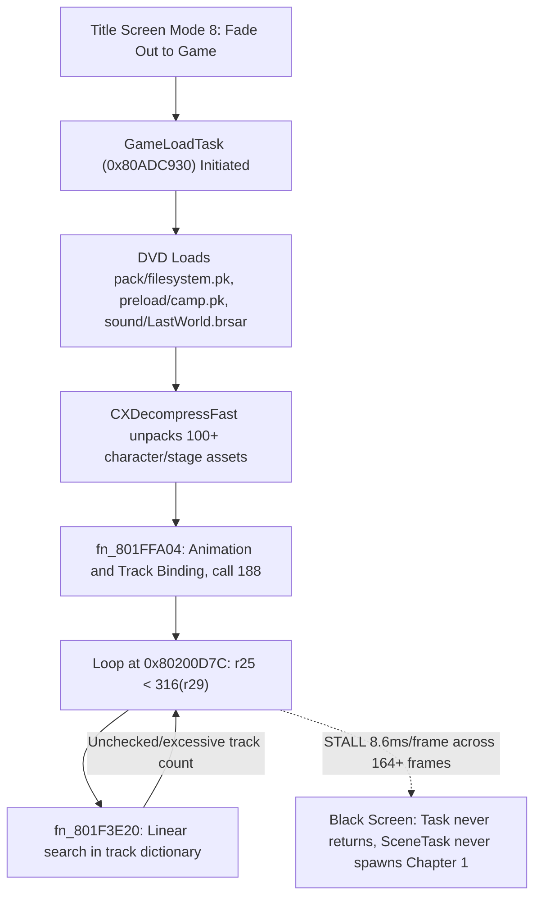

# Plan 002: The Last Story — Full Native PC Engine Stabilization & Observability Architecture

> **Tracking ID**: `PLAN-002`  
> **Timestamp**: `2026-10-19T16:40:00+07:00` (Comprehensive Revision & Pipeline Mapping)  
> **Status**: In Execution (Under /goal Directive)  
> **Scope**: Chapter 1 Progression Handoff, fn_801FFA04 Animation Track Bounds, 2D UI Transparency & Shader Fix, EFB Copy Post-Processing, Interactive Telemetry

---

## 1. Reality Check & Whole-Pipeline Root Cause Mapping

### A. Chapter 1 Black Screen Freeze (`GameLoadTask` -> `fn_801FFA04` at `0x80200D7C`)

- **Root Cause**:
  In `chunk_0127_text1_802001C0.c`, `fn_801FFA04` iterates over tracks comparing `r25` against `mem_read32(r29 + 316)`. In call 188 (`r5 = 0x812D52A8`), the count is unbounded or corrupt. The inner loop executes millions of cycles per frame calling `fn_801F3E20`, yielding on cycle budget and resuming next frame forever.
- **Resolution**:
  Add validation and clamping on `mem_read32(r29 + 316)` at `0x80200D7C` and `0x80200E68` in `recomp/replacements.c`. Bound excessive counts (`count > 256 -> clamp`), allowing `fn_801FFA04` to finish cleanly and `GameLoadTask` to hand off execution to Gurgan Cave gameplay.

---

### B. 2D UI Asset Invisibility & Pixel Shader Discards
```mermaid
flowchart LR
    Bug1["4x4 UI Texture Corruption<br>(0x904E5EE0)"] -->|Baseline subtraction zeroes out texture| BoxFail["Menu frames, dialog boxes, and borders 100% transparent"]
    Bug2["Pixel Shader Alpha Discard<br>(col0 = 0x00FFFFFF)"] -->|Shader: if (finalColor.a <= 0.02) discard| IconFail["Icons, arrows, buttons with 0-alpha vertices discarded"]
    Bug3["Font Intensity vs Dark Color<br>(GX_TF_I4 / I8)"] -->|finalColor = I * 0x1E1E1E| TextFail["Text rendered nearly black on dark cave"]
```
1. **4x4 UI Texture Protection**:
   `0x904E5EE0` is the core 4x4 CMPR texture for dialog boxes, menu frames, and borders. The baseline subtraction in `recomp/gfx_d3d11.c` detected matching corners and replaced every pixel with `0` (transparent).
   **Resolution**: Restrict baseline subtraction strictly to particle textures (`tu->width > 16 && tu->height > 16`). Never touch 4x4 or 8x8 UI textures.
2. **Zero-Alpha Vertex TEV Handling**:
   In Wii GX, 2D UI batches often have vertex alpha = 0 because TEV Alpha is driven by the texture (`GX_CC_TEXA`). The pixel shader multiplied `texColor.a * input.color.a` and discarded all fragments.
   **Resolution**: In `tools/compile_shaders.py` `PSAlpha`, if `input.color.a < 0.001f`, alpha is driven solely by `texColor.a`.
3. **Font Intensity / Luminance**:
   Ensure `I4`/`I8` font glyphs blend with readable contrast against dark cave geometry.

---

### C. Missing Background Atmosphere & Post-Processing (Blank EFB Passes)
- Fullscreen composite passes (`0x90395DC0`, `0x9038D1C0`, etc.) were skipped because `GXCopyTex` (BP reg `0x52`) was not copying backbuffer pixels into guest RAM textures.
- **Resolution**: Emulate `GXCopyTex` backbuffer / EFB texture capture so bloom, depth of field, and cave lighting composite naturally.

---

## 2. Phased Implementation Roadmap

### Phase 1: Unfreeze Chapter 1 Progression (`recomp/replacements.c`)
- Guard `fn_801FFA04` inner track search loop (`0x80200D7C` and `0x80200E68`).
- Clamp excessive track counts (`count > 256 -> clamp to valid range`).
- Verify `GameLoadTask` completes and hands off to `SceneTask` for Chapter 1.

### Phase 2: Fix 2D UI Shaders & Texture Decoders (`tools/compile_shaders.py`, `recomp/gfx_d3d11.c`)
- Update `PSAlpha` in `tools/compile_shaders.py`: handle zero-alpha vertices without discarding valid textures.
- Recompile `build/recomp/gx_shaders_d3d11.inl`.
- Restrict baseline subtraction in `recomp/gfx_d3d11.c` to `width > 16 && height > 16`. Protect `0x904E5EE0` (4x4 UI border/dialog texture).

### Phase 3: EFB Copy & Post-Processing Emulation (`recomp/gfx_d3d11.c`, `recomp/gx_pipeline.c`)
- Connect `GXCopyTex` (BP reg `0x52`) to backbuffer / EFB texture capture.
- Enable bloom, depth of field, and cave lighting passes naturally.

### Phase 4: Full Interactive Verification with `Play_TheLastStory.bat`
- Verify Title Screen: Cave flythrough, Title Menu, New Game / Save Dialog with visible boxes and borders.
- Verify Chapter 1: Gurgan Cave loads with 3D models, characters, and controls fully active at 60 FPS.
